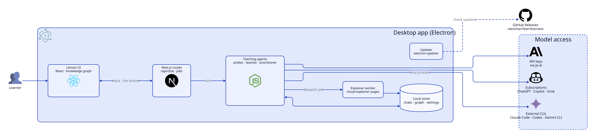

<p align="center">
  <picture>
    <source media="(prefers-color-scheme: dark)" srcset="docs/assets/lh_banner_dark.png">
    <source media="(prefers-color-scheme: light)" srcset="docs/assets/lh_banner_light.png">
    
  </picture>
</p>

<p align="center"><strong>LearnHarness Fork — An agent harness for learning.</strong></p>

日本語: [README.ja.md](README.ja.md)

<p align="center">
  <a href="https://github.com/reeschan/learnharness/releases">Download</a> ·
  <a href="#how-it-works">How it works</a> ·
  <a href="docs/README.md">Documentation</a> ·
  <a href="https://github.com/reeschan/learnharness/issues">Issues</a>
</p>

LearnHarness uses AI agents to plan and teach lessons from your current understanding to your goal. It builds a detailed picture of what you understand and how you reason. That picture is updated as you learn.

Instead of just giving you an explanation, it uses your answers and thinking to decide what you need next. Teaching builds understanding one reasoning step at a time. Practice makes it usable. A persistent knowledge graph carries it across sessions.


## About this fork

This repository is a modified version of [LearnHarness](https://github.com/amosblomqvist/learnharness) by Amos Blomqvist, licensed under AGPL-3.0-only. On desktop, it installs as a separate app (`LearnHarness Fork`, appId `com.reeschan.learnharness`) with its own data directory (`%APPDATA%\LearnHarness Fork\data`), independent of upstream LearnHarness.

On top of upstream LearnHarness, this fork adds:

- **Course packs** for importing numbered chapter notes and scheduling reviews
- **External CLI providers** for Codex and Gemini CLI alongside Claude Code
- **Explainer**, a diagram-led HTML page sub-agent tool for lessons
- **Fork releases** for Windows x64 builds and isolated auto-updates
- **Shared Memory**, a core plugin that manually sends knowledge-graph propositions to shared memory

### Course packs

Import a folder of numbered chapter notes on your machine (or download a GitHub archive at runtime), study and practice from those files, and schedule spaced-repetition reviews with SM-2. The notes themselves are not included in this repository. See [Course packs](docs/fork/course-pack.md) (日本語: [コースパック](docs/fork/course-pack.ja.md)).

### External CLI providers (Codex and Gemini CLI)

Codex and Gemini CLI are available under **Settings → Providers → External CLI** alongside Claude Code, and are off by default (`codex` and `geminiCli` opt-ins). Install and sign in to the CLI in your terminal first; LearnHarness starts it only when needed—no background process required—and disables the CLI's built-in tools so only LearnHarness tools run. Codex requires v0.165.0+, controls its own billing (note that `~/.codex/AGENTS.md` and skills may still be loaded), and lists models from `codex app-server`; Gemini CLI requires v0.68.0+, controls its own billing, and exposes `pro`, `flash`, and `flash-lite`.

### Explainer

During teaching sessions, the `explainer` sub-agent (using the **Cheap** model slot) writes a diagram-led, self-contained HTML page rendered on the server and shown scaled down in a sandboxed card that you can expand to full screen or download. You can turn it on or off under **Settings → Agent** (`Tool · explainer`, on by default). It bundles `visual-explainer` 0.15.0 (MIT); see [NOTICE](NOTICE) for third-party licenses.

### Fork releases

Fork builds use fork versioning (`upstream patch × 100 + sequence`, such as `0.5.1` on `0.5.0` or `0.6.101` on `0.6.1`), and in-app updates come only from this fork's GitHub Releases. See [Fork releases](docs/fork/release.md) (日本語: [Fork のリリース](docs/fork/release.ja.md)).

## How it works

1. **Measure.** Before teaching, the agent finds where your understanding ends on each part the lesson depends on. Your answers, confidence, and thinking show it where to start.
2. **Plan.** It works out a dependency map from that starting point to your goal. You can see the plan, and the lesson adapts when your understanding turns out different.
3. **Teach.** Each step builds on something you already understand. You predict, get an explanation, and check your understanding. Confusions are repaired before anything is built on them. The aim is for the goal to feel obviously true, not merely familiar.
4. **Practice.** Separate sessions pose varied problems that require the right knowledge to come to mind without being named first. Problems and hints adapt to your reasoning.

**Think out loud.** The thinking fields let you explain your reasoning, uncertainties, and reactions in your own words. This is how the agent gets a detailed picture rather than just a record of right and wrong answers. You can type or use dictation.

**Bring your files.** In the desktop app, attach PDFs, photos, or any other file with the paperclip, or drag them in. The file stays where it is: the message carries its path, and the agent reads it from there.

The agent can also research questions in the background, create visual explanations and diagram-led explainer pages, show your own images in the lesson and mark them up with arrows and labels, and build interactive demonstrations.

## Knowledge that carries forward

What you are taught accumulates as propositions and reasoning chains: individual claims and the premises that lead to them. The graph shows this structure, with links back to the source sessions. You can also import notes.

Future teaching sessions can read the graph instead of starting from scratch. Practice sessions can draw their material from it. It stores the ideas and their connections, not ratings of your ability.


## Download and get started

**[GitHub Releases](https://github.com/reeschan/learnharness/releases)**

- **Windows (x64):** download and run the installer from this fork's Releases. It is unsigned, so Windows may show an "unknown publisher" or SmartScreen warning. It installs alongside upstream LearnHarness with a separate data folder; to move upstream data manually, see [Move data from upstream LearnHarness](docs/fork/release.md#move-data-from-upstream-learnharness).
- **macOS and Linux:** this fork does not publish macOS or Linux installers, and building from source on those platforms is unverified in this fork.

To build the Windows installer from source on Windows:

```bash
npm ci
npm run plugins:setup
npm run desktop:dist:win
```

Choose your models, then start a session with what you want to understand. You can use provider API keys, supported subscription connections in the desktop app, an installed external CLI ([Claude Code](docs/claude-code.md), Codex, or Gemini CLI), or a [custom OpenAI-compatible endpoint](docs/custom-providers.md), including a local model server. Optional dictation and web search use separate service keys. Web research can use a Tavily, Brave, Exa, Firecrawl, or Ollama key in Settings → Providers → Search. Ollama search uses its hosted service, not a local model server.

See [Getting started](docs/getting-started.md) for model setup, dictation, files, and notes imports, and [context, caching, and costs](docs/compaction-accounting.md) for advanced cache preferences.

Windows fork builds support in-app updates from this fork's GitHub Releases.

## Your keys, your data

- **Your keys and models.** No LearnHarness subscription or markup. Billing depends on your provider, CLI configuration, subscription, or local setup. The live cost meter estimates known API costs, not subscription, CLI (`CLI billing`), or custom-endpoint charges.
- **Local storage.** Your chats, graph, settings, and API keys live on your machine. Learning records are plain files you can inspect.
- **External services.** Models run through your configured providers. Model requests send the context needed for the task; web research and dictation also contact external services. Local storage does not mean offline processing.
- **Inspectable behavior.** System prompts are visible and editable. The app is open source under the AGPL-3.0 license.

## Development and support

```bash
npm ci
npm run plugins:setup
npm run dev        # http://localhost:3000
npm test           # fixtures and fake providers
```

`npm test` assumes a bash shell (on Windows, run it in Git Bash).

<picture>
  <source media="(prefers-color-scheme: dark)" srcset="docs/architecture/architecture-dark.svg">
  
</picture>

The diagram source is [docs/architecture/architecture.d2](docs/architecture/architecture.d2); redraw the SVGs with the arch-diagram `render.py` after changing it.

See the [documentation index](docs/README.md) for all guides, [development](docs/development.md) for setup and checks, [architecture](docs/architecture.md) for the runtime, [keyboard shortcuts](docs/keyboard.md), [themes](docs/themes.md) for the theme file format, and [desktop builds and releases](docs/desktop-release.md).

For trusted local plugins, start with the [authoring guide and capability map](docs/plugin-authoring.md). It links the question, practice-problem, submission, view-context and UI contracts. Use [`examples/plugins/`](examples/plugins/) for small runnable templates, [`plugins/`](plugins/) for feature source projects, and the [host architecture](docs/plugin-architecture.md) for internals.

Questions, bug reports, and feature requests: [GitHub Issues](https://github.com/reeschan/learnharness/issues).

Security vulnerabilities: report privately as described in [SECURITY.md](SECURITY.md), not in public issues.

## License

[AGPL-3.0](LICENSE)

Upstream [LearnHarness](https://github.com/amosblomqvist/learnharness) ([learnharness.ai](https://learnharness.ai), [Discord](https://discord.gg/5tCHHQEB2e)) remains AGPL-3.0-only, copyright Amos Blomqvist. This fork is a modification of that work under AGPL-3.0-only, and the AGPL obligations apply to the whole application.

Each release on this fork's GitHub Releases is built from the commit its tag points to. The Corresponding Source for a release is this repository at that tag, available from the same Releases page.

Do not distribute imported notes (such as `system-design-notes`); they are not licensed for redistribution. Third-party software attributions (`visual-explainer` 0.15.0, `pele`, and the Pi coding agent ports) are listed in [NOTICE](NOTICE).
