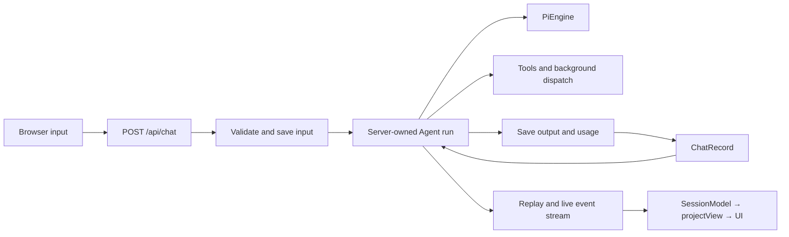
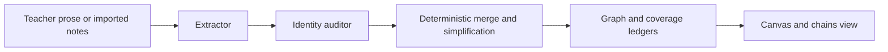

# 架构

LearnHarness 是一个带有 Electron 桌面宿主的 Next.js 应用。服务器负责智能体运行、对话记录、后台工作和文件系统持久化；浏览器把这些记录投影为课程/练习界面和知识图谱。

本参考文档描述的是[仓库源码](README.md#about-these-docs)。命令见[开发](development.md)，教学意图见[教学理论](teaching-methodology.md)。

## 代码边界

| 区域 | 职责 / 入手点 |
| --- | --- |
| `app/` | 页面和 HTTP 传输；`api/chat/route.ts`、`api/chats/` |
| `components/` | 浏览器状态和呈现；`session-core.ts`、`chat.tsx`、`graph-view.tsx` |
| `src/server/` | 组合、准入、活性、面向 HTTP 的服务；`chat-handler.ts`、`jobs.ts`、`stores.ts` |
| `src/agent/` | 智能体构建、工具、服务商流、工作器；`teacher-agent.ts`、`models.ts`、`tools.ts`、`subagents/` |
| `src/core/` | 契约、记录/视图投影、领域算法；`input-events.ts`、`native-messages.ts`、`view.ts`、`graph.ts` |
| `src/store/` | 对话、后台任务、图谱、设置和凭据的文件系统适配器 |
| `electron/` | 桌面启动、导航/权限防护、凭据传输、浏览器助手、更新器 |

[`eslint.config.mjs`](../eslint.config.mjs) 把外壳层对 `src/` 的导入限制为 core/server 的 barrel 入口，禁止 core 导入 IO 层，并禁止智能体导入 server/store 适配器。依赖通过注入的上下文/端口传入。这些规则并不能证明 core 是纯的、只有一个组合根，或每个存储只有一个写入者：有些 core 模块绑定 Node，并被排除在浏览器 barrel 之外；server 模块可以导入适配器。脚本、Electron 和测试不在这些区域之内。

## 对话与回合

**对话**是一个持久的 `ChatRecord`，包含原生的 `LhMessage[]`、设置、可选的学习计划和用量日志。缺少 `kind` 表示教学；`practice` 则选择练习智能体。**引擎**是解析后的 Pi 模型、流函数和思考级别。应用层的**回合**会根据已保存的历史构建一个全新的原生 Pi `Agent`；它可以进行多次模型调用并执行工具。它不是一个 HTTP 连接，也不是单次生成。

[`chat-handler.ts`](../src/server/chat-handler.ts) 会确认就绪状态、等待上下文压缩完成、重新读取持久化的真实状态，并占用该对话的活性。与之竞争的回合会得到 **409**。被接受的输入会在推理之前保存；订阅的自动输入则可以保持暂存状态，直到派发准入。HTTP 响应确认的是准入，而 `GET /api/chats/:id/stream` 承载重放/实时事件和终止状态。

存储的记录有两种投影：

- [`toLlmMessages`](../src/core/native-messages.ts) 会剥离应用元数据、展平面向模型的标记、应用当前的上下文压缩截断点，并在服务商边界修复符合条件的被中断工具调用对。
- [`projectView`](../src/core/view.ts) 推导出界面消息、问题/题目停靠区和产物。它既不是存储格式，也不是服务商线上格式。

Pi 在构建时注入系统提示词/工具；这条合成的系统消息不会持久化。因此新回合总能获得当前的指令。应用不使用 AI SDK 的客户端对话记录替换或 `addToolOutput` 循环。

结算会持久化新的原生消息、学习计划快照和用量，包括中止时的部分输出。输入写入失败会拒绝推理；回复写入失败会在终止状态之前报告出来，不会伪装成成功的空回合。清理会释放活性。一条仅存于内存的失败通知可以告知重新连接的视图，而不会编造已保存的对话记录内容。

### 流式传输与恢复

[`pi/ui-stream.ts`](../src/server/pi/ui-stream.ts) 发出原生的智能体事件。部分消息更新会替换一个槽位；它们不是累加的文本增量。重放会保留已结算的事件和最新的进行中更新，并合并实时扇出。工具 ID 会相对于历史做唯一化处理，使持久化、答案路由和服务商上下文保持一致。

断开浏览器连接只会分离一个视图，而不是智能体。显式中止是另一回事。[`session-core.ts`](../components/session-core.ts) 负责重新连接、有限次数的 409 恢复以及采纳规范状态。在过早 EOF/读取失败之后允许一次恢复连接；反复的传输失败会显示错误。

问题草稿在乐观卸载后仍保留在内存中。不确定是否成功的提交会在重新发送之前，与已保存的记录和运行状态进行核对，范围限定在同一个问题实例。服务商响应的重试是显式的：它在磁盘上保留失败的尝试，同时把符合条件的失败尾部从临时的模型上下文中略去。它不是挂载时的重放，也不是对任意失败的自动重试。

### 旁支提问

在教学会话和练习会话中，每段讲解与其关联的问题共享一个持久的旁支提问对话。消息历史中一个不显眼的对话气泡入口，或对选中文本点击**提问**（Ask），都会在一个可移动的浮动窗口中打开该对话，并可选择停靠到侧边（[`side-thread.tsx`](../components/side-thread.tsx)、[`use-side-thread.ts`](../components/use-side-thread.ts)）。关闭只是将其隐藏；已保存的问答仍可重新打开。随着会话推进，这个伴随面板从不静默切换对话；**前往当前步骤 →**（Go to current step →）可按需打开该步骤的独立历史，并保留停靠状态和各线程的草稿。较早的对话仍可使用，并在每次请求时收到最新的可见课程内容。固定到侧边/取消固定（Pin/Unpin）在浮动与停靠两种呈现之间切换。两者都使用主题背景：停靠时不透明，浮动时为 50% 不透明并带 18px 的背景模糊。输入框使用主输入框的不透明卡片表面。浮动面板的四条边和四个角都可以调整大小；对边保持锚定，默认的 416px 宽度是首选最小值，而较小的视口优先。浮动时，所选尺寸在切换对话后仍会保留；停靠栏保持其现有宽度。浮动面板只避开 macOS 红绿灯按钮所在的角落，并共享原生边距尺寸和缩放的真实值；普通浏览器中的位置不变。学习者的消息是右对齐的气泡，宽度上限为 70%；助手的回复不加边框。行内麦克风使用现有的录音器，并显式指定旁支草稿为目标：快捷键跟随旁支输入框的焦点，一次录音保持其开始时的目标，关闭时会结束录音并写入那份已保存的草稿。录音时，三根紧凑的音量条在本地采样录音器现有的 RMS 信号；静音时它们不会动画，也不会让主对话重新渲染。在旁支控件上按 Enter 只作用于伴随面板内部，停靠时也是如此。主语音听写保留其独立的输入占用，主提交也从不等待旁支录音。选中的段落把其原始的原生消息和精确文本选择器保留为规范的引用元数据，与线程的片段头相互独立。**引用**（Cite）是另一项独立功能：它会在最后获得焦点的主输入框或思考栏中插入一个原子化的引文标签，并在输入发送给模型时展开该引文。

旁支回答**不是应用回合**。[`server/side-chat.ts`](../src/server/side-chat.ts) 负责每个对话一次、使用会话所选模型的无工具流式调用，带有模型/密钥就绪检查，但不占用主回合的活性，因此检验问题、进行中的题目或正在运行的主回合都不会阻塞它。助手收到的是学习者可见课程的文本重建，作为一份引用文档，而不是内部的工具往来或上下文压缩摘要（[`core/side-chat.ts`](../src/core/side-chat.ts)）。未结束的检验和进行中的题目会省略答案、讲解和已提交的解答；问题选项使用学习者看到的确定性乱序顺序。助手会单独收到一次它自己的线程，与课程分开。它固定的、仅用于旁支的简洁性提示片段跟在共享的语气/准确性/格式附录之后，倾向于给出最小的有用回答——通常是一两句短句——而不是一节迷你课。关闭会分离视图；停止（Stop）会保留部分回复。被接受的用量记录在 `turns` 中该旁支回答的 id 之下。变更通过 `side-chats-changed` 通知；路由位于 `app/api/chats/[id]/side-chats/` 下。

`ChatRecord.sideChats` 保存实时的界面历史。在主回合开始时以及之后每次内部模型调用之前，服务器会从**所有**对话（包括较早的步骤）中收集新的原始问答，并追加带出处标注的自定义 `side-question` 条目，而不改变更早的原生历史。内部更新使用 SDK 的下一回合准备钩子，并在工具结果之后伴随正常的消息生命周期事件。首次调用和准入恢复调用通过 SDK 的初始插话轮询获得新的内容。这两条路径都不会打断正在进行的调用，也不会安排额外的老师回复。它们随正在运行的回合一起持久化，沿用该回合现有的结算/失败契约。回合前的上下文压缩触发条件会把预期的旁支问答计算在内，但只总结已保存的历史——不包括那些新的问答。最终的 SDK 请求钩子会在准备好的引用和排队的插话都加入之后，在首次调用和内部调用上，按所选模型的输入预算检查实际的上下文（输出预留不超过该模型的最大输出；窗口未知时使用配置的预算）。过大的新问答保持待处理状态，不设投递水位线：一个可操作的本地失败响应会保留主输入和已完成的工具，以便重试或换用更大的模型。不会发生内部上下文压缩、自动的额外老师调用、静默丢弃，也不会总结这些新问答。本地拒绝会恢复未被准入的自动输入，而不进行授权恢复；其错误仍然可见。它在结算时触发的上下文压缩会被跳过，以便仍可重试，而该重试只能跨越由它自己的预检关卡执行的上下文压缩——不能跨越更早的压缩或中间插入的输入。静默的空闲/搁置关闭只记录关闭本身；它们不能把未经检查的旁支问答预先发布到上下文压缩历史中。实时回复只贡献其当前已有的文本；之后的请求会追加剩余的后缀和终止状态，而绝不会重复已记录的前缀。非前缀的更正会被显式标注为更新后的措辞，而不是静默替换先前的文本。主输入仍然是预写式的；原始的旁支问答已经持久保存在 `sideChats` 中。临时的引用条目会通过最终的请求校验，对于订阅，还会通过现有的派发准入关卡。只有被准入的条目才会随正在运行的回合的结算一起发布；拒绝只会撤回未被准入的临时引用，不会撤回学习者的插话、已完成的工具、更早被准入的条目或原始历史。这些不可变的条目持有投递水位线，它们在重启和上下文压缩之后依然保留；未被准入的请求和失败的保存不能消耗新的问答。如果一次被中断的临时运行所发布的部分内容没有留下任何回复，它会被报告一次。同级问题会推迟投递，直到所有原生结果都相邻。主请求从不等待助手，助手的结算也从不会自行写入主上下文条目。原生模型投影把更新渲染为用户角色的引用，而不是导师的回复；共享的提示片段会解释其出处和续接方式。这些更新可供老师/练习的上下文和上下文压缩使用，但抽取或续接逻辑不会把它们当作新的学习者提交。对话记录版本 2 把这一契约与旧的应用区分开；旧版开发快照条目保持不变，并作为新投递账本的初始数据。

## 教学与练习

[`teacher-agent.ts`](../src/agent/teacher-agent.ts) 和[工具注册表](../src/agent/tools.ts)基于同一份教学历史组合出不同的智能体：

| 智能体 | 交互 | 其他工具 |
| --- | --- | --- |
| 摸底（Prober） | `probe` 或 `recall`、`ask_user_question`、`probe_done` | 只读文件、调研/PDF 派发；受开关控制的图谱读取工具 |
| 老师（Teacher） | `quiz` 或 `explain`、`ask_user_question`、`plan_init` | 只读文件、调研/PDF/互动演示/图示派发；`show_image` |
| 练习智能体（Practitioner） | `problem`、`conclude` | 只读文件、调研/PDF 派发；受开关控制的图谱读取工具 |

交互机制的选择、设置开关和就绪状态会影响工具是否可用。练习的辅助工具独立于教学开关单独组合。Claude 系列的智能体可以获得 `send_to_user`。参数修复先于语义校验；无效调用会返回模型可以据此纠正的错误。

问题工具在服务端校验并执行，返回一个合成的终止占位结果。它会干净地停在提出问题的位置，包括混合的工具批次，但不会被保存。学习者真实的回答之后才会成为该调用的结果。浏览器负责打乱选项并为选择题评分；自由回忆题会公开已提交的答案供模型判断。同级的待回答问题在最后一个被解决之前，无需推理即可逐一回答。

一个匹配的、成功的 `probe_done` 结果会选择老师，并排队交接给一个全新的智能体。空的/被拒绝的调用则不会。规划从这个衔接点开始；显示出来的教学从第一个带节点标记的 `quiz`/`explain` 开始，而不是 `plan_init`。学习计划是一个经过校验的 Mermaid DAG，可通过 `plan_init` 替换。当前/已访问的位置由带标记的调用推导，而不是由评分推导。等待学习者对学习计划给出自然的回复，是提示词中的教学原则，而不是一次接受确认的事务。

练习使用相同的回合/持久化/恢复路径，而不是单独的题集服务。[`tools/practice.ts`](../src/agent/tools/practice.ts) 通过 `problem` 提交题目陈述和解答；`conclude` 记录结果并揭示该解答。一个回合范围的关卡确保同时只有一道进行中的题目。题目结束后的暂停是教学原则，而不是一个终止性的 `conclude` 结果。“下一题”（Next）会添加一个显式标记。练习结果是会话内的证据，而不是图谱上的掌握程度；普通的练习结算会跳过抽取。

[提示词组合](../src/agent/prompts/README.md)和[工具内容的显示恢复](tool-content-recovery.md)各有单独的参考文档。插件可以添加有边界的问题/题目类型，而不替换内置类型；参见[受信任的本地插件](#trusted-local-plugins-api-v1)。

## 后台工作

调研、PDF、互动演示和图示工具会持久化后台任务、确认派发，并通过 [`subagents/runner.ts`](../src/agent/subagents/runner.ts) 启动独立的工作器。互动演示使用浏览器助手进行检查；图示使用渲染并检查的循环。PDF/SVG 渲染是原生的；互动演示的执行使用 Electron 的浏览器服务，并以系统 Chrome 作为回退。普通插图的 SVG 会接受与其显示时相同的两项仅用于渲染的修复（缺失的根命名空间和 HTML `&nbsp;`），然后只用 resvg 栅格化。标注输入仍然严格。已保存的 SVG/下载内容不会被改写。原生 SVG 解析/渲染失败交由图示制作器现有的修订/失败处理，绝不回退到浏览器；被 resvg 静默忽略的不支持内容，也不会由另一个引擎来补救。

工作器完成与会话投递是分开的。工作器会先保存其结果和待投递元数据，再排队一个标记。[`server/jobs.ts`](../src/server/jobs.ts) 的投递方式是：在原生边界处以插话方式送入正在运行的智能体，或唤醒一个空闲且符合条件的会话。待回答的问题、暂停、授权或准入竞争都可能暂缓投递。只有正在计算的工作器可以被中止。

**已保存对话**中的标记才确认投递——而不是 HTTP 接受或在流中可见。核对过程避免重放已保存的结果；重启恢复会还原已知的待处理义务，并可以重新启动未完成的内置工作器。插件后台任务从规范的任务记录中恢复，而不重放插件代码。没有投递元数据的旧版已终止后台任务不会被猜测着重放。删除会话会丢弃它的义务。

这是基于 JSON 文件的单进程协调，而不是事务性队列，也不是服务商的恰好一次执行。内存中的输入框插话不具备与后台任务投递相同的持久性。

### 共享的工作器请求准入

一个进程全局的 FIFO 关卡限制后台**模型请求流**的数量，在每个请求结束时释放许可——在工具或子任务等待之前释放，而不是在整个智能体完成之后。设置 → 智能体 → 模型 → **后台并发请求数**（Settings → Agent → Models → Concurrent worker requests，`agent.workerRequestConcurrency`）默认为 **8**，未设置时也是如此。任何可安全表示的正整数都会被接受，没有人为上限；无效值会被拒绝，而不是被截断到范围内。实时调大会立即放行排队中的请求，直到达到上限；调小则会让正在进行的请求完成，并且只在活动数低于新上限时才放行下一个。排队中的取消会阻止向服务商派发。

核心的抽取器/审核器/调研/互动演示/图示/PDF 请求以及所有分离的 `ctx.workers` 任务共享这个池，即使是用户发起的任务也一样。直接的老师/摸底/练习请求及其上下文压缩、由插件管理的交互式对话以及独立的原始插件推理不在其列。`purpose` 决定的是订阅授权，而不是工作器分类。同一个应用服务器进程内的路由和窗口共享一个池，但绝不跨独立的服务器进程共享。按来源串行的抽取分块、贯穿审核到合并的一致性锁以及前端的三文件上传队列都独立于这个关卡。参见[插件宿主的工作/恢复地图](plugin-architecture.md#推理持久工作与恢复)。

### 学习者图像快照

`show_image` 显示一张本地栅格图片；带图像路径的 `visual` 会对其进行标注。两者都使用文件访问策略和共享的处理流程：输入上限为 25 MiB、16 百万像素、每边 8192px；在主线程之外进行方向/元数据清理；存储的 PNG/JPEG 每边不超过 1600px，且 base64 后小于 1 MiB。

带 `pdf: { path, page }` 的 `visual` 会标注学习者 PDF 中某一页上的插图。派发时会检查文件访问权限、这个图示工具对本地 PDF 的 64 MiB 上限，以及 pdfjs 能否打开该文件且该页存在。在后台任务开始时，[`pdf-figure.ts`](../src/agent/tools/pdf-figure.ts) 会再次检查，并为该任务打开一份有大小限制的 PDF 副本。它以原生方式渲染该页（pdfjs + Skia，长边约 1600px）。制作器找到插图后，以页面图像像素为单位传入一个框来调用 `crop_page`。裁剪区域会从同一份已打开的 PDF 重新渲染（最高 300 dpi），而不是从页面位图或重新读取的文件得来。任务在投递结果之前释放 PDF。重新裁剪会替换图片并丢弃 SVG。两次渲染都经过同样的快照处理；只有最终被标注的图片会被存储，结果中会记录其页码和裁剪区域。

[`learner-image.ts`](../src/agent/tools/learner-image.ts) 以 SHA-256 标识把处理后的字节存储在 `ChatRecord.imageSnapshots` 中，按会话去重。卡片和标注 SVG 引用这些快照，因此移动原文件不会破坏已保存的结果。会话范围的图像读取会解析这些引用；SVG 下载会内嵌其图像。标注器编辑的是一个占位 href，而不是 base64，并使用静态原生渲染。普通的图示 SVG 保持其现有行为。离线回归测试检验的是快照存储、显示和负载投递，而不是由模型驱动的标注质量。

## 知识图谱与导入

图谱记录的是客观的命题和共同蕴含结论的推理链，而不是学习者的理解程度。构建是事后进行的，并且独立于学习计划：

[`coverage.ts`](../src/core/coverage.ts) 按实际的消息 ID 为老师的行文（包括成功的 `send_to_user` 文本）生成指纹。学习者的文本、思考、问题、其他工具结果和标记都不计入。自动抽取受 `graph.enabled` 和未覆盖 token 阈值（默认 **4096**，最小 **500**）控制。渲染是另一个独立的开关。手动抽取/导入路由本身不检查自动抽取开关。

流水线会把最早的未覆盖消息分批处理，不会拆分单条消息。触发预算和批次预算是不同的：当前的应用接线并没有把可配置的触发值作为批次预算注入。每个来源的批次串行执行；跨来源的工作可以在共享的请求级准入关卡下重叠进行。一个进程范围的 FIFO 锁把从审核到合并的过程串行化。这些注册表通过 `globalThis` 在模块入口之间存续，但不跨独立的服务器进程。

[抽取器](../src/agent/subagents/extraction.ts)读取来源文本，并提出带锚点的命题/推理链。审核器看到的是命题和当前图谱，而不是来源段落或推理链，并提交同一性链接。确定性的合并器会解析同一性/端点、合并出处、对论证去重、简化冗余的推理链，并在图谱写入之后为覆盖情况设置检查点。失败的阶段会让材料保持未覆盖状态；已完成的分块和用量在之后的失败/中止中仍然保留。有序的账本操作并不是原子的多文件事务。

### 笔记与来源组织

`POST /api/graph/import` 把文本或在本地转换得到的 PDF Markdown 送入同一条流水线，不带对话消息锚点。在注册来源或抽取之前，该路由会执行共享的文件扩展名列表，通过 `%PDF-` 文件头识别 PDF，并拒绝前 8 KiB 中含有零字节的其他文件。非 PDF 文件按 UTF-8 解码；零字节规则只是有限的二进制文件启发式判断，而不是完整的文本或编码校验。[导入界面](../components/notes-import.tsx)为每个受支持的文件排队一个请求，最多同时进行三个。单个文件上限为 25 MiB；服务器端每个请求的文件总字节数上限同样为 25 MiB，multipart/代理的上限为 26 MiB。PDF 转换不包含 OCR；被跳过的纯图像页面和扫描件相关的注意事项会被报告出来。

来源标识对原始路径/名称取哈希；可以随匹配的文件名一并提供安全的、相对于文件夹的路径。重命名或重新组织显示的来源不会改变其标识。每次显式导入都会处理整个文件，即使文本没有变化；重试不是恰好一次的处理。对同一来源的重叠操作会以“忙碌”为由被拒绝。每个文件的结果区分已完成、部分完成、失败、已中止和忙碌；零发现也可以是一次已完成的导入。

`graph/source-organization.json` 保存显示覆盖和文件夹放置，而不是原始文件内容。文件夹导入会重建包含受支持文件的目录。这种组织方式独立于会话侧边栏中的放置。推理链浏览器和练习的节点选择器都会隐藏练习会话的来源行；这只是读取时的投影，而不是删除对话、图谱贡献或放置信息。文件夹选择会排除这些被隐藏的来源。空的来源名称会在原位置以弱化样式显示，依据的是完整内容，而不是经搜索过滤后的计数。普通的推理链视图选择的是来源/文件夹，包括被搜索隐藏的子项；练习可以选择更细粒度的图谱材料。

删除来源会移除它们对图谱的贡献，同时保留在其他地方有支撑的知识。同时删除对话是一个显式的、默认不勾选的选项。抽取/实时工作的预检会阻止冲突的删除；文件系统故障可能会留下已报告的部分进度。来源组织使用经过校验的、基于操作的更新。这些保证并不是跨越所有图谱/会话文件的事务。

### 读取模型与其他写入者

[`graphSnapshot`](../src/core/graph.ts) 推导出呈现内容，而不会启动抽取。单前提的论证画为直接箭头；联合前提会产生几何上的汇合点，而不是额外存储的命题。聚类来源于诞生来源的出处，而不是嵌入向量、Louvain 或 LLM 命名。布局/渲染设置由服务器持久化；相机状态保存在设备本地。

摸底/练习的图谱工具需要同时打开图谱开关和图谱工具开关；老师没有图谱读取工具注册表。在创建会话时显式选择的图谱内容是另一条独立的上下文路径，而不是自动的语义 top-K 注入。

抽取是负责构建的写入者，但不是唯一的变更来源：来源/会话/节点删除、简化以及位置提交也会写入图谱文件。删除一个命题会移除使用它的推理链；在删除会话时保留图谱，会保留出处，同时移除抽取的簿记信息。

## 存储与通知

[`config.ts`](../config.ts) 把不可变的提示词资源锚定到应用根目录，把可变状态锚定到 `LH_DATA_DIR`（默认为仓库中的 `data/`）。存储端口是 [`ports.ts`](../src/core/ports.ts) 中的语义接口。

| 数据 | 文件 |
| --- | --- |
| 对话、学习计划、用量、图像快照、旁支提问 | `chats/*.json` |
| 工作器计算和投递义务 | `jobs/*.json` |
| 命题、推理链、检查点、覆盖情况 | `graph/{nodes,chains,sessions,coverage}.jsonl` |
| 来源、组织、位置、渲染偏好 | `graph/` 下的 JSON 映射 |
| 偏好设置和提示词覆盖 | `settings.json`、`prompts/` |
| 核心插件的可写记录 | `core-plugin-data/<id>/` |
| 社区插件的代码和可写记录 | `plugins/<id>/{dist,data}/` |
| 密钥和自定义端点绑定 | 单独的 `auth.json`，由 `LH_AUTH_FILE` 指定 |

适配器使用同步的文件系统操作。JSONL 读取会跳过损坏/无效的行；图谱推导会合并重复的断言。有些替换使用临时文件重命名，但普通的整文件写入并不是数据库事务。同一事件循环内的串行化不是跨进程锁，也不保证崩溃时的原子性。**每个数据/认证配置只使用一个服务器所有者**。

对话和图谱系列文件有各自独立的版本防护；缺少版本标记的按 v1 读取，更新的版本会被拒绝。位置可以重建，不带版本标记。设置有其自己的版本/清理策略。格式计数器不是应用版本。黄金测试夹具检验兼容性。图谱存储初始化会移除已停用的账本，因此导入存储模块并不是一种普遍只读的检查方法。

`/api/chats/:id/stream` 是一个回合/视图流。`/api/events` 是一个独立的窗口级通知流：一种短暂的、进程内的信号，用于提示去获取规范数据。[`SERVER_EVENT_TYPES`](../src/core/events.ts) 是事件词汇表。消费方会做防抖，并在重新连接时重新获取；通知没有持久化的重放。实时回合的终止状态控制何时采纳结算结果，因此一次由通知引发的获取不会覆盖部分状态。结算标志着工作结束，而不是磁盘写入成功的证明。

## 宿主与服务商

打包后的 Electron 会在回环地址上启动一个私有的独立 Next 子进程，设置数据/认证路径，并加载一个沙箱化的渲染器。它的导航/权限防护和凭据传输防护是桌面端的边界，而不是 Web 多用户认证。[桌面发布](desktop-release.md)介绍追踪/打包检查。

[`models.ts`](../src/agent/models.ts) 组合 Pi 服务商和应用桥接。强力/经济/视觉（Strong/Cheap/Vision）槽位没有出厂的模型固定。会话保留显式的选择；后台角色独立解析。缺少配置/未就绪时会拒绝，而不是静默选择另一个服务商。

API 环境变量的值优先于已保存的密钥。打包后的订阅刷新凭据保存在 Electron 主进程中；Web/开发环境使用服务器所拥有的连接文件。订阅路由不会回退到 API 计费。[Claude Code](claude-code.md) 保留原生的 CLI 认证/路由，但桥接 LearnHarness 的工具；[自定义端点](custom-providers.md)把授权绑定到 URL/模式，并按每次操作解析设置。两条路由都没有推断出的零美元定价。[核算](compaction-accounting.md)负责上下文/缓存/费用的语义。

### 文件访问与外部服务

只读文件工具默认以服务器用户的主目录为范围，而不是所选项目或应用数据根目录。遍历时的排除规则用于减少噪音；它们不是访问权限的依据。会话附件携带的是本地路径，而不是上传的文件。

**敏感路径防护**会拒绝已知的私密主目录位置、`.env` 文件、已配置的认证/订阅文件以及可识别的凭据临时文件。它检查命名路径/规范路径和别名；遍历会跳过受保护的位置。它是基于路径的纵深防御，而不是内容扫描器、沙箱或允许文件夹设置。其他敏感文件和学习记录仍可能可读。参见 [`fs-shared.ts`](../src/agent/tools/fs-shared.ts)。

文件/PDF/图示图像共享图像后处理。搜索支持 Tavily、Brave、Exa、Firecrawl 和托管的 Ollama 适配器；页面抓取是独立的，不需要搜索密钥。语音听写在服务端签发短时有效的 token，并以浏览器 → Deepgram 的方式流式传输音频。仅靠临时数据目录并不能隔离这些外部影响。

## 受信任的本地插件（API v1）

[插件架构](plugin-architecture.md)规定了运行时，[编写指南](plugin-authoring.md)记录了其公开契约。插件是可选的，默认禁用，并像其他本地程序一样被信任：没有沙箱，也不假装有权限控制。核心包和社区包使用相同的上下文 API。应用直接从应用的 `core-plugins/<id>/` 加载由目录选定的四个核心包；可写的核心记录位于 `<learning data>/core-plugin-data/<id>/`。`<learning data>/plugins/<id>/` 下的社区工作区从固定的 `dist/` 加载其清单、浏览器模块、Node 后端以及 CSS/资源，并可选地包含源码和持久化的同级 `data/`。核心 ID 是保留的：与之冲突的社区副本会被跳过并显示可见的诊断信息，既不加载也不删除。已有的显式启用/禁用选择在应用更新后仍然保留；启动时从不把核心代码复制到用户数据中，也不迁移旧的开发记录。后端运行在现有的 Next Node 服务器内部；禁用是协作式的。

`instrumentation.ts` 启动 `src/server/plugins.ts` 中的服务器单例。它的 `globalThis` 锚点可以跨越 Next 分别编译的路由模块存续。原生的 `scripts/plugin-loader.cjs` 辅助加载器加载外部的 CommonJS 后端，而无需让 Next 打包用户安装的代码。HTTP 适配器暴露列出/启用/调用以及白名单中的前端资源；私有的插件数据和后端模块永远不会作为资源响应返回。LearnHarness 现有的桌面 API 来源保护仍然覆盖这些路由。带品牌标识的宿主错误在分别编译的模块实例之间保持其 HTTP 含义。

`PluginsProvider` 为每个窗口负责一个前端生命周期。外部加载器使用原生的动态 import，而不是 eval。显式放置的操作会在主内容区打开插件视图；设置 → 核心插件 / 社区插件（Settings → Core plugins / Community plugins）控制启用状态，并链接到各个插件的设置。注册、订阅、挂载、CSS 和异步销毁都遵循插件的生命周期。重新启用会等待该插件之前的前端清理完成；其他插件互不影响。`plugins-changed` 通知宿主可用性的变化；`plugin-message` 承载插件范围内、非持久化的 JSON 通知。重新连接/重新同步会重新读取宿主可用性，并让插件视图重新读取其权威的后端状态。

支持的服务包括只读的学习记录、已配置/已认证的模型调用、插件本地的托管智能体会话、分离的工作器、有边界的文档转换、宿主拥有的界面组件，以及围栏代码块/工具结果渲染器。后端贡献会追加逐回合的指令和原生 Pi 工具，而不替换内置的提示词/工具。内置的呈现方式保持优先；缺失/失败的渲染器会留下可读的回退内容。这些是受信任的呈现和生命周期边界，而不是沙箱。

[有边界的问题契约](plugin-question-contract.md)和[练习题目契约](plugin-problem-contract.md)保留已保存的 schema/版本以及精确实例的权威性。渲染器负责受控编辑器和可选的呈现，而不负责路由标识或宿主外框。可选的后端评分/处理会在真正被接受的结果保存、普通续接继续进行之前运行。未知或失败的规范同步会保留可读的已保存内容和重试，而不是编造“不可用”状态。宿主的思考栏、原生键盘归属、待回答的同级问题以及过时/重复的拒绝仍然是权威的。

[会话扩展契约](plugin-session-extension-contract.md)规定了前端提交拦截、显式的学习者图像、整个视图的快照以及覆盖层。准备阶段会在任何 await 之前预留原始目标，只为该目标完成语音听写，并在不重新指定目标的前提下重新检查归属。取消/失败会保留草稿和待处理的插件材料。确认回调是实时的、尽力而为的 API 接受，而不是持久化的投递或模型成功。覆盖层覆盖整个页面主体（包括输入框），但不包括顶栏/侧边栏；被覆盖的主体仍保持挂载。实现和验证的衔接点参见[宿主输入/来源地图](plugin-architecture.md#提交准备图片与视图快照)。

## 共享的对话框与交互基础

原生和插件的对话框、锚定弹出层以及页面覆盖层共享 [`interaction-layers.tsx`](../components/interaction-layers.tsx)。Escape 键归属于唯一一个符合条件的最顶层所有者；被覆盖的作用域不能提交、语音听写或抢夺焦点。对话框使用共享的宿主外框，而插件通过受控的 HTMLElement/清理契约挂载内容。设置只有一个由宿主拥有的实例。焦点的进入/返回会尊重更新的所有者；仅凭视觉上的层叠，并不会让一个插件成为另一个插件覆盖层的生命周期所有者。参见[插件界面契约](plugin-authoring.md#受控的宿主界面)和[插件架构](plugin-architecture.md)。

## 验证入手点

测试使用注入的引擎/端口、假传输和渲染器衔接点。从 `tests/` 下的 `chat-flow`、`session-core`、`turn-recovery`、`job-delivery-recovery`、`extraction`、`notes-import-route`、`practice-flow`、`prompt-overrides`、`golden-fixtures` 和 `plugin-*` 开始。测试夹具检查确立的是它们所检验的契约，而不是真实账号的权益、教学质量或跨进程的持久性。命令和运行时前置条件属于[开发](development.md#checks)。历史上的插件验证记录位于[归档](archive/plugin-implementation-history.md)中，而不属于当前的运行时契约。
