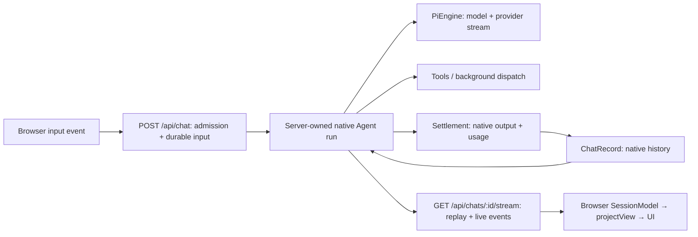
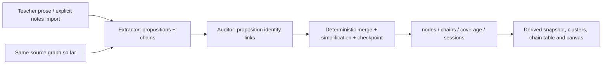

# LearnHarness architecture

This is the current implementation reference for the released app: a Next.js application with an Electron host, native Pi conversations, adaptive teaching and conversational practice, and a persistent knowledge graph. [Development](development.md) covers setup and commands; [teaching methodology](teaching-methodology.md) covers the pedagogical method. Older design documents and the [archived architecture](archive/architecture-2026-09-08.md) are history, not runtime specifications.

## 1. Code boundaries

| Area | Responsibility | Main entry points |
|---|---|---|
| `app/` | Pages, server components and HTTP transport | `app/api/chat/route.ts`, `app/api/chats/` |
| `components/` | Browser session state, transcript projection/rendering, question and practice docks, graph and settings UI | `session-core.ts`, `chat.tsx`, `graph-view.tsx` |
| `src/server/` | Composition, admission, persistence/liveness coordination, provider configuration and HTTP-facing services | `chat-handler.ts`, `stores.ts`, `jobs.ts` |
| `src/agent/` | Native agent construction, tools, provider streams and background workers | `teacher-agent.ts`, `models.ts`, `tools.ts`, `subagents/` |
| `src/core/` | Contracts, record/view/model projections and domain algorithms | `native-messages.ts`, `input-events.ts`, `view.ts`, `graph.ts`, `coverage.ts` |
| `src/store/` | Filesystem persistence adapters | `chats.ts`, `jobs.ts`, `graph.ts`, `settings.ts` |
| `electron/` | Desktop launch, navigation/permission security, credentials and browser helper | `main.cjs`, subscription controllers |

The import restrictions in [`eslint.config.mjs`](../eslint.config.mjs) enforce specific boundaries:

- Imports from `components/` into `src/` must use the browser-facing `src/core/index.ts` barrel.
- Imports from `app/` into `src/` must use the core or server barrel.
- Core cannot import agent, server or store modules; agents cannot import server or store modules.

These are not a complete hexagonal-architecture proof. Some core modules are Node-bound (for example, graph/coverage hashing), and the core barrel deliberately excludes them. Agents read prompt assets and learner files and perform external operations; their storage and delivery dependencies arrive through injected contexts. `src/server/stores.ts` wires the main storage ports, but other server modules also import adapters, and the server barrel exposes settings/auth/override operations. There is no lint-enforced “only two composition roots” or “one writer per store” rule. Tests import across layers; scripts and Electron are outside these import restrictions.

## 2. Conversation, engine, agent and turn

These are different lifetimes:

- **Conversation:** a durable `ChatRecord` in `data/chats/<id>.json`, containing native `LhMessage[]`, settings, an optional plan tree and usage logs. Missing `kind` means teaching; `kind: "practice"` selects the practitioner.
- **Engine:** a resolved Pi model, stream function and thinking level (`PiEngine` in `src/agent/models.ts`). It is provider-aware, not an OpenRouter-only abstraction.
- **Agent:** a fresh `@earendil-works/pi-agent-core` `Agent` constructed for one application turn, with that conversation's history, current prompt and current tool registry.
- **Application turn:** one accepted input followed by a server-owned agent run. A run can make several model calls and execute tools before it ends. It is not an HTTP connection or a single provider generation.
- **Tool execution:** a call within that run. Some tools finish synchronously; question/problem tools pause for learner input; job tools dispatch independent background work.

### The native record and its projections

The server owns the transcript. `POST /api/chat` carries `{chatId, input}`, not a replacement client transcript. `src/core/input-events.ts` parses explicit text, answer, thinking, next-problem, continuation and retry inputs into record appends; server-side wakes use the same turn composition with steer markers.

`LhMessage` extends Pi's native user, assistant and tool-result messages with record IDs and app custom markers. Provider/model/usage/thinking metadata stays native. Two different projections consume it:

- `src/core/native-messages.ts` → `toLlmMessages`: strips app-only metadata, flattens model-facing markers to user text, omits presentation-only markers and applies the active compaction cut. Unanswered calls from completed generations receive synthetic interrupted results at this boundary; calls in failed/aborted generations do not acquire orphan results.
- `src/core/view.ts` → `projectView`: groups the native record into the UI's messages, parts and artifacts. This view is not the stored format or the provider wire. The app does not use the AI SDK's `useChat`/`addToolOutput` continuation loop.

The system prompt and tool declarations are seeded by Pi at agent construction. That synthetic system message is filtered out at settlement, so every new agent receives fresh instructions rather than replaying old declarations. Rebuilding the application Agent does not require every provider transport to be stateless: the Claude Code adapter can retain an eligible live CLI process behind this boundary (see its [lifecycle reference](claude-code.md)).

### Admission, execution and settlement

`src/server/chat-handler.ts` composes the turn:

1. Load the record; validate the input and any retry eligibility. Resolve the conversation model and provider availability. Missing models or credentials/readiness produce explicit refusal rather than a guessed fallback.
2. Await the conversation's compaction gate and re-read durable truth. Validate appends against that current record.
3. Claim per-chat liveness (`beginTurn`); a racing turn gets 409. Save accepted input before starting inference. Subscription automatic inputs can instead be staged until dispatch admission, so a denied background request remains queued rather than falsely delivered.
4. Construct the prober, teacher or practitioner. Register its live steering seam before the native loop starts, then register the running turn handle.
5. Return a short acceptance response. The browser attaches to `GET /api/chats/:id/stream`; a completed race returns a settled terminal instead of starting another turn.
6. At settlement, append the run's new native messages and plan snapshots, then usage. Successful question placeholders are loop devices and are not persisted; the unanswered call remains until its real learner result arrives. Partial output is saved on abort too.
7. Apply parked dismissals, release liveness and running-agent registrations, reconcile steer delivery, and consider background compaction. Teaching sessions can also trigger extraction.

Persistence failures are not successful empty turns. A failed input save refuses the request before inference. A failed reply save is reported before the stream terminal, and cleanup releases liveness even if normal settlement fails. A memory-only failure notice lets a view attaching after that failure still show the error; it is not a fabricated transcript entry.

### Streams and recovery

`src/server/pi/ui-stream.ts` streams native agent events, not UIMessage SSE. `message_update` contains the full partial message; views replace its slot rather than accumulating text deltas. The turn log retains settled events and only the latest in-flight updates, with live update fan-out coalesced (100 ms by default). Reattachment cost tracks content rather than every provider chunk. Tool-call IDs are uniquified at the boundary against existing history so wire, record, answer routing and later provider context agree.

A disconnected browser detaches a **view**, not the agent. Turns run without subscribers; explicit abort is separate. `components/session-core.ts` owns adoption, 409 backoff and read-only reattachment. Premature EOF/read failure without a terminal permits one recovery attachment; a further transport failure shows an error rather than declaring completion.

Submitted question drafts survive optimistic unmount in memory. An uncertain answer submission reconciles the canonical record and running-turn state before another send, and is scoped to the same question occurrence. It must not blindly replay an already-accepted answer. Saved provider failures are distinct from transient transport/settlement notices; retrying a failed response is an explicit action, not mount-time continuation. Retry retains failed attempts on disk and omits only the eligible failed tail from the temporary agent context.

## 3. Teaching lifecycle and tools

The teaching agents share one record but have different prompts and registries (`src/agent/teacher-agent.ts`, `src/agent/tools.ts`).

| Agent | Main interaction | Other capabilities |
|---|---|---|
| Prober | `probe` (multiple choice) or `recall` (free recall), `ask_user_question`, `probe_done` | Read-only file tools, research/PDF dispatch; graph readers when enabled |
| Teacher | `quiz` or `explain`, `ask_user_question`, `plan_init` | Read-only file tools and research/PDF/demo/visual dispatch |
| Practitioner | `problem`, `conclude` | Read-only file tools, research/PDF dispatch; graph readers when enabled |

The choice/free-recall mechanic selects one graded tool per teaching phase. Tool toggles and availability gates affect the registry; the table is not a promise that every dispatch tool is always enabled. Practice side tools are composed separately, without the teaching toggle filter. Claude-family agents can also receive `send_to_user` for explicit learner-facing output. All ordinary registries pass through argument healing; semantic validation failures return error results so the model can correct the call.

**Questions execute on the server but are answered in the browser.** Their execute function validates authoring and returns a synthetic terminating “question posed” result. Clean question poses stop the run, including mixed tool batches; invalid poses leave the model able to retry. The dock deterministically shuffles options, builds the learner's answer (including choice grading via `question-core`) and sends an answer event. Free-recall answers expose the precommitted answer and return to the agent for judgment. These are not server-less tools and not a universal deterministic grading system.

Pending calls are record-derived, so reopening an unanswered question needs no new model call. If a model emitted sibling questions, answering one persists its result without starting inference while another remains pending; the last answer starts the reaction turn.

**Probe → plan → teach:** a matching successful `probe_done` result, not a bare call or refusal, selects the teacher on subsequent turns. The tool queues a handoff wake, which must build a fresh teacher rather than steer into the prober. If the wake cannot be delivered, the next learner turn still selects the teacher from the saved seam. Phase display (`src/core/phases.ts`) advances from probe to plan at that successful result, and to teach at the first `nodeId`-tagged `quiz`/`explain` call—not at `plan_init` or an acceptance marker.

**Plan:** `plan_init` parses a restricted Mermaid graph and validates its DAG structure. It writes/replaces the whole plan; it is intentionally re-callable, not mechanically author-once. Question node IDs validate against the current tree. Current/visited/upcoming statuses derive from tagged calls, not grades or explicit “done” writes. Presenting the plan and waiting for a natural learner reply is prompt doctrine, not a separate acceptance transaction.

## 4. Conversational practice

Practice uses the same chats store, admission, native turn runner, steering, usage and recovery as teaching. It is **not** the former partitioner → problem-generator → grader problem-set service: there are no current `/api/practice/sets` routes or separate practice store.

A practice session can start with graph selections or free-form material. Session creation can save a graph-context marker containing selected proposition text and chain lines before the learner's first message; there is no automatic semantic top-K graph injection.

- `problem` commits the statement and model solution together. The solution stays hidden in the UI until conclusion. A valid pose ends the run and opens the thinking dock; each thinking submission starts another turn on the same active problem.
- `conclude` records outcome, verdict and diagnostic information and reveals the solution committed at pose time. Target IDs, when supplied, normalize/validate against graph propositions; targets can be omitted for material outside the map.
- A turn-scoped gate, seeded from the record, enforces one active problem and rejects conclusion without one. The gate updates during tool execution, so it does not depend on the settlement-only transcript write.
- After conclusion, the prompt and tool acknowledgement tell the agent to close the turn and wait for explicit learner go-ahead. This pause is not a tool-level terminating gate on `conclude`. The Next problem action adds a native marker; dismissals use a synthesized conclusion and the separate dismissal path.

Practice outcomes are evidence in the session, not graph mastery levels, certification or a spaced-repetition state store. The normal turn-settlement path skips extraction for practice sessions. Problem/solution/outcome projection lives in `src/core/native-messages.ts` and `src/core/view.ts`; the tools live in `src/agent/tools/practice.ts`.

## 5. Background work and delivery

Researcher, PDF reader, demo builder and visual maker run independently (`src/agent/subagents/runner.ts`). Dispatch tools persist a job and its input, return an acknowledgement, then spawn the worker. Demos are executed through the browser helper before delivery; visual verification uses rendered images. PDF/SVG rendering and shared image postprocessing are native; demos use the app's Electron browser service with system Chrome as fallback, not an extra downloaded Chromium.

**Worker completion is not session delivery.** The runner saves a terminal worker outcome plus pending delivery metadata before queueing the result. Worker resources and the running activity row can end while an unanswered question holds its result. Only computing workers are abortable; abort notices have their own pending-delivery lifecycle.

`src/server/jobs.ts` owns a process-local registry with deterministic marker IDs and two delivery vehicles:

- **Live run:** eligible markers enter Pi's steering queue at native boundaries (never between a call and its result). A question stopper can leave them unconsumed; settlement returns those markers to pending.
- **Idle wake:** wait for a turn-free, question-free, unpaused, consented session, then start the normal turn composition carrying queued markers. A 409 backs off; a consent refusal retains queue ownership. Other failed starts remain quietly pending for a later learner run or restart recovery, not an unlimited retry timer.

A marker in the **saved conversation**, not HTTP acceptance or streaming visibility, acknowledges delivery. Reconciliation prevents a saved marker from replaying if later bookkeeping/model work fails. Recovery restores known pending result/abort obligations before a newly registered agent's first poll; unfinished workers can be respawned using saved input. Legacy terminal jobs without delivery metadata are not guessed into replay. Session deletion discards its pending obligations.

This is single-process coordination over JSON records, not a transactional queue or exactly-once provider execution. Composer steers also use the live-agent/settlement seam; their unsaved in-memory queue is not equivalent to durable job recovery.

## 6. Knowledge graph: extraction and coverage

The graph stores objective propositions and reasoning chains, not learner understanding levels. Extraction is post-hoc and independent of the plan tree. Its main path is:

### Session extraction

`src/core/coverage.ts` and `src/agent/subagents/extraction.ts` share the teacher-prose selection. It includes ordinary assistant text and successful explicit `send_to_user` output, with passages labeled by actual message IDs. Learner text, thinking, question blocks, other tools/results and markers do not count. SHA-256 fingerprints of that view are compared with `coverage.jsonl`; uncovered state is derived, not separately stored. A learner answer alone does not reopen covered prose.

Automatic extraction considers uncovered tokens at teaching-turn settlement. `graph.enabled` gates that automatic path; `graph.rendering` only selects the home presentation and does not delete data. The configurable trigger threshold is `graph.extractionChunkTokens`, whose factory default is **4096** and minimum is **500** (`src/core/settings.ts`). Manual `POST /api/graph/coverage/extract` can request uncovered material below the threshold; it is asynchronous, with status/coverage reads showing progress. The explicit extraction/import routes do not themselves check the automatic-extraction switch.

**Threshold and batch size are distinct in current wiring.** The pipeline supports an injected `getChunkTokens`; without one it uses the factory budget. The app's pipeline in `chat-handler.ts` does not inject that getter, so changing the trigger setting does not also change its batch budget. Chats batch oldest uncovered prose messages greedily, never splitting a message; a single oversized message runs alone.

Each batch is an independent observable extraction job with its own usage, not a Workbench `JobRecord`. A source's batches run serially so later extractors can build on the propositions/chains already merged from that source. Cross-source work can overlap; a shared background-LLM semaphore bounds extraction work, and a process-wide FIFO lock serializes audit through merge. These registries/locks use `globalThis` to survive separate Next module entries **within one process**, not across server processes.

The extractor alone reads source material and submits propositions plus jointly-entailing chains. Chat propositions must anchor to a teacher-prose message in the current batch. Chains can reference submitted IDs or existing graph IDs. Submit validation returns correctable errors for bad anchors/endpoints. The auditor receives propositions only—not source passages or chains—and explores the current graph using read-only tools to submit identity links. It cannot rewrite the extractor's argument structure.

`mergeFindings` resolves those links, appends proposition phrasings/provenance, resolves chain endpoints and deduplicates identical arguments under an `arg_` identity. Its whole-ledger simplification pass removes redundant same-conclusion chains using premise-set and ancestry rules. Coverage checkpoints come after graph appends; layout settles after merge. A failed pre-merge stage leaves the batch uncovered. Earlier successful batches survive later failures/abort; ordinary batch failures are isolated, while a source-wide abort stops subsequent batches. Usage is retained for failed jobs too. These are ordered file operations, not an atomic multi-ledger transaction: a disk failure after some appends need not roll back the graph.

### Notes imports and retry

`POST /api/graph/import` accepts text and PDF notes and uses the same extractor/auditor/merger, with notes-specific prompts and no message-anchor requirement. Source identity remains a hash of the supplied file path/name. The optional multipart `paths` entries preserve safe folder-relative paths, matched to each uploaded filename; without them the route uses `File.name`. Changing the picked path changes source identity; changing a display name or organizational placement does not. Identical names do not become different sources just because their upload positions differ.

The shared Files/Folder picker sends one request per supported file through one appendable page-memory queue, with **three files in flight** and immediate refill when any finishes. Further selections join that queue without disabling import. Files over **25 MiB** fail individually; a selection may exceed that total because requests are separate. The server still checks actual aggregate file bytes per request at 25 MiB and bounds the multipart body/proxy at **26 MiB**. PDF conversion, scanner notices and extraction stages are unchanged. The file queue is not persisted across a page reload and introduces no model-concurrency setting.

**Every explicit import processes the whole file, even unchanged text.** There is no content-fingerprint skip or exactly-once import promise. Notes split greedily at line boundaries; a retry reprocesses the file using its existing source digest and identity auditing. Prior merges and usage remain. Same-source overlap is refused as busy before source metadata changes.

The route returns per-upload `requestIndex` and completion outcomes (`completed`, `partial`, `failed`, `aborted`, `busy`). Completion means all chunks completed, not “at least one node was created”; zero findings can be a valid completion. Partial failure/abort preserves committed chunks and reports partial statistics. The UI checks response identity/shape and reports errors; it does not silently turn a failed or ambiguous request into an unchanged-file success. Retry is another explicit import, not automatic background replay.

### Source organization

The chains view inventories all session and imported-source records, including those with no extracted graph content. Individual sources use Book/BookOpen icons; nested organizational folders use Folder/FolderOpen. A source's default imported name is its exact basename minus the final extension, with no tidying or capitalization. Inline session renames use the existing chat title; imported display overrides and folder names/placement live separately in `data/graph/source-organization.json` (lazy, versioned presentation metadata).

Folder imports reconstruct directories containing supported files, not empty/unsupported-only directories. Stable original-directory associations reuse folders after a rename or move, while re-import preserves existing source names and placement. Drag-and-drop changes parent folders only; Name/Props/Created sorting remains authoritative. These folders do not yet appear in the sessions sidebar.

In ordinary browsing, checkboxes select whole sources and folders (including empty entries), not shared proposition IDs. Selecting a folder includes all descendants even while search hides some rows. The pill counts sources and folders; Delete removes selected sources' graph contributions using session-deletion semantics, preserving knowledge supported by other sources. Imported records are removed without touching original files. For sessions, an unchecked-by-default confirmation checkbox additionally deletes conversations and their background jobs; otherwise conversations retain their placements and lose coverage/checkpoints so they can be extracted again. Selected folders are removed bottom-up only when empty; containers still needed by kept conversations or unselected entries remain. Practice's Pick nodes keeps fine-grained graph-node selection without deletion; global node deletion stays in the graph context menu.

Source contribution deletion refuses while any extraction is registered; deleting conversations additionally preflights live turns/computing workers before any selected entry is changed. The synchronous purge handles the selected batch with at most one graph rewrite and one imported-record update, sharing existing session cleanup, with no import cancellation or automatic retry. I/O failures may leave partial progress, reported explicitly; explicit retries tolerate already-removed entries. Organization reads do not write, and operation-based atomic sidecar updates refuse invalid data or folder cycles instead of resetting it.

### Read model and graph mutation

`graphSnapshot` reads stored propositions/chains and derives the presentation:

- A single-premise chain draws as a direct arrow. A multi-premise chain creates a geometry junction with premise → junction → conclusion links; the canvas does not expose it as an ordinary visible proposition. Stored chains remain available independently to the chain table.
- Birth-session clusters derive from proposition provenance, with chat titles/imported display names as labels; original paths remain in provenance. There is no embedding, Louvain or LLM naming stage. Multi-premise junctions are assigned to displayed clusters after the proposition-count hull filter.
- Canvas rendering uses Canvas 2D/d3-zoom over the core layout; server-persisted positions/render settings are separate from device-local camera state. Turning graph rendering off leaves the chain-table presentation and stored knowledge intact.
- Prober and practice graph readers are gated by `graph.enabled` and `agent.graphTools.enabled`. The teacher registry does not include these readers. Explicit graph selections at session creation are a separate context path, not unbidden automatic injection.

Extraction is the normal **construction** writer, not the only graph mutation. Node deletion, session deletion, chain simplification and position commits also write graph files. Session deletion's `preserve-graph` mode keeps graph content/provenance while removing extraction bookkeeping; `delete-nodes` removes that session's traces, retaining identities supported by surviving sources. Deleting a proposition removes chains that use it; deleting an argument identity removes that chain. Node deletion refuses while extraction is registered. Session deletion blocks live turns/computing workers, winds down its own extraction and rechecks before its synchronous purge. Graph snapshot reads do not start extraction or settle layout.

## 7. Change notifications and observability

There are two SSE channels with different jobs:

| Channel | Lifetime | Meaning |
|---|---|---|
| `/api/chats/:id/stream` | One running turn/view attachment | Replay plus native agent events, then terminal |
| `/api/events` | One `EventSource` per open window | Small change notifications; consumers fetch canonical data |

The notification bus (`src/core/events.ts`) is ephemeral and process-local. `src/server/events-stream.ts` adapts it with heartbeat comments; `components/server-events.tsx` fans it out in the window. It carries turn, record, compaction, job, activity, chat-list and subscription changes. The exact vocabulary lives in `SERVER_EVENT_TYPES`, not a second protocol catalog here.

Notifications generally follow the corresponding mutation. Chat content-store operations are deliberately silent; turn lifecycle events or explicit `record-changed` notifications cover their visible effects. Consumers debounce bursts and refetch on reconnect because notifications have no durable replay log. While a view owns a live turn stream, its terminal controls settlement adoption; notification-triggered fetches must not replace partial state underneath it. A settlement event means the run ended, not proof that an earlier failed disk write succeeded.

`src/server/observability.ts` composes background job/extraction status, usage/context metadata and a graph revision derived from file mtimes. Turn liveness is separate from background worker status. Abort routes target actual running work; dismissing an interaction is a different operation. Coverage panels retain bounded run-scoped reads for finer-grained progress; 409 retries are bounded race recovery, not standing application polling.

## 8. Storage and compatibility

[`config.ts`](../config.ts) anchors shipped prompt assets to the application root and mutable state to `LH_DATA_DIR` (default: repo `data/`). The main storage ports are semantic interfaces in `src/core/ports.ts`, not a generic document database.

| Data | Persistence |
|---|---|
| Conversations, plans, outcomes and usage | `chats/*.json` |
| Worker computation and delivery obligations | `jobs/*.json` |
| Proposition assertions, chain assertions, extraction checkpoints/coverage | `graph/{nodes,chains,sessions,coverage}.jsonl` |
| Imported source metadata/usage, resting positions, render preferences | JSON maps in `graph/` |
| Non-secret settings deltas and prompt overrides | `settings.json`, `prompts/` |
| API keys/custom endpoint credential binding | Separate `auth.json`, located by `LH_AUTH_FILE` |

The adapters use synchronous filesystem operations. JSONL readers skip corrupt or shape-invalid lines; graph derivation unions repeated identities/provenance. Some replacements use temp-file rename; whole-file chat/settings/source writes do not provide a database transaction. A synchronous read/modify/write section cannot interleave in the same event loop, but that is not cross-process locking or crash atomicity. Use one server owner for a data/auth profile.

Chat writes stamp the supported chat schema version; an unstamped record reads as the original version, while a newer-version chat is refused. Graph-family files share lazy `graph/format.json`; newer graph formats throw on guarded reads. Positions are rebuildable and unstamped. Settings use their own schema counter and sanitizer/default resolution, not the same newer-version refusal policy. These counters are not app release versions and do not promise migration from every historical scratch format. The graph adapter also removes retired `edges.jsonl`/`events.jsonl` at initialization, so importing a store module is not a universally side-effect-free inspection method.

Golden fixtures under `tests/fixtures/golden-data/` exercise real saved records through the data-directory seam. Intentional format changes must keep their compatibility expectations and fixture documentation consistent.

## 9. Host, providers and external effects

Production Electron launches the standalone Next server as a private child on loopback, sets the data/auth paths and loads a sandboxed renderer. Teaching, practice, extraction and storage stay server-side. Main-process navigation/permission guards and private credential transport are desktop boundaries, not a web multi-user authentication system. Build/packaging guards in `scripts/build-server.mjs` check data exclusion and traced assets; native runtime smoke scripts check the packaged provider/renderer dependencies. See [desktop release](desktop-release.md).

`src/agent/models.ts` exposes Pi's native provider collection plus app bridges. Settings supply strong/cheap/vision slots and background-role overrides; there are **no factory model pins**. New sessions copy the strong slot into their conversation settings. Existing explicit session choices remain local; absent model/thinking fields still resolve through the conversation fallback. Missing configuration/readiness refuses at the point of need. Background roles resolve independently and do not inherit an in-session model pick.

Ordinary API credentials are read through the key seam, with real environment variables taking precedence over saved file values. Web/dev subscription connections have a server-owned credential directory; packaged subscriptions keep refresh credentials in Electron main and use private scoped request transport. These logical subscription routes do not silently fall back to API-key billing. Claude Code is a separate local CLI provider with its own authentication/process lifecycle; custom endpoints have their own configuration and credential binding. Focused references:

- [Claude Code](claude-code.md)
- [Custom providers](custom-providers.md)
- [Compaction, context and accounting](compaction-accounting.md)
- [Development credential and shared-server boundaries](development.md#subscription-connections-in-webdev)

File tools are read-only, but not confined to `data/` or a selected project: relative/default paths resolve against the server user's home. Walk exclusions reduce noise, not access authority. Existing-file attachments carry paths for the agent to read; they are not a new file-upload sandbox. Read/PDF/visual image results share image postprocessing; tool content retained outside the model-facing result follows [tool content recovery](tool-content-recovery.md). Search uses configured Tavily/Brave adapters; research can still use direct web fetching without a search key. Dictation mints short-lived Deepgram tokens server-side, then streams audio browser → Deepgram, not through the app server; its language preference is shared app settings.

## 10. Verification seams

Tests use injected engines/ports, fake provider transports and renderer seams rather than requiring real accounts. Useful starting points are `tests/chat-flow.test.ts`, `tests/session-core.test.ts`, `tests/turn-recovery.test.ts`, `tests/job-delivery-recovery.test.ts`, `tests/extraction.test.ts`, `tests/notes-import-route.test.ts`, `tests/practice-flow.test.ts`, `tests/prompt-overrides.test.ts` and `tests/golden-fixtures.test.ts`. Local fixture/loopback tests establish their exercised behavior, not real model quality, account entitlements or cross-process durability. Commands and runtime-gate prerequisites live in [development](development.md#checks).
