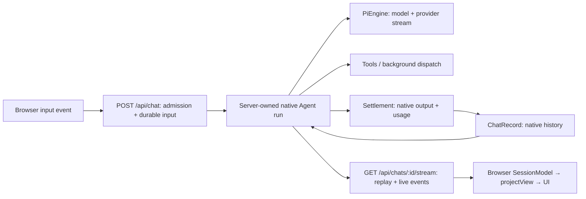
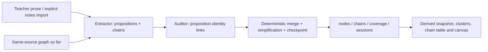

# LearnHarness architecture

> **Commit closeout — 2026-11-04:** The verified UI-polish, question-card, native-default/reconnection and opening-animation changes are included in this feature-branch commit, together with Coding Questions and UI Showcase. “Uncommitted” notices below retain their original verification-time status; this note supersedes them for the current Git state. No push or release is implied.

This is the current implementation reference for LearnHarness (the historical plugin increments, later UI polish, question defaults/navigation and continuous-opening correction are implemented and verified on `feature/plugin-architecture`, not released): a Next.js application with an Electron host, native Pi conversations, adaptive teaching and conversational practice, and a persistent knowledge graph. [Development](development.md) covers setup and commands; [teaching methodology](teaching-methodology.md) covers the pedagogical method. Older design documents and the [archived architecture](archive/architecture-2026-09-08.md) are history, not runtime specifications.

## 1. Code boundaries

| Area | Responsibility | Main entry points |
|---|---|---|
| `app/` | Pages, server components and HTTP transport | `app/api/chat/route.ts`, `app/api/chats/` |
| `components/` | Browser session state, transcript projection/rendering, question and practice docks, graph and settings UI | `session-core.ts`, `chat.tsx`, `graph-view.tsx` |
| `src/server/` | Composition, admission, persistence/liveness coordination, provider configuration and HTTP-facing services | `chat-handler.ts`, `stores.ts`, `jobs.ts` |
| `src/agent/` | Native agent construction, tools, provider streams and background workers | `teacher-agent.ts`, `models.ts`, `tools.ts`, `subagents/` |
| `src/core/` | Contracts, record/view/model projections and domain algorithms | `native-messages.ts`, `input-events.ts`, `view.ts`, `graph.ts`, `coverage.ts` |
| `src/store/` | Filesystem persistence adapters | `chats.ts`, `jobs.ts`, `graph.ts`, `settings.ts` |
| `electron/` | Desktop launch, navigation/permission security, credentials and browser helper | `main.cjs`, subscription controllers |

The import restrictions in [`eslint.config.mjs`](../eslint.config.mjs) enforce specific boundaries:

- Imports from `components/` into `src/` must use the browser-facing `src/core/index.ts` barrel.
- Imports from `app/` into `src/` must use the core or server barrel.
- Core cannot import agent, server or store modules; agents cannot import server or store modules.

These are not a complete hexagonal-architecture proof. Some core modules are Node-bound (for example, graph/coverage hashing), and the core barrel deliberately excludes them. Agents read prompt assets and learner files and perform external operations; their storage and delivery dependencies arrive through injected contexts. `src/server/stores.ts` wires the main storage ports, but other server modules also import adapters, and the server barrel exposes settings/auth/override operations. There is no lint-enforced “only two composition roots” or “one writer per store” rule. Tests import across layers; scripts and Electron are outside these import restrictions.

## 2. Conversation, engine, agent and turn

These are different lifetimes:

- **Conversation:** a durable `ChatRecord` in `data/chats/<id>.json`, containing native `LhMessage[]`, settings, an optional plan tree and usage logs. Missing `kind` means teaching; `kind: "practice"` selects the practitioner.
- **Engine:** a resolved Pi model, stream function and thinking level (`PiEngine` in `src/agent/models.ts`). It is provider-aware, not an OpenRouter-only abstraction.
- **Agent:** a fresh `@earendil-works/pi-agent-core` `Agent` constructed for one application turn, with that conversation's history, current prompt and current tool registry.
- **Application turn:** one accepted input followed by a server-owned agent run. A run can make several model calls and execute tools before it ends. It is not an HTTP connection or a single provider generation.
- **Tool execution:** a call within that run. Some tools finish synchronously; question/problem tools pause for learner input; job tools dispatch independent background work.

### The native record and its projections

The server owns the transcript. `POST /api/chat` carries `{chatId, input}`, not a replacement client transcript. `src/core/input-events.ts` parses explicit text, answer, thinking, next-problem, continuation and retry inputs into record appends; server-side wakes use the same turn composition with steer markers.

`LhMessage` extends Pi's native user, assistant and tool-result messages with record IDs and app custom markers. Provider/model/usage/thinking metadata stays native. Two different projections consume it:

- `src/core/native-messages.ts` → `toLlmMessages`: strips app-only metadata, flattens model-facing markers to user text, omits presentation-only markers and applies the active compaction cut. Unanswered calls from completed generations receive synthetic interrupted results at this boundary; calls in failed/aborted generations do not acquire orphan results.
- `src/core/view.ts` → `projectView`: groups the native record into the UI's messages, parts and artifacts. This view is not the stored format or the provider wire. The app does not use the AI SDK's `useChat`/`addToolOutput` continuation loop.

The system prompt and tool declarations are seeded by Pi at agent construction. That synthetic system message is filtered out at settlement, so every new agent receives fresh instructions rather than replaying old declarations. Rebuilding the application Agent does not require every provider transport to be stateless: the Claude Code adapter can retain an eligible live CLI process behind this boundary (see its [lifecycle reference](claude-code.md)).

### Admission, execution and settlement

`src/server/chat-handler.ts` composes the turn:

1. Load the record; validate the input and any retry eligibility. Resolve the conversation model and provider availability. Missing models or credentials/readiness produce explicit refusal rather than a guessed fallback.
2. Await the conversation's compaction gate and re-read durable truth. Validate appends against that current record.
3. Claim per-chat liveness (`beginTurn`); a racing turn gets 409. Save accepted input before starting inference. Subscription automatic inputs can instead be staged until dispatch admission, so a denied background request remains queued rather than falsely delivered.
4. Construct the prober, teacher or practitioner. Register its live steering seam before the native loop starts, then register the running turn handle.
5. Return a short acceptance response. The browser attaches to `GET /api/chats/:id/stream`; a completed race returns a settled terminal instead of starting another turn.
6. At settlement, append the run's new native messages and plan snapshots, then usage. Successful question placeholders are loop devices and are not persisted; the unanswered call remains until its real learner result arrives. Partial output is saved on abort too.
7. Apply parked dismissals, release liveness and running-agent registrations, reconcile steer delivery, and consider background compaction. Teaching sessions can also trigger extraction.

Persistence failures are not successful empty turns. A failed input save refuses the request before inference. A failed reply save is reported before the stream terminal, and cleanup releases liveness even if normal settlement fails. A memory-only failure notice lets a view attaching after that failure still show the error; it is not a fabricated transcript entry.

### Streams and recovery

`src/server/pi/ui-stream.ts` streams native agent events, not UIMessage SSE. `message_update` contains the full partial message; views replace its slot rather than accumulating text deltas. The turn log retains settled events and only the latest in-flight updates, with live update fan-out coalesced (100 ms by default). Reattachment cost tracks content rather than every provider chunk. Tool-call IDs are uniquified at the boundary against existing history so wire, record, answer routing and later provider context agree.

A disconnected browser detaches a **view**, not the agent. Turns run without subscribers; explicit abort is separate. `components/session-core.ts` owns adoption, 409 backoff and read-only reattachment. Premature EOF/read failure without a terminal permits one recovery attachment; a further transport failure shows an error rather than declaring completion.

Submitted question drafts survive optimistic unmount in memory. An uncertain answer submission reconciles the canonical record and running-turn state before another send, and is scoped to the same question occurrence. It must not blindly replay an already-accepted answer. Saved provider failures are distinct from transient transport/settlement notices; retrying a failed response is an explicit action, not mount-time continuation. Retry retains failed attempts on disk and omits only the eligible failed tail from the temporary agent context.

## 3. Teaching lifecycle and tools

The teaching agents share one record but have different prompts and registries (`src/agent/teacher-agent.ts`, `src/agent/tools.ts`).

| Agent | Main interaction | Other capabilities |
|---|---|---|
| Prober | `probe` (multiple choice) or `recall` (free recall), `ask_user_question`, `probe_done` | Read-only file tools, research/PDF dispatch; graph readers when enabled |
| Teacher | `quiz` or `explain`, `ask_user_question`, `plan_init` | Read-only file tools and research/PDF/demo/visual dispatch |
| Practitioner | `problem`, `conclude` | Read-only file tools, research/PDF dispatch; graph readers when enabled |

The builtin choice/free-recall mechanic selects one graded tool per teaching phase. Tool toggles and availability gates affect the registry; the table is not a promise that every dispatch tool is always enabled. Practice side tools are composed separately, without the teaching toggle filter. Claude-family agents can also receive `send_to_user` for explicit learner-facing output. All ordinary registries pass through argument healing; semantic validation failures return error results so the model can correct the call.

**Builtin questions execute on the server but are answered in the browser.** Their execute function validates authoring and returns a synthetic terminating “question posed” result. Clean question poses stop the run, including mixed tool batches; invalid poses leave the model able to retry. The dock deterministically shuffles options, builds the learner's answer (including choice grading via `question-core`) and sends an answer event. Free-recall answers expose the precommitted answer and return to the agent for judgment. These are not server-less tools and not a universal deterministic grading system.

Pending calls are record-derived, so reopening an unanswered question needs no new model call. If a model emitted sibling questions, answering one persists its result without starting inference while another remains pending; the last answer starts the reaction turn.

**Probe → plan → teach:** a matching successful `probe_done` result, not a bare call or refusal, selects the teacher on subsequent turns. The tool queues a handoff wake, which must build a fresh teacher rather than steer into the prober. If the wake cannot be delivered, the next learner turn still selects the teacher from the saved seam. Phase display (`src/core/phases.ts`) advances from probe to plan at that successful result, and to teach at the first `nodeId`-tagged `quiz`/`explain` call—not at `plan_init` or an acceptance marker.

**Plan:** `plan_init` parses a restricted Mermaid graph and validates its DAG structure. It writes/replaces the whole plan; it is intentionally re-callable, not mechanically author-once. Question node IDs validate against the current tree. Current/visited/upcoming statuses derive from tagged calls, not grades or explicit “done” writes. Presenting the plan and waiting for a natural learner reply is prompt doctrine, not a separate acceptance transaction.

## 4. Conversational practice

Practice uses the same chats store, admission, native turn runner, steering, usage and recovery as teaching. It is **not** the former partitioner → problem-generator → grader problem-set service: there are no current `/api/practice/sets` routes or separate practice store.

A practice session can start with graph selections or free-form material. Session creation can save a graph-context marker containing selected proposition text and chain lines before the learner's first message; there is no automatic semantic top-K graph injection.

- `problem` commits the statement and model solution together. The solution stays hidden in the UI until conclusion. A valid pose ends the run and opens the thinking dock; each thinking submission starts another turn on the same active problem.
- `conclude` records outcome, verdict and diagnostic information and reveals the solution committed at pose time. Target IDs, when supplied, normalize/validate against graph propositions; targets can be omitted for material outside the map.
- A turn-scoped gate, seeded from the record, enforces one active problem and rejects conclusion without one. The gate updates during tool execution, so it does not depend on the settlement-only transcript write.
- After conclusion, the prompt and tool acknowledgement tell the agent to close the turn and wait for explicit learner go-ahead. This pause is not a tool-level terminating gate on `conclude`. The Next problem action adds a native marker; dismissals use a synthesized conclusion and the separate dismissal path.

Practice outcomes are evidence in the session, not graph mastery levels, certification or a spaced-repetition state store. The normal turn-settlement path skips extraction for practice sessions. Problem/solution/outcome projection lives in `src/core/native-messages.ts` and `src/core/view.ts`; the tools live in `src/agent/tools/practice.ts`.

## 5. Background work and delivery

Researcher, PDF reader, demo builder and visual maker run independently (`src/agent/subagents/runner.ts`). Dispatch tools persist a job and its input, return an acknowledgement, then spawn the worker. Demos are executed through the browser helper before delivery; visual verification uses rendered images. PDF/SVG rendering and shared image postprocessing are native; demos use the app's Electron browser service with system Chrome as fallback, not an extra downloaded Chromium.

**Worker completion is not session delivery.** The runner saves a terminal worker outcome plus pending delivery metadata before queueing the result. Worker resources and the running activity row can end while an unanswered question holds its result. Only computing workers are abortable; abort notices have their own pending-delivery lifecycle.

`src/server/jobs.ts` owns a process-local registry with deterministic marker IDs and two delivery vehicles:

- **Live run:** eligible markers enter Pi's steering queue at native boundaries (never between a call and its result). A question stopper can leave them unconsumed; settlement returns those markers to pending.
- **Idle wake:** wait for a turn-free, question-free, unpaused, consented session, then start the normal turn composition carrying queued markers. A 409 backs off; a consent refusal retains queue ownership. Other failed starts remain quietly pending for a later learner run or restart recovery, not an unlimited retry timer.

A marker in the **saved conversation**, not HTTP acceptance or streaming visibility, acknowledges delivery. Reconciliation prevents a saved marker from replaying if later bookkeeping/model work fails. Recovery restores known pending result/abort/failure obligations before a newly registered agent's first poll; unfinished built-in workers can be respawned using saved input. Plugin jobs instead recover from canonical task records without replaying plugin code (see §11). Legacy terminal jobs without delivery metadata are not guessed into replay. Session deletion discards its pending obligations.

This is single-process coordination over JSON records, not a transactional queue or exactly-once provider execution. Composer steers also use the live-agent/settlement seam; their unsaved in-memory queue is not equivalent to durable job recovery.

### Shared worker-request admission

One process-global FIFO gate limits background **model request streams**, releasing each permit when the request ends, before tools or child waits—not after a whole agent finishes. Settings → Agent → Models → **Concurrent worker requests** (`agent.workerRequestConcurrency`) defaults to **8**, including when unset. Any positive safely representable whole integer is accepted without an arbitrary cap; invalid values are rejected, not clamped. A live increase drains queued requests immediately up to the limit; a decrease lets active requests finish and admits another only when the active count is below the new limit. Queued cancellation prevents provider dispatch.

Core extractor/auditor/research/demo/visual/PDF requests and all detached `ctx.workers` tasks share the pool, even user-initiated tasks. Direct teacher/prober/practice requests and their compaction, interactive plugin-managed conversations and standalone raw plugin inference are excluded. `purpose` governs subscription consent, not worker classification. Routes and windows share a pool within one app-server process, never across independent server processes. Source-serial extraction chunks, the audit-through-merge consistency lock and the frontend three-file upload queue remain independent of this gate. See the [plugin host work/recovery map](plugin-architecture.md#inference-persistent-work-and-recovery) for standalone worker activity integration and the unchanged task/delivery recovery boundaries.

## 6. Knowledge graph: extraction and coverage

The graph stores objective propositions and reasoning chains, not learner understanding levels. Extraction is post-hoc and independent of the plan tree. Its main path is:

### Session extraction

`src/core/coverage.ts` and `src/agent/subagents/extraction.ts` share the teacher-prose selection. It includes ordinary assistant text and successful explicit `send_to_user` output, with passages labeled by actual message IDs. Learner text, thinking, question blocks, other tools/results and markers do not count. SHA-256 fingerprints of that view are compared with `coverage.jsonl`; uncovered state is derived, not separately stored. A learner answer alone does not reopen covered prose.

Automatic extraction considers uncovered tokens at teaching-turn settlement. `graph.enabled` gates that automatic path; `graph.rendering` only selects the home presentation and does not delete data. The configurable trigger threshold is `graph.extractionChunkTokens`, whose factory default is **4096** and minimum is **500** (`src/core/settings.ts`). Manual `POST /api/graph/coverage/extract` can request uncovered material below the threshold; it is asynchronous, with status/coverage reads showing progress. The explicit extraction/import routes do not themselves check the automatic-extraction switch.

**Threshold and batch size are distinct in current wiring.** The pipeline supports an injected `getChunkTokens`; without one it uses the factory budget. The app's pipeline in `chat-handler.ts` does not inject that getter, so changing the trigger setting does not also change its batch budget. Chats batch oldest uncovered prose messages greedily, never splitting a message; a single oversized message runs alone.

Each batch is an independent observable extraction job with its own usage, not a Workbench `JobRecord`. A source's batches run serially so later extractors can build on the propositions/chains already merged from that source. Cross-source work can overlap. The shared worker-request gate (§5) replaces the old whole-extractor-phase three-permit wrapper with request-level admission; a separate process-wide FIFO lock still serializes audit through merge for consistency. These registries/locks use `globalThis` to survive separate Next module entries **within one process**, not across server processes.

The extractor alone reads source material and submits propositions plus jointly-entailing chains. Chat propositions must anchor to a teacher-prose message in the current batch. Chains can reference submitted IDs or existing graph IDs. Submit validation returns correctable errors for bad anchors/endpoints. The auditor receives propositions only—not source passages or chains—and explores the current graph using read-only tools to submit identity links. It cannot rewrite the extractor's argument structure.

`mergeFindings` resolves those links, appends proposition phrasings/provenance, resolves chain endpoints and deduplicates identical arguments under an `arg_` identity. Its whole-ledger simplification pass removes redundant same-conclusion chains using premise-set and ancestry rules. Coverage checkpoints come after graph appends; layout settles after merge. A failed pre-merge stage leaves the batch uncovered. Earlier successful batches survive later failures/abort; ordinary batch failures are isolated, while a source-wide abort stops subsequent batches. Usage is retained for failed jobs too. These are ordered file operations, not an atomic multi-ledger transaction: a disk failure after some appends need not roll back the graph.

### Notes imports and retry

`POST /api/graph/import` accepts text and PDF notes and uses the same extractor/auditor/merger, with notes-specific prompts and no message-anchor requirement. Source identity remains a hash of the supplied file path/name. The optional multipart `paths` entries preserve safe folder-relative paths, matched to each uploaded filename; without them the route uses `File.name`. Changing the picked path changes source identity; changing a display name or organizational placement does not. Identical names do not become different sources just because their upload positions differ.

The shared Files/Folder picker sends one request per supported file through one appendable page-memory queue, with **three files in flight** and immediate refill when any finishes. Further selections join that queue without disabling import. Files over **25 MiB** fail individually; a selection may exceed that total because requests are separate. The server still checks actual aggregate file bytes per request at 25 MiB and bounds the multipart body/proxy at **26 MiB**. PDF conversion, scanner notices and extraction stages are unchanged. The file queue is not persisted across a page reload and introduces no model-concurrency setting.

**Every explicit import processes the whole file, even unchanged text.** There is no content-fingerprint skip or exactly-once import promise. Notes split greedily at line boundaries; a retry reprocesses the file using its existing source digest and identity auditing. Prior merges and usage remain. Same-source overlap is refused as busy before source metadata changes.

The route returns per-upload `requestIndex` and completion outcomes (`completed`, `partial`, `failed`, `aborted`, `busy`). Completion means all chunks completed, not “at least one node was created”; zero findings can be a valid completion. Partial failure/abort preserves committed chunks and reports partial statistics. The UI checks response identity/shape and reports errors; it does not silently turn a failed or ambiguous request into an unchanged-file success. Retry is another explicit import, not automatic background replay.

### Source organization

The chains view inventories all session and imported-source records, including those with no extracted graph content. Individual sources use Book/BookOpen icons; nested organizational folders use Folder/FolderOpen. A source's default imported name is its exact basename minus the final extension, with no tidying or capitalization. Inline session renames use the existing chat title; imported display overrides and folder names/placement live separately in `data/graph/source-organization.json` (lazy, versioned presentation metadata).

Folder imports reconstruct directories containing supported files, not empty/unsupported-only directories. Stable original-directory associations reuse folders after a rename or move, while re-import preserves existing source names and placement. Drag-and-drop changes parent folders only; Name/Props/Created sorting remains authoritative. These folders do not yet appear in the sessions sidebar.

In ordinary browsing, checkboxes select whole sources and folders (including empty entries), not shared proposition IDs. Selecting a folder includes all descendants even while search hides some rows. The pill counts sources and folders; Delete removes selected sources' graph contributions using session-deletion semantics, preserving knowledge supported by other sources. Imported records are removed without touching original files. For sessions, an unchecked-by-default confirmation checkbox additionally deletes conversations and their background jobs; otherwise conversations retain their placements and lose coverage/checkpoints so they can be extracted again. Selected folders are removed bottom-up only when empty; containers still needed by kept conversations or unselected entries remain. Practice's Pick nodes keeps fine-grained graph-node selection without deletion; global node deletion stays in the graph context menu.

Source contribution deletion refuses while any extraction is registered; deleting conversations additionally preflights live turns/computing workers before any selected entry is changed. The synchronous purge handles the selected batch with at most one graph rewrite and one imported-record update, sharing existing session cleanup, with no import cancellation or automatic retry. I/O failures may leave partial progress, reported explicitly; explicit retries tolerate already-removed entries. Organization reads do not write, and operation-based atomic sidecar updates refuse invalid data or folder cycles instead of resetting it.

### Read model and graph mutation

`graphSnapshot` reads stored propositions/chains and derives the presentation:

- A single-premise chain draws as a direct arrow. A multi-premise chain creates a geometry junction with premise → junction → conclusion links; the canvas does not expose it as an ordinary visible proposition. Stored chains remain available independently to the chain table.
- Birth-session clusters derive from proposition provenance, with chat titles/imported display names as labels; original paths remain in provenance. There is no embedding, Louvain or LLM naming stage. Multi-premise junctions are assigned to displayed clusters after the proposition-count hull filter.
- Canvas rendering uses Canvas 2D/d3-zoom over the core layout; server-persisted positions/render settings are separate from device-local camera state. Turning graph rendering off leaves the chain-table presentation and stored knowledge intact.
- Prober and practice graph readers are gated by `graph.enabled` and `agent.graphTools.enabled`. The teacher registry does not include these readers. Explicit graph selections at session creation are a separate context path, not unbidden automatic injection.

Extraction is the normal **construction** writer, not the only graph mutation. Node deletion, session deletion, chain simplification and position commits also write graph files. Session deletion's `preserve-graph` mode keeps graph content/provenance while removing extraction bookkeeping; `delete-nodes` removes that session's traces, retaining identities supported by surviving sources. Deleting a proposition removes chains that use it; deleting an argument identity removes that chain. Node deletion refuses while extraction is registered. Session deletion blocks live turns/computing workers, winds down its own extraction and rechecks before its synchronous purge. Graph snapshot reads do not start extraction or settle layout.

## 7. Change notifications and observability

There are two SSE channels with different jobs:

| Channel | Lifetime | Meaning |
|---|---|---|
| `/api/chats/:id/stream` | One running turn/view attachment | Replay plus native agent events, then terminal |
| `/api/events` | One `EventSource` per open window | Small change notifications; consumers fetch canonical data |

The notification bus (`src/core/events.ts`) is ephemeral and process-local. `src/server/events-stream.ts` adapts it with heartbeat comments; `components/server-events.tsx` fans it out in the window. It carries turn, record, compaction, job, activity, chat-list and subscription changes. The exact vocabulary lives in `SERVER_EVENT_TYPES`, not a second protocol catalog here.

Notifications generally follow the corresponding mutation. Chat content-store operations are deliberately silent; turn lifecycle events or explicit `record-changed` notifications cover their visible effects. Consumers debounce bursts and refetch on reconnect because notifications have no durable replay log. While a view owns a live turn stream, its terminal controls settlement adoption; notification-triggered fetches must not replace partial state underneath it. A settlement event means the run ended, not proof that an earlier failed disk write succeeded.

`src/server/observability.ts` composes background job/extraction status, usage/context metadata and a graph revision derived from file mtimes. Turn liveness is separate from background worker status. Abort routes target actual running work; dismissing an interaction is a different operation. Coverage panels retain bounded run-scoped reads for finer-grained progress; 409 retries are bounded race recovery, not standing application polling.

## 8. Storage and compatibility

[`config.ts`](../config.ts) anchors shipped prompt assets to the application root and mutable state to `LH_DATA_DIR` (default: repo `data/`). The main storage ports are semantic interfaces in `src/core/ports.ts`, not a generic document database.

| Data | Persistence |
|---|---|
| Conversations, plans, outcomes and usage | `chats/*.json` |
| Worker computation and delivery obligations | `jobs/*.json` |
| Proposition assertions, chain assertions, extraction checkpoints/coverage | `graph/{nodes,chains,sessions,coverage}.jsonl` |
| Imported source metadata/usage, resting positions, render preferences | JSON maps in `graph/` |
| Non-secret settings deltas and prompt overrides | `settings.json`, `prompts/` |
| API keys/custom endpoint credential binding | Separate `auth.json`, located by `LH_AUTH_FILE` |

The adapters use synchronous filesystem operations. JSONL readers skip corrupt or shape-invalid lines; graph derivation unions repeated identities/provenance. Some replacements use temp-file rename; whole-file chat/settings/source writes do not provide a database transaction. A synchronous read/modify/write section cannot interleave in the same event loop, but that is not cross-process locking or crash atomicity. Use one server owner for a data/auth profile.

Chat writes stamp the supported chat schema version; an unstamped record reads as the original version, while a newer-version chat is refused. Graph-family files share lazy `graph/format.json`; newer graph formats throw on guarded reads. Positions are rebuildable and unstamped. Settings use their own schema counter and sanitizer/default resolution, not the same newer-version refusal policy. These counters are not app release versions and do not promise migration from every historical scratch format. The graph adapter also removes retired `edges.jsonl`/`events.jsonl` at initialization, so importing a store module is not a universally side-effect-free inspection method.

Golden fixtures under `tests/fixtures/golden-data/` exercise real saved records through the data-directory seam. Intentional format changes must keep their compatibility expectations and fixture documentation consistent.

## 9. Host, providers and external effects

Production Electron launches the standalone Next server as a private child on loopback, sets the data/auth paths and loads a sandboxed renderer. Teaching, practice, extraction and storage stay server-side. Main-process navigation/permission guards and private credential transport are desktop boundaries, not a web multi-user authentication system. Build/packaging guards in `scripts/build-server.mjs` check data exclusion and traced assets; native runtime smoke scripts check the packaged provider/renderer dependencies. See [desktop release](desktop-release.md).

`src/agent/models.ts` exposes Pi's native provider collection plus app bridges. Settings supply strong/cheap/vision slots and background-role overrides; there are **no factory model pins**. New sessions copy the strong slot into their conversation settings. Existing explicit session choices remain local; absent model/thinking fields still resolve through the conversation fallback. Missing configuration/readiness refuses at the point of need. Background roles resolve independently and do not inherit an in-session model pick.

Ordinary API credentials are read through the key seam, with real environment variables taking precedence over saved file values. Web/dev subscription connections have a server-owned credential directory; packaged subscriptions keep refresh credentials in Electron main and use private scoped request transport. These logical subscription routes do not silently fall back to API-key billing. Claude Code is a separate local CLI provider with its own authentication/process lifecycle; custom endpoints have their own configuration and credential binding. Focused references:

- [Claude Code](claude-code.md)
- [Custom providers](custom-providers.md)
- [Compaction, context and accounting](compaction-accounting.md)
- [Development credential and shared-server boundaries](development.md#subscription-connections-in-webdev)

File tools are read-only, but not confined to `data/` or a selected project: relative/default paths resolve against the server user's home. Walk exclusions reduce noise, not access authority. Existing-file attachments carry paths for the agent to read; they are not a new file-upload sandbox. Read/PDF/visual image results share image postprocessing; tool content retained outside the model-facing result follows [tool content recovery](tool-content-recovery.md). Search uses configured Tavily/Brave adapters; research can still use direct web fetching without a search key. Dictation mints short-lived Deepgram tokens server-side, then streams audio browser → Deepgram, not through the app server; its language preference is shared app settings.

## 10. Verification seams

Tests use injected engines/ports, fake provider transports and renderer seams rather than requiring real accounts. Useful starting points are `tests/chat-flow.test.ts`, `tests/session-core.test.ts`, `tests/turn-recovery.test.ts`, `tests/job-delivery-recovery.test.ts`, `tests/extraction.test.ts`, `tests/notes-import-route.test.ts`, `tests/practice-flow.test.ts`, `tests/prompt-overrides.test.ts` and `tests/golden-fixtures.test.ts`. Local fixture/loopback tests establish their exercised behavior, not real model quality, account entitlements or cross-process durability. Commands and runtime-gate prerequisites live in [development](development.md#checks).

The bounded-question host increment, implemented and verified on `feature/plugin-architecture` but not released, passed the [archived 3,778-test verification checkpoint](archive/plugin-implementation-history.md#plugin-question-verification-checkpoint--2026-11-02), strict packaged SDK, isolated production/privacy audit and the exercised packaged-browser flows; these results do not establish every interaction or actual OS microphone/IME behavior.

The later [native session-extension increment](plugin-session-extension-contract.md)
(submission interception, explicit learner images and session-body surfaces) is
**implemented and verified on `feature/plugin-architecture`, not released**, at its separate
[archived 3,869-test / 564-suite checkpoint](archive/plugin-implementation-history.md#native-session-extension-verification-checkpoint--2026-11-02).
Whole-project TypeScript, lint (zero errors, existing head warning only), strict external
SDK, isolated Next/standalone build and privacy/source-byte audits passed. The packaged
Electron-Node/Chrome scenario passed 23 assertion groups with zero page errors, blocked
external requests or unexpected HTTP responses; see the checkpoint for exercised proofs
and limits. Historical question/Markdown/interaction results remain separate evidence.

The later [archived UI-polish checkpoint](archive/plugin-implementation-history.md#ui-polish-status--2026-11-03) is
**implemented and verified, uncommitted on `feature/plugin-architecture`, not released**.
It passed **3,908 root tests / 564 suites, zero failures** (including the final scrubbed
rerun), typecheck/lint/diff checks, **17 showcase tests**, strict showcase types/build,
fresh isolated Next 16.4.3/standalone curation and strict external curated-SDK compilation
with `skipLibCheck: false`. Privacy proof checked **96 NFT manifests / 277,329 entries**,
zero private-root hits and **410 byte-identical production files**. Expanded packaged
Electron-Node/Chrome proof recorded **223 requests / 217 responses**, nine screenshots,
zero off-origin/forbidden-generation/microphone/WebSocket/page-error activity, only provider
catalog `GET /v1/models`, and unchanged settings/graph/host source. One cancelled graph-source
read and expected fixture favicon/dictation-token errors are narrowly recorded, not a
clean-console or all-requests-succeeded claim. See the checkpoint for measured slider,
worker-tooltip, dialog/surface and 11 picker-origin/geometry proofs. Reverse programmatic
surface-over-picker ordering has host integration proof only; Windows/Linux window-controls
checks simulate CSS, not physical OS chrome. No actual microphone/IME, paid-provider,
signed-installer, real-profile installation, full Electron-window or Windows/Linux runtime
proof, commit, push or release is implied. Separately held question fixes are not included.
Historical 3,778/3,869/3,665-test checkpoints retain their original scope.

The later [archived question-defaults/navigation checkpoint](archive/plugin-implementation-history.md#question-defaults-and-navigation-recovery--implemented-and-verified)
is **implemented and verified, uncommitted on `feature/plugin-architecture`, not released**.
It passed **3,965 host tests / 564 suites, zero failures/cancellations/skips**, typecheck,
lint, fresh isolated build and strict external SDK checks. The **62 card/frontend**, **39
core/lifecycle** and earlier **90 session-core** focused checks are separate runs, not an
aggregate total. Privacy proof checked **96 NFT manifests / 277,497 entries**, zero
private-root hits and **410 byte-identical production source files**.

The pre-fix development failure was **10/10 pending prediction/check mount returns despite
all 162 GETs returning 200**. Recovery now uses private connection-generation task ownership
and stable-identity effect reconnect reads, preserving stale/identity fences and StrictMode.
Final current-transcript/async-initial-publication P2 findings were closed by restoring
original draft-ownership guards while retaining canonical admission/Submit gates; no
confirmed P1/P2 findings remain. Final native plus dev/production browser proof passed
**20 healthy returns/mounts, ten per mode**, with held GETs retaining Preparing and no
healthy-return Retry/error/false Unavailable/Dismiss. Trusted code Enter submitted a
prediction and Thinking Enter submitted a check; both Shift+Enter paths, exact canonical/
model channels, 40px empty Thinking/76px three-line growth and fresh disabled-backend
recovery passed. No page errors, external requests, navigation model calls or microphone
attempts occurred. The native pre-curation payload retained **5,535 runtime files / 130
plugin files byte-identical**. Five product unit/catalog tests and real Chrome component
proof also passed. See the checkpoint for evidence and scope limits.

Historical **3,925-test native-parity** and **3,908-test UI-polish** records remain frozen.
React Activity lifecycle reproduction is fixture-only; Cache Components remains false.
Composition guards were tested synthetically, not through actual OS IME. No actual
microphone recording, paid-provider, signed-installer, real-profile installation, commit,
push or release claim follows.

Unresolved browser follow-up: a trusted wheel over native prose at point 5 had `defaultPrevented: false` but left transcript scroll at `2769`, while blank-margin wheel moved and folded; cause and preexisting-versus-question-state causality remain unestablished, with no intentional wheel surface identified.

## 11. Trusted local plugins (API v1)

The [plugin architecture](plugin-architecture.md) specifies the runtime and [authoring guide](plugin-authoring.md) documents its public contract. Plugins are optional, disabled by default, and trusted like other local programs: no sandbox or permission fiction. Bundled and externally installed packages use the same context API. Each workspace under `data/plugins/<id>/` loads its manifest, optional browser ES module and Node backend, and optional CSS/assets from the fixed `dist/` directory. Optional source may live alongside `dist/`; persistent plugin records stay in sibling `data/`, outside the build output. The backend runs inside the existing Next Node server; disable is cooperative.

`instrumentation.ts` starts the server singleton in `src/server/plugins.ts`. Its `globalThis` anchor survives Next's separately compiled route modules. The native `scripts/plugin-loader.cjs` sidecar loads external CommonJS backends without asking Next to bundle user-installed code. The HTTP adapter exposes list/enable/call and allowlisted frontend assets; private plugin data and backend modules are never asset responses. LearnHarness's existing desktop-API origin protection still covers those routes. Branded host errors retain their HTTP meaning across separately compiled module instances.

Frontend `ctx.documents.toMarkdown(File, { signal }?)` provides pure, in-memory PDF/strict-UTF-8 conversion through the same native PDF engine, without learning/model/storage effects. Its process-global converter admits one request at a time, with bounded upload/output and cooperative cancellation; see the [document conversion contract](plugin-authoring.md#uploaded-documents). Only its exact Node upload endpoint skips Next Proxy body cloning, which can silently truncate uploads before route limits observe them. The route preserves the identical desktop capability check for **every method**, before params, body or host access; other API routes and existing notes-import policy are unchanged.

`PluginsProvider` owns one frontend lifecycle per window. The external loader uses native dynamic import, not eval. Custom plugin views appear in the sidebar and main content area; Settings → Plugins controls enablement and hosts plugin settings. Registrations, subscriptions, mounts, CSS, and async teardown follow plugin lifetime. Re-enabling awaits that plugin's previous frontend cleanup; other plugins are independent. `plugins-changed` announces host availability changes; `plugin-message` carries plugin-scoped, non-durable JSON notifications. Reconnect/resync rereads host availability and lets plugin views reread their authoritative backend state.

Supported services are thin read-only access to all learning records, configured/authenticated model calls, and an optional managed agent-session helper built on the existing pi Agent SDK. Managed sessions are plugin-local, not a third core chat kind: they survive navigation, support persisted deferred input and end-run tools, deduplicate accepted request IDs, and mark interrupted runs without automatically replaying tools. Plugins own their domain logic and UI. No scheduling, flashcards, exam semantics, or alternative agent framework is added to the core.

Backend contributions append instructions and native Pi tools to the existing prober/teacher/practice registries, with per-turn factories and package-level failure isolation. Frontend fenced-block and tool-result renderers mount through the same HTMLElement/cleanup model; built-in presentations retain precedence, and missing or failing renderers leave readable raw fallbacks. This does not introduce a new learner-answer protocol.

The [approved bounded question-v1 contract](plugin-question-contract.md) adds backend `registerQuestionType` and owner-scoped frontend `registerQuestionRenderer`, with actual types in `src/core/plugin-questions.ts`; the implementation passed the [archived 3,778-test question checkpoint](archive/plugin-implementation-history.md#plugin-question-verification-checkpoint--2026-11-02) and is implemented and verified on `feature/plugin-architecture`, not released; `792671e` remains a historical migration checkpoint. Optional explicit probe/teach variants enroll only their respective teaching roles; required `showThinking` is host policy. Host-generated native parameters are common `{ question, payload }` plus teach `{ type, nodeId }`, preserving predict/check positioning. Saved schemas, required historical refinements and exact canonical occurrence identity—not current tool-name lookup or reused call IDs—govern answer authority. Editors become actionable only after canonical persistence/adoption and terminal reconciliation; the host saves genuine results before ordinary continuation and blocks stale/duplicate/legacy bypasses. Failed/live/unavailable attempts have safe common-question fallback, never generic raw-payload traces. This remains a presentation boundary, not a sandbox.

The host question defaults now make **Enter submit and Shift+Enter insert a
newline** in both plugin answer editors and host Thinking. An optional explicit editor
`handleKeyDown` override remains allowed; `"pass"`/no hook means host Enter-submit, not
an editing newline. Mod+Enter stays reserved Submit; IME/229 and interaction-scope guards
are unchanged. The coding plugin now omits a plain-Enter override while retaining Tab
indentation and Shift+Enter newline indentation. Native footer wording is **↵ submits ·
⇧↵ newline**, button **Submit answer**. The human chose **40px minimum Thinking height
for all variants**, replacing the teaching 72px minimum. Unknown/failed canonical sync is
not confirmed unavailability: keep readable saved content and genuine Retry, without
fabricating Unavailable or recovery Dismiss. This delta passed the separate 3,965-test
checkpoint and changes no grading, saved-data, blank/whitespace filtering, public API shapes
or `ctx.ui`.

Question renderers own only optional question/answered content and the required controlled editor. Atomic empty/unready/ready state preserves finite JSON, falsy values and verbatim strings. Exact contract-version support, explicit incompatible-version quiet cancellation and unavailable/pending fallback replace automatic migrations; unknown versions alone never cancel. Stats/microphone/model/model-thinking and host Thinking/ReadingThinking rules stay host-owned, with explicit Thinking-off `appendTranscript` opt-in or visible disabled microphone—no hidden composer. Narrow editing-key/focus integration remains within the host keyboard contract. Folding/adoption/remounts preserve drafts in the existing in-memory session model, but model-destroying navigation/reload/restart do not promise draft persistence; posed questions/accepted answers are durable. V1 returns valid answers to the ordinary teacher, with no assessment/node hook or grading stage; separate existing tools remain available. Builtins and grading are unchanged, with no generic pending-input/form/field SDK, global chat migration or product resumption. The historical 3,681-test Markdown checkpoint remains separate from the question verification record.

### Native session extensions — implemented and verified

The [native session-extension contract](plugin-session-extension-contract.md) is normative;
**implemented and verified on `feature/plugin-architecture`, not released**. The human
separately authorized committing all changes and preparing the branch for a human-performed
push, not an agent push or release. Public definitions are in
`src/core/plugin-submissions.ts`, `src/core/plugin-ui.ts` and the frontend context. Frontend
`registerSubmissionInterceptor`/`refreshSubmissions` prepare raw learner text, practice
thinking, builtin answers and plugin JSON answers. Hooks run serially with finite integer
priority (default 0, high-first, plugin-ID/interceptor-ID ties). Input/context/history are
detached, recursively readonly and frozen; history is the browser's native snapshot,
possibly streamed/not durable, not canonical persisted history. Targets preserve exact
occurrence/view identity and expose an opaque `surfaceTarget`, also available on native
session top-bar action context. Hooks cannot author routing/grading identity. Builtin
transformed fields receive strict mode/choice/channel validation and existing host
regrading against the captured rendered/shuffled question; plugin saved-schema/refinement
and occurrence authority remains unchanged. Pending plugin input may start builtin
preparation before native fields are filled, but cannot bypass final validity or plugin
question editor readiness.

Preparation reserves before awaits, finalizes dictation for the original target and
rechecks target/plugin/model ownership rather than retargeting. **Preparing submission…**
with pre-POST **Cancel** and native error reporting retain drafts and fence late hook
results; failures are fail-closed. `onAccepted` is live/best-effort API acknowledgment,
including successful memory-only parked steers, not durable history, replay, model success
or exactly-once delivery. Refusal/lost acknowledgment never authorizes clearing pending
plugin material. Model retries reuse accepted stored/transformed input; busy retries and
steer-to-send fallback reuse a single preparation without rerunning hooks. The lease ends
on acknowledgment/refusal, not model stream completion.

Only explicit native inline `{ type: "image", data: <base64>, mimeType }` blocks are
images; `.png` paths remain paths. Image-only and separate answer/thinking/reading channels
use additive transport/storage fields, existing image processing and actual-engine
capability/resize checks with strict async occurrence/model guards. Accepted normalized
bytes reach both native model content and host baseline figures in their matching UI
containers, outside plugin-owned question/answer slots, never metadata alone. Processing
or explicitly text-only-model refusal retains input; no image-omitted fallback is added.
Instant optimistic previews remain. To avoid raw-preview/normalized-canonical duplication,
the host defers transcript adoption during the owning image-bearing POST, discards deferred
snapshots and makes a fresh canonical read when delivery resolves—including refusal or
lost acknowledgment. Failure/ownership loss retires only that attempt's provisional images,
preserving drafts/plugin pending data without inferring acceptance callbacks. This bounded
policy was human-approved and is covered by eleven permanent causal regressions.

`ctx.ui.openSurface(target, { title, content, background?, onClose? }, { signal })` uses existing content
mounts/update/dispose and `view` interaction scopes. Its opaque token expires with one
mounted teaching/practice view; returning to the same session ID cannot revive it. Live
unknown/expired targets throw `Surface target is no longer active`; aborted signals are
inert and late mounts/cleanup are fenced. Surfaces cover the **whole body including
inputs, not top bar/sidebar**. Approved polish adds `background?: "dimmed" | "opaque"`,
default `"dimmed"` (Chains-style 80%-background plus blur); `"opaque"` is solid with no
blur. Opening and handle updates validate the enum. `title` remains required for the
accessible name, with **no host-visible title/header row**. Quiet muted Close/X floats
above content independently of scroll. The content fills the body, with its scrollbar at
the outer edge rather than inset by a host frame; plugins own visible headings and bottom
actions. No extra header/appearance props are added. This presentation change passed the
separate UI-polish checkpoint. Covered native/plugin bodies stay mounted and painted; stacked entries are visual
siblings, not automatic lifetime owners. Lower-owner unload/disposal never removes another
owner's foreground surface or Settings merely painted above it. Navigation/caller abort/
plugin unload/dispose tear down only their scopes. Existing one-Escape, eligible focus
entry/return and covered-input action guards apply without app-wide modal hiding, scroll
lock or focus trap. Additional regions, navigation suspension and broader message/card/
composer slots remain deferred, as do backend submission hooks, generic native send/agent
hooks, image pickers/path inference/asset stores and generic rich-transcript renderers.
See the [plugin host input boundary](plugin-architecture.md#submission-preparation-images-and-view-snapshots)
and [session-extension contract](plugin-session-extension-contract.md)
for details. This increment does not resume either paused product implementation.

### Existing worker and controlled-UI services

The result-oriented `ctx.workers` service complements managed conversations: immutable accepted input, explicit model/purpose and turn budget, schema/semantic validation through a native terminal submission tool, and one durable accepted result. Unfinished tasks become interrupted on disable/restart; they are never automatically replayed. `createBackgroundTool` binds a worker to the existing acknowledgement-now/result-steer-later job pipeline. Task outcomes and delivery state remain distinct. Host admission (§5) includes all detached tasks in the shared request pool and projects standalone tasks into the existing Background agents panel (plugin name · worker definition ID; elapsed/activity/model/usage when available, no invented session link; END cancels computing work). A linked background-tool host job suppresses a duplicate standalone row. No automatic retry, new history screen or public agent framework is added.

The additive API v1 `ctx.ui.mountKnowledgePicker(container, { value, onChange, disabled? }, { signal })` keeps controlled node IDs (`value: readonly string[]`) and the standard update/dispose handle. Plugins own bubble placement, selection and persistence; the host writes no plugin state. The exact `NodePickerControl` and real `ChainTableOverlay` supply Pick nodes/count/Clear (`[]`), immediate checkbox updates and retained controlled IDs. The latest approved policy supersedes the always-full-window picker: the host captures actual origin, with no public options. Plugin/native pages and session-body surfaces open a **main-pane view overlay excluding the interactive sidebar**, expiring on source-view navigation; dialog/Settings/modal origins open a **full-viewport modal** with painted/stateful but inert parents and common modal focus rules. Existing translucent/blurred Chains visuals and core Graph/Practice content-area behavior remain. This policy is implemented and verified at the separate UI-polish checkpoint. The host supplies canonical graph/source organization, lazy loading, focus/portals and abort cleanup. User-driven source rename, folder creation and drag organization remain available, while practice-picker management Delete remains absent. Backend learning-data APIs stay read-only; no programmable core writes or deck/library-tree API is added. Deck state, membership, limits and persistence remain plugin-owned.

Ordinary plugin/native pages, session surfaces, plugin Settings and public `ctx.ui.openDialog` content use the same picker API/lifetime contract. Modal launching parents stay mounted, painted and visible underneath, preserving state/scroll while inert—not hidden. Done/X and unconsumed selector-owned Escape close only the picker, retain controlled IDs and restore eligible focus; picker Done has no dumbbell/practice glyph (native practice keeps its glyph). There is no picker sidebar-reopen button. Left-edge clearance applies only where the picker reaches the viewport left edge, including full-viewport modal/closed-pane cases; Windows/Linux window-controls-overlay gutter calculation and sidebar-state persistence stay unchanged. New public dialogs/menus foreground normally. Fresh Settings opens above a picker without discarding it; return-to existing Settings follows the shared guarded rules in §12. One exclusive selector slot uses normal close guards and retains IDs on replacement without auto-reopening. Newer UI/retargets invalidate pending graph work; loading must respect the captured origin/lifetime and cannot promote stale UI. Private AppShell main-pane isolation and `HostRouteLifetimeContext` bind nonmodal origins only; modal-origin selection follows its actual modal and widget, not an unrelated background route. Covered view-source DOM/drafts and exact interaction owners are retained without imposing blanket cross-region DOM `inert`; existing modal/session-surface inert policies are unchanged. The provisional picker-only hiding/coordinator and unconditional Settings-cancels-picker rules are superseded. Historical admission/ordinary-picker checkpoints remain distinct from [historical 3,665-test interaction verification](archive/plugin-implementation-history.md#historical-shared-interaction-final-verification--2026-11-02), not proof of this later policy.

Other approved polish keeps the exact independent model/thinking controls plugin-local and read-only toward core settings, makes their 11px typography self-contained, leaves the standalone composer bare, and frames only standard-composer text with the control row below/outside. These do not replace native writing controls. Gallery explanations use configured reading size (16px default), Settings headings remain compact, and button palettes are preserved. Synchronous slider changes avoid transient disabling; actual Promise-pending disabling is unchanged. Plugin worker headers become status icon plus label only, without Background prefix/raw status text; collapsed results use a chevron without View result / Hide result text, with full accessible/tooltip status and native failure X. Native Research/PDF disclosure grammar is unchanged. These changes passed the separate UI-polish checkpoint and remain uncommitted, not released.

The additive API v1 `ctx.ui.mountMarkdown(container, props, { signal }): PluginWidgetHandle<PluginMarkdownProps>` uses `PluginMarkdownProps { text: string }`, standard update/dispose and existing per-mount signals. Private `HostMarkdown` reuses the actual shared host Markdown/math/highlighted-code/tables/callout/Mermaid/images/typography pipeline for complete static content. Only built-ins run, not registered plugin code-block renderers. Auxiliary copy/download/retry/expand/zoom/disclosure controls are omitted; ordinary links retain host-native new-tab behavior (`target="_blank"`, `rel="noopener noreferrer"`) without an extra confirmation modal. Invalid Mermaid shows the existing error heading/message and source directly, without retry/details. Plugins own content/data/layout; no storage, inference, React import, dependency or API-version bump is added. This generic static renderer can serve content such as card fronts/backs without inventing worker results. The implementation passed [archived 3,681-test final Markdown verification](archive/plugin-implementation-history.md#static-markdown-final-verification--2026-11-02), including strict SDK and actual packaged-browser checks; checkpoint `792671e`'s 3,665-test interaction results remain historical, not proof of this later API.

Bundled updates run before activation with a durable recovery journal and manifest-last replacement. A failed package is blocked while unrelated plugins remain usable; corrupt shared ownership metadata is refused. Updates never replace plugin `data/`. Source-free payload smoke checks cover a post-build installed backend, browser ESM/relative assets, UI enable/disable/remount, and disabled asset denial. See `scripts/smoke-server.mjs --isolated --browser` (optionally `--electron`).

## 12. Shared dialog and interaction foundation

The [human-approved dialog, popup and interaction contract](dialog-overlay-contract.md) is authoritative. Core and plugin modals use private `HostDialog`/`InteractionLayersProvider` composition, with `MenuShell`, shared popup ownership and nonmodal content-view scopes. Domain actions and explicit cancellation remain; the later approved plugin presentation polish and origin-sensitive picker policy are explicit exceptions to the historical visual-preservation baseline. Plugin dialogs require `title` for the accessible name but have no host-visible title/header row, with a quiet muted Close/X floating above content independently of scroll; plugins own visible headings and bottom actions. This polish is implemented and verified, not new public header/appearance APIs. Nested modal parents remain painted and stateful underneath, but only the active modal and its owned children are interactive/accessibility-active.

Each physical Escape has one snapshotted original owner, with leaf handlers first; closing, handled or blocked outcomes cannot cascade to another layer or fallback action. Tooltips are passive help, not Escape owners; their modal-owned portals preserve visibility without intercepting the active field/menu/dialog's Escape. Native Tab/Shift+Tab navigation and primitive focus looping stay disabled; existing explicit field-cycle/question/thinking/rebinding actions remain scoped to eligible controls. Preserve explicit initial focus, otherwise choose the first eligible editable field or heading, not an action button. Child close restores eligible invoking focus or the active surface's initial-focus policy. Settings field Escape follows validated blur/save without closing Settings and retains unsuccessful drafts; credential Save and rename cancellation retain their distinct workflows. Busy deletion consumes dismissal without closing. Acknowledged full settings snapshots stay authoritative across close/reopen: older responses and Settings/startup appearance GETs cannot roll back a newer save. The newest full snapshot applies its appearance slice regardless of the section written, and a pending save finishing after reopen updates the current instance; fresh loads still read the server normally.

Settings remains one instance. A fresh open nests above the current surface. Returning to an existing instance requests intervening closures top-down through normal callbacks, once each, stopping on blocked, handled-without-closing or pending outcomes. There is no forced cancellation or queued surprise navigation; retarget/deep-link only after return-to succeeds. Paint order does not determine lifetime ownership. The [historical interaction verification record](archive/plugin-implementation-history.md#historical-shared-interaction-final-verification--2026-11-02) reports 3,665 passing tests, strict SDK compilation and isolated packaged-browser/privacy gates, not verification of the later static Markdown API; the contract specifies the preservation and interaction matrix.
