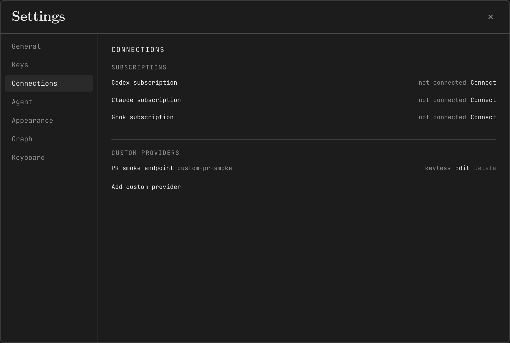

# Subscription and custom-provider connections

Open Settings → Connections. Existing API keys stay in Settings → Keys.

## Subscriptions

Connect Codex, Claude or Grok using the login flow offered by the pinned pi-ai SDK. The app displays the browser link, device code or manual prompt returned by that adapter. Complete sign-in in your normal browser. Closing Connections cancels a pending attempt on a best-effort basis; the server expires abandoned attempts after ten minutes.

A subscription has its own model-picker entry. For example, `subscription-anthropic` and `anthropic` select different authentication sources even when they name the same model. Connect first, then explicitly pick the desired models for the strong, cheap and vision slots. The same engine path serves teaching and practice; background jobs, extraction and compaction use the configured role or slot.

A failed or disconnected subscription does not fall back to an API key. Disconnect removes the local credential without deleting learning records or changing model selections. It is not provider-side revocation, and a request already admitted may still finish. Existing Pi, Codex and Claude Code credential files are never read or imported.

These flows are SDK capabilities, not a guarantee of account entitlement or provider approval for third-party clients. Codex uses the SDK's legacy route. Provider restrictions and available models may change. The application does not bypass a provider rejection. No account login or live subscription inference was performed as part of the automated tests.

## Custom endpoints

Add a provider with a unique `custom-` identifier and its base URL. Supported protocols are OpenAI Chat Completions, OpenAI Responses and Anthropic Messages. Add the exact upstream model IDs and their capabilities. No model discovery request runs automatically.

For a local CLIProxyAPI-compatible server, an example is `http://127.0.0.1:8317/v1` with the protocol that server exposes. Enter that proxy's dedicated client key, or explicitly select keyless if that local server requires none. This only configures the client connection; it does not install a proxy or authenticate its upstream accounts.

Each custom key is bound to that entry's normalized endpoint and protocol. Changing either requires a new key or explicit keyless configuration. Leaving the key blank while editing an unchanged endpoint retains its existing bound key. A failed metadata update cannot make that key authenticate the previous endpoint. Keys are write-only and are not copied from another provider or the process environment. Shell commands, environment substitutions and arbitrary header configuration are not supported.

Remote endpoints require HTTPS; HTTP is accepted for canonical loopback addresses. URL credentials, query strings and fragments are rejected. Literal metadata and link-local destinations are blocked. The application does not resolve DNS during validation, so this is not a complete SSRF sandbox. Only add endpoints you trust. Requests cannot leave the configured origin or follow redirects. Ambient OpenAI organization/project identifiers are removed from custom requests.

## Storage and access boundary

OAuth credentials and custom keys live in `connections/provider-credentials.json` under `LH_DATA_DIR`, separate from the existing API-key file. They are plaintext at rest, protected by owner-only POSIX permissions rather than a keychain. Windows deployments must protect the data directory using their own ACLs. Do not include the connections directory in support bundles or public backups.

Credential updates use atomic replacement and a shared filesystem lock. Only one active LearnHarness instance should use a data directory. An unknown or abandoned acquisition guard fails closed and requires recovery after stopping every process using that directory. Do not remove a lock based on its age.

The new connection-management routes are loopback-only and reject cross-site requests. Mutations require a matching Origin and `X-LearnHarness-Connections: 1`. These checks are not user authentication. Do not expose the server publicly, and do not assume they protect the application's older routes. Remote connection management is outside this change's scope.

Subscription models are labeled Subscription in the picker, not priced as API usage. A custom model without configured rates is labeled Unpriced. Current historical cost aggregation leaves these new provider IDs unpriced; it does not report subscription quota, a subscription charge, or a zero-dollar bill. Optional custom rates describe picker metadata and do not change the historical price table.

## Validation boundaries

Tests use fake OAuth providers, isolated credential files and synthetic streaming responses. They cover refresh serialization, cancellation/disconnect races, auth-source separation and custom key binding. The production standalone build must include the SDK's dynamically loaded OAuth modules and callback page. A successful build or fake-provider request does not establish real-account entitlement, real refresh-token rotation or every supplier's multimodal/tool behavior.
