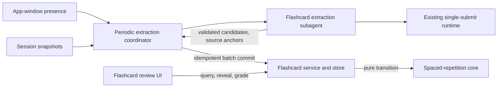

# Flashcards from learning sessions — design proposal

Status: **draft plan for review; no implementation**. Application source and runtime behavior are unchanged by this PR. Contracts and filenames below are proposals, not approved implementation decisions.

## Confirmed product requirements

- Periodically run extraction subagents over learning sessions **only while the app is open**. No OS scheduler or always-on daemon.
- Read **teacher explanations and learner answers**, including evidence of misconceptions. Do not silently inherit the graph extractor's teacher-only source policy.
- Provide **spaced repetition from the first version**.
- Browsing cards, revealing answers, grading recall, and calculating the next due date are independent of an agent. They work with no provider key or connection once cards exist.
- The present change is the plan, including a navigable module/interface graph. Implementation follows review and design approval.

## Existing architecture and constraints

Inspected upstream `b277ee3e0fa24249c1b2d0f9b7fd6ed485f484b9`.

| Existing seam | Evidence | Implication |
| --- | --- | --- |
| Native sessions, not a rendered transcript | `src/core/contracts/chat.ts:29–60`, `src/core/ports.ts:33–65`, `src/store/chats.ts:61–90` | Read `ChatStore` snapshots through injected ports. Do not scrape UI or write cards into chat messages. |
| Teacher-only graph extraction | `src/core/coverage.ts:1–84`, `src/agent/subagents/extraction.ts:110–138` | Flashcard projection and coverage must be separate; graph coverage cannot suppress flashcard work. |
| Single-submit worker | `src/agent/subagents/submit-agent.ts:48–83` | Reuse bounded engine/schema/semantic-validation infrastructure with a new flashcard contract. |
| Jobs can wake the teacher | `src/server/jobs.ts:1–55` | Do not send extraction results through `deliverJobResult`, steer delivery or teacher wake. |
| One SSE connection per open window | `components/server-events.tsx:3–22`, `src/server/events-stream.ts:33–81` | Integrate app presence and notify→fetch with the existing channel, not a polling loop per review component. |
| Window close is not always process exit | `electron/main.cjs:575–587` | On macOS the process remains resident. Process lifetime alone cannot enforce “app open.” |
| Layer boundaries and sole writers | `docs/architecture.md:1–85`, `eslint.config.mjs`, `src/server/stores.ts` | Domain logic stays pure; agents receive ports; store adapters alone touch data; routes use the server barrel. |
| Local desktop API capability | `proxy.ts`, `src/server/desktop-access.ts` | New endpoints remain behind the existing capability check. No scheduler HTTP bypass. |
| Deletion and compaction already exist | `src/server/chats.ts:49–68`, `src/server/compaction.ts:267–290` | In-flight extraction needs cancellation and precommit revision checks; deleted/compacted source cannot be silently treated as unchanged. |

No flashcard implementation was found in source. Historical roadmap mentions of spaced repetition are not an implementation. The architecture document contains older Practice descriptions; current code and contracts take precedence.

## Proposed boundaries

The two routes converge on one owned flashcard store. Only the extraction route calls a model. The diagram's arrows show runtime data flow; the JSON canvas uses the harness convention **caller → provider**.

- **Extraction coordinator:** owns admission, periodic wakeups, source batching, cancellation, retry/backoff and spend accounting. It has no teaching behavior and never grades recall.
- **Extractor:** transforms a bounded immutable source batch into schema-checked candidates with source anchors. Receives model/abort/usage dependencies. It cannot write stores, invoke shell/web tools, wake a teacher or schedule reviews.
- **Flashcard service/store:** one semantic writer for cards, source associations, extraction receipts and review events. UI and worker do not write files directly. Store adapter implements a dedicated core port; no generic database abstraction.
- **Spaced-repetition core:** pure, versioned transition from prior scheduling state + rating + supplied time to new state. No imports from agent/server/store; no network or filesystem.
- **Review UI:** due queue, prompt, reveal, recall rating, next-card navigation and source link. No chat composer or agent-based grading. Ordinary HTTP + existing event notifications.

This adds one flashcard-owned domain; it does not reuse Practice grades as evidence of understanding or mutate graph knowledge state.

## Background lifecycle

Proposed host integration: register authenticated open-window presence in the existing server event lifecycle. One coordinator per server process (shared `globalThis` state, matching turn-liveness conventions); never one timer per tab. Start/resume while at least one app-window lease is live. Stop admitting work and abort model calls when the last window closes or its lease expires. App-level desktop close/quit signals should accelerate release; bounded lease expiry handles abrupt browser loss. Specify the lease duration and what minimized/hidden windows mean before implementation.

The periodic timer only admits eligible work. `turn-settled` can mark a session dirty for the next tick; it must not create an unbounded second trigger path. On reopening, perform a bounded catch-up pass instead of a burst of every missed timer tick. No extraction runs while closed. Persist due dates as timestamps: review queues become due by comparing with the clock on reopening; they need no background timer while the app is closed.

Admission requires configured extraction settings/model/credentials, app presence, no conflicting live extraction, and an eligible persisted session snapshot. Skip a session while a turn or compaction is live, then recheck source fingerprints before commit; use existing turn-liveness/compaction seams rather than guessing from timestamps. A disabled/unconfigured extractor leaves existing cards fully usable. Use cancellation, explicit per-run token/card limits, bounded concurrency, spend recording on both success and failure, and retry backoff. Concrete cadence, budgets, model role and activation defaults remain approval items below.

## Source projection and provenance

Build a dedicated flashcard projection from native `LhMessage` records: teacher-visible explanatory text, learner-visible answers, and the minimal question text/answer pairing necessary to interpret an answer. Learner quiz answers are native `ToolResultMessage` records (`src/core/native-messages.ts:130–150`), not ordinary user prose; project an allowlisted answer/question shape rather than dropping them or forwarding arbitrary tool output. Exclude hidden model thinking, credentials, raw diagnostic/provider payloads and unrelated tools. Do not change `messageViewLines` or graph extraction coverage to accomplish this.

Each source unit carries session ID, stable message/answer IDs, role, normalized visible content and content fingerprint. The same projection feeds the worker and the checkpoint calculation. The coordinator derives covered source keys from that frozen input; the model cannot invent coverage IDs. Keep flashcard coverage independent of graph coverage. Prompt/schema/projection versions belong in the extraction key so policy changes can be intentionally reprocessed.

Learner misconceptions inform what a card tests; they are not accepted facts. Candidate output must distinguish evidence supporting the answer from evidence explaining why the card is useful. Reject unknown anchors and unsupported claims; abstention/zero candidates is valid. Exact prompt wording and candidate acceptance policy need human review.

Freeze the source batch before model invocation. Recheck session existence and projected fingerprints before committing. If edits, compaction or deletion invalidate those anchors, discard/requeue without advancing coverage. Do not claim full historical backfill from compacted transcripts: expose unavailable source rather than regenerating invented history.

## Proposed contracts (names and wire shapes for review)

| Boundary | Input | Output and failure behavior |
| --- | --- | --- |
| `tick(now, presence)` | clock, presence lease, configured budgets | `started / idle / blocked` and reason; no duplicate run for a claimed source batch |
| `extract(batch, signal, onUsage)` | immutable source units, prior-card summaries as bounded dedup context, prompt/schema versions | `candidates[]`, anchored coverage disposition, usage; invalid/cancelled/failed run cannot commit |
| `commitExtraction(runKey, expectedSources, candidates)` | validated candidates and source-revision expectations | durable receipt, stable card IDs; same run key returns prior receipt; stale source refuses |
| `listDue(now, cursor, limit)` | supplied time and bounded pagination | saved card/version + schedule revision; no model lookup or spend |
| `recordReview(cardId, cardVersion, scheduleRevision, reviewId, rating)` | stable command ID and rating after reveal | review event + next due state; duplicate command is idempotent, conflicting stale rating returns a conflict |
| `schedule(previous, rating, now, algorithmVersion)` | explicit prior state, approved rating vocabulary, time | deterministic next state and due time; algorithm choice/parameters remain to be approved |

A candidate proposed shape is `front`, `back`, `sourceRefs`, and `supportingEvidence`. The store, not the model, assigns card identity and scheduling state. Review events reference the precise card content version reviewed; future content edits must not rewrite historical reviews.

Proposed transport: `GET /api/flashcards?due=...`, `POST /api/flashcards/:id/reviews`, a separate settings/status surface, and `flashcards-changed` notifications followed by refetch. These routes delegate to `@/src/server`; components import only `@/src/core`. Error envelopes include missing card, malformed rating, stale revision and unavailable/corrupt storage. Names are candidates, not locked API design.

## Persistence and race behavior

Keep card content revisions, source associations, successful extraction receipts, and review events under a dedicated flashcard store. Honor the repository's append-only-evidence/derived-state rule: treat due state as a fold or rebuildable cache over versioned review evidence. A single committed batch record should couple accepted cards to its extraction receipt/coverage. Do not separately mark a batch processed before the cards are durable. Exact file/ledger organization and crash-recovery protocol need store-level tests before choosing the format.

Idempotency has two distinct scopes: an extraction run key prevents replaying the same source batch; a canonical card identity/dedup policy handles overlapping batches or repeated concepts. Do not merge semantic near-duplicates automatically without an approved rule. Preserve user edits and review history if later extraction finds a similar card. For a valid zero-card result, record an explicit completed-empty disposition; invalid output is a failure, not empty success.

Coordinate one writer for the same data directory (including duplicate app/server processes), or explicitly refuse the second owner. Do not rely solely on an in-memory lock across processes. Serialize writes or use optimistic revisions so simultaneous grading and extraction do not overwrite each other. The same `reviewId` with different payload is a conflict, not a second review. Multiple windows grading the same schedule revision cannot advance it twice. Specify clock rollback/time-zone handling and persist absolute timestamps. Rebuild caches after crashes; do not claim ordinary file appends alone provide a cross-file transaction.

Session deletion must cancel related extraction and prevent late resurrection. Coordinate flashcard handling with `deleteChatSession`, and choose whether cards are purged, archived, or retained with detached provenance. Keep that decision explicit, including what a learner sees when source links disappear. A corrupt store or newer schema version is an explicit blocked state, never silently treated as an empty deck.

## Spaced repetition and independent interaction

An approved, deterministic SRS algorithm is required for v1; do not substitute a simple remembered/not-remembered queue. Pin algorithm and parameter versions in review history and define migration/replay behavior. Algorithm/library, retention target and rating vocabulary are open decisions; this proposal does not silently choose them.

The learner can open the flashcard page, review a due card, reveal its saved answer, self-rate recall and receive the next due date with network/model access disabled. Grading produces a local review event only. New generated cards appear via notify→fetch without resetting an in-progress card; the learner completes the content version they started. If generation fails, the review flow continues on saved cards.

## Candidate code locations

| Change | Candidate locations |
| --- | --- |
| Domain records, store port, pure SRS | `src/core/contracts/flashcards.ts`, `src/core/flashcards.ts`, `src/core/ports.ts`, browser-safe `src/core/index.ts` |
| Owned storage + service | `src/store/flashcards.ts`, `src/server/flashcards.ts`, composition in `src/server/stores.ts` |
| Coordinator + injected worker | `src/server/flashcard-extraction.ts`, `src/agent/subagents/flashcards.ts`; reuse `submit-agent.ts` with a dedicated schema |
| Presence, activity and settings | `src/server/events-stream.ts`, `components/server-events.tsx`, host lifecycle; `src/core/events.ts`, settings contracts/resolution/model-role mapping |
| UI + transport | `app/flashcards/page.tsx`, `components/flashcards/`, `app/api/flashcards/`, server barrel; navigation entry in the existing shell |
| Deletion and recovery | `src/server/chats.ts`, flashcard store and coordinator; existing graph extraction remains separate |

These are module/file candidates, not promised diff hunks. Before writing application code, follow AGENTS.md and read the installed Next.js guides relevant to the chosen routes and lifecycle hooks.

## Delivery slices and acceptance

1. **Approve policies and domain contracts.** Confirm source scope, lifetime, SRS algorithm, generation costs, duplicate/content-revision behavior and deletion semantics. Pin reference SRS examples and transition invariants.
2. **Ship independent review against deterministic seed cards.** Pure scheduler, owned persistence, routes and keyboard-accessible UI. With all model adapters replaced by throwing spies and no keys present, due/reveal/rate/reload still work; replay reproduces due state; duplicate and conflicting review commands are covered.
3. **Add extraction behind a fake-engine seam.** Validate both teacher and learner projections, structured answers, anchors, abstention, unsupported claims, dedup, retries and crash-before/after-commit behavior. User messages and tool content cannot change worker permissions.
4. **Wire app-open periodic admission.** Fake-clock tests cover two windows/one run, last-window disconnect, macOS resident process, server restart, sleep/resume, disabled/missing model, transient failures and bounded catch-up. Cancelling before completion leaves coverage unadvanced.
5. **Integrate and run a small extraction-quality trial.** Use consented/synthetic teach and practice samples with an independent reference review for factual support, usefulness, atomicity and duplicates. Track spend and failures separately from card-review latency. No real learner data or model spend is needed for deterministic tests.

Required edge cases: source edited/deleted/compacted mid-run; zero-card success; malformed submit; missing credentials; repeated tick; simultaneous ratings; rating after content change; corrupted/newer store version; app closed during provider call; reopening with overdue cards; provider outage during review. Existing lint/import-boundary tests, typecheck and deterministic suite remain implementation gates. This documentation-only PR does not claim those future tests passed.

## Decisions explicitly pending approval

- Extraction interval, source settle/debounce window, lease expiry, concurrency and per-run/spend bounds; enabled-by-default versus opt-in.
- Teach sessions only or practice sessions too; backfill scope; interpretation of “open” for minimized/hidden windows.
- Card formats, source-support threshold, duplicate policy, manual editing/suspension, and automatic activation versus a candidate inbox.
- SRS algorithm/library, parameters, retention target, rating vocabulary, time semantics and revision migration.
- Exact storage format/commit recovery; deletion versus detached-provenance retention; cancellation of running work on last-window close.
- Model role/slot and spend visibility; prompt wording and final API/UX names.

These are intentionally unresolved per AGENTS.md. The confirmed requirements at the top constrain the proposal; merging a plan is not approval to silently choose the remaining product behavior.

## Review artifacts and validation

- [Current architecture slice](flashcards/architecture.json)
- [Proposed task intent](flashcards/intent.json)
- [Composed navigable plan](flashcards/plan.json)

The JSON artifacts use planning-harness schema v1; existing vs proposed nodes and API edges are labeled. Source excerpts are captured from the pinned upstream revision, with hashes. TypeScript was inspected directly: the harness's Python syntax index cannot establish TypeScript coverage. No user sessions, credentials, generated flashcards or source index cache are included.

A planning-harness checkout can validate with `node scripts/plan.mjs validate /path/to/learnharness/docs/plans/flashcards/plan.json` and compose from the map + intent. The agent opens the viewer; the reviewer does not need to run terminal setup commands. See the PR evidence for the checks actually executed.

### Checks executed for this proposal (2026-10-25)

- Shared planning-harness schema validation: passed.
- Composing `architecture.json` + `intent.json` reproduces `plan.json`: passed.
- Existing-node source excerpt ranges and full-file SHA-256 hashes match the inspected checkout: passed.
- Canvas: 8 modules, 9 contracts, every connection routed.
- Textual headless smoke at 140×45: loaded the plan, selected a contract, opened its inspector and viewed proposed intent successfully.
- Agent launcher opened this plan in Kitty and returned readiness.

No LearnHarness runtime code was changed, and its application test suite, live extraction quality, provider calls and spaced-repetition implementation were not exercised. Those are future implementation checks, not evidence claimed by this PR.
