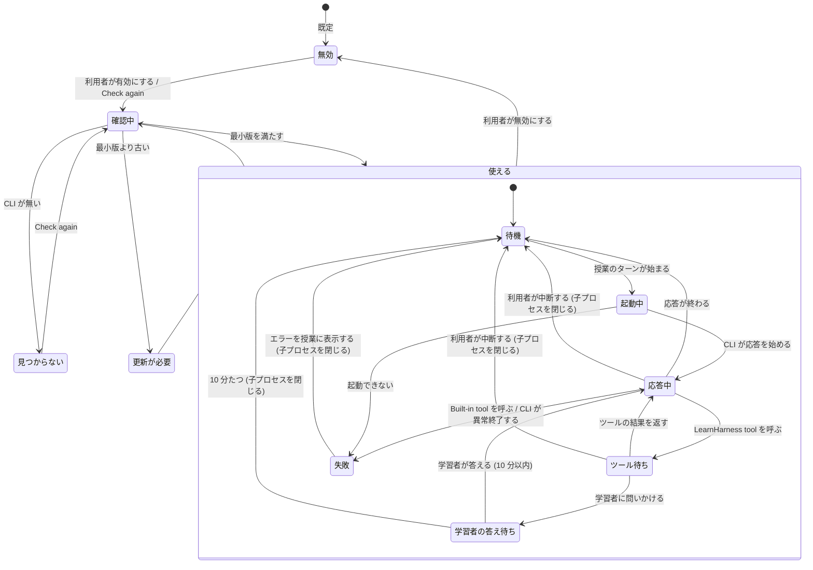
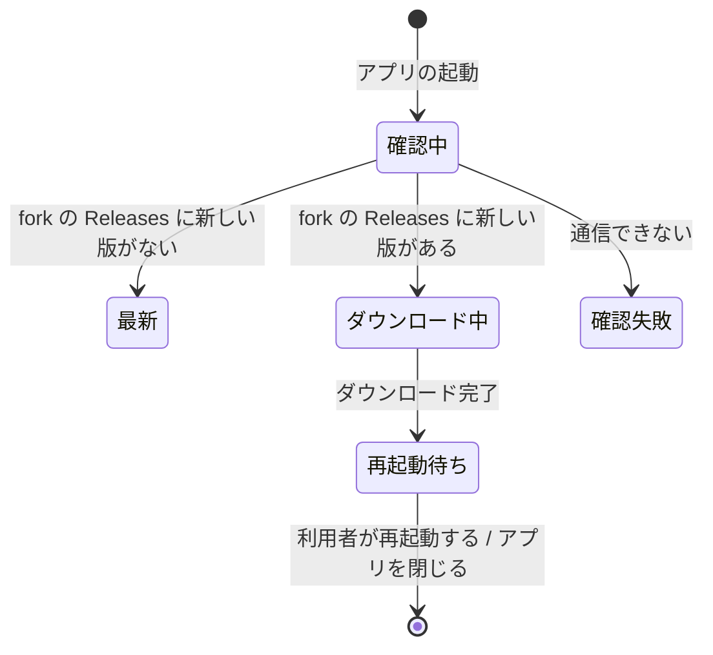

# fork の改良: 外部 CLI プロバイダー・explainer・fork リリース・README

用語は [GLOSSARY.md](../../GLOSSARY.md) に従う。

## Problem Statement

この fork (reeschan/learnharness) の利用者は、手持ちのサブスク (ChatGPT プラン、Google のプランなど) で動く coding-agent CLI を、LearnHarness のモデルとして使いたい。今は外部 CLI プロバイダーが Claude Code しかなく、Codex や Gemini CLI は使えない。

授業で出る図は、1 枚の SVG (Visual) か操作できるデモ (Demo) だけで、図が主役の説明ページ (仕組みを段階的に見せる・比べる) は作れない。

fork を自分の PC (Windows) に入れて使う手段がない。upstream のビルドは macOS 専用のスクリプトで、自動更新も upstream の Releases を見ている。そのため、fork のビルドを入れても upstream 版で上書きされ、upstream 版とデータの置き場も同じになる。

README は upstream 向けの英語だけで、fork で足した機能と使い方が日本語で読めない。

## Solution

- **外部 CLI プロバイダー**: Codex と Gemini CLI を足す。Claude Code と同じく「Settings → Providers → External CLI」に並べ、それぞれの CLI opt-in (既定オフ) で使えるようにする。
  - 授業の 1 ターンは CLI に流すが、ツールは LearnHarness tool だけを使わせ、CLI の Built-in tool は動かさない。
  - 課金と認証は CLI に任せ、金額は表示しない。
- **explainer**: 授業中に教師エージェントが Explainer を頼めるようにする。
  - サブエージェントが visual-explainer の考え方と kit で図が主役の HTML ページを書き、授業のカードに縮小表示する。全画面表示とダウンロードもできる。
- **fork release**:
  - fork 用の appId・製品名にして、upstream 版と別アプリとしてインストールする。
  - `v*` タグで GitHub Actions が Windows インストーラーを作り、fork の Releases に公開する。fork のビルドは fork の Releases からだけ自動更新する。
  - 版は fork version (upstream のパッチ × 100 + 通し番号) にする。
- **README**: fork 向けに書き直した英語版 `README.md` と、同じ内容の日本語版 `README.ja.md` を置き、相互にリンクする。

## User Stories

1. 利用者として、Settings で Codex を External CLI として有効にしたい。ChatGPT プランで動く Codex を授業のモデルにできるようにするため。
2. 利用者として、Settings で Gemini CLI を有効にしたい。Google のプランで授業を受けられるようにするため。
3. 利用者として、外部 CLI プロバイダーが既定でオフであってほしい。知らないうちに CLI が起動したり、課金されたりしないようにするため。
4. 利用者として、Codex と Gemini CLI のインストール状態と版を「Check again」で確かめたい。使えない理由が分かるようにするため。
5. 利用者として、CLI が最小版に満たないときは、更新が必要だと表示されてほしい。壊れた応答で授業が乱れないようにするため。
6. 利用者として、Codex のモデル一覧に、自分のプランで使えるモデルだけが出てほしい。選んでから失敗しないようにするため。
7. 利用者として、Gemini CLI では `pro`・`flash` などの別名でモデルを選びたい。版名を追いかけなくて済むようにするため。
8. 利用者として、Codex の応答が少しずつ表示されてほしい。授業のテンポが落ちないようにするため。
9. 利用者として、外部 CLI のモデルでも、問い (probe)・計画・デモなど LearnHarness tool がいつもどおり動いてほしい。モデルを替えても授業の質が変わらないようにするため。
10. 利用者として、外部 CLI が自分のファイルを書き換えたりシェルを動かしたりしないと分かっていたい。安心して有効にできるようにするため。
11. 利用者として、CLI が Built-in tool を呼ぼうとしたら、そのターンが分かるエラーで止まってほしい。黙って危険な操作が起きないようにするため。
12. 利用者として、外部 CLI のターンを中断したら、CLI の子プロセスがすぐ止まって片付いてほしい。PC に残らないようにするため。
13. 利用者として、外部 CLI のメニューに「CLI 課金」と表示され、金額が推定されないでほしい。費用を誤解しないようにするため。
14. 利用者として、外部 CLI の opt-in を切ったら、以後のリクエストが CLI に流れないでほしい。すぐ止められるようにするため。
15. 学習者として、仕組みや流れが絡む内容で、図が主役の Explainer を授業の中で見たい。文章だけより早く理解できるようにするため。
16. 学習者として、Explainer をカードの中で縮小して見て、ボタンで全画面に広げたい。授業の流れを止めずに細部も見られるようにするため。
17. 学習者として、Explainer を HTML としてダウンロードしたい。後で見返したり人に見せたりできるようにするため。
18. 学習者として、Explainer を見るときに外部のサーバー (フォントの配信など) へ通信が出ないでほしい。データは手元という方針が守られるようにするため。
19. 利用者として、Settings で explainer を Demo や Visual と同じようにオン・オフしたい。使わない授業では呼ばれないようにするため。
20. 利用者として、Explainer が Demo と同じサブエージェントのモデル枠で作られてほしい。モデル設定を増やさずに済むようにするため。
21. 利用者として、Explainer の中のコードがサーバーで実行されないと分かっていたい。生成されたページが危険な処理をしないようにするため。
22. 利用者として、fork のインストーラーを Windows に入れて、upstream 版とは別のアプリとして使いたい。両方を並べて試せるようにするため。
23. 利用者として、fork のアプリが fork の新しいリリースだけで自動更新されてほしい。upstream 版で上書きされないようにするため。
24. 保守者として、`v*` のタグを push するだけで、Windows インストーラーが fork の Releases に公開されてほしい。手作業のリリースを減らすため。
25. 保守者として、手元でも Windows インストーラーを試しにビルドしたい。リリース前に確かめられるようにするため。
26. 保守者として、upstream の版を取り込んだときの fork version の上げ方が `docs/fork/` に書いてあってほしい。版の付け方を迷わないようにするため。
27. 読者として、README を英語と日本語のどちらでも読み、冒頭のリンクで行き来したい。読みやすい言語で fork を理解できるようにするため。
28. 読者として、README で fork が足した機能 (コースパック・外部 CLI・Explainer・fork release) と、ビルドとインストールの手順が分かってほしい。すぐ使い始められるようにするため。
29. 読者として、README で upstream のクレジットと AGPL の義務が分かってほしい。ライセンスを守って使えるようにするため。

## Implementation Decisions

### 外部 CLI プロバイダー (共通)

- Claude Code の仕組みを、CLI ごとに差し替える部分と共通の部分に分ける。
  - **差し替える部分**: 起動の引数、出力を内部イベントに読み替えるパーサー、版の確認、モデル一覧。
  - **共通の部分**: 内部イベント、ツール呼び出しの待ち合わせ、子プロセスの再利用と片付け、履歴の再送。
  - Claude Code の振る舞いは変えない。
- MCP の橋渡しは、ツール呼び出しの照合方法を CLI ごとに差し替えられるようにする。Claude Code は今の照合方法 (呼び出し ID の一致) のまま変えない。
- それぞれの CLI に、設定の項目 (opt-in)・状態の確認 API・設定画面の状態表示・pi-ai へのプロバイダー登録を、Claude Code と同じ形で足す。
- 子プロセスは空の一時ディレクトリで起動する。LearnHarness の鍵ストアが注入した資格情報は渡さない。
- 金額は出さず、メニューには「CLI 課金」と表示する。

### Codex

- `codex app-server` (JSON-RPC over stdio) でつなぐ。experimental の機能なので、最小版を契約に固定し、満たないときは拒否する。
- LearnHarness tool は app-server の dynamic tools として渡す。ツール呼び出しはサーバーからの要求 (callId 付き) で受ける。
- システムプロンプトは base/developer instructions で渡す。
- Built-in tool は、feature の無効化ですべて止める (シェル・unified exec・画像・apps・ブラウザ・computer use・画像生成・メモリ・プラグイン・フック・Web 検索)。そのうえで sandbox を read-only にする。利用者の MCP サーバー (thread/start の `config` で名前ごとに `enabled=false`)・plugins・apps も止める。それでも Built-in tool の item が来たら、そのターンをエラーで止める。
- 利用者の `~/.codex/AGENTS.md` と `~/.codex/skills` は止められず、読み込まれることがある (Codex 0.165.0 で `project_doc_max_bytes=0` でも `instructionSources` に残る)。利用者が受け入れた (2026-11-13、answers/11-decision.md 1a)。設定画面の Codex の説明にこのことを一言書く (PBI-10・11)。
- モデル一覧は app-server から取る。
- 文字の差分 (agent message delta・reasoning delta) を逐次表示する。

### Gemini CLI

- headless の `stream-json` でつなぐ。LearnHarness tool は HTTP の MCP として渡し、設定で LearnHarness の MCP サーバーだけを許可する。
- CLI の認証情報で API を直接呼ばない。必ず公式 CLI のプロセスを通す (agy も同じ)。サブスク枠の認証情報を取り出して Gemini の API を直接呼ぶと、アカウントが BAN される (ユーザーの制約、2026-11-13、answers/13-rework-limit.md)。
- Built-in tool の許可リスト (`tools.core`) には LearnHarness の MCP tool だけを入れ (`["mcp_learnharness_*"]`)、除外リストで Built-in tool を止める。Gemini CLI 0.68.0 では許可リストを空にすると LearnHarness の tool も見えなくなるため (answers/13-rework-limit.md 2-1a)。それでも Built-in tool の呼び出しが来たら、そのターンをエラーで止める。
- Windows では npm が `gemini.cmd`・`gemini.ps1` だけを入れ、`gemini.exe` は無い。`gemini.cmd` の隣の公式 bundle `node_modules/@google/gemini-cli/bundle/gemini.js` を見つけ、PATH の `node` でそれを直接起動する (shell を通さない。`.cmd` を除く方針はそのまま)。これは公式 CLI 経由に当たる (ユーザーが確認)。Node が PATH に無い PC では「Gemini CLI は見つかったが Node が無い」と出して止まる (answers/13-rework-limit.md 2-2a)。
- 画像: headless の入力は文字だけ。最新の学習者のメッセージに画像があれば、そのターンをエラーで止め、`Gemini CLI provider cannot read images. Remove the image or switch the model.` と出す。過去のメッセージの画像は、文の中に `[image omitted]` と書いて渡す (answers/13-rework-limit.md 2-3a)。
- システムプロンプトはシステム MD の差し替えで渡す。
- モデルは別名 (`pro`・`flash` など) を固定で持つ。

### explainer

- 新しいサブエージェントのジョブツール `explainer` を足す。
  - 使えるのは授業のフェーズだけで、Settings でオン・オフできる。
  - モデルは Demo と同じサブエージェントの枠を使う。
  - 既存の Visual と Demo には手を入れない。
- visual-explainer (MIT、0.15.0) の次のファイルをリポジトリに同梱し、MIT の表記を NOTICE に書く。
  - SKILL.md と references (サブエージェントのプロンプトの材料)
  - kit と plan のレンダラー
  - Mermaid の描画 (pele)
- レンダリングはサーバーの Node で行い、ブラウザでの目視チェックはしない (`--no-check` 相当)。出力から Google Fonts の読み込みを取り除く。
- 状態機械のモデル実行 (`<ve-flow>` のモデル) は常に無効にする。スライド・動画・PPTX・ページ内の質問 (`<ve-ask>` と返信) は入れない。
- 結果は授業のカードに縮小表示する。sandbox 付きの iframe を使い、同一オリジンの権限は与えない。拡大ボタンで全画面にし、HTML をダウンロードできる。

### fork release と自動更新

- appId を `com.reeschan.learnharness`、製品名を `LearnHarness Fork` に変え、インストール先とデータの置き場を upstream 版と分ける。
- 自動更新の配信元 (publish) を `reeschan/learnharness` の GitHub Releases にする。
- 版は fork version にする (例: upstream 0.6.1 の上の 1 回目は `0.6.101`)。upstream を取り込んだら、その版の上の `1xx` 系に上げる。
- リリース用のワークフローは、`v*` タグで Windows x64 の NSIS インストーラーを作り、署名はせず、Actions の組み込みトークンで公開する。macOS と Linux のジョブは外す。
- 手元で試しにビルドするためのスクリプト `desktop:dist:win` を足す。

### README

- `README.md` (英語) を fork 向けに書き直し、`README.ja.md` に同じ内容の日本語版を置き、冒頭で相互にリンクする。
- ダウンロードの節は、fork のリリースとビルド手順に差し替える。upstream のクレジット・AGPL・NOTICE の説明は残す。
- README は、ほかの作業がすべて終わってから最後に書く。

### upstream との関係

- fork 専用とし、upstream のファイルへの変更は最小限にする。追加した仕組みと運用は `docs/fork/` と NOTICE に記録する。

## Testing Decisions

良いテストは外から見える振る舞いだけを確かめ、内部の関数の分け方には依存しない。テストは `npm test` (tsx の test runner) で、偽物の CLI と偽物のエンジンで動かし、実際の推論はしない。

合意済みの seam:

1. **外部 CLI のプロバイダーのストリーム関数**: 偽物の `codex app-server` と偽物の `gemini` (既存の `fake-claude.mjs` と同じ形) を使い、次を確かめる。
   - 文字が逐次流れること
   - LearnHarness tool の呼び出しと結果の受け渡し
   - Built-in tool の呼び出しでターンがエラーで止まること
   - 最小版に満たない CLI を拒否すること
   - 中断で子プロセスが片付くこと

   加えて、既存の `claude-code-harness.test.ts` と同じ形で、授業 1 ターンを通しで動かすテストを CLI ごとに 1 本書く。
2. **explainer**: 2 つの境界で確かめる。
   - **ジョブツールの境界**: 偽物のエンジンで、カードの結果が授業に届くこと。
   - **同梱したレンダラーの境界**: 見本の入力に対して、出力が自己完結していること・Google Fonts を読まないこと・`<ve-flow>` のモデルのコードを実行しないこと。
3. **fork release**: 2 つを確かめる。
   - fork version を作る純粋な関数 (upstream の版と通し番号から `0.6.101` などを作る)
   - `electron-builder.yml` を読むテスト (配信元が fork・appId と製品名が fork 用)

   インストーラーそのものは、Actions のリリースで確かめる。

README にはテストを書かない。

既存の手本: `tests/claude-code-stream.test.ts`・`tests/claude-code-harness.test.ts`・`tests/fixtures/claude-code/fake-claude.mjs`・`tests/claude-code-status-ui.test.tsx`・`tests/provider-neutral-agents.test.ts`。

## Out of Scope

- Cursor Agent CLI (Built-in tool を止める手段がないため)
- `codex exec --json` での接続
- macOS・Linux 向けのビルドとリリース、コード署名
- 既存の Visual と Demo の変更
- visual-explainer のスライド・動画・PPTX・ページ内の質問と返信・状態機械のモデル実行・ブラウザでの目視チェック
- Anthropic のサブスクの OAuth を LearnHarness に直接入れること (upstream が除外している方針を変えない)
- upstream への PR

## Further Notes

- Codex の `app-server` と dynamic tools は experimental である。Codex の更新で壊れたら、最小版を上げるか、接続方式を見直す。
- Gemini CLI は、この PC に `npm i -g @google/gemini-cli` で入れて動作確認する。ログインはユーザー自身が行う。
- 自動更新は、fork のリポジトリが公開であることを前提にしている。
- 調査の根拠 (2026-11-13): Codex CLI 0.165.0 の `app-server` の schema、Gemini CLI の公式ドキュメント (headless・MCP・tools 設定)、visual-explainer 0.15.0 の `render.mjs` (純粋な Node、外部依存は Google Fonts のみ)。

## 状態の図

外部 CLI プロバイダーの、使えるかどうかと 1 ターンの流れ (Codex と Gemini CLI で共通):

fork のアプリの自動更新:

