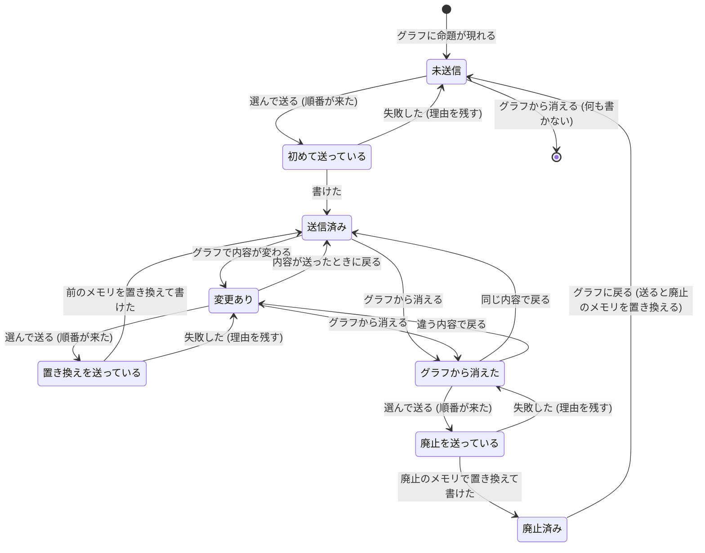

# Shared Memory プラグイン: 知識グラフの命題を shared memory に送る

## Problem Statement

LearnHarness で学んだことは、知識グラフ（命題と推論の連鎖）として LearnHarness の中にだけ溜まる。学習者は、ふだん使うコーディングエージェント（Claude Code・Codex など）とも学んだことを共有したい。それらは shared memory（複数のエージェントが共有する、LearnHarness の外の記憶の置き場。実体は shared-memory の MCP サーバー）を使っている。しかし LearnHarness には、外部の MCP サーバーを足す口が無い。そのため、学んだ命題を shared memory に移す手段が無い。

## Solution

fork に core プラグイン「Shared Memory」を足す（既定は無効）。サイドバーの画面「Send to Shared Memory」に、知識グラフの命題のうち、shared memory との差があるもの（未送信・送ったあとに変更あり・グラフから消えた）を一覧で出す。学習者が選んで（またはすべて選択して）送ると、命題 1 つが shared memory のメモリ 1 件になる。送った内容は sent record に控える。命題が変わったら、送り直すと前のメモリが置き換わる。命題が消えたら、選べば「廃止した」というメモリを書く。

向きは LearnHarness から shared memory に書くだけ。授業中に shared memory を読む向きは、この仕様の範囲外。

## User Stories

1. 学習者として、Settings → Core plugins で Shared Memory プラグインを有効にしたい。使わないときに何も起きないようにするため。
2. 学習者として、プラグインの設定ページで shared memory の MCP の URL を変えたい。サーバーを別の場所（SSH の転送先など）で動かしていても使えるようにするため。
3. 学習者として、URL の既定値が `http://127.0.0.1:7820/mcp` であってほしい。ふつうの構成では設定せずに使えるようにするため。
4. 学習者として、送り先の scope を設定で変えたい。自分の決まりに合った scope に入れるため。
5. 学習者として、scope の既定値が `project:learning` であってほしい。何も決めなくても、学んだことが 1 か所にまとまるようにするため。
6. 学習者として、サイドバーから「Send to Shared Memory」の画面を開きたい。送る作業を 1 か所で済ませるため。
7. 学習者として、まだ送っていない命題を一覧で見たい。何が共有されていないかが分かるようにするため。
8. 学習者として、送ったあとに内容（文・別名・前提）が変わった命題を「変更あり」として見たい。古い内容が shared memory に残り続けないようにするため。
9. 学習者として、送ったあとにグラフから消えた命題を「グラフから消えた」として見たい。もう正しくない記憶を廃止できるようにするため。
10. 学習者として、送ったときと同じ内容の命題は一覧に出ないでほしい。やることだけが見えるようにするため。
11. 学習者として、一覧から命題をチェックして選びたい。送りたいものだけを共有するため。
12. 学習者として、「すべて選択」を使いたい。初めて使うとき、数百件を一度に送れるようにするため。
13. 学習者として、送っている間の進み具合（何件中何件）を見たい。どれだけ待てばよいかが分かるようにするため。
14. 学習者として、送るのを途中で止めたい。間違えて大量に選んだときに止められるようにするため。
15. 学習者として、止めたあと、まだ送っていない命題が元の状態のまま一覧に残ってほしい。あとで続きを送れるようにするため。
16. 学習者として、送った命題が shared memory で、タイトルが命題の名前、本文が命題の文のメモリになってほしい。ほかのエージェントが検索して読めるようにするため。
17. 学習者として、メモリの本文に命題の別名があってほしい。違う言い方でも検索で見つかるようにするため。
18. 学習者として、メモリの本文に、その命題を導く推論の連鎖の前提があってほしい。なぜそう言えるのかが、ほかのエージェントにも伝わるようにするため。
19. 学習者として、メモリの本文に出典（セッション名と日付、またはノートの名前）があってほしい。どこで学んだかをたどれるようにするため。
20. 学習者として、メモリに `learnharness` のタグと、命題が属するクラスターの名前のタグが付いてほしい。tags で絞り込めるようにするため。
21. 学習者として、メモリの書き手が `learnharness` と記録されてほしい。どのエージェントが書いた記憶かが分かるようにするため。
22. 学習者として、メモリの信頼度が `agent_inferred` になってほしい。AI の teacher が述べた内容で、人が確かめたものではないと分かるようにするため。
23. 学習者として、「変更あり」の命題を送ったら、前のメモリが置き換わって（supersedes）ほしい。同じ命題のメモリが 2 件並ばないようにするため。
24. 学習者として、「グラフから消えた」命題を選んで送ったら、廃止したと書いた短いメモリが、前のメモリを置き換えて（supersedes）ほしい。shared memory の決まりどおりに古い記憶を退けるため。
25. 学習者として、一度も送っていない命題がグラフから消えても、何も起きないでほしい。送っていないものの廃止は要らないため。
26. 学習者として、送るのに失敗した命題が、理由と一緒に一覧に残ってほしい（つながらない、秘密情報を含むとして拒まれた など）。直してから送り直せるようにするため。
27. 学習者として、失敗した命題が送ったことにならないでほしい。sent record が shared memory の実際とずれないようにするため。
28. 学習者として、shared memory のサーバーが止まっているとき、画面に「つながらない」と分かる形で出てほしい。サーバーを起こせば直ると分かるようにするため。
29. 学習者として、sent record がアプリの更新やプラグインの無効化・再有効化のあとも残ってほしい。もう一度全部を送り直さずに済ませるため。
30. 学習者として、プラグインが LearnHarness の学習データを書き換えないでほしい。学習の記録を壊さないようにするため。

## Implementation Decisions

- **プラグインの形**: Plugin API v1 の core プラグインにする。id は `shared-memory`、表示名は「Shared Memory」。core プラグインの一覧に載せて同梱し、既定は無効（core プラグインのふつうの扱い）。
- **前提の作業**: shared-memory 側の `write` の `source_agent` に、値 `learnharness` を足す。これは shared-memory のリポジトリの別の作業で、このプラグインより先に済ませる。
- **モジュール**:
  - **サーバー側（backend）**: ロジックをすべて持つ。`activate(ctx)` で次の操作を登録し、フロントから呼べるようにする。
    - 一覧: 差のある命題と、その状態・失敗の理由を返す
    - 送る: 選ばれた命題を順に送る。進み具合は通知で知らせる
    - 止める
  - **差分の計算**: グラフの命題（`ctx.learning.graph()`）と sent record を突き合わせて、各命題の状態を決める。命題の「内容」は、文・別名・前提（その命題を結論とする連鎖の前提の文）・出典・クラスター名。この内容から指紋（ハッシュ）を作り、sent record の指紋と比べる。
  - **本文の組み立て**: 命題 1 つから、タイトル・本文・タグを作る。本文の形は次のとおり。

    ```
    <命題の文>

    別名: <別名をカンマで区切る>（あるときだけ）

    ## 前提（この命題を導く推論の連鎖）
    - <前提の命題の文>
    （連鎖が複数あれば、連鎖ごとに箇条書きを分ける。連鎖が無ければこの節を省く）

    ## 出典
    - <セッション名> (<日付>)   ← セッションから来た命題
    - <ノートの名前>            ← 取り込んだノートから来た命題
    ```

    廃止のメモリは、タイトルを「廃止: <命題の名前>」、本文を「LearnHarness の知識グラフから消えたため廃止した。」とする。
  - **shared memory のクライアント**: 設定の URL の MCP エンドポイントに、MCP の HTTP でつなぎ、`write` ツールを呼ぶ。タイムアウトは固定値。
  - **sent record の保存**: プラグイン専用の保存場所（`ctx.dataDirectory`）に置く。命題 1 つにつき、命題の id・最後に書いたメモリの id・送った内容の指紋・送った日時・廃止したかどうかを持つ。書き込みは原子的に行う。
  - **フロント（画面と設定）**: サイドバーの画面「Send to Shared Memory」と、設定ページ（URL・scope の 2 行）。表示と入力だけを受け持ち、状態の判定を持たない。
- **`write` に渡す値**: scope は設定の値、kind は `semantic`、provenance は `agent_inferred`、source_agent は `learnharness`。tags は `learnharness` とクラスター名（あるときだけ）。`source_path` は渡さない（学習データはこの PC の中のパスで、ほかの PC から開けないため）。置き換えのときは、sent record にある前のメモリの id を `supersedes` に渡す。
- **送る順と止め方**: 選ばれた命題を 1 件ずつ順に送る。止めるときは、今送っている 1 件の結果を待ち、残りは送らない。止めた命題の状態は変わらない。
- **失敗の扱い**: 成功した命題だけ sent record を更新する。失敗した命題は sent record を変えず、理由をプラグインの状態として持ち、一覧に出す。理由は、つながらない・タイムアウト・shared memory が拒んだ（秘密情報など、サーバーのメッセージをそのまま）を見分ける。
- **重複の確認はしない**: 送る前に shared memory を検索して似たメモリを探すことはしない。
- **学習データには書かない**: `ctx.learning` は読むだけにする。

## 状態の図（命題 1 つの、shared memory との関係）



一覧に出るのは、未送信・変更あり・グラフから消えた の 3 つ（失敗の理由があれば添える）。送信済みと廃止済みは出ない。

## Testing Decisions

- **よいテスト**: 外から見える振る舞いだけを確かめる。登録された操作（一覧・送る・止める）の結果と、偽の shared memory のサーバーが受け取った `write` の呼び出しを見る。内部の関数や sent record のファイルの形は直接見ない。
- **合意済みの seam**: プラグインのサーバー側の入口 `activate(ctx)` の 1 か所。
  - `ctx` は偽物を使う。グラフはスタブで渡し、保存場所は一時フォルダーにする。
  - 送り先は、ループバックで立てた偽の shared-memory の MCP サーバーにする。成功・拒否・遅延・接続不可を作り分ける。
  - これで確かめること:
    - 3 つの状態の判定
    - 本文・タイトル・タグ・scope・`supersedes`
    - 失敗が一覧に残り、sent record が変わらないこと
    - 止めたあと、順番が来ていなかった命題が書かれないこと
    - 再起動（activate のやり直し）のあとも sent record が残ること
    - 状態の図の `%% never` の規則
- **フロント**: 画面は表示と入力だけなので、ロジックのテストは書かない。必要なら、既存プラグインの frontend テストの作りに倣って、一覧の描画だけを軽く確かめる。
- **先例**: flashcards の `backend.test.cjs`（偽の `ctx` で `activate` を呼ぶ作り）と、node の組み込みのテストランナー。

## Out of Scope

- 授業中に shared memory を読む向き（teacher が検索して使うツール）。別の仕様にする。
- 知識の抽出が終わるたびに自動で送ること、承認を待つ候補の自動の積み上げ。
- 送る前に shared memory を検索して重複を確かめること。
- セッションごと・連鎖ごとの要約をモデルで作って送ること。
- shared-memory 側の変更（`source_agent` に `learnharness` を足す）そのもの。別の作業として先に行う。
- shared memory に書かれたメモリを Git にコミットすること（shared-memory の決まりどおり人が行う）。
- URL・scope 以外の設定（タイムアウトなど）。

## Further Notes

- 用語は GLOSSARY.md の **Shared memory** と **Sent record** に従う。
- 外部への書き込みは取り消せない。止める操作は、まだ順番が来ていない命題にだけ効く。
- 公開リポジトリなので、仕様・コード・コミットに組織の文脈を書かない。
- shared memory のサーバーがほかの PC にある構成では、SSH のポート転送で `127.0.0.1:7820` を手元に出しておく前提。設定の URL はそのままでよい。
