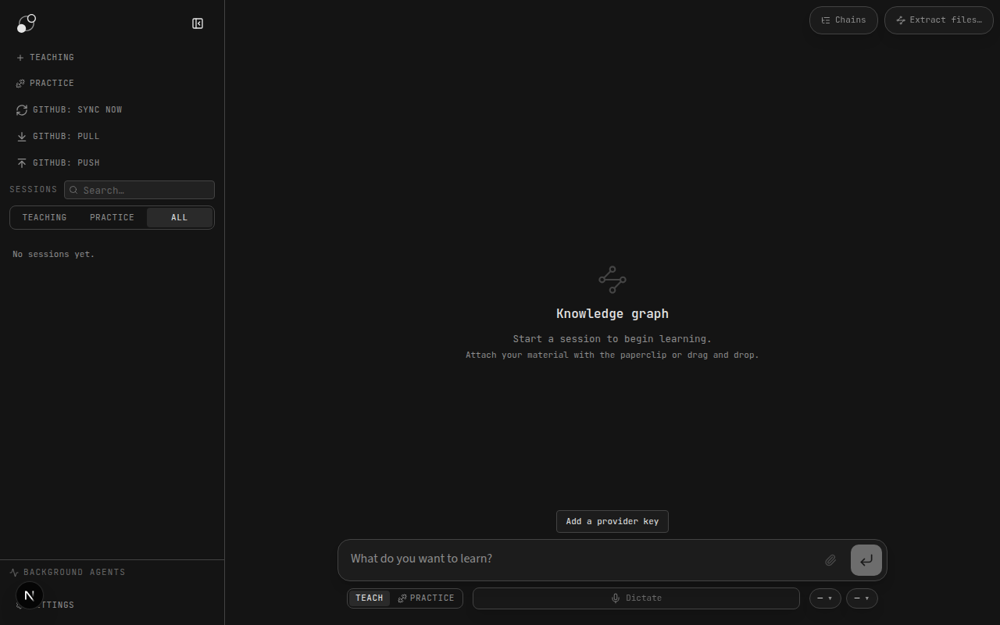
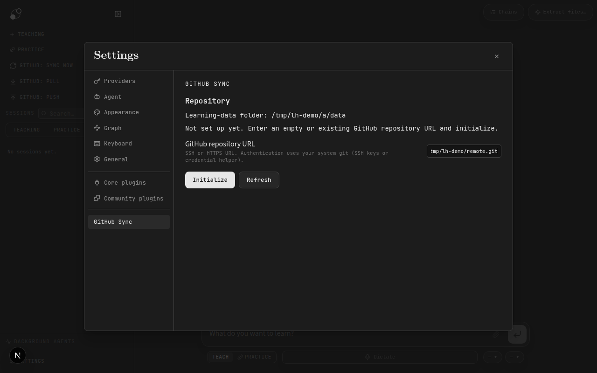
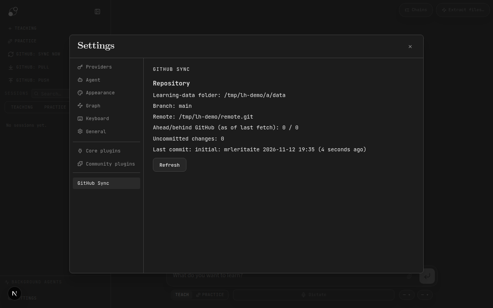
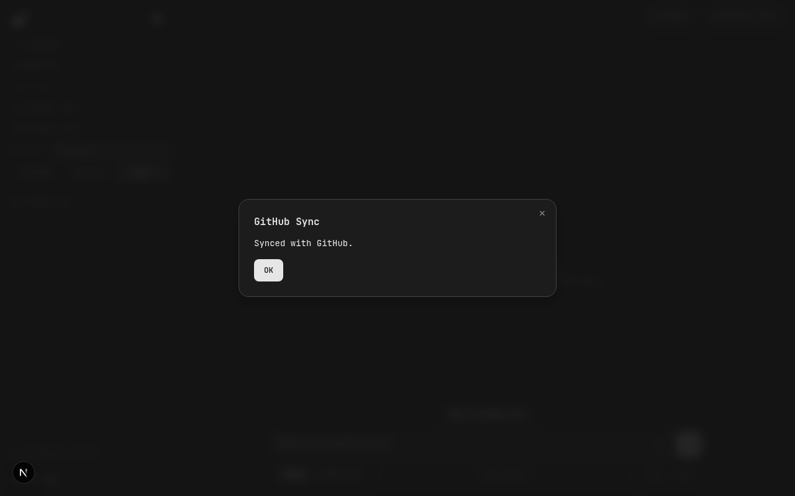
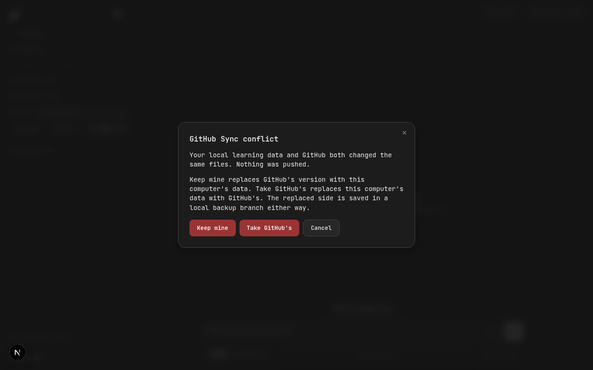
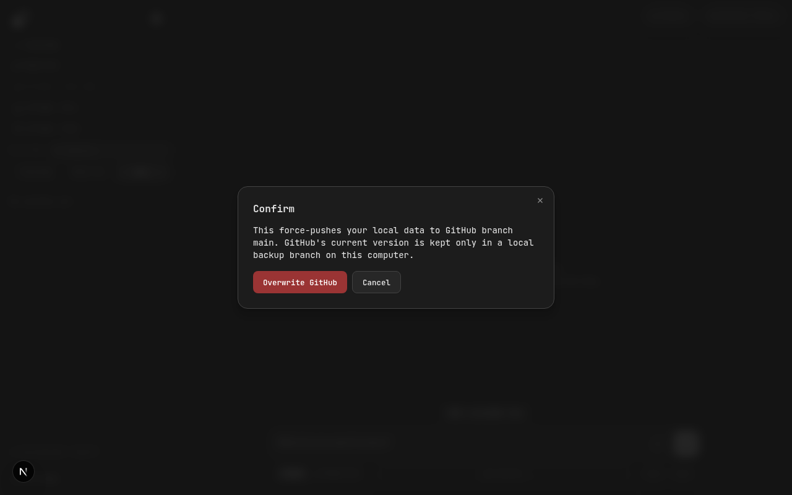
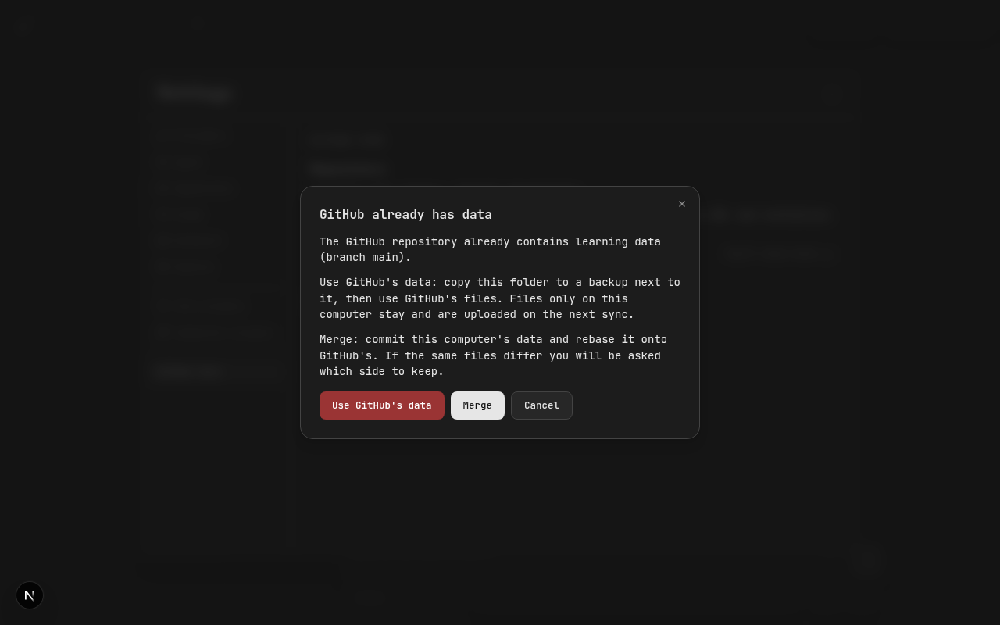

# GitHub Sync

A Community plugin that keeps your LearnHarness **learning-data folder** in a GitHub
repository, so the same chats, jobs, settings and plugin data follow you between
computers. It runs your installed `git`; it has no model calls or tokens. It syncs
automatically when LearnHarness starts, after work ends and when you quit, and from the
sidebar whenever you press a button.

## What it does

The plugin adds three sidebar actions:

| Action | What happens |
| --- | --- |
| **GitHub: Sync now** | Commit local changes → fetch → rebase onto GitHub → push. If GitHub moved during the push, it pulls once more and retries. |
| **GitHub: Pull** | Commit local changes → fetch → rebase onto GitHub. Nothing is pushed. |
| **GitHub: Push** | Commit local changes → push. If GitHub has commits you have not pulled, it stops and asks you to use Sync now. |

Commits are named `sync: <hostname> YYYY-MM-DD HH:MM`. Only one operation runs at a time.

**Changes pause while it syncs.** Each action waits for nothing to be running: if a
lesson, job or extraction is in progress, it says LearnHarness is busy. While it syncs,
the app shows a banner ("GitHub Sync is syncing") with **Cancel**, and changes in the app
are refused until it finishes; reading keeps working.

**After a pull changes files, LearnHarness restarts its server and reloads the window**
so nothing keeps the old data in memory. Without the desktop app (for example `next dev`)
it asks you to restart, and changes stay paused until then.

**Newer data.** If GitHub's data was written by a newer LearnHarness (its
`data-format.json` has a higher chat, graph or settings format), nothing is pulled and
you are asked to update the app first.

## Automatic sync

On by default once the folder is set up; turn it off per computer under
**Settings → GitHub Sync → Automatic sync**.

| When | What happens |
| --- | --- |
| LearnHarness starts | Pull, before any learning data is loaded. A small window shows "Syncing your learning data…" with **Skip**. |
| A lesson, job or extraction ends (and nothing else starts for 3 s) | Commit and push. Never pulls, so it never restarts the app. If GitHub moved on, the push waits for the next start or quit. |
| You quit the desktop app | Running work is stopped and saved, then pull and push. A small window shows "Syncing before quit…" with **Quit now**. |

Start and quit share a 30-second limit; after it, LearnHarness continues and the next
sync catches up. If an automatic sync finds a **conflict**, your local data stays as it
is, automatic sync pauses and the sidebar's Sync action becomes **GitHub: Sync conflict**,
which opens the conflict dialog. Resolving it resumes automatic sync.

**Graph ledgers merge.** The append-only `graph/*.jsonl` files use git's union merge
(`.gitattributes`), so learning on two computers adds both sides' lines instead of
reporting a conflict.

**Conflicts.** If both computers changed the same file, the rebase is aborted (nothing
is half-applied or pushed) and a dialog offers:

- **Keep mine**: GitHub's version is saved in a local branch
  `lh-backup/<host>-<timestamp>-remote`, then your data is force-pushed with
  `--force-with-lease`. If GitHub changed again meanwhile, nothing is overwritten.
- **Take GitHub's**: your version is saved in a local branch
  `lh-backup/<host>-<timestamp>-local`, then the folder is reset to GitHub's version.
- **Cancel**.

Both destructive choices ask for confirmation first. Backup branches are local only;
inspect them with `git log lh-backup/...` inside the learning-data folder.

## Screenshots

Taken from the running app with a throwaway learning-data folder and a local bare
repository standing in for GitHub.

| | |
| --- | --- |
| Sidebar actions |  |
| Settings before setup |  |
| Settings after setup |  |
| Sync result |  |
| Conflict choice |  |
| Confirmation |  |
| Setup when GitHub already has data |  |

## Requirements

- `git` 2.28 or later on the `PATH` of the LearnHarness app.
- Non-interactive access to the repository: an SSH key loaded in your agent, or an HTTPS
  credential helper. The plugin disables terminal prompts, so a missing credential fails
  with git's error instead of waiting.
- A git identity (`git config --global user.name` / `user.email`) for commits.
- A **private** GitHub repository is strongly recommended: the learning-data folder holds
  your chats and learning records. API keys are stored outside this folder (in the app's
  `auth.json`), so they are not uploaded.

## Install

GitHub Sync is a built Community package. With dependencies set up (see
[Development](#development)):

```sh
npm run build
```

Copy the **contents** of `dist/` into `<plugins directory>/github-sync/dist/`. Open
**Settings → Community plugins** to find the plugins directory, then press refresh and
enable **GitHub Sync**.

## Set up

Open **Settings → GitHub Sync**. It shows the learning-data folder and its repository
state. If the folder is not a repository yet:

1. Create an empty private repository on GitHub.
2. Paste its URL (for example `git@github.com:you/learning-data.git`) and press
   **Initialize**.

With an **empty** GitHub repository, the plugin runs `git init -b main`, adds a
`.gitignore` (temporary files, `.DS_Store`, plugin `node_modules/` and `.sdk/`, and this
plugin's per-machine `plugins/github-sync/data/local.json`) and a `.gitattributes`
(union merge for `graph/*.jsonl`), commits and pushes. Folders set up by an earlier
version get the new entries on their next sync.

If the GitHub repository **already has data** (for example from your other computer),
nothing changes locally until you choose:

- **Use GitHub's data**: the whole folder is first copied to
  `<folder>.github-sync-backup-<timestamp>` next to it. Then GitHub's files are checked
  out. Files that exist only on this computer stay and are uploaded on the next sync.
- **Merge**: this computer's data is committed and rebased onto GitHub's; conflicts use
  the choices above.
- **Cancel**.

A learning-data folder that sits inside another git repository (for example `data/`
in a source checkout) is treated as not set up; initializing creates its own repository.

## Limits

- Sync on quit and the start/quit windows need the desktop app. With `next dev` or the
  web server, startup sync still runs (with the time limit) but quit does not sync.
- On LearnHarness versions without the host hold API, only the manual actions work and
  the window reloads after a pull.
- A pull that updates GitHub Sync's own code loads the new code on the next start.
- The plugin syncs the entire learning-data folder; it does not choose individual files.
- It does not install git or manage SSH keys or credentials.

## Development

From `plugins/github-sync/` in a LearnHarness checkout:

```sh
npm run sdk        # generate type-only SDK into .sdk/ (needs the app's npm install)
npm install
npm run typecheck
npm test           # uses temporary repositories and a local bare remote; no network
npm run build
```

Source: `src/git-sync.ts` (git operations), `src/backend.ts` (call-bridge handlers,
lifecycle hooks, hold and restart), `src/local-state.ts` (per-machine settings and
conflict state), `src/main.ts` (sidebar actions, dialogs and settings).
