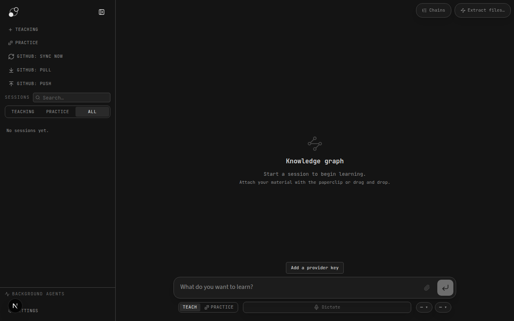
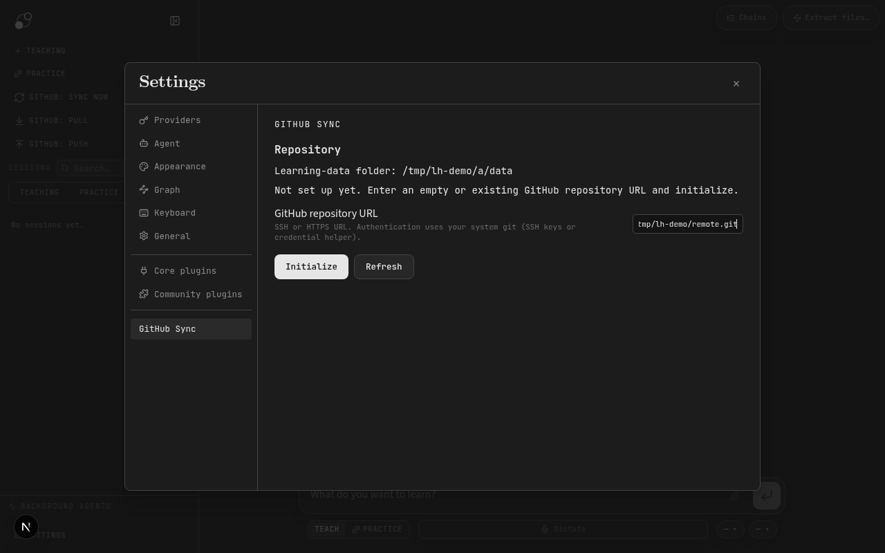
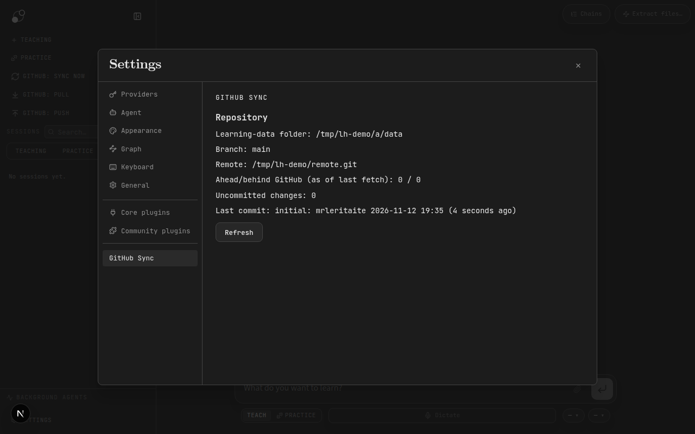
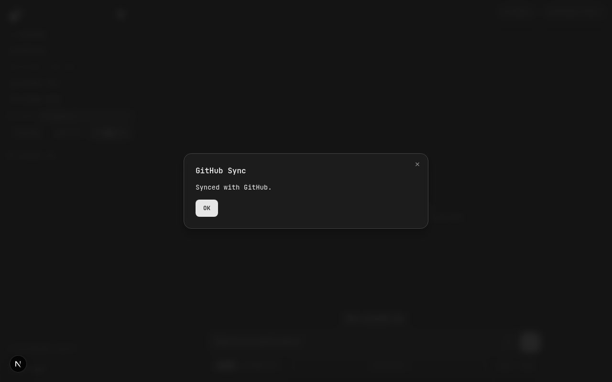
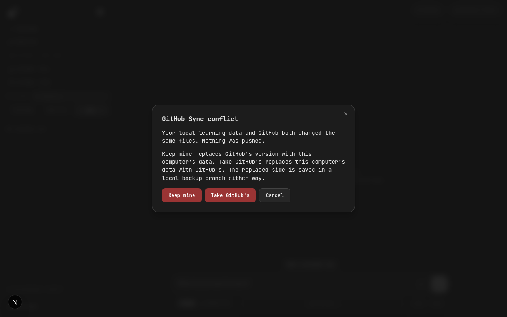
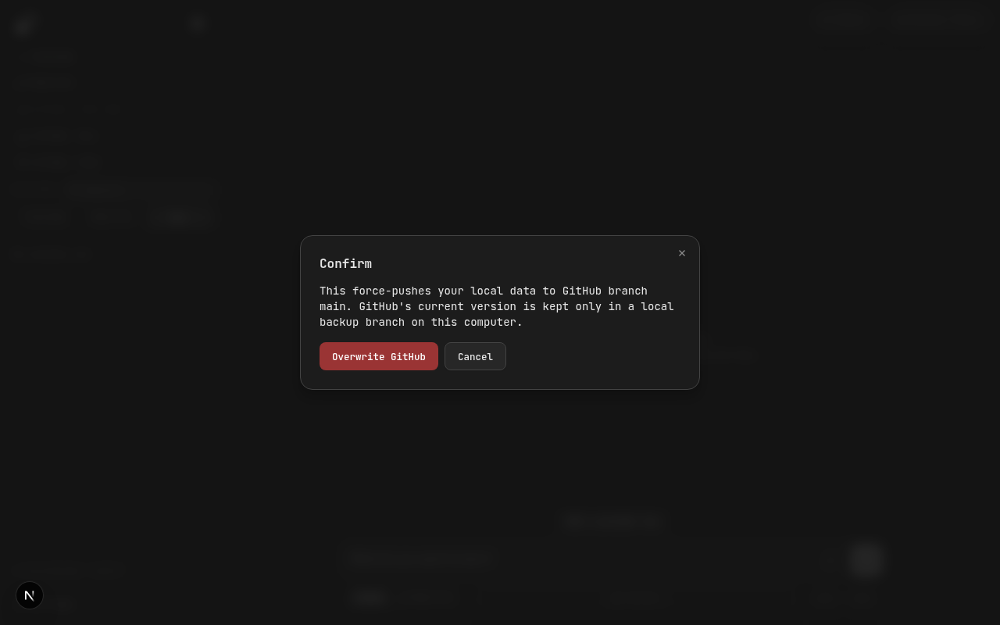
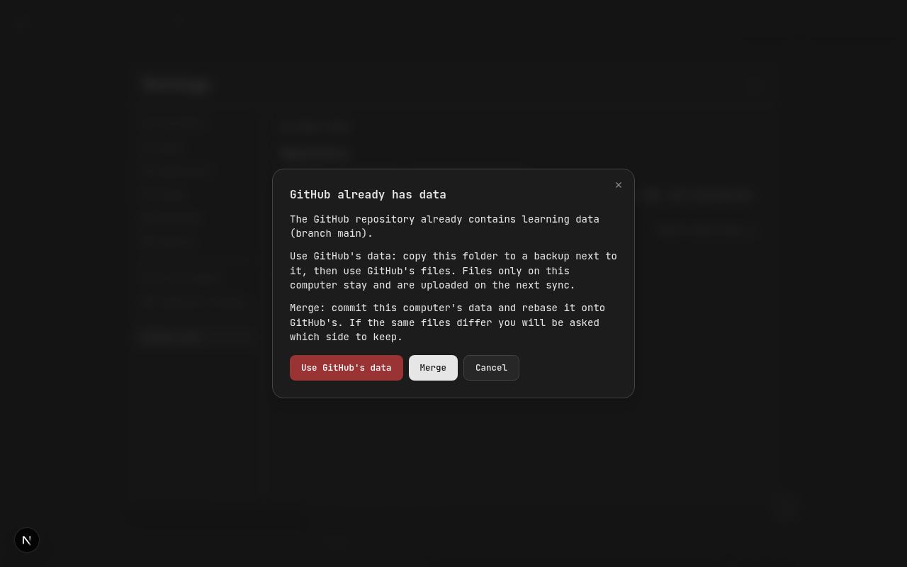

# GitHub Sync

A Community plugin that keeps your LearnHarness **learning-data folder** in a GitHub
repository, so the same chats, jobs, settings and plugin data follow you between
computers. It runs your installed `git`; it has no model calls, tokens or background
schedule. Everything happens when you press a button.

## What it does

The plugin adds three sidebar actions:

| Action | What happens |
| --- | --- |
| **GitHub: Sync now** | Commit local changes → fetch → rebase onto GitHub → push. If GitHub moved during the push, it pulls once more and retries. |
| **GitHub: Pull** | Commit local changes → fetch → rebase onto GitHub. Nothing is pushed. |
| **GitHub: Push** | Commit local changes → push. If GitHub has commits you have not pulled, it stops and asks you to use Sync now. |

Commits are named `sync: <hostname> YYYY-MM-DD HH:MM`. Only one operation runs at a time.

**After a pull changes files, the window reloads** so open pages show the new data.

**Conflicts.** If both computers changed the same file, the rebase is aborted (nothing
is half-applied or pushed) and a dialog offers:

- **Keep mine**: GitHub's version is saved in a local branch
  `lh-backup/<host>-<timestamp>-remote`, then your data is force-pushed with
  `--force-with-lease`. If GitHub changed again meanwhile, nothing is overwritten.
- **Take GitHub's**: your version is saved in a local branch
  `lh-backup/<host>-<timestamp>-local`, then the folder is reset to GitHub's version.
- **Cancel**.

Both destructive choices ask for confirmation first. Backup branches are local only;
inspect them with `git log lh-backup/...` inside the learning-data folder.

## Screenshots

Taken from the running app with a throwaway learning-data folder and a local bare
repository standing in for GitHub.

| | |
| --- | --- |
| Sidebar actions |  |
| Settings before setup |  |
| Settings after setup |  |
| Sync result |  |
| Conflict choice |  |
| Confirmation |  |
| Setup when GitHub already has data |  |

## Requirements

- `git` 2.28 or later on the `PATH` of the LearnHarness app.
- Non-interactive access to the repository: an SSH key loaded in your agent, or an HTTPS
  credential helper. The plugin disables terminal prompts, so a missing credential fails
  with git's error instead of waiting.
- A git identity (`git config --global user.name` / `user.email`) for commits.
- A **private** GitHub repository is strongly recommended: the learning-data folder holds
  your chats and learning records. API keys are stored outside this folder (in the app's
  `auth.json`), so they are not uploaded.

## Install

GitHub Sync is a built Community package. With dependencies set up (see
[Development](#development)):

```sh
npm run build
```

Copy the **contents** of `dist/` into `<plugins directory>/github-sync/dist/`. Open
**Settings → Community plugins** to find the plugins directory, then press refresh and
enable **GitHub Sync**.

## Set up

Open **Settings → GitHub Sync**. It shows the learning-data folder and its repository
state. If the folder is not a repository yet:

1. Create an empty private repository on GitHub.
2. Paste its URL (for example `git@github.com:you/learning-data.git`) and press
   **Initialize**.

With an **empty** GitHub repository, the plugin runs `git init -b main`, adds a
`.gitignore` (temporary files, `.DS_Store`, plugin `node_modules/` and `.sdk/`), commits
and pushes.

If the GitHub repository **already has data** (for example from your other computer),
nothing changes locally until you choose:

- **Use GitHub's data**: the whole folder is first copied to
  `<folder>.github-sync-backup-<timestamp>` next to it. Then GitHub's files are checked
  out. Files that exist only on this computer stay and are uploaded on the next sync.
- **Merge**: this computer's data is committed and rebased onto GitHub's; conflicts use
  the choices above.
- **Cancel**.

A learning-data folder that sits inside another git repository (for example `data/`
in a source checkout) is treated as not set up; initializing creates its own repository.

## Limits

- Pulling happens while the app is open. The window reloads afterwards, but work
  in progress in another window may need a manual reload.
- There is no automatic or scheduled sync, and no sync on app exit.
- The plugin syncs the entire learning-data folder; it does not choose individual files.
- It does not install git or manage SSH keys or credentials.

## Development

From `plugins/github-sync/` in a LearnHarness checkout:

```sh
npm run sdk        # generate type-only SDK into .sdk/ (needs the app's npm install)
npm install
npm run typecheck
npm test           # uses temporary repositories and a local bare remote; no network
npm run build
```

Source: `src/git-sync.ts` (git operations), `src/backend.ts` (call-bridge handlers),
`src/main.ts` (sidebar actions, dialogs and settings).
