# Linux and the shell
id: linux
blurb: Work any server from a prompt: files, pipes, scripts, permissions, processes, networking and SSH.
why: Every cloud VM, every container and every Kubernetes node is a Linux machine you reach through a shell. This module comes first because everything after it runs there.
stage: shell | The shell | Move around a machine and handle files from a prompt.
stage: text | Text and pipes | Answer questions about logs and data by chaining small tools.
stage: system | The system | Read permissions, control processes, and know where configuration lives.
stage: net | Networks and remote machines | Reach other machines, and tell a network problem from an app problem.

## Talking to the shell
id: shell
stage: shell
minutes: 40
goal: Read a command as a program plus an argument list, predict how the shell rewrites that line before the program starts, and use the exit code.
source: GNU Bash manual: Shell syntax | https://www.gnu.org/software/bash/manual/bash.html#Shell-Syntax
source: GNU Bash manual: Shell expansions | https://www.gnu.org/software/bash/manual/bash.html#Shell-Expansions
source: POSIX: Shell command language | https://pubs.opengroup.org/onlinepubs/9699919799/utilities/V3_chap02.html
source: The Linux command line (free book) | https://linuxcommand.org/tlcl.php
source: OverTheWire Bandit, level 0: log in over SSH and start the real game | https://overthewire.org/wargames/bandit/bandit0.html

You type one line. A program later receives a list of strings and, when it ends, a number. Everything painful about the shell sits in the gap between those two facts: the shell rewrites your line before any program sees it, and the only thing the next step in a script can trust is that number.

Without that picture, a filename with a space looks like a bug in `ls`, a `*` deletes the wrong files, and a pipeline "succeeds" while the command you cared about failed. The shell was invented so people could compose small programs. The rewriting rules are the cost of that composition.

### What actually runs

A **shell** is a program. On servers it is almost always `bash`. It reads a line (or a script file), applies the expansion rules below, and then asks the kernel to run a program. The line has a fixed shape once the shell is done with it:

```bash
ls -l --all /var/log
```

- `ls` is the **command**: the program to run. The shell searches the directories in `PATH` for a file with that name. `PATH` is a colon-separated list of directories copied into the process at start, which is why a program you just installed stays "not found" until the directory that holds it is on that list.
- `-l` and `--all` are **options**. Short ones have one dash and can be bundled: `-la` is `-l` and `-a`. Long ones have two dashes and a whole word. The program, not the shell, decides what they mean. `ls` and `grep` both accept `-i`, and the two flags have nothing to do with each other.
- `/var/log` is an **argument**: data for the program.

The program does not receive the text of the line. It receives an **argument vector**: a list of strings, `argv`, plus an environment (a list of `NAME=value` strings) and three open streams. Those streams are standard input, standard output, and standard error. A later command can connect one program's output to the next program's input, but the connection is made by the shell before either program starts. `ls` never sees the quotes you typed. The shell has already used them and thrown them away.


### The order the shell rewrites a line

Bash (and the POSIX shell, for the steps it shares) rewrites each simple command in this order. Later steps see the text earlier steps produced.

1. **Brace expansion**: `file{1,2}.log` becomes two words, `file1.log` and `file2.log`. This happens even inside scripts.
2. **Tilde expansion**: `~` at the start of a word becomes your home directory. `~root` becomes root's home. It does not happen in the middle of a word.
3. **Parameter, arithmetic and command substitution**, left to right. `$name` and `${name}` insert a parameter. `$((1+2))` inserts a number. `` `date` `` and `$(date)` run a command and insert its standard output, with trailing newlines stripped.
4. **Word splitting**. The shell cuts the results of the previous step on characters in `IFS` (default: space, tab, newline). It does **not** split text that you quoted, and it does not split words that were never expanded.
5. **Pathname expansion** (globbing). Each word is matched against files: `*` is any string, `?` is one character, `[abc]` is one of those characters. A word that matches nothing is left as itself, unless you set `nullglob` or `failglob`.
6. **Quote removal**. The quotes that protected text are deleted. The program never sees them.

Then the shell runs the program. This order is why quotes exist. They are not decoration. They freeze a word so that splitting and globbing cannot tear it apart.

```bash
name="my notes"
printf '%s\n' $name
printf '%s\n' "$name"
```

The first `printf` receives two arguments, `my` and `notes`, because the expanded value was split. The second receives one argument, `my notes`. `echo` hides this bug, because `echo` prints its arguments separated by spaces, so both lines look the same. `printf '%s\n'` shows the real argument list. When you are debugging a command, print with `printf '%q\n'` (bash) or prefix the command with `set -x`, which traces the line **after** expansion.

### Every command answers with a number

When a program ends it returns an **exit code** from 0 to 255. `0` means success. Anything else means failure, and the number is the program's own choice of which failure. The shell keeps the last code in `$?`.

```bash
ls /nope
echo $?      # 1 on macOS's ls, 2 with GNU ls
```

`true` is a command that always exits 0. `false` always exits 1. Scripts, CI, and a container's health check all ask "did it work?" by reading this number and nothing else. A program that prints `ERROR` and then exits 0 has succeeded, as far as the shell is concerned.

A **pipeline** is several processes with the standard output of one attached to the standard input of the next. By default `$?` after a pipeline is the exit code of the **last** command only:

```bash
false | true
echo $?          # 0, because true succeeded
set -o pipefail
false | true
echo $?          # 1, because some command in the pipe failed
```

`set -o pipefail` is a bash option. Put it near the top of every script you mean to trust, next to `set -u` (unset variables are an error) and `set -e` (exit when a simple command fails). Together people write `set -euo pipefail`. `set -e` has sharp edges: it does not fire inside `if`, and a failure in a pipeline still needs `pipefail` before `set -e` will notice it. The scripts lesson uses the trio for real.

`cmd1 && cmd2` runs `cmd2` only when `cmd1` returned 0. `cmd1 || cmd2` runs `cmd2` only when `cmd1` returned non-zero. The exit code of the whole chain is the exit code of the last command that actually ran.

### Finding out more, and which shell you are in

- `man ls` opens the manual. `q` leaves, `/word` searches. On a server, the manual matches the installed tool. That is the one to trust.
- `ls --help` prints a short summary on GNU systems. macOS's BSD tools often have no `--help`. Use `man`.
- `type ls` says whether a name is a program on `PATH`, a shell builtin, or an alias. Aliases are an interactive convenience. Scripts should not depend on them, because bash does not expand aliases in scripts unless you ask.
- `echo "$BASH_VERSION"` shows the bash you are in. macOS still ships bash 3.2. Linux distributions ship bash 4 or 5. Arrays declared with `declare -A`, `mapfile`, and `${var,,}` are bash 4. Do not use them if the script must also run on a Mac.

> The practice terminal in these lessons is bash on your Mac, in a throwaway folder with no network. macOS ships the BSD versions of `ls`, `sed`, `stat` and friends. Servers run the GNU versions. Where a flag differs, the lesson says so, and the exercises stick to what both accept.

### Where this breaks

**Unquoted expansions.** `rm $file` is safe only when you already know `$file` contains no spaces and no glob characters. `rm -- "$file"` is the form that survives a file named `-rf` or `*`. The `--` stops option parsing so a leading dash is a filename.

**A glob that matches nothing.** `rm *.log` in an empty directory becomes `rm *.log`, and a literal file named `*.log` would be removed if one existed. With `nullglob` set, the same command becomes `rm` with no arguments, which is a different surprise. Look before you delete: `printf '%s\n' *.log`.

**`echo` and options.** `echo "$name"` does different things across shells when `name` is `-n` or contains backslashes. Use `printf '%s\n' "$name"` in scripts.

**Assuming GNU flags.** `sed -i` without an argument edits in place on GNU sed and refuses to run on BSD sed, which requires `sed -i ''`. `grep -P` is Perl syntax and is missing on macOS. Write the portable form, or say which system the script is for.

**Reading `$?` too late.** Any command you run in between, including `echo`, replaces `$?`. Save it: `status=$?`.

### How this is used at work

CI systems run your script with no terminal attached and fail the job when the exit code is non-zero. A Dockerfile's shell form (`RUN apt-get update && apt-get install -y curl`) is this same `&&` chain, which is why a failed install does not keep going. Kubernetes `command` is an argument vector with no shell at all. If you need a pipe or a variable there, you run `sh -c` on purpose and quote the script as one argument. That is the same rule as this lesson: the shell only rewrites text you actually handed to a shell.

The three streams are standard input, standard output, and standard error. A pipe joins one program's standard output to the next program's standard input, which is why `ls | head` never writes a temporary file. The same expansion rules apply when the commands live in a file: the shell still splits and globs before the program starts, so a script that forgets quotes fails for the same reason an interactive line fails. Git, Docker and Terraform all shell out. When their output looks split in the wrong place, it is almost always this expansion order.

### Which quote

| You want | Write | Why |
|---|---|---|
| Literal text, no expansion | `'*.log'` or `'$HOME'` | Single quotes suppress `$`, backticks and backslashes |
| Expansion, but one argument | `"$HOME"` or `"$(date)"` | Double quotes allow `$` and `$(...)`, and block splitting and globbing |
| Several arguments from a list you control | leave it unquoted, on purpose | Word splitting is the feature, and it will also split on spaces inside items |
| A name that might start with `-` | `rm -- "$file"` | `--` ends options |

### You can now

- Point at a command line and name the program, the options and the arguments the program will actually receive.
- Say which of brace, tilde, parameter, split and glob has already happened, in order.
- Explain why `"$file"` and `$file` are different, and why `echo` can hide that.
- Read `$?`, and explain why `false | true` exits 0 unless `pipefail` is on.
- Choose `man` over guessing a flag, and notice when a flag is GNU-only or bash-4-only.

::: quiz
q: In `grep -in error app.log`, what is `-in`?
- The command
+ Two short options bundled together, `-i` and `-n`
- An argument naming a file
- A pipe
why: Short options can be glued together after one dash. `grep` is the command, `-i` (ignore case) and `-n` (show line numbers) are options, and `error` and `app.log` are arguments.
:::

::: predict lang=shell
q: What does this print?
code:
```bash
ls /this/does/not/exist 2>/dev/null
echo "code: $?"
true
echo "code: $?"
```
answer:
```
code: 1
code: 0
```
why: `ls` fails (macOS's `ls` exits with 1; GNU's uses 2), and `2>/dev/null` only hides its error message. `true` is a program whose only job is to exit with 0.
:::

::: shell
task: Print the text `hello from the shell` (exactly that, on one line).
expect: hello from the shell
solution:
```bash
echo "hello from the shell"
```
hint: `echo` prints its arguments.
:::

::: quiz
q: In bash, when does pathname expansion (the `*` in `*.log`) happen?
- Inside the program, after it has started and opened the directory
- Before parameter expansion, so `$dir/*.log` globs before `$dir` is replaced
+ After parameter expansion and word splitting, and before the program starts
- Only when the command is `ls`
why: The shell builds the argument list, then starts the program. Globbing is step 5 of that rewrite, after `$dir` has been substituted and split. `ls` is not special. `rm *.log` and `printf '%s\n' *.log` both receive the expanded names. The tempting "inside the program" answer is how people explain a glob that matched the wrong directory: the shell globbed in the working directory before `ls` ever ran.
:::

::: quiz
q: A script runs `false | true` and does not set `pipefail`. What is `$?` immediately afterwards, and why?
- 1, because a pipeline fails when any command fails
+ 0, because the default pipeline status is the status of the last command, and `true` exits 0
- empty, because a pipeline has no exit code
- 127, because `false` is not a real program
why: Without `pipefail`, bash reports only the last command in the pipe. `true` succeeded, so the pipeline succeeded, even though `false` failed. That is why a log pipeline can hide a broken producer. `set -o pipefail` changes the status to a failure if any command in the pipe failed. `false` is a real command whose job is to exit 1, so this is not a "command not found" (127).
:::

::: predict lang=shell
q: What does this print? The script is bash, and `printf '%s\n'` prints each argument on its own line.
code:
```bash
title="draft notes"
printf '%s\n' $title
printf '%s\n' "$title"
```
answer:
```
draft
notes
draft notes
```
why: `$title` is expanded and then split on spaces, so `printf` receives two arguments. `"$title"` is one argument, so the space survives. The variable is not named `name` and the words are not the ones from the worked example, but the split is the same rule. `echo` would have printed `draft notes` both times and hidden the split.
:::

::: predict lang=shell
q: What does this print?
code:
```bash
false | true
echo $?
set -o pipefail
false | true
echo $?
```
answer:
```
0
1
```
why: The first pipeline's status is the status of `true`. After `set -o pipefail`, the same pipeline reports failure because `false` failed.
:::

::: shell
task: A file name is stored in a way that will break an unquoted expansion. Create a file whose name is exactly `my notes.txt` (with the space) and whose contents are exactly `ok`. Then print that file's contents with `cat`. Quote so the space stays one argument.
expect: ok
solution:
```bash
printf '%s\n' ok > "my notes.txt"
cat "my notes.txt"
```
hint: Quotes go around the whole name, including the space. `printf '%s\n' ok > "my notes.txt"` writes the file. `cat "my notes.txt"` reads it back.
:::

## Files and paths
id: paths
stage: shell
needs: shell
minutes: 35
goal: Name any file absolute or relative, move around the tree, and know which top-level directory to open when a server misbehaves.
source: man hier | https://man7.org/linux/man-pages/man7/hier.7.html
source: Filesystem Hierarchy Standard | https://refspecs.linuxfoundation.org/FHS_3.0/fhs/index.html
source: POSIX pathname resolution | https://pubs.opengroup.org/onlinepubs/9699919799/basedefs/V1_chap04.html#tag_04_13
source: OverTheWire Bandit, levels 0 to 3: odd filenames and hidden files | https://overthewire.org/wargames/bandit/bandit1.html

A program cannot open "the config". It can open a string of directory names ending in a file. If you cannot build that string from wherever you happen to be standing, every later command (`cp`, `rm`, a script, a systemd unit) aims at the wrong place. Most "it works on my machine" file bugs are a path that was relative when it needed to be absolute, or a `..` that climbed one level further than you thought.

### One tree, no drive letters

Linux has one tree of directories starting at `/`, the **root**. There is no `C:`. A USB stick, a second disk, or a network share appears as a directory somewhere in that tree after it is **mounted**. The directory is still a name in that one tree. The bytes live on whatever filesystem was attached at that directory, which is why `/mnt/data/file` can be a different disk from `/` and still have a path that looks like every other path. A "D: drive" is the same idea with a different name.

A **path** is a string that names one place:

- An **absolute** path starts with `/`. `/home/anna/notes.txt` means the same thing no matter what your working directory is. Scripts, cron, and systemd should use these, because those contexts do not inherit the directory you were sitting in when you tested the command.
- A **relative** path does not start with `/`. `notes.txt`, `src/app.py` and `../shared` are resolved from the **working directory**, the directory the process is "in".

`pwd` prints the working directory. `cd` changes it. `ls` lists it. `cd` with no argument goes home, same as `cd ~`. `cd -` goes back to the previous directory, which is stored in `$OLDPWD`.

The kernel resolves a path by walking components separated by `/`:

```text
/home/anna/src/../notes.txt
  start at /
  enter home
  enter anna
  enter src
  ".." means the parent of src, so back to anna
  open notes.txt
```

Two slashes together (`/home//anna`) collapse to one. A trailing slash on a directory is usually harmless (`/var/log/`). A path that climbs above root stays at root: `cd / && cd ../../..` is still `/`.

| Name | Means |
|---|---|
| `.` | this directory. `./script.sh` runs a script from here even when `.` is not on `PATH` |
| `..` | the parent directory |
| `~` | your home directory, expanded by the shell (see the shell lesson), not by the program |
| `-` | only as the argument to `cd`: the directory you were in before |

`~` is a shell expansion. A program started without a shell, such as a Kubernetes `command:` list, does not expand it. Write `$HOME` inside a shell, or the real absolute path, when the consumer is not a shell.

### Hidden names, and names that are legal but hostile

A name starting with `.` is **hidden** only by convention. `ls` skips it. `ls -a` shows `.`, `..` and dotfiles. `ls -A` shows dotfiles without `.` and `..`. The filesystem itself does not treat `.gitignore` as special. `cp` and `rm` do not skip dotfiles unless the tool you used does. `cp -r src dest` copies `.git` if it is inside `src`. `*` does **not** match a leading dot, so `rm *` leaves `.env` behind. That surprise cuts both ways: it protects `.git`, and it also makes `cp * backup/` miss the file you most wanted.

Names can contain spaces, newlines, and leading dashes. `-rf` is a legal filename. `rm $file` when `file` is `-rf` is how a cleanup command turns into `rm` reading options. Quote, and use `--`: `rm -- "$file"`. Newlines in names are rare and break line-oriented tools (`ls | something`). `find -print0` and `xargs -0`, in the xargs lesson, are the way through.

### Where things live on a server

The Filesystem Hierarchy Standard is the map distributions aim at. Real machines add a few directories. The ones you open during an incident:

| Path | What's there |
|---|---|
| `/etc` | configuration the admin edits. `/etc/nginx/nginx.conf`, `/etc/ssh/sshd_config`. Not the place for programs |
| `/var` | data that varies. `/var/log` logs, `/var/lib` state (database files, docker), `/var/tmp` scratch that survives reboot |
| `/home` | human users' homes. Services often use `/var/lib/name` or `/srv` instead |
| `/srv` | data for services you host, such as `/srv/app` |
| `/usr` | installed software. `/usr/bin` programs, `/usr/lib` libraries, `/usr/local` what you installed by hand |
| `/bin`, `/sbin`, `/lib` | on many current distributions these are symlinks into `/usr`, so early boot and the rest share one set of binaries |
| `/tmp` | scratch, often wiped on reboot, and often a separate mount so a full `/tmp` does not fill `/` |
| `/proc`, `/sys` | not disks. Live views of the kernel and of devices. The proc lesson goes through `/proc` |
| `/dev` | device nodes. `/dev/null` discards writes. `/dev/sda` is a disk, which you do not `cat` |
| `/root` | the root user's home. Not `/` |
| `/opt` | optional add-on software, often a vendor tree like `/opt/google` |
| `/boot` | kernel and bootloader. Small, and full `/boot` breaks the next kernel install |

When a service misbehaves you look in `/etc` for how it was told to run and `/var/log` (or the journal, later) for what it said. When a disk fills you look in `/var` first, not in `/usr`.

macOS is not FHS. `/Users` is home, `/etc` is a symlink to `/private/etc`, and `/var` is `/private/var`. The practice sandbox is a Mac. The paths in these exercises are relative on purpose. The map above is the Linux server you will SSH into.

### Working directory is a property of the process

Each process has its own working directory. `cd` in a script does not change your interactive shell, because the script is a different process (unless you `source` it). `cd` in one terminal tab does not affect another. A program that opens `config.yml` opens it relative to **its** working directory, which might be `/` if systemd started it, not the directory of the binary. That is the usual reason a service "can't find the config" that you can see sitting next to the executable. Either `cd` to the right place before you start it, or pass an absolute path.

`pwd -P` prints the physical path with symlinks resolved. `pwd -L` (the default) prints the logical path you used. If `/var/log` is a symlink, those two disagree, and a script that compares strings will get confused. Prefer not to compare paths as strings. Use the file tests from the scripts lesson.

### A worked walk

You are dropped in `/srv/app` after SSH.

```bash
pwd
# /srv/app
ls
# README.md  src  config.yml
cd src
pwd
# /srv/app/src
ls ../
# README.md  src  config.yml
cat ../config.yml
```

`../config.yml` and `/srv/app/config.yml` are the same file. The absolute form still works after a later `cd /tmp`. The relative form does not.

From `/srv/app/src`, which path is the config? `../config.yml`. `./config.yml` would be `/srv/app/src/config.yml`, which does not exist. `~/config.yml` is `/home/you/config.yml`. `/config.yml` is a file at the root of the disk.

### Where this breaks

**Relative paths in cron and systemd.** Cron's working directory is the user's home, not your repo. A unit file's default working directory is `/`. `./scripts/backup.sh` then means `/scripts/backup.sh`. Use absolute paths, or set `WorkingDirectory=`.

**Symlinks.** `cd /var/log` then `cd ..` logically returns to `/var` even if `log` is a symlink to `/data/log`. `cd -P` walks the physical tree. Backups that copy a symlink sometimes copy the link and sometimes the target (`cp -a` preserves the link, `cp -L` follows it). Know which you invoked.

**Spaces in the path.** `cd /srv/my app` splits into two arguments. `cd "/srv/my app"` or `cd /srv/my\ app`. Tab completion inserts the backslash for you. Scripts must quote `"$dir"`.

**Confusing `/` and `~`.** Deleting `~/tmp` cleans your home. Deleting `/tmp` cleans the world's scratch. The slash is the whole machine.

### How this is used at work

Docker `WORKDIR` sets the working directory for later instructions and for the running container. A `COPY config.yml .` lands in that directory. Kubernetes volume mounts attach a disk or a secret at an absolute path you choose, often `/etc/app` or `/var/lib/app`. Git stores forward slashes even on Windows. Terraform and Ansible copy files to absolute paths on the target. Whenever a config says `path: ./data`, ask "relative to which process?"

### Which path to write

| Situation | Use | Why |
|---|---|---|
| You are exploring | relative, `..`, `cd -` | Short, and you can see where you are |
| A script, cron, systemd, CI | absolute | The working directory is not the one you tested in |
| A path inside a repo | relative to the repo root, and `cd` there first | The repo moves between machines; `/home/you/...` does not travel |
| A name from a variable | `"$path"`, and `--` if the command takes options | Spaces and leading dashes |
| You need the real file behind links | `pwd -P`, `readlink`, or `cd -P` | String prefixes lie about symlinks |

### You can now

- Translate between an absolute path and a relative one from a given working directory, including `..`.
- Explain why `cd` in a script does not move your terminal, and why a service might not see `./config.yml`.
- List the first directory you would open for config, logs, variable data, and installed binaries.
- Say what `ls` hides, and why `*` does not match `.env`.
- Quote a path that contains spaces, and refuse to confuse `~` with `/`.

::: quiz
q: You're in `/srv/app/src`. Which path names `/srv/app/config.yml`?
- `./config.yml`
+ `../config.yml`
- `~/config.yml`
- `/config.yml`
why: `..` goes up one level, from `/srv/app/src` to `/srv/app`. `~` is your home directory, and `/config.yml` would be at the very root.
:::

::: shell
task: The folder has a project in it. Go into `project/src` and print the working directory's last part (the folder's own name) with `basename "$(pwd)"`.
file: project/src/main.py
```
print("hi")
```
file: project/README.md
```
# project
```
expect: src
solution:
```bash
cd project/src && basename "$(pwd)"
```
hint: `cd project/src`, then run the `basename` command from the task. `&&` runs the second command only if the first worked.
:::

::: shell
task: List **every** entry in `conf`, including hidden ones, one per line, but without `.` and `..`. (`ls -A` does exactly that; `-1` forces one per line.)
file: conf/app.yml
```
port: 8080
```
file: conf/.env
```
SECRET=x
```
file: conf/db.yml
```
host: db
```
expect:
```
.env
app.yml
db.yml
```
solution:
```bash
ls -A1 conf
```
hint: `ls -a` would also show `.` and `..`. Look for the capital-A option.
:::

::: quiz
q: A directory contains `.env` and `app.py`. You run `rm *` in that directory. What happens to `.env`?
- It is deleted, because `*` means every file
+ It is left in place, because a glob `*` does not match a leading dot
- The shell refuses to run the command, because a hidden file is present
- `.env` is deleted only if you are root
why: Pathname expansion does not match a name that starts with `.` unless the pattern itself starts with a dot. `rm *` therefore never receives `.env` as an argument. That protects `.git` and also surprises people who thought they had emptied the directory. Hidden is a naming convention for `ls` and globs, not a permission, so root is irrelevant. The shell does not refuse; it expands to the non-dot names and runs `rm` on those.
:::

::: quiz
q: A systemd service starts your program with no `WorkingDirectory=` set, and the program opens `config.yml`. Where does the kernel look for that file?
- In the directory that contains the program binary
+ In the process's working directory, which defaults to `/` for a systemd service
- In the home directory of the user who wrote the unit file
- In `/etc`, because that is where configuration lives
why: A relative path is resolved from the process's working directory, not from the binary's location and not from `/etc`. systemd's default working directory is `/`, so `config.yml` means `/config.yml`. Set `WorkingDirectory=` or pass an absolute path. The home directory is only the default for an interactive login and for cron, not for systemd.
:::

::: predict lang=shell
q: What does this print?
code:
```bash
mkdir -p a/b/c
cd a/b/c
cd ..
basename "$(pwd)"
```
answer:
```
b
```
why: `cd ..` from `a/b/c` lands in `a/b`. `basename` prints only the last component, so the sandbox's absolute prefix does not matter. The answer is `b`, not `c` and not `a`.
:::

::: shell
task: From the starting directory, create the nested path `srv/app/src` and a file `srv/app/config.yml` whose single line is `port: 8080`. Do not print anything. The check only looks at the file.
file: README.md
```
placeholder
```
verify:
```bash
[ "$(cat srv/app/config.yml)" = "port: 8080" ] || { echo "config contents wrong"; exit 1; }
[ -d srv/app/src ] || { echo "missing srv/app/src"; exit 1; }
```
solution:
```bash
mkdir -p srv/app/src
printf '%s\n' 'port: 8080' > srv/app/config.yml
```
hint: `mkdir -p` creates every missing parent. `printf '%s\n' 'port: 8080'` writes one line. The path is relative to where you start.
:::

## Making, copying, moving, deleting
id: files
stage: shell
needs: paths
minutes: 35
goal: Create, copy, rename and remove files and directories, and preview a glob before a destructive command sees it.
source: GNU coreutils manual | https://www.gnu.org/software/coreutils/manual/coreutils.html
source: POSIX mv | https://pubs.opengroup.org/onlinepubs/9699919799/utilities/mv.html

The filesystem does not have a recycle bin, an undo stack, or a "are you sure" for `rm`. The shell will also expand `*` before `rm` starts, so the command you typed is not the argument list `rm` receives. People lose production data by combining those two facts: a glob that matched more than they thought, and a delete that cannot be undone. The fix is a small set of commands whose defaults you can predict, plus the habit of printing the expansion before you delete.

### The five commands

| Command | Does | Sharp edge |
|---|---|---|
| `mkdir logs` | make a directory | fails if `logs` exists or a parent is missing. `mkdir -p a/b/c` creates parents and succeeds if the path already exists |
| `touch notes.txt` | create an empty file, or update the modification time if it exists | does not empty a file that already has contents. To truncate, use `> notes.txt` in the shell (the pipes lesson) |
| `cp a.txt b.txt` | copy a file | if `b.txt` exists it is overwritten. `cp -r dir/ backup/` copies a directory tree. A trailing slash on the source is mostly cosmetic for `cp -r` |
| `mv old new` | rename, or move into another directory | same syscall family as rename. If `new` is an existing directory, `old` moves inside it. If `new` is an existing file, it is replaced |
| `rm file` | unlink a name | `rm -r dir` walks a tree. There is no trash |

`mv` on the same filesystem does not copy bytes. It points a new name at the same inode and removes the old name, so it is fast and does not need a second copy of the disk space. `mv` across filesystems (from `/tmp` to `/home` when they are different mounts) copies and then deletes. A crash in the middle can leave both, or only the new copy. The copy happens because the two directories are different filesystems: a mount attached a second disk at one of those paths, so a rename is no longer a directory update.

`rm` removes a **name**. If another name (a hard link) or an open file descriptor still points at the data, the bytes stay until the last user is gone. That is why deleting a live log can free no space until the service restarts: the process still has the file open. `df` still shows the space used. You will use that fact when a disk is full and `du` does not add up.

### Copy flags that matter on both BSD and GNU

macOS `cp` and GNU `cp` both accept:

- `-r` or `-R`, recursive. Use this for directories.
- `-p`, preserve mode, ownership and timestamps as far as the OS allows. You often cannot preserve ownership without root.
- `-a` is "archive" on GNU (`-dR --preserve=all`). On macOS `-a` is also archive-like. Prefer `-R` plus the specific flag you mean when the script must run on both, and test it.

Do not use `cp --parents` or `cp --backup` in a portable script. They are GNU.

`rm -rf dir` means recursive and do not prompt. `rm -f` on a missing file exits 0, which is what you want in a cleanup script. `rm` without `-f` on a missing file exits non-zero. Never interpolate an untrusted string into `rm -rf`. `rm -rf /` is the famous disaster. `rm -rf "$dest/"` with `dest` empty becomes `rm -rf /` on some setups if you wrote `rm -rf "$dest/"*` badly, and `rm -rf $dest/` with `dest` unset and `set -u` off becomes `rm -rf /`. Set `-u`, and write `rm -rf -- "${dest:?}/"` so an empty variable aborts.

### Globs, again, at the moment of deletion

The shell expands patterns **before** the command runs:

- `*` matches any string except a leading dot: `*.log` is every non-hidden name ending in `.log`
- `?` matches one character: `day?.csv` matches `day1.csv`, not `day10.csv`
- `[abc]` matches one of those characters
- A pattern that matches nothing is left as the literal text, unless `nullglob` is set

So `rm *.tmp` is not `rm` understanding a pattern. The shell turns it into `rm a.tmp b.tmp` and `rm` deletes those names. Preview with `printf '%s\n' *.tmp`. If the preview is the single line `*.tmp`, nothing matched, and `rm *.tmp` would try to delete a file that is literally named `*.tmp`.

`mv *.log archive/` moves every match into `archive`, which must already be a directory. If `archive` does not exist and there is exactly one match, `mv` renames that file to `archive`. If there are several matches and `archive` is not a directory, `mv` errors. Create the directory first with `mkdir -p`.

### A worked tidy-up

A deploy directory has accumulated logs next to the code.

```bash
mkdir -p archive/2025
printf '%s\n' *.log
mv *.log archive/2025/
ls
```

`printf` shows the names. `mv` takes many sources and one destination directory. `app.py` does not match `*.log`, so it stays. This is the same shape as the exercise below.

Copying a project to a backup before you experiment:

```bash
cp -R site site.bak
```

The original stays. `-R` is required. Without it, `cp` refuses to copy a directory.

### Where this breaks

**`mv` into an existing directory.** `mv config.yml /etc/app` moves the file *inside* `/etc/app` if that path is a directory, instead of replacing a file. Check with `test -d`.

**Trailing slash and `rsync`.** You will meet `rsync` later in real work. `rsync -a src dest` and `rsync -a src/ dest/` mean different things. `cp -R` is less subtle, but the habit of reading the slash still matters.

**GNU `mkdir -v`, `cp -u`.** Useful, not portable to the Mac sandbox. Fine on a Linux server if the script says so.

**Aliases.** Interactive bash often aliases `rm` to `rm -i`. Scripts do not use your aliases. A script's `rm` will not prompt, which is what you want, and it will not save you.

### How this is used at work

Build systems `mkdir -p` output directories and `rm -rf` them at the start of a clean build. Git does not store empty directories, so a repo uses a placeholder file or creates the directory at runtime. Docker `COPY` is a copy into an image layer. A bind mount, later, is not a copy: the container and the host share the same files, and `rm` inside the container removes the host's file. Backup jobs are `cp -a` or `tar` (the archives lesson) onto another disk, then a check that the destination has the bytes before anyone deletes the source.

### Which tool

| You want | Command | Not |
|---|---|---|
| A directory and any missing parents | `mkdir -p` | repeated `mkdir` |
| An empty file or a fresh timestamp | `touch` | `mkdir` |
| A second copy | `cp -R` for trees | `mv`, which removes the source name |
| A new name, same bytes | `mv` | `cp` then `rm`, unless you are crossing filesystems and need the copy to finish first |
| Delete | `rm -r --` | a glob you have not printed |
| See what a glob will hit | `printf '%s\n' pattern` | `rm` as the preview |

### You can now

- Create a nested directory, copy a tree, rename a file, and remove a file, with the portable flags.
- Predict what `mv` does when the destination exists and is a directory.
- Preview a glob, and explain the literal-pattern case when nothing matches.
- Explain why `rm` of a live log may not free disk space.
- Refuse to run `rm -rf` on a variable that might be empty.

::: quiz
q: The folder holds `a.log`, `b.log` and `notes.txt`. You run `echo *.log`. What runs?
+ `echo a.log b.log`: the shell expanded the pattern before echo started
- `echo *.log`, and echo looks for matching files
- `echo` with every file in the folder
why: Globs are expanded by the shell. The program only ever sees the final list of names, which is why `echo` is a safe preview of what a pattern matches.
:::

::: shell
task: Tidy the folder. Make a folder `archive/2025`, move every `.log` file into it, and leave `app.py` where it is.
file: app.py
```
print("app")
```
file: jan.log
```
jan
```
file: feb.log
```
feb
```
file: mar.log
```
mar
```
verify:
```bash
[ -f app.py ] || { echo "app.py should stay where it is"; exit 1; }
[ -d archive/2025 ] || { echo "there is no archive/2025 folder"; exit 1; }
[ "$(ls archive/2025 | sort | tr '\n' ' ')" = "feb.log jan.log mar.log " ] || { echo "archive/2025 should hold exactly the three .log files"; exit 1; }
! ls *.log >/dev/null 2>&1 || { echo "some .log files are still in the top folder"; exit 1; }
```
solution:
```bash
mkdir -p archive/2025
mv *.log archive/2025/
```
hint: `mkdir -p` makes both levels at once. `mv` takes many sources and one destination folder.
:::

::: shell
task: Make a backup copy of the whole `site` folder called `site.bak` (with everything inside it).
file: site/index.html
```
<h1>hi</h1>
```
file: site/css/main.css
```
body {}
```
verify:
```bash
[ -f site.bak/index.html ] && [ -f site.bak/css/main.css ] || { echo "site.bak should contain index.html and css/main.css"; exit 1; }
[ -f site/index.html ] || { echo "the original site folder should still be there"; exit 1; }
```
solution:
```bash
cp -r site site.bak
```
hint: Copying a folder needs the recursive option.
:::

::: quiz
q: You run `mkdir -p a/b` and `a/b` already exists as a directory. What is the exit code?
- Non-zero, because the directory exists
+ 0, because `-p` treats an existing directory as success
- 0 only when you are root
- The command is not portable and does not exist on macOS
why: `mkdir -p` creates missing parents and does not fail when the final directory is already there. That is why scripts use it on every run. Plain `mkdir a/b` fails if `a` is missing or if `a/b` exists. `-p` is POSIX, so macOS has it, and root is irrelevant.
:::

::: quiz
q: The shell has `nullglob` off (the default). The directory has no `.tmp` files. What does `rm *.tmp` do?
- It deletes nothing and exits 0, because the glob matched an empty list
+ The shell leaves the word `*.tmp` as a literal argument, and `rm` tries to delete a file with that exact name
- `rm` receives every file in the directory
- The shell refuses to run `rm` when a glob matches nothing
why: With the default bash settings, an unmatched glob is not removed. It stays as the text `*.tmp`. `rm` then looks for a file named exactly `*.tmp` and, finding none, exits non-zero. It does not delete the other files. `nullglob` would turn the command into `rm` with no file arguments, which is a different footgun. Preview with `printf` before you delete.
:::

::: predict lang=shell
q: What does this print? `printf '%s\n'` prints each argument on its own line.
code:
```bash
touch a.log b.log notes.txt
printf '%s\n' *.log
```
answer:
```
a.log
b.log
```
why: The shell expands `*.log` to the matching names before `printf` starts. `notes.txt` does not match. The names come out in the shell's expansion order, which for this set is alphabetical.
:::

::: shell
task: A bad deploy left `build/output.tmp` and `build/keep.txt`. Delete only the `.tmp` file. Leave `keep.txt` and the `build` directory. Print nothing.
file: build/output.tmp
```
junk
```
file: build/keep.txt
```
keep
```
verify:
```bash
[ ! -e build/output.tmp ] || { echo "tmp should be gone"; exit 1; }
[ -f build/keep.txt ] || { echo "keep.txt should stay"; exit 1; }
[ -d build ] || { echo "build directory should stay"; exit 1; }
```
solution:
```bash
rm -- build/output.tmp
```
hint: `rm` removes a file. `--` ends options, which matters when a name starts with a dash. Do not pass `-r` here. You are not removing the directory.
:::

## Editors: vim, nano, and ed
id: editors
stage: shell
needs: files
minutes: 35
goal: Change a file from the keyboard with vim or nano, and change a file from a script with a here-document or ed.
source: Vim | https://wiki.archlinux.org/title/Vim
source: nano | https://wiki.archlinux.org/title/Nano
source: GNU ed manual | https://www.gnu.org/software/ed/manual/ed_manual.html
source: OverTheWire Bandit, levels 25 and 26: escaping a pager into an editor | https://overthewire.org/wargames/bandit/bandit26.html

A server has no mouse. The file you need is `/etc/ssh/sshd_config`, or a unit file, or a script that is already on the machine. You are connected over SSH, so the terminal is a grid of characters, and the program that opens the file is also a terminal program. If you only know a desktop editor, you are stuck, and the temptation is to copy the file to a laptop, edit it, and copy it back. That works until the file is root-owned, the copy drifts, or you are on a jump host where your laptop is not the place the change has to happen.

The other failure is the opposite tool: you start `vim` because a runbook says so, you type, nothing you type appears as text, you type harder, and you close the window. The file may be half-written. On a box you do not own, that is how a one-line change becomes an outage. This lesson is the small set of keys that gets you in and out of the two editors you will actually meet, plus the non-interactive tools you use when there is no terminal at all.

### Two jobs, two kinds of editor

An editor is a program that loads a file into a buffer, lets you change the buffer, and writes the buffer back when you say so. The disk copy does not change on every keystroke. It changes when the editor writes. That is why "I typed it" and "the file contains it" are different claims, and why killing the SSH session can throw away a buffer that was never written.

There are two ways to drive that buffer.

An **interactive editor** assumes a terminal. `vim` and `nano` read keys and redraw the screen. They are what you use when you are sitting at the prompt. A **batch editor** reads commands from standard input, the same way the pipes lesson chains programs. `ed` and `ex` are batch editors. A here-document is even simpler: the shell writes a new file from text in the script. The practice runner in this course is not a terminal. It runs `/bin/bash` with no keyboard. `vim` and `nano` would start and wait for keys that never come, so the graded exercises use a here-document and `ed`. You still have to know the interactive keys, because production work is interactive. You practice the keys as quizzes and cards, and you practice the scriptable forms as shell steps.

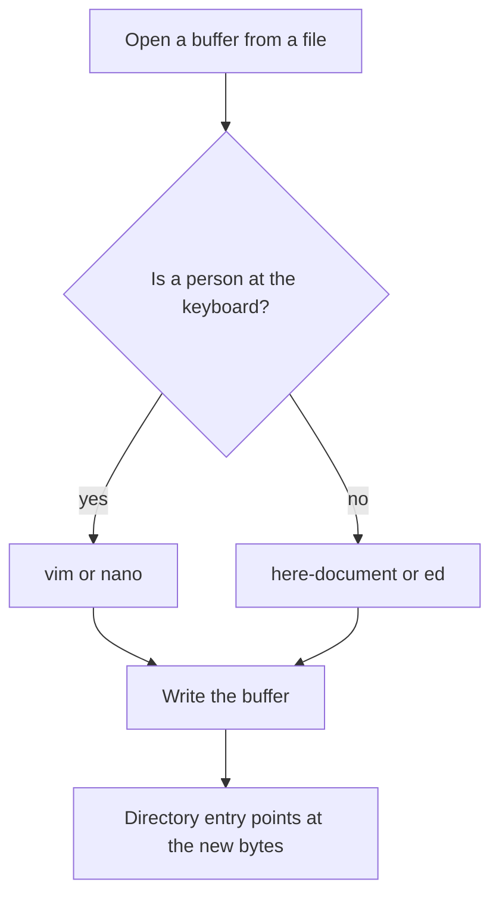

`vim` is a visual front end on the old `ex` line editor, which is itself a descendant of `ed`. When you type `:w`, you are giving `ex` a command. `nano` is a small editor whose commands are chorded with Control, and it prints those chords at the bottom of the screen. Neither one is "the Linux editor". A minimal container often has neither. `ed` is the one POSIX tool you can count on more often, and a here-document needs nothing but the shell from the shell lesson.

### vim is a mode machine

`vim` starts in **normal mode**. Keys are commands, not text. `j` and `k` move, `x` deletes a character, `dd` deletes a line. If you type `hello` in normal mode you are not inserting hello. You are running five commands, and one of them may delete something.

**Insert mode** is where keystrokes become text. From normal mode, `i` inserts before the cursor, `a` inserts after it, and `o` opens a new line below and inserts there. You leave insert mode with Escape. On a laptop the Escape key is sometimes far away, and Ctrl-[ sends the same code. If you are not sure which mode you are in, press Escape. Pressing Escape in normal mode is harmless. It beeps or flashes and stays in normal mode. Then look at the bottom left. `-- INSERT --` means insert mode. An empty corner means normal mode.

From normal mode, `:` opens **command-line mode** for one ex command:

| You type | Effect |
|---|---|
| `:w` | Write the buffer to the current filename |
| `:q` | Quit, but only if the buffer is unchanged since the last write |
| `:wq` | Write, then quit |
| `:q!` | Quit and throw away the buffer, even if you changed it |
| `:w other.txt` | Write a copy to a different name |

`:q` refusing to quit is the editor protecting you. The tempting reaction is to kill the terminal. Don't. Either `:w` if you meant the change, or `:q!` if you did not. `:q!` is not a crash. It is an explicit discard.

These normal-mode commands cover almost every small edit:

| Key | Effect |
|---|---|
| `dd` | Delete the current line into the yank register |
| `yy` | Yank (copy) the current line |
| `p` | Put (paste) that register after the current line |
| `/pattern` | Search forward for a basic regular expression |
| `n` | Repeat the search in the same direction |
| `u` | Undo the last change |
| `Ctrl-r` | Redo |

Search uses the same regular-expression ideas as the regex lesson, but vim's default is its own magic syntax, not `grep -E`. For a literal dot, type `/\.conf` rather than `/ .conf`. `/` searches. It does not save. After you land on the line, you are still in normal mode. `i` to type, Escape when the phrase is done, `:w` to commit.

A realistic pass, the kind you do on a host after the SSH lesson: open the file, search, change one token, write, quit.

```text
vim /etc/ssh/sshd_config
/PermitRootLogin
```

The cursor sits on that line. `cw` changes the word under the cursor: it deletes the word and leaves you in insert mode. You type `no`, press Escape, then `:wq`. You did not rewrite the file by hand. You changed one token and left a trail you can explain. After that, the running `sshd` does not notice until it is reloaded. Editing a file and reloading a process are different steps, because the process keeps the configuration it read at start until a signal tells it to read the file again.

If vim says `E45: 'readonly' option is set`, the file is not writable by this user. Quit with `:q!` and come back through `sudoedit` or `sudo -e`, which copy the file, run your editor as you, and replace the original as root only if the editor exits successfully. Do not `sudo vim` as a habit if you can avoid it: it runs the whole editor as root, and a typo in a plugin or a macro is a root typo. The mode bits decide whether this user can write the file. `sudo` is a separate decision: it runs a command as root if the policy says so, which is why a read-only file and a missing sudoers rule feel the same at the keyboard and are not the same fix.

### nano keeps the commands on screen

`nano` is the editor to use when you do not trust yourself in vim today. It opens in a single mode. What you type goes into the buffer. The bottom two rows list commands, with `^` meaning Control:

| Chord | On screen | Effect |
|---|---|---|
| `Ctrl-O` | `^O Write Out` | Write the buffer. It asks you to confirm the filename. Press Enter to accept it. |
| `Ctrl-X` | `^X Exit` | Leave. If the buffer is dirty it asks whether to save. |
| `Ctrl-K` | `^K Cut` | Cut the current line |
| `Ctrl-U` | `^U Uncut` | Paste the cut line |
| `Ctrl-W` | `^W Where Is` | Search. It prompts for the text. |
| `Ctrl-G` | `^G Help` | The built-in help |

`Ctrl-O` does not mean "open". That is the muscle memory from a desktop. In nano, open is what you did on the command line (`nano file`), and `Ctrl-O` writes. Mixing them up is how people "save" by doing nothing and then exit without writing.

A small edit in nano is: arrows to the line (or `Ctrl-W`, type the word, Enter), type the replacement, `Ctrl-O`, Enter, `Ctrl-X`. There is no normal mode to escape from. The cost is that every command is a chord, and large structured edits are slower than vim. That is a fair trade for a file you touch twice a year.

nano still has the write-versus-buffer split. `Ctrl-X` and then answering `N` throws the buffer away, the same decision as vim's `:q!`. Answering `Y` writes first, the same decision as `:wq`.

### When nobody is at the keyboard

Scripts, CI, and this course's practice shell cannot drive vim. You have three honest options.

**Replace the whole file** with a quoted here-document. The shell lesson showed that quotes change expansion. A quoted delimiter does not expand `$` or backticks inside the body, which is what you want for a config file that contains `$PATH` or similar.

```bash
cat > greeting.txt <<'EOF'
hello
from
the shell
EOF
```

After that command, `greeting.txt` contains those three lines and a trailing newline. `cat` writes to the file the shell opened. There is no buffer sitting unsaved. This is the right tool when you own the whole contents. It is the wrong tool when the file has eighty lines and you want to change one, because you would have to paste the other seventy-nine into the script and you would silently drop any local edit.

**Change a few lines** with `ed -s`. `ed` reads commands, applies them to a buffer, and writes when you say `w`. `-s` suppresses the byte counts it would otherwise print. A delete of line 1 looks like this:

```bash
printf '%s\n' '1d' 'w' 'q' | ed -s notes.txt
```

The practice sandbox cannot run that pipeline, because `ed` creates a temporary file outside the scratch directory and the sandbox blocks the write. The graded edit therefore uses `sed` on a different file, matching a line by its text rather than repeating this `1d`. On a server, `ed -s` and `sed` are both fair. `sed -i` is the one that differs between BSD and GNU, so prefer `sed '1d' file > file.new && mv file.new file` when you need the change on disk in both places.

`1d` deletes line 1, `w` writes, `q` quits. Input mode, if you need it, starts with `a` (append) or `i` (insert) and ends with a line that is a single `.`. Forgetting the `.` makes `ed` eat the rest of the script as file text. That is the classic batch-edit bug.

`ex -s` is the same family. vim in ex mode is `vim -e`, but a tiny image may not have vim. Prefer `ed` in scripts you want to carry.

**Refuse to edit.** Sometimes the right change is a new file next to the old one, plus a symlink flip, which is what the dotfiles project does. An editor is not the only way to publish a config.

### Where this breaks

**Wrong mode in vim.** You wanted to type `:wq` and you were in insert mode, so the buffer now contains the characters `:wq` and the file was not written. Escape, then `:wq`. If those three characters got inserted, `u` undoes the insert first.

**`:q!` after a good edit.** You did the work and then discarded it because `:q` complained. Read the message. "No write since last change" means the buffer is dirty. It does not mean the file is broken.

**Here-document without quotes.** `<<EOF` expands `$HOME` and `$(...)` in the body. `<<'EOF'` does not. Config files are full of `$`. Quote the delimiter unless you really want expansion.

**`ed` without `w`.** The buffer changed, the process exited, the disk file did not. The same split as vim, easier to miss because you cannot see the buffer.

**`sudo vim` on a file you do not understand.** You can write a syntax error into a file that only root can fix. `sudoedit` plus a check (`sshd -t`, `nginx -t`, `visudo`) is the grown-up version. `visudo` edits sudoers and refuses to install a file that does not parse. A broken sudoers file is a lockout, because `sudo` refuses every command when the policy does not parse, including the command you would use to fix the file.

**Assuming the editor exists.** Debian's small images often ship `vim.tiny` or nothing. Alpine's base image often has neither vim nor nano. Your script should not call them. A human's runbook can say "use nano if vim is hostile".

**`GIT_EDITOR` and `EDITOR` in non-interactive runs.** `git commit` with no `-m` opens `$EDITOR`. In CI there is no terminal, so the command hangs or fails. The scripts lesson's rule applies: pass `-m` or set the message in the file. Cron, from the cron lesson, has the same trap.

### How this is used at work

You SSH in, you `cd` to the service, you open one file, you change one setting, you write, you quit, you reload the process, you watch the log. The editor is the middle of that loop, not the whole job. The file tools from the files lesson (`cp`, `ls`, `rm`) prepare the scene. Permissions decide whether the write succeeds. Pipes and `grep` find the line so you do not scroll a 10,000-line log in vim. A script that must be repeatable does not call vim. It ships the file, or it applies an `ed` script you can read in review.

On a shared host, set `EDITOR` and `VISUAL` in your shell startup so `sudoedit`, `git`, and `crontab -e` open the editor you can actually drive. `crontab -e` is the cron lesson. If you set `EDITOR=vim` and you cannot exit vim, you cannot install a crontab either.

### Which tool

| Situation | Use | Why |
|---|---|---|
| You edit every day and want speed | vim | Modes pay off once your hands know them |
| You edit a server twice a year | nano | The chords are printed on screen |
| A script must replace a whole file | `cat > file <<'EOF'` | No editor binary, no unsaved buffer |
| A script must change a few lines | `ed -s` | Reads commands from stdin, writes on `w` |
| You are root-editing sudoers | `visudo` | It will not install a file that does not parse |
| CI or cron must commit or configure | Do not open an editor | There is no terminal. Pass the text on the command line or in a file |

### You can now

- Say which vim mode you are in, enter insert mode with `i`, and leave it with Escape.
- Write and quit with `:w` and `:q`, and say what `:q!` throws away.
- Delete, copy, and paste a line with `dd`, `yy`, and `p`, and repeat a search with `n`.
- Save and leave nano with `Ctrl-O` and `Ctrl-X`, cut a line with `Ctrl-K`, and search with `Ctrl-W`.
- Replace a file from a script with a quoted here-document, and delete or rewrite lines with `ed -s`, without starting vim.
- Choose vim, nano, a here-document, or ed from the situation, including the case where no terminal exists.

::: quiz
q: You opened a file in vim and typed `i`. What do the next letters do, and how do you get back to a mode where `dd` deletes a line?
- The letters run as commands immediately, and `dd` already works because vim has only one mode
+ The letters are inserted into the buffer. Escape returns to normal mode, where `dd` deletes the current line
- The letters are inserted, and `dd` deletes a line even before you press Escape
- The letters are saved to disk at once, and Escape closes the file
why: `i` enters insert mode, so the following keys are text, not commands. Escape leaves insert mode and returns to normal mode, which is where `dd` means "delete the line". The tempting idea is that vim has one mode and every key both inserts and commands. That is nano, not vim. If you type `dd` while still in insert mode, the buffer gains the two characters d and d, and nothing is deleted. Typing also does not write the file. The disk copy changes only on a write command such as `:w`.
:::

::: quiz
q: vim prints `E37: No write since last change` and refuses `:q`. The buffer contains an edit you do not want to keep. What do you do?
- Kill the SSH session so the editor cannot save
+ `:q!`, which quits and discards the unsaved buffer on purpose
- `:q` a second time. The second try overrides the warning
- `:w!`, because a bang always throws the buffer away
why: `:q` refuses to quit while the buffer differs from the last write. `:q!` is the explicit discard. Killing the session also drops the buffer, but it drops every other unsaved state in that session and teaches you nothing about the message. A second `:q` does not override the check. `:w!` writes. The bang there forces a write past some protections. It does not discard.
:::

::: card
q: In nano, which chords write the buffer, exit, cut the current line, and start a search?
answer: Ctrl-O writes (it then asks you to confirm the filename). Ctrl-X exits, and asks whether to save if the buffer is dirty. Ctrl-K cuts the current line. Ctrl-W starts a search. The caret in nano's on-screen help means Control, so `^O` is Ctrl-O, not a literal caret.
:::

::: card
q: In vim's normal mode, what do `dd`, `yy`, `p`, `/PermitRoot`, and `n` do?
answer: `dd` deletes the current line into the yank register. `yy` copies the current line into that register. `p` pastes the register after the current line. `/PermitRoot` searches forward for that pattern. `n` repeats the same search. These are normal-mode commands. In insert mode the same keys would be typed into the file as text.
:::

::: shell
task: Create `app.env` with a quoted here-document. The file must contain exactly three lines, and the second line must contain the characters `$HOME` rather than an expanded path. Print the file.
expect:
```
MODE=live
ROOT=$HOME/app
note=keep
```
verify:
```bash
# wrong answer tested: cat > app.env <<EOF without quotes, which expands $HOME and fails the expect.
grep -qx 'ROOT=$HOME/app' app.env
```
solution:
```bash
cat > app.env <<'EOF'
MODE=live
ROOT=$HOME/app
note=keep
EOF
cat app.env
```
hint: Quote the word after `<<` so the shell does not expand `$HOME` inside the body. `cat` the file at the end so the result is visible.
:::

::: shell
task: `roster.txt` has four lines. Delete the line that is exactly `hold` and print the other three, in their original order. Do not delete by line number. The sandbox cannot run `ed`.
file: roster.txt
```
ada
hold
ben
chi
```
expect:
```
ada
ben
chi
```
verify:
```bash
# wrong answer tested: sed '1d' roster.txt, which deletes ada and keeps hold.
[ "$(sed '/^hold$/d' roster.txt | paste -sd, -)" = "ada,ben,chi" ]
```
solution:
```bash
sed '/^hold$/d' roster.txt
```
hint: `/^hold$/d` deletes a line only when the whole line is `hold`. `1d` would delete `ada` instead, because `hold` is not line 1.
:::

::: quiz
q: A shell script in CI must update one line of a config file. There is no terminal. What should it run?
- `vim config.txt`, because vim is always installed and will apply a default edit
+ `ed -s`, or a quoted here-document if you are replacing the whole file. A batch tool reads commands from the script
- `nano config.txt`, because nano does not have modes and will save on its own
- `sudo vim -y config.txt`, so vim skips the keyboard
why: CI has no keyboard. vim and nano would wait for keys, or fail because there is no terminal. `ed -s` applies a command script and writes when told. A quoted here-document replaces the whole file without an editor binary. The tempting choice is vim, because it is the editor you know. It is the wrong shape of program for a script. There is no `-y` that turns vim into a non-interactive editor for this job. Use `ed`, or write the file from the shell.
:::

::: card
q: Why do the practice exercises in this lesson avoid starting vim or nano, and what do they use instead?
answer: The practice shell runs bash with no terminal and no keyboard, so vim or nano would wait for keys. The exercises write files with a quoted here-document, or delete a line with `sed`. `ed -s` is the same idea on a real server (commands on stdin, `w` to write, `q` to quit), but this sandbox blocks the temporary file `ed` creates outside the scratch directory. On an SSH session you still use vim or nano yourself.
:::
## Archives: tar and zip
id: archives
stage: shell
needs: files
minutes: 35
goal: Create, list, and extract a tar.gz safely with flags that work on BSD tar and GNU tar, and refuse an archive whose names leave the destination.
source: GNU tar: absolute file names | https://www.gnu.org/software/tar/manual/html_node/absolute.html
source: GNU tar: gzip | https://www.gnu.org/software/tar/manual/html_node/gzip.html
source: GNU tar: integrity | https://www.gnu.org/software/tar/manual/html_node/Integrity.html
source: Archiving and compression | https://wiki.archlinux.org/title/Archiving_and_compression
source: OverTheWire Bandit, level 12: a hexdump of nested archives | https://overthewire.org/wargames/bandit/bandit13.html

You need to move a directory to another machine, or you have just downloaded the source of a tool. Copying the files one by one loses the structure and, over a bad link, loses files in the middle. An archive is one file that contains many files, plus their names. Compression makes that one file smaller. `tar` is the archive you will meet on every server. `zip` is the archive you will meet from laptops and from a lot of Windows and macOS tools. They are not interchangeable, and extracting either one as root into your home directory is how a hostile or merely careless archive overwrites something you needed.

You already have a tree of names on disk. An archive is one file that stores those names and the bytes they point at, and the rule that matters is which names you are willing to let it write back.

### tar stores names, gzip squeezes bytes

`tar` walks a tree and writes a stream of members. Each member has a name, a mode, a size, and the bytes. The name is the path as `tar` stored it, which is not necessarily a path you should extract on your machine. `tar` alone does not compress. The file is a `.tar`, an uncompressed archive, and it is already useful.

`gzip` compresses a stream. A `.tar.gz` or `.tgz` is a tar stream passed through gzip. The pairing is so common that `tar` grew a `-z` flag that runs gzip for you. You do not pipe by hand unless you have a reason.

The flags you need are the same on BSD tar (the macOS one, also common on other BSD systems) and on GNU tar (Linux):

| Flag | Meaning |
|---|---|
| `-c` | Create an archive |
| `-x` | Extract |
| `-t` | List names, do not write them to disk |
| `-z` | The archive is gzip-compressed |
| `-f` | The next argument is the archive file. Without it, tar uses standard input or output |
| `-C dir` | Change to `dir` before doing the work |
| `-v` | Print names as you go. Noisy. Leave it off in scripts |

The order people type is `tar -czf bundle.tar.gz things`. `-f` consumes the next argument, so the archive name must be the word after `-f`. `tar -czf things bundle.tar.gz` would try to create an archive named `things` and will not do what you meant. Bundling the short flags as `-czf` is fine. A separate `-f bundle.tar.gz` is the same command.

Create from inside the tree, or use `-C`, so the member names are `readme.txt` and `sub/note.txt` rather than `home/ada/project/readme.txt`. You want the archive to mean "this project", not "the absolute location it happened to live on my laptop".

```bash
mkdir -p project/sub
printf 'alpha\n' > project/readme.txt
printf 'beta\n' > project/sub/note.txt
tar -czf project.tar.gz -C project readme.txt sub
tar -tzf project.tar.gz
```

The list looks like:

```text
readme.txt
sub/
sub/note.txt
```

`tar` stores the directory `sub` as its own member, then the file inside it. Extract with `tar -xzf project.tar.gz -C out`, after `mkdir out`. Listing first is not optional when the archive came from someone else. `-t` reads names. It does not create files.

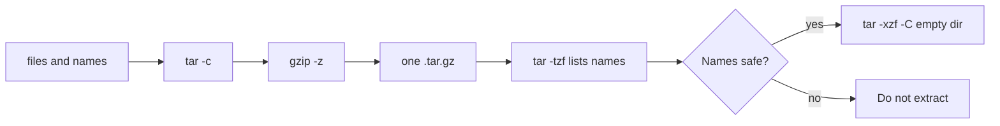

### Zip is a pile of compressed files

`zip -r bundle.zip project` stores each member compressed on its own. You can pull one file out without reading the whole archive. A `.tar.gz` is one gzip stream, so listing or extracting the last member still means decompressing everything in front of it. That difference matters for huge artifacts and almost never matters for a config tree.

`unzip -Z1 bundle.zip` prints member names, one per line, which is the zip equivalent of `tar -tzf`. `unzip -l` also prints sizes and dates. Dates change, so do not scrape `-l` in a script. Zip is the right exchange format when the other side is not a Unix tool. It is a poor fit for a faithful backup: it does not store Unix owners, and its symlink story is weaker than tar's. For a server-to-server copy of a directory, use tar.

### Names that leave the directory

An archive member is just a string. Nothing stops that string from being `../../.ssh/authorized_keys` or `/etc/cron.d/please`. Extracting such a member writes outside the directory you thought you were using. That class of bug is called a tar slip, and zip has the same shape. You do not need a clever exploit to cause one. A buggy packer, a hand-edited archive, or a malicious download all produce the same symptom: files appear somewhere you did not pass to `-C`.

Current GNU tar, documented in its manual, strips a leading `/` when it stores and when it extracts, and it refuses to extract a `..` component that would leave the working directory. The flag that turns those protections off is `--absolute-names`, also `-P`. BSD tar similarly refuses to be a pipe into arbitrary paths unless you ask. Do not pass `-P`. Do not pass `-h` / `--dereference` on extract either: dereferencing symlinks while extracting is how a member named as a symlink to a directory outside the tree, followed by a file through that link, writes outside. The GNU tar integrity section describes that case.

Those defaults are not a reason to skip the check. Other versions, other unpackers, and a copy you made with `-P` by habit will not save you. The practice that survives a bad tool is:

1. List names with `tar -tzf` or `unzip -Z1`.
2. If any name is absolute or contains a `..` segment, stop.
3. Extract into a new empty directory, using `-C`, as a user who does not own the rest of the machine.
4. Only then move the tree into place.

A symlink inside the archive can still point outside. Tar's own extractor may refuse to follow it. The next program you run, `cp -a` or your shell, will follow it. Listing names includes symlink targets when you ask tar for them. If you do not understand a member, do not extract it on a shared host.

`authorized_keys` is the file that decides who can log in, and its mode decides who can rewrite that list, so an archive member with that name is a login change hiding in a tarball. Unpacking as root multiplies the damage, because root can overwrite `/etc` and the crontab that will run as that user later.

### Where this breaks

**`-f` in the wrong place.** `tar -cfz bundle.tar.gz dir` on some tars treats `z` as the archive name, because `-f` took the next argument and `z` was next. Put `f` at the end of the short cluster: `-czf`.

**Extracting in `$HOME` or `/`.** Even a well-behaved archive dumps `readme.txt` into whatever the current directory is. `-C` an empty directory you just created.

**`tar -xzf` of an untrusted file with `-P`.** You turned the safety off. There is almost never a good reason on a server.

**Assuming gzip because the name ends in `.gz`.** `-z` is how tar knows. A misnamed file fails, which is fine. A script that guesses from the name and then pipes through `gunzip` can delete the only copy if someone chains `gunzip` in place. Prefer `tar -tzf` and let tar report the error.

**`zip` and `tar` of the same tree are not equal.** Owners, sparse files, and some symlinks differ. Do not "convert" a system backup to zip to make it smaller and expect to restore the host.

**Disk full halfway through extract.** You have a partial tree and a full filesystem, the disks lesson. Check `df` first. Extract somewhere with room. A partial tree is not a successful deploy.

### How this is used at work

Release artifacts, base images, and "here is the config" bundles are tar.gz files. A deploy script lists, extracts into a staging directory, and swaps a symlink. That swap is the same idea as the dotfiles project: the running tree is one name, the new tree is another, and the switch is atomic enough to retry. CI caches are often tar.gz of dependencies. A cache that is extracted with `-P` into the workspace is a cache that can write outside the workspace.

You will also see `tar -czf - dir | ssh host tar -xzf - -C /dest`. The archive never sits on disk. The pipe means the bytes never sit in a file on the sending side. The remote side is an SSH command, so it only runs if the key and the host key check succeed. The same name checks apply to a stream: you can `tar -tzf` a file, but a stream is harder to inspect twice. For anything you do not trust, write it to a file, list it, then extract it.

Logs and core dumps get gzipped by logrotate. That is gzip on one file, not tar. `gzip -d` or `zcat` reads them. Do not build a tar around a single log unless you are bundling several.

### Which archive

| Situation | Use | Why |
|---|---|---|
| A directory between Unix machines | `tar -czf` | Keeps the tree, works everywhere |
| You only need to look | `tar -tzf` or `unzip -Z1` | Lists names, writes nothing |
| You are unpacking | `mkdir` a new dir, `tar -xzf -C` that dir | Contains a bad member |
| The other side is a desktop tool | `zip -r` | They can open it |
| Someone asks for `-P` or absolute names | Refuse | That flag writes members where the name says |
| One already-compressed log | `gzip`, not tar | There is no tree |

### You can now

- Create a gzip-compressed tar with `-czf`, list it with `-tzf`, and extract it with `-xzf -C`.
- Put `-f` immediately before the archive name, and use `-C` so member names are relative.
- List a zip with `unzip -Z1` and say why zip and tar.gz are different shapes.
- Reject an archive whose names are absolute or contain `..`, and never pass `-P` to "make it work".
- Extract into an empty directory as a user who cannot overwrite the rest of the host.
- Say what a full disk halfway through extract leaves behind.

::: quiz
q: You want a gzip-compressed tar named `project.tar.gz` whose members are the contents of `project`, not the directory name of your home folder. Which command matches BSD tar and GNU tar?
- `tar -cfz project.tar.gz project`
+ `tar -czf project.tar.gz -C project readme.txt sub`, after you decide which paths inside `project` belong in the archive
- `gzip project | tar -xf project.tar.gz`
- `tar -x -z -f project.tar.gz project`
why: `-c` creates, `-z` filters through gzip, `-f` takes the archive name next, and `-C project` stores the paths you list without a long prefix. Putting `z` after `-f` makes `z` the archive name on tars that bind `-f` to the next argument. `-x` extracts. It does not create. Piping `gzip` of a directory into tar is not how either tool is asked to pack a tree. The tempting cluster `-cfz` looks almost right and fails because of flag order.
:::

::: quiz
q: GNU tar's manual says it strips a leading `/` and blocks a `..` member that would leave the working directory, unless you pass `-P`. What should you do with an untrusted archive anyway?
- Pass `-P`, because the archive will not extract without it
+ List the names, refuse absolute names and `..` segments, and extract into a new empty directory without `-P`
- Extract it in your home directory. The default protection is enough on every tar, including old ones
- Rename the file to `.tar` so the dangerous members are ignored
why: The default is a good net, not a policy. Other versions and other unpackers differ, and `-P` disables the net on purpose. Listing with `tar -tzf` shows the names before anything is written. An empty directory plus a non-root user limits the damage if a member still surprises you. Extracting in `$HOME` is how a bad member lands on your keys. Renaming the file does not change the members.
:::

::: shell
task: Create `site/index.html` containing `home` and `site/css/app.css` containing `body`. Pack those paths into `site.tar.gz` with member names that do not include `site/` or your home directory. List the archive.
expect:
```
index.html
css/
css/app.css
```
verify:
```bash
# wrong answer tested: tar -czf site.tar.gz site, which stores the member site/index.html.
tar -tzf site.tar.gz | grep -qx index.html
! tar -tzf site.tar.gz | grep -q '^site/'
```
solution:
```bash
mkdir -p site/css
printf 'home\n' > site/index.html
printf 'body\n' > site/css/app.css
tar -czf site.tar.gz -C site index.html css
tar -tzf site.tar.gz
```
hint: `-C site` changes directory before tar stores `index.html` and `css`. `-czf` creates a gzip tar. `-tzf` lists it. Packing `site` itself puts `site/` on the front of every member.
:::

::: shell
task: `project.tar.gz` is the archive from the previous kind of layout (it is already in this directory). Extract it into a new directory `out`. The check reads `out/readme.txt` and `out/sub/note.txt`.
file: project/readme.txt
```
alpha
```
file: project/sub/note.txt
```
beta
```
setup:
```bash
tar -czf project.tar.gz -C project readme.txt sub
rm -rf project
```
verify:
```bash
set -euo pipefail
[ -f out/readme.txt ]
[ -f out/sub/note.txt ]
[ "$(cat out/readme.txt)" = "alpha" ]
[ "$(cat out/sub/note.txt)" = "beta" ]
```
solution:
```bash
mkdir -p out
tar -xzf project.tar.gz -C out
```
hint: `-x` extracts, `-z` expects gzip, `-C out` chooses the destination. Make `out` first.
:::

::: shell
task: `bundle.zip` contains the `project` tree. Print the member names, one per line, sorted.
file: project/readme.txt
```
alpha
```
file: project/sub/note.txt
```
beta
```
setup:
```bash
zip -q -r bundle.zip project
```
expect:
```
project/
project/readme.txt
project/sub/
project/sub/note.txt
```
solution:
```bash
unzip -Z1 bundle.zip | LC_ALL=C sort
```
hint: `unzip -Z1` lists names without extracting and without dates. Sort so the order is stable.
:::

::: card
q: Why can you extract one member of a zip without reading the whole archive, while a `.tar.gz` does not work that way?
answer: Zip compresses each member separately, so the archive is a pile of compressed files with an index. A `.tar.gz` is one tar stream wrapped in one gzip stream. Reaching the last tar member means decompressing the gzip stream from the start. Use tar for Unix trees and zip when the other side expects zip. Neither format makes an untrusted archive safe to extract in your home directory.
:::

::: quiz
q: A download's `tar -tzf` listing contains `../../.ssh/authorized_keys`. What do you do?
- Extract it with `tar -xzf`. GNU tar will turn that name into a file inside the current directory called `authorized_keys`
+ Do not extract it. A `..` segment is an attempt to write outside the destination, and the archive is untrusted
- Extract it with `-P` so you can see where the file wants to go
- Extract it as root so the write succeeds and you can inspect the file afterwards
why: A member name with `..` is the tar-slip shape. The safe action is to stop, not to "see what happens". `-P` disables the extractor's refusal and is the opposite of what you want. Extracting as root only raises the privilege of a bad write. Current GNU tar tries to block this case, and you still do not extract an archive that announced it. Listing was the point. You already have the answer.
:::

## Reading files
id: reading
stage: shell
needs: paths
minutes: 30
goal: Inspect a file of any size from the shell, and take a slice of it without loading the whole thing.
source: GNU coreutils: head | https://www.gnu.org/software/coreutils/manual/html_node/head-invocation.html
source: less FAQ | https://www.greenwoodsoftware.com/less/faq.html
source: OverTheWire Bandit, level 4: the only human-readable file | https://overthewire.org/wargames/bandit/bandit5.html

Opening a multi-gigabyte log in an editor, or printing it with `cat`, fills your terminal and can fill the disk again if you redirect it. Logs append. The newest clue is at the end, and you usually need fifty lines, not the file. The tools in this lesson only read the slice you asked for (or page through the file) and they work over SSH with nothing installed.

### The tools

| Command | Use it for | Notes that bite |
|---|---|---|
| `cat file` | print a whole small file | also concatenates several files in order. Fine for a config. Wrong for a 4 GB log |
| `head -n 20 file` | the first 20 lines | POSIX. `head -20` works too but `-n` is clearer |
| `tail -n 20 file` | the last 20 lines | logs grow at the bottom, so this is the recent history |
| `tail -n +3 file` | from line 3 to the end | the `+` is "start at", not "last" |
| `tail -f file` | keep printing new lines (follow). Ctrl-C stops | on a server you follow the live log while you reproduce the bug. GNU tail also has `-F`, which reopens the file if it is rotated (the name changes and a new file appears). macOS `tail` follows by file descriptor with `-f` and does not have the same `-F`. On Linux, prefer `-F` for logs that logrotate renames |
| `less file` | page through a big file | space or `f` goes down, `b` goes up, `/word` searches, `n` repeats, `q` quits, `g` and `G` go to start and end. `less +F file` follows like `tail -f` and Ctrl-C drops you into the pager |
| `wc -l file` | count lines | `-w` words, `-c` bytes. `wc` prints padded counts. The comparison in these exercises ignores extra spaces |

`head` and `tail` can be combined. Lines 3 to 5 of a file are "the first 5 lines, then the last 3 of those":

```bash
head -n 5 poem.txt | tail -n 3
```

There is no portable `head -n -1` (drop the last line). GNU accepts a negative count. BSD `head` on macOS does not. Use `sed '$d'` to drop the last line if you must do it on both.

### What a log looks like when you read it this way

A service crashed a minute ago. The file is 2 GB.

```bash
tail -n 50 app.log
```

You see the last 50 lines, which are the last thing the process wrote. `head -n 50` would show the boot message from weeks ago. `wc -l` would count every line and tell you nothing about the crash. `cat` would print 2 GB through your SSH session.

While you click around a site:

```bash
tail -f /var/log/nginx/access.log
```

Each request appears as it is written. That is still the right move when you are on a VM with a file log. On a systemd host the same idea is `journalctl -u nginx -f`, which the journal lesson covers. Containers often have no log file at all: the runtime captures standard output, and you read it with `kubectl logs` or `docker logs`. The habit is the same. Read the end, then follow.

### Binary files and "what kind of file is this"

`cat` on a binary dumps garbage and can change your terminal's settings. `file report.csv` prints a guess from the contents (`ASCII text`, `gzip compressed data`, `ELF`). Use it when an extension lies. `strings file | less` pulls out readable text from a binary when you are desperate. Neither is a parser.

`less` on a huge file does not read it all up front. It seeks. That is why it is safe where an editor is not.

### Where this breaks

**`tail -f` and rotation.** If the app renames `app.log` to `app.log.1` and opens a new `app.log`, a follow that tracks the original file descriptor keeps watching the old, frozen file. GNU `tail -F` follows by name. If you are stuck, stop and start the follow again.

**`head` closes the pipe early.** `head -n 1` reads one line and exits. The producer may then get SIGPIPE and exit 141. That is normal, and it looks like a failure in `set -o pipefail` scripts. The pipes lesson explains the signal.

**Line endings.** A file from Windows has `\r\n`. `cat -A` (GNU) or `od -c` shows the hidden `\r`. A "same" line that fails a string compare often has a carriage return. BSD `cat` has no `-A`. `od -c file | head` works on both.

**`wc -l` and a missing final newline.** `wc -l` counts newline characters, not visual lines. A file whose last line has no newline is short by one. Editors usually add the newline. The checker for these lessons adds one to files it creates.

### How this is used at work

Incident response starts with the last lines of the log, then a search (the grep lesson), then a count (the textproc lesson). CI logs are the same shape: scroll to the bottom, find the first error, ignore the pages of compilation that followed it. `kubectl logs --tail=100` and `docker logs --tail` are `tail` with a remote file. When someone pastes a 10 MB log into chat, ask for the last 50 lines instead.

### Which reader

| You have | Use |
|---|---|
| A short config | `cat` |
| The start of a file, or a sample | `head -n` |
| The recent part of a log | `tail -n` |
| A live log file | `tail -f` or GNU `tail -F` |
| A long file you must search | `less`, then `/pattern` |
| A need for a number | `wc -l` |
| A file you do not recognise | `file` |

### You can now

- Pick `tail`, `head`, `less` or `cat` for a file based on its size and on whether the new lines are at the end.
- Cut an inclusive line range out of a text file with `head` and `tail` in a pipeline.
- Explain why following a log can go silent after rotation, and what you do about it.
- Avoid printing a binary with `cat`, and use `file` first when the type is unclear.

::: quiz
q: A service crashed a minute ago and its log is 2 GB. What's the quickest look at what just happened?
- `cat app.log`
+ `tail -n 50 app.log`
- `head -n 50 app.log`
- `wc -l app.log`
why: New lines go at the end of a log, so the last lines are the most recent. `head` shows the oldest lines, and `cat` would print all 2 GB.
:::

::: shell
task: Print only lines 2 to 4 of `notes.txt`.
file: notes.txt
```
red
green
blue
gold
black
white
```
expect:
```
green
blue
gold
```
verify:
```bash
# wrong answer tested: head -n 5 notes.txt | tail -n 3, which prints blue, gold, black.
[ "$(head -n 4 notes.txt | tail -n 3 | paste -sd, -)" = "green,blue,gold" ]
```
solution:
```bash
head -n 4 notes.txt | tail -n 3
```
hint: `head -n 4` keeps lines 1–4. The last three of those are lines 2–4.
:::

::: predict lang=shell
code:
```bash
printf 'a\nb\nc\n' > f.txt
wc -l < f.txt
```
answer: 3
why: Three newline characters, three lines. With `< f.txt` the file arrives on standard input, so `wc` prints only the number, not the file name.
:::

::: quiz
q: On GNU/Linux, a program renames `app.log` to `app.log.1` and creates a new `app.log` while you are following the log. You want to keep seeing new lines. Which tail invocation follows the name, so it reopens the new file?
- `tail -f app.log`, which always reopens when the file is renamed
+ `tail -F app.log`
- `tail -n +1 app.log`
- `less app.log` with no options, because less watches the directory
why: GNU `tail -f` follows the open file descriptor, so after rotation you keep reading the renamed file, which is no longer growing. `tail -F` follows by name and reopens `app.log` when it is replaced. macOS `tail` does not offer the same `-F`. `-n +1` prints from line 1 once and exits. Plain `less` does not follow until you ask it to.
:::

::: card
q: In a shell pipeline on both BSD and GNU, how do you print every line of `notes.txt` except the last one, without `head -n -1`?
answer: `sed '$d' notes.txt`. The address `$` is the last line and `d` deletes it. GNU `head` accepts a negative count; BSD `head` on macOS does not, so the sed form is the portable one.
:::

::: shell
task: `data.txt` has a Windows-style carriage return at the end of each line. Print the three lines with the carriage returns removed. `tr -d '\r'` deletes that character.
setup:
```bash
printf 'one\r\ntwo\r\nthree\r\n' > data.txt
```
expect:
```
one
two
three
```
solution:
```bash
tr -d '\r' < data.txt
```
hint: Redirect the file into `tr` with `<`. `-d` deletes the characters in the set. Do not use `cat` on the way in.
:::

## Pipes and redirection
id: pipes
stage: text
needs: reading
minutes: 40
goal: Send a program's output into a file or into another program, and keep errors apart from results.
source: POSIX shell command language, redirection | https://pubs.opengroup.org/onlinepubs/9699919799/utilities/V3_chap02.html#tag_02_07
source: man pipe | https://man7.org/linux/man-pages/man2/pipe.2.html

Every command you have used so far wrote to the screen because that is where its output stream pointed, not because the program knows what a screen is. Once you can retarget those streams, a log is just a file you pointed stdout at, and a one-line report is three programs wired together. Without that, you copy text between windows, and a failed command hides inside a "successful" pipeline.

### Three streams, already open

The kernel starts a process with three open file descriptors:

| Stream | Number | Default |
|---|---|---|
| standard input (stdin) | 0 | the keyboard, or nothing if there is no terminal |
| standard output (stdout) | 1 | the terminal |
| standard error (stderr) | 2 | the terminal |

The program writes bytes. It does not know whether those bytes land on your screen, in a file, or in another program. Results belong on stdout. Complaints, progress and diagnostics belong on stderr. You see both on a terminal because both descriptors point at it. They are still separate, which is why you can save one and watch the other.

```text
keyboard --0--> program --1--> terminal
                     \--2--> terminal
```

A **redirection** changes one of those arrows before the program starts. The shell sets it up. The program just reads fd 0 and writes fd 1 and fd 2.

| You write | It means |
|---|---|
| `cmd > out.txt` | stdout into a file, truncated first. `>|` overwrites even if the shell's `noclobber` option is set |
| `cmd >> out.txt` | stdout appended. The file is created if it does not exist |
| `cmd < in.txt` | the file becomes stdin |
| `cmd 2> err.txt` | stderr into a file |
| `cmd > all.txt 2>&1` | stdout into the file, then stderr to wherever stdout goes **now** |
| `cmd 2>/dev/null` | throw errors away. `/dev/null` is a device that discards writes and returns end-of-file on read |
| `cmd &> all.txt` | bash shorthand for stdout and stderr into one file. Not POSIX. Fine in bash scripts |
| `a \| b` | a pipe: a's stdout becomes b's stdin. a's stderr still goes to the terminal |

Redirections are applied **left to right**, and `2>&1` means "make fd 2 a copy of fd 1 as it is right now", not "make fd 2 follow fd 1 forever".

```bash
./run.sh > run.log 2>&1
```

First stdout is the file. Then stderr is copied from stdout, so both go to the file.

```bash
./run.sh 2>&1 > run.log
```

First stderr is copied from stdout, which is still the terminal. Then stdout moves to the file. Errors stay on the terminal. This is the order people get backwards, and the quiz below is that exact trap.

### A pipe is two processes and a buffer

`a | b` does not turn a's output into text that b reads as an argument. The shell creates a pipe, a small kernel buffer, forks both programs, connects a's fd 1 to the write end and b's fd 0 to the read end, and runs them **at the same time**. b can start printing before a has finished. When a exits it closes the write end, b reads the rest and then sees end-of-file.

```text
a  --stdout-->  [pipe buffer]  --stdin-->  b
a  --stderr-->  terminal
```

That is why `grep` can filter a multi-gigabyte stream without a temporary file, and why a slow `b` eventually blocks `a` (the buffer fills, and the write in `a` waits). That backpressure is a feature. It is also why a pipeline has more than one exit code. `$?` is the status of the last command in the pipeline unless `pipefail` is set, because the shell records one status for the pipeline and the default is the right-hand command.

`cat access.log | grep " 500 " | wc -l` counts server errors. The `cat` is unnecessary: `grep " 500 " access.log | wc -l` opens the file itself. People still write the `cat` form because the left-to-right story is easy to read. Prefer the form without `cat` when the first program can open the file.

### Worked examples

Save output, watch errors:

```bash
./build.sh > build.log
```

Progress and results go to the file. Warnings on stderr still appear in the terminal. To keep only the warnings, flip it: `./build.sh 2> warnings.txt`. Stdout stays on the terminal.

Silence a noisy success check:

```bash
grep -q ERROR app.log
```

`grep -q` writes nothing and exits 0 if it found a match. When you only have redirection, `grep ERROR app.log > /dev/null` hides the lines but still exits with grep's status, so `if grep ERROR app.log > /dev/null; then` works.

Feed a loop, or a program that insists on stdin:

```bash
tr 'a-z' 'A-Z' < names.txt
```

Here the shell opens `names.txt`. `tr` never sees the filename. Some programs behave differently with a filename than with stdin (`grep` can print the name; `wc` prints a filename only when you pass one). `<` is how you force the stdin behaviour.

Append a stamp without wiping the log:

```bash
printf '%s\n' "deployed $(date -u +%Y-%m-%dT%H:%M:%SZ)" >> /var/log/deploys.log
```

`>` would have replaced the history. `>>` adds a line.

Group several commands into one redirection:

```bash
{
  echo requests
  grep -c GET access.log
} > summary.txt
```

The `{ }` group is still the current shell. `( )` is a subshell, a separate process, which matters when you `cd` inside it.

### Where this breaks

**`2>&1` order.** Covered above. Read left to right.

**`set -e` and pipelines.** Without `pipefail`, a failing first command does not fail the script. Turn `pipefail` on in scripts.

**SIGPIPE.** `yes | head -n 1` makes `head` exit after one line and close the pipe. `yes` then gets SIGPIPE (signal 13) and dies. With `pipefail`, that pipeline can look like a failure (exit 141, which is 128+13) even though `head` did its job. Don't treat 141 as an application bug.

**Binary in the pipe.** `grep` on a file with a NUL may say "binary file matches" and skip it. `grep -a` forces text. Don't pipe a JPEG into `sort` and expect characters.

**`> file` in the middle of a command you meant to append.** One `>` empties the file at open time, before the command writes. A crash immediately after still leaves an empty file. Write to `file.tmp` and `mv` it into place if the old contents must survive a failure.

**stderr merged too early.** `cmd 2>&1 | grep error` puts both streams into grep, so a success message that happens to contain the word is indistinguishable from a real error, and you cannot get the original stdout back. Filter first, merge later, when you can.

### How this is used at work

CI logs are stdout and stderr of the job, captured by the runner the same way `> run.log 2>&1` captures them. A Docker `RUN` is a shell whose failure fails the build. Kubernetes takes the container's stdout and stderr as the pod log. Structured logging (one JSON object per line on stdout) exists so a later pipeline can split fields without a custom parser. `xargs` and `find -exec`, next, are what you use when the pipe is a list of filenames rather than a stream of text. The log-report project at the end of this module is one pipeline per question.

### Which form

| You want | Write |
|---|---|
| Save results, still see errors | `cmd > out.txt` |
| Save everything | `cmd > out.txt 2>&1` |
| Save only errors | `cmd 2> err.txt` |
| Discard errors | `cmd 2>/dev/null` |
| Add to a file | `cmd >> out.txt` |
| Read a file as stdin | `cmd < in.txt` |
| Next program filters this one | `cmd \| next` |
| Both streams into the next program | `cmd 2>&1 \| next` |
| Status of every stage | `set -o pipefail` |

### You can now

- Name fd 0, 1 and 2 and say where each one points by default.
- Redirect stdout, stderr, or both, and explain why `2>&1` must come after `> file`.
- Draw a pipe as two processes and a buffer, not as a temporary file.
- Explain exit 141 and why `pipefail` changes the status of `false | true`.
- Choose a redirection instead of `cat` when a program can open the file itself.

::: quiz
q: You want a script's normal output **and** its errors in `run.log`. Which line does it?
- `./run.sh 2>&1 > run.log`
+ `./run.sh > run.log 2>&1`
- `./run.sh | run.log`
- `./run.sh 2> run.log`
why: Redirections apply left to right. First stdout goes to the file, then `2>&1` points stderr at the same place. The other order sends stderr to wherever stdout was before, which is the terminal.
:::

::: predict lang=shell
code:
```bash
echo first > notes.txt
echo second > notes.txt
echo third >> notes.txt
cat notes.txt
```
answer:
```
second
third
```
why: `>` empties the file before writing, so `first` is gone. `>>` appends.
:::

::: shell
task: `build.sh` prints progress to stdout and warnings to stderr. Run it so that **only the warnings** end up in `warnings.txt`, and the progress still shows on screen.
file: build.sh
```
#!/bin/bash
echo "compiling"
echo "warning: unused variable" >&2
echo "linking"
echo "warning: deprecated flag" >&2
```
verify:
```bash
[ "$(cat warnings.txt 2>/dev/null)" = "$(printf 'warning: unused variable\nwarning: deprecated flag')" ] || { echo "warnings.txt should hold exactly the two warnings"; exit 1; }
```
solution:
```bash
./build.sh 2> warnings.txt
```
hint: Warnings travel on stream 2.
:::

::: quiz
q: In a pipeline `producer | consumer`, what happens to the producer's standard error?
- It is fed to the consumer's standard input, together with standard output
+ It still goes to the terminal (or wherever the pipeline's own stderr points), unless you redirect it
- It is discarded
- It becomes the pipeline's exit code
why: A pipe connects the producer's stdout to the consumer's stdin only. Stderr is a different descriptor and stays pointed at the terminal, which is why warnings still appear while you filter results. To send both streams into the consumer you write `producer 2>&1 | consumer`. The exit code is not stderr. It is a number the process returns when it ends.
:::

::: predict lang=shell
q: What does this print to standard output?
code:
```bash
{ echo OUT; echo ERR >&2; } > both.txt 2>&1
cat both.txt
echo ---
{ echo OUT; echo ERR >&2; } 2>&1 > both.txt
echo ---
cat both.txt
```
answer:
```
OUT
ERR
---
ERR
---
OUT
```
why: The first group points stdout at the file and then points stderr at that same place, so both words are in the file and `cat` prints them. The second group first copies stderr onto the current stdout, which is this script's standard output, and only then points stdout at the file. ERR is therefore printed when the group runs, and the file holds only OUT. `2>&1` copies the destination once. It does not keep following stdout after stdout moves.
:::

::: shell
task: Run `./build.sh` so that stdout and stderr both end up in `all.txt`, and nothing from the script is required on screen. The file should contain the two progress lines and the two warnings.
file: build.sh
```
#!/bin/bash
echo "compiling"
echo "warning: unused variable" >&2
echo "linking"
echo "warning: deprecated flag" >&2
```
verify:
```bash
got=$(LC_ALL=C sort all.txt)
want=$(printf '%s\n' compiling linking "warning: deprecated flag" "warning: unused variable" | LC_ALL=C sort)
[ "$got" = "$want" ] || { echo "all.txt has the wrong lines"; echo "$got"; exit 1; }
```
solution:
```bash
./build.sh > all.txt 2>&1
```
hint: Point stdout at the file first, then copy stderr to wherever stdout goes. The other order leaves the warnings on the terminal.
:::

## Searching: grep and find
id: grep
stage: text
needs: pipes
minutes: 40
goal: Find the lines that matter in a log and the files that matter in a tree, with patterns the shell will not eat.
source: GNU grep manual | https://www.gnu.org/software/grep/manual/grep.html
source: POSIX find | https://pubs.opengroup.org/onlinepubs/9699919799/utilities/find.html
source: BSD grep (macOS) | https://man.openbsd.org/grep
source: OverTheWire Bandit, levels 5 to 7: find by properties, grep for a word | https://overthewire.org/wargames/bandit/bandit6.html

A 2 GB log is not something you read. You ask a question and a tool prints the lines that answer it. `grep` asks the question of the **contents**. `find` asks it of the **names and metadata**. Mixing them up (running `find` when you meant "lines containing ERROR", or `grep -r` across `node_modules`) is how a search either misses the incident or melts the disk.

### What grep actually does

`grep` reads lines and prints the ones that match a pattern. The default pattern is a **basic regular expression**, not a fixed string. `.` means any character, `*` means "the previous item, any number of times", and a search for `error.log` also matches `errorXlog`. When you want the characters you typed and nothing else, use `grep -F` (fixed strings) or `grep -F -e '--flag'` so a leading dash is not an option.

```bash
grep -F 'out of memory' app.log
```

Quote the pattern. Without quotes the shell splits `out of memory` into three arguments, and it will also expand any `*` before `grep` starts. Single quotes are the safest. The pattern is data, not a command.

| Option | Does |
|---|---|
| `-F` | fixed string, no regular expression. Use this for log text and for anything a user typed |
| `-i` | ignore case |
| `-n` | prefix each line with its number |
| `-v` | invert: lines that do **not** match |
| `-c` | print a count of matching lines, not the lines |
| `-r` | walk a directory and search file contents. Does not follow symlinks into other filesystems in the useful way you hope; point it at the directory you mean |
| `-l` | print only the names of files with a match |
| `-E` | extended regular expressions, where `error|fatal` means either word and `{2}` is a count |
| `-o` | print only the matching piece, one per line |
| `-q` | print nothing, exit 0 if there was a match. For `if` |

The `-E` row is the one people memorise wrong. In **extended** regex (`grep -E` or `egrep`):

- `|` means or: `grep -E 'error|fatal' app.log`
- `+` means one or more, `?` means zero or one, `{2,4}` is a count
- `(` `)` group

In **basic** regex, those are literal unless you backslash them, and the backslash rules differ between GNU grep and BSD grep. Prefer `grep -E` when you need any of that, and `grep -F` when you do not. Avoid `grep -P` (Perl syntax). macOS grep does not have it.

A status code in a combined log line sits in a known place. Counting 5xx responses:

```bash
grep -cE '" 5[0-9]{2} ' access.log
```

The pattern is: a quote, a space, a 5, two digits, a space. `-c` prints the number. `-E` makes `{2}` a count. This is the exercise below, and it is the same shape you will reuse on real access logs.

`grep -v` combined with `-c` counts lines that fail the pattern. `grep -vc DEBUG app.log` counts non-debug lines. `grep -v DEBUG app.log | head` shows a sample, it does not count. `find` does not search inside lines.

Exit codes: 0 means at least one match, 1 means no match, 2 means an error (unreadable file, bad pattern). A script with `set -e` dies on "no match" unless you write `grep -q PATTERN file || true` or put the grep in an `if`.

### find walks names, not lines

`find` starts at a directory and tests each entry.

```bash
find . -name '*.py'
find /var/log -type f -size +100M
find . -type d -name node_modules
find . -name '*.tmp' -mtime +7
```

Quote the `-name` pattern. If you do not, the shell expands `*.py` in the current directory first, and `find` receives a single name instead of a pattern.

| Test | Meaning |
|---|---|
| `-name` | the file's own name, with shell-style globs, not regular expressions. `-iname` ignores case |
| `-path` | the whole path matches a glob, as in `-path '*/test/*'` |
| `-type f` | regular file. `d` directory, `l` symlink |
| `-size +100M` | bigger than 100 megabytes. `+` is more than, `-` is less than, no sign is equal. The units are easy to get wrong: `c` bytes, `k` kilobytes, `M` megabytes |
| `-mtime +7` | modified more than 7 full days ago. `-mmin` is minutes |
| `-newer stamp` | modified after the file `stamp` |

`find` does not print in sorted order. Pipe through `sort` when a human or a test will compare the list.

`grep -r` searches contents and skips nothing you would want skipped unless you say `--exclude-dir`. `find` is how you select files first:

```bash
find src -name '*.py' -print | sort
grep -rl TODO src
```

The xargs lesson connects `find` to a command per file. Until then, do not pipe `find` into `xargs` without `-print0`.

### A worked incident search

The deploy directory has YAML and a README. You want every YAML path, sorted:

```bash
find deploy -name '*.yml' | sort
```

You want which of those files mention `replicas`:

```bash
grep -l replicas deploy/base/app.yml deploy/prod/app.yml
```

Or, from the directory, `grep -l replicas deploy/*/*.yml`. A glob does not descend forever. `grep -r` does. Pick the one whose walk you can describe.

### Where this breaks

**The pattern is a regex by default.** Searching for `1.2.3` matches `1a2b3`. Use `-F`.

**GNU versus BSD.** `grep -P`, `grep --include`, and some context-flag spellings differ. `-n`, `-i`, `-v`, `-c`, `-E`, `-F`, `-r`, `-l` exist on both macOS and Linux. Stay inside that set in portable scripts.

**`find -name` and leading dots.** `-name '*.log'` matches `.hidden.log` on find, unlike shell `*`. find's glob is not the shell's glob. Don't assume they skip dotfiles.

**Permissions.** `grep -r /var/log` prints errors for files you cannot read, on stderr, and exits 2 if any file failed. `2>/dev/null` hides the noise and also hides real errors. Better to point at the one log you are allowed to read.

**Binary files.** grep may say "binary file matches" and print nothing else. `-a` treats it as text. `-I` skips binaries.

### How this is used at work

On call, the first command is often `grep -n ERROR app.log | tail`. The line number is what you paste. In a repo, `grep -rn` (or `git grep`, which knows what is tracked and ignores `node_modules`) finds every caller of a function. CI uses `grep -q` to assert a log line exists. `find -mtime +7 -name '*.log'` is the start of a log cleanup, and you preview with `find ... -print` before any `-exec rm`. Kubernetes `kubectl logs | grep` is the same tool against a stream. A fixed string is enough when the word is literal. A pattern is a different language, with its own metacharacters, and you only need it when the word is not literal. This lesson is enough to aim the tool.

### Which tool

| Question | Tool |
|---|---|
| Which lines contain this text? | `grep -F` |
| Which lines match a pattern? | `grep -E` |
| How many lines? | `grep -c` |
| Which files contain it? | `grep -l` or `git grep -l` |
| Which files are named this? | `find -name` |
| Which files are large or old? | `find -size` or `-mtime` |
| A pattern from a user, or one with `.` or `*` in it | `grep -F` |

### You can now

- Choose `-F` or `-E` on purpose, and quote the pattern so the shell does not split or glob it.
- Count matching lines, count non-matching lines, and list only filenames.
- Explain grep's exit codes 0, 1 and 2.
- Use `find` with `-name`, `-type`, `-size` and `-mtime`, and sort the output.
- Say why `find -name *.py` without quotes is wrong.

::: quiz
q: Which command counts the lines in `app.log` that do **not** contain `DEBUG`?
- `grep -c DEBUG app.log`
+ `grep -vc DEBUG app.log`
- `grep -v DEBUG app.log | head`
- `find app.log -not DEBUG`
why: `-v` inverts the match and `-c` counts instead of printing. Together they count the lines without DEBUG.
:::

::: shell
task: How many requests in `gate.log` were refused with a **4xx** status (400 to 499)? The status sits just after the quoted request. Print just the number. A 5xx line is not a 4xx line.
file: gate.log
```
10.0.0.1 - - [05/Jan/2026:10:00:01] "GET / HTTP/1.1" 200 512
10.0.0.2 - - [05/Jan/2026:10:00:02] "GET /api/users HTTP/1.1" 500 120
10.0.0.1 - - [05/Jan/2026:10:00:03] "POST /api/login HTTP/1.1" 401 64
10.0.0.3 - - [05/Jan/2026:10:00:04] "GET /api/orders HTTP/1.1" 503 0
10.0.0.2 - - [05/Jan/2026:10:00:05] "GET /static/app.js HTTP/1.1" 404 19
10.0.0.4 - - [05/Jan/2026:10:00:06] "GET /api/users HTTP/1.1" 502 0
10.0.0.1 - - [05/Jan/2026:10:00:07] "GET /secret HTTP/1.1" 403 2
10.0.0.8 - - [05/Jan/2026:10:00:08] "GET /old HTTP/1.1" 410 0
```
expect: 4
verify:
```bash
# wrong answer tested: grep -cE '" 5[0-9]{2} ' gate.log, which counts the three 5xx lines (500, 503, 502) and prints 3.
# 401, 404, 403 and 410 are the four that must match.
[ "$(grep -cE '" 4[0-9]{2} ' gate.log)" -eq 4 ]
```
solution:
```bash
grep -cE '" 4[0-9]{2} ' gate.log
```
hint: A 4xx status follows the closing quote of the request: `" 4`, then two more digits, then a space. `grep -E` lets you write `[0-9]{2}`. The same shape with a 5 counts a different class of failure.
:::

::: shell
task: List every `.yml` file anywhere under `deploy`, sorted, one per line (paths like `deploy/base/app.yml`).
file: deploy/base/app.yml
```
a: 1
```
file: deploy/base/README.md
```
docs
```
file: deploy/prod/app.yml
```
a: 2
```
file: deploy/prod/secrets.yml
```
s: 1
```
file: deploy/notes.txt
```
n
```
expect:
```
deploy/base/app.yml
deploy/prod/app.yml
deploy/prod/secrets.yml
```
solution:
```bash
find deploy -name "*.yml" | sort
```
hint: `find` prints in whatever order the disk gives; pipe it through `sort`.
:::

::: quiz
q: You need every line in `app.log` that contains the literal text `file.txt`, including the dot. Which command does that?
- `grep file.txt app.log`, because a dot in the pattern only matches a dot
+ `grep -F file.txt app.log`
- `find app.log -name file.txt`
- `grep -E file.txt app.log`, because `-E` turns off regular expressions
why: Without `-F`, `.` matches any character, so `file.txt` also matches `fileXtxt`. `-F` treats the pattern as literal text. `-E` turns on more regular-expression syntax, it does not turn it off. `find -name` matches file names, not lines inside `app.log`.
:::

::: predict lang=shell
q: What does this print?
code:
```bash
printf 'error\nError\nall good\n' > app.log
grep -c error app.log
grep -ci error app.log
```
answer:
```
1
2
```
why: Without `-i`, only the lowercase line matches, so the count is 1. `-i` ignores case, so `Error` matches as well and the count is 2. `all good` matches neither. `grep -c` prints the count and no lines.
:::

::: shell
task: Print the names of the files under `src` that contain the fixed string `TODO`, one per line, sorted. Do not print the matching lines themselves.
file: src/app.py
```
# TODO: handle empty cart
print("go")
```
file: src/lib/util.py
```
def ready():
    return True
```
file: src/lib/notes.py
```
# TODO: rename this
x = 1
```
expect:
```
src/app.py
src/lib/notes.py
```
solution:
```bash
grep -rlF TODO src | sort
```
hint: `-l` prints file names, `-r` walks the directory, `-F` treats TODO as literal text. `sort` makes the order stable.
:::

## Regular expressions for grep and sed
id: regex
stage: text
needs: grep
minutes: 40
goal: Write a basic or extended regular expression on purpose, anchor it, and avoid grep -P and shortcuts that macOS grep does not have.
source: GNU grep: Basic vs Extended | https://www.gnu.org/software/grep/manual/html_node/Basic-vs-Extended.html
source: GNU grep manual | https://www.gnu.org/software/grep/manual/grep.html
source: sed(1) | https://manpages.debian.org/bookworm/sed/sed.1.en.html

The grep lesson found lines that contain a fixed word. Logs are not that tidy. You want "ERROR at the start of the message", or "an id that is digits", or "the date, then the rest". A regular expression is a pattern language for that. It is also a way to match far more than you meant, and to write a command that works on GNU grep in CI and fails on the Mac, where the practice shell runs BSD grep.

`grep` selects lines. `sed` changes lines. Both read a pattern. They do not share one dialect unless you ask them to. This lesson is the dialect you can use on both BSD and GNU tools in 2026, and the dialect you should stop typing.

### Two dialects, one set of characters

A pattern is matched against each line. `grep` prints the line when the pattern matches anywhere in it, unless you anchor the pattern. `sed` can print, delete, or substitute. The default dialect for both is **basic regular expressions** (BRE). `grep -E` and `sed -E` select **extended regular expressions** (ERE). The characters are mostly the same. The escaping is not.

In BRE, these characters are ordinary: `? + { } | ( )`. You make them special by adding a backslash: `\? \+ \{ \} \| \( \)`. In ERE they are special by themselves, and a backslash makes them ordinary. `grep` with no `-E` is BRE. A pattern you copied from a blog that uses `foo|bar` does not mean "foo or bar" in BRE. The `|` is just a vertical bar.

```bash
printf 'ab\nabbb\nac\n' > t.txt
echo "BRE:"
grep 'ab+' t.txt || true
echo "ERE:"
grep -E 'ab+' t.txt
```

BRE looks for the two characters `a`, `b`, and a plus sign. No line has a plus sign, so it prints nothing and exits 1. The `|| true` keeps a script from dying under `set -e` when "no match" is an acceptable answer. ERE reads `ab+` as "an a, then one or more b characters", and prints `ab` and `abbb`. Same four characters in the pattern. Different language. When you mean ERE, write `-E` every time so the next reader does not have to guess.

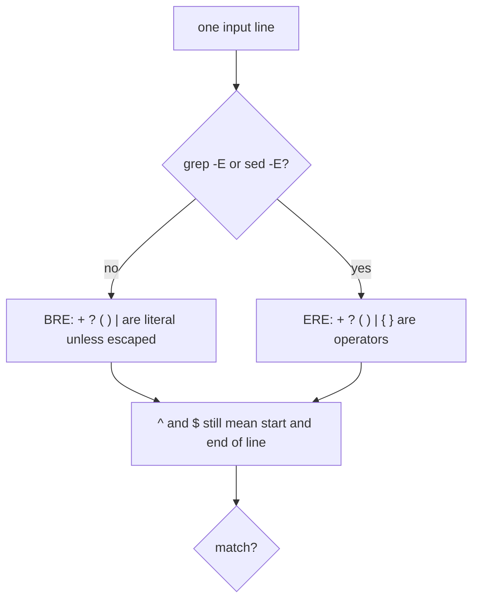

`egrep` and `sed -r` are older spellings. `egrep` is a historical name for `grep -E`. GNU sed accepts `-r` as a synonym of `-E`. BSD sed on macOS accepts `-E` and does not accept `-r`. Write `grep -E` and `sed -E`.

### The pieces you actually use

These mean the same thing in BRE and ERE:

| Piece | Meaning |
|---|---|
| `.` | Any one character except newline |
| `*` | The previous item, zero or more times |
| `^` | The start of the line, but only if `^` is first |
| `$` | The end of the line, but only if `$` is last |
| `[abc]` | One character, a or b or c |
| `[^abc]` | One character that is not a, b, or c |
| `[0-9]` | One digit, in the C locale |
| `[[:digit:]]` | One digit, as a POSIX class. Prefer this when the locale is not C |

`*` applies to the previous item, not to "the whole line so far". `ab*` is "a, then zero or more b". It matches `a`, `ab`, and `abbb`. It is not "lines that are ab repeated". `.*` is "anything", and it is greedy: it takes as much as it can while still letting the rest of the pattern match. That is why a sed substitution with `.*` often eats more of the line than the author pictured.

ERE adds the operators you wanted in the first place. `+` means one or more of the previous item. `?` means zero or one. A vertical bar means alternation: `foo|bar` is foo or bar. Parentheses group. `(ab)+` is "ab, repeated one or more times". The BRE spelling of that same idea is `\(ab\)\+`, which is harder to read and easy to get wrong. Grouping is the usual reason to pick ERE and stay there. In BRE, `foo|bar` is the literal characters foo, a bar, and bar. It is not alternation. If you need groups or alternation, write `grep -E` or `sed -E` and do not escape the parentheses.

A class is not a wildcard. `[error]` matches one character that is one of e, r, o. It does not match the word error. `^error$` matches a line that is exactly `error`. `error` with no anchors matches `error` anywhere, including `noerror` and `errors`. Anchors are how you stop that. `grep` does not match across lines. `^` is the start of the line, not the start of the file.

POSIX classes (`[[:digit:]]`, `[[:space:]]`, `[[:alnum:]]`) are the portable spelling of "a digit" and "whitespace". `\d`, `\s`, and `\w` are Perl. They are not ERE. `grep -P` is the GNU grep flag that turns on Perl syntax, and it exists only when that grep was built with PCRE. BSD grep, which is what macOS ships and what this practice shell runs, rejects `-P` as an invalid option. A script that works on a developer's Ubuntu machine and dies on a Mac, or in a minimal container whose grep has no PCRE, is a script that used `-P` or `\d`. Write `[0-9]` or `[[:digit:]]`.

Set `LC_ALL=C` when a range like `[A-Z]` must mean ASCII letters. In other locales a range can include letters you did not intend. The text-processing lesson's `sort` has the same locale trap.

### sed substitutes, it does not just select

`sed -E 's/pattern/replacement/'` replaces the first match on each line. `s/pattern/replacement/g` replaces every match on the line. Parentheses in an ERE pattern capture. In the replacement, `\1` is the first group, `\2` the second. The replacement is not a regular expression. It is text plus backreferences. A `&` in the replacement means "the whole match".

```bash
printf '2026-10-04 app started\n' | sed -E 's/^([0-9]{4})-([0-9]{2})-([0-9]{2}) (.*)/\1 \2 \4/'
```

The pattern anchors at the start, captures the year, the month, the day, and the rest, and the replacement prints year, month, and the rest. The day group is captured and unused. That is allowed. The output is `2026 10 app started`. Without `-E`, the parentheses would be literal and the `+` and `{4}` would not mean what they mean here. `{4}` is an ERE quantifier: the previous item, four times. In BRE you would write `\{4\}`.

`sed -n` and the `p` flag print only what you ask. Without `-n`, sed prints every line, modified or not. A script that "filters" with sed and forgets `-n` leaks the lines that did not match. `grep -E` is the filter. `sed -E` is the edit. Piping grep into sed is normal and clear, because a pipe is one program's output handed to the next program's input, with no temporary file in between.

`grep` returns 0 when it finds a match, 1 when it does not, and 2 when something is wrong with the command. Under `set -e`, from the scripts lesson, a search that finds nothing aborts the script. That is correct when a missing match is a failure, and wrong when you are filtering. `grep -q` tests without printing. An `if grep -q` does not trip `set -e`.

### Where this breaks

**A pattern with a space, unquoted.** The shell splits it before grep sees it. Quote every pattern. The shell lesson's quoting rules are the difference between one argument and three.

**`.*` greed.** `s/.*-//` on `a-b-c` deletes through the last dash, leaving `c`, not `b-c`. Write a class that stops, such as `[^-]*`, when you mean "up to the next dash".

**Unanchored words.** A search for `error` matches `supererror`. Anchor, or search for a token with spaces you control, such as ` ERROR `.

**`grep -P` and `\d`.** Invalid option on this Mac. Even on GNU grep, `-P` is a build option. Do not put it in a script you want to carry.

**BRE parentheses.** `grep '(foo|bar)'` does not group in BRE. You get a literal parenthesis. `grep -E '(foo|bar)'` is the pattern you meant.

**Locale ranges.** `[A-Z]` under a UTF-8 locale is not always "the 26 letters". `LC_ALL=C` or `[[:upper:]]` if you know you want a class.

### How this is used at work

Production use is a pipeline: `grep -E` to keep the lines, `sed -E` to pull out a field, `sort` and `uniq -c` to count them, because identical lines have to sit next to each other before a count is honest. A log line `2026-10-04T10:01:00Z ERROR disk full` becomes the token `disk full`. You do that to a file, not to a live journal, when you are practising. A live journal is the same text arriving continuously, queried with `journalctl` instead of `grep` on a path. The same pattern language shows up in `awk`, in vim's `/` search, and in configuration files that pretend to be regular expressions and are actually globs. A glob `*.log` is not a regular expression. The shell expands globs. `grep` does not.

When a pattern goes into a script, treat it as code. A pattern built by concatenating user input is a way to match more than you intended, including extra commands if you then `eval` the result. Do not `eval` a pattern. Pass it as one quoted argument.

### Which spelling

| You want | Write | Not |
|---|---|---|
| One or more digits | `grep -E '[0-9]+'` | `grep -P '\d+'` |
| foo or bar, as a whole line | `grep -E` with an anchored alternation | the same pattern in BRE, where a vertical bar is literal |
| Group and substitute | `sed -E 's/^([0-9]+)/\1/'` | `sed -r`, which BSD sed rejects |
| A literal dot | `\.` | `.`, which is any character |
| "No match is fine" | `if grep -q`, or grep followed by `\|\| true` | A bare grep under `set -e` |
| A digit class that ignores locale | `LC_ALL=C grep -E '[0-9]'` | `[0-9]` in a random locale, if you depend on ASCII |

### You can now

- Say what `+`, `?`, `|`, and parentheses mean in ERE, and that BRE treats them as literal unless escaped.
- Turn ERE on with `grep -E` and `sed -E`, not with `grep -P` or `sed -r`.
- Anchor with `^` and `$`, and explain why `error` matches `noerror`.
- Capture a group and put it back with `\1` in a sed replacement.
- Use `[0-9]` or `[[:digit:]]` instead of `\d`.
- Predict grep's exit code when nothing matches, and keep `set -e` from treating that as a crash when absence is allowed.

::: quiz
q: You run `grep 'ab+'` with no `-E` against a file that contains the lines `ab` and `abbb`. What happens?
- It prints both lines, because `+` always means "one or more"
+ It prints nothing. In basic regular expressions `+` is a literal plus sign, and neither line contains one
- It prints `abbb` only, because `+` means "more than one" in BRE
- It is a syntax error. `+` is illegal unless you pass `-E`
why: Default grep is BRE, where `+` is ordinary text. The pattern matches the three characters a, b, and plus. The lines have no plus, so there is no match and grep exits 1. The tempting belief is that `+` means "one or more" everywhere, which is true in ERE (`grep -E 'ab+'`) and in Perl, and false in BRE. `+` is not a syntax error in BRE. It is just a character.
:::

::: predict lang=shell
q: What does this print? `grep` with no match exits 1, and `|| true` keeps the script going.
code:
```bash
printf 'xy\nxyyy\nxz\n' > t.txt
echo "BRE:"
grep 'xy+' t.txt || true
echo "ERE:"
grep -E 'xy+' t.txt
```
answer:
```
BRE:
ERE:
xy
xyyy
```
why: The BRE pattern is the literal characters x, y, and plus, so the first grep prints nothing. `grep -E 'xy+'` means "an x, then one or more y characters", which matches `xy` and `xyyy` and not `xz`. The `|| true` does not print the word true. It only supplies a successful exit code when grep finds nothing.
:::

::: predict lang=shell
q: What does this sed command print?
code:
```bash
printf '2026-03-15 backup ok\n' | sed -E 's/^([0-9]{4})-([0-9]{2})-([0-9]{2}) (.*)/\4 (\1)/'
```
answer:
```
backup ok (2026)
```
why: `-E` makes the parentheses capture. Group 1 is the year, group 2 the month, group 3 the day, group 4 the rest of the line. The replacement keeps group 4, then the year in parentheses. Sed prints the modified line because `-n` was not set. Without `-E` the parentheses and the `{4}` quantifier would not capture, and the line would not be rewritten this way.
:::

::: shell
task: `app.log` has info, error, and warning lines. Print only the text after `ERROR ` on each error line, in order.
file: app.log
```
2026-10-04T10:00:00Z INFO started
2026-10-04T10:01:00Z ERROR disk full
2026-10-04T10:02:00Z WARN retry
2026-10-04T10:03:00Z ERROR net down
```
expect:
```
disk full
net down
```
solution:
```bash
grep -E 'ERROR' app.log | sed -E 's/.*ERROR //'
```
hint: `grep -E` keeps the error lines. `sed -E` with `s/.*ERROR //` deletes through the word ERROR and the following space. The two error lines stay in order.
:::

::: quiz
q: A script uses `grep -P '\d+'` to find digits. It works on one Linux laptop and fails on this course's Mac with `invalid option -- P`. Why?
- macOS grep is broken and cannot match digits at all
+ `-P` selects Perl syntax, and the BSD grep shipped on macOS does not have it. `[0-9]+` with `grep -E` is the portable spelling
- `\d` is ERE, so the fix is to drop `-P` and change nothing else
- `-P` means "print", and macOS uses `-p` for that
why: Perl shortcuts such as `\d` are not basic or extended POSIX regular expressions. GNU grep only accepts them with `-P`, and only if it was built with PCRE. BSD grep rejects the flag. Dropping `-P` but keeping `\d` searches for a literal backslash and a d, or for the letter d, depending on the dialect. It does not search for digits. `grep -E '[0-9]+'` or `[[:digit:]]+` is the form that works on both. The capital P is not "print".
:::

::: quiz
q: `grep -E 'error' app.log` prints a line that says `noerror`. You wanted lines that are exactly the word error. What pattern do you use?
- `grep -E '*error*' app.log`
+ `grep -E '^error$' app.log`
- `grep -E '[error]' app.log`
- `grep -E 'error?' app.log`
why: `^` and `$` anchor the match to the whole line, so `noerror` and `errors` no longer qualify. A leading star is not a wildcard. In ERE a star needs something in front of it. `[error]` matches a single character. `error?` makes the final r optional, so it matches `erro` and `error`, which is a different bug. The unanchored pattern was the whole problem.
:::

::: card
q: In `sed -E`, what is the difference between a parenthesised group in the pattern and `\1` in the replacement?
answer: Parentheses in the extended pattern capture the text that the group matched. In the replacement, which is not itself a regular expression, `\1` inserts the first captured group, `\2` the second, and `&` inserts the whole match. Example: `s/^([0-9]{4})-([0-9]{2}).*/\1 \2/` keeps the year and the month from a date at the start of the line.
:::

::: shell
task: Print the lines of `ids.txt` whose whole line is `id=` followed by one or more digits.
file: ids.txt
```
id=12
id=ab
id=
id=3
prefix id=9
```
expect:
```
id=12
id=3
```
solution:
```bash
grep -E '^id=[0-9]+$' ids.txt
```
hint: Anchor with `^` and `$` so `prefix id=9` does not match. `[0-9]+` is one or more digits. Do not use `\d` or `grep -P`.
:::
## Many files: find -exec and xargs
id: xargs
stage: text
needs: grep
minutes: 35
goal: Run one command on many files without breaking on spaces, and choose between find -exec and xargs -0.
source: find(1) | https://manpages.debian.org/bookworm/findutils/find.1.en.html
source: xargs(1) | https://manpages.debian.org/bookworm/findutils/xargs.1.en.html

`grep` searches inside files you name. The grep lesson's `find` walks names. The gap between them is the command line: a program receives a list of arguments, and that list has a maximum length. A directory of ten thousand logs will not fit in one `grep` invocation if you expand them all with a shell glob. A filename with a space will be split into two arguments if you are careless. Both failures look like "grep is broken". They are the shell and `xargs` doing what they were asked.

This lesson is how you turn a list of paths into as few process starts as possible, without splitting a path in half. The practice machine is macOS, so `find` and `xargs` are the BSD ones. The flags below are the ones both BSD and GNU accept. There is no `find -printf` here. That is a GNU extension, and it is missing on this Mac.

### The argument list is a real limit

Every time the kernel starts a program, it copies the argument vector and the environment into a fixed-size area. The limit is `ARG_MAX`. A glob of every file in a huge directory can fail with "argument list too long" before `grep` runs at all. The shell tried to pass every name at once.

You need a tool that batches: start `grep` with as many names as fit, then start it again for the next batch. Two tools do that. `find -exec` is part of find. `xargs` reads names from standard input, which is the pipes lesson applied to filenames.

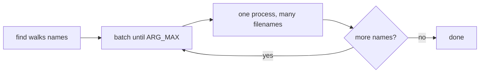

### find -exec, once per file or in batches

`find` can run a command itself. You do not need a pipe.

```bash
find box -type f -exec basename {} \;
```

The `\;` tells find that the command ends there. `{}` is replaced by one path. Find starts `basename` once per file. Two files, two processes. That is correct and slow. A tree of a hundred thousand files is a hundred thousand process starts, each paying the cost of `exec`.

The batch form uses `+` instead of `\;`, and it is for commands that accept many file arguments:

```bash
find box -type f -exec echo {} +
```

Find appends as many paths as fit and starts `echo` once. The `{}` must be a separate argument immediately before the `+`. That is the POSIX rule. `echo` prints every argument, so two files become one line of output and one process. `grep`, `rm`, and `wc` also accept many files, so they are the commands you batch. `basename` does not. It takes one path and an optional suffix, so `basename {} +` is the wrong shape: the second path is not a second file. Use `\;` or `xargs -0 -n 1` when the command takes a single path.

`find -exec` does not go through the shell. A file named `my file.txt` is one argument, space included. That is why `-exec` is safer than `find | xargs` without `-0`. A realistic search is `find logs -type f -exec grep -l ERROR {} +`: one `grep` (or a few, if the tree is huge), many paths, no word-splitting.

### xargs reads stdin and splits on blanks

`xargs` reads standard input, splits it into arguments, and appends them to a command. The default split is on any whitespace. A line `my file.txt` becomes two arguments, `my` and `file.txt`. Quotes in the input are xargs's own quoting rules, not the shell's. A filename with a space, a quote, or a newline will be damaged.

The safe pair is:

```bash
find box -type f -print0 | xargs -0 -n 1 basename
```

`find -print0` writes each path followed by a NUL byte. NUL cannot appear in a path. `xargs -0` splits only on NUL. The name `my file.txt` stays one argument. `-n 1` is optional. It forces one argument per command, which you want for tools like `basename` that take a single path. For `grep -l` or `rm`, you want the default batching and you do not pass `-n 1`.

`xargs` and an empty list differ by implementation. On this Mac, BSD `xargs` runs the command zero times if stdin is empty, and the pipeline still exits 0. GNU `xargs` runs the command once with no extra arguments, unless you pass `-r` (`--no-run-if-empty`). A script that does `find ... -print0 | xargs -0 rm` is safe on GNU only with care: if find prints nothing, GNU xargs runs `rm` with no arguments, and some `rm` implementations then wait for stdin or error. BSD xargs does not run `rm` at all in that case. `find -exec rm -- {} +` does not run `rm` when nothing matched, on both. Prefer `-exec ... {} +` when you do not need a pipe. Use `xargs -0` when the names are already a stream, or when you are composing with another filter.

Do not pipe `find` to `xargs rm` without `-print0` and `-0`. A name that starts with `-` can look like an option. `rm --` ends options. `find -exec rm -- {} +` includes the `--`.

### A count you can see

Two files, `box/a.txt` and `box/b.txt`. `find -exec echo {} +` starts echo once, so `wc -l` on that output is 1. `find -exec echo {} \;` starts echo twice, so `wc -l` is 2. The `+` form did the same work with one process. That ratio is the whole performance story. It does not matter for two files. It matters for a checkout with hundreds of thousands of files, which is a normal size in a monorepo.

`find box -type f -print0 | xargs -0 -n 1 basename | LC_ALL=C sort` prints the basenames, including a name with a space, one per line. Drop the `-0` and the space becomes a split. The sorted output is how you compare a run to itself. Find's walk order is not alphabetical.

### Where this breaks

**`{}` not immediately before `+`.** POSIX requires that. `find . -exec cp {} dest/ +` is rejected or misread. The copy-into-a-directory case is awkward with `+`. Use `\;`, or `xargs -0 -I {}` which replaces `{}` and runs once per name. `-I` implies one-at-a-time. You gave up batching on purpose.

**xargs without `-0`.** Spaces, newlines, and quotes in names split or disappear. `find -print` uses newlines. A newline in a name, rare and legal, breaks `-print` and is fine with `-print0`.

**Assuming GNU `xargs -r` exists.** It does not on BSD. The portable "do nothing if empty" tool is `find -exec ... {} +`.

**`sh -c` with a concatenated name.** `find -exec sh -c "grep foo {}" \;` lets a hostile filename break the shell command. If you must use a shell, pass the path as a separate argument: `find -exec sh -c 'grep foo "$1"' _ {} \;`. The `_` is `$0`. The path is `$1` and it is quoted. Prefer `find -exec grep foo {} +` so there is no shell.

**`basename {} +`.** `basename` takes one path and an optional suffix, not a list of files. Batching it with `+` does not print every basename. Use `\;` or `xargs -n 1`.

### How this is used at work

A search across a repository is `find . -type f -name '*.log' -exec grep -l -E 'ERROR' {} +`. One grep, many files, a list of paths that matched. You add `-xdev` (same idea as `du -x` in the disks lesson) so find does not wander into another filesystem. You add `! -path './.git/*'` so you do not grep the object store.

A cleanup job in cron uses `find` with `-exec rm -- {} +`, not a glob, because the glob can exceed `ARG_MAX` and because cron's shell is not your interactive shell. Cron starts the job with a short `PATH` and without your interactive shell setup, so a command name that worked at the prompt can be "not found" when the clock runs it. A deploy that rewrites a tree uses the same batching to `chmod` or `chown`, because those programs accept many paths in one invocation and the mode bits are per file. `chmod` accepts many files, so `+` is right.

Interactive work can be a pipe you can read: `find ... -print0 | xargs -0 grep -l pattern`. Scripts should prefer `-exec` with `+` unless the pipe is doing something find cannot, such as filtering the name list through another program first.

### Which form

| Situation | Use | Why |
|---|---|---|
| Many files, one command that accepts a list | `find -exec cmd {} +` | Batches, no shell, skips the run if nothing matched |
| A command that takes exactly one path | `find -exec cmd {} \;` or `xargs -0 -n 1` | `+` would pass several paths |
| Names already on stdin, and some contain spaces | `xargs -0` fed by something that writes NUL | Default xargs splits on spaces |
| You are on GNU xargs and the list might be empty | `-r` as well as `-0` | GNU xargs otherwise runs the command once |
| You are on BSD xargs, including this Mac | Do not pass `-r` | The flag is not there. Empty stdin already runs nothing |
| A name might start with `-` | `cmd --` before `{}` | Stops option parsing |

### You can now

- Explain `ARG_MAX` and why a giant glob fails before the program starts.
- Run a command once per file with `\;` and in batches with `{} +`.
- Keep spaces and newlines intact with `-print0` and `xargs -0`.
- Say what this Mac's xargs does with empty input, and how GNU xargs differs.
- Avoid putting filenames inside a `sh -c` string.
- Choose `-exec` or `xargs` from the table instead of building a command with unquoted expansion.

::: quiz
q: `find box -type f -exec echo {} +` is run in a directory that contains two ordinary files. How many echo processes run, compared with the same command using `\;`?
- One process for `\;`, because the semicolon batches, and one process per file for `+`
+ One process for `+`, because find appends every path that fits, and two processes for `\;`, one per file
- Two processes either way. `+` only changes the printed punctuation
- Zero processes. `echo` is a shell builtin, so find cannot run it
why: `+` tells find to pass as many paths as fit in one argument list, so both files go to a single echo. `\;` ends the command after one substitution, so find starts echo twice. Find does not ask your shell to parse the command, so it runs the `echo` binary, not the builtin, and it does run. The tempting reversal, "semicolon means batch", comes from reading `\;` as a terminator in a shell sense and guessing it collects arguments. It terminates one command template, which is then run once per file.
:::

::: predict lang=shell
q: What does this print? `wc -l` counts how many lines echo produced, which is how many times it ran. There are three files.
code:
```bash
mkdir -p pkg
printf 'x\n' > pkg/one.txt
printf 'y\n' > pkg/two.txt
printf 'z\n' > pkg/three.txt
printf 'plus:%s\n' "$(find pkg -type f -exec echo {} + | wc -l | tr -d ' ')"
printf 'semi:%s\n' "$(find pkg -type f -exec echo {} \; | wc -l | tr -d ' ')"
```
answer:
```
plus:1
semi:3
```
why: With `+`, find starts echo once and passes all three paths, and echo prints them on a single line, so `wc -l` is 1. With `\;`, find starts echo once per file, three lines, so `wc -l` is 3. `tr -d ' '` strips the padding `wc` puts in front of the number. The files are tiny, so all three paths fit in one batch. A huge tree can make the `+` form run more than once, but it still runs far fewer processes than `\;`.
:::

::: quiz
q: A file is named `my file.txt`, with a space. Which pipeline passes that whole name to `basename` as one argument?
- `find box -type f | xargs basename`
+ `find box -type f -print0 | xargs -0 -n 1 basename`
- `find box -type f -print0 | xargs basename`
- `find box -type f -printf '%f\n'`
why: Default xargs splits its input on whitespace, so the space in `my file.txt` becomes two arguments and basename never sees the real name. `-print0` terminates each path with a NUL byte, and `xargs -0` splits only on NUL. `-n 1` matters because basename takes one path, not a list. `-print0` without `-0` does not help: xargs still splits on spaces, and the NUL becomes garbage in an argument. `find -printf` is a GNU extension and is not on this Mac.
:::

::: predict lang=shell
q: On this Mac, `xargs` is the BSD one. What does this print?
code:
```bash
printf '' | xargs echo ran
echo "exit:$?"
```
answer:
```
exit:0
```
why: The pipe gives xargs an empty input. BSD xargs runs the command zero times when there is nothing to pass, and it still exits 0, so `echo ran` never prints. GNU xargs would run `echo ran` once with no extra arguments unless you add `-r`. Do not write a script that depends on the GNU behaviour if it has to run on macOS. `find -exec ... {} +` runs the command zero times when find has no matches, on both.
:::

::: shell
task: The directory `drop` contains `readme.txt` and `release notes.txt`. Print each basename on its own line, sorted with `LC_ALL=C`, without splitting the name that contains a space.
file: drop/readme.txt
```
x
```
file: drop/release notes.txt
```
hello
```
expect:
```
readme.txt
release notes.txt
```
verify:
```bash
# wrong answer tested: find drop -type f | xargs -n 1 basename, which splits "release notes.txt" into two arguments.
find drop -type f -print0 | xargs -0 -n 1 basename | LC_ALL=C sort | paste -sd, - | grep -qx 'readme.txt,release notes.txt'
```
solution:
```bash
find drop -type f -print0 | xargs -0 -n 1 basename | LC_ALL=C sort
```
hint: `-print0` and `xargs -0` keep the space inside one argument. `-n 1` gives basename one path at a time. Sort with `LC_ALL=C` so the order does not depend on the locale. Without `-0`, the space becomes a second argument and basename prints `release` and `notes.txt`.
:::

::: card
q: Why does `find dir -exec rm -- {} +` not start `rm` when `dir` contains no files, and why is that safer than a GNU `xargs rm` without `-r`?
answer: `find -exec` with `+` only runs the command when it has at least one path to substitute. An empty match list starts nothing. GNU xargs, given empty stdin, runs the command once with no added arguments unless you pass `-r`. `rm` with no file operand is an error, or worse, on some versions it reads names from stdin. BSD xargs already skips an empty input, but `-exec ... {} +` has the same "run zero times" behaviour on both. The `--` stops a filename that starts with a dash from being read as an option.
:::

::: quiz
q: You want to run `grep -l ERROR` on every regular file under `logs`, and some names contain spaces. Which command is the one to put in a script?
- `grep -l ERROR logs/*`
+ `find logs -type f -exec grep -l ERROR {} +`
- `find logs -type f | xargs grep -l ERROR`
- `find logs -type f -exec sh -c "grep -l ERROR {}" \;`
why: A glob can exceed the argument limit and, unless you have set nullglob and quoted carefully, is the wrong tool for a tree. `find -exec grep {} +` batches paths and passes each path as one argument, space included, with no shell. Piping to xargs without `-0` splits on spaces. Building a `sh -c` string around `{}` lets a strange filename change the command. `grep -l` accepts many files, so `+` is the right terminator, not `\;`.
:::

## Cutting, sorting, counting
id: textproc
stage: text
needs: grep
minutes: 40
goal: Turn a log or a CSV into an answer by picking columns, sorting, counting and ranking.
source: POSIX awk | https://pubs.opengroup.org/onlinepubs/9699919799/utilities/awk.html
source: POSIX sort | https://pubs.opengroup.org/onlinepubs/9699919799/utilities/sort.html
source: POSIX uniq | https://pubs.opengroup.org/onlinepubs/9699919799/utilities/uniq.html
source: OverTheWire Bandit, levels 8 to 11: uniq, strings, base64, tr | https://overthewire.org/wargames/bandit/bandit9.html

`grep` tells you which lines match. Most questions are the next step: which value appears most, which column is the team, what is left after you drop a header. Those questions are a pipeline of tools that each do one thing to a stream of lines. If you only know `grep`, you end up pasting the log into a spreadsheet. The pipeline is the spreadsheet, and it runs over SSH on a file you should not download.

### One line is a record, whitespace or a comma is the split

`cut` and `awk` both pick fields. They split differently.

`cut -d, -f2` splits on a single character you name and prints that field. It does not collapse repeated delimiters. A CSV line `ana,ana@x.io,platform` yields `ana@x.io` for field 2. A line with two spaces does not become two fields if you cut on a space: the empty field between the spaces counts. `cut` is the right tool for a delimiter you can see, such as a comma or a colon in `/etc/passwd`.

`awk` splits on **whitespace** by default, and repeated spaces count as one separator. `$1` is the first field, `$2` the second, `$0` the whole line, `NF` how many fields there are. `awk '{print $1}' access.log` prints the IP from a line that starts with an address. `awk '$5 >= 500'` prints the whole line when field 5 is at least 500. That comparison is numeric. Quote the program with single quotes so the shell does not eat `$1`.

```bash
awk -F, '{print $3}' users.csv
```

`-F,` makes awk split on commas, same as `cut -d,`. Prefer awk when you also need a condition. Prefer cut when the job is only "field 3 of a CSV".

`tr` translates or deletes characters, not fields. `tr 'a-z' 'A-Z'` uppercases. `tr -d '\r'` strips carriage returns. `tr -s ' '` squeezes repeated spaces. It is how you clean a line before `cut` sees it.

`sed` edits lines. `sed 's/foo/bar/g'` replaces every `foo` on each line. The portable in-place story is annoying: macOS `sed -i '' 's/a/b/' f` and GNU `sed -i 's/a/b/' f`. Write `sed 's/a/b/' f > g && mv g f` when the script must run on both, and only use `-i` when you have named the system.

### sort, then uniq

`uniq` collapses **adjacent** duplicate lines. It does not look at the whole file. Two identical lines with something between them stay. So you `sort` first, which puts equals together, then `uniq`.

`uniq -c` prefixes each group with a count. The count is padded with spaces. These exercises ignore spacing when they compare output, but a later `awk '{print $1}'` still sees the count as field 1 and the original line as the rest.

`sort -u` sorts and drops duplicates in one process. Use it when you do not need the counts. Use `uniq -c` when you do.

`sort` options you will actually use:

| Flag | Effect |
|---|---|
| `-n` | numeric. Without it, `10` sorts before `2` because `1` < `2` as text |
| `-r` | reverse |
| `-k2` | start the key at field 2. `sort -k2,2 -n` sorts on field 2 only |
| `-t,` | field separator, for CSV |
| `-u` | unique |
| `-s` | stable: equal keys keep their original order. Useful, and POSIX |

Locale changes character order and even what "numeric" does with thousands separators. In scripts and in the checks for this course, set `LC_ALL=C` before `sort` so the order is byte order, the same on every machine.

### The count-and-rank pattern

Top addresses in a log:

```bash
awk '{print $1}' access.log | sort | uniq -c | sort -rn | head -n 5
```

Read it left to right. Pick the field. Group equal values (`sort`). Count each group (`uniq -c`). Sort those counts numerically, biggest first (`sort -rn`). Keep five (`head`). `sort | uniq -c | sort -rn` is the phrase to memorise. Skipping the first `sort` makes `uniq` count only the runs that happened to be adjacent, and the ranking is a lie.

Distinct teams from a CSV with a header:

```bash
tail -n +2 users.csv | cut -d, -f3 | sort -u
```

`tail -n +2` starts at line 2. There is no portable `head` that drops the last line, but dropping the first line is portable. `sort -u` both orders and deduplicates.

### A worked ranking

Log:

```text
10.0.0.1 GET /
10.0.0.2 GET /api
10.0.0.1 GET /about
10.0.0.1 POST /login
10.0.0.1 GET /
10.0.0.2 GET /api
```

`awk '{print $1}'` prints six addresses. After `sort | uniq -c` you have a count of 4 for `10.0.0.1` and 2 for `10.0.0.2`. `sort -rn | head -n 2` prints the 4 first. That is the exercise. The same pipeline with `$2` ranks paths instead of addresses. The project at the end of the module is this pipeline four times, wrapped in a script.

### Where this breaks

**`uniq` without `sort`.** The counts are counts of adjacent runs, not of values.

**Numeric versus text.** `sort -r` on counts that are padded differently can look numeric by accident and then fail when a count reaches two digits if you sorted the wrong field. `sort -n` on the count field is the one that still works at 100.

**CSV is not always `cut`.** A field that contains a comma inside quotes (`"Doe, Ana",platform`) splits in the wrong place. `cut` and awk do not understand quotes. For a real export, use a language with a CSV parser (the Python module does). For logs and simple files, cut is fine.

**`sort` and the locale.** A teammate on a Mac with a different locale can get a different order from CI. `LC_ALL=C sort` in scripts.

**`sed -i`.** The empty-string argument on BSD is the backup suffix. On GNU that same command tries to use `''` as a script. Don't share `sed -i` one-liners between the two without checking.

**`head` closes the pipe.** `sort | head` can make `sort` die with SIGPIPE. With `pipefail` the pipeline's status may be 141 even though you have the lines you wanted. For a script that must stay green, write the sort to a file, or accept 141 knowingly.

### How this is used at work

Access logs, audit logs and CSV exports are still the bulk of "what just happened" questions, and this pipeline answers them without shipping the file to a laptop. Monitoring systems are the same aggregation on a timer. `kubectl top` and a billing CSV both end up here when the dashboard is wrong and you want the raw ranking. The shell script lesson wraps the pipeline so you do not retype it. SQL, later in the path, is the same idea (group, count, order) when the data lives in a database instead of a file. People who are fluent in both notice that `sort | uniq -c | sort -rn` is `GROUP BY` plus `ORDER BY count DESC`.

### Which tool

| You have | Use |
|---|---|
| Comma or colon separated fields, no quotes | `cut -d` |
| Whitespace-separated log, or a condition | `awk` |
| Adjacent duplicates only, after you sorted | `uniq` or `sort -u` |
| A ranking by how often a value appears | `sort \| uniq -c \| sort -rn` |
| Character cleanup | `tr` |
| A substitution on each line | `sed`, redirected to a new file |
| Quoted CSV | a real parser, not `cut` |

### You can now

- Pick a column with `cut` or `awk` and say which one collapses repeated spaces.
- Explain why `uniq` comes after `sort`, and what the count it prints means.
- Rank values with `sort | uniq -c | sort -rn | head`.
- Skip a header with `tail -n +2`, and dedupe with `sort -u`.
- Keep `LC_ALL=C` on `sort` in a script, and avoid `sed -i` in a script that must run on both macOS and Linux.

::: predict lang=shell
code:
```bash
printf 'b\na\nb\nc\nb\na\n' | sort | uniq -c | sort -rn | head -n 1
```
answer: 3 b
why: After sorting, the three `b`s sit together, `uniq -c` counts them, and `sort -rn` puts the biggest count first. (The real output has leading spaces, `      3 b`; spacing is ignored here.)
:::

::: shell
task: Which **IP address** made the most requests in `access.log`? Print the top two as `count ip`, most first (for example `4 10.0.0.1`).
file: access.log
```
10.0.0.1 GET /
10.0.0.2 GET /api
10.0.0.1 GET /about
10.0.0.3 GET /
10.0.0.1 POST /login
10.0.0.2 GET /api
10.0.0.1 GET /
```
expect:
```
4 10.0.0.1
2 10.0.0.2
```
solution:
```bash
awk '{print $1}' access.log | sort | uniq -c | sort -rn | head -n 2
```
hint: Print field 1 with `awk`, sort so identical IPs sit together, `uniq -c` to count them, `sort -rn` so the largest count is first, and `head -n 2` to keep two lines.
:::

::: shell
task: `staff.csv` has a header line and then `id,city,role`. Print the **distinct cities**, sorted, one per line (no header).
file: staff.csv
```
id,city,role
7,oslo,dev
8,lima,dev
9,oslo,sre
10,bern,dev
```
expect:
```
bern
lima
oslo
```
verify:
```bash
# wrong answer tested: cut -d, -f3, which prints roles (dev, sre) instead of cities.
[ "$(tail -n +2 staff.csv | cut -d, -f2 | LC_ALL=C sort -u | paste -sd, -)" = "bern,lima,oslo" ]
```
solution:
```bash
tail -n +2 staff.csv | cut -d, -f2 | LC_ALL=C sort -u
```
hint: `tail -n +2` starts at line 2, skipping the header. City is field 2, not field 3. `LC_ALL=C sort -u` sorts by byte value and drops duplicates.
:::

::: quiz
q: `uniq` is run on a file that was not sorted. Two identical lines exist, with a different line between them. What does `uniq` do with that pair?
- It removes one of them, because uniq looks at the whole file
+ It leaves both, because uniq only collapses duplicates that are already next to each other
- It exits with an error and prints nothing
- It sorts the file first, then collapses them
why: `uniq` is a stream tool. It compares each line only to the previous one. Non-adjacent duplicates are invisible to it, which is why the count-and-rank pattern sorts first. It does not sort, and identical lines far apart are not an error.
:::

::: card
q: In a portable shell script, why do you set `LC_ALL=C` before `sort` when the sorted lines are compared or checked in?
answer: The locale changes character ordering. `LC_ALL=C` sorts by raw byte value, so the order is the same on macOS and on Linux and does not depend on the user's language settings.
:::

::: predict lang=shell
q: What does this print? Spacing in `uniq -c` is normalised, so write the count and the word with a single space.
code:
```bash
printf '2\n10\n2\n' | sort | uniq -c | sort -n
```
answer:
```
1 10
2 2
```
why: The first `sort` groups the two `2` lines together. `uniq -c` emits a count of 2 for `2` and a count of 1 for `10`. The second `sort -n` orders those counts numerically, so the smaller count comes first. A text sort of the original numbers would have put `10` before `2`. Here the number being sorted is the count, not the value.
:::

::: shell
task: `events.log` lines look like `INFO ready` and `ERROR disk`. Print how many ERROR lines there are, as a single number. Use awk's field test, not grep.
file: events.log
```
INFO ready
ERROR disk
INFO listening
ERROR timeout
INFO ready
```
expect: 2
solution:
```bash
awk '$1 == "ERROR"' events.log | wc -l
```
hint: `awk '$1 == "ERROR"'` prints the matching lines. `wc -l` counts them. Quote the awk program with single quotes.
:::

## Shell scripts
id: scripts
stage: text
needs: pipes
minutes: 45
goal: Write a small bash script that takes arguments, makes decisions, loops, and stops on the first error.
source: GNU Bash manual | https://www.gnu.org/software/bash/manual/bash.html
source: ShellCheck | https://www.shellcheck.net/
source: POSIX test | https://pubs.opengroup.org/onlinepubs/9699919799/utilities/test.html
source: OverTheWire Bandit, level 24: a loop that tries every PIN | https://overthewire.org/wargames/bandit/bandit25.html

The commands in the last few lessons are enough to answer a question once. A script is those commands saved, so the next person (often you, at 02:00) runs one file instead of reconstructing the pipeline from memory. The failure mode is a script that continues after a command failed, or that splits a filename, and then deletes or ships the wrong thing. The rules below are how you stop that.

### A script is a file the kernel hands to bash

```bash
#!/usr/bin/env bash
set -euo pipefail

name="${1:-world}"
printf 'hello, %s\n' "$name"
```

The first line is the **shebang**. When you run `./script.sh`, the kernel reads those bytes and starts that program with the file as an argument. `#!/usr/bin/env bash` finds `bash` on `PATH`, which is more portable than hard-coding `/bin/bash` (though on this Mac and on most servers `/bin/bash` exists). The file must be executable (`chmod +x script.sh`) or you run it as `bash script.sh`, which does not need the executable bit and does not need the shebang. In these exercises, `bash script.sh` is the form the checker runs.

`name=value` sets a variable. **No spaces around `=`.** `name = value` runs a command called `name`. `"$name"` reads it. Always quote. An unquoted `$f` whose value is `my file.log` becomes two arguments. `$1`, `$2` are the arguments. `$#` is how many there are. `"$@"` is all of them, each kept as its own argument even if one of them contains spaces. `"$*"` joins them into one string. You almost always want `"$@"`.

`${1:-world}` means "the first argument, or `world` if it is unset or empty". `${1:?need a file}` aborts if it is missing. Use the second form for anything destructive.

`$(command)` captures standard output, with trailing newlines stripped. Quote it: `"$(wc -l < "$f")"`. The old backticks form does the same thing and is harder to nest. Prefer `$()`.

### Tests and loops

`[ ... ]` is the `test` command, not shell syntax. Spaces inside the brackets are required. Useful tests:

| Test | True when |
|---|---|
| `-f file` | a regular file exists |
| `-d dir` | a directory exists |
| `-z "$s"` | the string is empty |
| `-n "$s"` | the string is not empty |
| `"$a" = "$b"` | the strings are equal. `==` is a bash extension |
| `-eq -ne -lt -gt` | numeric comparison. Do not use `<` inside `[ ]`. It is a redirection |

`[[ ... ]]` is bash syntax with fewer surprises (no word splitting, pattern match with `==`). It is fine in a bash script and is not POSIX `sh`. This module's scripts are bash.

```bash
for f in *.log; do
  lines=$(wc -l < "$f")
  if [ "$lines" -gt 1000 ]; then
    printf '%s is big: %s lines\n' "$f" "$lines"
  fi
done
```

The `for` loop receives the names **after** the shell globs. If nothing matches, bash leaves the literal `*.log` and the loop runs once on a file that does not exist. Guard with `[ -f "$f" ]`, or `shopt -s nullglob` if you are willing to live with the other effects of that option.

`while read -r line; do ...; done < file` reads lines. `read -r` does not treat backslashes specially. A pipeline into `while` runs the loop in a subshell in bash (unless you `shopt -s lastpipe`), so variables set inside the loop disappear when it ends. Redirect the file into `done` instead.

### set -euo pipefail

Bash's defaults are kind in the way that causes outages. A failed command does not stop the script. An unset variable expands to empty. A pipeline's status is the last command.

- `-e` exit when a simple command returns non-zero
- `-u` an unset variable is an error, which catches `$nmae`
- `-o pipefail` a pipeline fails if any stage fails

Put `set -euo pipefail` at the top of every script you mean to trust.

`-e` does not fire on a command in the test of an `if`, or on a command before `||`. That is how you write an optional step: `grep -q ERROR log || true`. It also does not notice a failure inside a command substitution in some bash versions unless you have arranged it. Don't memorise every exception. Run the script on a case you know should fail, and confirm it exits non-zero. ShellCheck (shellcheck.net) catches the quoting mistakes statically. `shellcheck script.sh` is part of finishing a script, the way tests are part of finishing Python.

### Functions and exit codes

```bash
count_lines() {
  wc -l < "$1"
}

if [ "$#" -lt 1 ]; then
  printf 'usage: %s file [file...]\n' "$0" >&2
  exit 2
fi
```

A function's arguments are its own `$1`, `$2`, not the script's. `local name` keeps a variable inside the function. Without `local`, an assignment overwrites the global. `exit` ends the whole script. `return` ends the function and can pass a status.

Write messages for humans on stderr (`>&2`) and the machine-readable result on stdout, so a caller can do `n=$(count.sh file)` without swallowing the usage text.

`$0` is the script's path as it was invoked. It is the right name to print in a usage line. It is not always the absolute path.

### A worked script

`count.sh` prints `name: count` for each argument. The exercise below asks for that. The shape is:

```bash
#!/usr/bin/env bash
set -euo pipefail
for f in "$@"; do
  printf '%s: %s\n' "$f" "$(wc -l < "$f")"
done
```

`"$@"` preserves each argument. `wc -l < "$f"` prints only the number, because the filename was not an argument to `wc`. That is the difference between a clean line and `3 a.txt`.

### Where this breaks

**Spaces around `=`.** `greeting = "hi"` runs a command. The quiz is this.

**Unquoted expansion.** The predict below shows `$f` splitting into two loop iterations.

**`set -e` and pipelines without `pipefail`.** Already covered. Both flags, together.

**`for f in $(ls)`.** Parses `ls` output. Breaks on spaces. Use a glob or `find -print0`.

**Bash 4 features on a Mac.** `mapfile`, associative arrays, `${var,,}` will not run on the bash 3.2 that macOS ships. The shebang does not upgrade bash. Install a newer bash only when you have decided the script is Linux-only, and then say so in the first comment.

**CRLF.** A script edited on Windows has `\r` at the end of the shebang, and the kernel looks for an interpreter named `bash\r`. `tr -d '\r'` fixes it.

### How this is used at work

CI runs your script with `bash -e` sometimes already set, and sometimes not. Set the flags yourself so local and CI match. Container entrypoints are shell scripts with this header. A Kubernetes probe that calls a script trusts the exit code and ignores the text. Git hooks are scripts. The dotfiles project at the end of the module is a setup script that must be safe to run twice: if a line is already in the file, do not append it again. Idempotency is the extra requirement once the script works once. Cron, later, runs the same file with a tiny `PATH` and no terminal, so relative paths and "it worked when I typed it" both fail.

### Which form

| You want | Write |
|---|---|
| Every argument, intact | `"$@"` |
| A default for a missing argument | `${1:-default}` |
| Abort when an argument is missing | `${1:?message}` |
| A number from a command | `"$(cmd)"` |
| Stop on failure | `set -euo pipefail` |
| A message that must not enter a pipe | `printf '...' >&2` |
| Compare strings | `[ "$a" = "$b" ]` |
| Compare numbers | `[ "$n" -gt 3 ]` |

### You can now

- Write a bash script with a shebang, `set -euo pipefail`, and quoted expansions.
- Read arguments from `$1` and `"$@"`, and supply a default with `${1:-}`.
- Branch with `[` tests, and loop over files without splitting names on spaces.
- Explain why `name = value` runs a command, and why the loop variable must be quoted.
- Put human text on stderr so stdout stays pipeable.

::: quiz
q: What goes wrong with `greeting = "hi"` in bash?
- Nothing, the spaces are ignored
+ Bash runs a command called `greeting` with the arguments `=` and `hi`
- It sets `greeting` to ` "hi"` with the spaces
- It's a syntax error that stops the script
why: Assignment is `name=value` with no spaces. With spaces, the first word is read as a command name.
:::

::: predict lang=shell
code:
```bash
f="my file.txt"
touch "$f"
for x in $f; do echo "[$x]"; done
for x in "$f"; do echo "<$x>"; done
```
answer:
```
[my]
[file.txt]
<my file.txt>
```
why: Unquoted, `$f` is split on the space into two words. Quoted, it stays one argument. This is the single most common bash bug.
:::

::: shell
task: Write a script `count.sh` that prints how many lines each file given as an argument has, as `name: count`. Then run `bash count.sh a.txt b.txt`. (The run's output is checked.)
file: a.txt
```
1
2
3
```
file: b.txt
```
x
```
expect:
```
a.txt: 3
b.txt: 1
```
solution:
```bash
cat > count.sh <<'EOF'
#!/usr/bin/env bash
set -euo pipefail
for f in "$@"; do
  echo "$f: $(wc -l < "$f")"
done
EOF
bash count.sh a.txt b.txt
```
hint: Write the file with `cat > count.sh <<'EOF'` … `EOF` (a heredoc). Loop over `"$@"`, and use `$(wc -l < "$f")` for the count without the file name.
:::

::: quiz
q: A bash script starts with `set -euo pipefail` and then runs `false | true`. What happens?
- The script continues, because the last command in the pipe succeeded
+ The script exits, because `pipefail` makes the pipeline fail when `false` fails, and `-e` exits on that failure
- The script exits only if `true` is missing
- `pipefail` is ignored when the pipe is not inside `if`
why: `pipefail` sets the pipeline status from the failing stage, so this pipe's status is non-zero. `-e` then ends the script. Without `pipefail` the status would be `true`'s 0 and `-e` would not fire. `pipefail` is not limited to `if`. It changes how the status of every pipeline is computed.
:::

::: card
q: In a bash script, what is the difference between `"$@"` and `"$*"`?
answer: `"$@"` expands to each argument as its own word, so a filename with a space stays one argument. `"$*"` joins all arguments into a single word separated by the first character of `IFS` (a space by default). Loops and commands that must see the original arguments use `"$@"`.
:::

::: shell
task: Write `greet.sh`. With no arguments it prints `hello, world`. With one argument it prints `hello, ` plus that argument. Run `bash greet.sh` and then `bash greet.sh Ada`. The check looks at both lines.
expect:
```
hello, world
hello, Ada
```
solution:
```bash
cat > greet.sh <<'EOF'
#!/usr/bin/env bash
set -euo pipefail
printf 'hello, %s\n' "${1:-world}"
EOF
bash greet.sh
bash greet.sh Ada
```
hint: `${1:-world}` is the first argument, or `world` when it is missing. `printf` avoids `echo` surprises. Run the script twice so both lines appear.
:::

## Scheduled jobs: cron and timers
id: cron
stage: system
needs: scripts
minutes: 35
goal: Read a five-field crontab line, predict the minimal environment it runs in, and say when a systemd timer is the better scheduler.
source: crontab(5) | https://man7.org/linux/man-pages/man5/crontab.5.html
source: systemd.timer(5) | https://man7.org/linux/man-pages/man5/systemd.timer.5.html
source: systemd timers | https://wiki.archlinux.org/title/Systemd/Timers
source: OverTheWire Bandit, levels 21 to 23: reading cron jobs | https://overthewire.org/wargames/bandit/bandit22.html

You tested a backup in your shell. It worked. You put it in cron and it failed every night, quietly, because nothing was watching the terminal you did not have. Cron is a clock that runs a command as a user, with a small environment, and no keyboard. A systemd timer is the same job expressed as a unit, with logs in the journal and a way to say "if the machine was off, run this when it comes back". You need to read both. You do not need to install either one to practise the line itself.

A script is the program. Cron is the clock that starts it, and the clock's shell is worse than the one you typed the script in, because the environment, the current directory, and the `PATH` are not yours.

### Five fields, then a command

A user crontab line has five time fields and then a command. The system crontab, `/etc/crontab`, has a username between the time and the command. Do not mix them up. A user line with an extra name runs that name as part of the command and fails.

```text
minute  hour  day-of-month  month  day-of-week  command
15      3     *             *      1            /usr/local/bin/backup.sh
```

That is 03:15 on Monday. Ranges are inclusive. `1-5` in the hour field is 01:00 through 05:00, for every minute you also allowed. Lists are commas: `1,15` in the minute field. A star is "every". A step is a star and a slash: `*/15` in the minute field is every fifteen minutes. Names exist for months and weekdays (`mon`, `jan`) in vixie-derived cron, which is what Linux distributions ship. Digits do not depend on locale. Prefer digits in files you commit.

Day of week is 0 through 7. Both 0 and 7 are Sunday.

The command is the rest of the line, not a sixth time field. It is run by `sh -c` on traditional cron, not by your interactive bash, unless you write `bash -lc` yourself. A bashism from the scripts lesson (`[[ ]]`, arrays) will fail in `sh` if `sh` is dash, which it is on Debian and Ubuntu. Write the command as a script with a shebang, and put the script's absolute path in the crontab. Then the shebang, not cron's `sh`, chooses the interpreter.


### Both day fields are an OR

This is the line people get wrong. If the day-of-month field and the day-of-week field are both restricted (neither is `*`), cron runs the command when **either** field matches, not when both match. `0 3 1 * 1` means "03:00 on the first of the month, and also every Monday", not "03:00 only when the first is a Monday". crontab(5) states that rule. To get AND, put one of the restrictions in the command: `0 3 1 * * test "$(date +\%u)" -eq 1 && /usr/local/bin/backup.sh`. Note the backslash before `%`. In a crontab, an unescaped `%` is not a percent sign. It is turned into a newline, and the text after the first `%` is fed to the command as standard input. `date +%u` does not mean what it means in your shell. `date +\%u` does.

### The environment is not your laptop

Cron does not read your interactive startup files unless the command is a login shell, which it is not. `PATH` is a short default, typically `/usr/bin:/bin`. The `aws` or `node` or `python` you installed in `/usr/local/bin` or in your home directory is not on that path. The job that worked when you typed it fails with "command not found", and the failure is a mail message to the user, which on a server is often undelivered. You never see it.

Set `PATH=` on its own line at the top of the crontab if you must, and still use absolute paths in the command. `cd` to a known directory inside the script, do not depend on cron's current directory (it is often the home directory, and "often" is not a contract you want). Redirect stdout and stderr to a file you actually look at: `/usr/local/bin/backup.sh >> /var/log/backup.log 2>&1`. That log grows until something rotates it, and a rotation that deletes the file while the job still has it open leaves the blocks allocated. A backup that overlaps itself needs a lock, because cron starts a second copy while the first is still running. It does not know they are the same job, and a signal is how you would stop the first copy if you had its pid.

`crontab -e` edits your crontab through `$EDITOR`. If that editor is vim and you cannot get back to normal mode, the install never finishes, so you set `EDITOR` to a program you can leave. `crontab -l` prints the installed table. Installing is a real change on a real machine. In this practice shell you only write the line into a file. You do not call `crontab`, and you do not start the daemon.

Special strings such as `@daily`, `@hourly`, and `@reboot` exist in the cronie crontab(5) this lesson cites. They are readable. They are also a dialect. The five fields are the form every cron understands. `@reboot` runs after the daemon starts, which is not the same as "after the network is up". A timer can express that dependency. A cron line cannot.

### systemd timers are the modern clock

On a host that runs systemd, a timer unit is usually a better job than a crontab. You write two units, or one unit with a `[Timer]` section and a matching service. `OnCalendar=Mon *-*-* 03:15:00` is the same Monday 03:15, in a format `systemd-analyze calendar` can explain. `OnBootSec=10min` means "ten minutes after boot". `Persistent=true` means "if the machine was off when the calendar time passed, run the job once when the machine is back". Cron simply skips a time the machine was down. That is the difference that matters for a laptop and for a VM that is not always on.

`RandomizedDelaySec=` spreads a fleet so a thousand machines do not hit the same mirror at 03:15. Cron has no standard way to say that. The service unit has `User=`, a working directory, and an environment you can read in the file. Logs go to the journal, so the journal lesson's `journalctl -u backup.service` is how you see the run. There is no mail. If you were depending on cron's mail to notice failures, a timer without a journal check is just as silent. `systemctl enable --now backup.timer` both starts the timer and links it into the boot target, and `systemctl list-timers` shows the next run. `enable` without `--now` would leave the timer idle until the next boot.

You still meet cron. Images, appliances, and non-systemd hosts use it. Read the line. Do not rewrite a working crontab as a timer in the middle of an incident unless you are sure the host is systemd and you can watch the journal.

### Where this breaks

**A relative command.** `backup.sh` with no slash depends on `PATH` and on the current directory. Use `/usr/local/bin/backup.sh`.

**`%` in the command.** `date +%Y` becomes `date +` plus a newline plus `Y` on stdin. Escape every percent.

**Day-of-month and day-of-week both set.** You get OR. Your "first Monday" job runs on the first, even if it is a Thursday, and on every Monday.

**Output you do not capture.** The job prints an error, cron tries to mail it, mail is not set up, the error is gone. Redirect, or use a timer and the journal.

**The script needs a terminal, a passphrase, or your shell functions.** Cron has none of those. An SSH key used by the job needs to be unencrypted or loaded by an agent the job does not have. The SSH lesson's agent is a user session. Cron is not in that session.

**Overlapping runs.** `* * * * *` a job that takes two minutes. You now have two copies. Use a lock, or a timer with no queueing if one is enough.

### How this is used at work

Nightly backups, certificate renewal, cache cleanup, and "email the on-call if this file is stale" are scheduled jobs. The script is in the repository and is reviewed like any other script. The schedule is a line in a crontab file or a timer unit, also reviewed. A human installing it with `crontab -e` on one machine is how the line drifts away from the repo. The dotfiles project is the habit of keeping that line in a file you can apply twice.

A container often should not run cron at all. The orchestrator, or a timer on the host, starts a one-shot container on the schedule. A cron inside an image that is also scaled to five replicas runs the job five times. That is the same overlap bug, across processes the processes lesson can see and across machines it cannot.

### Which clock

| You need | Use | Why |
|---|---|---|
| A simple job on a host that already has cron | Five-field crontab, absolute path | It is already there. Keep the script in a file |
| "If we were off, run it later" | systemd timer with `Persistent=true` | Cron skips missed times |
| Logs you can query | A service unit, then `journalctl -u` | Cron's mail is easy to lose |
| Spread a fleet | `RandomizedDelaySec=` | Cron has no standard jitter |
| A command that only works in your login shell | Neither, until it runs as a script | The clock will not load your rc files |
| Practising in this course | Write the line into a file | Do not install a daemon |

### You can now

- Read minute, hour, day of month, month, and day of week, and point at the command.
- Explain the OR rule when both day fields are restricted.
- Escape `%`, and refuse to rely on your login `PATH`.
- Redirect output, and expect overlapping runs unless you prevent them.
- Say what `Persistent=true` adds that cron does not.
- Write a crontab line into a file without calling `crontab`.

::: quiz
q: A user crontab line is `15 3 * * 1 /usr/local/bin/backup.sh`. When does it run?
- At 15:03 every day, and the `1` is an extra argument to the script
+ At 03:15 every Monday. Field one is the minute, field two is the hour, field five is the day of week, and Monday is 1
- At 03:15 on the first of the month
- Once, because there is no year field
why: The five fields are minute, hour, day of month, month, and day of week. `15` is the minute and `3` is the hour, so 03:15, not 15:03. Day of month and month are `*`. Day of week `1` is Monday (0 and 7 are Sunday). The tempting swap of minute and hour is the usual misread. The path is the command, not a sixth schedule field. There is no year field because the line repeats.
:::

::: quiz
q: The line `0 3 1 * 1 /usr/local/bin/backup.sh` is installed. What does cron do?
- It runs only when the first of the month is also a Monday
+ It runs at 03:00 on the first of every month, and also at 03:00 every Monday, because both day fields are restricted and cron ORs them
- It never runs. Mixing a day-of-month with a day-of-week is a syntax error
- It runs every day at 03:00. Stars are implied when the fields disagree
why: crontab(5) says that if both the day-of-month and the day-of-week are restricted, the command runs when either one matches. People expect AND, because that is how you say "the first Monday" in English. Cron does not do that. It is not a syntax error, and it does not ignore the fields. To get a first Monday, leave one of those fields as `*` and test the date inside the script.
:::

::: quiz
q: A script runs when you type it over SSH and fails under cron with `aws: not found`, even though `which aws` in your shell prints a path. What is the cause?
- Cron runs as root and root has no home directory
+ Cron's `PATH` is a short default and does not include the directory your login shell added. The job never saw your shell startup files
- Cron only runs scripts whose mode is 777
- The five fields consumed the command, so cron executed `aws` with an empty path on purpose
why: Cron does not source your interactive rc files, and its default `PATH` is just the basic system directories. A program in `/usr/local/bin` or in your home directory is invisible until you call it by absolute path or set `PATH` in the crontab. The mode 777 guess answers a different failure. "Permission denied" is a mode bit. "not found" means the search through `PATH` did not see a file with that name. Cron does not delete `PATH` to be hostile. It never had yours.
:::

::: shell
task: Write `install-line.sh`. It must ensure the single line `15 3 * * 1 /usr/local/bin/backup.sh` is in `crontab.txt`, and leave the comment in place. The checker runs your script twice. A script that appends on every run fails the second run.
file: crontab.txt
```
# managed crontab
```
verify:
```bash
# wrong answer tested: printf the line >> crontab.txt with no grep. The second run of install-line.sh then leaves two copies.
set -euo pipefail
bash install-line.sh
bash install-line.sh
line='15 3 * * 1 /usr/local/bin/backup.sh'
count=$(grep -c -x -F "$line" crontab.txt || true)
[ "$count" -eq 1 ]
grep -qx '# managed crontab' crontab.txt
awk -v line="$line" 'index($0, line)==1 && NF>=6 { found=1 } END { exit found?0:1 }' crontab.txt
```
solution:
```bash
cat > install-line.sh <<'EOF'
#!/bin/bash
set -euo pipefail
line='15 3 * * 1 /usr/local/bin/backup.sh'
grep -qxF "$line" crontab.txt || printf '%s\n' "$line" >> crontab.txt
EOF
```
hint: `grep -qxF` checks for the whole line as a fixed string. Append only when it is missing. The `||` is what keeps `set -e` from exiting when the line is absent. The command must be an absolute path. Do not call `crontab`.
:::

::: card
q: What does an unescaped `%` mean in a crontab command, and how do you run `date +%u` from cron?
answer: Cron turns each unescaped `%` into a newline. The text after the first one is passed to the command on standard input, so `date +%u` is not a format string anymore. Write `date +\%u`, or put the date command inside a script file so the crontab line has no percent signs. This is separate from the shell, which does not treat `%` that way.
:::

::: card
q: What does `Persistent=true` on a systemd timer change, compared with cron, when the machine was powered off at the scheduled time?
answer: The timer runs the missed job once after the machine is back. Cron does not. It waits for the next time the fields match. `OnCalendar=` is the timer's schedule, `journalctl -u` is where the run is logged, and `RandomizedDelaySec=` can spread a fleet. Cron has no standard equivalent of those three.
:::

## Users and permissions
id: perms
stage: system
needs: files
minutes: 40
goal: Read a mode like `-rwxr-x---` at a glance, and set exactly the permissions a file needs.
source: POSIX chmod | https://pubs.opengroup.org/onlinepubs/9699919799/utilities/chmod.html
source: man credentials | https://man7.org/linux/man-pages/man7/credentials.7.html
source: OverTheWire Bandit, level 19: setuid programs | https://overthewire.org/wargames/bandit/bandit20.html

Unix does not ask "are you an admin?" on each file. It asks three short questions: are you the owner, are you in the file's group, or are you someone else? The answers are three triplets of bits. Getting them wrong either locks you out of your own deploy script or leaves a secret readable by every account on the box. SSH will even refuse to use a private key that is too open. The mode is not decoration.

### Owner, group, everyone else

Every file has an **owner** (a user id), a **group** (a group id), and a **mode**. `ls -l` prints the mode as ten characters:

```text
-rwxr-x---  1 deploy  web  2048 Jan 5 10:00 deploy.sh
│└┬┘└┬┘└┬┘
│ │  │  └── others: nothing
│ │  └───── group (web): read and execute
│ └──────── owner (deploy): read, write, execute
└────────── type: - file, d directory, l symlink
```

The kernel checks in order. If your uid matches the owner, only the owner triplet applies. It does not also grant the group bits. If you are not the owner but your process is in the file's group, the group triplet applies. Otherwise the other triplet applies. A file can be readable by the world and unreadable by its owner (`chmod 007`). That is legal and confusing. Don't do it.

`r` is read. `w` is write. `x` is execute. On a **directory** the bits mean different operations:

| Bit on a directory | Allows |
|---|---|
| `r` | list the names inside (`ls`) |
| `x` | enter the directory and access a file whose name you already know (`cd`, `cat dir/file`) |
| `w` | create and delete names inside. Deleting someone else's file in a directory you can write to is allowed, unless the sticky bit is set |

`/tmp` is mode `1777`: sticky bit plus read/write/execute for everyone. The sticky bit (`t` in `ls`, the leading `1` in `1777`) means you can delete only names you own. Without it, any user could delete anyone's temp files.

A directory of mode `644` (`rw-r--r--`) cannot be entered. The owner can read the directory as a file of names in theory, but `cd` fails because there is no `x`. The quiz below is that trap. Directories you use are `755` (everyone can enter, only the owner can add names) or `700` (only the owner).

### Numbers and letters

Each triplet is a digit. `r` is 4, `w` is 2, `x` is 1. Add them.

| Number | Letters | Typical use |
|---|---|---|
| 644 | rw-r--r-- | ordinary files. Owner writes, everyone reads |
| 755 | rwxr-xr-x | programs, scripts, and directories people must enter |
| 640 | rw-r----- | a config the service group can read and the world cannot |
| 600 | rw------- | secrets: SSH private keys, `.env` |
| 750 | rwxr-x--- | a script the group may run and others may not |
| 700 | rwx------ | a private directory, `~/.ssh` |

`chmod 640 app.conf` sets all three triplets at once. `chmod u+x script.sh` adds execute for the owner and leaves the rest. `chmod go-w file` removes write from group and others. `u`, `g`, `o`, `a` are owner, group, others, all. `+`, `-`, `=` add, remove, or set exactly.

`chmod` does not change the owner. `chown user:group file` does, and on a server it usually requires root, because only the superuser may give a file to another account. This lesson is the mode on a file you already own.

Your **umask** is subtracted from the permissions a new file would like. A typical umask of `022` turns a new file's 666 into 644 and a new directory's 777 into 755. A umask of `077` makes new files private (600). `umask` prints the current value. Cron and systemd may not use the umask of your interactive shell. If a secret created by a job is world-readable, check the umask of that job, then `chmod` anyway.

### root, sudo, and what they do not fix

`root` is uid 0. The kernel lets uid 0 ignore mode bits on traditional Unix permissions. You log in as yourself and borrow root for one command with `sudo command`. `sudo` checks a policy (`/etc/sudoers`, edited with `visudo`) and logs the command. `su -` starts a root login shell and is a bigger hammer than one command.

A service should run as its own user (`www-data`, `postgres`), not as root, so a bug in the service can only touch that user's files. A container that runs as root is the same mistake one layer up. The Dockerfile lesson says `USER` for that reason. A mode of 777 is almost never the fix for "permission denied". It means you have not decided who should read the file. Find the user the process runs as (`ps` shows it) and grant that user or its group the bit it needs.

SSH refuses a private key that others can read. `chmod 600 ~/.ssh/id_ed25519` and `chmod 700 ~/.ssh` clear "UNPROTECTED PRIVATE KEY FILE". The ssh lesson uses those modes.

### Worked fixes

A deploy script must be runnable by the `web` group and invisible to everyone else. A token file must be owner-only.

```bash
chmod 750 deploy.sh
chmod 600 .env
ls -l deploy.sh .env
```

You expect `-rwxr-x---` and `-rw-------`. `750` is owner `7` (rwx), group `5` (r-x), others `0`. `600` is owner `6` (rw).

Making a script executable without changing its other bits:

```bash
chmod u+x script.sh
```

If the file was 644, it becomes 744. If you wanted 755, set 755 explicitly so group and others can execute it too.

### Where this breaks

**Execute on a script versus a directory.** For a script, `x` means the kernel may run it (along with a valid shebang). For a directory, `x` means "may traverse". People chmod a folder to 644 and then cannot `cd` into a folder they own.

**Group is not "everyone in the group plus the owner".** The owner is judged only by the owner bits. If you are the owner and the owner bits lack `r`, you cannot read the file even when the group bits have `r` and you are in the group.

**ACLs and macOS.** `ls -l` sometimes shows `+` or `@` after the mode. `+` means POSIX ACLs add rules beyond the three triplets. `@` on macOS means extended attributes. `chmod 640` still sets the triplets, but an ACL can grant more. `getfacl` on Linux prints the extra rules. This course's checks look at the ten-character mode only.

**`chmod` on a symlink.** It changes the target on Linux. Don't chmod a path until you know `ls -ld` says it is the file you think.

**Copy preserving mode.** `cp -p` keeps the mode. A plain `cp` applies the umask. A secret copied without `-p` can become 644.

### How this is used at work

Application config that contains a database password is 640, group `app`, and the process user is in `app`. World-readable `.env` files are a common leak on shared build machines. Container images that `COPY` a private key as 644 ship the key to anyone who can pull the image. Git stores an executable bit (100644 versus 100755) and nothing else about the mode. The rest is applied on the machine, by the script, the package, or the unit file. Kubernetes file permissions on a mounted secret are a mount option, defaulting to a mode you should set on purpose rather than discover from a refused SSH key.

### Which mode

| File | Mode | Why |
|---|---|---|
| Source code, README | 644 | readable, not executable |
| Script or binary people run | 755 | execute for everyone who can see it |
| Script only the group runs | 750 | others have no bits |
| Private key, `.env` | 600 | owner read and write only |
| `~/.ssh` | 700 | traverse and write, nobody else |
| Shared scratch `/tmp` | 1777 | sticky, so you cannot delete others' files |
| Directory of a site | 755 | the server user must enter it |

### You can now

- Read the ten characters of `ls -l`, including the directory meaning of `x`.
- Convert between a triplet and its digit, and the other way.
- Choose 644, 755, 750, 600 or 700 for a file and say why.
- Explain why uid 0 bypasses these bits, and why a service should still not run as root.
- Fix an SSH key that the client refuses because the mode is too open.

::: quiz
q: A file shows `-rw-r-----`. Which number is that?
- 644
+ 640
- 600
- 750
why: Owner rw- is 4+2 = 6, group r-- is 4, others --- is 0.
:::

::: quiz
q: You create a folder `secrets` with mode `644` (`rw-r--r--`). What happens when you try to `cd` into it?
- It works, you're the owner and have read access
+ Permission denied: entering a directory needs `x`
- It works, but you can't list its files
why: On a directory, `r` lets you list names and `x` lets you enter it and reach the files inside. Directories almost always need `x` (755, 700).
:::

::: shell
task: Make `ship.sh` executable and readable by its owner and group, writable only by the owner, and closed to everyone else. Make `secret.key` readable and writable by the owner only. The setup leaves both files mode 666, so a solution that does not call `chmod` fails.
file: ship.sh
```
#!/bin/bash
echo shipping
```
file: secret.key
```
TOKEN=abc
```
setup:
```bash
chmod 666 ship.sh secret.key
```
verify:
```bash
# wrong answer tested: chmod 755 ship.sh and chmod 644 secret.key. 755 is rwxr-xr-x, and 644 leaves the key world-readable.
[ "$(ls -l ship.sh | cut -c1-10)" = "-rwxr-x---" ] || { echo "ship.sh is $(ls -l ship.sh | cut -c1-10), it should be -rwxr-x---"; exit 1; }
[ "$(ls -l secret.key | cut -c1-10)" = "-rw-------" ] || { echo "secret.key is $(ls -l secret.key | cut -c1-10), it should be -rw-------"; exit 1; }
```
solution:
```bash
chmod 750 ship.sh
chmod 600 secret.key
```
hint: Owner rwx = 7, group r-x = 5, others nothing = 0. 755 would leave the script readable and executable by everyone. 644 would leave the key readable by everyone.
:::

::: card
q: On a Unix directory, what do the read bit and the execute bit allow, separately?
answer: Read lets you list the names in the directory. Execute lets you enter it and use a name you already know (`cd`, or open `dir/file`). A directory mode of 644 has read without execute, so the owner still cannot `cd` into it.
:::

::: quiz
q: You are the owner of `secret.txt`. The mode is `----r-----` (owner nothing, group read, others nothing), and you are also a member of the file's group. Can you read it?
- Yes, because group read applies to every member of the group, including the owner
+ No. If your uid matches the owner, only the owner bits are consulted, and those have no read
- Yes, because the owner can always read their own files
- Only if you use sudo, which ignores the fact that you are the owner
why: Permission checks do not combine the triplets. The owner triplet wins as soon as the uid matches, and a group membership is not consulted. Owners can lock themselves out. sudo would work because uid 0 bypasses the mode, but that does not make the file readable as you. "The owner can always read" is the misconception this mode exists to break.
:::

::: shell
task: `site/` must be traversable by everyone but writable only by the owner (`755`). `site/config.yml` must be readable by owner and group and writable only by the owner (`640`). Set those modes. Print nothing.
file: site/config.yml
```
port: 80
```
setup:
```bash
chmod 777 site site/config.yml
```
verify:
```bash
[ "$(ls -ld site | cut -c1-10)" = "drwxr-xr-x" ] || { echo "site mode is $(ls -ld site | cut -c1-10)"; exit 1; }
[ "$(ls -l site/config.yml | cut -c1-10)" = "-rw-r-----" ] || { echo "config mode is $(ls -l site/config.yml | cut -c1-10)"; exit 1; }
```
solution:
```bash
chmod 755 site
chmod 640 site/config.yml
```
hint: A directory needs `x` or nobody can enter it. `755` is `rwxr-xr-x`. `640` is `rw-r-----`. `ls -ld` is the directory itself. `ls -l` of the path is the file.
:::

## Users, groups, and sudo
id: users
stage: system
needs: perms
minutes: 40
goal: Read passwd, group, and shadow records, explain uid 0, and choose between sudo and su without handing out a passwordless root shell.
source: passwd(5) | https://man7.org/linux/man-pages/man5/passwd.5.html
source: group(5) | https://man7.org/linux/man-pages/man5/group.5.html
source: sudoers(5) | https://man7.org/linux/man-pages/man5/sudoers.5.html
source: sudo(8) | https://man7.org/linux/man-pages/man8/sudo.8.html
source: useradd(8) | https://man7.org/linux/man-pages/man8/useradd.8.html
source: usermod(8) | https://man7.org/linux/man-pages/man8/usermod.8.html
source: id(1) | https://man7.org/linux/man-pages/man1/id.1.html
source: shadow(5) | https://man7.org/linux/man-pages/man5/shadow.5.html
source: su(1) | https://man7.org/linux/man-pages/man1/su.1.html

The perms lesson showed a mode string, `-rwxr-x---`, and said the left-hand name is the owner. It did not say how the machine decides who that owner is. The kernel does not store the string `ada` in the inode. It stores a number, the user id. A second number, the group id, is the file's group. Names exist so people can read the numbers. If you only learn the names, you will misread a container, a backup of `/etc`, and any host where two names share one number.

You also have to cross a privilege boundary. Packages install as root. A service should not run as root. You, a human, should not live as root either. `sudo` and `su` are the two common doors. They look similar and they check different passwords, which is why a runbook that says "become root" is not specific enough.

This lesson does not read the real `/etc` on your machine and it does not create users. Creating a user needs root, and `useradd` on a laptop you do not administer will fail. The exercises parse a fake database you can read. The commands you would run on a server are described so you recognise them, not so you run them here.

### Three files and a number

Linux keeps the account database in three text files. They are the interface. Tools such as `useradd` edit them, or edit a directory service that is presented as if it were them. When you are debugging, you read the files, or you ask `getent`, which also sees LDAP and NIS if the host uses them. `getent passwd ada` is the form that still works when the account is not local. The columns are the same.

```text
/etc/passwd   world-readable map of name, uid, primary gid, home, shell
/etc/shadow   password hashes, readable by root (and sometimes the shadow group)
/etc/group    name, gid, and the extra members of each group
```

A passwd line has seven colon-separated fields:

```text
ada:x:1000:1000:Ada Lovelace:/home/ada:/bin/bash
│   │ │    │    │            │         │
│   │ │    │    │            │         └── login shell
│   │ │    │    │            └── home directory
│   │ │    │    └── GECOS, a free-text comment (often the real name)
│   │ │    └── primary group id
│   │ └── user id
│   └── password field. x means "the hash lives in shadow"
└── login name
```

The kernel's access check uses the uid and the gids, not the name and not the home directory. `chown ada file` looks the name up and stores `1000`. If you later rename the passwd entry and keep the uid, the file still belongs to that person. If you create a new person and reuse uid `1000`, they own the old files. Reusing uids is a quiet way to give away a home directory.

**Uid 0 is root.** The kernel treats uid 0 as allowed to bypass discretionary permission checks. The name is conventional. A second passwd line with uid 0 and the name `backup` is a second root. Auditing "is there only one root" means auditing "is there only one uid 0", not counting people named root. The perms lesson's mode bits do not constrain uid 0.

The password field in passwd is `x` on any system that uses shadow. The old design put the hash in passwd. Passwd has to be readable by every program that expands a uid to a name, so a world-readable hash was easy to copy and crack offline. `/etc/shadow` holds the hash, the password-ageing columns, and a lock flag. A normal user cannot read it. A line looks like:

```text
ada:$y$j9T$...hash...:19726:0:99999:7:::
```

Field two is the hash, or a lock. A hash from a modern scheme starts with `$`. A field of `*` or `!` or `!!`, or a hash with `!` stuck in front, means the password is locked and password login will not succeed. Locked is not the same as "this account cannot run things". `sshd` with an authorized key, and `sudo`, and `cron`, do not need a password hash. Locking the password does not disable keys. That surprises people who "disable" an account and leave `~/.ssh/authorized_keys` in place. The public key lives in `authorized_keys` in that user's home, which is why locking the password leaves key login working.

`/etc/group` is:

```text
deploy:x:1001:ada,deploy
```

Name, a password field you can ignore, gid, then a comma-separated list of **supplementary** members. The primary group is the gid in the passwd line. It is often absent from that member list. `id ada` prints the uid, the primary group, and the supplementary groups. `groups ada` prints the names. If you only split the member field, you will miss the primary group and you will misread who can enter a directory that is group-owned by `ada`.

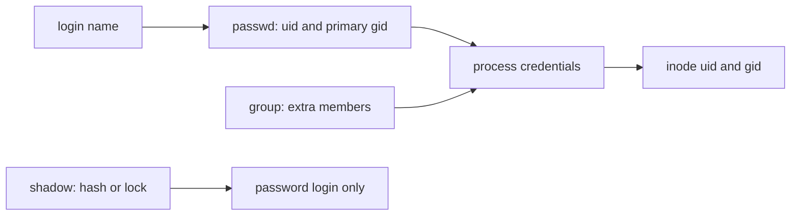

### What the commands mean

`id` with no arguments describes the current process. `id -u` prints only the number, which is what a script should test. `id -Gn ada` prints ada's group names. Comparing names is fine for humans. Comparing numbers is what the kernel does.

Creating an account, on a host where you are allowed to, is `useradd`. A typical line is `useradd -m -s /bin/bash -c "Ada Lovelace" -G sudo ada`. `-m` makes the home directory, `-s` sets the shell, `-G` adds supplementary groups. The primary group defaults to a new group with the same name as the user on Debian-style systems, and to `users` on some others. Do not memorise a distro's default. Read the passwd line after you create the account.

`usermod -aG docker ada` adds `docker` to ada's supplementary groups. The `-a` means append. `usermod -G docker ada` without `-a` sets the supplementary list to exactly `docker` and removes the other supplementary groups. That is the footgun. People drop themselves from `sudo` with a "small" group change and only notice at the next login. Group membership is read at login, when the session is built. A process that is already running keeps its old credentials. `id` in a new login shows the new groups. `id` in the old shell may not.

`userdel` removes the account. It does not, by default, remove every file the uid owns on every filesystem. Orphaned files still carry the number. `find` can locate them later. That is another reason not to reuse a uid the same day.

A service account should have a shell that refuses login, conventionally `/usr/sbin/nologin` or `/sbin/nologin`, and often no home you can write to. It still has a uid, so the process can own its files and nothing else. Running `nginx` as uid 0 because "the port is 80" is laziness. Bind the privileged port as root and drop, or give the service `CAP_NET_BIND_SERVICE`. `ps` shows that uid on the running process, which is how you check the drop actually happened.

### sudo and su check different people

`su` starts a shell as another user. With no name, that user is root. Traditional `su` asks for the **target** user's password. `su -` (or `su -l`) is a login shell: it clears most of the environment and reads the target's startup files, so `PATH` is the target's path. `su` without the dash keeps more of your environment, which is a good way to run root commands with a user's strange `PATH`. Prefer `su -` when you really mean "I am that user now".

`sudo` runs one command as another user, default root. It asks for **your** password, not root's, and then checks a policy file, `/etc/sudoers`. A line:

```text
ada ALL=(ALL) /usr/bin/systemctl reload nginx
```

lets ada run that command as root, on any host this file applies to, and nothing else. `sudo -u postgres psql` runs one command as postgres. `sudo -i` is a login shell as root, which is `su -` with sudo's policy instead of root's password.

`NOPASSWD` in sudoers skips the password prompt. That is reasonable for a single vetted command a deploy script must run non-interactively. It is not reasonable as:

```text
%admin ALL=(ALL) NOPASSWD: ALL
```

That line is a root shell for anyone in the group, with no extra check, and any malware that runs as them is root. Passwordless `ALL` is the thing audits look for. Put the specific command, with a full path, so a user cannot drop a different `systemctl` earlier on `PATH`.

`sudo` keeps a timestamp. A second `sudo` a minute later may not ask again. A script should not assume the timestamp exists. `sudo -n` fails instead of prompting if a password is required, which is what you want in CI, where a prompt would hang the job the way vim would.

`visudo` edits sudoers and checks the grammar before installing it. A syntax error in a hand-edited sudoers can lock out every admin. Do not improvise that edit in an editor you cannot exit, because a sudoers file left half-written is itself a lockout.

You cannot practice `useradd` or `sudo` in this sandbox. They need root, and this is not the machine to practice on. You can practice reading the records, which is the skill you need when a login fails and someone says "the account exists".

### A record you can read by hand

Given this passwd line and this group line:

```text
ada:x:1000:1000:Ada Lovelace:/home/ada:/bin/bash
sudo:x:27:ada
```

ada's uid is 1000, her primary gid is 1000, her shell is bash, and she is also a supplementary member of `sudo`. Her primary group does not have to be named in a member list. A shadow field of `!` would mean her password is locked even though this passwd line looks normal. `awk -F:` splits these lines. Field 3 of passwd is the uid. Field 2 of shadow is the hash or the lock. The exercises use a fake file so you never dump the real shadow database, which is a secret store even when you are allowed to read it.

### Where this breaks

**Trusting the name.** Two passwd lines, one uid, two names. `ls -l` shows one of the names. The inode only has the number. Scripts that "exclude root" by excluding the string `root` miss the second uid 0.

**Primary group blindness.** A directory is `drwxr-x---` owned by `deploy:deploy`. ada's passwd gid is `deploy`, but ada is not in the member list. She can still enter. The member list is not the whole story.

**`usermod -G` without `-a`.** You replace the supplementary set. The user loses `sudo` until someone with a root shell puts it back. Root's path is the console, or a remaining sudoer, or a cloud serial console.

**Thinking a locked password closes the account.** Keys, sudo, and cron still run. To disable an account, lock the password and remove the keys and the sudoers entry, or set the shell to `nologin` and check what still runs as that uid.

**`sudo` with a relative command.** `sudo editor file` runs whatever `editor` appears first on the caller's `PATH` if sudoers allows it. Full paths in the policy, and `sudo` resets `PATH` by default on many builds. Do not depend on a loose configuration.

**Editing sudoers without `visudo`.** One bad character and the next SSH session cannot become root. Keep a root shell open until you have tested a new session.

### How this is used at work

A deploy user owns the application directory and is not uid 0. The service unit from the services lesson sets `User=deploy`. Log files are group-readable by `adm` so you can read them without sudo. When you need a privileged action, sudo runs one command: reload a unit, install a package, read a sealed log. Production shells are not left at a root prompt.

Containers reuse this model and then confuse it. Inside a container, uid 0 is root in that namespace, which may map to an unprivileged uid on the host. A bind-mounted file showing uid `1000` may be "root" in the container's passwd and a normal user on the host. When names and numbers disagree across that boundary, believe the number on the host that owns the disk. The perms lesson's `chown` is how you line them up.

Scripts that check "am I root" should use `id -u`, not `whoami`. `whoami` prints a name. The name `root` with a uid other than 0 is not the check you wanted. The scripts lesson's `set -e` will not save you from a sudo prompt. Use `sudo -n` if a password would be a bug.

### Which door

| You need | Use | Why |
|---|---|---|
| One command as root, you are allowed | `sudo command` | Checks sudoers, asks for your password, runs one command |
| A root login shell, you are allowed | `sudo -i` | Login environment, still governed by sudoers |
| You know the target's password and policy is irrelevant | `su - user` | Asks for the target password. Rare on servers |
| A script must run one privileged command with no prompt | sudoers `NOPASSWD` on that full path | Do not grant `NOPASSWD: ALL` |
| See who you are | `id` | Uid, primary gid, supplementary groups |
| Add a supplementary group | `usermod -aG group user` | Without `-a`, `-G` replaces the list |

### You can now

- Read a passwd line and name the uid, primary gid, home, and shell, and say what `x` in the password field means.
- Explain why uid 0 is root even under another name, and why shadow exists.
- Explain why a group's member list is not the full set of people in that group.
- Say what `usermod -aG` does and what dropping `-a` does.
- Choose `sudo`, `sudo -i`, or `su -`, and say whose password is checked.
- Recognise `NOPASSWD: ALL` as a root shell, and restrict passwordless sudo to one full path.
- Parse a passwd or shadow file with `awk -F:` without reading the real `/etc`.

::: quiz
q: A passwd line starts `ada:x:1000:1000:`. What does the single character `x` mean?
- The account is locked and cannot log in
+ The password hash is not in this file. It is in `/etc/shadow`, which ordinary users cannot read
- The user has no password and can log in with an empty password
- The uid is encoded in hexadecimal
why: `x` is a placeholder. The hash, the lock flag, and the password-ageing fields live in `/etc/shadow` so that the world-readable passwd file does not publish a crackable hash. The tempting reading is "x means locked". A lock is a shadow field of `!`, `!!`, or `*`, not the letter x in passwd. An empty password is a different, dangerous shadow value. The third field, `1000`, is the uid in decimal.
:::

::: quiz
q: A host has two passwd lines: `root:x:0:0:...` and `backup:x:0:0:...`. What can `backup` do?
- Nothing special. Only the account named `root` bypasses permission checks
+ The same as root. The kernel authorises uid 0, and both lines have uid 0
- Only read `/etc/shadow`, because the name `backup` is not in sudoers
- Only write files in `/backup`, because the home directory limits uid 0
why: Discretionary access control treats every process with uid 0 as privileged, whatever name passwd shows. A second uid 0 is a second root, including the ability to read shadow and change sudoers. The name `root` is a convention. Home directories do not sandbox uid 0. This is why an audit looks for every line whose third field is 0.
:::

::: card
q: Name the seven colon-separated fields of an `/etc/passwd` line, in order.
answer: Login name, password field (`x` when the hash is in `/etc/shadow`), user id, primary group id, GECOS comment, home directory, login shell. Example: `ada:x:1000:1000:Ada Lovelace:/home/ada:/bin/bash`.
:::

::: shell
task: `passwd` is a fake account file. Print `name home` for every account whose uid is at least 1000 and below 65534 and whose shell ends in `bash`. One account per line.
file: passwd
```
root:x:0:0:root:/root:/bin/bash
daemon:x:1:1:daemon:/usr/sbin:/usr/sbin/nologin
ada:x:1000:1000:Ada Lovelace:/home/ada:/bin/bash
deploy:x:1001:1001:Deploy:/home/deploy:/bin/bash
nobody:x:65534:65534:nobody:/nonexistent:/usr/sbin/nologin
```
expect:
```
ada /home/ada
deploy /home/deploy
```
solution:
```bash
awk -F: '$3 >= 1000 && $3 < 65534 && $7 ~ /bash$/ { print $1, $6 }' passwd
```
hint: The fields are separated by colons. Field 3 is the uid, field 1 the name, field 6 the home, field 7 the shell. `nobody` is 65534 and its shell is `nologin`, so both tests exclude it.
:::

::: shell
task: `shadow` is a fake shadow file. Print the login name of every account whose password field is `*` or begins with `!`. Those accounts are locked for password login.
file: shadow
```
root:!:19726:0:99999:7:::
ada:$y$j9T$dummyhash:19726:0:99999:7:::
deploy:!!:19726:0:99999:7:::
svc:*:19726:0:99999:7:::
```
expect:
```
root
deploy
svc
```
solution:
```bash
awk -F: '$2 == "*" || $2 ~ /^!/ { print $1 }' shadow
```
hint: Field 2 is the hash or the lock. `!` and `!!` both start with `!`. A real hash here starts with `$`, so ada should not be printed.
:::

::: quiz
q: ada runs `sudo systemctl reload nginx`. The sudoers policy allows it. Whose password does sudo ask for, and what does `su` ask for instead?
- sudo asks for root's password. `su` asks for ada's password
+ sudo asks for ada's password, then checks sudoers. `su` to root asks for root's password
- Neither asks for a password if ada's passwd field is `x`
- Both ask for the password stored in `/etc/group`
why: sudo authenticates the invoking user and then applies policy, so ada proves she is ada. `su` authenticates the target: becoming root requires root's password, which most people do not have, which is why servers use sudo. The passwd field `x` only means the hash is in shadow. It is not a free pass. Group passwords are not what either tool asks for. The tempting swap, "sudo wants root's password", describes `su`, and it is why a host with a locked root password can still be administered with sudo.
:::

::: quiz
q: ada is in supplementary groups `sudo` and `deploy`. An admin runs `usermod -G docker ada` and does not pass `-a`. What is ada's supplementary set afterwards?
- `sudo`, `deploy`, and `docker`. `-G` always adds
+ `docker` only. Without `-a`, `-G` replaces the supplementary list
- Unchanged. `-G` without `-a` is an error and the command does nothing
- The primary group becomes `docker` and the supplementary list stays
why: `usermod -G` sets the supplementary groups to exactly the list you gave. `-a` is what appends, and `-a` is only valid together with `-G`. Forgetting `-a` removes `sudo` and `deploy`. The change shows up in a new login, not necessarily in the shell that was already open. The primary group is the gid in passwd and is not what `-G` sets.
:::

::: card
q: Why can a user be in the group `deploy` even when `/etc/group` shows `deploy:x:1001:` with an empty member list?
answer: The member list is only the supplementary members. The primary group is the fourth field of the user's `/etc/passwd` line. If that gid is 1001, the user is in `deploy` without being named in the member list. `id` and `groups` show both. Reading only the member list misses the primary group.
:::
## Disks, mounts, and inodes
id: disks
stage: system
needs: paths
minutes: 35
goal: Tell free space from directory size, read a mount and an fstab line, and explain a full disk that du cannot see.
source: fstab(5) | https://man7.org/linux/man-pages/man5/fstab.5.html
source: mount(8) | https://man7.org/linux/man-pages/man8/mount.8.html
source: inode(7) | https://man7.org/linux/man-pages/man7/inode.7.html
source: df(1) | https://manpages.debian.org/bookworm/coreutils/df.1.en.html
source: du(1) | https://manpages.debian.org/bookworm/coreutils/du.1.en.html

A deploy fails with `No space left on device`. You run `du -sh` on the directory you were writing and it says the tree is small. Someone deletes the log and the error stays. Someone else says the disk is 40% free. All three reports can be true at once, because they are measuring different things. Until you can say which thing, you will reboot a healthy machine and leave the full one alone.

`/var/log/app.log` is a path you can join and split. The path is only a name. This lesson is about what that name is attached to, and about the two resources a filesystem can run out of. One resource is data blocks, the bytes `df` is usually asked about. The other is inodes, the records that describe files. You can have free bytes and still be unable to create a file.

### Names, inodes, blocks

A directory is a table of names. Each name points at an **inode**. The inode holds the metadata: mode, owner, timestamps, size, and pointers to the **blocks** that hold the bytes. The filename is not in the inode. Two names can point at one inode. That is a hard link. The inode keeps a link count. When the last name is removed, the inode is eligible to be freed, but only if no process still has the file open.

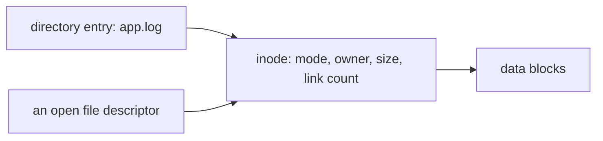

`rm` removes a directory entry. It does not necessarily free the blocks. If a process has the file open, the inode stays, the blocks stay, and `df` still counts them. `du` walks names. The name is gone, so `du` no longer sees those bytes. This is the "deleted but open" file. It is the usual reason a log disk is full after you deleted the log.

You can see the hold on Linux through `/proc/<pid>/fd`. The symlink for that descriptor is marked `(deleted)`. `/proc/<pid>/fd` is a kernel view shaped like a directory, which is why `ls` can show the descriptor. Closing the descriptor, or exiting the process, drops the link count to zero and the blocks return. Truncating a log (`: > app.log`) shrinks the blocks while keeping the same inode open, which is what you wanted. Deleting it and letting the daemon keep writing creates a new invisible file. Restarting the daemon is the blunt fix. You find that daemon from its pid, with `ps` or `lsof`, and you stop it with a signal rather than by deleting another name.

### df reads the filesystem, du walks names

`df` asks the kernel how full a filesystem is. `df -h /var` prints a human-readable summary for the filesystem that holds `/var`: size, used, available, percent, and the mount point. `df -i` prints inode use instead of block use. Scripts should not scrape `-h`. Use `df -k` or `df -P` when you need stable columns. `-P` is the POSIX output shape, one line per filesystem, which is what you can parse.

`du` adds up the blocks reachable by walking a tree of names. `du -sh /var/log` is a summary in human units. `du -sk /var/log` is the same idea in kibibytes, which is what you compare and sort. `du -d 1 /var` (GNU also accepts `--max-depth=1`) shows each child and stops. That is how you find which top-level directory grew. `-h` is for your eyes. The moment you sort or compare, use `-k` so the units are numbers.

`du` does not cross into "what df knows" by magic. Two flags matter:

- `du -x` stays on one filesystem. Without it, `du /` walks into every mount under `/`, including another disk, a network mount, or a container overlay. A "the root disk is huge" report is often `du` adding up `/var` and `/home` that are separate filesystems.
- `df` never cared which directory you own. `du` can only add names you are allowed to read. Run as a normal user, `du /var` under-reports. Run as root, it sees the rest, because directory search permission decides which names `du` is allowed to walk, and a mode that excludes you hides those bytes from the total.

A third disagreement is snapshots and reserved space. ext4 reserves some blocks for uid 0, so a non-root process gets `No space left` while `df` still shows a little free. Btrfs, ZFS, and APFS snapshots keep blocks that no name in the live tree points at. `du` does not charge you for them. `df` does. You will not practice snapshots here. You will practice the rule: when `df` and `du` disagree, say which one you asked and what it is allowed to see.

On this course's Mac, `du` is the BSD one. `du -sk`, `du -sh`, `du -d 1`, and `du -x` are the flags to remember, and they match current GNU `du` as well. Do not use BSD-only `-A` in a script you want to run on a server. Do not use GNU-only long options in a script you want to run on the Mac.

### Mounts and fstab

A **mount** attaches a filesystem to a directory, the mount point. After `mount` attaches a disk at `/var`, a path under `/var` is that disk, even though the path still looks like part of `/`. The paths lesson's `..` does not climb out of a mount in the way people expect from a diagram of folders. `df /var/log/app.log` names the filesystem that would hold that file. `findmnt` or `mount` lists what is attached. `/proc/mounts` is the kernel's list on Linux.

`/etc/fstab` is the table of mounts the boot should recreate. One line, six fields:

```text
UUID=2f1c... /var ext4 defaults,noatime 0 2
│            │    │    │                 │ │
│            │    │    │                 │ └── fsck pass
│            │    │    │                 └── dump frequency (usually 0)
│            │    │    └── options
│            │    └── type
│            └── mount point
└── source. Prefer a UUID over /dev/sdb1, which can change names
```

The last field is the fsck pass. `1` is the root filesystem. `2` is everything else you want checked. `0` means do not fsck this entry at boot. A typo in fstab is a machine that boots into an emergency shell. Edit it with the same care as sudoers: one change, a backup of the line, and do not reboot until you can say what the line mounts.

`noauto` in the options means "this line is a record, but do not mount it at boot". `ro` is read-only. `defaults` is the usual rw set. You do not need every option. You need to read a line without guessing which column is the mount point.

### A tree you can measure

`du -sk` reports kibibytes of allocated space. That integer is a property of the filesystem, because a 100-byte file and a 2-byte file often share one allocation unit, and a file that crosses a block boundary jumps by a whole block. You do not put a `du` number into a test or a script that has to give the same answer on a laptop and on a server. You use `du` when one directory is heavier by megabytes and you want its name. You use `wc -c` when you need the exact number of bytes you wrote.

```bash
mkdir -p hold/mail hold/cache
printf 'a%.0s' {1..40} > hold/mail/m.txt
printf 'b%.0s' {1..80000} > hold/cache/c.txt
wc -c hold/mail/m.txt hold/cache/c.txt
```

`wc -c` prints 40 and 80000. Those are the bytes you wrote, on every machine. `du -sk hold/* | sort -n` is what you run on a server. The last name is the directory that grew. The integer in front of it is not the byte count.

On a server you run `du -sk /var/* | sort -n` and read the bottom of the list. `sort -n` compares the size as a number, so `9` comes before `10`. A plain `sort` compares characters, so `10` comes before `9`, and the directory you delete is the wrong one.

### Where this breaks

**Deleting a live log.** The writer still has the inode. `df` does not drop. `lsof` or `/proc/<pid>/fd` shows `(deleted)`. Truncate, or restart the writer. Do not fill the disk a second time by copying the log "to save it" before you have freed anything.

**`du /` without `-x`.** You add every mounted filesystem and blame the root disk. Check `df -h` first and see the mount points, then `du -x -d 1` on the full one.

**Inode exhaustion.** `df -h` shows free space. `df -i` shows `100%` IUse. Creating a file fails with the same `No space left on device`. The cause is millions of tiny files, often a cache or a mail spool. Deleting files frees inodes, because each file consumes one inode and removing the last name gives that inode back. Raising the block size does not free inodes. The block size only decides how many bytes sit in each data block, and it is chosen when the filesystem is created, so you cannot change it on a live volume. The way out is to delete files, or to create a new filesystem with more inodes and copy the data across.

**Parsing `df -h`.** `1.5G` and `1500M` do not sort as text. Use `-k` and awk. Human flags are for humans.

**Assuming `/dev/sdb1` is stable.** Disks are named in the order they are discovered. fstab should use `UUID=` or a stable by-label path. A swapped name mounts the wrong disk on `/var`, and the boot "succeeds".

**Snapshots and containers.** A container's writable layer can fill the host disk that backs it. `du` inside the container does not show the host's other tenants. `df` on the host does. When the numbers disagree across that boundary, you are looking at two views of one pool.

### How this is used at work

An alert says the root filesystem is over 85%. You `df -h` and `df -i` before you `du` anything, so you know whether you are hunting blocks or inodes, and which mount. Then `du -x -d 1` on that mount, then one level down, until the directory is small enough to explain. Logs are the usual answer. systemd's journal stores its own files under `/var/log/journal` when persistence is on, so `du` can see that directory even though you read the records with `journalctl` rather than with `less`.

A deploy that unpacks an archive, from the archives lesson, can fill the disk halfway through. The script should check `df` before it starts, and it should not unpack as root into `/` . A full disk makes shells fail in strange ways: bash cannot write a history file, sshd cannot write a pid, the editor cannot write a swap file. Free a little space first, then look properly.

Cron jobs that rotate logs by `rm` instead of truncation recreate the deleted-open problem every night, because the scheduler will run the same `rm` again tomorrow and the writer still holds the inode. The fix belongs in the job, which should truncate or signal the writer, not in a bigger disk.

### Which question

| You want | Ask | Do not ask |
|---|---|---|
| Is the filesystem full? | `df -h` on the path | `du` of one directory |
| Are inodes full? | `df -i` | `df -h` |
| Which directory grew? | `du -x -d 1` then go down | `du /` with no `-x` |
| A number you can sort | `du -sk` | `du -sh` |
| Why df is high and du is low | Open deleted files, snapshots, permissions | Another `rm` of a file you already deleted |
| What boots mounted | `/etc/fstab` and `findmnt` | The label printed on the VM's disk list |

### You can now

- Explain an inode, a directory entry, and a data block, and why `rm` can leave blocks allocated.
- Use `df` for a filesystem and `du -sk` for a tree, and say why they disagree.
- Read `df -i` and recognise inode exhaustion.
- Stay on one filesystem with `du -x`, and stop at one level with `du -d 1`.
- Read the six fields of an fstab line and say why the source should be a UUID.
- Choose truncate-or-restart over deleting a live log.

::: quiz
q: `/var` is 100% full according to `df`. You delete `/var/log/app.log`, and `df` does not drop. `du -sh /var/log` is now small. What is the best explanation?
- `du` is wrong because it ignores files larger than 1 GB
+ A process still has the log open. The name is gone, so `du` misses it, but the inode and its blocks stay until the last file descriptor closes
- `df` caches the old size for 24 hours
- The file is still in the directory under a different name that `du` skips
why: `rm` removes the directory entry. The inode remains while any process has the file open, and `df` counts those blocks. `du` only walks names, so it no longer sees them. `df` is not waiting a day. `du` does not skip large files. The tempting story, "du is simply wrong", throws away the only clue you have: the two tools are looking at different objects. Find the process and restart it, or truncate next time instead of deleting.
:::

::: quiz
q: `df -h` on a filesystem shows several gigabytes free. Creating a file still returns `No space left on device`. What do you check next?
- `du -sh /`, because df must be stale
+ `df -i`. Free bytes do not help if every inode is in use
- `mount -o remount,rw`, because a full inode table means the mount is read-only
- The fstab dump field. A value of 0 refuses new files
why: A filesystem can run out of inodes while it still has free blocks. `df -i` shows that. Millions of tiny files are the usual cause. `du` will confirm there are many names, but it will not tell you the inode table is the resource that hit 100%. Remounting read-write does not create inodes. The dump field in fstab is not a quota.
:::

::: card
q: What does `du -x -d 1 -k /var` report, and why those flags?
answer: It reports the allocated size, in kibibytes, of `/var` and of each directory directly inside it, without walking into other filesystems mounted under `/var`. `-k` keeps the units numeric, `-d 1` limits the depth, and `-x` stays on one filesystem. `df` would instead report the whole filesystem that holds `/var`, including deleted-but-open files and other directories.
:::

::: predict lang=shell
q: What does this print? `wc -c` counts the bytes you wrote. The comparison does not use `du`, so the answer does not depend on the filesystem's block size.
code:
```bash
mkdir -p shop/thumbs shop/images
printf 't%.0s' {1..80} > shop/thumbs/a.txt
printf 'i%.0s' {1..30000} > shop/images/b.txt
thumbs=$(wc -c < shop/thumbs/a.txt | tr -d ' ')
images=$(wc -c < shop/images/b.txt | tr -d ' ')
if [ "$images" -gt "$thumbs" ]; then echo "heavier: shop/images"; else echo "heavier: shop/thumbs"; fi
echo "thumbs_bytes: $thumbs"
echo "images_bytes: $images"
```
answer:
```
heavier: shop/images
thumbs_bytes: 80
images_bytes: 30000
```
why: `printf 't%.0s' {1..80}` writes 80 bytes, and `{1..30000}` writes 30000 bytes. `wc -c` reports those numbers on every machine. `du -sk` would report allocation units instead, and two filesystems can print different kibibyte totals for the same bytes. The images directory holds more payload, so the comparison prints `shop/images`.
:::

::: shell
task: Create `var/spool` with two 10-byte files, `var/www` with one 25000-byte file, and `var/tmp` with one 40-byte file. Print only the directory whose files contain the most bytes. Count with `wc -c`, not with `du`, so the answer is the same on every filesystem.
expect: var/www
verify:
```bash
# wrong answer tested: echo var/spool, because that directory has more files (two) even though it holds only 20 bytes.
spool=$(wc -c var/spool/* | awk '$2 != "total" { s += $1 } END { print s }')
www=$(wc -c var/www/* | awk '$2 != "total" { s += $1 } END { print s }')
[ "$www" -gt "$spool" ]
```
solution:
```bash
mkdir -p var/spool var/www var/tmp
printf 's%.0s' {1..10} > var/spool/a.txt
printf 's%.0s' {1..10} > var/spool/b.txt
printf 'w%.0s' {1..25000} > var/www/index.html
printf 't%.0s' {1..40} > var/tmp/note.txt
best=""
bestn=-1
for d in var/spool var/www var/tmp; do
  n=$(wc -c "$d"/* | awk '$2 != "total" { s += $1 } END { print s }')
  if [ "$n" -gt "$bestn" ]; then bestn=$n; best=$d; fi
done
printf '%s\n' "$best"
```
hint: Add the byte counts of the files in each directory. Skip a `total` line if `wc` prints one. The directory with two files is not the heavy one. Print the path and nothing else.
:::

::: quiz
q: An fstab line reads `UUID=abc /var ext4 defaults 0 2`. What is the `2`?
- The filesystem should be mounted read-only
+ The fsck pass. Root is pass 1. Pass 2 means "check this, after root"
- The dump frequency, and 2 means "dump twice a day"
- The maximum number of mounts before the disk is ignored
why: The six fields are source, mount point, type, options, dump frequency, and fsck pass. The `0` just before the `2` is the dump frequency. The `2` is the pass. The tempting reading swaps the last two fields and treats 2 as a dump schedule. `defaults` is the option column. Nothing in that line is a mount limit.
:::

::: card
q: Why is `df -h /var` a poor input to a script that decides which directory to delete, and what do you run instead?
answer: `df` reports the whole filesystem mounted at `/var`, in human units that are awkward to compare, including space `du` cannot see. To choose a directory, run `du -k -x -d 1 /var` and sort the numbers. Use `df -h` and `df -i` first only to learn which filesystem is full and whether the scarce resource is blocks or inodes.
:::
## Packages, repositories, and signatures
id: packages
stage: system
needs: files
minutes: 30
goal: Tell update from upgrade, compare apt, dnf, apk, and brew, and refuse a curl-pipe-bash install.
source: apt | https://wiki.debian.org/Apt
source: apt(8) | https://manpages.debian.org/bookworm/apt/apt.8.en.html
source: Pacman Rosetta | https://wiki.archlinux.org/title/Pacman/Rosetta
source: Package signing | https://wiki.archlinux.org/title/Pacman/Package_signing

A README says the next step is `curl https://example.com/install.sh | bash`, or `sudo apt install something` on a machine that has never refreshed its package lists. Both are ways to get software onto a host. One of them is a signed index of packages your distribution already agreed to trust. The other is a program you have not read, fetched over the network, running as you, sometimes as root, with whatever bytes the server feels like sending today. This lesson is how the signed path works, what the four package tools you will actually meet call the same operation, and why the pipe is not a shortcut you take on a server.

You will not run `apt` or `dnf` here. There is no repository, and this is not the machine to modify. You will read a fake package list the way a planner reads "installed version" and "candidate version" before it changes anything.

### A repository is an index with a signature

A package is an archive plus metadata: the name, the version, the dependencies, the files it owns. A repository is a collection of those packages and an index that lists them. The index is signed by a key the distribution ships, or by a key you installed on purpose. When the tool refreshes, it downloads the index, checks the signature, and checks that each package hash matches the index. A mirror can hand you a stale copy. It cannot hand you a substituted package that still verifies, not unless it also has the signing key.

That chain is why "I downloaded the `.deb` from a random URL" is a different act from "I installed it with apt". The first file has no relationship to the index unless you check a published checksum yourself. The second was hashed in the index you already verified. Debian's apt and Arch's pacman both work this way. Their pages on apt and on package signing are the references. Fedora's `dnf` and Alpine's `apk` do the same job with different file formats: a repo file, a signature, a refusal to install when the signature does not check, unless someone turned the check off. Turning the check off is the thing you do not do to make a build green.

Third-party repositories are a policy decision, not a technical detail. The key you add can sign any package the tool will accept from that repo, including a package named like a core library, depending on how the tool pins origins. Adding a key is giving that key a say in what root-owned files look like the next time you upgrade. Prefer the distribution's archive. If you add a vendor repo, know which packages it is allowed to replace.

### The same four verbs, different words

You only need a handful of operations. The names change.

| You mean | Debian apt | Fedora dnf | Alpine apk | Homebrew |
|---|---|---|---|---|
| Refresh the index | `apt update` | `dnf check-update` or `dnf makecache` | `apk update` | `brew update` |
| Install newer versions of what is already installed | `apt upgrade` | `dnf upgrade` | `apk upgrade` | `brew upgrade` |
| Install a package by name | `apt install nginx` | `dnf install nginx` | `apk add nginx` | `brew install nginx` |
| Remove it | `apt remove nginx` | `dnf remove nginx` | `apk del nginx` | `brew uninstall nginx` |

`apt update` does **not** install anything. It downloads the lists. `apt upgrade` installs newer versions of packages you already have, and it is the conservative upgrade: it will not remove a package to satisfy a dependency. `apt full-upgrade` (and the older `apt-get dist-upgrade`) may remove packages to finish the upgrade. On a server you read that plan before you accept it. `apt-get` is the form to use in scripts. `apt` is the form for a person at a terminal. The apt manual describes both. Scripts should pass `-y` only when a human already decided the plan is acceptable, and they should not hide a failure. The scripts lesson's `set -e` is how a failed install stops the script.

`dnf upgrade` is the Fedora and RHEL upgrade. People still type `dnf update`. On current dnf that is an upgrade, which is the opposite naming trap from apt, where `update` only refreshes lists. Read the verb against the tool, not against your memory of a different tool.

`apk` is what you meet inside Alpine images, which is most small containers. `apk add --no-cache` in a Dockerfile updates the index and installs without leaving the index sitting in the image. The package is still coming from a signed Alpine repository. The container being small does not make a random shell script a better installer.

Homebrew, on a Mac and sometimes on Linux, splits the two ideas the other way. `brew update` updates Homebrew itself and the taps, which are the indexes. `brew upgrade` upgrades the formulae you installed. Running `brew update` and expecting every package to jump versions will disappoint you. Running `brew upgrade` in a script every hour upgrades the world, including things you were not ready to retest.

Arch's `pacman -Syu` refreshes and upgrades together, and the rosetta table maps it onto `apt update` plus `apt upgrade` and onto `dnf upgrade`. Partial upgrades, refreshing the index and then installing one package against a half-applied world, are how Arch systems break. Debian's split between `update` and `upgrade` makes that mistake harder. It does not make it impossible.

### What a candidate version is

A planner looks at two versions. The installed version is what is on disk. The candidate is what the index says is the newest installable version. If they differ, an upgrade would change that package. If they are equal, the package is current relative to this index, which might itself be old if you have not refreshed. The exercise at the bottom is that comparison on a text file: name, installed, candidate. No network, no root, no real package database.

```text
nginx 1.24.0 1.26.1
curl 8.5.0 8.5.0
bash 5.2.15 5.2.21
```

`nginx` and `bash` would change. `curl` would not. That is the whole decision. The real tools then download the packages, verify the hashes, unpack them as root, and run maintainer scripts. Those scripts are code from the package, running as root. The signature chain is why that is an acceptable risk for the distribution's archive and a wild risk for a script you piped from the internet.

### Why the pipe is worse

`curl https://example.com/install.sh | bash` has four separate problems.

The script can change between the moment you read a copy in the browser and the moment you run it. You did not pin a hash. The URL can move to a different host if you followed a redirect you did not notice. The shell starts executing bytes as they arrive, so a truncated download is not always a clean failure. And the script often calls `sudo`, so the next thing it does is root. A package install runs maintainer scripts too, but those scripts came from a signed package whose contents you can re-fetch and diff. A pipe has no artifact left to diff unless you saved it.

If a vendor only offers a shell script, download it, read it, check a published checksum or signature, and then run the file you read. Do not pipe. Prefer a distro package or a pinned upstream package over a script that "sets everything up" and also rewrites your shell rc files. The dotfiles project is the opposite habit: a script you own, in a repo you review, that you can run twice.

`sudo bash` of an unread script is the users lesson's root boundary, crossed for no policy reason. `NOPASSWD` would make it worse, not better.

### Where this breaks

**`apt upgrade` on a machine you have not updated.** The lists are old. You "upgrade" to whatever was current months ago, or the download fails because the files have been removed. `apt update` first.

**Confusing apt's `update` with dnf's `update`.** One refreshes. The other upgrades. The table is the antidote.

**`apt-get install -y` in a Dockerfile with no pin.** Today's build gets today's candidate. Tomorrow's build gets a different one and the image moved under you. Pin versions when you need a reproducible image, and still rebuild on purpose so you take security fixes.

**Disabling signature checks.** `gpgcheck=0`, `--allow-unauthenticated`, `apk add --allow-untrusted`. The build goes green and the chain is gone. Fix the key, or stop.

**A third-party repo named like a convenience.** It can ship a newer `sudo` or `openssl` than your distribution, depending on pin priorities. Read what the repo is allowed to replace before you add the key.

**`curl | bash` inside CI.** The CI cache hides how often the script changed. Pin the installer by commit or hash, or install the distro package.

### How this is used at work

A base image names a distribution and a set of packages. The Dockerfile runs `apt-get update` and `apt-get install` in one layer so the lists and the install are the same snapshot, then deletes the lists. The host itself gets `apt upgrade` or `dnf upgrade` on a schedule, from the cron or timer lesson, and someone reads the changelogs for the services that matter. Unattended security updates are a policy, not a default you enable on a database and forget.

When a vulnerability says "fixed in openssl 3.0.14", you do not browse the vendor's website and grab a tarball. You look at the candidate version in the distro you actually run. A fixed upstream version that your distro has not packaged is not installed. A packaged version that is older than upstream and carries the distro's patch might already contain the fix. The package version is the fact. The blog's version number is a hint.

The files lesson's `/etc` is full of configs the package owns. An upgrade may ask you to keep or replace a config you edited. That prompt is the package manager refusing to destroy your change. In a script, that prompt hangs, the same way vim hangs. `dpkg` options for "keep the old file" exist so a script can choose. Do not default them to "take the vendor's file" without reading the diff.

### Which operation

| You are about to | Do | Do not |
|---|---|---|
| See what changed upstream of this machine | Refresh the index | Assume the lists from image-build time are current |
| Move installed packages forward | Upgrade, and read removals | `full-upgrade` unattended on a unique server |
| Install one tool on Debian | `apt-get install` after `update` | `curl \| bash` |
| The same tool on Alpine | `apk add` | The Debian command, which is not there |
| The same tool on a Mac you develop on | `brew install` | `brew update` and then assuming the formula upgraded |
| A script | `apt-get`, pinned if the build must be reproducible | `apt` with a pager and a question |
| A signature error | Fix the key or the clock | Disable the check |

### You can now

- Explain a signed index, a package hash, and why a mirror cannot silently substitute a package.
- Contrast `apt update` with `apt upgrade`, and with `dnf upgrade` and `brew update`.
- Name `apk add` as Alpine's install, and say why containers still want the signed repo.
- Say what `apt full-upgrade` may do that `apt upgrade` will not.
- Refuse `curl | bash`, and say what to do instead.
- Read a name, an installed version, and a candidate version, and list what an upgrade would change.

::: quiz
q: On Debian, you have not touched the package lists in months. You want the newest packaged nginx that this release offers. What do you run?
- `apt upgrade`, which also refreshes the lists
+ `apt update`, then `apt upgrade` or `apt install nginx`. `update` only refreshes the lists. `upgrade` installs newer versions of what is already installed
- `apt full-upgrade` with no update. Full means it refreshes and upgrades
- `curl | bash` from the nginx website, because apt cannot see new versions
why: `apt update` downloads package lists and does not install. `apt upgrade` installs from those lists and will not remove packages to do it. Without a fresh list you upgrade toward an old snapshot, or the download 404s. `full-upgrade` does not refresh the lists either. It only changes the dependency solver. Piping a shell script skips the signed index entirely. The tempting belief is that "upgrade" is the one verb that does everything, which is closer to how people use `dnf upgrade` and is wrong for apt.
:::

::: quiz
q: A project's install documentation is `curl -fsSL https://example.com/install.sh | bash`. Why is that a bad way to install software on a server?
- The pipe is fine if the URL starts with https, because TLS means the script is the one the vendor published last year
+ You did not pin a hash, the script can change or arrive truncated, and it often runs as root. Download it, check a signature or checksum, read it, then run the file you read. A distro package is better
- bash cannot read a pipe, so the command does nothing
- curl refuses to talk to bash, so the pipe is a syntax error
why: HTTPS protects the bytes in transit. It does not freeze the script, and it does not review it. The server can send a different script than the one you skimmed, and the shell can start running it before the download finishes. A signed distro package is hashed in an index you already trust. The tempting claim is that the lock icon is a review. It is only a transport. bash can read a pipe, which is the problem, not a syntax error.
:::

::: card
q: On apt, what may `full-upgrade` do that `upgrade` will not, and what is the Homebrew pair that people swap?
answer: `apt full-upgrade` may remove packages if that is what the dependency solver needs. `apt upgrade` will not. Neither refreshes the lists. That is `apt update`. Homebrew is the other naming trap: `brew update` updates Homebrew and the taps (the indexes), and `brew upgrade` upgrades installed formulae. `brew update` alone does not upgrade nginx.
:::

::: shell
task: `packages.txt` has one package per line: name, installed version, candidate version. Print the names that an upgrade would change, one per line, sorted. A package changes when the two versions differ.
file: packages.txt
```
nginx 1.24.0 1.26.1
curl 8.5.0 8.5.0
bash 5.2.15 5.2.21
openssl 3.0.13 3.0.13
```
expect:
```
bash
nginx
```
solution:
```bash
awk '$2 != $3 { print $1 }' packages.txt | LC_ALL=C sort
```
hint: Field 2 is what is installed. Field 3 is the candidate. Print field 1 when they differ, and sort so `bash` comes before `nginx`.
:::

::: quiz
q: You are inside an Alpine container and you need nginx from the distribution repository. Which command matches that system?
- `apt-get install nginx`
+ `apk add nginx`
- `dnf install nginx`
- `brew install nginx`
why: Alpine uses `apk`. `apk add` installs from the signed repositories in `/etc/apk/repositories`. `apt-get` is Debian and Ubuntu, `dnf` is Fedora and RHEL, and `brew` is Homebrew, which is a user-space package manager and not the Alpine base system. The tempting choice is `apt-get`, because most Dockerfile snippets you have seen are Debian. The package tool has to match the distribution the image actually is.
:::

::: card
q: What does a package signature chain let a mirror do, and what does it stop a mirror from doing?
answer: A mirror may serve the packages and the signed index, including a stale but genuine copy. It cannot substitute a different package that still verifies, because the index is signed by the distribution key and each package is hashed in that index. Disabling the check (`--allow-unauthenticated`, `gpgcheck=0`, `apk --allow-untrusted`) removes that guarantee. Adding a third-party key lets that key sign packages your tool will trust.
:::

## Processes and signals
id: processes
stage: system
needs: shell
minutes: 40
goal: See what is running, stop it politely or by force, and read an exit code that means "killed by a signal".
source: man signal | https://man7.org/linux/man-pages/man7/signal.7.html
source: POSIX kill | https://pubs.opengroup.org/onlinepubs/9699919799/utilities/kill.html

A program you start is not a name in a terminal. It is a **process**: an address space, open files, a user id, a working directory, and a number, the **PID**. When a server is sick, the useful question is which process is using the CPU, which one is stuck, and which signal will let it finish its work before it dies. `kill -9` as a first move throws that work away. The exit code afterwards is how you tell a crash from a kill.

### Parents, children, and the number

Every process except PID 1 has a parent, the process that created it. The shell forks, then the child executes the program you named. `echo $$` is the shell's own PID. `echo $!` is the PID of the last background job.

```bash
sleep 30 &
echo $!
```

`ps aux` lists every process with its owner, CPU and memory. The columns that matter on a first look are USER, PID, STAT, %CPU, %MEM, and the command. `STAT` of `R` means running, `S` sleeping, `Z` a zombie (the process has exited and its parent has not waited for it, so the PID entry is still there). `top` (and `htop`, if it is installed) is the same table, live, busiest first. `pgrep -af gunicorn` prints PIDs whose command line matches. `pgrep` is a search. `pkill` sends a signal to the same set. Prefer `pgrep` first so you see who you are about to signal.

`jobs`, `fg` and `bg` manage the background jobs of **this shell** only. They do not see a process another terminal started. `ps` does.

```text
shell (parent)
  ├── sleep 30   PID in $!
  └── python3 app.py
init / systemd is PID 1, parent of anything whose parent already exited
```

### Signals

`kill` does not mean "destroy". It sends a **signal**, a small integer the kernel delivers to the process.

| Signal | Number | Meaning |
|---|---|---|
| SIGTERM | 15 | Please exit. `kill PID` sends this. A well-written server stops accepting work, finishes what is in flight, and exits |
| SIGINT | 2 | Interrupt. Ctrl-C in a terminal sends this. Most programs treat it like "stop now" |
| SIGHUP | 1 | The terminal hung up. Many daemons reuse it as "reload the config". Do not assume that. Read the program's manual |
| SIGKILL | 9 | The kernel removes the process. It cannot be caught, blocked, or handled. No cleanup runs |
| SIGSTOP / SIGCONT | 19 / 18 on Linux (numbers differ by OS) | Pause and resume. The numbers are not portable. The names are. Write `kill -TERM`, not `kill -15`, when you can |
| SIGCHLD | 17 on Linux | A child exited. The parent should `wait` so the child does not stay a zombie |

Docker `stop` and Kubernetes send SIGTERM, wait a grace period (10 seconds for Docker, 30 seconds by default in Kubernetes, `terminationGracePeriodSeconds`), then SIGKILL. An application that ignores SIGTERM is killed mid-request every deploy. Catch SIGTERM, stop taking new work, and exit 0 when the current work is done.

`kill -0 PID` sends no signal. It succeeds if the process exists and you are allowed to signal it, and fails otherwise. Scripts use it as "is it still there?".

### Exit codes above 128

A process that calls `exit(3)` produces status 3. A process killed by a signal does not get to choose. The shell reports **128 + the signal number**. SIGTERM is 143 (128+15). SIGKILL is 137 (128+9). SIGINT is 130 (128+2).

In Kubernetes, "exit code 137" plus `OOMKilled` means the kernel killed the container for using more memory than its limit. The application did not return 137 from `main`. An image-pull failure is a different event and does not look like 137. The quiz below is that distinction.

`wait $pid` in bash collects the child's status into `$?`. Without `wait`, a background job's status is easy to miss, and the process can become a zombie until the shell exits.

### PID 1 is special

On a server, PID 1 is init, almost always **systemd**. It adopts orphaned processes and it is the process that must stay up. Inside a container, your application is often PID 1. PID 1 has a historical quirk: signals that a process does not explicitly handle may be ignored, and zombies of its children are not reaped unless it waits for them. That is why container images often use a tiny init (tini, or Docker's `--init`) in front of the app, and why the app itself must handle SIGTERM. On the host, systemd is the init that should own the process. This fact is why a container that "will not stop" is often an app that never installed a SIGTERM handler and is PID 1.

### A worked stop

```bash
sleep 60 &
pid=$!
kill "$pid"          # SIGTERM
wait "$pid"          # status 143, because sleep does not catch the signal
kill -0 "$pid" 2>/dev/null || echo stopped
```

`sleep` dies immediately on SIGTERM, so you never need `-9` for it. A database is the opposite. SIGKILL can corrupt nothing if the database is careful, but it skips the checkpoint the process wanted to run. SIGTERM, then wait, then SIGKILL only if it is still alive after the grace period. That is the same policy Docker uses.

### Where this breaks

**`kill -9` first.** You skip cleanup and you learn nothing about why it was stuck. Use it when SIGTERM was ignored and you accept the crash.

**Killing the wrong PID.** PIDs are recycled. `kill` a PID you looked up minutes ago can hit a new process. Re-check with `ps` immediately before the signal.

**`pkill -f` too broad.** `-f` matches the whole command line. `pkill -f python` can match your editor's helper. Print with `pgrep -af` first.

**Zombies are already dead.** You cannot `kill -9` a zombie into disappearing. The parent must `wait`. If the parent is gone, PID 1 reaps it.

**Signal numbers differ.** `kill -19` is not SIGSTOP on every Unix. macOS and Linux do not use the same number for every signal. Use names: `kill -TERM`, `kill -KILL`.

**The shell and `wait`.** A script that starts a background job and then exits can take the child with it if the shell sends SIGHUP, unless the job was `disown`ed or started with `nohup`. Services should be systemd units, not `nohup` in a forgotten terminal, because a unit has a restart policy, a user, and a log that survives the logout. `nohup` only ignores SIGHUP.

### How this is used at work

On call you sort `top` by CPU, confirm the PID with `ps`, and decide between restart (SIGTERM via the service manager) and a thread dump. Kubernetes `kubectl delete pod` is SIGTERM then SIGKILL. A health check that fails does not send a signal by itself. The kubelet kills the container when the probe policy says so. Exit 137 in a dashboard is a memory limit until you prove otherwise. The proc lesson shows `/proc/PID` as the live view of one of these processes. A shell script that backgrounds work must `wait` and must treat 143 as "we asked it to stop", not as a mystery failure.

### Which signal

| Situation | Send | Not |
|---|---|---|
| Stop a server you expect to shut down cleanly | `kill -TERM` | `-KILL` as the first try |
| The terminal key for "stop this foreground job" | Ctrl-C (SIGINT) | closing the laptop and hoping |
| It ignored SIGTERM past the grace period | `kill -KILL` | another SIGTERM in a loop |
| "Is this PID still alive?" | `kill -0` | `kill -0` as a way to stop it. It does not stop it |
| Reload config | only if the manual says SIGHUP | SIGHUP on a program that exits on hangup |

### You can now

- Find a process with `ps` or `pgrep` and name its PID and parent.
- Say what SIGTERM, SIGINT and SIGKILL do, and why cleanup runs only for the first two.
- Compute 128 + signal number, and recognise 137 and 143.
- Explain why PID 1 in a container must handle SIGTERM.
- Stop a background job and confirm it is gone with `kill -0`.

::: quiz
q: A container keeps restarting and its last state says **exit code 137**. What happened?
- The app returned 137 from main
+ It was killed with SIGKILL (128 + 9), very often for going over its memory limit
- The image was not found
- It exited normally
why: Codes above 128 mean "killed by signal (code − 128)". 137 − 128 = 9, SIGKILL. When the memory limit is the cause, Kubernetes shows OOMKilled.
:::

::: predict lang=shell
code:
```bash
sleep 30 &
pid=$!
kill "$pid"
wait "$pid"
echo "exit: $?"
```
answer: exit: 143
why: `kill` sends SIGTERM (15), and `sleep` doesn't catch it, so it dies of the signal. The shell reports 128 + 15 = 143.
:::

::: shell
task: Start `sleep 60` in the background, then stop it with SIGTERM, and print `stopped` only if it's really gone. (`kill -0 PID` succeeds while a process exists; it sends no signal.)
expect: stopped
solution:
```bash
sleep 60 &
pid=$!
kill "$pid"
wait "$pid" 2>/dev/null
kill -0 "$pid" 2>/dev/null || echo stopped
```
hint: `$!` is the PID of the last background job. After `kill`, `wait` for it, then `kill -0` fails because it no longer exists.
:::

::: quiz
q: You send SIGTERM to a server, wait the grace period, and it is still running. What does SIGKILL change, compared with sending SIGTERM again?
- SIGKILL asks more politely, so the program runs its shutdown hooks a second time
+ SIGKILL cannot be caught. The kernel removes the process, and the shutdown hooks do not run
- SIGKILL is signal 15, so the exit code becomes 128 + 15
- SIGKILL only works on processes you do not own
why: A process can ignore or handle SIGTERM, which is why a stuck server is still there. SIGKILL is delivered by the kernel as removal, not as a catchable event, so the program's shutdown hooks do not run. The exit status a shell reports is 137, which is 128 + 9, not 128 + 15. You can SIGKILL your own processes. The tempting move is to send SIGTERM again and hope. A second SIGTERM is the same catchable signal. SIGKILL is the one that skips cleanup.
:::

::: card
q: A shell reports exit code 130 after you press Ctrl-C on a foreground command. What happened?
answer: Ctrl-C sends SIGINT, which is signal 2. The shell encodes "killed by signal N" as 128 + N, so 128 + 2 = 130. The program did not return 130 from a normal exit unless it chose that number itself. 143 is SIGTERM (128 + 15). 137 is SIGKILL (128 + 9).
:::

::: predict lang=shell
q: What does this print?
code:
```bash
sleep 30 &
pid=$!
kill -KILL "$pid"
wait "$pid"
echo "exit: $?"
```
answer:
```
exit: 137
```
why: `kill -KILL` is SIGKILL, signal 9. `sleep` cannot catch it. `wait` stores 128 + 9 = 137 in `$?`. This is the same number Kubernetes shows when a container is SIGKILLed, including many out-of-memory kills.
:::

## /proc, the kernel's files
id: proc
stage: system
needs: processes
minutes: 35
goal: Read /proc as a kernel API, parse loadavg, status, and a NUL-separated cmdline, and know it is not a disk and not present on macOS.
source: proc(5) | https://man7.org/linux/man-pages/man5/proc.5.html
source: proc_loadavg(5) | https://man7.org/linux/man-pages/man5/proc_loadavg.5.html
source: The proc filesystem | https://docs.kernel.org/filesystems/proc.html
source: proc documentation | https://www.kernel.org/doc/html/latest/filesystems/proc.html

The processes lesson showed you a PID and a signal. It did not show you where those facts live. On Linux they live in `/proc`. It looks like a directory of files. It is not a directory of files. It is a kernel API shaped like a filesystem, generated when you read it. `ls` works. `du` lies. A backup of `/proc` is nonsense. macOS does not have this tree, which is why this practice shell will not open `/proc/loadavg` and why the exercises use a fake tree with the same layout.

When a process is misbehaving you can learn a lot without attaching a debugger: what it was started as, how much RAM it holds, which files it still has open, including the deleted logs from the disks lesson. `/proc` is that view. It is also a place secrets show up, in environment variables and in file descriptors, so it is not a tree you archive or expose.

### A filesystem that is not stored

The kernel registers `/proc` as a virtual filesystem. Asking for a path is a query. The text you read is formatted at that moment. The size `ls -l` prints is often 0, because there is no block allocation and no length until you read. `du /proc` is the wrong tool. It walks a live kernel, it can hang on files that block, and the "size" is not disk usage. The disks lesson's `df` on the `proc` mount shows a tiny or empty filesystem. That number is not the memory of the machine.


Two kinds of path matter.

Global files describe the machine. `/proc/loadavg` is the load. `/proc/meminfo` is memory. `/proc/mounts` is the mount table the disks lesson mentioned. `/proc/self` is a symlink to the directory of the process that opened it, which is a useful trick in a script: `/proc/self/fd/1` is your own standard output.

Per-process directories are `/proc/<pid>/`. The ones you will actually read:

| Path | What the text is |
|---|---|
| `status` | Name, state, pids, uids, and memory, in `Key:\tvalue` lines |
| `cmdline` | The argument vector, separated by NUL bytes, not by spaces |
| `environ` | The environment, also NUL-separated. Often mode 0400, owner only |
| `fd/` | Symlinks to open files. A deleted file still open shows `(deleted)` |
| `cwd` | Symlink to the current directory |

`status` is the file to parse. `ps` reads this family of files and prints a table. When `ps` and the service manager disagree, read `status` yourself.

### loadavg is a queue, not a percentage

`/proc/loadavg` is one line of five fields:

```text
0.15 0.40 0.55 1/120 8421
```

The first three are the run-queue averages over 1, 5, and 15 minutes: processes that are running or runnable (and, on Linux, uninterruptible disk wait). They are not a CPU percentage. A load of 1 on a one-CPU machine means the CPU was fully busy. A load of 1 on a 32-CPU machine means the machine is almost idle. Compare the load to the number of CPUs, which is in `/proc/cpuinfo` or `nproc`, not to 100.

The fourth field is two integers separated by a slash: the number of currently runnable kernel scheduling entities, and the number of entities that exist. The fifth field is the PID that was most recently created. It is not "the number of processes". People quote it as if it were. It is a stamp.

A fake `proc/loadavg` in the exercise is the same line. `awk '{ print $1 }'` is the one-minute figure. You do not need to open the real file, and on this Mac you cannot.

### cmdline is not a sentence

`/proc/42/cmdline` is the bytes the process was started with, joined by NUL (`\0`), and usually ending with a NUL. Spaces inside an argument are not separators. `cat` prints the bytes with no breaks, so `nginx` and `master process` look glued together or separated by a character your terminal does not show. The tool that understands the format is `tr`:

```bash
tr '\0' '\n' < proc/42/cmdline
```

Each argument becomes a line. The last NUL becomes a trailing newline, which is what you want. This is also why you must not parse `cmdline` with the shell's word splitting. The xargs lesson was about the same class of bug: whitespace is not a boundary if the real boundary is a NUL.

`status` is easier because it is text lines. A nginx worker might look like:

```text
Name:	nginx
State:	S (sleeping)
Pid:	42
Uid:	33	33	33	33
VmRSS:	   12345 kB
```

`Name:` is the process name, truncated. The real arguments are in `cmdline`. `State:` `S` is sleeping, `R` is running, `Z` is a zombie, which the processes lesson's unreaped child becomes. `Uid:` is four numbers: real, effective, saved, filesystem. If the effective uid is 0, the process is root, whatever name `ps` prints, because the kernel authorises uid 0 and the name is only a label in `/etc/passwd`. `VmRSS` is the resident set, the physical memory the process is using, in kilobytes, not the virtual size. Virtual size includes mapped files and holes and will scare you for no reason. RSS is the number you compare when a machine is swapping.

### Where this breaks

**Reading `/proc` on macOS or in a scratch BSD shell.** It is not there. A script that hardcodes `/proc/self` is a Linux script. Say so at the top.

**`du`, `find`, and backups.** `find /proc` will walk every process and can misbehave on special files. Exclude `/proc`, `/sys`, and `/dev` from backups and from `du /`.

**Trusting `ls` sizes.** A 0-byte `meminfo` still returns kilobytes of text when you `cat` it. The length is a property of the read, not of the directory entry.

**`environ` and `fd` as a secret store.** Environment variables hold tokens. File descriptors hold open sockets and deleted files. The mode is usually owner-only. Do not chmod `/proc` to "make debugging easier", and do not ship a world-readable copy of a process's environ in a bug report.

**PIDs get reused.** You read `/proc/42/cmdline`, the process exits, a new process gets pid 42, you act on the new one. Check the start time or the name again before you kill. The processes lesson's `kill` is the sharp end of a stale PID.

**Parsing `status` with a rigid column.** The separator is a tab, and `VmRSS` pads the number. Use awk's default field splitting, which treats tabs and spaces as whitespace, and match the key. Do not count characters.

### How this is used at work

An alert says memory is high. You `ps` sorted by RSS, then you confirm with `/proc/<pid>/status`, then you decide whether that process is supposed to be large. A file descriptor leak is `ls /proc/<pid>/fd | wc -l` growing without bound. A full disk that `du` cannot see is a symlink in that `fd` directory marked `(deleted)`, which closes the loop with the disks lesson: restart or truncate, do not only `rm`.

A service manager (the services lesson) knows the main PID. `/proc/<pid>/cgroup` tells you which unit or container a process belongs to when you found it from `ps` and not from the manager. In a container, `/proc` is the container's processes, not the host's, unless the container was given the host's PID namespace. A PID 1 inside a container is the container's init, not the host's init. Killing it kills the container's whole tree.

Scripts that need "how many CPUs" or "am I in a container" often read `/proc` because it does not require a library. Keep those scripts on Linux. The same fact on a Mac comes from `sysctl`, and it is a different interface on purpose.

### Which file

| You want | Read | Do not read |
|---|---|---|
| Is the machine busy? | `/proc/loadavg`, compared with CPU count | The fifth field, as if it were a percentage |
| What was this PID started as? | `cmdline`, split on NUL | `cat` and guess at the spaces |
| How much RAM is it using? | `VmRSS` in `status` | Virtual size alone |
| Why is the disk full after an `rm`? | `fd` symlinks marked `(deleted)` | Another `du` of the directory |
| Your own process | `/proc/self/...` | A cached PID from an hour ago |
| A copy for a laptop that is not Linux | A saved text fixture | The live `/proc` tree. It is not portable, and it is not a backup |

### You can now

- Explain why `/proc` is a kernel API and why file sizes there are often 0.
- Read the five fields of `loadavg` and compare the first three with the CPU count.
- Split `cmdline` on NUL and parse `status` as key-value lines.
- Find a deleted-but-open file through `fd`, and leave `environ` alone.
- Refuse to `du` or back up `/proc`, and refuse to require `/proc` on macOS.

::: quiz
q: `ls -l /proc/meminfo` shows size 0. You `cat` it and get a page of numbers. What is going on?
- The file is empty and `cat` is printing a cached copy from the shell
+ `/proc` is generated by the kernel when you read it. The directory entry has no allocated blocks, so the reported size is 0. The contents exist only as the result of the read
- `meminfo` is a sparse file and `ls` does not count holes
- The size is in inodes, and 0 inodes means the file is small but not empty
why: proc files are a kernel API shaped like files. Nothing is stored on disk, so there is no block length for `ls` to report. The read asks the kernel, and the kernel writes a fresh snapshot into the read. A sparse file would still be a real inode with a logical size. Inodes are not the unit of `ls -l`'s size column. The tempting story, "cat is wrong and the file is empty", would mean the memory numbers you just read do not exist. They do. They are simply not stored.
:::

::: card
q: What are the five fields of `/proc/loadavg`, in order?
answer: The 1-minute, 5-minute, and 15-minute load averages (runnable plus uninterruptible wait, not a CPU percentage), then two integers separated by a slash (currently runnable entities, then existing entities), then the most recently created PID. Compare the averages with the number of CPUs. The last number is not a process count and not a percentage.
:::

::: shell
task: `proc/loadavg` is a saved copy of that file. Print only the one-minute load average.
file: proc/loadavg
```
0.15 0.40 0.55 1/120 8421
```
expect:
```
0.15
```
solution:
```bash
awk '{ print $1 }' proc/loadavg
```
hint: The fields are separated by spaces. The first one is the one-minute average. Do not open the real `/proc`. This machine does not have it.
:::

::: shell
task: `proc/42/status` is a saved process status. Print the `Name` value and the `VmRSS` number, in that order, on two lines. `VmRSS` is resident memory in kB.
file: proc/42/status
```
Name:	nginx
State:	S (sleeping)
Pid:	42
Uid:	33	33	33	33
VmRSS:	   12345 kB
```
expect:
```
nginx
12345
```
solution:
```bash
awk '$1 == "Name:" { print $2 }' proc/42/status
awk '$1 == "VmRSS:" { print $2 }' proc/42/status
```
hint: The key is field 1, including the colon. The value is field 2. Tabs and the padding spaces around `12345` are both whitespace to awk.
:::

::: shell
task: `proc/7/cmdline` is NUL-separated, the way Linux stores an argument vector. The setup writes those NULs. Print each argument on its own line. The space is not an argument boundary. The NUL is.
setup:
```bash
mkdir -p proc/7
printf 'python3\0-m http.server\0--bind\0' > proc/7/cmdline
```
expect:
```
python3
-m http.server
--bind
```
verify:
```bash
# wrong answer tested: tr ' ' '\n', which splits "-m http.server" into two lines and leaves the NULs in place.
tr '\0' '\n' < proc/7/cmdline | sed '/^$/d' | paste -sd, - | grep -qx 'python3,-m http.server,--bind'
```
solution:
```bash
tr '\0' '\n' < proc/7/cmdline
```
hint: `tr` turns each NUL into a newline. There are three arguments. The space inside `-m http.server` stays, because it is not a NUL. A trailing NUL becomes the newline after `--bind`.
:::

::: quiz
q: A log was deleted but `df` still shows the filesystem full. Where in `/proc` do you confirm a process is holding the deleted file open?
- `/proc/loadavg`, the fifth field, which counts deleted files
+ `/proc/<pid>/fd`, where the symlink for that descriptor is marked `(deleted)`
- `/proc/meminfo`, the `Cached` line
- `/proc/<pid>/cmdline`, which records every file the process has unlinked
why: Each open file is a symlink under `fd`. When the directory entry is gone and the descriptor remains, the kernel marks the link `(deleted)`. That is the inode the disks lesson still charges. `loadavg` is the run queue. `meminfo` is memory, not a particular file. `cmdline` is the argument vector from when the process started, not a log of later `unlink` calls. The tempting place to look is `cmdline`, because it is the file you already learned to open. It answers a different question.
:::

## Environment variables and PATH
id: env
stage: system
needs: scripts
minutes: 40
goal: Configure a process through its environment, and explain how the shell turns a command name into a file.
source: The Twelve-Factor App: config | https://12factor.net/config
source: POSIX environment | https://pubs.opengroup.org/onlinepubs/9699919799/basedefs/V1_chap08.html
source: GNU Bash manual: command search | https://www.gnu.org/software/bash/manual/bash.html

A process does not read your shell history. It receives a list of `NAME=value` strings, the **environment**, copied from its parent at the moment it starts. Change the parent's variable later and the child does not notice. This is how the same program binary becomes a dev process and a prod process without a rebuild: different `DATABASE_URL`, same bytes. It is also how a script "loses" a variable you were sure you set, because you never exported it, or how the wrong `python3` runs because an earlier directory on `PATH` won.

### What is inherited

```bash
echo "$HOME"
export API_URL=https://x   # this shell, and children started afterwards
DEBUG=1 ./run.sh           # this one command only. The shell itself is unchanged
```

A variable set **without** `export` is a shell variable. It is visible to the shell and to expansions in this shell. It is not copied into a child. This is the bug:

```bash
TOKEN=abc
bash -c 'echo "child sees: [$TOKEN]"'    # empty
export TOKEN
bash -c 'echo "child sees: [$TOKEN]"'    # abc
```

`env` prints the environment the child would see. `env -u TOKEN command` runs a command with that name removed. `env -i PATH=/usr/bin:/bin command` starts with a nearly empty environment, which is how you discover that a program was depending on a variable you did not know about.

Names are case-sensitive. `Path` and `PATH` are different. Values are strings. There is no integer type. A child that wants a number parses the string. The conventional form is `UPPER_SNAKE`.

`export NAME` marks an existing shell variable for export. `export NAME=value` assigns and exports. `unset NAME` removes it. In bash, `set -a` (allexport) exports every assignment after it. That is useful in a short config snippet and surprising if you leave it on.

### One command, not the whole shell

```bash
GREETING=Servus NAME=Anna ./greet.sh
```

The prefix is part of the simple command. Those names are in the environment of `greet.sh` only. The next line in your shell does not have them, unless they were already exported. This is the right way to run a test against a different config without editing `~/.bashrc`.

A script cannot change the environment of the shell that started it. `export` inside `script.sh` dies with the script. To change your interactive shell you `source script.sh` (or `. script.sh`), which runs the lines in the current shell. That is also why a script's `cd` does not move your terminal, and why people `source ~/.bashrc` after editing it.

### PATH

When you type `python3`, bash searches the directories in `PATH`, a colon-separated list, and runs the first executable file with that name.

```bash
echo "$PATH"
type python3     # builtin, alias, function, or file
command -v python3
```

`which` is an external program and can lie when a function or alias is involved. `type` asks the shell, which is the thing that will actually run the command.

"command not found" means no directory in `PATH` contained an executable with that name. "Wrong version runs" means an earlier directory had another copy. `export PATH="/opt/tool/bin:$PATH"` puts a directory first so it wins. Appending (`PATH="$PATH:/opt/tool/bin"`) keeps the system copy first.

An empty component in `PATH` (a trailing colon, or `::`) means the current directory. That is a security hole on a shared machine: someone drops a fake `ls` in a directory you `cd` into. Do not put `.` on `PATH`.

`./script.sh` and `bash script.sh` do not search `PATH`. The slash, or the explicit interpreter, is why they run a file in the current directory.

### Where the variables come from

Login and interactive shells read startup files. The details differ by shell and by whether the shell is a login shell.

| File | When it is read, roughly |
|---|---|
| `/etc/profile`, then `~/.bash_profile` or `~/.profile` | login shells |
| `~/.bashrc` | interactive non-login bash. Many people source this from the profile so both paths match |
| nothing of yours | scripts (`bash script.sh`), cron, systemd | 

Cron and systemd do not read `~/.bashrc`. A command that works when you type it and fails in cron with "command not found" is almost always a `PATH` that only exists in your interactive startup. Cron never read your shell startup files, so the `PATH` you exported in `~/.bashrc` was never copied into the job. A systemd unit sets `Environment=` or `EnvironmentFile=` and `PATH` is whatever the unit says, often a short default.

The twelve-factor rule: configuration that changes between deploys lives in the environment, not in the code. Secrets in the environment are better than secrets in the repo, and they are still visible to anything that can read the process (the proc lesson: `/proc/PID/environ` on Linux). Do not treat environment variables as encrypted. A Kubernetes Secret injected as an env var is convenient and readable to anyone who can `kubectl exec` the pod.

### A worked fix

The tool is installed at `/opt/tool/bin/tool`. The shell says command not found.

```bash
export PATH="/opt/tool/bin:$PATH"
type tool
```

That lasts for this shell. To keep it, put the `export` line in `~/.bashrc` and start a new shell. Do not `chmod 777` the binary. The permission was never the problem if the error was "command not found" rather than "permission denied".

### Where this breaks

**Forgot `export`.** The child sees empty, because an assignment that was not exported dies with the parent shell and is not copied into the child's environment.

**Exported too much.** `export DEBUG=1` in a startup file turns on debug for every program, including ones that treat the variable as their own. Prefer a prefix on the one command.

**`PATH` in a script overwritten.** `PATH=/usr/bin:/bin` near the top of a deploy script makes the search predictable and ignores the caller's junk. Do that on purpose, not by accident.

**`sudo` resets the environment.** By default `sudo` uses a secure `PATH` and drops most variables. `sudo -E` preserves them and is something you should not make a habit of. A unit file is the place for a service's environment, not `sudo -E`.

**Values with spaces or `=`.** Rare, legal, and painful. Quote on the way in: `export NAME="a b"`.

### How this is used at work

Containers set the environment in the image config or at `docker run -e`. Kubernetes uses env, envFrom, and ConfigMaps. CI systems inject tokens as environment variables for one job and scrub them from the log if you mark them secret. `set -u` turns a missing required variable into an immediate error, which is what you want for `DATABASE_URL`, because an empty string would otherwise be passed to the client as a real configuration. Twelve-factor is the sentence you use in review when someone hard-codes the production hostname. The uid is who the process runs as. The environment is what it is told. Both are per process, copied at start, not global magic.

### Which form

| You want | Write |
|---|---|
| This shell and later children | `export NAME=value` |
| One command | `NAME=value command` |
| See what a child receives | `env` |
| A clean room | `env -i PATH=/usr/bin:/bin command` |
| Find what `tool` will run | `type tool` |
| Prefer your copy of a tool | put its directory first on `PATH` |
| Change your current shell | `source file`, not `./file` |

### You can now

- Explain why a shell variable is invisible to a child until `export`.
- Set variables for one command without leaving them in the shell.
- Describe the `PATH` search and why `.` on `PATH` is a bad idea.
- Say why cron and systemd do not see the `PATH` from your `~/.bashrc`.
- Put configuration in the environment and keep secrets out of the git repo, knowing the environment is still readable to the process owner.

::: predict lang=shell
code:
```bash
COLOR=blue
bash -c 'echo "child sees: [$COLOR]"'
export COLOR
bash -c 'echo "child sees: [$COLOR]"'
```
answer:
```
child sees: []
child sees: [blue]
```
why: The child process only inherits **exported** variables. Before `export`, `COLOR` lived only in the parent shell.
:::

::: shell
task: `greet.sh` prints a greeting using the `GREETING` and `NAME` environment variables. Run it once so it prints `Hi, Sam`, without editing the script.
file: greet.sh
```
#!/bin/bash
echo "${GREETING:-Hello}, ${NAME:-you}"
```
expect: Hi, Sam
verify:
```bash
# wrong answer tested: ./greet.sh with no variables, which prints "Hello, you".
# also tested: rewriting the echo line. The script must stay as it was given.
grep -qx 'echo "${GREETING:-Hello}, ${NAME:-you}"' greet.sh
```
solution:
```bash
GREETING=Hi NAME=Sam ./greet.sh
```
hint: Variables written before a command on the same line are set for that command only. `GREETING=Hi` and `NAME=Sam` are the values. Do not change the script.
:::

::: quiz
q: You installed a tool to `/opt/tool/bin/tool`, but typing `tool` says "command not found". What's the usual fix?
- `chmod 777 /opt/tool/bin/tool`
+ Add `/opt/tool/bin` to `PATH` (for example `export PATH="/opt/tool/bin:$PATH"` in `~/.bashrc`)
- Restart the machine
- Run it with `sudo tool`
why: The shell only finds programs in `PATH` folders. Adding the folder, and saving that line in a startup file, makes it findable in new shells.
:::

::: quiz
q: A script `setenv.sh` contains `export MODE=prod`. You run `./setenv.sh` and then `echo "$MODE"` in the same terminal. What do you see, and why?
- `prod`, because export always changes the shell that launched the script
+ An empty value. The script is a child process, and its export dies with it
- `prod` only if the script is executable
- The shell refuses to run the script, because export is not allowed there
why: `./setenv.sh` starts a new process. That process can export for its own children, and then it exits. The parent shell's environment is unchanged. `source setenv.sh` (or `. setenv.sh`) runs the lines in the current shell, which is how a startup file actually changes your prompt. The executable bit is unrelated. The tempting belief is that `export` means "global". It means "copy this into children of this process".
:::

::: card
q: Why does a program that you can run in an interactive SSH session fail under cron with `command not found`?
answer: Cron does not read `~/.bashrc` or `~/.bash_profile`. Its `PATH` is a short default, often `/usr/bin:/bin`. The interactive shell found the program because a startup file had added a directory. The fix is an absolute path in the crontab, or a `PATH=` line in the crontab itself, not a hope that cron will source your rc file.
:::

::: shell
task: Create a program `bin/tool` that prints `tool-ok`. Run it as `tool` by putting `bin` on `PATH` for that one command. Do not call it as `./bin/tool`.
file: bin/tool
```
#!/bin/bash
echo tool-ok
```
expect: tool-ok
solution:
```bash
chmod +x bin/tool
PATH="$PWD/bin:$PATH" tool
```
hint: The file needs the executable bit or the shell will skip it during the search. Prefix the command with `PATH=...` so the change lasts for that command only. `$PWD/bin` is absolute enough for the search. `tool` with no slash is what forces a `PATH` lookup.
:::

## Services and logs
id: services
stage: system
needs: processes, perms
minutes: 40
goal: Start, stop and inspect a service on a systemd machine, and find what it printed.
source: systemd systemctl | https://www.freedesktop.org/software/systemd/man/latest/systemctl.html
source: systemd.service | https://www.freedesktop.org/software/systemd/man/latest/systemd.service.html
source: systemd for administrators, part 1 | https://0pointer.de/blog/projects/systemd-for-admins-1.html

A process you started in a terminal dies when you log out, does not come back after reboot, and leaves its output in a scrollback you no longer have. A **service** is a process the machine's init system owns: it starts at boot if you asked, it restarts when it crashes, and its output is stored somewhere you can read after the fact. On current Linux servers that init system is **systemd**, which is PID 1. You talk to it with `systemctl`. You read what the service printed with `journalctl`. macOS uses launchd, not systemd, so this lesson has no `systemctl` exercise. The unit file is still the idea, and the journal lesson reads the same records in more detail.

### What systemd is doing

systemd starts units. A **service unit** is the kind that runs a process. There are also timers (the cron lesson), sockets, and mounts. `systemctl status nginx` is the first command. It shows whether the unit is active, the PID of the main process, the last few log lines, and whether it is enabled for boot.

| Command | Does |
|---|---|
| `systemctl status nginx` | running or not, main PID, recent logs. Does not need root to look |
| `sudo systemctl start nginx` | start it now |
| `sudo systemctl stop nginx` | send the stop action, which is SIGTERM to the main process, then SIGKILL if it does not exit |
| `sudo systemctl restart nginx` | stop, then start |
| `sudo systemctl reload nginx` | ask the service to reload config, if the unit defines `ExecReload`. Not every service supports it |
| `sudo systemctl enable nginx` | start at every boot. Does **not** start it now |
| `sudo systemctl enable --now nginx` | enable, and start now |
| `sudo systemctl disable nginx` | do not start at boot. Does not stop a running process |
| `journalctl -u nginx` | that unit's logs. `-f` follows. `--since "10 min ago"` limits the window. `-b` is this boot |
| `sudo systemctl daemon-reload` | re-read unit files from disk. Editing a file does not update the copy systemd already parsed |

`enable` writes a symlink so the unit is pulled in by a target, usually `multi-user.target`, which is "the machine is up in multi-user mode, the normal server boot". `start` is the process now. People mix them up, then reboot and discover the service they started by hand is gone, because `start` does not write the boot symlink and `enable` does not start the process now.

### A unit file is the contract

`/etc/systemd/system/api.service` overrides and extends what the package shipped in `/usr/lib/systemd/system/`. A small unit:

```ini
[Unit]
Description=Orders API
After=network.target

[Service]
User=api
WorkingDirectory=/srv/api
EnvironmentFile=/etc/api/env
ExecStart=/srv/api/.venv/bin/uvicorn main:app --port 8000
Restart=on-failure

[Install]
WantedBy=multi-user.target
```

Read it with the earlier lessons in mind.

- `User=api` is the permissions lesson. The process is not root.
- `WorkingDirectory=` is the paths lesson. Relative opens happen here, not next to the binary, and not in `/` only because you forgot the line. The default working directory is `/`.
- `EnvironmentFile=` is the environment lesson. The names in that file become the process environment. systemd does not expand every shell trick in that file. Prefer `KEY=value` lines.
- `ExecStart=` is the argument vector. It is **not** a shell, unless you set `ExecStart=/bin/bash -c '...'`. No glob, no pipe, no `$VAR` from your bashrc, unless you asked for a shell. Use an absolute path. systemd does not search your interactive `PATH` the way your prompt does.
- `Restart=on-failure` starts the process again when it exits non-zero or is killed by a signal. A clean exit 0 stays down. `Restart=always` brings it back even after exit 0, which is what you want for a server that should never end, and wrong for a job that should run once.
- `After=network.target` orders the start after the network management service is up. It does not mean "the network is fully configured" in every sense people hope. It is still the usual dependency to declare.

After you edit the file, `sudo systemctl daemon-reload`, then `sudo systemctl restart api`. Restart alone uses the unit systemd already has in memory. The quiz is that skip. `systemctl cat api` prints the unit text systemd is using, including drop-in overrides in `/etc/systemd/system/api.service.d/`.

### Logs

The service's stdout and stderr go to the journal, not necessarily to a file in `/var/log`. `journalctl -u api --since "03:00" --no-pager` is the first place to look after a crash at 03:12. `ps` only shows what is still running. `/etc/api/env` is the configuration, not the traceback. The journal lesson covers `-p`, persistence, and how this differs from a text file. Until then: filter by unit, bound the time, and follow with `-f` while you reproduce.

A package's own file log (`/var/log/nginx/error.log`) can exist beside the journal. If `journalctl` is quiet, the program may have opened its own file. Check the unit's `StandardOutput=` and the program's config.

### Worked incident

The API was restarted and still shows the old port.

```bash
systemctl cat api
sudo systemctl daemon-reload
sudo systemctl restart api
systemctl status api
journalctl -u api -n 50 --no-pager
```

`status` tells you the active state and the main PID. The journal tells you the traceback if the new process exited. `enable` is not part of this story. The unit was already enabled. The parsed copy was stale.

### Where this breaks

**Forgot daemon-reload.** The old `ExecStart` keeps running after restart.

**`enable` versus `start`.** Enabled and stopped is a normal state. Started and disabled dies on reboot.

**`Restart=on-failure` plus a crash loop.** systemd will restart, then slow down (`RestartSec=`), then give up after `StartLimitBurst=` in a window. `status` shows `start-limit-hit`. Fix the crash. `reset-failed` only clears the counter.

**Shell syntax in `ExecStart`.** `ExecStart=/usr/bin/app | tee /var/log/app.log` does not start a pipeline. systemd reports a bad executable. Wrap with `bash -c` only when you must, and quote it.

**Relative `ExecStart`.** `ExecStart=uvicorn` depends on a `PATH` the unit may not have. Absolute path.

**User versus system units.** `systemctl --user` talks to your user's systemd instance, which is not PID 1 and does not run when you are logged out unless lingering is enabled. Server services are system units.

### How this is used at work

A deploy on a VM is often "ship the files, daemon-reload, restart, read the journal". Containers and Kubernetes do the same job for many machines: a restart policy, a user, an environment, a working directory, and logs collected from stdout. When you later read a Deployment, the unit file is the single-machine version of that spec. `nginx` got onto the box through the distribution's signed package index (`apt`, `dnf`), not through a downloaded script. The journal keeps those logs after reboot when storage is persistent, which a terminal scrollback does not. A timer unit is the systemd replacement for cron when you want the job's output in the same journal.

### Which command

| You want | Command |
|---|---|
| Is it running, and what is the PID? | `systemctl status name` |
| Run it now | `sudo systemctl start name` |
| Survive reboot | `sudo systemctl enable --now name` |
| Stop surviving reboot, leave it running | `disable` |
| You edited the unit file | `daemon-reload`, then `restart` |
| The traceback | `journalctl -u name --since ...` |
| The unit text systemd believes | `systemctl cat name` |

### You can now

- Read a short service unit and point at the user, the working directory, the environment file, and the command.
- Distinguish `start`, `stop`, `enable`, `disable`, and `daemon-reload`.
- Find a crash in `journalctl -u` instead of in `ps`.
- Explain why `ExecStart` is not a shell pipeline.
- Say what `Restart=on-failure` does with exit 0 versus a crash.

::: quiz
q: You edited `/etc/systemd/system/api.service`, ran `systemctl restart api`, and systemd still uses the old settings. What did you skip?
- `systemctl enable api`
+ `systemctl daemon-reload`
- `journalctl -u api`
- Rebooting
why: systemd caches unit files. `daemon-reload` makes it read them again; then restart.
:::

::: quiz
q: The API crashed at 03:12. Where do you look first?
- `/etc/api/env`
- `systemctl enable api`
+ `journalctl -u api --since "03:00"`
- `ps aux`
why: journalctl holds what the service printed, filtered by unit and time. ps only shows what's running now.
:::

::: card
q: What do `systemctl enable` and `systemctl start` each do?
answer: `start` runs the service now. `enable` makes it start at every boot, and doesn't start it now unless you add `--now`.
:::

::: quiz
q: A unit's `ExecStart=` line is `/usr/bin/server | tee /var/log/server.log`. systemd refuses to start it. Why?
- The pipe is fine, but `tee` is not installed in the default PATH
+ `ExecStart` is an argument vector, not a shell command, so the pipe character is not a pipeline
- `Restart=on-failure` forbids pipes
- journald already tees stdout, so a pipe is a syntax error only on the second start
why: Unless you explicitly run a shell (`ExecStart=/bin/bash -c '...'`), systemd does not expand globs, variables, or pipes. It tries to execute a program whose name includes the pipe text, and fails. The journal is what captures stdout. A pipe in the unit is the wrong tool for that. `Restart=` does not parse the command.
:::

::: shell
task: Write `api.service` with a `[Service]` section that runs as user `api`, uses working directory `/srv/api`, and starts the absolute program `/srv/api/bin/api`. Use the keys `User`, `WorkingDirectory`, and `ExecStart`.
verify:
```bash
grep -q '^User=api$' api.service || { echo "User=api"; exit 1; }
grep -q '^WorkingDirectory=/srv/api$' api.service || { echo "WorkingDirectory"; exit 1; }
grep -q '^ExecStart=/srv/api/bin/api$' api.service || { echo "ExecStart"; exit 1; }
```
solution:
```bash
cat > api.service <<'EOF'
[Service]
User=api
WorkingDirectory=/srv/api
ExecStart=/srv/api/bin/api
EOF
```
hint: One key per line, no spaces around `=`. The program path is absolute because systemd does not search your interactive PATH. This sandbox cannot call systemctl. The file is the contract.
:::

::: card
q: In a systemd service unit, what is the difference between `Restart=on-failure` and `Restart=always`?
answer: `on-failure` starts the process again when it exits non-zero or dies from a signal. A clean exit 0 stays stopped. `always` starts it again even after exit 0, which suits a server that should never end and is wrong for a one-shot job that finished successfully.
:::

## The journal and text logs
id: journal
stage: system
needs: services
minutes: 35
goal: Query a systemd journal with unit, boot, priority, and time filters, and fall back to text logs when there is no journal.
source: journalctl(1) | https://man7.org/linux/man-pages/man1/journalctl.1.html
source: systemd journal | https://wiki.archlinux.org/title/Systemd/Journal

The services lesson started and stopped a unit. The unit printed errors. They did not go to your terminal, because the unit is not attached to your terminal. On a systemd host they went to the journal, a binary log with fields. On other hosts they went to a text file under `/var/log`. You need both habits. `journalctl` is how you ask the journal a question. `grep` is how you ask a text file the same question. This practice machine has no systemd, so the exercises grep a saved log. The flags you memorise are still `journalctl`'s flags, because that is what you will type on a server.

### A log line is a record with fields

A text log line is one string. You can `grep` it, and you can also fool yourself, because the word `nginx` might be the unit, the message, or somebody's username. The journal stores fields. `_PID` and `_UID` are trusted fields the journal itself adds. `MESSAGE` is the text. `_SYSTEMD_UNIT` and `SYSLOG_IDENTIFIER` say who produced it. `PRIORITY` is a number. `journalctl` is a query over those fields, with a default format that looks like the old syslog line so humans can read it.

```text
Oct 04 10:01:02 web nginx[100]: connect() failed (111: Connection refused)
```

That shape is what `journalctl` prints in its short output, and what rsyslog writes to `/var/log/syslog` on many Debian hosts. The exercises use that shape on purpose. You can practise the filter without pretending this Mac is running systemd.

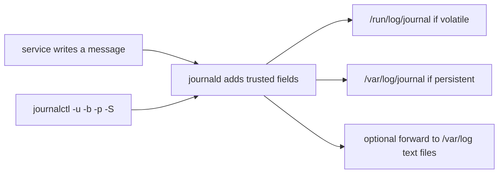

### The filters you will actually type

`journalctl` with no arguments prints the journal you are allowed to see, oldest first. That is too much. Narrow it.

| Flag | Meaning |
|---|---|
| `-u nginx` | This unit. You can pass `-u` more than once |
| `-b` | This boot only. `-b -1` is the previous boot |
| `-p err` | Priority `err` and more severe. Not "only exactly err" |
| `-S '1 hour ago'` | Since a timestamp or a relative time. `--since` is the same flag |
| `-U yesterday` | Until. `--until` is the same flag |
| `-n 100` | The last 100 records |
| `-f` | Follow, like `tail -f` |
| `-o json` or `-o cat` | Machine-readable output, or the message only |
| `-k` | Kernel messages, the same family as `dmesg` |

Priorities run from 0 to 7: `emerg`, `alert`, `crit`, `err`, `warning`, `notice`, `info`, `debug`. A single `-p err` means `err` and everything more important (the smaller numbers). It does not mean "the level that is exactly err", and it does not include `warning`. A range is `warning..err` if you need a band. People pass `-p warning` on a busy host and think the tool is noisy. It is doing what a single level means: that level and up.

`-b` matters after a reboot. The default is the whole journal you have, including last week's boots. When you are debugging "it failed after we restarted", `-b` or `-b -1` is the difference between the crash and a similar crash from March. `-S` and `-U` cut by time inside that. `-u` and `-p` cut by who and how bad. You can combine them: `journalctl -u nginx -b -p err -S '30 min ago'`.

`-f` is for a deploy you are watching. It does not search the past. Run the filtered query first, then follow.

### Persistent or gone at reboot

journald stores records according to `Storage=` in `journald.conf`. `volatile` keeps them under `/run/log/journal`, which is a tmpfs. Reboot, and they are gone. `persistent` keeps them under `/var/log/journal`. `auto`, the usual default, uses the persistent directory if it exists and otherwise stays volatile. A new machine that has never had `/var/log/journal` created is volatile until you `mkdir` that directory and restart journald, or set `Storage=persistent`. The Arch wiki page on the journal describes this layout.

A persistent journal grows without bound, for the same reason any other file grows, until `SystemMaxUse=` or a vacuum (`journalctl --vacuum-size`, `--vacuum-time`) caps it. A full `/var` caused by the journal is `du` seeing `/var/log/journal`, which is the opposite of the deleted-open case: the names are there. Vacuum, or fix the service that is logging a stack trace in a loop. Do not delete the directory out from under a running journald and assume the space returns immediately. The files can be open.

Text logs have the same growth problem and a different tool. `/var/log/syslog`, `/var/log/auth.log`, and `/var/log/messages` are plain files, often written by rsyslog, sometimes fed by the journal. `logrotate` renames them. A program that holds the old inode open is the deleted-open bug again. `grep` and `zgrep` are the query tools. There is no `-u` and no `-b`. The unit name is just words in the line, so the pattern has to be anchored and escaped. A dot in a unit name matches any character unless you quote it with `-F` or escape it, and an unanchored word matches that word inside a longer message.

A host can have both. `journalctl` shows what journald kept. The text file shows what rsyslog kept. They can disagree after a forward rule, a rate limit, or a reboot that dropped the volatile journal while the text file survived. When someone says "the log", ask which store.

### A saved log you can filter

This file is the kind of short output you would have saved from `journalctl -o short` or read from syslog:

```text
Oct 04 10:00:01 web nginx[100]: started
Oct 04 10:01:02 web nginx[100]: connect() failed (111: Connection refused)
Oct 04 10:02:03 web sshd[200]: Accepted publickey for ada
Oct 04 11:15:00 web nginx[100]: upstream timed out
```

"What did nginx do" is the lines whose program tag is nginx. "What failed" is the lines that say `failed` or `timed out`. On a real journal you would write `journalctl -u nginx -p err` and the priority field would do the second cut properly. In a text file the word `failed` is only a word. `Accepted publickey` is a success and must not be swept up by a sloppy `grep ssh`. The SSH lesson cares about that line. An authentication failure looks different (`Failed password`, `Invalid user`). Match the failure, not the daemon.

### Where this breaks

**`-p err` expected to hide emergencies.** It shows them. More severe priorities have smaller numbers and are included.

**Looking at `-b` after the volatile journal was wiped.** The previous boot is not there. `/var/log/syslog` might still have it, if rsyslog was forwarding. Check both before you declare the crash invisible.

**`journalctl` as an unprivileged user.** You see your user's journal. System logs require group `systemd-journal` or root. An empty answer can mean "permission", not "it did not happen".

**Following the wrong unit name.** `-u nginx` matches the unit `nginx.service`. A process that logged without a unit shows up under its syslog identifier, which `-u` may also match, but a container's unit name is longer than the binary name. `systemctl status` from the services lesson shows the unit name you should pass.

**`grep error` on a binary journal file.** The files under `/var/log/journal` are not text. Grep will not find the message. Use `journalctl`.

**Timezones.** `-S '2026-10-04 10:00'` is interpreted in local time unless you say otherwise. A host in UTC and a laptop in another zone will not agree. Prefer an explicit offset or UTC when you are writing a report.

### How this is used at work

A deploy finishes and you run `journalctl -u api -b -n 50 --no-pager` before you declare success. A timer from the cron lesson logs to the same place: `journalctl -u backup.service`. An incident in the last hour is `-S '1 hour ago' -p warning`. You are not reading a million lines. You are cutting by unit, boot, priority, and time, then reading.

When the host is not systemd, the same questions become `grep` on `/var/log/syslog` or on the application log the service was configured to write. The application log is often the better source: the journal has the stdout of the process, and the app log has the request ids. Neither replaces the other. A support bundle is a time-bounded export, `journalctl -u api -S ... -U ... --no-pager`, saved to a file, not a tarball of `/var/log/journal` from a live system. If you must move that text, pack the file you saved, after you have listed the names you are about to put in the archive.

Rate limits drop records. A service in a crash loop can look quiet because journald suppressed the repeats. The message about suppression is itself a log line. If the count does not match what you saw on the terminal during a test, look for "suppressed".

### Which store and which flag

| You need | Use | Not |
|---|---|---|
| One service, this boot | `journalctl -u name -b` | The whole journal since install |
| Only serious failures | `-p err` | `-p debug` on a production host |
| A window of time | `-S` and `-U` | A pager and your eyes |
| Survive reboot | Persistent storage under `/var/log/journal` | A volatile journal, if you needed the previous boot |
| A host with only text logs | `grep` on `/var/log/...` | `journalctl`, which is not installed |
| A script | `journalctl --no-pager -o cat` or `-o json` | The default pager, which hangs a script the way vim does |

### You can now

- Query by unit, boot, priority, and time, and combine those flags.
- Explain why `-p err` includes `emerg` and excludes `warning`.
- Say where a volatile journal and a persistent journal live, and what `auto` does.
- Grep a text log without pretending every word is a field.
- Keep `journalctl` out of a script's pager, and keep `grep` off the binary journal files.

::: quiz
q: You run `journalctl -u nginx -p err`. Which messages about nginx come back?
- Only messages whose priority is exactly `err`
+ Messages at `err` and at more severe priorities (`crit`, `alert`, `emerg`). `warning` and `info` are excluded
- Every nginx message, because `-p` selects the unit
- Only messages from the previous boot
why: A single priority is a threshold. `journalctl` shows that level and the more important levels, which are the lower numbers. `warning` is less important than `err` and is not included. `-u` selects the unit. `-b` would select the boot, and you did not pass it, so this is not "previous boot only". The tempting reading is "exactly err", because the flag looks like an equality filter. It is a minimum severity.
:::

::: quiz
q: After a reboot you need this morning's logs from before the reboot. `journalctl -b -1` prints nothing, and `/run` is empty of journal files. Where should a persistent journal have been?
- `/run/log/journal`, which always survives reboot
+ `/var/log/journal`. `Storage=auto` only uses it when that directory exists. Otherwise the journal was volatile and the reboot discarded it
- `/etc/systemd/journal`, next to the unit files
- `/proc/log`, because the proc lesson said the kernel keeps logs there
why: `/run` is tmpfs. Volatile journal data under `/run/log/journal` dies at reboot. Persistent data is `/var/log/journal`, used when `Storage=persistent` or when `Storage=auto` and the directory exists. `/etc` holds configuration, not the log stream. `/proc` is not a log. The tempting path is `/run`, because that is a path you will see on a live machine. It is the one that does not survive.
:::

::: card
q: What do `journalctl -u nginx`, `-b`, `-p err`, and `-S '1 hour ago'` each cut?
answer: `-u nginx` keeps that unit. `-b` keeps the current boot (`-b -1` is the previous boot). `-p err` keeps priority err and more severe. `-S` keeps records since a time. `--since` is the same as `-S`. They combine: `journalctl -u nginx -b -p err -S '1 hour ago'`.
:::

::: shell
task: `syslog.txt` is a saved short log. Print only the lines whose process tag is `nginx`, in order.
file: syslog.txt
```
Oct 04 10:00:01 web nginx[100]: started
Oct 04 10:01:02 web nginx[100]: connect() failed (111: Connection refused)
Oct 04 10:02:03 web sshd[200]: Accepted publickey for ada
Oct 04 11:15:00 web nginx[100]: upstream timed out
```
expect:
```
Oct 04 10:00:01 web nginx[100]: started
Oct 04 10:01:02 web nginx[100]: connect() failed (111: Connection refused)
Oct 04 11:15:00 web nginx[100]: upstream timed out
```
solution:
```bash
grep -E 'nginx\[[0-9]+\]:' syslog.txt
```
hint: The tag looks like `nginx[100]:`. A pattern of `nginx`, a bracket, digits, and a closing bracket avoids matching a message that merely mentions the word nginx. Do not match the sshd line.
:::

::: shell
task: From the same `syslog.txt`, print the lines that record a failure: `failed` or `timed out`. Leave out the successful sshd login.
file: syslog.txt
```
Oct 04 10:00:01 web nginx[100]: started
Oct 04 10:01:02 web nginx[100]: connect() failed (111: Connection refused)
Oct 04 10:02:03 web sshd[200]: Accepted publickey for ada
Oct 04 11:15:00 web nginx[100]: upstream timed out
```
expect:
```
Oct 04 10:01:02 web nginx[100]: connect() failed (111: Connection refused)
Oct 04 11:15:00 web nginx[100]: upstream timed out
```
solution:
```bash
grep -E 'failed|timed out' syslog.txt
```
hint: Extended grep alternation matches either phrase. The sshd line says `Accepted`, so it stays out. On a real journal, `-p err` would use the priority field instead of these words.
:::

::: quiz
q: A Debian host runs both journald and rsyslog. You deleted nothing, but `journalctl -b -1` is empty after a reboot and `/var/log/syslog` still has this morning's lines. What is the consistent explanation?
- rsyslog deletes the journal on purpose when it forwards a line
+ The journal was volatile, so the reboot dropped it. rsyslog had already written the same messages to a normal file under `/var/log`, which survived
- `/var/log/syslog` is a copy of `/proc/meminfo`
- `journalctl -b -1` only shows kernel messages, so service lines were never stored
why: Forwarding copies messages into a text file. It does not require the journal itself to be persistent. A volatile journal in `/run` disappears at reboot. The text file does not. `-b -1` is the previous boot of the journal, not a kernel-only view (`-k` is the kernel filter). The two stores can diverge, which is why "the log" is not a specific claim until you name the store.
:::

## Networking for developers
id: network
stage: net
needs: processes
minutes: 40
goal: Follow a request from a URL to a process listening on a port, and name which hop failed.
source: MDN: An overview of HTTP | https://developer.mozilla.org/en-US/docs/Web/HTTP/Guides/Overview
source: Julia Evans on networking | https://jvns.ca/categories/networking/

"The site is down" is four different failures wearing one sentence. A name might not resolve. A packet might never get an answer. A machine might answer "nothing is listening". A certificate might be wrong. Or the application might answer HTTP 500, which means the network worked. Until you can point at the hop, you restart random processes. This lesson is the order of the hops. `ip`, `ss`, `dig`, and a `curl -v` transcript are the four readings that name the hop. `ip` shows the address, `ss` shows the listen, `dig` shows the name lookup, and the transcript shows the TLS handshake. There is no network in the practice sandbox, so the exercises reason about errors and addresses. They do not call the internet.

### The path of one request

When you open `https://api.example.com/orders`, these steps happen in order:

1. **DNS.** The name `api.example.com` becomes an IP address, such as `203.0.113.10`. The resolver asks, in the order configured on the machine, a recursive resolver, which may answer from cache. Check with `dig api.example.com`. "Could not resolve host" stops here. Nothing was contacted.
2. **TCP connect** to that IP on a **port**. 443 is the usual HTTPS port, 80 is HTTP. A port selects one listening socket on that machine. The handshake is SYN, SYN-ACK, ACK. "Connection refused" means the machine sent a reset: the IP answered, and no socket is listening on that port. "Connection timed out" means no answer at all. A firewall or a security group often drops the packets, so you wait until the client gives up.
3. **TLS**, the S in HTTPS. The server presents a certificate. The client checks the name, the dates, and whether it trusts the issuer. "certificate has expired" and "unknown CA" are this step. The TCP connection already succeeded.
4. **HTTP.** The client sends a request line (`GET /orders`), headers, and maybe a body. The server sends a status, headers, and maybe a body. `curl -v` shows this. A status of 404, 500, or 502 means a program answered. The network is not the broken part.

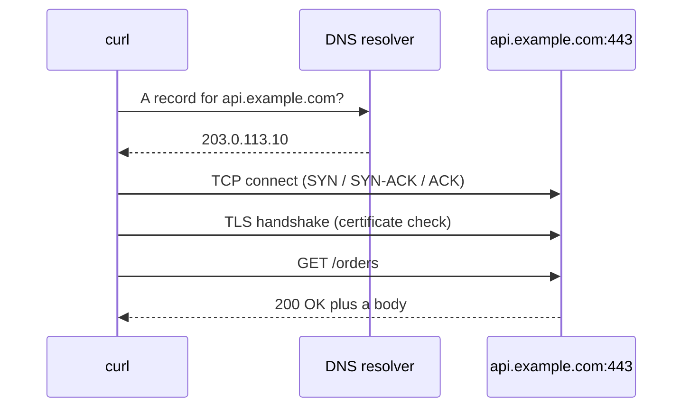

| Error you see | Broken step | Not the cause |
|---|---|---|
| Could not resolve host | DNS | a firewall, in the usual case. You never picked an IP |
| Connection refused | nothing is listening on that port | DNS, if you already used an IP. TLS, because the handshake never started |
| Connection timed out | packets are dropped or the host is unreachable | "refused", which is a fast active answer |
| certificate has expired, hostname mismatch, unknown CA | TLS | the application status code |
| HTTP 404, 500, 502 | a server answered | the network path |

`curl http://10.0.3.7:8080/health` has no DNS name and no TLS. "Connection refused" on that URL is the listening socket. A timeout would be the firewall. The quiz is that split.

### Addresses worth knowing

- `127.0.0.1` and the name `localhost` mean this machine. A server that listens on `127.0.0.1:8000` accepts connections only from the same network namespace. From outside, nothing is there. Listen on `0.0.0.0` (every IPv4 interface) or on a specific interface address if you want other machines to connect. Inside a container, "localhost" is the container itself, not the host and not the laptop. This is the second quiz.
- `::1` is IPv6 localhost. A program can listen on IPv6 only, and `curl localhost` might hit a different socket than `curl 127.0.0.1`.
- Private ranges `10.0.0.0/8`, `172.16.0.0/12`, and `192.168.0.0/16` are not routed on the public internet. A VPC address in `10.x` is reachable from the VPC, not from a coffee-shop laptop, unless a VPN or a bastion carries you in.
- `/24` after an address is CIDR notation. It says how many leading bits are the network. IPv4 has 32 bits. A `/24` leaves 8 bits, 256 addresses. A `/16` leaves 16 bits, 65,536 addresses. Cloud subnets reserve a few of those for the router and for their own services. AWS documents five reserved addresses in each subnet. The count of 256 is the size of the prefix, not the number you can assign to instances.

`ss -tlnp` on Linux lists TCP sockets that are listening, with the process if you have permission. On a Mac the closest everyday command is `lsof -nP -iTCP -sTCP:LISTEN`. The net-tools lesson reads `ss` output in detail.

### A worked diagnosis

From a laptop, `curl https://api.example.com/orders` hangs and then times out.

You `dig api.example.com` and get `203.0.113.10`. DNS worked. You `nc -vz 203.0.113.10 443` and it also times out. The path to that port is not answering. You do not yet generate a new TLS certificate, and you do not restart the app on a hunch. You look at the security group, the route table, and whether the process is in a subnet that has a path to you. If `nc` had said refused, you would look at the process and the bind address instead.

From inside the container, `curl localhost:8000` works and the same URL from your laptop fails immediately with refused or with a timeout at the published port. Check the bind address. `127.0.0.1` inside the container is the usual explanation when the process is up and the published port still fails.

### Where this breaks

**Refused versus timeout.** Refused is fast and means the IP sent a reset. Timeout is slow and means silence. Treating both as "the firewall" wastes an hour when the process is simply not running.

**Editing `/etc/hosts` and forgetting.** A name can resolve to a stale address on one machine. `dig` asks DNS. `getent hosts name` asks the same lookup path the application uses, including `/etc/hosts`. They can disagree.

**IPv6.** `curl` may try `AAAA` first and hang if IPv6 is broken, then fall back. `curl -4` forces IPv4 when you are isolating that.

**TLS to an IP.** The certificate is usually issued for a name. `curl https://203.0.113.10/` fails the name check even when the process is healthy. That is TLS, not "the port is down".

**Proxies.** `HTTPS_PROXY` in the environment sends the request somewhere else. A timeout might be the proxy. `env | grep -i proxy` before you blame the origin.

### How this is used at work

Load balancers and security groups fail in the timeout or refused shapes above. Kubernetes `Service` objects give a stable address in front of changing pods, and a `targetPort` that must match what the process bound. A readiness probe that gets connection refused takes the pod out of service. SSH is a TCP connection, usually on port 22, with its own authentication on top of the bytes that already arrived. HTTP status codes come back in the web module. Here, the only status fact you need is that a numeric HTTP status means the bytes arrived.

### Which check

| Question | Command or fact |
|---|---|
| Did the name resolve? | `dig` or `getent hosts` |
| Is the port open? | `nc -vz host port`, or `ss` on the host |
| Is it TLS? | the error mentions a certificate, a hostname, or a CA |
| Did the app answer? | an HTTP status |
| Who can connect? | the bind address, `127.0.0.1` versus `0.0.0.0` |

### You can now

- List DNS, TCP, TLS, and HTTP in the order they happen.
- Tell connection refused from a timeout and name the hop each one points at.
- Explain what `127.0.0.1` and `0.0.0.0` mean for a server socket, including inside a container.
- Compute how many addresses a `/24` and a `/16` contain.
- Stop chasing an application bug when the failure is still "could not resolve host".

::: quiz
q: `curl http://10.0.3.7:8080/health` returns "Connection refused" immediately. What's the most likely cause?
- DNS isn't working
+ Nothing is listening on port 8080 on that machine
- A firewall is silently dropping packets
- The TLS certificate expired
why: "Refused" is an active answer: the machine was reached, but no program has that port open. A firewall that drops packets makes you wait until the connection times out, and this URL has no DNS name and no TLS.
:::

::: quiz
q: Your app works with `curl localhost:8000` inside its container but not from outside. It listens on `127.0.0.1:8000`. Fix?
+ Listen on `0.0.0.0:8000`
- Use port 80
- Add a DNS record
- Run it as root
why: `127.0.0.1` accepts only connections from the same machine (here, the same container). `0.0.0.0` accepts them on every interface.
:::

::: card
q: How many addresses does a `/24` network have, and a `/16`?
answer: A /24 leaves 32 − 24 = 8 bits, 2⁸ = 256 addresses. A /16 leaves 16 bits, 65,536 addresses. (Clouds reserve a few in each subnet; AWS keeps 5.)
:::

::: quiz
q: `curl https://api.example.com/health` fails with `Could not resolve host`. Which hop failed?
- TCP, because the port never answered
+ DNS. No address was chosen, so no packet was sent to the server
- TLS, because the name on the certificate could not be checked
- HTTP, because a 502 from the proxy looks like a missing host
why: Resolution is the first step. Without an address, curl cannot open a socket, so this is not a timeout, a refused connection, or a certificate error. A 502 would be an HTTP status from a server that was reached. The tempting move is to treat every curl failure as a firewall. The words in the error name the hop.
:::

::: card
q: What is the difference between `connection refused` and `connection timed out` when you open a TCP port?
answer: Refused means the host answered with a reset: the IP was reached and nothing is listening on that port. Timed out means no answer arrived before the client gave up, which is what a firewall or a missing route looks like when it drops packets. Refused is fast. Timeout is slow.
:::

::: shell
task: `hops.txt` lists an error on each line. Print only the lines whose failure is DNS, then only the lines whose failure is "nothing listening". Match the fixed phrases `resolve` and `refused`.
file: hops.txt
```
could not resolve host api.example.com
connection refused on port 8080
connection timed out
certificate has expired
connection refused on port 443
```
expect:
```
could not resolve host api.example.com
---
connection refused on port 8080
connection refused on port 443
```
solution:
```bash
grep -F resolve hops.txt
echo ---
grep -F refused hops.txt
```
hint: `-F` is a fixed string. DNS errors in this file contain `resolve`. A reset from a closed port contains `refused`. Print a `---` line between the two groups so the check can see both.
:::

## ip, ss, dig, and a curl transcript
id: net-tools
stage: net
needs: network
minutes: 45
goal: Read addresses, sockets, and a DNS answer, and tell a TLS hostname failure from a missing certificate authority.
source: ip(8) | https://man7.org/linux/man-pages/man8/ip.8.html
source: ss(8) | https://man7.org/linux/man-pages/man8/ss.8.html
source: dig(1) | https://manpages.debian.org/bookworm/bind9-dnsutils/dig.1.en.html
source: curl(1) | https://manpages.debian.org/bookworm/curl/curl.1.en.html
source: Network configuration | https://wiki.archlinux.org/title/Network_configuration
source: Transport Layer Security | https://wiki.archlinux.org/title/Transport_Layer_Security
source: OverTheWire Bandit, levels 14 to 17: talking to ports, TLS, port scans | https://overthewire.org/wargames/bandit/bandit15.html

A service is reachable when an address, a port, and a path through the firewall all agree. This lesson is the four commands you use to check that claim from a shell, and the transcript you read when the failure is TLS rather than "connection refused". You will not send a packet in these exercises. The practice shell has no network. The transcripts are saved files, which is also how you should paste evidence into a ticket: the output, not a memory of the output.

`ifconfig`, `route`, and `netstat` are the old net-tools. They are missing or deprecated on current Linux. `ip` and `ss`, from iproute2, are the replacements. `dig` asks DNS. `curl -v` shows the HTTP and TLS conversation. Each one answers a different layer. Running only curl and guessing is how you "fix" DNS by editing an application.

### Addresses and routes

`ip addr` lists interfaces and the addresses on them. `ip -br addr` is the short form: interface, state, addresses. A line `eth0 UP 10.0.0.5/24` means this host owns `10.0.0.5` on `eth0`, and the prefix length is 24. The prefix is the local network, not the whole internet. `lo` is the loopback, `127.0.0.1`, which is this machine talking to itself. A service bound only to `127.0.0.1` is healthy and still unreachable from anywhere else.

`ip route` prints the routing table. The line that starts with `default` is where packets go when no more specific route matches. If the default route is missing, the host can talk to its own subnet and to nothing else. `ip link` shows whether the interface is UP. An address on an interface that is DOWN is not in use.

You do not need every subcommand. You need to answer: what addresses does this host have, which interface are they on, and where do non-local packets go. `ping` is not that answer. Ping can be filtered while the service works, or the reverse.

### Sockets, not "the port is open"

`ss` lists sockets. `ss -tln` is the set you want first: TCP (`-t`), listening (`-l`), numeric (`-n`) so you see `22` and not the name `ssh`. A listening socket is a process that called `listen`. It is not a firewall rule, and it is not a DNS name.

```text
LISTEN 0 128 0.0.0.0:22 0.0.0.0:*
LISTEN 0 128 127.0.0.1:5432 0.0.0.0:*
LISTEN 0 128 [::]:80 [::]:*
ESTAB  0 0 10.0.0.8:51004 10.0.0.5:443
```

`0.0.0.0:22` is "every IPv4 address on this host, port 22". `127.0.0.1:5432` is postgres on loopback only. `[::]:80` is every IPv6 address, port 80. `ESTAB` is a connection that already exists, which is not the same as listening. A client port like `51004` is ephemeral. You do not look it up in fstab or in a service file.

`ss -tlnp` adds the process name. Seeing the process can require privileges, so an empty process column is not "nothing is listening". `-tln` already proved the listen. Once you have a pid, `ps` and `/proc/<pid>` tell you which program it is. `ss -uln` is the UDP version. DNS and DHCP are often UDP. A TCP-only check will not see them.

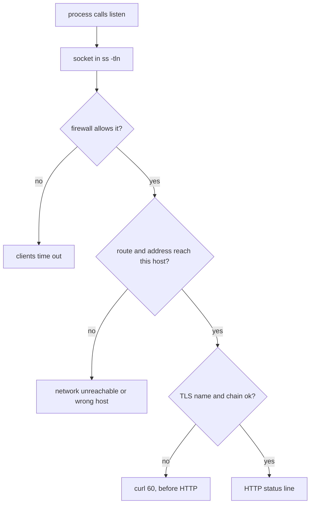

### dig asks DNS, curl asks the system resolver

`dig example.com A` sends a DNS query and prints the answer. The status in the header is the result: `NOERROR` means the name exists (an empty answer can still be NOERROR), `NXDOMAIN` means the name does not exist, `SERVFAIL` means the resolver failed. The ANSWER section is the records. An `A` record is an IPv4 address. A `CNAME` is an alias, and the address may be on the following line.

`dig` does not read `/etc/hosts`. It talks to the resolver in `/etc/resolv.conf`, or to the server you name with `@`. `getent hosts example.com`, and the lookup `curl` does, go through the system's name service switch. If `/etc/hosts` says `example.com` is `127.0.0.1`, curl connects to loopback and dig still shows the public address. They are not broken. They were asked different questions. The network lesson's "DNS is wrong" needs this split: which lookup path.

`dig +short example.com A` prints only the addresses, which is what a script wants. The full output is what you paste when the status is the bug. A saved full answer is what the exercise parses, so you can practise the ANSWER section without a network.

### What curl -v is saying

`curl -v` prints a transcript on standard error. Three prefixes:

| Prefix | Who is talking |
|---|---|
| `*` | curl itself, commentary |
| `>` | bytes curl sent, including the request line and request headers |
| `<` | bytes curl received, including the status line and response headers |

The request line is `GET / HTTP/1.1`. The status line is `HTTP/1.1 200 OK` or `404` or `500`. A 200 means the server spoke HTTP and chose that status. It does not mean the application is correct. It means TLS, if you used `https`, already succeeded, because the HTTP line is inside the encrypted connection.

Before any `>` line, an `https` URL has a TLS handshake. curl prints the certificate subject, the issuer, and whether the name matched. Two failures both show up as curl error 60, and they are not the same failure:

- **Unable to get a local issuer** means curl could not build a chain from the certificate the server sent to a trust anchor in the system CA store. The certificate might be fine and an intermediate might be missing, or the server might be using a private CA you do not trust. Adding `-k` hides this. Installing the right CA, or fixing the server so it sends the intermediate, solves it.
- **Hostname mismatch** means the chain verified and the name in the URL is not in the certificate's subject alternative names. You asked for `api.example.com` and the certificate is for `www.example.com`. The lock is cryptographically valid and still the wrong host. `-k` hides this too, which is how deployments get pointed at the wrong server and stay that way. The fix is the URL or the certificate, not a flag that disables verification.

`--insecure` and `-k` turn off both checks. They are acceptable for one debugging command against a server you just stood up, and unacceptable in a script, a health check, or a client library default. The users lesson's root and the packages lesson's signature story are the same instinct: do not disable the check to make the command green.

A proxy, a redirect, and a timeout are yet more prefixes in the `*` lines. Read them in order. The first error is the cause. The later "connection reset" is often a consequence.

### Where this breaks

**`ss` shows LISTEN and clients still time out.** The process is listening. The firewall, the security group, or a bind to `127.0.0.1` is the rest of the path. `ss` does not print the firewall.

**Editing `/etc/hosts` and then using dig to confirm.** dig will not show that edit. curl will. Confirm with the same lookup path the application uses.

**Treating NXDOMAIN and SERVFAIL as the same.** NXDOMAIN is a negative answer. SERVFAIL is the resolver failing. One is "delete the name from your docs". The other is "DNS is broken, retry or fix the resolver".

**IPv6.** `ss` shows `[::]:80` and your curl used IPv4, or the reverse. `curl -4` and `curl -6` force a family when you are testing. A happy-eyeballs client may use a different family from dig's first line.

**Reading only the HTTP status.** A 200 from the wrong host, because of a hosts-file override or a mismatch you suppressed with `-k`, is a successful transcript of the wrong conversation.

**Running these tools in this sandbox.** There is no network, and `ip` and `ss` may not exist on the Mac. Parse the saved files. On a server, run the real commands and save the output you mean to talk about.

### How this is used at work

A ticket says "the API is down". You ask, in order: does `ss -tln` show the listen, on which address, does `ip route` have a way out, does `dig` return the address the client should be using, does `curl -v` get a TLS failure or an HTTP status. You stop at the first layer that is wrong. You do not restart the application because TLS presented the wrong name.

SSH is one listen, usually on port 22, plus a key exchange that happens only after TCP connects. The same `ss` line shows it. A load balancer's health check is a curl, and if that check uses `-k` it will keep sending traffic to a host whose certificate expired. Take `-k` out of health checks.

When you paste evidence, paste `ss -tln`, the dig header and answer, and the curl transcript from the `*` TLS lines through the status line. A text file is enough. You do not need an archive to paste twenty lines. Later, a pattern anchored to the status line is how you pull that line out of a long transcript.

### Which tool

| Question | Tool | A wrong tool |
|---|---|---|
| What addresses does this host have? | `ip -br addr` | `dig`, which asks DNS about a name |
| Where do unknown packets go? | `ip route` | `ss`, which lists sockets |
| Is anything listening on 443? | `ss -tln` | `ping` |
| What does DNS say? | `dig name A` | `/etc/hosts`, which dig ignores |
| What will this application connect to? | The system resolver, `getent hosts` | `dig`, if a hosts file overrides it |
| Did TLS and HTTP work? | `curl -v` | `curl -k`, which hides the failure |
| Chain fails, name is right | Fix the CA or the intermediate | A hosts-file edit |
| Chain is fine, name is wrong | Fix the URL or the certificate | `-k` in the client |

### You can now

- Read `ip -br addr` and `ip route`, and say what `127.0.0.1` and a default route mean.
- Read `ss -tln` and separate LISTEN from ESTAB, and a loopback bind from `0.0.0.0`.
- Read a dig status and the A record in the ANSWER section, and say why dig and curl can disagree.
- Point at `*`, `>`, and `<` in a curl transcript, and find the HTTP status line.
- Tell a missing issuer from a hostname mismatch, and refuse to paper over either with `-k`.

::: quiz
q: `ss -tln` shows `127.0.0.1:5432` in state LISTEN and does not show `0.0.0.0:5432`. A coworker on another machine cannot connect. What does the socket line mean?
- Postgres is down. LISTEN means the port is closed
+ Postgres is listening only on loopback. Other machines cannot reach 127.0.0.1 on this host. A listen on 0.0.0.0 or on a reachable address would be a different line
- The firewall is open, because ss prints firewall rules in the LISTEN state
- The default route is missing. ss only prints 127.0.0.1 when there is no route
why: `127.0.0.1` is this host. A listen there is real, and it is not reachable from the network. `0.0.0.0` would mean every IPv4 address. `ss` does not print the firewall and does not print the routing table. Those are `ip route` and the host's firewall. The tempting reading is "LISTEN means closed" or "the service is down". LISTEN means a process called listen. The address beside it says who is allowed to reach that call.
:::

::: quiz
q: `dig api.example.com A` returns `NXDOMAIN`. `curl https://api.example.com` connects and gets an HTTP response. What is a coherent explanation?
- dig is always right, so curl must be ignoring the URL
+ curl uses the system resolver, which consults `/etc/hosts` and then DNS. dig asks DNS and does not read `/etc/hosts`. A hosts entry would let curl work while dig reports NXDOMAIN
- NXDOMAIN means the certificate is valid
- curl skips DNS for any URL that uses https
why: The two tools do not use the same lookup path. dig talks to a DNS resolver. curl, through the system resolver, can hit `/etc/hosts` first. A local override explains the split. NXDOMAIN is a DNS statement about a name, not a TLS statement. https does not disable name lookup. The tempting move is to treat dig as the definition of what curl must do. It is the definition of what DNS said.
:::

::: card
q: In a `curl -v` transcript, what do lines starting with `*`, `>`, and `<` mean, and where is the HTTP status?
answer: `*` lines are curl's commentary, including the TLS handshake and certificate checks. `>` lines are what curl sent, starting with the request line such as `GET / HTTP/1.1`. `<` lines are what the server sent back. The HTTP status is the `<` line that looks like `HTTP/1.1 200 OK`. It appears only after TLS has succeeded, when the URL is https.
:::

::: quiz
q: `curl -v https://api.example.com` fails with error 60 and the text `no alternative certificate subject name matches target host name`. The issuer is a public CA you trust. What is wrong, and does `-k` fix it?
- The CA store is empty. `-k` installs the missing issuer and is safe in a health check
+ The certificate chain verified, but the name in the URL is not on the certificate. `-k` hides the check. The fix is the URL or the certificate's names, not a client that no longer verifies anything
- Port 443 is closed. curl uses error 60 for connection refused
- The DNS status is NXDOMAIN. curl prints TLS errors when dig would have printed NXDOMAIN
why: A subject-name mismatch means curl reached a server, built a chain it trusts, and then refused the certificate because the hostname was not in the SAN. That is a different failure from "unable to get local issuer certificate", which is a chain problem. `-k` disables verification entirely, so the command goes green against whatever host answered. Error 60 is TLS verification, not "connection refused" and not a DNS status. The tempting fix is `-k`, because it makes this one command succeed. It also makes the next, wrong, server succeed.
:::

::: shell
task: `ss.txt` is a saved `ss -tln` listing. Print the listening port numbers, one per line, sorted numerically. Include IPv4 and IPv6 listens. Do not print the established connection.
file: ss.txt
```
State Recv-Q Send-Q Local-Address:Port Peer-Address:Port
LISTEN 0 128 0.0.0.0:22 0.0.0.0:*
LISTEN 0 128 127.0.0.1:5432 0.0.0.0:*
LISTEN 0 128 [::]:80 [::]:*
ESTAB 0 0 10.0.0.8:51004 10.0.0.5:443
```
expect:
```
22
80
5432
```
solution:
```bash
awk '$1 == "LISTEN" { n = $4; sub(/.*:/, "", n); print n }' ss.txt | LC_ALL=C sort -n
```
hint: Field 4 is the local address and port. Strip through the last colon so `[::]:80` and `0.0.0.0:22` both leave a port. Sort numerically.
:::

::: shell
task: `curl-v.txt` is a saved `curl -v` transcript. Print the HTTP status line the server sent, without the leading `<`.
file: curl-v.txt
```
* Connected to example.com (93.184.216.34) port 443
* Server certificate:
*  subject: CN=example.com
*  subjectAltName: host "example.com" matched cert's "example.com"
*  SSL certificate verify ok.
> GET / HTTP/1.1
> Host: example.com
>
< HTTP/1.1 200 OK
< Content-Type: text/plain
< Content-Length: 5
```
expect:
```
HTTP/1.1 200 OK
```
solution:
```bash
sed -n 's/^< HTTP/HTTP/p' curl-v.txt
```
hint: Response lines start with `<`. The status line is the one that starts `< HTTP`. Strip that prefix. Do not print the request line, which starts with `>`.
:::

::: shell
task: `dig.txt` is a saved dig answer. Print the A-record addresses, one per line, in the order they appear.
file: dig.txt
```
;; ->>HEADER<<- opcode: QUERY, status: NOERROR, id: 1
;; flags: qr rd ra; QUERY: 1, ANSWER: 2, AUTHORITY: 0, ADDITIONAL: 1

;; ANSWER SECTION:
example.com. 300 IN A 93.184.216.34
example.com. 300 IN A 93.184.216.35
;; AUTHORITY SECTION:
```
expect:
```
93.184.216.34
93.184.216.35
```
solution:
```bash
awk '$3 == "IN" && $4 == "A" { print $5 }' dig.txt
```
hint: Comment lines start with a semicolon and will not have `IN` as field 3. An A record has class `IN`, type `A`, and the address in field 5.
:::

::: card
q: What is the difference between curl error text `unable to get local issuer certificate` and `no alternative certificate subject name matches`?
answer: The issuer error means curl could not build a trusted chain from the server certificate to a CA in the local trust store. A missing intermediate or a private CA looks like this. The subject-name error means the chain did verify, and the hostname in the URL is not listed on the certificate. Both are curl error 60. `-k` hides both. Only the first is fixed by installing the right CA. The second is fixed by using the name the certificate actually contains, or by issuing a certificate for the name you use.
:::

## SSH and keys
id: ssh
stage: net
needs: perms, network
minutes: 40
goal: Log in with keys, keep a small `~/.ssh/config`, and copy files without typing the host every time.
source: OpenSSH ssh_config | https://man.openbsd.org/ssh_config
source: OpenSSH sshd | https://man.openbsd.org/sshd
source: GitHub: Generating a new SSH key | https://docs.github.com/en/authentication/connecting-to-github-with-ssh/generating-a-new-ssh-key-and-adding-it-to-the-ssh-agent
source: OverTheWire Bandit, levels 13 and 18: SSH keys, and commands over SSH | https://overthewire.org/wargames/bandit/bandit14.html

SSH is a shell on another machine over an encrypted TCP connection: `ssh anna@203.0.113.10`. The network lesson's hops still apply. Port 22 (or whatever you set) has to be reachable before any key is checked. "Connection timed out" is not a bad key. "Permission denied (publickey)" is. The practice sandbox has no network and no `sshd`, so the exercises write a config and reason about keys. They do not open a real session.

### Keys, not passwords

```bash
ssh-keygen -t ed25519 -C "anna@laptop"
```

This creates a **key pair** in `~/.ssh`:

- `id_ed25519` is the **private** key. It never leaves your machine. Mode `600`. A passphrase encrypts the file at rest. The agent holds the decrypted key in memory so you do not type the passphrase on every connection.
- `id_ed25519.pub` is the **public** key. You can publish it. It cannot by itself log in.

The server stores the public key in `~anna/.ssh/authorized_keys`, one key per line. `ssh-copy-id anna@server` appends it if you can already log in once. On a connect, the server checks that you can prove you hold the matching private key. The private key is not sent. A password is not sent either, if public-key authentication succeeds.

GitHub uses the same mechanism for `git push` over `git@github.com`. You add the `.pub` file to the account. You do not upload the private file.

`~/.ssh` itself should be mode `700`. OpenSSH refuses a private key that group or others can read, with "UNPROTECTED PRIVATE KEY FILE". `chmod 600` on the private key and `chmod 700` on the directory. Those numbers are the mode bits: 700 is owner-only on a directory, and 600 is owner read-write on a file, because a group-readable private key is a key other accounts can steal.

### The first connection and known_hosts

The first time you connect to a host, the client has no idea whether the server is the one you wanted. It shows the host key fingerprint and, if you accept, stores it in `~/.ssh/known_hosts`. The next connection checks that the server still has that key. A changed key is either a reinstall or a man in the middle. Do not delete the line to silence the warning until you know which. `ssh-keygen -R hostname` removes one entry when you have confirmed the new key on another channel.

### ~/.ssh/config

```text
Host web
    HostName 203.0.113.10
    User deploy
    IdentityFile ~/.ssh/id_ed25519
    Port 22
```

`Host web` is an alias you type. `HostName` is the real address. Settings under it are indented. `ssh web` is enough, and `scp`, `rsync`, and git understand the alias too. `Host *` at the bottom sets defaults. Put specific aliases above `Host *`, because the first obtained value wins for most keywords.

`IdentitiesOnly yes` stops the client from offering every key in the agent. Servers that disconnect after too many attempts are usually seeing five keys they do not recognise before the right one.

### Moving files and one remote command

```bash
scp report.csv web:/tmp/
rsync -avz ./site/ web:/srv/site/
ssh web 'tail -n 50 /var/log/nginx/error.log'
```

`scp` copies one file or a small tree. `rsync -a` copies a tree and, on a second run, sends what changed. The trailing slash matters: `site/` means the contents of site, `site` means the directory itself, so the remote path gains an extra `site` level. `-z` compresses in transit. It does not replace a backup plan.

`ssh host command` runs one command and does not leave you in a shell. Quote the command so your local shell does not expand `$` and globs before the remote shell sees them: `ssh web 'rm -f /tmp/stale.log'`.

Local port forwarding is how you reach a database that only listens on the server's localhost:

```bash
ssh -L 5432:127.0.0.1:5432 web
```

Connections to your laptop's port 5432 are carried through SSH and then connected, from the server, to `127.0.0.1:5432` on the server. The database never sees the public internet. Close the SSH session and the tunnel closes.

### A worked config

The exercise writes an alias `db` for `10.0.2.15`, user `postgres`, port `2222`, with `~/.ssh` at `700` and the config at `600`. The same shape is what you commit in a dotfiles repo, except the private key stays out of the repo. The dotfiles project at the end of the module is that split: the config can be a symlink into the repo, the key cannot.

### Where this breaks

**Copied the private key.** Anyone with the file is you. Generate a new key per machine. Revoke a lost machine by deleting its `.pub` line from `authorized_keys`.

**Mode 644 on the private key.** The client refuses. This is not a server-side `chmod`.

**Wrong user.** `authorized_keys` lives in the home of the account you log in as. A key in `/home/anna/.ssh` does not let you in as `deploy`.

**Agent full of old keys.** The server rejects the connection after several wrong offers. `IdentitiesOnly` and one `IdentityFile` fix it.

**`known_hosts` mismatch after a rebuild.** Confirm the new fingerprint, then remove the old line. Do not use `StrictHostKeyChecking no` in a config you keep. It disables the check that caught the change.

**Quoting.** `ssh web rm $FILE` expands `$FILE` locally. The remote command should be in single quotes.

### How this is used at work

Bastion hosts are an SSH server you can reach, and the private instances are reached by a second hop or by `ProxyJump bastion` in the config. CI deploy keys are a key pair whose public half is on the server and whose private half is a secret in the CI system, not a key from your laptop. Git remotes of the form `git@github.com:org/repo.git` are SSH. The file-copy commands are how you pull one log when you do not want a full session. Kubernetes and cloud consoles did not remove SSH. They added other doors. A VM still answers on 22 when that is how you built it.

### Which file

| File | Leaves your machine? | Mode |
|---|---|---|
| `id_ed25519` | no | 600 |
| `id_ed25519.pub` | yes, into `authorized_keys` or a host's account page | 644 is fine |
| `config` | only if you choose to commit it, and it must not embed secrets | 600 |
| `known_hosts` | no | 644 is usual |
| `authorized_keys` | it lives on the server | 600, directory 700 |

### You can now

- Generate an ed25519 key and say which file is public.
- Put the public key in the right user's `authorized_keys`.
- Write a `Host` alias with `HostName`, `User`, and `Port`, and lock down the directory modes.
- Explain `known_hosts` and why a changed host key is a stop, not a prompt to disable checking.
- Copy a file with `scp` or `rsync`, and quote a remote command.

::: quiz
q: Which file do you copy to a new server so you can log in with your key?
- `~/.ssh/id_ed25519`
+ `~/.ssh/id_ed25519.pub`, appended to the server's `~/.ssh/authorized_keys`
- `~/.ssh/config`
- `~/.ssh/known_hosts`
why: Only the public half goes anywhere. The private key stays on your machine, and anyone who has it can log in as you.
:::

::: shell
task: Write `~/.ssh/config` (in this sandbox, `$HOME` is a throwaway folder) with a host alias `db` for `10.0.2.15`, user `postgres`, port `2222`. Then make the `.ssh` folder mode `700` and the config `600`.
verify:
```bash
f="$HOME/.ssh/config"
# wrong answer tested: two Host db blocks, and chmod 644 on the config.
[ -f "$f" ] || { echo "no ~/.ssh/config"; exit 1; }
count=$(grep -cE '^Host[[:space:]]+db$' "$f" || true)
[ "$count" -eq 1 ] || { echo "Host db appears $count times"; exit 1; }
grep -qiE '^[[:space:]]+HostName[[:space:]]+10\.0\.2\.15$' "$f" || { echo "HostName 10.0.2.15 is missing (indented under Host db)"; exit 1; }
grep -qiE '^[[:space:]]+User[[:space:]]+postgres$' "$f" || { echo "User postgres is missing"; exit 1; }
grep -qiE '^[[:space:]]+Port[[:space:]]+2222$' "$f" || { echo "Port 2222 is missing"; exit 1; }
[ "$(ls -ld "$HOME/.ssh" | cut -c1-10)" = "drwx------" ] || { echo "~/.ssh should be drwx------ (700)"; exit 1; }
[ "$(ls -l "$f" | cut -c1-10)" = "-rw-------" ] || { echo "~/.ssh/config should be -rw------- (600)"; exit 1; }
```
solution:
```bash
mkdir -p ~/.ssh
cat > ~/.ssh/config <<'EOF'
Host db
    HostName 10.0.2.15
    User postgres
    Port 2222
EOF
chmod 700 ~/.ssh
chmod 600 ~/.ssh/config
```
hint: A heredoc writes several lines at once: `cat > ~/.ssh/config <<'EOF'`, then the lines, then `EOF`. Indent the settings under `Host db`.
:::

::: card
q: Why does SSH refuse to use a private key file with mode 644?
answer: Other users could read it, and a readable private key lets them log in as you. SSH insists on 600 (owner only) and says "UNPROTECTED PRIVATE KEY FILE".
:::

::: quiz
q: You can already log in to a server as `anna`. You want key login for the `deploy` account. Where does the public key go?
- `/home/anna/.ssh/authorized_keys`, because that is the account you used for `ssh-copy-id` last time
+ `/home/deploy/.ssh/authorized_keys`, mode 600, in a directory mode 700
- `/etc/ssh/sshd_config`, as a line that contains the private key
- `~/.ssh/known_hosts` on your laptop
why: `authorized_keys` is read from the home directory of the user you are authenticating as. A key installed for `anna` does not admit you as `deploy`. The private key stays on the client. `known_hosts` stores server host keys, not your login key. `sshd_config` is the server's policy, not a bag of private keys.
:::

::: card
q: In `~/.ssh/config`, what do `Host` and `HostName` mean?
answer: `Host` is the alias you type (`ssh web`). `HostName` is the real address or DNS name to connect to. `User` and `Port` under that alias replace what you would have typed on the command line. The first value OpenSSH obtains for a keyword wins, so a specific `Host` block belongs above a catch-all `Host *`.
:::

::: shell
task: Add a host alias `web` to `~/.ssh/config` for `203.0.113.10`, user `deploy`, identity file `~/.ssh/id_ed25519`, and `IdentitiesOnly yes`. Keep the directory mode `700` and the config mode `600`.
verify:
```bash
f="$HOME/.ssh/config"
# wrong answer tested: appending a second Host web block, and leaving the config mode 644.
[ -f "$f" ] || exit 1
count=$(grep -cE '^Host[[:space:]]+web$' "$f" || true)
[ "$count" -eq 1 ] || exit 1
grep -q '203.0.113.10' "$f" || exit 1
grep -qiE '^[[:space:]]+User[[:space:]]+deploy$' "$f" || exit 1
grep -q 'id_ed25519' "$f" || exit 1
grep -qiE '^[[:space:]]+IdentitiesOnly[[:space:]]+yes$' "$f" || exit 1
[ "$(ls -ld "$HOME/.ssh" | cut -c1-10)" = "drwx------" ] || exit 1
[ "$(ls -l "$f" | cut -c1-10)" = "-rw-------" ] || exit 1
```
solution:
```bash
mkdir -p ~/.ssh
cat > ~/.ssh/config <<'EOF'
Host web
    HostName 203.0.113.10
    User deploy
    IdentityFile ~/.ssh/id_ed25519
    IdentitiesOnly yes
EOF
chmod 700 ~/.ssh
chmod 600 ~/.ssh/config
```
hint: Indent the settings under `Host web`. `IdentitiesOnly yes` stops the client offering every key in the agent. Modes are `700` for the directory and `600` for the file.
:::

## Project: a log report
id: p-logs
stage: net
needs: textproc, scripts
minutes: 85
project: yes
goal: Turn an access log into a report with a script you can run twice and trust.
source: Combined Log Format | https://httpd.apache.org/docs/2.4/logs.html

You are on call, the dashboard is blank, and the only artefact on the box is an access log. Each line is six fields separated by spaces: client IP, timestamp, method, path, status, bytes.

```text
10.0.0.9 2026-01-05T10:00:03 GET /api/orders 502 0
```

Field 1 is the IP, field 4 is the path, and field 5 is the status. A server error in this report is a status of 500 or higher, because that is the range where the server failed the request. A 404 is the server answering "that path is not here". It is a client miss. If you count every status that is not 200, a missing favicon pages the same person as a crashed checkout, so the report stops being something you can trust at 02:00.

Write `report.sh` so that `bash report.sh access.log` prints this shape:

```text
requests: 12
errors: 4
top paths:
5 /api/orders
3 /
top error ip: 10.0.0.9
```

**requests** is the number of lines. **errors** is how many of those lines have a status of at least 500. **top paths** is the two most requested paths, as `count path`, most first, and the paths include successful requests because "what was hit" is a different question from "what failed". **top error ip** is the client with the most 5xx responses. When no line is a 5xx, print `top error ip: none`. When the file is empty, print zeros, the heading `top paths:` with no path lines under it, and `none` for the error IP. Do not invent a sentinel address such as `0.0.0.0`. An empty answer and a real address must stay visually different, or the next person will block a client that never connected.

Each exercise starts from its own log. Nothing you wrote in the previous step is still on disk, so the script has to carry the whole rule. `set -euo pipefail` belongs at the top, because a missing file or a failed `awk` should stop the script instead of printing a half report that looks finished. `LC_ALL=C` belongs on every `sort`. Without it, two machines can order the same paths differently, and a check that passed on your laptop fails in CI for a reason that is not the data.

### How a line becomes a number

`awk` splits on whitespace, so `$5` is the status and `$4` is the path on this particular log. That is why the format has to stay six fields. A path with a space would shift the status into the wrong column, and the numeric test would see a word. These logs do not have that space. A combined-log line from Apache does, inside the quoted request, which is why you do not point this script at a combined log and hope.

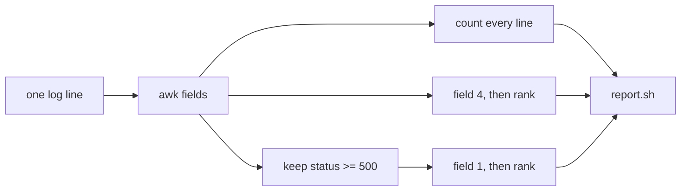

The rank is `sort`, then `uniq -c`, then a numeric sort, then `head`. `uniq` only collapses lines that are already neighbours, so the first sort is what makes the count true. `uniq -c` prints the count in front of the value. A second sort on that count puts the busiest value first. `head -n 2` keeps two lines. If you `head` before you sort, you keep two arbitrary lines and call them the top, which is how a quiet path gets blamed for an incident.

When two values share a count, `sort -rn` does not leave them in alphabetical order. It reverses the whole line, so the tie goes to whichever remainder is later in byte order. That is a bad contract to leave implicit. When a count is tied, sort with `LC_ALL=C sort -k1,1nr -k2,2`: the count descending, and the value itself ascending by raw bytes. `/a` then comes out before `/b` when both were requested twice. The exercises that have a tie tell you this. The exercises whose counts differ do not care which tie-break you used, which is why a script can look finished and still be wrong.

`wc -l` counts newline characters and pads the number with spaces. The checker treats that padding as the same number. A file with no newline characters has zero lines, so an empty log is `requests: 0` without a special case for the count. The ranking still needs a special case. `awk` on an empty stream prints nothing, but a pipeline that always prints a heading and then "whatever awk printed" is fine only if you do not also print a blank path line. Test the file with `[ -s "$log" ]` before you rank paths. `-s` is false for an empty file, so you skip the ranking and the heading stands alone.

The error IP uses the same rank on field 1 of the 5xx lines. If that pipeline prints nothing, `${ip:-none}` supplies the word `none`, because an unset variable would otherwise print `top error ip:` with a hole, and a hole looks like a bug in the report rather than a log that had no errors.

### A walk-through on three lines

This sample is not the file you will be graded on. It is small enough to do by hand.

```text
1.2.3.4 2026-04-01T09:00:00 GET /b 200 1
1.2.3.4 2026-04-01T09:00:01 GET /a 200 1
1.2.3.4 2026-04-01T09:00:02 GET /a 500 1
```

There are three lines, so requests is 3. One status is 500, so errors is 1. The 200 on `/b` is not an error. Paths: `/a` twice, `/b` once, so the top two are `2 /a` then `1 /b`. The only error IP is `1.2.3.4`. A script that prints `top error ip: 1.2.3.4` because that IP made every request happens to be right here and wrong on the next file, where the busy client is healthy and a different client caused the 500s. Rank the error lines. Do not reuse the request ranking.

```bash
log=sample.log
echo "requests: $(wc -l < "$log" | tr -d ' ')"
echo "errors: $(awk '$5 >= 500' "$log" | wc -l | tr -d ' ')"
echo "top paths:"
awk '{ print $4 }' "$log" | LC_ALL=C sort | uniq -c | LC_ALL=C sort -k1,1nr -k2,2 | head -n 2
```

That is the shape. The graded logs use different addresses, different paths, and different status mixes, so pasting this sample's numbers fails.

### Where the report lies

**Status `!= 200`.** 301, 404, and 499 all become "errors". The on-call page fires for a redirect. The test is `$5 >= 500`. 499 is not a server error in this report. 500 is.

**Hard-coded numbers.** Printing the sample report with `echo` passes one file and fails the next. The checker runs your script again after it changes the log. Read the file.

**The busiest IP as the error IP.** A client that requested `/` a hundred times with status 200 did not cause the outage. The error IP comes only from lines whose status is at least 500.

**A tie left to `sort -rn`.** Equal counts come out in reverse byte order, which swaps `/a` and `/b` compared with the rule above. Key the sort.

**Locale.** Without `LC_ALL=C`, the order of equal paths depends on the machine's language. The numbers would still be right and the lines would still be "wrong".

**A combined log.** Quoted requests, dashes, and user agents add fields. `$5` is no longer the status. This project is the six-field log only.

### How you use it

The script is what you run before you open the whole file in an editor. You want four lines of answer, then you go look at the path and the IP it named. The same shape works on a saved `kubectl logs` dump once you have extracted the same six fields, because the ranking does not care that the bytes came from a journal. It cares that field 5 is a status. A second run on the same file must print the same report, because nothing in the script appends, deletes, or depends on the clock.

### Which line

| Question | Keep | Do not keep |
|---|---|---|
| How many requests | every line | only lines with a status you like |
| How many server errors | status >= 500 | status != 200, or status == 500 only |
| Which paths were hit | field 4 of every line | field 4 of errors only |
| Which client failed | field 1 of status >= 500 | the IP with the most requests |
| No such client | the word `none` | a made-up address |
| Empty file | zeros and a bare heading | a crash, or a fake row |
| Tied counts | `sort -k1,1nr -k2,2` under `LC_ALL=C` | `sort -rn` and a hope |

### You can now

- Pick fields from a whitespace log and say why a space inside a path would move the status.
- Count a subset with a numeric test, and say why 404 is outside that subset.
- Rank values, and break a tie by byte order instead of by whatever the locale does.
- Wrap the pipelines in a script that takes the filename as `$1` and still works on an empty file.
- Tell a hard-coded report from a script, because the second run sees different lines.

::: shell
task: Write `report.sh`, then run `bash report.sh access.log`. The output is checked against the report below. The checker then appends one more 500 line and runs your script again, so a printed copy of this report does not pass.
file: access.log
```
10.0.0.1 2026-01-05T10:00:01 GET /api/orders 200 512
10.0.0.2 2026-01-05T10:00:02 GET / 200 1024
10.0.0.9 2026-01-05T10:00:03 GET /api/orders 502 0
10.0.0.1 2026-01-05T10:00:04 POST /api/login 200 64
10.0.0.3 2026-01-05T10:00:05 GET /api/orders 200 512
10.0.0.9 2026-01-05T10:00:06 GET /api/orders 503 0
10.0.0.4 2026-01-05T10:00:07 GET / 200 1024
10.0.0.2 2026-01-05T10:00:08 GET /api/users 500 0
10.0.0.9 2026-01-05T10:00:09 GET /api/orders 504 0
10.0.0.5 2026-01-05T10:00:10 GET / 200 1024
10.0.0.6 2026-01-05T10:00:11 GET /health 200 2
10.0.0.7 2026-01-05T10:00:12 GET /about 404 128
```
expect:
```
requests: 12
errors: 4
top paths:
5 /api/orders
3 /
top error ip: 10.0.0.9
```
verify:
```bash
# wrong answer tested: printf the sample report and never read the file.
# also tested: awk '$5 != 200', which counts the 404 and prints errors: 5.
set -euo pipefail
canon() { awk '{$1=$1; print}'; }
printf '%s\n' '10.0.0.8 2026-01-05T11:00:00 GET /api/orders 500 1' >> access.log
got=$(bash report.sh access.log | canon)
want=$(printf '%s\n' 'requests: 13' 'errors: 5' 'top paths:' '6 /api/orders' '3 /' 'top error ip: 10.0.0.9' | canon)
[ "$got" = "$want" ]
```
solution:
```bash
cat > report.sh <<'EOF'
#!/usr/bin/env bash
set -euo pipefail
log="$1"
echo "requests: $(wc -l < "$log")"
echo "errors: $(awk '$5 >= 500' "$log" | wc -l)"
echo "top paths:"
awk '{print $4}' "$log" | LC_ALL=C sort | uniq -c | LC_ALL=C sort -k1,1nr -k2,2 | head -n 2
ip=$(awk '$5 >= 500 {print $1}' "$log" | LC_ALL=C sort | uniq -c | LC_ALL=C sort -k1,1nr -k2,2 | head -n 1 | awk '{print $2}')
echo "top error ip: ${ip:-none}"
EOF
bash report.sh access.log
```
hint: `awk '$5 >= 500'` keeps server errors. Rank field 4 for paths and field 1 of those error lines for the IP. `head -n 2` is the path list. `head -n 1` then `awk '{print $2}'` is the IP hiding behind `uniq -c`'s count.
:::

::: quiz
q: In this module's access log, a line ends with status 404. Does `report.sh` count it under errors?
- Yes. Any status that is not 200 is an error
+ No. Errors are statuses of 500 or higher. 404 is a client miss
- Yes, but only if the path is `/`
- No. Only status 500 exactly counts, so 502 is not an error either
why: The report defines a server error as status >= 500. 404 means the server answered "not that path". Counting it pages people for missing files. 502 and 503 are errors because they are at least 500. The tempting rule "not 200" mixes client mistakes with broken servers.
:::

::: shell
task: The same `report.sh` contract, on a log with no 5xx lines. 404 must not count as an error. When there is no error IP, print `top error ip: none`. The checker appends a successful request and runs the script again.
file: access.log
```
10.0.0.1 2026-01-05T10:00:01 GET /missing 404 10
10.0.0.1 2026-01-05T10:00:02 GET /missing 404 10
10.0.0.2 2026-01-05T10:00:03 GET / 200 1
```
expect:
```
requests: 3
errors: 0
top paths:
2 /missing
1 /
top error ip: none
```
verify:
```bash
# wrong answer tested: counting status != 200, which makes errors: 2 on this file.
# also tested: echoing this report. Three extra /health lines make the top path /health, so a frozen report still says 2 /missing.
set -euo pipefail
canon() { awk '{$1=$1; print}'; }
printf '%s\n' '10.0.0.3 2026-01-05T10:00:04 GET /health 200 1' >> access.log
printf '%s\n' '10.0.0.3 2026-01-05T10:00:05 GET /health 200 1' >> access.log
printf '%s\n' '10.0.0.3 2026-01-05T10:00:06 GET /health 200 1' >> access.log
got=$(bash report.sh access.log | canon)
want=$(printf '%s\n' 'requests: 6' 'errors: 0' 'top paths:' '3 /health' '2 /missing' 'top error ip: none' | canon)
[ "$got" = "$want" ]
```
solution:
```bash
cat > report.sh <<'EOF'
#!/usr/bin/env bash
set -euo pipefail
log="$1"
echo "requests: $(wc -l < "$log")"
echo "errors: $(awk '$5 >= 500' "$log" | wc -l)"
echo "top paths:"
awk '{print $4}' "$log" | LC_ALL=C sort | uniq -c | LC_ALL=C sort -k1,1nr -k2,2 | head -n 2
ip=$(awk '$5 >= 500 {print $1}' "$log" | LC_ALL=C sort | uniq -c | LC_ALL=C sort -k1,1nr -k2,2 | head -n 1 | awk '{print $2}')
echo "top error ip: ${ip:-none}"
EOF
bash report.sh access.log
```
hint: Keep the status test at `>= 500`. If the error-IP pipeline prints nothing, `${ip:-none}` supplies the word none. Rank every path, not only the errors. The checker adds more `/health` requests, so the top of the list has to move.
:::

::: shell
task: An empty log. Print zeros, a `top paths:` heading with no path lines, and `top error ip: none`. The setup truncates `access.log` so the file exists and has no bytes. The checker also runs your script on a one-line 500 log, so a script that always prints zeros does not pass.
setup:
```bash
: > access.log
```
expect:
```
requests: 0
errors: 0
top paths:
top error ip: none
```
verify:
```bash
# wrong answer tested: always printing the empty report, including for a log that contains one 500.
set -euo pipefail
canon() { awk '{$1=$1; print}'; }
printf '%s\n' '10.9.9.9 2026-01-05T10:00:01 GET /x 500 0' > probe.log
got=$(bash report.sh probe.log | canon)
want=$(printf '%s\n' 'requests: 1' 'errors: 1' 'top paths:' '1 /x' 'top error ip: 10.9.9.9' | canon)
[ "$got" = "$want" ]
```
solution:
```bash
cat > report.sh <<'EOF'
#!/usr/bin/env bash
set -euo pipefail
log="$1"
echo "requests: $(wc -l < "$log")"
echo "errors: $(awk '$5 >= 500' "$log" | wc -l)"
echo "top paths:"
if [ -s "$log" ]; then
  awk '{print $4}' "$log" | LC_ALL=C sort | uniq -c | LC_ALL=C sort -k1,1nr -k2,2 | head -n 2
fi
ip=$(awk '$5 >= 500 {print $1}' "$log" | LC_ALL=C sort | uniq -c | LC_ALL=C sort -k1,1nr -k2,2 | head -n 1 | awk '{print $2}')
echo "top error ip: ${ip:-none}"
EOF
bash report.sh access.log
```
hint: `wc -l` of an empty file is 0. `[ -s file ]` is false for an empty file, so skip the path ranking instead of printing a blank path. `${ip:-none}` covers the missing IP. The same script has to read whatever path you pass as `$1`.
:::

::: shell
task: This log has a 499 and a 500. 499 is not a server error here. Write `report.sh` for the same contract. The checker adds another 500 for a different path and runs the script again.
file: access.log
```
10.0.0.4 2026-02-01T08:00:01 GET /nope 499 8
10.0.0.4 2026-02-01T08:00:02 GET /nope 500 8
10.0.0.4 2026-02-01T08:00:03 GET /ok 200 8
```
expect:
```
requests: 3
errors: 1
top paths:
2 /nope
1 /ok
top error ip: 10.0.0.4
```
verify:
```bash
# wrong answer tested: awk '$5 >= 400', which counts the 499 and prints errors: 2.
# also tested: awk '$5 == 500' on a follow-up line whose status is 503.
set -euo pipefail
canon() { awk '{$1=$1; print}'; }
printf '%s\n' '10.0.0.8 2026-02-01T08:00:04 GET /ok 503 8' >> access.log
got=$(bash report.sh access.log | canon)
want=$(printf '%s\n' 'requests: 4' 'errors: 2' 'top paths:' '2 /nope' '2 /ok' 'top error ip: 10.0.0.4' | canon)
[ "$got" = "$want" ]
```
solution:
```bash
cat > report.sh <<'EOF'
#!/usr/bin/env bash
set -euo pipefail
log="$1"
echo "requests: $(wc -l < "$log")"
echo "errors: $(awk '$5 >= 500' "$log" | wc -l)"
echo "top paths:"
if [ -s "$log" ]; then
  awk '{print $4}' "$log" | LC_ALL=C sort | uniq -c | LC_ALL=C sort -k1,1nr -k2,2 | head -n 2
fi
ip=$(awk '$5 >= 500 {print $1}' "$log" | LC_ALL=C sort | uniq -c | LC_ALL=C sort -k1,1nr -k2,2 | head -n 1 | awk '{print $2}')
echo "top error ip: ${ip:-none}"
EOF
bash report.sh access.log
```
hint: 499 fails a `>= 500` test. After the extra 503, `/nope` and `/ok` are tied at 2, and byte order puts `/nope` first. The two error IPs are also tied at one each, so `10.0.0.4` comes out before `10.0.0.8`.
:::

::: quiz
q: A log has 100 requests from 10.0.0.1, all status 200, and 2 requests from 10.0.0.5, both status 500. What does this report print for the error IP, and why?
- 10.0.0.1, because the error IP is the client that sent the most requests
+ 10.0.0.5, because the error IP is ranked only on lines whose status is at least 500
- none, because 500 is not an error unless the path is /api
- 10.0.0.1, because a client with only two requests cannot be the top of any list
why: The error ranking throws away the 200 lines before it counts IPs. 10.0.0.1 never appears in that list. 10.0.0.5 appears twice, so that address is the top error IP. Volume of successful traffic is a different question, which is why the path ranking and the error ranking are separate pipelines.
:::

::: shell
task: Two paths were requested twice and a third path once. All statuses are 200. When counts tie, the path that comes first in raw byte order must be printed first (`LC_ALL=C`, count descending, then the path ascending). Write `report.sh`. There is no error IP.
file: access.log
```
10.1.0.1 2026-03-01T01:00:01 GET /zeta 200 1
10.1.0.1 2026-03-01T01:00:02 GET /alpha 200 1
10.1.0.2 2026-03-01T01:00:03 GET /zeta 200 1
10.1.0.2 2026-03-01T01:00:04 GET /alpha 200 1
10.1.0.3 2026-03-01T01:00:05 GET /mid 200 1
```
expect:
```
requests: 5
errors: 0
top paths:
2 /alpha
2 /zeta
top error ip: none
```
verify:
```bash
# wrong answer tested: sort -rn with no key, which prints 2 /zeta before 2 /alpha because the reverse full-line order prefers /zeta.
set -euo pipefail
canon() { awk '{$1=$1; print}'; }
got=$(bash report.sh access.log | canon)
want=$(printf '%s\n' 'requests: 5' 'errors: 0' 'top paths:' '2 /alpha' '2 /zeta' 'top error ip: none' | canon)
[ "$got" = "$want" ]
```
solution:
```bash
cat > report.sh <<'EOF'
#!/usr/bin/env bash
set -euo pipefail
log="$1"
echo "requests: $(wc -l < "$log")"
echo "errors: $(awk '$5 >= 500' "$log" | wc -l)"
echo "top paths:"
if [ -s "$log" ]; then
  awk '{print $4}' "$log" | LC_ALL=C sort | uniq -c | LC_ALL=C sort -k1,1nr -k2,2 | head -n 2
fi
ip=$(awk '$5 >= 500 {print $1}' "$log" | LC_ALL=C sort | uniq -c | LC_ALL=C sort -k1,1nr -k2,2 | head -n 1 | awk '{print $2}')
echo "top error ip: ${ip:-none}"
EOF
bash report.sh access.log
```
hint: `sort -rn` reverses the path as well as the count, so `/zeta` would win the tie. `sort -k1,1nr -k2,2` under `LC_ALL=C` keeps the count descending and the path ascending. `/alpha` is before `/zeta`.
:::

::: shell
task: The busiest client is healthy. The errors come from a different address. Write `report.sh` for the same contract. The checker appends one more error from the quiet client and runs the script again.
file: access.log
```
10.0.0.1 2026-05-01T12:00:01 GET / 200 1
10.0.0.1 2026-05-01T12:00:02 GET / 200 1
10.0.0.1 2026-05-01T12:00:03 GET / 200 1
10.0.0.5 2026-05-01T12:00:04 GET /api 500 0
10.0.0.5 2026-05-01T12:00:05 GET /api 502 0
```
expect:
```
requests: 5
errors: 2
top paths:
3 /
2 /api
top error ip: 10.0.0.5
```
verify:
```bash
# wrong answer tested: taking the error IP from the busiest path's client, which prints 10.0.0.1.
set -euo pipefail
canon() { awk '{$1=$1; print}'; }
printf '%s\n' '10.0.0.5 2026-05-01T12:00:06 GET /api 500 0' >> access.log
got=$(bash report.sh access.log | canon)
want=$(printf '%s\n' 'requests: 6' 'errors: 3' 'top paths:' '3 /' '3 /api' 'top error ip: 10.0.0.5' | canon)
[ "$got" = "$want" ]
```
solution:
```bash
cat > report.sh <<'EOF'
#!/usr/bin/env bash
set -euo pipefail
log="$1"
echo "requests: $(wc -l < "$log")"
echo "errors: $(awk '$5 >= 500' "$log" | wc -l)"
echo "top paths:"
if [ -s "$log" ]; then
  awk '{print $4}' "$log" | LC_ALL=C sort | uniq -c | LC_ALL=C sort -k1,1nr -k2,2 | head -n 2
fi
ip=$(awk '$5 >= 500 {print $1}' "$log" | LC_ALL=C sort | uniq -c | LC_ALL=C sort -k1,1nr -k2,2 | head -n 1 | awk '{print $2}')
echo "top error ip: ${ip:-none}"
EOF
bash report.sh access.log
```
hint: Count errors with `$5 >= 500`, then rank those lines' first field. The client that requested `/` three times never appears in that list. After the extra 500, `/` and `/api` are tied, and `/` comes first in byte order.
:::

## Project: dotfiles that can run twice
id: p-dotfiles
stage: net
needs: ssh, scripts
minutes: 70
project: yes
goal: Build a setup you can run twice that writes a gitconfig, links an SSH config, refuses to pretend a missing file is fine, and keeps a crontab line once.
source: Dotfiles | https://wiki.archlinux.org/title/Dotfiles
source: Bash startup files | https://www.gnu.org/software/bash/manual/bash.html#Bash-Startup-Files
source: OpenSSH manual | https://www.openssh.com/manual.html
source: ln | https://www.gnu.org/software/coreutils/manual/html_node/ln-invocation.html

You have a new laptop, or a new server, or a second server that should look like the first. The list of things to restore is always the same: your name and email for git, the SSH client config that names your hosts, the editor variable, a backup line for the clock, and the mode bits on `~/.ssh`. Doing it by hand is how the second machine drifts. The first machine has `IdentityFile` set. The second one never got the file. A script that "sets up your home" is the right idea and a common outage, because the script was written to be run once and the second run appends a second copy of every line.

This project is that script, in pieces small enough to test. Each exercise starts from a fresh directory and only the files that exercise gives you. Nothing is left on disk between them. That is also how you should think of the real setup: it reads the repo, it writes the home directory, and it does not depend on a previous half-finished run still sitting in a shell variable.

### Idempotent means the second run is a success

A setup is **idempotent** when running it again leaves the machine in the same desired state and exits 0. It is not "run it once and hope". You will run it once when the machine is new, again when the repo changes, and again because you are not sure it finished. If the second run appends another `source` line, your shell startup file grows forever. If the second run fails because a symlink already exists, you cannot repair a machine by re-running the script that built it.

Three operations cover almost every dotfile.

**Ensure a line.** The file is mostly someone else's, or it already has local lines. You want one exact line present. `grep -qxF` checks for that line as a fixed string, whole line, no regular expression. If it is missing, append it. If it is present, do nothing.

```bash
line='export EDITOR=vim'
grep -qxF "$line" bashrc || printf '%s\n' "$line" >> bashrc
```

The `||` is the shell lesson: the second command runs only when grep does not find the line. Fixed-string matching matters. A line that contains a dot or a star must not be interpreted as a regular expression. `-F` is that. `-x` is the whole line, so a comment that mentions the line does not count as the line. `-q` keeps grep's match out of your output. Run the same four words a second time and the file does not change.

**Replace a file you own.** `home/.gitconfig` in this project is yours. The whole contents are the desired state. Write it with `cat > file <<'EOF'`, which the editors lesson used. The `>` truncates and replaces. An append would duplicate `[user]` on the second run. A quoted heredoc delimiter means `$` and backticks in the file stay literal. You want the email to be the characters you wrote, not an expansion of a variable that happens to be set in the environment.

**Link, do not copy, the files that should track the repo.** `ln -sfn ../../dotfiles/ssh-config home/.ssh/config` makes `~/.ssh/config` a symlink to the file in the repo. `-s` is symbolic. `-f` replaces an existing symlink. `-n` does not follow a symlink that is already there and treat it as a directory. Without `-f`, the second run fails because the name exists. Without `-n`, a symlink pointing at a directory can be followed and the new link created inside that directory. `readlink` prints the target. The target you store should be relative, so the repo still works when the home directory is `/home/ada` on one machine and `/Users/ada` on another.

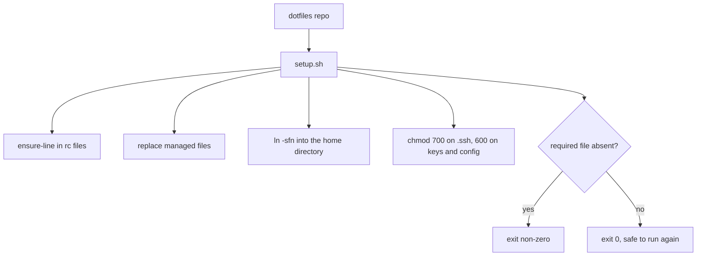

### What the script owns

`setup.sh` lives in the repo. It does not assume the current directory is the home directory. It finds its own directory from the path used to run it, or you `cd` to the repo at the top. In these exercises the script's directory is the work directory, and the home directory is a folder named `home` inside that work directory. You do not write into the real `$HOME`. A practice run must not edit the account you are logged into. The same habit is useful on a server: run against a staging home until `readlink` and the file contents match, then point the script at the real home.

The gitconfig this project writes is only the identity:

```text
[user]
	name = Ada Lovelace
	email = ada@example.com
```

Git reads `~/.gitconfig` when you commit. A wrong email here is a year of commits attributed to the wrong address. Replacing the whole file is acceptable only when the file is fully managed. If a human also keeps credentials or aliases in it, do not overwrite it blindly. Ensure the two lines, or use a separate `include` file. For this project the file is managed, so replacement is the honest model. The second run writes the same bytes.

The SSH config is not generated. It is a file in the repo, `dotfiles/ssh-config`, and the home directory gets a symlink. The SSH lesson's settings, `IdentityFile` and `Host` blocks, stay in one place you can review. The symlink is how every machine sees the same text. Permissions still apply to the target file, not to the symlink's own mode. `chmod 600` the config file in the repo. `chmod 700` the `.ssh` directory. OpenSSH refuses a config or a private key that is group-readable. A setup that links the file and leaves it mode 644 will fail later, in ssh, with an error that does not mention your setup script.

### Failure is an exit code

A required file that is missing must fail the script. Skipping it and exiting 0 is how you get a green run and a machine that cannot SSH. The scripts lesson's `set -euo pipefail` is the default at the top of `setup.sh` and of any check script. A test you care about is an `if` and an explicit `exit 1`, with a message on stderr that names the path. The message is for the human. The exit code is for the caller. CI, from the same habit as every other lesson, only sees the exit code.

```bash
if [ ! -f dotfiles/ssh-config ]; then
  echo "missing dotfiles/ssh-config" >&2
  exit 1
fi
```

The check goes before you rewrite gitconfig, or you do the check first and the writes after, so a missing file does not leave a half-applied home. Order is part of idempotence. A crash in the middle should be repairable by running the script again, which means every step must tolerate the previous steps having already happened. Creating a directory is `mkdir -p`, which succeeds when the directory exists. Linking is `ln -sfn`, which succeeds when the link is already correct. Ensuring a line is the grep test. Replacing a managed file is `>`. None of those fail the second time.

The crontab line is the same ensure-line operation on a file you will later install with `crontab`. This project does not call `crontab` and does not install a daemon. It keeps the line `15 3 * * 1 /usr/local/bin/backup.sh` in `crontab.txt`, once. The cron lesson said why the path is absolute and why Monday is field five. The setup script's job is to keep that line in the file you manage. Installing it on a machine is a separate, explicit step.

### Where this breaks

**Append instead of ensure.** `printf '...\n' >> bashrc` with no test. The second run duplicates the line. Your shell sources the same file twice and the third run makes it worse.

**`ln -s` without `-f` and `-n`.** The second run errors, or, with a directory symlink, creates a link in the wrong place. You then "fix" it by hand and the script no longer matches the machine.

**Relative symlink with the wrong depth.** `../../dotfiles/ssh-config` from `home/.ssh/config` goes up to `home`, up to the repo root, then into `dotfiles`. One `..` too few points at `home/dotfiles`, which does not exist. `readlink` shows what you stored. `ls -l` of the symlink shows the target. Open the target before you call the setup done.

**Mode on the symlink.** `chmod 600` on the symlink, on Linux, changes the target. On some systems the call is less obvious. `chmod` the real file by its path in the repo. Then `ls -l` the real file and look for `-rw-------`. `ls -l` on the symlink shows the link itself. `ls -lL` or `stat` the target when you are unsure which one you changed.

**`set -e` and a grep test.** `grep -q` returns 1 when the line is absent. Under `set -e`, a bare grep aborts the script at the moment you were about to append. The `||` form is an allowed failure. An `if grep -qxF ...; then :; else printf ...; fi` is the same idea and easier to read once the script is long.

**Editing the real home from a test.** A bug in the script that uses `$HOME` instead of the staging directory will rewrite your actual `~/.ssh/config` and your actual `~/.gitconfig`. Point the script at a directory you can delete.

### How this is used at work

The same pattern is a machine image and a configuration-management run, scaled down to one user. You keep the desired state in git. You apply it. You apply it again and the diff is empty. SSH keys themselves are not in the repo. The config that points at a key path can be. The private key is generated on the machine or installed from a secret store, mode 600, and the setup script checks that the path exists instead of writing a key it does not have. A private key is not a dotfile you copy to a laptop and a CI log, because anyone who reads the file can authenticate as you.

A server account's setup is the users lesson plus this one. `useradd` creates the account. The script fills the home directory. `sudo` is not required if the script runs as that user. A script that `sudo`s to write `~/.ssh` is a script that can also write `/etc`. Do not give it that power to edit a symlink.

When the setup fails, the exit code stops the next step. A cloud-init or a CI job that ignores the exit code will boot a machine that looks finished. The shells and scripts lessons both ended on this point. This project is where you enforce it.

### Which write

| You are changing | Do | Second run |
|---|---|---|
| One line in a file other tools also edit | `grep -qxF` then append | Does not append again |
| A file this repo fully owns | `cat > file` | Rewrites the same bytes |
| A path that should track the repo | `ln -sfn` a relative target | Replaces the symlink, same target |
| A directory | `mkdir -p` | Succeeds if it exists |
| A secret key | Do not store it in the repo. Check the mode if it is present | Does not print the key |
| A missing required file | `exit 1` with the path on stderr | Still fails, until the file exists |
| A crontab line | Ensure-line in a file | One copy, absolute path |

### You can now

- Add a line to a file once, and show that a second run does not duplicate it.
- Write a managed `.gitconfig` by replacement, not by append.
- Point `~/.ssh/config` at the repo with `ln -sfn` and a relative target.
- Exit non-zero when a required file is missing, and say why exit 0 would be a lie.
- Keep a five-field crontab line in a managed file without installing cron.
- Set directory mode 700 and config mode 600, and re-run the whole setup without making a mess.

::: quiz
q: A setup script adds `export EDITOR=vim` to `bashrc` with `>>` every time it runs. What is wrong, and what is the idempotent test?
- Nothing. Shell rc files are supposed to contain the line once per run, and the shell ignores duplicates
+ The file gains another copy on every run. Check with `grep -qxF` for the exact line and append only when that check fails
- `>>` replaces the file, so the second run is already safe
- The fix is `grep EDITOR bashrc` with no `-x` and no `-F`, because a partial match is the same as the line
why: `>>` appends. A second run adds a second line, and a tenth run adds a tenth. The shell will happily set EDITOR ten times. The file is still a mess, and a later edit that removes one copy will not remove the others. `>` would replace the whole file, which is the wrong tool when `bashrc` has other lines you must keep. `grep -qxF` is the whole line, as a fixed string. A looser grep matches comments and substrings, so you skip the append when the real line is still missing, or you match a different assignment. The tempting claim is that duplicate assignments are harmless. They are harmless only until a human has to read the file.
:::

::: shell
task: `profile` already has a comment and a PATH line. Write `ensure-pager.sh` so that `export PAGER=less` appears exactly once, as a whole line. The checker runs your script twice. Leave the original lines in place.
file: profile
```
# login profile
export PATH="$HOME/bin:$PATH"
```
verify:
```bash
# wrong answer tested: printf 'export PAGER=less\n' >> profile with no grep. The second run leaves two copies.
set -euo pipefail
bash ensure-pager.sh
bash ensure-pager.sh
count=$(grep -c -x -F 'export PAGER=less' profile || true)
[ "$count" -eq 1 ]
grep -qx '# login profile' profile
grep -q 'export PATH=' profile
```
solution:
```bash
cat > ensure-pager.sh <<'EOF'
#!/bin/bash
set -euo pipefail
line='export PAGER=less'
grep -qxF "$line" profile || printf '%s\n' "$line" >> profile
EOF
```
hint: `-x` is the whole line and `-F` is a fixed string. Append only when grep does not find it. The `||` is what keeps `set -e` from exiting on a missing line. Leave the original two lines in place. The line is `PAGER`, not `EDITOR`.
:::

::: shell
task: Write `setup.sh` that replaces `home/.gitconfig` with a managed identity, and points `home/.ssh/config` at `../../dotfiles/ssh-config`. The config file is already in the repo. A second run of the script must leave a single `name = Ada Lovelace` line and the same symlink. The check runs your script.
file: dotfiles/ssh-config
```
Host *
  IdentityFile ~/.ssh/id_ed25519
```
verify:
```bash
# wrong answer tested: printf the [user] block >> home/.gitconfig. The second run then has two "name = Ada Lovelace" lines.
# also tested: ln -s without -f, which fails the second run because the name already exists.
set -euo pipefail
bash setup.sh
grep -q 'name = Ada Lovelace' home/.gitconfig
grep -q 'email = ada@example.com' home/.gitconfig
[ "$(readlink home/.ssh/config)" = "../../dotfiles/ssh-config" ]
bash setup.sh
[ "$(grep -c 'name = Ada Lovelace' home/.gitconfig)" -eq 1 ]
[ "$(readlink home/.ssh/config)" = "../../dotfiles/ssh-config" ]
```
solution:
```bash
cat > setup.sh <<'EOF'
#!/bin/bash
set -euo pipefail
cd "$(dirname "$0")"
mkdir -p home/.ssh
cat > home/.gitconfig <<'CFG'
[user]
	name = Ada Lovelace
	email = ada@example.com
CFG
ln -sfn ../../dotfiles/ssh-config home/.ssh/config
EOF
bash setup.sh
```
hint: `>` replaces `.gitconfig`, so a second run does not duplicate the name. `ln -sfn` replaces the symlink. The relative target is from `home/.ssh`, up two levels, then into `dotfiles`. Quote the heredoc that writes the script, and quote the inner one too.
:::

::: shell
task: Write `require.sh` in this directory. It must exit 0 when `dotfiles/ssh-config` exists and exit non-zero when that file is missing, with a message on stderr. The check will run it both ways.
file: dotfiles/ssh-config
```
Host *
  IdentityFile ~/.ssh/id_ed25519
```
verify:
```bash
# wrong answer tested: exit 0 when the file is missing. The second run must be non-zero.
set -euo pipefail
bash require.sh
mv dotfiles/ssh-config dotfiles/ssh-config.off
if bash require.sh; then
  echo "missing file should fail" >&2
  exit 1
fi
```
solution:
```bash
cat > require.sh <<'EOF'
#!/bin/bash
set -euo pipefail
here=$(dirname "$0")
if [ ! -f "$here/dotfiles/ssh-config" ]; then
  echo "missing dotfiles/ssh-config" >&2
  exit 1
fi
EOF
```
hint: Test `-f` on the path next to the script. Exit 1 when it is absent. Do not create the file to hide the hole. The message goes to stderr so a later `if` can tell success from failure by the exit code alone.
:::

::: shell
task: `jobs.txt` has a comment. Write `ensure-job.sh` so the single line `45 2 * * 5 /usr/local/bin/scrub.sh` is present. The checker runs your script twice. Friday is day-of-week 5. Do not call `crontab`.
file: jobs.txt
```
# managed jobs
```
verify:
```bash
# wrong answer tested: printf the scrub line >> jobs.txt on every run. The second run leaves two copies.
set -euo pipefail
bash ensure-job.sh
bash ensure-job.sh
line='45 2 * * 5 /usr/local/bin/scrub.sh'
count=$(grep -c -x -F "$line" jobs.txt || true)
[ "$count" -eq 1 ]
grep -qx '# managed jobs' jobs.txt
```
solution:
```bash
cat > ensure-job.sh <<'EOF'
#!/bin/bash
set -euo pipefail
line='45 2 * * 5 /usr/local/bin/scrub.sh'
grep -qxF "$line" jobs.txt || printf '%s\n' "$line" >> jobs.txt
EOF
```
hint: `grep -qxF` then append. The command is an absolute path. Field five is Friday. Do not call `crontab`. This file is the source you would install later.
:::

::: shell
task: Write `harden.sh` that creates `home/.ssh` with mode 700 and sets `dotfiles/ssh-config` to mode 600. The check looks at the mode bits.
file: dotfiles/ssh-config
```
Host *
  IdentityFile ~/.ssh/id_ed25519
```
verify:
```bash
# wrong answer tested: chmod 755 home/.ssh and chmod 644 dotfiles/ssh-config. OpenSSH would reject both.
set -euo pipefail
bash harden.sh
bash harden.sh
dir_mode=$(ls -ld home/.ssh | awk '{ print substr($1, 1, 10) }')
file_mode=$(ls -l dotfiles/ssh-config | awk '{ print substr($1, 1, 10) }')
[ "$dir_mode" = "drwx------" ]
[ "$file_mode" = "-rw-------" ]
```
solution:
```bash
cat > harden.sh <<'EOF'
#!/bin/bash
set -euo pipefail
cd "$(dirname "$0")"
mkdir -p home/.ssh
chmod 700 home/.ssh
chmod 600 dotfiles/ssh-config
EOF
bash harden.sh
```
hint: `mkdir -p` is safe if the directory already exists. `chmod 700` is `rwx` for the owner only. `chmod 600` is `rw` for the owner. OpenSSH will ignore a config the group can read.
:::
