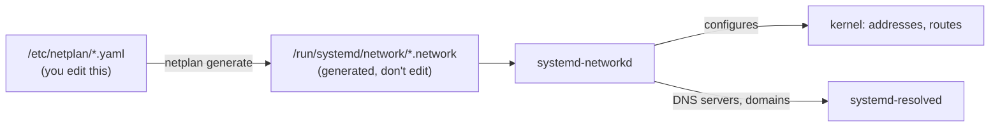
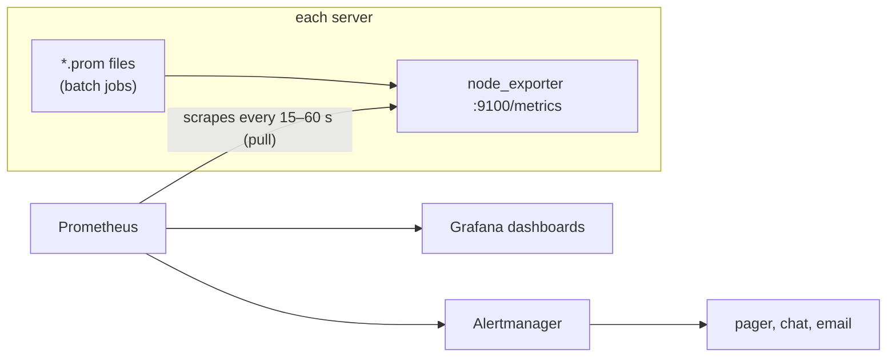
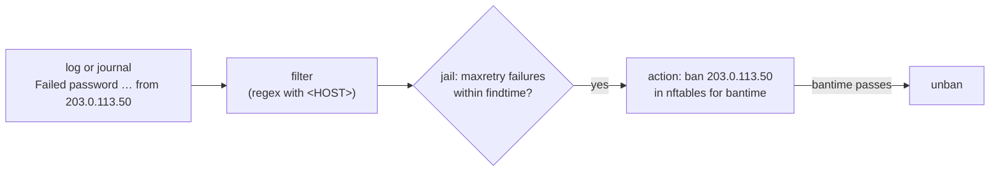
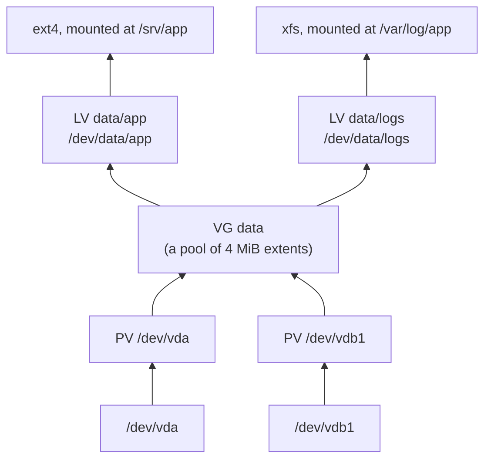
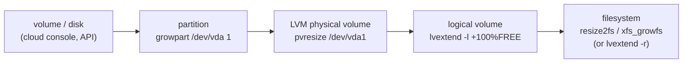

# Server operations
id: ops
blurb: Networks from config, SSH between machines, backups you can restore, metrics and central logs, a load balancer, hardening (sysctl, AppArmor, fail2ban, automatic updates) and real disks: partitions, LVM, growing a full disk.
why: The Linux servers module put you on one machine. Production is several machines talking to each other, disks that fill up, and attacks that never stop. Here you work on two machines at once (SSH from one to the other, back up across the network, balance traffic over both) and on a small VM with real blank disks. Many steps give you a live root shell, so you can poke around the way you would on a real server.
stage: net | Networks and machines | Configure addresses, routes and DNS, log in between machines with keys, and keep backups you've actually restored.
stage: watch | Watching and scaling | Expose metrics, ship logs to another machine, and spread traffic over two app servers that can fail.
stage: harden | Hardening | Kernel tunables, AppArmor confinement, banning brute-force attackers, and security updates that install themselves.
stage: disks | Real disks | Partition, format and mount a new disk, pool disks with LVM, and grow a full disk without downtime.

## Addresses, routes and DNS with netplan
id: netplan
stage: net
needs: server/lab-intro
minutes: 45
goal: Read a machine's network state with ip and resolvectl, and change addresses, routes and DNS in netplan so the change survives a reboot.
source: Netplan documentation | https://netplan.readthedocs.io/en/stable/
source: Netplan YAML reference | https://netplan.readthedocs.io/en/stable/netplan-yaml/
source: ip-route(8) | https://man7.org/linux/man-pages/man8/ip-route.8.html
source: resolvectl(1) | https://www.freedesktop.org/software/systemd/man/latest/resolvectl.html

A server's network setup comes down to three questions: **which address do I have, where do packets for other networks go, and who turns names into addresses?** On Ubuntu you answer them in one YAML file, and you check the answers with three commands. Get this right and a whole class of "the server is up but nothing can reach it" incidents becomes a two-minute fix.

### Reading the state: ip and resolvectl

`ip` (from the iproute2 package) replaced the old `ifconfig`, `route` and `arp` commands years ago. Its subcommands are objects: `ip link` (interfaces), `ip addr` (addresses on them), `ip route` (the routing table), `ip neigh` (the neighbour, or ARP, table). `-br` gives a brief one-line-per-interface view, and `-4` limits output to IPv4.

```bash
ip -br addr                 # eth0  UP  10.214.77.42/24
ip route                    # default via 10.214.77.1 dev eth0 proto dhcp src 10.214.77.42 metric 100
                            # 10.214.77.0/24 dev eth0 proto kernel scope link src 10.214.77.42
ip route get 1.1.1.1        # which route a packet to 1.1.1.1 would take, and from which source address
```

Read the routing table from most specific to least. `10.214.77.0/24 dev eth0 scope link` says: addresses in this /24 are **on the wire**, reachable directly, no router needed. `default via 10.214.77.1` says: everything else goes to the router at 10.214.77.1, the **gateway**. The kernel always picks the most specific matching route (the longest prefix), so a /16 route beats `default` (which is 0.0.0.0/0) for addresses inside it. `ip route get` runs that lookup for you, and is the quickest answer to "why does traffic to X leave through the wrong interface?".

A prefix length is how many leading bits are the network part. A /24 leaves 8 bits for hosts: 256 addresses, minus the network address (.0) and broadcast (.255), so 254 usable. A /16 leaves 16 bits, 65,534 hosts. A gateway must be inside one of your on-link networks: you can't send a packet to a router you can't reach directly.

Names are a separate system. On Ubuntu, **systemd-resolved** answers DNS questions. Programs read `/etc/resolv.conf`, which is a symlink to a file that points them at resolved's local stub, `127.0.0.53`. resolved then asks the real DNS servers configured for each interface. Ask resolved directly with `resolvectl`:

```bash
resolvectl status           # DNS servers and search domains, globally and per interface
resolvectl dns eth0         # just the DNS servers for eth0
resolvectl query example.com
resolvectl flush-caches
```

`getent hosts name` resolves a name the way programs do: through the order in `/etc/nsswitch.conf`, which checks `/etc/hosts` first, then DNS. `dig` and `nslookup` talk DNS directly and **ignore `/etc/hosts`**. When `dig` finds a name but your app can't (or the other way round), that difference is usually why.

### Configuring it: netplan

You could set all of this with `ip addr add` and `ip route add`, and on a live machine that's a fine way to test. It's also temporary: those changes vanish on reboot, and on the next `netplan apply`. Persistent configuration on Ubuntu lives in **netplan**: YAML files in `/etc/netplan/`, which netplan translates for the real network daemon, `systemd-networkd` on servers and NetworkManager on desktops.



Every lab machine starts with `/etc/netplan/10-lxc.yaml`, which asks for DHCP on eth0. A static setup looks like this:

```yaml
network:
  version: 2
  ethernets:
    eth0:
      dhcp4: false
      addresses: [10.214.77.231/24]
      routes:
        - to: default
          via: 10.214.77.1
      nameservers:
        addresses: [10.214.77.1]
        search: [lab.internal]
```

`addresses` takes CIDR notation, prefix included; forget the `/24` and netplan rejects it. `routes` is a list: `to: default` is the default route, and any other destination (`to: 10.99.0.0/16`) adds a specific route. You'll still see `gateway4:` in old tutorials. It's deprecated; netplan warns and asks for a default route instead. `nameservers.search` lists the domains tried for short names, so `ping db` tries `db.lab.internal`.

Every file in `/etc/netplan/` is read, in lexical order, and later files override earlier ones key by key. So a `99-override.yaml` can change one setting of `50-cloud-init.yaml` without copying the rest. On cloud images, cloud-init writes `50-cloud-init.yaml` at first boot. To change networking for good there, disable cloud-init's network step (a file in `/etc/cloud/cloud.cfg.d/` containing `network: {config: disabled}`), or your edits may be regenerated. netplan also warns when a file is readable by other users, because it may hold Wi-Fi passwords. `chmod 600` the files you write.

The commands:

| Command | What it does |
|---|---|
| `netplan generate` | Writes the backend config only; a dry run for syntax errors |
| `netplan apply` | Generates and applies now |
| `netplan try` | Applies, then **reverts after 120 seconds unless you press Enter**. Use it over SSH: a mistake that cuts you off undoes itself |
| `netplan get eth0` / `netplan get` | Prints the merged configuration (all files together), or one key of it |
| `netplan set ethernets.eth0.dhcp4=false` | Edits the YAML for you; handy in scripts |
| `netplan status` | What's actually applied right now, per interface |

`netplan try` is the habit that matters. Changing the network of a remote machine is one of the few edits that can lock you out completely, and the cloud console is a slow way back in.

### The lab's network

Every lab machine sits on a private network, `10.214.77.0/24`. The router, DNS server and DHCP server are all at `10.214.77.1`. DHCP hands out `.2` to `.199`, so `.200` to `.254` are yours for static addresses, and each exercise names one to use. Machines reach the internet through NAT on the router, which is why `apt` works.

### When a machine cannot be reached

Walk the stack from the wire upward and stop at the first answer that is wrong. Skipping ahead is how a DNS problem gets "fixed" by rewriting routes.

| Step | Command | A good answer | A bad answer means |
|---|---|---|---|
| Link | `ip link show eth0` | `UP` and `LOWER_UP` | `DOWN` is administrative (`ip link set eth0 up`). No carrier means the cable, the virtual NIC, or the cloud attachment |
| Address | `ip -br addr show eth0` | The address and prefix you configured, `scope global` | The address was added with `ip addr add` and then wiped by `netplan apply`, or the prefix is wrong |
| Route | `ip route get 1.1.1.1` | A device, a source address, and usually a gateway | `Network is unreachable`, or the packet would leave by the wrong device |
| DNS | `resolvectl query archive.ubuntu.com` | Addresses | Names fail while numeric addresses work: resolved, not routing |
| Firewall | `nft list ruleset`, plus the cloud security group | The port is accepted from the client you care about | The host is fine and the packet still never arrives |
| Socket, then packets | `ss -lnt`, then `tcpdump -ni eth0` | A listener, and packets in both directions | A listener with a silent `tcpdump` means the packet died before the guest |

### IPv6 on the same interface

`ip -6 addr` and `ip -6 route` are the same objects for IPv6. An interface that is up always has a **link-local** address in `fe80::/10`, scope `link`. It works only on that segment, and the interface has to be named (`ping -6 fe80::1%eth0`). It is not how clients on the internet reach you.

**SLAAC** builds a global address from a Router Advertisement. `accept-ra: true` turns that on, and `dhcp6: true` also asks DHCPv6 for an address or for DNS. A **static** address is a line in `addresses`, almost always a `/64`, plus a default route, often via the router's link-local address. SLAAC and a static address can both be present.

A second NIC that learns a default route from an RA you did not intend sends replies out the wrong way. Set `accept-ra: false` on the interface that should not own the default, or install an explicit route. `ss -lnt` showing only an IPv4 address means IPv6 clients, which may have an AAAA from `resolvectl query`, will time out.

### MTU

The **MTU** is the largest packet the interface will send. Ethernet is 1500 bytes. A cloud network is often 1500, and some (AWS with jumbo frames enabled) are 9001. netplan sets it with `mtu: 1500` under the interface. `ip link` prints what the kernel is actually using.

A hop with a smaller MTU must fragment the packet or drop it. Path MTU discovery uses ICMP "fragmentation needed". Drop that ICMP and small packets still work (SSH, a short request) while large ones hang (`apt`, a file upload). Lower this MTU to the path, or allow the ICMP. Setting an MTU above the virtual network only gets the frames dropped on the first hop.

### Two interfaces

Each connected interface gets an on-link route for its own prefix. You usually want one default route. When two interfaces both install a default, the kernel prefers the **lower metric**. DHCP on Ubuntu commonly uses 100. A second NIC that also uses DHCP can install another default, and traffic leaves by whichever metric wins, which may be the management network.

```yaml
eth1:
  dhcp4: true
  dhcp4-overrides:
    route-metric: 200
```

`ip route` then lists two `default` lines, and `ip route get 1.1.1.1` shows the winner. A longer prefix still beats any default. Use a longer prefix when one destination must leave by a particular NIC, and the metric only to rank two defaults.

### Bonds and VLANs

A **bond** turns two NICs into one interface so a cable or a card can fail. `active-backup` sends on one member and moves to the other when the link drops. `802.3ad` splits traffic, and the switch has to be configured for LACP or the bond stays on one member. A **VLAN** is an 802.1Q tag on a parent interface: a separate L2 network on the same wire, with its own addresses and routes.

```yaml
network:
  version: 2
  ethernets:
    eth0: {}
    eth1: {}
  bonds:
    bond0:
      interfaces: [eth0, eth1]
      parameters:
        mode: active-backup
        mii-monitor-interval: 100
  vlans:
    vlan20:
      id: 20
      link: bond0
      addresses: [10.20.0.10/24]
      routes:
        - to: default
          via: 10.20.0.1
```

Leave the member NICs without addresses. Put addresses on the bond, or on the VLAN on top of it, as here. `ip -d link show bond0` shows the mode and the active member. `ip link show vlan20` shows id `20` and parent `bond0`. No carrier on the VLAN means the tag is wrong or the switch is not passing it.

### What a cloud VPC looks like from the guest

The guest still has an address, a default route, and DNS servers. The console's objects are those three things, plus filters you cannot see from inside.

| In the console | On the machine |
|---|---|
| Subnet CIDR and the instance's private IP | `ip addr` on the primary NIC, usually learned by DHCP |
| The subnet router, conventionally `.1` | `default via` that address. It is a virtual router. There is nothing to SSH to |
| The VPC route table (`0.0.0.0/0` toward an internet gateway or a NAT gateway) | Where packets go after they leave the guest. The guest does not list the gateway as a second hop |
| The DHCP option set | The DNS servers and search domain in `resolvectl status` |
| The security group and the network ACL | Drops that never appear in `nft list ruleset`, because they happen outside the guest |
| A second network interface | Another device, often `eth1`, with its own address and often its own route table |

When the security group allows port 22, `ss` shows sshd, and `tcpdump` stays silent, the packet never reached the guest. A security group, a network ACL, or the route back is the filter.

::: shell vm
task: Print just the IP address of this machine's default gateway (one line, the address only).
expect: 10.214.77.1
solution:
```bash
ip route show default | awk '{print $3}'
```
hint: `ip route show default` prints one line like `default via ADDRESS dev eth0 …`. The address is the third word.
:::

::: quiz
q: `dig db.internal` returns nothing, but `ping db.internal` works on the same machine. What's the likeliest explanation?
- `dig` only works for public domains
+ `db.internal` is in `/etc/hosts`; `ping` resolves through nsswitch (files first), `dig` asks DNS only
- `ping` caches answers from earlier runs
- systemd-resolved is stopped
why: Programs like ping resolve names through `/etc/nsswitch.conf`, which checks `/etc/hosts` before DNS. `dig` is a DNS client and never reads `/etc/hosts`. Use `getent hosts` to see what programs see.
:::

::: shell vm
task: |
  Give this machine a **static** address, configured in netplan so it survives reboots: replace the DHCP setup in `/etc/netplan/10-lxc.yaml` with
  - address `10.214.77.231/24` on eth0, no DHCP
  - default route via `10.214.77.1`
  - DNS server `10.214.77.1`, search domain `lab.internal`

  Make the file readable by root only, and apply it.
verify:
```bash
ip -4 -o addr show dev eth0 | grep -q ' 10.214.77.231/24 ' || { echo "eth0 doesn't have 10.214.77.231/24 (ip -4 addr show eth0):"; ip -4 -o addr show dev eth0; exit 1; }
ip -4 -o addr show dev eth0 | grep -q dynamic && { echo "eth0 still has an address from DHCP: set dhcp4: false"; exit 1; }
ip route show default | grep -q 'via 10.214.77.1' || { echo "no default route via 10.214.77.1 (ip route):"; ip route; exit 1; }
resolvectl dns eth0 | grep -q '10.214.77.1' || { echo "eth0's DNS server isn't 10.214.77.1 (resolvectl dns eth0)"; exit 1; }
resolvectl domain eth0 | grep -q 'lab.internal' || { echo "eth0's search domains don't include lab.internal (resolvectl domain eth0)"; exit 1; }
grep -q 10.214.77.231 /etc/netplan/*.yaml || { echo "the address isn't in /etc/netplan: it would be gone after a reboot"; exit 1; }
[ "$(stat -c %a /etc/netplan/10-lxc.yaml)" = 600 ] || { echo "/etc/netplan/10-lxc.yaml should be mode 600, it's $(stat -c %a /etc/netplan/10-lxc.yaml)"; exit 1; }
getent hosts archive.ubuntu.com >/dev/null || { echo "names don't resolve any more: check the nameservers block"; exit 1; }
```
solution:
```bash
cat > /etc/netplan/10-lxc.yaml <<'EOF'
network:
  version: 2
  ethernets:
    eth0:
      dhcp4: false
      addresses: [10.214.77.231/24]
      routes:
        - to: default
          via: 10.214.77.1
      nameservers:
        addresses: [10.214.77.1]
        search: [lab.internal]
EOF
chmod 600 /etc/netplan/10-lxc.yaml
netplan apply
```
hint: Overwrite the file with a heredoc (`cat > file <<'EOF'` … `EOF`), using the YAML shape from the lesson, then `chmod 600` and `netplan apply`. Indentation is YAML structure: two spaces per level.
:::

::: shell vm
task: Traffic for a partner network, `10.99.0.0/16`, must go via the router `10.214.77.1` (a VPN gateway in real life). Add that route **persistently in netplan**, keep DHCP for the address, and apply it. A route added with `ip route add` alone won't survive a reboot or the next apply.
verify:
```bash
ip route show 10.99.0.0/16 | grep -q 'via 10.214.77.1' || { echo "no route for 10.99.0.0/16 via 10.214.77.1 (ip route):"; ip route; exit 1; }
netplan get ethernets.eth0.routes 2>/dev/null | grep -q '10.99.0.0/16' || { echo "the route isn't in netplan's config (netplan get ethernets.eth0.routes): it would vanish on reboot"; exit 1; }
netplan get ethernets.eth0.dhcp4 2>/dev/null | grep -q true || { echo "keep dhcp4: true for the address"; exit 1; }
ip route get 10.99.4.4 | grep -q 'via 10.214.77.1' || { echo "a packet to 10.99.4.4 doesn't use the new route"; exit 1; }
```
solution:
```bash
cat > /etc/netplan/10-lxc.yaml <<'EOF'
network:
  version: 2
  ethernets:
    eth0:
      dhcp4: true
      dhcp-identifier: mac
      routes:
        - to: 10.99.0.0/16
          via: 10.214.77.1
EOF
chmod 600 /etc/netplan/10-lxc.yaml
netplan apply
```
hint: Add a `routes:` list under eth0 with one entry, `to: 10.99.0.0/16` and `via: 10.214.77.1`, and leave `dhcp4: true`. `netplan get ethernets.eth0` shows what netplan sees. (`netplan set` can do it too, but a heredoc is easier to get right.)
:::

::: term
task: |
  A colleague "tidied up" this machine's network, and now `apt-get update` hangs and nothing outside the lab can be reached. Find out what's wrong with `ip route`, `resolvectl status` and the netplan file, then fix it **in the netplan configuration** and apply it. Keep the static address it has.

  When you change the network over SSH in real life, use `netplan try`, which undoes itself unless you confirm. Here your shell doesn't depend on the network, so `netplan apply` is fine too.
setup:
```bash
cat > /etc/netplan/10-lxc.yaml <<'EOF'
network:
  version: 2
  ethernets:
    eth0:
      dhcp4: false
      addresses: [10.214.77.232/24]
      routes:
        - to: default
          via: 10.214.77.254
      nameservers:
        addresses: [10.214.77.99]
EOF
chmod 600 /etc/netplan/10-lxc.yaml
netplan apply 2>/dev/null
```
verify:
```bash
ip route show default | grep -q 'via 10.214.77.1 ' || { echo "the default route still doesn't go via the lab's router (ip route show default):"; ip route show default; exit 1; }
netplan get ethernets.eth0 2>/dev/null | grep -q '10.214.77.254' && { echo "the netplan config still mentions 10.214.77.254: the fix would be lost on reboot"; exit 1; }
netplan get ethernets.eth0 2>/dev/null | grep -q '10.214.77.99' && { echo "the netplan config still points DNS at 10.214.77.99, where no DNS server runs"; exit 1; }
getent hosts archive.ubuntu.com >/dev/null || { echo "names still don't resolve (getent hosts archive.ubuntu.com)"; exit 1; }
ip -4 -o addr show dev eth0 | grep -q ' 10.214.77.232/24 ' || { echo "keep the static address 10.214.77.232/24"; exit 1; }
```
solution:
```bash
ip route                     # default via 10.214.77.254: nothing answers there
resolvectl dns eth0          # 10.214.77.99: no DNS server there either
sed -i 's/10.214.77.254/10.214.77.1/; s/10.214.77.99/10.214.77.1/' /etc/netplan/10-lxc.yaml
netplan apply
getent hosts archive.ubuntu.com
```
hint: Two things are wrong, and both are addresses where nothing answers. The lesson says where the lab's router and DNS server are. `ping -c1 -W1 ADDRESS` tells you whether anything answers at an address.
:::

::: card
q: What does `netplan try` do, and why use it instead of `netplan apply` on a remote server?
answer: It applies the new configuration and **reverts it automatically after 120 seconds unless you confirm** by pressing Enter. If the change cuts off your SSH session, you can't confirm, so the old, working config comes back by itself and you aren't locked out.
:::

::: quiz
q: A machine has address 10.0.5.20/24. Which of these gateways can its default route use?
- 10.0.6.1
+ 10.0.5.1
- 10.1.5.1
- Any address, as long as a router answers there
why: A /24 means the first three numbers are the network: 10.0.5.x is on-link, reachable directly. The gateway must be reachable without a router (that's its whole job), so it has to be inside 10.0.5.0/24.
:::

## SSH between machines with keys
id: ssh-keys
stage: net
needs: server/access
minutes: 50
goal: Log in from one server to another with keys, understand host keys and known_hosts, write ~/.ssh/config, and run admin commands on a remote machine safely.
source: OpenSSH manual pages | https://www.openssh.com/manual.html
source: ssh_config(5) | https://man.openbsd.org/ssh_config
source: sshd_config(5) | https://man.openbsd.org/sshd_config
source: Ubuntu Server: OpenSSH | https://documentation.ubuntu.com/server/how-to/security/openssh-server/

In the Linux servers module you hardened the SSH server of a single machine. Real infrastructure is many machines: you SSH from your laptop to a bastion, from a deploy server to app servers, from a backup host to the machines it backs up. This lesson's exercises give you two machines, `lab` and a neighbour, on the same network. You'll make them trust each other the way production machines do.

### Two separate questions: who is the server, who are you?

An SSH connection answers two questions, in this order.

**1. Is this really the server I meant?** Every SSH server has a **host key** pair, generated when openssh-server was installed (`/etc/ssh/ssh_host_ed25519_key` and friends). When you connect, the server proves it holds the private host key. Your client compares the public half with what it saw last time, recorded in `~/.ssh/known_hosts`. The first time, there's nothing to compare against, so the client shows the key's fingerprint and asks. This is **trust on first use** (TOFU): you're trusting that nobody intercepted the very first connection.

```text
The authenticity of host 'web (10.214.77.57)' can't be established.
ED25519 key fingerprint is SHA256:u7Kx3...
Are you sure you want to continue connecting (yes/no/[fingerprint])?
```

If the key ever changes, ssh refuses loudly: `WARNING: REMOTE HOST IDENTIFICATION HAS CHANGED!`. Usually the server was simply rebuilt and got new host keys. But that's exactly what an attacker in the middle would look like too, so don't shrug it off. Confirm the new fingerprint through another channel: the cloud console, or the person who rebuilt it. Then remove the old entry with `ssh-keygen -R web` and connect again.

`StrictHostKeyChecking` controls this: `ask` (the default prompt), `yes` (refuse unknown hosts, for when known_hosts is managed for you), `accept-new` (accept unknown hosts silently, still refuse *changed* keys), and `no` (accept anything, which throws the protection away). Automation inside a private network commonly uses `accept-new`. Never use `no`.

**2. Who are you, and are you allowed in?** With a password, the server checks it. With a **key pair**, you hold a private key, and the server holds your public key in the target account's `~/.ssh/authorized_keys`. The server sends a challenge, and your client signs it with the private key. The private key never leaves your machine, and there's nothing to guess or phish, which is why keys beat passwords.

### Making and installing a key

```bash
ssh-keygen -t ed25519 -C "deploy@lab"          # writes ~/.ssh/id_ed25519 and id_ed25519.pub
ssh-keygen -t ed25519 -f ~/.ssh/backup_key -N '' -C backup   # a named key, no passphrase (automation only)
```

Ed25519 is the modern default: short keys, fast, no parameter choices to get wrong. Use RSA (3072 bits or more) only for old systems that lack Ed25519. A **passphrase** encrypts the private key on disk. Use one for keys that belong to people, and load the key once per session with `ssh-agent`/`ssh-add` so you don't type it constantly. Machine keys for unattended jobs have no passphrase, so restrict what they can do instead (more on that below).

To install your public key on a server, **ssh-copy-id** logs in once with a password and appends the key for you:

```bash
ssh-copy-id root@web           # asks for web's password once, then appends ~/.ssh/id_ed25519.pub
ssh root@web                   # from now on: no password
```

Without ssh-copy-id, the manual way is `cat ~/.ssh/id_ed25519.pub | ssh root@web 'mkdir -p ~/.ssh && cat >> ~/.ssh/authorized_keys'`.

sshd is strict about permissions (its `StrictModes` setting). If `~/.ssh` is writable by anyone but its owner, or `authorized_keys` is group- or world-writable, it ignores the keys and falls back to a password, often without saying why on the client. Use `chmod 700 ~/.ssh` and `chmod 600 ~/.ssh/authorized_keys`. The reason is sound: if anyone else could write that file, they could add their own key. When key login mysteriously fails, the server's log says why: `journalctl -u ssh` on the target.

An authorized_keys line can carry **options** in front of the key, which matters for automation keys:

```text
from="10.214.77.0/24",command="/usr/local/bin/backup-receive",restrict ssh-ed25519 AAAA... backup@lab
```

`from=` limits which addresses may use the key. `command=` forces one command no matter what the client asks for. `restrict` turns off port forwarding, agent forwarding and the PTY. A stolen backup key with these options can do nothing but run the backup.

### ~/.ssh/config: stop typing options

Every option you'd pass with `-o`, `-i`, `-p` or `-l` can live in `~/.ssh/config`, per host:

```text
Host bk
    HostName backup
    User root
    IdentityFile ~/.ssh/backup_key
    StrictHostKeyChecking accept-new

Host web-*
    User deploy
    ProxyJump bastion.example.com

Host *
    ServerAliveInterval 30
```

`Host` is the name you type, `HostName` is where to really connect. Patterns like `web-*` apply to every match, and **the first value found for each option wins**, so put specific hosts before `Host *`. `ProxyJump` connects through a bastion (jump host) in one step: `ssh web-1` hops via the bastion, and only the bastion needs to be reachable from outside. scp, rsync, git and Ansible all go through ssh, so they all pick up the config.

### Running commands remotely

```bash
ssh web hostname                         # run one command, print its output, return its exit code
ssh web 'systemctl is-active nginx'
ssh web "echo $HOSTNAME"                 # $HOSTNAME expands HERE, before ssh runs: prints lab
ssh web 'echo $HOSTNAME'                 # single quotes: expands THERE: prints web
ssh web 'bash -s' < fix.sh               # run a local script on the remote machine
scp report.txt web:/tmp/                 # copy a file; rsync is better for directories (next lesson)
```

In scripts, add `-o BatchMode=yes`, so ssh fails immediately instead of waiting for a password or a host-key prompt nobody will answer. Add `-o ConnectTimeout=5` too, so an unreachable host fails fast.

### Changing sshd remotely without locking yourself out

When you change a remote sshd's configuration, the session you're in survives a **reload**: only new connections use the new config. So keep your current session open, validate with `sshd -t` (syntax) or `sshd -T` (prints the effective settings), reload, and test a *new* connection from a second terminal before you log out.

On Ubuntu, `/etc/ssh/sshd_config` starts with `Include /etc/ssh/sshd_config.d/*.conf`, and for most sshd options **the first value read wins**. So the included files beat the main file, and among them, `10-…` beats `50-…`. To override something, use a drop-in file whose name sorts *earlier*, rather than editing the main file. `sshd -T | grep -i passwordauthentication` shows which value actually won.

### Reading a failed login: ssh -v

`ssh -v web` prints the decisions in order: which config blocks matched, which host key it compared, which private keys it offered, and what the server answered. `-vv` is the next step when that is not enough.

`Offering public key` followed by `Authentications that can continue: publickey,password` means that key was refused. A password prompt after the list ends means none of the offered keys is in `authorized_keys`, or sshd ignored the file because of its mode. `Server accepts key` means authentication worked. A failure after that is a forced command or a shell that exits.

`Remote protocol version` and the host-key algorithm tell you which server you actually reached. That matters when `HostName` in your config is not the name you thought, or when a proxy sent you somewhere else.

Add `-G web` when you are not ready to connect. It prints the resolved options and stops. `-v` is for a live attempt.

### Port forwarding

SSH can carry other TCP through a connection you already trust. Three flags cover the cases you will actually use.

| Flag | Who listens | Use |
|---|---|---|
| `-L 5432:db.internal:5432` | Your machine | Reach a database that only the bastion can see: `ssh -L 5432:db.internal:5432 bastion`, then point `psql` at `localhost:5432` |
| `-R 9000:localhost:3000` | The remote machine | Expose a service on your laptop to that server, for a webhook or a quick review |
| `-D 1080` | Your machine, as a SOCKS proxy | Send a browser or `curl --proxy socks5h://127.0.0.1:1080` out through the far network |

`-L` is how you reach a private database without opening it to the internet. The bastion dials `db.internal` only because your session asked, and the forward dies when the session does. The same line in config is `LocalForward 5432 db.internal:5432`. `AllowTcpForwarding` defaults to `yes`. A bastion often sets `no`, or `local` / `remote` for one direction, and an `authorized_keys` option `restrict` turns forwarding off for that one key. If `-v` says the forward was refused, the server refused it.

### Agent forwarding, and why ProxyJump is the safer hop

`ssh-agent` holds your unlocked private key. `ForwardAgent yes` (or `-A`) lets the remote host ask your agent to sign. From a bastion you can then hop onward with a key that stayed on the laptop. Root on that bastion can use the agent.

`ProxyJump` does not lend the key. The laptop authenticates to the bastion, opens a channel, and authenticates to the target itself. The bastion sees ciphertext and never gets an agent socket. Put `ProxyJump bastion` on the private hosts and leave `ForwardAgent` unset.

### Certificates for a fleet

Copying `authorized_keys` to every server does not scale, and revoking one person means editing every file. An **SSH certificate** is a public key signed by a CA you run. OpenSSH checks the signature instead of a list of raw keys.

You create a CA key pair (`ssh-keygen -t ed25519 -f ssh-user-ca`) and you keep the private half offline. A user's certificate is their public key signed by that CA:

```bash
ssh-keygen -s ssh-user-ca -I alice -n root,deploy -V +12h alice.pub
```

`-n` is the list of principals (usernames) the certificate may log in as. `-V +12h` makes it expire. The server trusts the CA by one line, `TrustedUserCAKeys /etc/ssh/user-ca.pub`, and does not need alice's key in `authorized_keys`. When alice leaves, you stop issuing certificates. The ones already issued die at `-V`. Host certificates work the same way in the other direction: a host CA signs each server's host key, and clients trust it with `@cert-authority *.example.com` in `known_hosts`, so a rebuilt server does not trip the "host key changed" warning.

A certificate valid for a year is a stolen key with extra steps. One that lasts a working day limits the damage, and it forces the issuing path to be something people will use.

### Hardware keys

`ssh-keygen -t ed25519-sk` creates a key on a FIDO2 token. The private key is not a file you can copy. SSH asks the token to sign, and the token does it only while it is present, usually after a touch. `-O resident` stores the key handle on the token so another machine can use it. A copied laptop disk does not contain a usable key. Keep a second token enrolled, because a key you cannot extract is a key you can lose.

### Who may log in, and from where

`AllowUsers` and `AllowGroups` are allow-lists. If `AllowUsers` is set, every user who is not listed is refused, even with a valid key. The form `AllowUsers deploy@10.0.0.0/8` also restricts the source. `DenyUsers` is the shorter list when almost everyone is allowed.

`Match` is how one sshd serves two policies. A block applies only when its conditions are true, and the settings inside it override the global ones (this is the exception to "the first value wins"):

```text
PasswordAuthentication no

Match Address 10.214.77.0/24
    PasswordAuthentication yes

Match User deploy
    AllowTcpForwarding local
    PermitTTY no
```

From the lab network, passwords work. From anywhere else, they do not. `deploy` may open local forwards and gets no TTY. `sshd -T -C user=deploy,addr=10.1.1.1` prints the settings for that user from that address. A `Match` that is too broad, placed last, overrides the hardening above it.

::: term peer=web
task: |
  Make `lab` able to log in to `web` as root **with a key, without a password**:
  1. Create an Ed25519 key pair for root on lab (no passphrase is fine here).
  2. Install it on web with `ssh-copy-id root@web`. web's root password is `tutor`. Accept web's host key when asked, and notice what it shows you.
  3. Prove it: `ssh web hostname` should print `web` without asking for anything.

  The `root@web` tab is a shell on web, if you want to look at `~/.ssh/authorized_keys` there afterwards.
peersetup:
```bash
echo 'root:tutor' | chpasswd
printf 'PermitRootLogin yes\nPasswordAuthentication yes\n' > /etc/ssh/sshd_config.d/10-lab-passwords.conf
systemctl enable --now ssh >/dev/null 2>&1
```
verify:
```bash
[ -f /root/.ssh/id_ed25519 ] || { echo "there's no Ed25519 key at /root/.ssh/id_ed25519 on lab"; exit 1; }
out=$(ssh -o BatchMode=yes -o ConnectTimeout=5 web hostname 2>&1) || { echo "ssh web still needs a password or a prompt: $out"; exit 1; }
[ "$out" = web ] || { echo "ssh web hostname printed: $out"; exit 1; }
grep -q '^web ' /root/.ssh/known_hosts 2>/dev/null || ssh-keygen -F web >/dev/null || { echo "web isn't in lab's known_hosts"; exit 1; }
```
solution:
```bash
ssh-keygen -t ed25519 -N '' -f /root/.ssh/id_ed25519
ssh-copy-id root@web          # yes to the host key, then the password: tutor
ssh web hostname
```
scripted:
```bash
ssh-keygen -q -t ed25519 -N '' -f /root/.ssh/id_ed25519
printf '#!/bin/sh\necho tutor\n' > /tmp/pw && chmod 700 /tmp/pw
SSH_ASKPASS=/tmp/pw SSH_ASKPASS_REQUIRE=force ssh-copy-id -o StrictHostKeyChecking=accept-new root@web >/dev/null 2>&1
ssh -o BatchMode=yes web hostname
```
hint: `ssh-keygen -t ed25519` makes the key (press Enter for the defaults). `ssh-copy-id root@web` asks "continue connecting?" (type `yes`), then the password. If `ssh web hostname` still asks for a password, look at `journalctl -u ssh` on the web tab.
:::

::: shell vm peer=backup
task: |
  lab already has a key for the backup machine, `/root/.ssh/backup_key`, and backup trusts it. Write `/root/.ssh/config` so that `ssh bk` connects to the host `backup` as root with that key, and **accepts a new host key without asking, but would still refuse a changed one**. Then run `ssh bk hostname`.
setup:
```bash
ssh-keygen -q -t ed25519 -N '' -f /root/.ssh/backup_key -C backup
mkdir -p /tmp/to-peer && cp /root/.ssh/backup_key.pub /tmp/to-peer/lab.pub
```
peersetup:
```bash
install -d -m 700 /root/.ssh && cat /tmp/from-lab/lab.pub >> /root/.ssh/authorized_keys && chmod 600 /root/.ssh/authorized_keys
systemctl enable --now ssh >/dev/null 2>&1
```
expect: backup
verify:
```bash
f=/root/.ssh/config
[ -f $f ] || { echo "there's no /root/.ssh/config"; exit 1; }
cfg=$(ssh -G bk 2>/dev/null)
echo "$cfg" | grep -qx 'hostname backup' || { echo "ssh -G bk says it would connect to: $(echo "$cfg" | awk '$1=="hostname"{print $2}')"; exit 1; }
echo "$cfg" | grep -qx 'user root' || { echo "bk should log in as root"; exit 1; }
echo "$cfg" | grep -q '^identityfile .*backup_key' || { echo "bk should use /root/.ssh/backup_key"; exit 1; }
echo "$cfg" | grep -qx 'stricthostkeychecking accept-new' || { echo "bk should accept new host keys but refuse changed ones: StrictHostKeyChecking accept-new"; exit 1; }
```
solution:
```bash
cat > /root/.ssh/config <<'EOF'
Host bk
    HostName backup
    User root
    IdentityFile ~/.ssh/backup_key
    StrictHostKeyChecking accept-new
EOF
chmod 600 /root/.ssh/config
ssh bk hostname
```
hint: One `Host bk` block with four settings: `HostName`, `User`, `IdentityFile` and `StrictHostKeyChecking`. `ssh -G bk` prints the settings ssh would use for bk, without connecting.
:::

::: shell vm peer=web
task: |
  web still accepts password logins, and you're on lab with key access to it. **From lab, over ssh**, make web's sshd refuse passwords for good: add a drop-in file in `/etc/ssh/sshd_config.d/` that sets `PasswordAuthentication no`, check the config, and reload sshd. Careful: web already has a drop-in, `50-cloud-passwords.conf`, that turns passwords **on**, and for sshd the first value read wins.
setup:
```bash
ssh-keygen -q -t ed25519 -N '' -f /root/.ssh/id_ed25519
mkdir -p /tmp/to-peer && cp /root/.ssh/id_ed25519.pub /tmp/to-peer/lab.pub
printf 'Host *\n    StrictHostKeyChecking accept-new\n' > /etc/ssh/ssh_config.d/10-lab.conf
```
peersetup:
```bash
install -d -m 700 /root/.ssh && cat /tmp/from-lab/lab.pub >> /root/.ssh/authorized_keys && chmod 600 /root/.ssh/authorized_keys
printf 'PasswordAuthentication yes\n' > /etc/ssh/sshd_config.d/50-cloud-passwords.conf
systemctl enable --now ssh >/dev/null 2>&1
```
peerverify:
```bash
sshd -t || { echo "web's sshd config has an error (sshd -t)"; exit 1; }
sshd -T 2>/dev/null | grep -qx 'passwordauthentication no' || { echo "on web, sshd -T still says: $(sshd -T 2>/dev/null | grep passwordauthentication). Which file is read first?"; exit 1; }
systemctl is-active --quiet ssh || { echo "sshd isn't running on web any more"; exit 1; }
n=$(systemctl show ssh -p ExecMainStartTimestampMonotonic --value); [ -n "$n" ] || exit 1
journalctl -u ssh --no-pager 2>/dev/null | grep -q -i -E 'reload|Received SIGHUP|restart' || { echo "sshd wasn't reloaded on web, so it's still running the old settings"; exit 1; }
```
solution:
```bash
ssh web 'echo "PasswordAuthentication no" > /etc/ssh/sshd_config.d/10-no-passwords.conf && sshd -t && systemctl reload ssh'
ssh web 'sshd -T | grep passwordauthentication'
```
hint: Name your file so it sorts before `50-…` (for example `10-no-passwords.conf`). Run everything on web through one `ssh web '…'`, with single quotes so nothing expands on lab: write the file, `sshd -t`, then `systemctl reload ssh`.
:::

::: quiz
q: On lab, `HOSTNAME` is `lab`. What does `ssh web "hostname; echo $HOSTNAME"` print?
- `web` then `web`
+ `web` then `lab`
- `lab` then `lab`
- `lab` then `web`
why: Inside double quotes, `$HOSTNAME` is expanded by lab's shell before ssh even runs, so web receives `hostname; echo lab`. `hostname` itself runs on web. Single quotes would send the `$HOSTNAME` through unexpanded, and web's shell would print `web`.
:::

::: quiz
q: You rebuilt a server from scratch, and now `ssh` stops with "REMOTE HOST IDENTIFICATION HAS CHANGED". What's the right move?
- Set `StrictHostKeyChecking no` for that host so it stops complaining
- Delete `~/.ssh/known_hosts` entirely
+ Check the new fingerprint through another channel (console, the person who rebuilt it), then `ssh-keygen -R host` and reconnect
- Ignore it: rebuilt servers always change keys
why: A rebuild does produce new host keys, but so does an attacker in the middle, and the warning can't tell them apart. Confirm out of band, then remove only that host's old entry. Turning checking off, or wiping known_hosts, throws away the protection for every host.
:::

::: card
q: What do `chmod 700 ~/.ssh` and `chmod 600 ~/.ssh/authorized_keys` protect against, and what happens if they're too open?
answer: If anyone else could write to them, they could add their own public key and log in as you. So sshd (StrictModes) **ignores the keys** when the directory or file is group- or world-writable, and key login silently falls back to a password. `journalctl -u ssh` on the server shows the reason ("bad ownership or modes").
:::

::: card
q: What is `ProxyJump` for?
answer: Reaching a host through a jump host (bastion) in one command: `ssh -J bastion web-1`, or `ProxyJump bastion` in `~/.ssh/config`. Only the bastion is reachable from outside; the client tunnels through it to the private host, and authenticates end to end with the private host.
:::

## Backups with rsync, and restoring them
id: backups
stage: net
needs: ssh-keys
minutes: 55
goal: Mirror a directory to another machine with rsync over SSH, keep cheap daily snapshots with hard links, and restore a single file with its owner and permissions intact.
source: rsync(1) | https://download.samba.org/pub/rsync/rsync.1
source: Ubuntu Server: backups | https://documentation.ubuntu.com/server/explanation/backups/backup-strategies/
source: Google SRE book: data integrity | https://sre.google/sre-book/data-integrity/

Nobody wants backups. What they want is **restores**: the file back the way it was, quickly, after a mistake, a broken disk or ransomware. Everything in this lesson follows from that. A backup you've never restored is a hope, not a backup.

### What a backup plan has to say

- **What** is backed up. Application data, configuration (`/etc`), databases. Not the OS: you rebuild that from a script or an image.
- **Where** it goes. Off the machine, at least, because a backup on the same disk dies with the disk. The classic **3-2-1 rule**: three copies of the data, on two different kinds of media, one of them offsite.
- **How much you can lose: RPO** (recovery point objective). Nightly backups mean up to 24 hours of changes can be lost. If that's too much, back up more often, or replicate.
- **How fast you must be back: RTO** (recovery time objective). Restoring 2 TB over a slow link takes hours, so the plan has to fit the RTO.
- **How you know it works.** Restore tests on a schedule, and monitoring that alerts when the last good backup is too old. The next lesson builds exactly that metric.

Two more points that bite people. **Databases** can't be backed up by copying their files while they run: you'd get a mix of half-written pages. Use the database's own dump (`pg_dump`, `mysqldump`) or a filesystem snapshot that the database knows about, and back up the dump. And **who can delete the backups?** If the server pushes to the backup host with a key that can write anywhere there, an attacker who owns the server can wipe the backups too. That's why serious setups **pull** (the backup host logs in to the server and reads), or use append-only storage.

### rsync: copying only what changed

`rsync` compares source and destination and transfers only the differences, even inside large files. That makes repeat backups fast, and it works locally or over SSH using your keys and `~/.ssh/config`.

```bash
rsync -a /srv/app/ backup:/backups/app/       # push over ssh
rsync -a backup:/backups/app/ /srv/restore/   # pull back
```

`-a` (archive) is what you almost always want: recursive, and it keeps symlinks, permissions, timestamps, owner, group and device files. It does **not** include hard links (`-H`), ACLs (`-A`) or extended attributes (`-X`). Add those when the data uses them. Other options you'll use:

| Option | Meaning |
|---|---|
| `-v`, `-i` | List files as they're transferred; `-i` (itemize) shows *why* each one changed |
| `-n` | Dry run: show what would happen, change nothing. Use it before every `--delete` you're unsure about |
| `--delete` | Delete files in the destination that are gone from the source: a true mirror |
| `--exclude 'cache/'` | Skip matching paths (patterns are relative to the source) |
| `--numeric-ids` | Keep numeric owner IDs rather than mapping by name. For backups, so a restore gets the right owners even when the backup host's users differ |
| `-z` | Compress in transit (helps on slow links, costs CPU) |
| `--link-dest=DIR` | Hard-link unchanged files to DIR instead of copying them (snapshots, below) |

**The trailing slash rule** trips everyone up once. On the *source*, a trailing slash means "the contents of": `rsync -a /srv/app/ dest/` puts `config.yml` at `dest/config.yml`. Without it, rsync copies the directory itself: `rsync -a /srv/app dest/` puts it at `dest/app/config.yml`. A trailing slash on the destination makes no difference.

`--delete` turns a copy into a mirror, which is what you want for "the backup equals the server". But a mirror also mirrors mistakes: delete a file by accident, run the backup, and it's gone from the backup too. That's why a single mirror isn't enough.

### Snapshots with hard links

A **hard link** is a second name for the same file data (the same inode). `--link-dest` uses this. Each day's backup goes into a new directory, and every file that hasn't changed since the previous day's backup becomes a hard link to it rather than a copy:

```bash
rsync -a --delete /srv/app/ backup:/backups/snap/2026-10-04/
rsync -a --delete --link-dest=/backups/snap/2026-10-04 /srv/app/ backup:/backups/snap/2026-10-05/
```

Each snapshot directory looks like a complete copy, and you restore from any day by copying out of it. But unchanged files take no extra space, so thirty days of snapshots of slowly changing data cost little more than one copy. Deleting an old snapshot (`rm -rf` the directory) frees only what no other snapshot still links to. Give `--link-dest` an **absolute path**: a relative one is resolved relative to the *destination* directory, which is rarely what you meant. Tools like rsnapshot automate exactly this pattern. Restic and Borg do the same job with deduplication and encryption, which is what you want for offsite and cloud storage.

### Restoring

Restoring one file is the most common restore, and the one people do badly in a hurry. Copy the file back with its attributes, and **only that file**, without dragging the whole tree over your newer data:

```bash
rsync -a backup:/backups/app/config.yml /srv/app/config.yml
ls -l /srv/app/config.yml        # owner, group, mode: as before?
```

Then check ownership and permissions. A restored file owned by the wrong user is a new outage: the app can't read its own config. Restoring a whole directory is the same with a trailing slash. Add `-n -i` first to see what it would overwrite.

### Scheduling

A backup that depends on you remembering isn't one. Run it from a systemd timer (Linux servers module) or cron, make the script fail loudly (`set -euo pipefail`), and have it record success somewhere monitoring reads. The next lesson's textfile metric is exactly that.

### Deduplicating and encrypting: restic and Borg

Hard-link snapshots are right for one backup server on a disk you control. They are a poor fit for object storage, and they are not encrypted: anyone who can read the backup disk can read every snapshot. **restic** and **Borg** split the data into chunks, store each distinct chunk once, and encrypt it. A second night's backup uploads only the chunks that changed. A repository on disk, on SFTP, or (restic) on S3 is the same set of commands.

```bash
restic init --repo /backup/app
restic backup --repo /backup/app /srv/app
restic snapshots --repo /backup/app
restic restore latest --repo /backup/app --target /srv/restore
```

Borg is the same shape: `borg init`, `borg create`, `borg list`, `borg extract`. Both will ask for a passphrase (or read it from an environment variable or a command). Lose that passphrase and the repository is unreadable. Store it with the same care as a disk encryption key, in a place the backup server's root cannot wipe along with the data.

Retention is a policy, not a feeling. restic's form of the usual one is:

```bash
restic forget --repo /backup/app \
  --keep-daily 7 --keep-weekly 4 --keep-monthly 12 --prune
```

That keeps seven daily snapshots, four weeklies, and twelve monthlies, and `--prune` deletes the chunks no remaining snapshot needs. Borg's `borg prune` takes the same `--keep-daily`, `--keep-weekly`, and `--keep-monthly` options. Run `forget` without `--prune` first when you want to see which snapshots would go. A policy that keeps every snapshot forever fills the disk and, on an immutable store, runs up the bill.

### Databases are not files you copy

Copying `/var/lib/postgresql` while Postgres is running saves a mix of old and new pages. Restoring it fails, or worse, starts and serves wrong rows. Ask the database for a consistent dump.

Postgres: `pg_dump -Fc -d app -f /backup/app.dump` writes a custom-format archive. `-Fc` is what you want, because `pg_restore` can then restore one table, restore in parallel, and restore into an existing server. A plain SQL dump is one script you run from the top. Restore with `pg_restore -d app --clean --if-exists /backup/app.dump` onto a server you are allowed to overwrite. Try it on an empty database first.

MySQL and MariaDB, for InnoDB: `mysqldump --single-transaction --routines --databases app > /backup/app.sql`. `--single-transaction` takes a consistent read without locking every table for the whole dump. It does not give you that for MyISAM. The restore is `mysql app < /backup/app.sql`. Dump the users and grants as well, or the restored data has no one who can read it.

Take the dump, then let restic or rsync back up the dump file. The dump is the backup. The data directory is not, unless you have a snapshot the database agreed to.

### A consistent snapshot

When a dump is too slow or you need the files exactly as they were at one instant (a directory of uploads plus the database that points at them), freeze the filesystem, snapshot the block device, and thaw.

LVM, on a volume that has room for the snapshot:

```bash
lvcreate -s -n app-snap -L 5G data/app
mkdir -p /mnt/snap && mount -o ro /dev/data/app-snap /mnt/snap
# copy from /mnt/snap, then:
umount /mnt/snap && lvremove -y data/app-snap
```

The snapshot is a frozen view. Writes to the live volume continue. They consume space in the snapshot's `-L` budget. If that fills, the snapshot breaks and the copy is not consistent. Remove it when the copy has finished.

Without LVM, `fsfreeze -f /srv/app` suspends writes on that mount (it works on ext4 and XFS). Take the cloud volume snapshot or the storage-array snapshot while it is frozen, then `fsfreeze -u /srv/app`. Leaving a filesystem frozen is an outage: every write blocks. Put the thaw in the same script, and in a trap that runs on failure. A cloud snapshot of a volume that was not frozen can still be crash-consistent, which is what a journaled filesystem can replay. It is not application-consistent. The database may need recovery, and a file that was mid-write may be torn. For a database, prefer the dump, or the database's own backup start and stop around the snapshot.

### Immutable offsite copies

Encryption stops a stranger reading the backup. It does not stop the account that owns the bucket from deleting it. Ransomware that reaches the backup credentials does exactly that. **S3 Object Lock** in compliance mode keeps an object until its retain-until date, and nobody, including the account root, can shorten that date. You write the backup, you set a retention of weeks or months, and a delete is rejected until then. Governance mode is the weaker setting: a principal with a special permission can bypass it, which is useful while you are testing and the wrong setting for the copy that exists to survive a hostile admin.

The backup job's credentials should be able to put objects and not to change the lock or delete the bucket. A separate, rarely used identity is what you use when a restore really needs an object unlocked early.

### A timer that reports failure, and a restore you write down

A systemd timer starts a service, and the service runs the backup. Put `OnFailure=backup-failed.service` on the backup service. That unit runs only when the backup exits non-zero: it can write a metric of zero, send mail, or create a ticket. A timer with no `OnFailure=` fails in the journal, which nobody is reading at 02:00. `OnSuccess=` is the pair, if you want a positive record as well as the absence of an alert.

A restore test is a procedure with a record, not a feeling that it probably works. Pick a snapshot that is not from today, restore it onto a spare machine or an empty directory, and check three things: a file you chose in advance has the checksum you stored, the owner and mode match, and the database dump actually loads and answers one query. Write down the date, the snapshot id, the host you restored onto (not production), how long it took, and who did it. Restoring "to test" onto the live data directory is how a test becomes the incident. If the record is older than your policy says, the backup is a hope again.

::: quiz
q: What does `rsync -a /srv/app backup:/backups/` create on the backup machine?
- `/backups/config.yml` and the rest of app's files directly in `/backups`
+ `/backups/app/` containing app's files
- A single archive file, `/backups/app.tar`
- Nothing: rsync needs a trailing slash on the destination
why: Without a trailing slash on the source, rsync copies the directory itself, so you get `/backups/app/…`. With `/srv/app/` (trailing slash) it would copy the contents straight into `/backups/`. The destination's slash doesn't matter.
:::

::: shell vm peer=backup
task: |
  Back up `/srv/app` from lab to the backup machine as an exact mirror: its **contents** directly in `backup:/backups/app/`, with owners, permissions and timestamps kept, and anything in the backup that no longer exists on lab removed (there's a stale `old.txt` there). lab can already ssh to backup as root with a key.
setup:
```bash
ssh-keygen -q -t ed25519 -N '' -f /root/.ssh/id_ed25519
mkdir -p /tmp/to-peer && cp /root/.ssh/id_ed25519.pub /tmp/to-peer/lab.pub
printf 'Host *\n    StrictHostKeyChecking accept-new\n' > /etc/ssh/ssh_config.d/10-lab.conf
mkdir -p /srv/app/static /srv/app/data
printf 'db: /srv/app/data/app.db\nport: 8080\n' > /srv/app/config.yml
chown root:www-data /srv/app/config.yml && chmod 640 /srv/app/config.yml
head -c 20000 /dev/urandom > /srv/app/data/app.db && chown www-data:www-data /srv/app/data/app.db
echo '<h1>hi</h1>' > /srv/app/static/index.html
cd /srv/app && find . -type f -printf '%P %m %u:%g\n' | sort > /tmp/to-peer/manifest && find . -type f -print0 | sort -z | xargs -0 sha256sum > /tmp/to-peer/sums
```
peersetup:
```bash
install -d -m 700 /root/.ssh && cat /tmp/from-lab/lab.pub >> /root/.ssh/authorized_keys && chmod 600 /root/.ssh/authorized_keys
systemctl enable --now ssh >/dev/null 2>&1
mkdir -p /backups/app && echo stale > /backups/app/old.txt
```
peerverify:
```bash
cd /backups/app 2>/dev/null || { echo "there's no /backups/app on backup"; exit 1; }
[ -e old.txt ] && { echo "old.txt is still in the backup: a mirror removes files that are gone from the source (--delete)"; exit 1; }
[ -e app ] && { echo "the files landed in /backups/app/app/: mind the trailing slash on the source"; exit 1; }
got=$(find . -type f -printf '%P %m %u:%g\n' | sort)
[ "$got" = "$(cat /tmp/from-lab/manifest)" ] || { echo "the files, permissions or owners differ from lab's. Expected:"; cat /tmp/from-lab/manifest; echo "Got:"; echo "$got"; exit 1; }
sha256sum -c --quiet /tmp/from-lab/sums || { echo "some file contents differ"; exit 1; }
```
solution:
```bash
rsync -a --delete /srv/app/ backup:/backups/app/
```
hint: `-a` keeps owners, permissions and times; `--delete` removes extras; and a trailing slash on `/srv/app/` copies its contents rather than the directory itself.
:::

::: shell vm peer=backup
task: |
  Keep daily snapshots on backup that share unchanged files:
  1. Copy `/srv/app/` to `backup:/backups/snap/day1/`.
  2. Then change one file on lab: `echo v2 > /srv/app/report.txt`.
  3. Copy `/srv/app/` to `backup:/backups/snap/day2/` so that every file that didn't change is a **hard link** to its copy in day1, not a second copy.
setup:
```bash
ssh-keygen -q -t ed25519 -N '' -f /root/.ssh/id_ed25519
mkdir -p /tmp/to-peer && cp /root/.ssh/id_ed25519.pub /tmp/to-peer/lab.pub
printf 'Host *\n    StrictHostKeyChecking accept-new\n' > /etc/ssh/ssh_config.d/10-lab.conf
mkdir -p /srv/app/images
echo v1 > /srv/app/report.txt
head -c 300000 /dev/urandom > /srv/app/images/big.bin
echo 'port: 8080' > /srv/app/config.yml
```
peersetup:
```bash
install -d -m 700 /root/.ssh && cat /tmp/from-lab/lab.pub >> /root/.ssh/authorized_keys && chmod 600 /root/.ssh/authorized_keys
systemctl enable --now ssh >/dev/null 2>&1
mkdir -p /backups/snap
```
peerverify:
```bash
cd /backups/snap 2>/dev/null || { echo "no /backups/snap on backup"; exit 1; }
for d in day1 day2; do for f in report.txt config.yml images/big.bin; do [ -f $d/$f ] || { echo "$d/$f is missing"; exit 1; }; done; done
[ "$(cat day1/report.txt)" = v1 ] || { echo "day1/report.txt should still say v1"; exit 1; }
[ "$(cat day2/report.txt)" = v2 ] || { echo "day2/report.txt should say v2"; exit 1; }
[ "$(stat -c %i day1/images/big.bin)" = "$(stat -c %i day2/images/big.bin)" ] || { echo "day2/images/big.bin is a separate copy, not a hard link to day1's (compare ls -i). Use --link-dest with an absolute path"; exit 1; }
[ "$(stat -c %i day1/config.yml)" = "$(stat -c %i day2/config.yml)" ] || { echo "day2/config.yml isn't a hard link to day1's"; exit 1; }
[ "$(stat -c %i day1/report.txt)" != "$(stat -c %i day2/report.txt)" ] || { echo "report.txt changed, so day2 needs its own copy"; exit 1; }
```
solution:
```bash
rsync -a /srv/app/ backup:/backups/snap/day1/
echo v2 > /srv/app/report.txt
rsync -a --link-dest=/backups/snap/day1 /srv/app/ backup:/backups/snap/day2/
```
hint: The second rsync needs `--link-dest=/backups/snap/day1`, a path **on the backup machine**, and absolute. On backup, `ls -li` shows inode numbers: hard links share one.
:::

::: term peer=backup
task: |
  Someone deleted `/srv/app/config.yml` on lab, and the app is down. Last night's backup is on the backup machine in `/backups/app/`. Restore **just that file**: same content, same owner and group (`root:www-data`), same mode (`640`). Don't touch anything else in `/srv/app`. `/srv/app/log/today.log` exists only on lab and must survive, and `/srv/app/VERSION` on lab is newer than the backup's and must stay as it is.

  Look before you copy: `ssh backup ls -l /backups/app/` shows what's there.
setup:
```bash
ssh-keygen -q -t ed25519 -N '' -f /root/.ssh/id_ed25519
mkdir -p /tmp/to-peer && cp /root/.ssh/id_ed25519.pub /tmp/to-peer/lab.pub
printf 'Host *\n    StrictHostKeyChecking accept-new\n' > /etc/ssh/ssh_config.d/10-lab.conf
mkdir -p /srv/app/log
printf 'db: /srv/app/data/app.db\nport: 8080\nworkers: 4\n' > /srv/app/config.yml
chown root:www-data /srv/app/config.yml && chmod 640 /srv/app/config.yml
echo 1.4.0 > /srv/app/VERSION
tar -C /srv -cpf /tmp/to-peer/app.tar app
sha256sum /srv/app/config.yml | awk '{print $1}' > /root/.config-sum
echo 1.4.1 > /srv/app/VERSION
echo "request served" > /srv/app/log/today.log
rm /srv/app/config.yml
```
peersetup:
```bash
install -d -m 700 /root/.ssh && cat /tmp/from-lab/lab.pub >> /root/.ssh/authorized_keys && chmod 600 /root/.ssh/authorized_keys
systemctl enable --now ssh >/dev/null 2>&1
mkdir -p /backups && tar -C /backups -xpf /tmp/from-lab/app.tar
```
verify:
```bash
f=/srv/app/config.yml
[ -f $f ] || { echo "$f is still missing"; exit 1; }
[ "$(sha256sum $f | awk '{print $1}')" = "$(cat /root/.config-sum)" ] || { echo "$f's content isn't the backed-up version"; exit 1; }
[ "$(stat -c '%U:%G %a' $f)" = "root:www-data 640" ] || { echo "$f is $(stat -c '%U:%G %a' $f), it should be root:www-data 640: the app can't read its config otherwise (or anyone can)"; exit 1; }
[ -f /srv/app/log/today.log ] || { echo "/srv/app/log/today.log was deleted: the restore touched more than the one file"; exit 1; }
[ "$(cat /srv/app/VERSION)" = 1.4.1 ] || { echo "/srv/app/VERSION was overwritten with the older backup copy"; exit 1; }
```
solution:
```bash
ssh backup ls -l /backups/app/
rsync -a backup:/backups/app/config.yml /srv/app/config.yml
ls -l /srv/app/
```
hint: `rsync -a` with the single file as the source copies just that file and keeps its owner, group and mode. A whole-directory restore (especially with `--delete`) would clobber the newer VERSION and delete today's log.
:::

::: card
q: Why do careful backup setups have the backup server **pull** from the servers instead of each server **pushing** to the backup host?
answer: With push, every server holds credentials that can write to the backup host, so an attacker (or ransomware) on any server can delete or encrypt the backups too. With pull, the servers hold no backup credentials; the backup host logs in and reads. Append-only or immutable storage solves the same problem another way.
:::

::: quiz
q: Backups run every night at 02:00. A disk dies at 23:30. What's the most data you lose, and which objective is that?
- 30 minutes; the RTO
+ About 21.5 hours of changes; the RPO
- Nothing, if the backup is fast; the RPO
- 24 hours; the RTO
why: Everything written since the last backup (02:00 to 23:30) is gone. How much data you can afford to lose is the recovery *point* objective. RTO is how long the restore may take.
:::

## Metrics: node_exporter and what to watch
id: metrics
stage: watch
needs: server/firewall
minutes: 50
goal: Expose a server's metrics with node_exporter, read the Prometheus format, publish your own metric from a batch job, and let only the monitoring server scrape it.
source: Prometheus: overview | https://prometheus.io/docs/introduction/overview/
source: Prometheus: metric types | https://prometheus.io/docs/concepts/metric_types/
source: node_exporter | https://github.com/prometheus/node_exporter
source: Brendan Gregg: the USE method | https://www.brendangregg.com/usemethod.html

Logs tell you **what happened**. Metrics tell you **how much, how often, and how it's trending**: CPU busy 85% for the last hour, disk 4% free and falling 1% an hour, 30 errors a second since the deploy. Almost every alert that wakes someone up is a metric crossing a line, so metrics come first when you set up a server.

### The Prometheus model

Prometheus is the standard open-source metrics system, and its model is worth knowing even when you use something else (CloudWatch, Datadog, Grafana Cloud) because most of them speak its format.



**Exporters** are small programs that publish metrics as plain text over HTTP, usually at `/metrics`. **Prometheus pulls** (scrapes) every target on a fixed interval, stores each series with a timestamp, and evaluates alert rules over them. Pulling means a dead server shows up as a failed scrape, the `up` metric drops to 0, which is itself an alert. A server that pushed would simply go quiet.

**node_exporter** is the exporter for the machine itself: CPU, memory, disks, filesystems, network, load, and much more, from `/proc` and `/sys`. On Ubuntu the package is `prometheus-node-exporter`, the service has the same name, it listens on port **9100**, and its command-line options go in `/etc/default/prometheus-node-exporter` (`ARGS="..."`).

### Reading the format

```text
# HELP node_load1 1m load average.
# TYPE node_load1 gauge
node_load1 0.42
# HELP node_network_receive_bytes_total Network device statistic receive_bytes.
# TYPE node_network_receive_bytes_total counter
node_network_receive_bytes_total{device="eth0"} 1.834262e+07
node_filesystem_avail_bytes{device="/dev/sda1",fstype="ext4",mountpoint="/"} 4.2e+09
```

Each line is a **name**, optional **labels** in braces, and a **value**. Labels split one metric into series: one per network device, per mountpoint, per CPU mode. `# TYPE` says how to treat the value:

| Type | Behaves like | Examples | How you use it |
|---|---|---|---|
| **gauge** | A reading that goes up and down | load, free memory, temperature, free disk | Use the value directly, or its average and maximum over time |
| **counter** | A total that only ever increases, resetting to 0 on restart | bytes received, requests served, CPU seconds | Never read the raw number: take its **rate** per second |
| histogram / summary | Buckets of observations | request durations | Percentiles: "99% of requests under 300 ms" |

By convention, counters end in `_total`, and units are in the name (`_bytes`, `_seconds`). A raw counter value like 18,342,620 bytes means nothing on its own. What matters is how fast it grows: `rate(node_network_receive_bytes_total[5m])` in PromQL is bytes per second over the last five minutes, and it handles counter resets.

### What to watch on a server

Brendan Gregg's **USE method** is a checklist: for every resource, check its **Utilization** (how busy), its **Saturation** (how much work is queued waiting for it) and its **Errors**.

| Resource | Utilization | Saturation | node_exporter metrics |
|---|---|---|---|
| CPU | busy % | load above CPU count, run queue | `node_cpu_seconds_total{mode}`, `node_load1`, `node_pressure_cpu_waiting_seconds_total` |
| Memory | used vs available | swapping, OOM kills | `node_memory_MemAvailable_bytes`, `node_vmstat_oom_kill` |
| Disk space | % full | (none: it's full, or it isn't) | `node_filesystem_avail_bytes`, `node_filesystem_files_free` (inodes) |
| Disk I/O | time busy | I/O wait, queue length | `node_disk_io_time_seconds_total`, `node_pressure_io_waiting_seconds_total` |
| Network | throughput vs link speed | drops | `node_network_receive_bytes_total`, `node_network_receive_drop_total` |

For services you add the **RED** view: request **R**ate, **E**rrors, **D**uration. Good alerts are about symptoms users feel (error rate up, latency up, disk about to fill), not every possible cause. A classic disk alert is "will be full within 4 hours at the current rate", `predict_linear(node_filesystem_avail_bytes{mountpoint="/"}[6h], 4*3600) < 0`, rather than "over 80%". A disk at 81% that's flat isn't urgent. One at 60% that's growing fast is.

### Your own metrics from batch jobs: the textfile collector

Some facts only a script knows: "the backup finished successfully at 02:13". Batch jobs don't stay running for Prometheus to scrape, so node_exporter's **textfile collector** reads `*.prom` files from a directory and serves their contents with everything else. On Ubuntu that directory is `/var/lib/prometheus/node-exporter`.

```bash
cat > /var/lib/prometheus/node-exporter/backup.prom.$$ <<EOF
# HELP backup_last_success_timestamp_seconds When the last backup finished OK.
# TYPE backup_last_success_timestamp_seconds gauge
backup_last_success_timestamp_seconds $(date +%s)
EOF
mv /var/lib/prometheus/node-exporter/backup.prom.$$ /var/lib/prometheus/node-exporter/backup.prom
```

Write to a temporary name in the same directory, then `mv` it into place. A rename within one filesystem is **atomic**, so node_exporter reads either the old file or the new one, never half of one. It ignores names that don't end in `.prom`, which is why the temporary name is safe. The alert then reads "the last good backup is more than 26 hours old": `time() - backup_last_success_timestamp_seconds > 26*3600`. That one alert catches a failing script, a missing timer, a full backup disk and a dead server alike.

### Who may scrape

`/metrics` tells anyone who can reach it a lot: kernel version, mount points, interface names, how busy you are. Don't expose 9100 to the internet. Allow it from the monitoring server only, with the firewall (Linux servers module) or a cloud security group. node_exporter can also do TLS and basic auth through a `--web.config.file`, for when the network path isn't private.

### What Prometheus scrapes

Prometheus reads a config file, by convention `prometheus.yml`, and pulls each target on `scrape_interval`. A small file for the machines in this module:

```yaml
global:
  scrape_interval: 30s
scrape_configs:
  - job_name: node
    static_configs:
      - targets: ["web:9100", "app:9100"]
        labels:
          env: prod
```

`job_name` becomes the `job` label on every series from those targets. `up` is 1 when the scrape succeeded and 0 when it did not, so a dead exporter is a series you can alert on without the exporter's help. Reload with `kill -HUP` on the Prometheus process, or the lifecycle endpoint if you enabled it. A config that does not parse refuses the reload and keeps the old one, which is what you want.

Service discovery (a cloud API, Kubernetes, a file you generate) replaces the static list once you have more than a handful of machines. The scrape itself does not change. Prometheus still pulls `/metrics`.

### PromQL you will actually write

A counter's raw value is a total since the process started. The functions that turn it into a rate are `rate` and `increase`. `rate(node_network_receive_bytes_total[5m])` is the average per second over five minutes, and it copes with a counter reset. `increase(...[1h])` is the amount gained over the hour, which is what you want for "how many bytes today" rather than "how fast right now".

Labels are how you slice. `sum by (device) (rate(node_network_receive_bytes_total[5m]))` adds the series together and keeps `device`, so you see each NIC instead of one number per CPU or per queue. `sum without (cpu)` is the other direction: drop that label, keep the rest. A query that forgets the aggregation draws one line per series and a graph that means nothing.

A histogram records how many observations fell into each bucket. The bucket series ends in `_bucket` and has a label `le` (less than or equal). The 99th percentile is:

```text
histogram_quantile(0.99,
  sum by (le) (rate(http_request_duration_seconds_bucket[5m])))
```

The `sum by (le)` is required. `histogram_quantile` needs one histogram, which means every bucket of one group. If you also want the percentile per route, add `path` inside the `by (le, path)`. The number is an estimate from the buckets. A histogram with buckets at 0.1, 0.5, and 1 will not tell you the difference between 12 ms and 40 ms.

### An alert rule

Rules live in a file Prometheus loads through `rule_files`. One rule:

```yaml
groups:
  - name: node
    rules:
      - alert: NodeDown
        expr: up{job="node"} == 0
        for: 5m
        labels:
          severity: page
        annotations:
          summary: "{{ $labels.instance }} is not being scraped"
```

`expr` is a PromQL expression. It fires while the expression returns samples. `for: 5m` holds the alert in a pending state until the expression has been true for five minutes, so one failed scrape does not page anyone. Leave `for` off only when a single sample is already an incident. `labels` decide who gets woken up. `annotations` are the text a person reads. Alertmanager routes on the labels. Prometheus does not send the page itself.

### Labels, and the one you must not add

Every unique combination of labels is a time series, stored and indexed. `method` and `status` are fine: a handful of values. A user id, an email address, a full URL with a query string, or an order id is not. Each new user creates series that live until they go stale, and a busy service will create millions. Prometheus slows down, the disk fills, and queries time out. That is a **cardinality** failure. Put the user id in a log line, where it belongs, and keep the metric as `http_requests_total{status="500"}`. If you need a count of distinct users, that is a different measurement, computed on purpose, not a label.

A label you meant well, such as `path` taken from the request URL, has the same shape when the path includes an id (`/users/171/profile` is a new series per user). Use the route template (`/users/:id/profile`), not the raw path.

### Probing from outside, and the Pushgateway

node_exporter reports what the machine thinks of itself. It will happily say the process is up while a security group, a DNS record, or a TLS certificate stops every client. The **blackbox exporter** connects the way a client does: an HTTP GET, a TCP dial, an ICMP ping, a TLS handshake, from a place outside the service. You alert on `probe_success == 0` or on `probe_duration_seconds` growing. Run it from more than one network if you can. A probe next to the server misses the failure your users have.

The **Pushgateway** is the opposite of a scrape. A batch job that exits before Prometheus can pull it pushes its last numbers to the gateway, and Prometheus scrapes the gateway. That fits a short job on a network Prometheus cannot reach. It is the wrong tool for a long-running service. The gateway keeps the last push forever, so a job that died still looks healthy until someone deletes its group. It is also the wrong place for the backup timestamp you already publish through the textfile collector: the machine is up, node_exporter is already scraped, and a file on disk does not outlive the truth the way a forgotten push group does. Use the gateway for ephemeral jobs, delete groups when the job is retired, and do not point every service at it because pushing felt easier than opening port 9100.

::: shell vm
task: Start node_exporter now **and** at every boot, then save the single `node_load1` line of its metrics (name and value, like `node_load1 0.42`) to `/root/load.txt`.
verify:
```bash
systemctl is-enabled --quiet prometheus-node-exporter || { echo "prometheus-node-exporter isn't enabled: it won't start at boot"; exit 1; }
systemctl is-active --quiet prometheus-node-exporter || { echo "prometheus-node-exporter isn't running"; exit 1; }
curl -s --max-time 5 localhost:9100/metrics | grep -q '^node_load1 ' || { echo "nothing answers on localhost:9100/metrics"; exit 1; }
[ -f /root/load.txt ] || { echo "there's no /root/load.txt"; exit 1; }
[ "$(wc -l < /root/load.txt)" -eq 1 ] && grep -Eq '^node_load1 [0-9.e+-]+$' /root/load.txt || { echo "/root/load.txt should be one line like 'node_load1 0.42' (no HELP or TYPE lines), it is:"; cat /root/load.txt; exit 1; }
```
solution:
```bash
systemctl enable --now prometheus-node-exporter
sleep 1
curl -s localhost:9100/metrics | grep '^node_load1 ' > /root/load.txt
```
hint: `systemctl enable --now` does both. Give the exporter a second to start before you `curl` it. Anchor the grep with `^` and a trailing space, so `# HELP node_load1` and `node_load15` don't match too.
:::

::: quiz
q: Which of these metrics only makes sense as a rate (per second over a window), not as its raw value?
- `node_memory_MemAvailable_bytes`
- `node_load1`
+ `node_network_receive_bytes_total`
- `node_filesystem_avail_bytes`
why: It's a counter (`_total`): a running total since the counter last reset, so its raw value only tells you how long the machine has been up. The others are gauges, readings you use as they are.
:::

::: predict lang=shell
q: A disk's metrics, and a little awk. What does it print?
code:
```bash
printf '%s\n' 'node_filesystem_size_bytes{mountpoint="/"} 2000' 'node_filesystem_avail_bytes{mountpoint="/"} 500' > m.prom
awk '/_size_bytes/ {s=$2} /_avail_bytes/ {a=$2} END {print 100 * (1 - a / s) "% used"}' m.prom
```
answer: 75% used
why: Used is everything that isn't available: 1 − 500/2000 = 0.75. node_exporter gives you size and available rather than "used", because "free" and "available" differ (reserved blocks), and available is what matters to your app.
:::

::: shell vm
task: |
  Your nightly backup script should publish when it last succeeded. Add the last part of it: write the metric `backup_last_success_timestamp_seconds` with the **current Unix time** as its value, with `# HELP` and `# TYPE … gauge` lines, to `backup.prom` in node_exporter's textfile directory, **atomically** (a temporary file in the same directory, then `mv`). Make sure node_exporter is running, so the metric is served.
verify:
```bash
d=/var/lib/prometheus/node-exporter
[ -f $d/backup.prom ] || { echo "there's no $d/backup.prom"; exit 1; }
ls $d | grep -v -E '\.prom$' | grep -q . && { echo "leftover files in $d: $(ls $d | grep -v -E '\.prom$' | tr '\n' ' ')"; exit 1; }
grep -q '^# TYPE backup_last_success_timestamp_seconds gauge$' $d/backup.prom || { echo "backup.prom needs the line: # TYPE backup_last_success_timestamp_seconds gauge"; exit 1; }
grep -q '^# HELP backup_last_success_timestamp_seconds ' $d/backup.prom || { echo "backup.prom needs a # HELP line for the metric"; exit 1; }
v=$(curl -s --max-time 5 localhost:9100/metrics | awk '$1=="backup_last_success_timestamp_seconds" {print $2}')
[ -n "$v" ] || { echo "node_exporter doesn't serve backup_last_success_timestamp_seconds (is it running? curl localhost:9100/metrics)"; exit 1; }
now=$(date +%s); v=$(printf '%.0f' "$v")
[ $((now - v)) -ge 0 ] && [ $((now - v)) -lt 600 ] || { echo "the metric's value ($v) isn't the current Unix time (date +%s is $now)"; exit 1; }
```
solution:
```bash
systemctl start prometheus-node-exporter
d=/var/lib/prometheus/node-exporter
cat > $d/backup.prom.tmp <<EOF
# HELP backup_last_success_timestamp_seconds When the last backup finished OK.
# TYPE backup_last_success_timestamp_seconds gauge
backup_last_success_timestamp_seconds $(date +%s)
EOF
mv $d/backup.prom.tmp $d/backup.prom
sleep 1
curl -s localhost:9100/metrics | grep backup_
```
hint: In the heredoc, leave the `EOF` marker unquoted so `$(date +%s)` expands. The temporary file needs a name that doesn't end in `.prom` (like `backup.prom.tmp`), so node_exporter never reads it half-written.
:::

::: term peer=monitor
task: |
  node_exporter runs on lab, and the monitoring server `monitor` must be able to scrape `http://lab:9100/metrics`, **but nobody else**. Write an nftables ruleset in `/etc/nftables.conf` on lab that:
  - lets established traffic, loopback and SSH (22) in,
  - accepts TCP 9100 **only from monitor's address** (`getent hosts monitor` shows it),
  - drops everything else coming in,

  and make it load now **and** at boot (the `nftables` service reads that file). Then try it from the `root@monitor` tab: `curl -s lab:9100/metrics | head -3`.

  The check scrapes from monitor, then from a second address on monitor that isn't allowed.
setup:
```bash
systemctl enable --now prometheus-node-exporter >/dev/null 2>&1
```
verify:
```bash
systemctl is-enabled --quiet nftables || { echo "the nftables service isn't enabled: your rules wouldn't load at boot"; exit 1; }
grep -q 9100 /etc/nftables.conf || { echo "/etc/nftables.conf doesn't mention port 9100"; exit 1; }
nft list ruleset | grep -q 9100 || { echo "no rule for port 9100 is loaded (nft list ruleset)"; exit 1; }
systemctl is-active --quiet prometheus-node-exporter || { echo "node_exporter isn't running on lab any more"; exit 1; }
```
peerverify:
```bash
curl -s --max-time 5 http://lab:9100/metrics | grep -q '^node_load1 ' || { echo "monitor can't scrape lab:9100/metrics"; exit 1; }
ip addr add 10.214.77.247/24 dev eth0 2>/dev/null
out=$(curl -s --max-time 4 --interface 10.214.77.247 http://lab:9100/metrics | head -1)
ip addr del 10.214.77.247/24 dev eth0 2>/dev/null
[ -z "$out" ] || { echo "another address (10.214.77.247) could scrape lab:9100 too: only monitor should"; exit 1; }
```
solution:
```bash
getent hosts monitor              # its address, e.g. 10.214.77.57
cat > /etc/nftables.conf <<'EOF'
#!/usr/sbin/nft -f
flush ruleset
table inet filter {
  chain input {
    type filter hook input priority 0; policy drop;
    ct state established,related accept
    iif lo accept
    tcp dport 22 accept
    ip saddr 10.214.77.57 tcp dport 9100 accept
  }
}
EOF
nft -c -f /etc/nftables.conf && systemctl enable --now nftables && systemctl restart nftables
```
scripted:
```bash
m=$(getent hosts monitor | awk '{print $1}')
cat > /etc/nftables.conf <<EOF
#!/usr/sbin/nft -f
flush ruleset
table inet filter {
  chain input {
    type filter hook input priority 0; policy drop;
    ct state established,related accept
    iif lo accept
    tcp dport 22 accept
    ip saddr $m tcp dport 9100 accept
  }
}
EOF
nft -c -f /etc/nftables.conf && systemctl enable --now nftables && systemctl restart nftables
```
hint: An input chain with `policy drop`, then the accepts: established, `iif lo`, port 22, and `ip saddr ADDRESS tcp dport 9100 accept` with monitor's address. Check the syntax with `nft -c -f /etc/nftables.conf`, then `systemctl enable --now nftables` (and `restart` if it was already running).
:::

::: card
q: What is the USE method, and what do you check with it?
answer: For every resource (CPU, memory, disks, network), check **U**tilization (how busy it is), **S**aturation (how much work is queued waiting for it, like load above the CPU count or swapping) and **E**rrors. Going through it systematically finds the bottleneck instead of guessing.
:::

::: quiz
q: Which disk alert is least likely to wake someone up for nothing, and most likely to warn before an outage?
- Disk over 80% full
- Disk over 95% full
+ At the current rate of growth, the disk will be full within 4 hours
- Any change in disk usage of more than 1% in an hour
why: A fixed threshold fires for disks that are full but stable, and can fire too late for disks filling fast. A prediction from the recent trend (`predict_linear`) fires exactly when there's an outage coming, with time left to act.
:::

## Central logs: shipping them off the machine
id: central-logs
stage: watch
needs: ssh-keys, server/journal-real
minutes: 50
goal: Send a server's logs to a central log host over TCP with rsyslog, sort them into a file per machine, and ship an application's own log file too.
source: rsyslog documentation | https://www.rsyslog.com/doc/
source: rsyslog: omfwd (forwarding) | https://www.rsyslog.com/doc/configuration/modules/omfwd.html
source: rsyslog: imfile (text files) | https://www.rsyslog.com/doc/configuration/modules/imfile.html
source: RFC 5424: the Syslog protocol | https://datatracker.ietf.org/doc/html/rfc5424

The journal on each machine is great until you need it most. The disk died and took the logs with it. An attacker deleted `/var/log` to hide their tracks. The bug shows up on one of twenty machines and you don't know which. Or you need to line up what the load balancer, two app servers and the database each saw in the same second. All of these need the logs **somewhere else, as they're written**.

### The pipeline

Every central logging setup has the same shape, whatever the products:


The agent collects, adds context (hostname, service), buffers when the network or the store is down, and sends. The store indexes and keeps logs for a **retention** period: often 14 to 90 days hot and searchable, longer archived for compliance. This lesson uses **rsyslog**, which is already on every Ubuntu server and is the classic tool. The ideas carry straight over to Vector, Fluent Bit or a cloud agent, which you'll meet in the cloud and Kubernetes modules.

### Syslog in a page

On Ubuntu, journald collects everything first, and passes each message on to rsyslog, which writes the traditional text files: `/var/log/syslog`, `/var/log/auth.log` and so on. A syslog message carries:

- a **facility**, the kind of source: `kern`, `auth`/`authpriv` (logins), `cron`, `daemon`, `mail`, and `local0` to `local7` for your own use;
- a **severity**, from 0 `emerg` through `alert`, `crit`, `err`, `warning`, `notice`, `info` to 7 `debug`;
- a timestamp, the **hostname** and a **tag**, usually the program name.

`logger` sends a message by hand, which is how you test a log pipeline: `logger -t deploy -p local0.warning "release 42 rolled back"`.

rsyslog's configuration is `/etc/rsyslog.conf` plus every `/etc/rsyslog.d/*.conf`, in name order. Two syntaxes are mixed in the wild. The old **selector** lines are `facility.severity  action`, like `auth,authpriv.*  /var/log/auth.log` or `*.*  @@logs:514`. The newer **RainerScript** uses `module(...)`, `input(...)`, `action(...)` and `template(...)` objects, plus `if … then` conditions. Use RainerScript for anything new: it's clearer, and it's where the options live. `rsyslogd -N1` checks the configuration without starting anything, and you `systemctl restart rsyslog` to apply it. (A reload doesn't re-read the configuration.)

### Sending: UDP, TCP, and what happens when the log host is down

| Transport | In config | Trade-off |
|---|---|---|
| UDP 514 | `@logs:514` | Fire and forget. Cheap, but messages vanish when the log host is down, restarting, or the network drops packets, and nothing tells you |
| TCP 514 | `@@logs:514` or `omfwd` with `protocol="tcp"` | The connection is acknowledged and rsyslog notices failures. With a queue, it holds messages and retries |
| RELP | `omrelp` | Application-level acknowledgements: nothing is lost, even on a broken connection |
| TLS | `StreamDriver="gtls"` | Encryption and authentication. Required when logs cross networks you don't control |

TCP alone isn't enough. When the log host is unreachable, rsyslog suspends the forwarding action, and by default it drops what arrives in the meantime. You give the action its **own queue**, kept on disk if needed, and tell it to retry forever:

```text
*.* action(type="omfwd" target="logs" port="514" protocol="tcp"
           queue.type="LinkedList" queue.filename="fwd_logs" queue.saveOnShutdown="on"
           action.resumeRetryCount="-1")
```

`queue.type="LinkedList"` keeps an in-memory queue just for this action. `queue.filename` makes it **disk-assisted**: when memory fills up, or rsyslog shuts down (`saveOnShutdown`), the queue spills to files in rsyslog's work directory (`/var/spool/rsyslog` on Ubuntu). `action.resumeRetryCount="-1"` means keep retrying until the log host is back. Now a log host outage delays logs instead of losing them.

### Receiving: one file per machine

On the log host, load the TCP input and send its messages through their own **ruleset**, so they don't mix with the log host's own syslog:

```text
module(load="imtcp")
template(name="PerHost" type="string" string="/var/log/remote/%HOSTNAME%.log")
ruleset(name="remote") {
    action(type="omfile" dynaFile="PerHost")
}
input(type="imtcp" port="514" ruleset="remote")
```

`dynaFile` picks the file name per message from the template, so each sender gets its own file, named after the hostname inside the message. One Ubuntu detail: rsyslog starts as root, opens its ports, then **drops privileges to the `syslog` user**. So `syslog` must be able to write to `/var/log/remote`: `install -d -o syslog -g adm /var/log/remote`. Open TCP 514 in the log host's firewall, for your servers only. Rotate the files there with logrotate, or they'll fill the disk you're keeping them on.

### Application log files: imfile

Not every program logs to the journal. Many write their own files, like `/var/log/nginx/access.log` or `/var/log/myapp/app.log`. rsyslog's **imfile** module tails a file and turns each new line into a message, with the tag and facility you choose. It remembers how far it has read, across restarts.

```text
module(load="imfile")
input(type="imfile" File="/var/log/myapp/app.log" Tag="myapp:" Facility="local0" Severity="info")
```

From there it's an ordinary message, forwarded by the same `action(type="omfwd" …)`. Two things must allow the read. The file must be readable by the `syslog` user, since rsyslog dropped its root privileges. And on Ubuntu, rsyslogd is **confined by AppArmor**: its profile lets it read and write under `/var/log`, and nowhere else. Point imfile at `/srv/app/app.log` and rsyslog logs `imfile: error accessing file … Permission denied`, even though the file is world-readable. That's the kernel enforcing the profile, not file permissions. Keep application logs under `/var/log/APP/` (the convention anyway), or extend the profile, which the AppArmor lesson in the hardening stage shows.

### Structured logs

Text lines are hard to search reliably. Modern pipelines prefer **structured** logs, one JSON object per line with fields like `level`, `request_id` and `duration_ms`, so the store can filter on `level=error AND service=checkout` instead of guessing with regular expressions. If you write an application's logging, log JSON to stdout, and let the platform (systemd, Docker, Kubernetes) collect it.

### journald, before anything is shipped

rsyslog only sees what journald kept. On Ubuntu the default `Storage=auto` uses a persistent journal when `/var/log/journal` exists, and a volatile one under `/run` when it does not. A volatile journal is gone after reboot, which is the moment you wanted the boot errors. Create the directory and set it on purpose in `/etc/systemd/journald.conf`:

```text
[Journal]
Storage=persistent
SystemMaxUse=1G
RateLimitIntervalSec=30s
RateLimitBurst=10000
```

`SystemMaxUse` caps the journal so it cannot fill the disk the way an uncapped `/var/log` can. When the cap is hit, the oldest entries go. `RateLimitBurst` is how many messages from one service journald will accept in `RateLimitIntervalSec`. Past that it drops them and writes a "Suppressed N messages" line. A process in a tight error loop will hit this, and the log you debug from is then missing the loop. Raise the burst for that service, or fix the loop. `systemctl restart systemd-journald` applies the file. `journalctl --disk-usage` shows what the cap is doing.

### TLS, in outline

Plain TCP to port 514 is fine on a network you control. The moment logs cross a network you do not, they need encryption and a check that the log host is the log host. rsyslog's `omfwd` does this with the GnuTLS driver: `StreamDriver="gtls"`, `StreamDriverMode="1"` on the sender, a CA, a client certificate, and `StreamDriverAuthMode="x509/name"` so the sender checks the server's certificate name. The receiver loads `imtcp` with the same driver and a permitted peer list. Certificates expire. A pipeline that worked for a year and then went silent is often a certificate, and the disk queue is the only reason the messages are still there when you notice.

### Vector or Fluent Bit, toward Loki or OpenSearch

rsyslog is already installed. A newer agent is what you run when the destination speaks HTTP and you want one config for files, the journal, and Kubernetes. **Fluent Bit** is small and common on nodes. **Vector** is one binary with a remap language. Both can tail the journal and ship it.

A Fluent Bit output to Loki names the labels Loki will index. Keep that list short. A label per user, or the raw request path, creates a stream per value, and Loki slows down the same way Prometheus does:

```text
[OUTPUT]
    Name   loki
    Match  *
    Host   loki.internal
    Port   3100
    Labels job=syslog, host=${HOSTNAME}
```

Vector's equivalent is a `loki` sink with an `endpoint` of `http://loki.internal:3100` and the same idea: a few labels, the rest of the line as the payload. OpenSearch (or Elasticsearch) wants the opposite shape, a JSON document per event, usually through Vector's `elasticsearch` sink or Fluent Bit's OpenSearch output. The index is the retention boundary. An index per day (`logs-2026.10.04`) lets you drop a day by deleting an index.

### Retention on the log host

A central store that keeps everything fills its disk, and then it stops accepting the logs you needed today. Decide a hot window, often 14 to 90 days, and delete past it on a timer. On an rsyslog host that is logrotate on `/var/log/remote/*.log`, with `rotate` and `maxage`, running as a config that the `syslog` user can still create new files under. On Loki it is a `retention_period` in the compactor. On OpenSearch it is an index policy that deletes the old daily index. Archiving to object storage is a second copy with a longer clock, not a reason to keep the hot disk unbounded.

Retention is also a privacy control. Logs are full of personal data you did not mean to collect. Keeping them for a year keeps that data for a year.

### What you do not log, and which level you use

Never write a secret into a log line. That includes passwords, API tokens, session cookies, `Authorization` headers, and card numbers. A request id is the handle you use to find the same request in another system. If a debug build prints headers, it must not run in production, because debug logs get shipped by the same agent as everything else and then sit in the store.

Use the severity you mean. `debug` is for a session on one machine. `info` is a normal event you might search for later (a deploy, a job finished). `warning` is a problem the process recovered from. `error` is a request or a job that failed. `crit` and above is the process unable to do its job. Logging every successful request at `error` trains everyone to ignore `error`. Logging tokens at `debug` "just this once" is how the token ends up in the 30-day store.

::: quiz
q: Your servers forward logs to the log host over UDP. The log host reboots for a kernel update and is down for three minutes. What happens to the messages sent during those minutes?
- They're queued on each server and delivered when it's back
- The kernel retransmits them once the log host answers
+ They're lost, and nothing reports it
- rsyslog switches to TCP automatically
why: UDP has no acknowledgements or retransmission: packets sent to a host that isn't listening are simply dropped. TCP lets the sender notice the failure, and with an action queue and `action.resumeRetryCount="-1"` it holds the messages until the log host is back.
:::

::: term peer=logs
task: |
  Set up central logging between the two machines:
  - On **logs** (its tab): receive syslog over **TCP 514**, and write each sender's messages to `/var/log/remote/HOSTNAME.log` (so lab's go to `/var/log/remote/lab.log`), not to logs' own syslog.
  - On **lab**: forward **every** message to `logs` over TCP, with an action queue that retries forever, so an outage of logs delays messages rather than losing them.

  Restart rsyslog on both. Test with `logger -t test "hello from lab"` on lab, then `tail /var/log/remote/lab.log` on logs.
verify:
```bash
rsyslogd -N1 >/dev/null 2>&1 || { echo "lab's rsyslog configuration has an error: run rsyslogd -N1"; exit 1; }
systemctl is-active --quiet rsyslog || { echo "rsyslog isn't running on lab"; exit 1; }
cat /etc/rsyslog.conf /etc/rsyslog.d/*.conf 2>/dev/null | grep -v '^\s*#' | grep -q -E 'omfwd|@@' || { echo "lab doesn't forward anything (no omfwd action or @@ line in rsyslog's config)"; exit 1; }
cat /etc/rsyslog.d/*.conf 2>/dev/null | grep -v '^\s*#' | grep -q -i 'resumeRetryCount="-1"' || { echo "the forwarding action should retry forever: action.resumeRetryCount=\"-1\""; exit 1; }
cat /etc/rsyslog.d/*.conf 2>/dev/null | grep -v '^\s*#' | grep -q -i 'queue.type' || { echo "the forwarding action needs its own queue (queue.type=\"LinkedList\")"; exit 1; }
logger -t tutor-check "central-logging-works"
sleep 3
```
peerverify:
```bash
systemctl is-active --quiet rsyslog || { echo "rsyslog isn't running on logs"; exit 1; }
ss -tlnp | grep -q ':514 .*rsyslogd' || { echo "nothing listens on TCP 514 on logs (ss -tlnp)"; exit 1; }
for i in 1 2 3 4 5 6 7 8; do grep -q 'central-logging-works' /var/log/remote/lab.log 2>/dev/null && break; sleep 1; done
grep -q 'central-logging-works' /var/log/remote/lab.log 2>/dev/null || { echo "a test message from lab didn't arrive in /var/log/remote/lab.log on logs"; ls -l /var/log/remote 2>&1 | head -5; exit 1; }
grep -q 'central-logging-works' /var/log/syslog 2>/dev/null && { echo "lab's messages also land in logs' own /var/log/syslog: give the TCP input its own ruleset"; exit 1; }
true
```
solution:
```bash
# on logs
install -d -o syslog -g adm /var/log/remote
cat > /etc/rsyslog.d/10-receive.conf <<'EOF'
module(load="imtcp")
template(name="PerHost" type="string" string="/var/log/remote/%HOSTNAME%.log")
ruleset(name="remote") {
    action(type="omfile" dynaFile="PerHost")
}
input(type="imtcp" port="514" ruleset="remote")
EOF
rsyslogd -N1 && systemctl restart rsyslog

# on lab
cat > /etc/rsyslog.d/90-forward.conf <<'EOF'
*.* action(type="omfwd" target="logs" port="514" protocol="tcp"
           queue.type="LinkedList" queue.filename="fwd_logs" queue.saveOnShutdown="on"
           action.resumeRetryCount="-1")
EOF
rsyslogd -N1 && systemctl restart rsyslog
logger -t test "hello from lab"
```
scripted:
```bash
ssh logs 'install -d -o syslog -g adm /var/log/remote; cat > /etc/rsyslog.d/10-receive.conf' <<'EOF'
module(load="imtcp")
template(name="PerHost" type="string" string="/var/log/remote/%HOSTNAME%.log")
ruleset(name="remote") {
    action(type="omfile" dynaFile="PerHost")
}
input(type="imtcp" port="514" ruleset="remote")
EOF
ssh logs 'rsyslogd -N1 && systemctl restart rsyslog'
cat > /etc/rsyslog.d/90-forward.conf <<'EOF'
*.* action(type="omfwd" target="logs" port="514" protocol="tcp"
           queue.type="LinkedList" queue.filename="fwd_logs" queue.saveOnShutdown="on"
           action.resumeRetryCount="-1")
EOF
systemctl restart rsyslog
```
setup:
```bash
ssh-keygen -q -t ed25519 -N '' -f /root/.ssh/id_ed25519
mkdir -p /tmp/to-peer && cp /root/.ssh/id_ed25519.pub /tmp/to-peer/lab.pub
printf 'Host *\n    StrictHostKeyChecking accept-new\n' > /etc/ssh/ssh_config.d/10-lab.conf
```
peersetup:
```bash
install -d -m 700 /root/.ssh && cat /tmp/from-lab/lab.pub >> /root/.ssh/authorized_keys && chmod 600 /root/.ssh/authorized_keys
systemctl enable --now ssh >/dev/null 2>&1
```
hint: The lesson has both halves: on logs, `imtcp` with a `ruleset` that writes through a `dynaFile` template, and a `/var/log/remote` that the `syslog` user can write to. On lab, one `*.* action(type="omfwd" …)` line with a queue. Check each with `rsyslogd -N1`, and restart (not reload).
:::

::: shell vm peer=logs
task: |
  logs already receives over TCP 514 into `/var/log/remote/HOSTNAME.log`. On lab, an app writes its own log file, `/var/log/myapp/app.log`, a line every second, and nothing reads it. Make rsyslog on lab **read that file** (tag `myapp:`, facility `local0`) and forward everything to `logs` over TCP. Restart rsyslog.
setup:
```bash
mkdir -p /var/log/myapp
cat > /etc/systemd/system/app.service <<'EOF'
[Service]
ExecStart=/bin/bash -c 'i=0; while true; do i=$((i+1)); echo "$(date -Is) order $i processed" >> /var/log/myapp/app.log; sleep 1; done'
EOF
systemctl daemon-reload && systemctl start app
```
peersetup:
```bash
install -d -o syslog -g adm /var/log/remote
cat > /etc/rsyslog.d/10-receive.conf <<'EOF'
module(load="imtcp")
template(name="PerHost" type="string" string="/var/log/remote/%HOSTNAME%.log")
ruleset(name="remote") {
    action(type="omfile" dynaFile="PerHost")
}
input(type="imtcp" port="514" ruleset="remote")
EOF
systemctl restart rsyslog
```
peerverify:
```bash
for i in $(seq 1 12); do grep -q 'myapp: .*order [0-9]* processed' /var/log/remote/lab.log 2>/dev/null && break; sleep 1; done
grep -q 'myapp: .*order [0-9]* processed' /var/log/remote/lab.log 2>/dev/null || { echo "no lines from app.log, tagged myapp, arrived in /var/log/remote/lab.log on logs"; tail -3 /var/log/remote/lab.log 2>/dev/null; exit 1; }
```
solution:
```bash
cat > /etc/rsyslog.d/50-app.conf <<'EOF'
module(load="imfile")
input(type="imfile" File="/var/log/myapp/app.log" Tag="myapp:" Facility="local0" Severity="info")
*.* action(type="omfwd" target="logs" port="514" protocol="tcp"
           queue.type="LinkedList" queue.filename="fwd_logs" action.resumeRetryCount="-1")
EOF
rsyslogd -N1 && systemctl restart rsyslog
```
hint: Two pieces in one file in `/etc/rsyslog.d/`: `module(load="imfile")` plus an `input(type="imfile" File=… Tag="myapp:" Facility="local0")`, and a forwarding `action(type="omfwd" …)` for everything. `rsyslogd -N1` checks it, and `journalctl -u rsyslog` shows whether imfile could open the file.
:::

::: card
q: Name three reasons to ship logs off a server as they're written.
answer: (1) If the machine or its disk dies, its local logs die with it. (2) An attacker who gets root can delete local logs to hide what they did; a copy elsewhere survives. (3) Searching and correlating events across many machines at once (and keeping logs for a set retention) needs one place to look.
:::

::: quiz
q: On the log host, why send the TCP input's messages through their own `ruleset` instead of letting them flow through the default rules?
- rsyslog can't receive TCP without a ruleset
+ Otherwise every remote message would also be written to the log host's own /var/log/syslog, mixing all machines together
- Rulesets make rsyslog faster on small machines
- It's required for the dynaFile template to work
why: Messages from an input go through the default ruleset unless bound to another one, and the default rules write to `/var/log/syslog`. A separate ruleset keeps remote logs in their per-host files and the log host's own logs clean.
:::

## A load balancer over two app servers
id: load-balancing
stage: watch
needs: server/nginx-tls
minutes: 55
goal: Spread traffic over two app servers with nginx and with HAProxy, take a dead server out automatically with health checks, and diagnose a backend that silently gets no traffic.
source: nginx: HTTP load balancing | https://docs.nginx.com/nginx/admin-guide/load-balancer/http-load-balancer/
source: nginx: ngx_http_upstream_module | https://nginx.org/en/docs/http/ngx_http_upstream_module.html
source: HAProxy configuration manual | https://docs.haproxy.org/2.8/configuration.html
source: AWS: Elastic Load Balancing concepts | https://docs.aws.amazon.com/elasticloadbalancing/latest/userguide/how-elastic-load-balancing-works.html

One server is a single point of failure, and a ceiling. Put a **load balancer** in front of several identical app servers and you get three things at once. **Capacity**: add servers to handle more traffic (horizontal scaling). **Availability**: one server dies and the site stays up. **Painless deploys**: take one server out of rotation, update it, put it back, repeat. Every cloud architecture you'll draw from now on has one, usually as a managed service (AWS ALB/NLB, a GCP or Azure load balancer, a Kubernetes Service or Ingress). Underneath, they do what you'll configure here by hand.

### Layer 4 or layer 7

A **layer 4** (transport) balancer forwards TCP connections. It sees addresses and ports, nothing inside. It's fast, works for any protocol (databases, MQTT, TLS it doesn't decrypt), and can't make decisions based on content. Examples: AWS NLB, HAProxy in `mode tcp`, Linux IPVS (which kube-proxy can use).

A **layer 7** (application) balancer speaks HTTP. It terminates the connection, reads the request, and makes a new request to a backend. That lets it route by path or host (`/api` to one pool, `/static` to another), terminate TLS, add headers, retry a failed request on another server, and return a proper 502 or 503 when nothing is healthy. Examples: nginx, HAProxy in `mode http`, Envoy, AWS ALB.

### Choosing a server: algorithms

| Algorithm | How it picks | Good for |
|---|---|---|
| Round robin (default) | Each server in turn | Similar servers, similar requests |
| Weighted | In proportion to `weight=` | Servers of different sizes, or canaries (1 of 10 requests to the new version) |
| Least connections | The server with the fewest active connections | Requests of very different lengths (uploads, reports, websockets) |
| Hash (IP, URL, header) | The same key always goes to the same server | Caches (each URL lives on one server), crude stickiness |

Consistent hashing variants keep most keys on the same server when one is added or removed, which matters for caches.

### Health checks: taking a dead server out

A balancer is only as good as its knowledge of which servers work.

- **Passive** checks watch real traffic. Open-source nginx does this: after `max_fails` errors (default 1) within `fail_timeout` (default 10 s), it stops sending requests to that server for `fail_timeout`, then tries it again. A user's request may hit the failure first, but nginx retries it on another server (`proxy_next_upstream`, by default on connection errors and timeouts), so they usually don't notice.
- **Active** checks probe each server on a schedule, independent of traffic. HAProxy does this with `check`: every `inter` (default 2 s) it connects, or with `option httpchk` sends an HTTP request. It marks a server down after `fall` failures (default 3) and up after `rise` successes (default 2).

The endpoint you check matters. `/healthz` should answer "can this instance serve requests?", meaning the process is up and its own critical pieces work. Make it check every downstream dependency instead (database, three APIs) and one slow dependency marks *every* server unhealthy at once. The balancer then has nothing left to send traffic to, and a partial outage becomes a total one.

### nginx as a load balancer

You met `proxy_pass` in the Linux servers module. Point it at an `upstream` group instead of a single address:

```nginx
upstream app {
    server 127.0.0.1:8081;
    server app2:8080;
    # least_conn;              # instead of round robin
    # server app3:8080 backup; # only used when the others are down
}
server {
    listen 80;
    location / {
        proxy_pass http://app;
        proxy_set_header Host $host;
        proxy_set_header X-Forwarded-For $proxy_add_x_forwarded_for;
        proxy_set_header X-Forwarded-Proto $scheme;
    }
}
```

nginx resolves host names in `upstream` once, when it loads the configuration (here from `/etc/hosts`). If a backend's address changes, reload nginx. Errors talking to backends go to `/var/log/nginx/error.log`, with lines like `connect() failed (111: Connection refused) while connecting to upstream, … upstream: "http://10.214.77.57:8080/"`. That log is the first place to look when one backend misbehaves.

### HAProxy

HAProxy is a dedicated load balancer, with active health checks, rich statistics and very high performance. Ubuntu's `/etc/haproxy/haproxy.cfg` already has `global` and `defaults` sections (HTTP mode, timeouts, logging). You add a **frontend** (where clients connect) and a **backend** (the pool):

```text
frontend web
    bind :80
    default_backend app

backend app
    balance roundrobin
    option httpchk GET /
    server app1 127.0.0.1:8081 check inter 1s fall 2 rise 2
    server app2 app2:8080 check inter 1s fall 2 rise 2
```

`haproxy -c -f /etc/haproxy/haproxy.cfg` validates the file, then `systemctl reload haproxy` applies it without dropping connections. When a server fails its checks, the journal (`journalctl -u haproxy`) logs `Server app/app2 is DOWN`, and traffic flows to the rest.

### The details that bite

- **The client's address.** Backends see every request coming from the balancer. The balancer adds `X-Forwarded-For` with the real client IP. Configure the app (or nginx's `real_ip` module) to trust that header **only from the balancer**, or anyone can claim any IP.
- **Sessions.** If a user's session lives in one server's memory, the next request might land elsewhere and they're logged out. Sticky sessions (a cookie pinning a user to a server) paper over it. The real fix is stateless app servers, with sessions in a shared store such as Redis or the database.
- **Retries.** Retrying a failed GET on another server is safe. Retrying a POST that charged a card might charge it twice. nginx and HAProxy don't retry non-idempotent requests by default after they've been sent. Keep it that way.
- **The balancer itself.** Now *it's* the single point of failure. Run two, sharing a floating IP with keepalived (VRRP), or use the cloud's managed balancer, which is redundant across availability zones by design.

### TLS stops at the balancer, or it does not

A layer 7 balancer usually **terminates** TLS: the client speaks HTTPS to the balancer, and the balancer speaks HTTP to the app. The certificate and the private key live on the balancer. The app sees a normal request and trusts `X-Forwarded-Proto: https` when it builds redirects. That header is only trustworthy from the balancer.

HAProxy, with the certificate and key concatenated in one PEM:

```text
frontend https
    bind :443 ssl crt /etc/haproxy/certs/site.pem
    default_backend app
```

nginx:

```text
server {
    listen 443 ssl;
    ssl_certificate     /etc/nginx/certs/site.crt;
    ssl_certificate_key /etc/nginx/certs/site.key;
    location / { proxy_pass http://app; }
}
```

Re-encrypting to the backend (HTTPS on the inside hop) is a second choice, for a network you do not trust between the balancer and the app. It costs a handshake per connection and a second certificate to rotate. On a private network, terminating once is the usual design. A layer 4 balancer does neither: it forwards the TLS bytes, and the certificate stays on the app. You then cannot route by path or by host, because you cannot see them.

### Taking one server out for a deploy

You want existing requests to finish and new ones to go elsewhere. That is **draining**, and it is not the same as killing the process.

HAProxy's runtime API does it without a reload. With `stats socket /run/haproxy/admin.sock mode 660 level admin` in the config:

```bash
echo "set server app/app2 state drain" | socat stdio /run/haproxy/admin.sock
```

`drain` finishes current connections and takes no new ones. `maint` is stronger: checks stop and the server is out. `ready` puts it back. Watch `show stat` until the session count is zero, then upgrade.

nginx's open-source build has no runtime socket for this. Mark the peer `down` in the `upstream` block and reload. A reload keeps existing connections, so in-flight requests finish, and new ones skip that peer. `down` is the keyword. Removing the line entirely and reloading does the same thing with more diff noise.

### Timeouts

Three clocks matter, and the defaults are often shorter than a real request.

| Clock | HAProxy | nginx | Too short | Too long |
|---|---|---|---|---|
| Connect to the backend | `timeout connect` | `proxy_connect_timeout` | Healthy servers look down during a blip | A dead backend ties up a worker |
| The client going quiet | `timeout client` | `client_body_timeout`, `send_timeout` | A slow upload is cut | An idle connection sits forever |
| The backend going quiet | `timeout server` | `proxy_read_timeout` (60s) | A report or a websocket dies at 60s | A stuck backend holds the slot |

A 504 with a backend that is still working is almost always `timeout server` or `proxy_read_timeout`. Raise it for the route that is actually slow. Do not raise the global timeout to five minutes because one export is slow. That hides dead backends.

### Stickiness, the stats page, and a second balancer

If session data lives in one process, the balancer has to send that client back. HAProxy can set the cookie itself:

```text
backend app
    cookie SERVERID insert indirect nocache
    server app1 10.0.0.11:8080 check cookie s1
    server app2 10.0.0.12:8080 check cookie s2
```

The browser then sends `SERVERID=s1` and stays on app1. This papers over a stateful app. A shared session store means you can delete the cookie lines and lose a server without logging everyone out.

The stats page is how you see the drain working. `stats enable`, `stats uri /stats`, and `stats auth` with a password. Bind it to localhost or a private port. It shows each server up or down, the check status, and the current sessions. Do not publish it on the public frontend.

Two balancers need one address. **keepalived** runs VRRP: both machines agree on a virtual IP, the one with the higher `priority` holds it, and the other takes it when advertisements stop.

```text
vrrp_instance VI_1 {
    state MASTER
    interface eth0
    virtual_router_id 51
    priority 100
    virtual_ipaddress {
        10.214.77.200/24
    }
}
```

The backup uses a lower priority and `state BACKUP`. The application must be willing to bind that address, including on the node that does not hold it yet, which is what `ip_nonlocal_bind` is for. Use a different `virtual_router_id` from any other VRRP pair on the same LAN, or the two pairs fight.

### A health check that does not empty the pool

`/healthz` answers one question: should this process receive a new request? Return 200 when the process is up, its config loaded, and it is not draining. Return 503 when it is draining or it knows it cannot serve. Do not check the shared database, the cache, and three downstream APIs inside that handler. Those are shared. When one of them slows down, every replica fails the check together, the balancer marks the whole pool down, and a partial failure becomes a total one.

Split the ideas if the platform lets you. A **live** check means "the process is running, do not kill it". A **ready** check means "send traffic". Kubernetes uses those two names. A deploy sets ready to fail, waits for the balancer to stop, finishes in-flight work, and then upgrades. The live check stays green the whole time, so nothing restarts the process out from under the drain.

::: quiz
q: You need to route `/api/*` to one group of servers and everything else to another, and to add the client's address as a header. What do you need?
- A layer 4 balancer, because it's faster
+ A layer 7 (HTTP) balancer: it reads the request, so it can route by path and set headers
- DNS round robin
- Two separate layer 4 balancers, one per path
why: Paths and headers are inside the HTTP request, which a layer 4 balancer never reads: it only sees addresses and ports. Routing by content and modifying requests are layer 7 features.
:::

::: shell vm peer=app2
task: |
  Two copies of an app are running: one on lab at `127.0.0.1:8081`, one on `app2` at port `8080` (each answers with its own name). Make **nginx** on lab listen on port 80 and balance requests round-robin across both, passing the `Host` and `X-Forwarded-For` headers. Replace the default site, check the config, and start nginx (now and at boot).
setup:
```bash
mkdir -p /srv/app1 && echo app1 > /srv/app1/index.html
cat > /etc/systemd/system/app.service <<'EOF'
[Unit]
Description=Demo app
[Service]
ExecStart=/usr/bin/python3 -m http.server 8081 --bind 127.0.0.1 --directory /srv/app1
Restart=always
[Install]
WantedBy=multi-user.target
EOF
systemctl daemon-reload && systemctl enable --now app >/dev/null 2>&1
```
peersetup:
```bash
mkdir -p /srv/app2 && echo app2 > /srv/app2/index.html
cat > /etc/systemd/system/app.service <<'EOF'
[Unit]
Description=Demo app
[Service]
ExecStart=/usr/bin/python3 -m http.server 8080 --directory /srv/app2
Restart=always
[Install]
WantedBy=multi-user.target
EOF
systemctl daemon-reload && systemctl enable --now app >/dev/null 2>&1
```
verify:
```bash
nginx -t 2>/dev/null || { echo "nginx -t fails"; nginx -t; exit 1; }
systemctl is-enabled --quiet nginx || { echo "nginx isn't enabled at boot"; exit 1; }
systemctl is-active --quiet nginx || { echo "nginx isn't running"; exit 1; }
out=$(for i in 1 2 3 4 5 6 7 8; do curl -s --max-time 3 -w ' %{http_code}' http://127.0.0.1/ | tr -d '\n'; echo; done)
echo "$out" | grep -q -v ' 200$' && { echo "not every request succeeded:"; echo "$out" | sort | uniq -c; exit 1; }
echo "$out" | grep -q '^app1 ' || { echo "no request reached app1 (lab:8081). Responses:"; echo "$out" | sort | uniq -c; exit 1; }
echo "$out" | grep -q '^app2 ' || { echo "no request reached app2 (app2:8080). Responses:"; echo "$out" | sort | uniq -c; exit 1; }
nginx -T 2>/dev/null | grep -q 'X-Forwarded-For' || { echo "pass the X-Forwarded-For header to the backends"; exit 1; }
```
solution:
```bash
cat > /etc/nginx/sites-available/app <<'EOF'
upstream app {
    server 127.0.0.1:8081;
    server app2:8080;
}
server {
    listen 80 default_server;
    location / {
        proxy_pass http://app;
        proxy_set_header Host $host;
        proxy_set_header X-Forwarded-For $proxy_add_x_forwarded_for;
    }
}
EOF
rm -f /etc/nginx/sites-enabled/default
ln -s /etc/nginx/sites-available/app /etc/nginx/sites-enabled/app
nginx -t && systemctl enable --now nginx && systemctl reload nginx
for i in 1 2 3 4; do curl -s localhost/; done
```
hint: An `upstream app { … }` block with the two `server` lines, and `proxy_pass http://app;` in the location. The default site also wants port 80 as the default server: remove its link from `sites-enabled`. Then `nginx -t`, and `systemctl enable --now nginx`.
:::

::: shell vm peer=app2
task: |
  Same two apps, this time behind **HAProxy** on port 80 with **active health checks** (`check`, every second, down after 2 failures), round robin. Add a frontend and a backend to `/etc/haproxy/haproxy.cfg` (keep the existing global and defaults sections), validate the file, and start HAProxy now and at boot.

  The check stops app2 and expects every request to land on app1 within a few seconds.
setup:
```bash
mkdir -p /srv/app1 && echo app1 > /srv/app1/index.html
cat > /etc/systemd/system/app.service <<'EOF'
[Service]
ExecStart=/usr/bin/python3 -m http.server 8081 --bind 127.0.0.1 --directory /srv/app1
Restart=always
[Install]
WantedBy=multi-user.target
EOF
systemctl daemon-reload && systemctl enable --now app >/dev/null 2>&1
ssh-keygen -q -t ed25519 -N '' -f /root/.ssh/id_ed25519
mkdir -p /tmp/to-peer && cp /root/.ssh/id_ed25519.pub /tmp/to-peer/lab.pub
printf 'Host *\n    StrictHostKeyChecking accept-new\n' > /etc/ssh/ssh_config.d/10-lab.conf
```
peersetup:
```bash
mkdir -p /srv/app2 && echo app2 > /srv/app2/index.html
cat > /etc/systemd/system/app.service <<'EOF'
[Service]
ExecStart=/usr/bin/python3 -m http.server 8080 --directory /srv/app2
Restart=always
[Install]
WantedBy=multi-user.target
EOF
systemctl daemon-reload && systemctl enable --now app >/dev/null 2>&1
install -d -m 700 /root/.ssh && cat /tmp/from-lab/lab.pub >> /root/.ssh/authorized_keys && chmod 600 /root/.ssh/authorized_keys
systemctl enable --now ssh >/dev/null 2>&1
```
verify:
```bash
haproxy -c -f /etc/haproxy/haproxy.cfg >/dev/null 2>&1 || { echo "haproxy -c fails:"; haproxy -c -f /etc/haproxy/haproxy.cfg 2>&1 | tail -3; exit 1; }
systemctl is-enabled --quiet haproxy || { echo "haproxy isn't enabled at boot"; exit 1; }
systemctl is-active --quiet haproxy || { echo "haproxy isn't running"; exit 1; }
grep -v '^\s*#' /etc/haproxy/haproxy.cfg | grep -q 'server .* check' || { echo "the backend servers need 'check' for active health checks"; exit 1; }
sleep 2
both=$(for i in 1 2 3 4 5 6; do curl -s --max-time 3 http://127.0.0.1/; done | sort -u | tr '\n' ' ')
[ "$both" = "app1 app2 " ] || { echo "before the failure, requests should reach both apps; they reached: $both"; exit 1; }
ssh -o BatchMode=yes app2 systemctl stop app
sleep 4
out=$(for i in 1 2 3 4 5 6 7 8; do curl -s --max-time 3 -w ' %{http_code}' http://127.0.0.1/ | tr -d '\n'; echo; done)
echo "$out" | grep -v -q '^app1 200$' && { echo "with app2 down, some requests still failed or went to app2 (a health check should have taken it out):"; echo "$out" | sort | uniq -c; exit 1; }
true
```
solution:
```bash
cat >> /etc/haproxy/haproxy.cfg <<'EOF'

frontend web
    bind :80
    default_backend app

backend app
    balance roundrobin
    server app1 127.0.0.1:8081 check inter 1s fall 2 rise 2
    server app2 app2:8080 check inter 1s fall 2 rise 2
EOF
haproxy -c -f /etc/haproxy/haproxy.cfg && systemctl enable --now haproxy && systemctl reload haproxy
```
hint: Append a `frontend` (`bind :80`, `default_backend app`) and a `backend app` with two `server NAME ADDRESS:PORT check inter 1s fall 2 rise 2` lines. `haproxy -c -f /etc/haproxy/haproxy.cfg` validates it.
:::

::: term peer=app2
task: |
  The site works, but the app2 server's dashboards say it gets **no traffic at all**: you're paying for two servers and using one. nginx on lab balances across `127.0.0.1:8081` and `app2:8080`. Find out why app2 never serves a request (start with nginx's error log on lab, then look at app2 in its tab) and fix it **on app2**, so that it stays fixed after a restart. Don't change nginx.
setup:
```bash
mkdir -p /srv/app1 && echo app1 > /srv/app1/index.html
cat > /etc/systemd/system/app.service <<'EOF'
[Service]
ExecStart=/usr/bin/python3 -m http.server 8081 --bind 127.0.0.1 --directory /srv/app1
Restart=always
[Install]
WantedBy=multi-user.target
EOF
systemctl daemon-reload && systemctl enable --now app >/dev/null 2>&1
cat > /etc/nginx/sites-available/app <<'EOF'
upstream app {
    server 127.0.0.1:8081;
    server app2:8080;
}
server {
    listen 80 default_server;
    location / {
        proxy_pass http://app;
        proxy_set_header Host $host;
        proxy_set_header X-Forwarded-For $proxy_add_x_forwarded_for;
    }
}
EOF
rm -f /etc/nginx/sites-enabled/default && ln -s /etc/nginx/sites-available/app /etc/nginx/sites-enabled/app
systemctl enable --now nginx >/dev/null 2>&1 && systemctl reload nginx
md5sum /etc/nginx/sites-available/app > /root/.nginx-sum
ssh-keygen -q -t ed25519 -N '' -f /root/.ssh/id_ed25519
mkdir -p /tmp/to-peer && cp /root/.ssh/id_ed25519.pub /tmp/to-peer/lab.pub
printf 'Host *\n    StrictHostKeyChecking accept-new\n' > /etc/ssh/ssh_config.d/10-lab.conf
```
peersetup:
```bash
mkdir -p /srv/app2 && echo app2 > /srv/app2/index.html
cat > /etc/systemd/system/app.service <<'EOF'
[Unit]
Description=Demo app
[Service]
ExecStart=/usr/bin/python3 -m http.server 8080 --bind 127.0.0.1 --directory /srv/app2
Restart=always
[Install]
WantedBy=multi-user.target
EOF
systemctl daemon-reload && systemctl enable --now app >/dev/null 2>&1
install -d -m 700 /root/.ssh && cat /tmp/from-lab/lab.pub >> /root/.ssh/authorized_keys && chmod 600 /root/.ssh/authorized_keys
systemctl enable --now ssh >/dev/null 2>&1
```
verify:
```bash
md5sum -c --quiet /root/.nginx-sum 2>/dev/null || { echo "nginx's config was changed; the fix belongs on app2"; exit 1; }
out=$(for i in 1 2 3 4 5 6 7 8 9 10; do curl -s --max-time 3 http://127.0.0.1/; done | sort | uniq -c)
echo "$out" | grep -q app2 || { echo "still no request reaches app2:"; echo "$out"; exit 1; }
echo "$out" | grep -q app1 || { echo "app1 stopped getting requests:"; echo "$out"; exit 1; }
```
peerverify:
```bash
systemctl is-active --quiet app || { echo "app isn't running on app2 as a service"; exit 1; }
systemctl cat app | grep -q 'bind 127.0.0.1' && { echo "app.service on app2 still binds to 127.0.0.1"; exit 1; }
pgrep -f 'http.server 8080' >/dev/null || { echo "nothing serves port 8080 on app2"; exit 1; }
[ "$(systemctl show app -p MainPID --value)" = "$(pgrep -f 'http.server 8080' | head -1)" ] || { echo "port 8080 is served by a process you started by hand, not by app.service: it won't survive a restart"; exit 1; }
```
solution:
```bash
# on lab:
tail /var/log/nginx/error.log      # connect() failed (111: Connection refused) ... upstream: "http://10.214.77.x:8080/"
# on app2:
ss -tlnp | grep 8080               # 127.0.0.1:8080: only reachable from app2 itself
sed -i 's/ --bind 127.0.0.1//' /etc/systemd/system/app.service
systemctl daemon-reload && systemctl restart app
ss -tlnp | grep 8080               # now *:8080
```
scripted:
```bash
ssh app2 "sed -i 's/ --bind 127.0.0.1//' /etc/systemd/system/app.service && systemctl daemon-reload && systemctl restart app"
sleep 1
```
hint: nginx retried every request that failed on app2 on app1 instead, so users never saw an error, but the error log did. On app2, `ss -tlnp` shows *which address* port 8080 listens on. A service bound to 127.0.0.1 only accepts connections from its own machine.
:::

::: card
q: What is `X-Forwarded-For`, and why must an app trust it only from the load balancer?
answer: A request header the load balancer adds with the client's real IP address, since the backend otherwise only sees the balancer's address. Clients can send the header themselves, so if the app trusted it from anyone, a client could claim any IP (bypassing IP allowlists or rate limits). Trust it only on connections that come from the balancer.
:::

::: quiz
q: Most requests to your service take 20 ms, but some exports take 30 seconds. With round robin, a few servers end up with a pile of slow exports while others sit idle. Which algorithm fits better?
- Round robin with more servers
+ Least connections
- Source IP hash
- Weighted round robin
why: Least connections sends each new request to the server with the fewest requests in progress, so servers busy with long exports get fewer new ones. Round robin ignores how busy each server is.
:::

## Kernel tunables with sysctl
id: sysctl
stage: harden
needs: server/lab-intro
minutes: 35
goal: Read and change kernel parameters at runtime and persistently, know which file wins, and understand why containers can change some settings but not others.
source: sysctl(8) | https://man7.org/linux/man-pages/man8/sysctl.8.html
source: sysctl.d(5) | https://www.freedesktop.org/software/systemd/man/latest/sysctl.d.html
source: Linux kernel: /proc/sys documentation | https://docs.kernel.org/admin-guide/sysctl/index.html
source: Kubernetes: using sysctls in a cluster | https://kubernetes.io/docs/tasks/administer-cluster/sysctl-cluster/

The kernel has hundreds of settings you can change while it runs: whether to route packets between interfaces, how many pending connections a listening socket may queue, how eagerly to swap. They're called **sysctls**, and a handful of them come up constantly in server work: every Kubernetes node needs one set, Elasticsearch refuses to start without another, and security baselines list a dozen more.

### Names are paths

Every sysctl is a file under `/proc/sys`, and its name is that path with dots: `net.ipv4.ip_forward` is `/proc/sys/net/ipv4/ip_forward`. The top-level groups tell you what a setting is about: `net` (networking), `vm` (memory), `fs` (filesystems), `kernel` (everything else).

```bash
sysctl net.ipv4.ip_forward              # net.ipv4.ip_forward = 0
cat /proc/sys/net/ipv4/ip_forward       # 0, the same value
sysctl -a | grep somaxconn              # search all of them
sysctl -n net.core.somaxconn            # the value only, for scripts
```

### Runtime and persistent

`sysctl -w name=value` (or writing to the `/proc/sys` file) changes the running kernel immediately. It's gone at the next boot. To keep a setting, put it in a file in **`/etc/sysctl.d/`**, ending in `.conf`, one `name = value` per line. At boot, `systemd-sysctl.service` applies these files, and `sysctl --system` applies them all again on demand:

```bash
cat > /etc/sysctl.d/60-server.conf <<'EOF'
# routing for the VPN gateway role
net.ipv4.ip_forward = 1
EOF
sysctl --system        # apply every file now, in boot order
```

**Which file wins?** `sysctl --system` reads `/usr/lib/sysctl.d/` (from packages), `/run/sysctl.d/` and `/etc/sysctl.d/` together, sorted by file name, then `/etc/sysctl.conf` last. A file in `/etc` replaces a file with the same name in `/usr/lib`. Every assignment is applied in that order, so **the last one wins**: a `99-legacy.conf` that sets `ip_forward = 0` beats your `60-server.conf`, every boot, silently. When a setting "won't stick", `sysctl --system` prints each file it applies, in order, and `grep -r ip_forward /etc/sysctl.d /usr/lib/sysctl.d /etc/sysctl.conf` finds every assignment. Name your own files with a number that places them deliberately, and keep one setting in one place.

### Settings you'll actually meet

| Setting | What it does | When you change it |
|---|---|---|
| `net.ipv4.ip_forward` | Route packets between interfaces | 1 on routers, VPN gateways, and every Docker or Kubernetes node (container traffic is routed) |
| `net.core.somaxconn` | Upper limit for a listening socket's queue of not-yet-accepted connections | Raise on busy web or proxy servers that see connection drops under bursts |
| `net.ipv4.ip_local_port_range` | Port range for outgoing connections | Widen on proxies and load balancers making many connections to backends |
| `net.ipv4.tcp_syncookies` | Survive SYN floods | Keep at 1 (the default) |
| `net.ipv4.conf.all.rp_filter` | Drop packets with impossible source addresses | 1 (strict) or 2 (loose); Ubuntu uses 2 |
| `vm.swappiness` | How eagerly to swap (0–200) | Lower on database servers |
| `vm.max_map_count` | Memory-map areas per process | Elasticsearch and OpenSearch need 262144 |
| `fs.inotify.max_user_watches` | Files one user can watch for changes | Raise for file-syncing tools, IDEs, log shippers |
| `fs.file-max` | Open files system-wide (per-process limits are `ulimit -n`, a different thing) | Rarely: the default is huge on modern kernels |
| `kernel.panic` | Seconds before rebooting after a kernel panic (0 = hang) | 10 on servers that should come back by themselves |

Security baselines (CIS benchmarks, your company's hardening guide) add settings like `net.ipv4.conf.all.accept_redirects = 0` (ignore ICMP redirects), `net.ipv4.conf.all.log_martians = 1` (log impossible packets), `kernel.dmesg_restrict = 1` and `kernel.kptr_restrict = 2` (hide kernel details from users). Ubuntu already ships several of these in `/etc/sysctl.d/10-*.conf`; read them, they're commented.

### Containers: some settings are yours, most aren't

Containers share the host's kernel, so a container can't be allowed to change settings that affect everyone. The kernel solves this with **namespaces**: most `net.*` settings belong to a network namespace, so each container has its own copy and root inside can change it. `kernel.*`, `vm.*` and most `fs.*` settings are global: only the host can change them. Try `sysctl -w vm.swappiness=10` on a lab machine (they're containers) and you get `permission denied`. On a VM or bare metal, it works.

Kubernetes follows the same split. A pod can set a few "safe" namespaced sysctls in its `securityContext`. Anything else needs the node's kubelet to allow it explicitly, or a change on the node itself. And because every node routes pod traffic, node setup (by kubeadm, or your cloud's node image) sets `net.ipv4.ip_forward = 1`, plus `net.bridge.bridge-nf-call-iptables = 1` so bridged traffic passes through the firewall rules.

### Loading a module on purpose

A sysctl under `net.bridge` does nothing until the bridge netfilter module is loaded. `modprobe br_netfilter` loads it now. It disappears at the next boot unless something loads it again. The durable place is a file in `/etc/modules-load.d/`, one module name per line:

```text
# /etc/modules-load.d/k8s.conf
br_netfilter
```

`systemd-modules-load` reads that directory at boot. Kubernetes needs `br_netfilter` so iptables and nftables see traffic that is only bridged between containers, not routed. Without it, network policy looks correct and does not apply to pod-to-pod traffic. `lsmod | grep br_netfilter` tells you whether the current boot loaded it. `modinfo br_netfilter` tells you the file the kernel would load.

### The conntrack table fills up

NAT and stateful firewalls remember each connection in the **conntrack** table. There is a ceiling, `net.netfilter.nf_conntrack_max` (also visible in `/proc/sys/net/netfilter/nf_conntrack_max`). When the table is full the kernel drops new packets and logs `nf_conntrack: table full, dropping packet`. Existing connections keep working. New ones, including health checks and new client requests, fail. It looks like a random network outage.

`conntrack -C` (from conntrack-tools) is the current count. Compare it to the max. A table at the ceiling is the incident. Raising `nf_conntrack_max` buys room, and each entry costs memory, so you also look at why the count is high: a health check that opens a new connection every second and never closes it, NAT hairpinning, a scanner, an application pool that is larger than the table. The hash table size is a module parameter (`hashsize`) set at load time. A max that is far above the hash size works, and it is slower. Set both with a reason you can say out loud, then watch the count. A bigger table that fills again next week was not the fix.

### Binding an address you do not hold yet

`net.ipv4.ip_nonlocal_bind = 1` lets a process bind a socket to an address that is not currently on any interface. keepalived uses this. The backup balancer should have HAProxy already listening on the virtual IP, so failover is a route change and not a race to start the process. Without the sysctl, the bind fails on the node that does not hold the address, and the backup is not actually ready. The matching IPv6 key is `net.ipv6.ip_nonlocal_bind`. Turn it on for the pair of machines that share the virtual IP. It is not a default you want on every host, because a service can then bind an address it has no business claiming.

### Settings people copy, and the measurement that comes first

`net.ipv4.tcp_tw_reuse` lets a new outbound connection reuse a socket that is in TIME_WAIT. Old blog posts set it, and `tcp_tw_recycle` next to it, to cure port exhaustion. `tcp_tw_recycle` was removed from the kernel because it broke clients that share an address through NAT. `tcp_tw_reuse` is still there, and on a server that mostly accepts connections it does almost nothing: TIME_WAIT from inbound connections is not what it reuses.

Before you set it, measure. `ss -s` prints a TCP line with the TIME_WAIT count. If that count is a few hundred and the failure you are chasing is something else (the conntrack message, a full accept queue, a firewall), the sysctl will not touch it. If the failure is `Cannot assign requested address` on outbound connections and TIME_WAIT is in the tens of thousands, then you have the problem the setting is for, and you still look at why one process opens that many short connections. The same rule covers `tcp_fin_timeout` and the various buffer sizes. A number from a tuned-database guide, pasted into `/etc/sysctl.d` on a web server, changes a machine you have not measured. Write down the symptom, the counter, and the value you changed. If the counter does not move, put the value back.

::: shell vm
task: Print just the current value of `net.core.somaxconn` (one number).
expect: 4096
solution:
```bash
sysctl -n net.core.somaxconn
```
hint: `sysctl -n NAME` prints the value without the name. `cat /proc/sys/net/core/somaxconn` works too.
:::

::: shell vm
task: |
  Make this machine forward IPv4 packets and raise `net.core.somaxconn` to `8192`: in a new file `/etc/sysctl.d/60-server.conf`, so both survive a reboot, and applied to the running kernel now.
verify:
```bash
f=/etc/sysctl.d/60-server.conf
[ -f $f ] || { echo "there's no $f"; exit 1; }
grep -Eq '^\s*net\.ipv4\.ip_forward\s*=\s*1\s*$' $f || { echo "$f doesn't set net.ipv4.ip_forward = 1"; exit 1; }
grep -Eq '^\s*net\.core\.somaxconn\s*=\s*8192\s*$' $f || { echo "$f doesn't set net.core.somaxconn = 8192"; exit 1; }
[ "$(sysctl -n net.ipv4.ip_forward)" = 1 ] && [ "$(sysctl -n net.core.somaxconn)" = 8192 ] || { echo "the running kernel doesn't have the new values yet: apply them"; exit 1; }
sysctl --system >/dev/null 2>&1
[ "$(sysctl -n net.ipv4.ip_forward)" = 1 ] && [ "$(sysctl -n net.core.somaxconn)" = 8192 ] || { echo "after sysctl --system (what a boot does), the values are gone"; exit 1; }
```
solution:
```bash
cat > /etc/sysctl.d/60-server.conf <<'EOF'
net.ipv4.ip_forward = 1
net.core.somaxconn = 8192
EOF
sysctl --system
```
hint: Two `name = value` lines in the file, then `sysctl --system` (or `sysctl -p /etc/sysctl.d/60-server.conf`) to apply them now.
:::

::: shell vm
task: |
  This machine is becoming a Kubernetes node, so it needs `net.ipv4.ip_forward = 1`. A colleague set that in `/etc/sysctl.d/60-k8s.conf`, but after every boot (and every `sysctl --system`) forwarding is off again. Find out why, and fix it so that after `sysctl --system` forwarding stays on. Keep the other settings on the machine as they are.
setup:
```bash
printf '# kubernetes node\nnet.ipv4.ip_forward = 1\n' > /etc/sysctl.d/60-k8s.conf
printf '# from the old image, 2019\nnet.ipv4.tcp_fin_timeout = 15\nnet.ipv4.ip_forward = 0\n' > /etc/sysctl.d/99-legacy.conf
sysctl --system >/dev/null 2>&1
```
verify:
```bash
sysctl --system >/dev/null 2>&1
[ "$(sysctl -n net.ipv4.ip_forward)" = 1 ] || { echo "after sysctl --system, net.ipv4.ip_forward is still $(sysctl -n net.ipv4.ip_forward): something applied later sets it back"; exit 1; }
grep -rhE '^\s*net\.ipv4\.tcp_fin_timeout\s*=\s*15\s*$' /etc/sysctl.d /etc/sysctl.conf 2>/dev/null | grep -q . || { echo "no file sets net.ipv4.tcp_fin_timeout = 15 any more: it would be gone after a reboot. Keep the legacy file's other setting"; exit 1; }
[ "$(sysctl -n net.ipv4.tcp_fin_timeout)" = 15 ] || { echo "net.ipv4.tcp_fin_timeout is no longer 15"; exit 1; }
grep -rhE '^\s*net\.ipv4\.ip_forward\s*=\s*0' /etc/sysctl.d /etc/sysctl.conf 2>/dev/null | grep -q . && { echo "a file still sets net.ipv4.ip_forward = 0; one setting, one place"; exit 1; }
true
```
solution:
```bash
sysctl --system | grep -E 'Applying|ip_forward'      # 99-legacy.conf comes after 60-k8s.conf
grep -rn ip_forward /etc/sysctl.d /etc/sysctl.conf
sed -i '/^net.ipv4.ip_forward/d' /etc/sysctl.d/99-legacy.conf
sysctl --system
```
hint: `sysctl --system` lists the files in the order it applies them, and the last assignment wins. Which file sets `ip_forward` after `60-k8s.conf`? Remove just that line from it.
:::

::: quiz
q: On a lab machine (a container), `sysctl -w net.ipv4.ip_forward=1` works but `sysctl -w vm.swappiness=10` says "permission denied", even as root. Why?
- vm.swappiness can only be set at boot
+ `net.*` settings belong to the container's own network namespace; `vm.*` settings are global to the shared kernel, so only the host may change them
- Containers are read-only
- vm.swappiness needs `sudo`, not just root
why: Containers share one kernel. Namespaced settings (most of `net.*`) have a separate copy per container, so changing them affects only that container. Global ones (`vm`, `kernel`, most of `fs`) would affect every container on the host, so the kernel refuses.
:::

::: card
q: How does a sysctl name relate to a file, and how do you make a setting permanent?
answer: Dots are path separators under `/proc/sys`: `net.core.somaxconn` is `/proc/sys/net/core/somaxconn`. `sysctl -w` (or writing the file) changes it until the next boot; to keep it, put `name = value` in a `.conf` file in `/etc/sysctl.d/` and apply with `sysctl --system`. Files apply in name order, last value wins.
:::

## AppArmor: confining a program
id: apparmor
stage: harden
needs: sysctl, server/units
minutes: 50
goal: Read AppArmor's state and denials, write a profile that confines a program even when it runs as root, and fix a "Permission denied" that file permissions can't explain.
source: Ubuntu Server: AppArmor | https://documentation.ubuntu.com/server/how-to/security/apparmor/
source: AppArmor wiki: quick profile language | https://gitlab.com/apparmor/apparmor/-/wikis/QuickProfileLanguage
source: apparmor.d(5) | https://manpages.ubuntu.com/manpages/noble/man5/apparmor.d.5.html

Classic Unix permissions are **discretionary access control** (DAC): a file's owner decides who may read it, and root may read everything. That's a problem when a program running as root, a web server or a log daemon, gets exploited: the attacker inherits root's access to everything. **Mandatory access control** (MAC) adds a second check, a policy enforced by the kernel that limits what each *program* may do, whoever runs it. Even root can't get past it.

Ubuntu, Debian and SUSE use **AppArmor**. Red Hat, Fedora and Android use **SELinux**. Both are MAC, but AppArmor's policies are written about **file paths**, which makes them much easier to read: "this program may read `/etc/nginx/**` and write `/var/log/nginx/*`". This lesson runs on a small VM rather than a container, because AppArmor's denials are reported by the kernel, and a VM has its own.

### Profiles and modes

Each **profile** applies to one program, by its path, and lists what it may do. Profiles live in `/etc/apparmor.d/`, conventionally named after the path with dots: `usr.sbin.rsyslogd` for `/usr/sbin/rsyslogd`. Each profile is in one of two modes:

- **enforce**: anything not allowed is **denied**, and the denial is logged.
- **complain**: nothing is denied, but what *would* have been denied is logged as `ALLOWED`. You use it to learn what a program needs before enforcing.

```bash
aa-status                                  # loaded profiles, their modes, and which processes are confined
apparmor_parser -r /etc/apparmor.d/usr.local.bin.peek    # load or reload a profile (-R removes it)
aa-complain /usr/local/bin/peek            # switch modes (aa-enforce to go back); from apparmor-utils
```

Ubuntu ships profiles for many daemons. rsyslogd, tcpdump, the snap daemon and cups are among the ones enforced by default. Every snap and every Docker container also runs under an AppArmor profile (Docker's is called `docker-default`).

### What a profile says

```text
abi <abi/4.0>,
include <tunables/global>

profile peek /usr/local/bin/peek {
  include <abstractions/base>

  /usr/local/bin/peek mr,
  /srv/public/ r,
  /srv/public/** r,
  deny /srv/public/drafts/** r,
}
```

- `profile NAME PATH { … }` attaches the profile to the program at PATH, whenever any process executes it.
- `include <abstractions/base>` pulls in what nearly every program needs: shared libraries, the dynamic loader, locale files, `/dev/null`. The abstractions in `/etc/apparmor.d/abstractions/` exist for common needs (`nameservice` for DNS and users, `ssl_certs`, `python`…).
- Each rule is a path and permissions: `r` read, `w` write, `a` append, `m` memory-map as executable (needed for the program's own binary and its libraries), `k` lock, `l` link, and `ix`/`px`/`ux` for executing other programs (inherit this profile, use the target's own profile, or run unconfined).
- `*` matches within one directory level, `**` across levels. `/srv/public/ r` (the directory itself) is what lets the program *list* it. `/srv/public/** r` covers everything inside.
- `deny` rules always win over allow rules, and their denials aren't logged.
- Beyond files, rules cover capabilities (`capability net_bind_service,` to bind ports below 1024) and networking (`network inet tcp,`).

Ubuntu's packaged profiles end with `include if exists <local/usr.sbin.rsyslogd>`. That makes `/etc/apparmor.d/local/usr.sbin.rsyslogd` the place for **your** additions: package upgrades replace the main profile, but never touch `local/`.

### Reading a denial

When a confined program is denied something, the kernel logs it. Read it with `journalctl -k`, or `dmesg`, or in `/var/log/audit/audit.log` when auditd is installed:

```text
audit: type=1400 apparmor="DENIED" operation="open" class="file" profile="peek"
       name="/srv/data/today.txt" pid=1234 comm="peek" requested_mask="r" denied_mask="r" fsuid=0 ouid=0
```

`profile` says which profile denied it, `name` the path, `requested_mask` the permission it wanted (`r` read, `w` write, `k` lock…), and `fsuid=0` says it was root. The program itself only sees `Permission denied`, the same error as bad file permissions. That's why AppArmor problems are confusing until you know to look. The pattern shows up again and again: a database's data directory is moved to a new disk, nginx is pointed at `/data/www`, rsyslog is told to read an app's log under `/srv`. File permissions are fine, and the program still can't open anything. If `ls -l` says it should work and it doesn't, check `journalctl -k | grep DENIED`.

### Fixing it properly

The wrong fix is turning AppArmor off, for the program (`aa-disable`) or for the system. That throws away the protection for a moment's convenience. The right fix is **the narrowest rule** that allows what's needed: add `/srv/data/** r,` (or, for a packaged profile, put that line in its `local/` file), reload with `apparmor_parser -r`, and confirm the profile is still in enforce mode. For a program with many unknown needs, put it in complain mode, exercise it, and let `aa-logprof` turn the logged events into proposed rules for you to review. Then enforce.

### Building a profile with aa-genprof and aa-logprof

`aa-genprof /usr/local/bin/app` is the guided path for a program that has no profile yet. It loads a complain-mode profile, asks you to exercise the program in another shell (the real paths: start it, open the files it serves, hit the error cases), and then reads the events. For each denial it proposes a rule and waits for you to allow it, deny it, or glob the path. When you quit, it saves the profile and offers to set enforce.

`aa-logprof` is the same review without the "start the program" step. You use it after a day in complain mode, or after an enforce-mode denial you have already decided is legitimate. It reads the audit log, groups similar events, and asks once per pattern. Accepting every suggestion without reading it recreates an unconfined program one rule at a time, including access to `/etc/shadow` if the program tripped over it. Refuse the wide ones. A rule of `/srv/data/** r,` is a decision. A rule of `/** rw,` is not.

### What happens at exec

When a confined program starts another program, the profile says which confinement the new process gets. The flag is on the exec rule.

| Flag | Meaning | You use it when |
|---|---|---|
| `ix` | Inherit this profile | A helper should have exactly the parent's rights. `/usr/bin/logger ix,` keeps the log call inside the app profile |
| `px` | A separate profile, scrubbed environment | The child has its own profile and should not see the parent's environment variables |
| `cx` | A child profile (a subprofile) | A plugin or a worker should be tighter than the parent, and the rule lives in the parent's file |
| `ux` | Unconfined | Almost never. It is an escape hatch. A bug in the child is then unconstrained |

`pix` tries a separate profile and falls back to inherit if that profile is not loaded. It shows up in packaged profiles. Prefer an explicit `px` or `ix` in a profile you write, so a missing profile fails closed instead of silently widening.

```text
/usr/bin/logger ix,
/opt/app/plugins/* cx -> plugin,
```

The `plugin` subprofile then lists only the paths a plugin may touch. The parent can still read the data directory. The plugin cannot, unless you copy that rule in.

### Network and capabilities

File rules do not cover the network. A profile that should speak TCP adds `network inet stream,` and, for IPv6, `network inet6 stream,`. DNS from the process is usually `network inet dgram,` as well. Leave them out and a process that can read its config still cannot connect, with a denial that names `network` rather than a path.

Capabilities are the other half of "root is not enough". Binding port 443 needs `capability net_bind_service,`. Reading a file owned by another user can need `capability dac_read_search,`. The denial's `requested_mask` or capability name tells you which line to add. Grant the one capability, not `capability,` with no name.

### Containers and Kubernetes

Docker's default profile is `docker-default`, which is why a container is already somewhat confined on Ubuntu. `docker run --security-opt apparmor=app` selects a profile you loaded on the host. `--security-opt apparmor=unconfined` turns it off for that container. The profile has to be loaded on the host before the container starts. A profile that mentions paths inside the container uses the path the process sees, not the host path it is mounted from.

Kubernetes, from 1.30, sets the same choice on the pod or the container. The container's setting wins.

```yaml
securityContext:
  appArmorProfile:
    type: Localhost
    localhostProfile: app
```

`RuntimeDefault` uses the runtime's profile. `Unconfined` turns AppArmor off. `Localhost` names a profile that must already be loaded on the node (`localhostProfile` matches the name in `/sys/kernel/security/apparmor/profiles`). A pod that lands on a node without that profile does not run unconfined: its container fails to start, with an error that names the missing profile. Load the profile on every node that might run the pod.

### SELinux, because RHEL jobs use it

AppArmor attaches a profile by the path of the program. **SELinux** attaches a label to every process and every file: `user:role:type:level`. The type is the part you reason about (`httpd_t` may read `httpd_sys_content_t`). Access is allowed when the policy says that pair may do that operation. The distribution ships the policy. You mostly fix labels and, rarely, add a module.

`getenforce` prints `Enforcing`, `Permissive`, or `Disabled`. Enforcing denies. Permissive allows and still logs, which is how you debug without an outage. Do not leave a server permissive. `ls -Z` shows the label. A directory restored from a tarball or mounted from a new disk often has the wrong one, and the daemon gets "Permission denied" that `ls -l` cannot explain. `restorecon -Rv /var/www` puts the policy's expected labels back.

Denials go to the audit log as AVC lines. `audit2allow` reads them and prints a policy snippet that would have allowed them. Review it the way you review an `aa-logprof` suggestion. Installing the output of `audit2allow` with no reading allows whatever the daemon happened to trip over, including a path an attacker provoked. The tools differ. The mistake is the same.

::: quiz
q: A web server runs as root. An attacker exploits it and runs `cat /etc/shadow` through it, but gets "Permission denied", although root can read `/etc/shadow`. What stopped them?
- The file's permissions (it's mode 640)
+ A mandatory access control profile (AppArmor) confining the web server's process, which is checked in addition to file permissions
- sudo, which root still needs for /etc/shadow
- The firewall
why: File permissions alone would let root read it. A MAC policy like AppArmor confines what the *program* may access, regardless of its user, and the kernel enforces both checks. That's exactly the protection you want when a root service is compromised.
:::

::: shell vm fullvm
task: |
  `/usr/local/bin/peek` is a copy of `cat`. Confine it: write an AppArmor profile (in `/etc/apparmor.d/usr.local.bin.peek`), in **enforce** mode, that lets peek read files under `/srv/public/` and nothing else, and load it. Afterwards, even root running `peek /srv/private/secret.txt` or `peek /etc/hostname` must get "Permission denied", while `peek /srv/public/hello.txt` still works.
setup:
```bash
cp /usr/bin/cat /usr/local/bin/peek
mkdir -p /srv/public /srv/private
echo 'hello, world' > /srv/public/hello.txt
echo 'the launch code' > /srv/private/secret.txt
```
verify:
```bash
aa-status 2>/dev/null | sed -n '/profiles are in enforce mode/,/profiles are in complain mode/p' | grep -q '/usr/local/bin/peek\|^   peek$' || { echo "aa-status doesn't list a profile for /usr/local/bin/peek in enforce mode"; exit 1; }
[ "$(/usr/local/bin/peek /srv/public/hello.txt 2>&1)" = 'hello, world' ] || { echo "peek can't read /srv/public/hello.txt: $(/usr/local/bin/peek /srv/public/hello.txt 2>&1)"; exit 1; }
/usr/local/bin/peek /srv/private/secret.txt >/dev/null 2>&1 && { echo "peek can still read /srv/private/secret.txt"; exit 1; }
/usr/local/bin/peek /etc/hostname >/dev/null 2>&1 && { echo "peek can still read /etc/hostname"; exit 1; }
cat /srv/private/secret.txt >/dev/null || { echo "plain cat should be unaffected"; exit 1; }
```
solution:
```bash
cat > /etc/apparmor.d/usr.local.bin.peek <<'EOF'
abi <abi/4.0>,
include <tunables/global>

profile peek /usr/local/bin/peek {
  include <abstractions/base>

  /usr/local/bin/peek mr,
  /srv/public/ r,
  /srv/public/** r,
}
EOF
apparmor_parser -r /etc/apparmor.d/usr.local.bin.peek
aa-status | grep -A3 enforce | head
peek /srv/public/hello.txt
peek /srv/private/secret.txt || echo denied
```
hint: Use the profile from the lesson without its `deny` line: `include <abstractions/base>`, `mr` on peek's own path, and read on `/srv/public/` and `/srv/public/**`. Load it with `apparmor_parser -r FILE`. `journalctl -k | grep peek` shows each denial.
:::

::: term fullvm
task: |
  The nightly report job (`report.service`) runs `peek` on today's report, and since the reports moved from `/srv/public/` to `/srv/data/` it fails every night. File permissions look fine. Find the real reason, fix it **without weakening the profile more than needed** (peek must stay enforced, and must still be denied `/srv/private/`), and run the job successfully: `systemctl start report`.
setup:
```bash
cp /usr/bin/cat /usr/local/bin/peek
mkdir -p /srv/public /srv/private /srv/data
echo 'the launch code' > /srv/private/secret.txt
echo "orders: 1,204" > /srv/data/today.txt
cat > /etc/apparmor.d/usr.local.bin.peek <<'EOF'
abi <abi/4.0>,
include <tunables/global>

profile peek /usr/local/bin/peek {
  include <abstractions/base>

  /usr/local/bin/peek mr,
  /srv/public/ r,
  /srv/public/** r,
}
EOF
apparmor_parser -r /etc/apparmor.d/usr.local.bin.peek
cat > /etc/systemd/system/report.service <<'EOF'
[Unit]
Description=Nightly report
[Service]
Type=oneshot
ExecStart=/usr/local/bin/peek /srv/data/today.txt
EOF
systemctl daemon-reload
systemctl start report 2>/dev/null || true
```
verify:
```bash
aa-status 2>/dev/null | sed -n '/profiles are in enforce mode/,/profiles are in complain mode/p' | grep -q 'peek' || { echo "the peek profile isn't in enforce mode any more"; exit 1; }
systemctl start report 2>/dev/null || { echo "report.service still fails: $(journalctl -u report -n 2 --no-pager -o cat | tail -1)"; exit 1; }
journalctl -u report -n 5 --no-pager -o cat | grep -q 'orders: 1,204' || { echo "report.service ran, but didn't print the report"; exit 1; }
/usr/local/bin/peek /srv/private/secret.txt >/dev/null 2>&1 && { echo "peek can now read /srv/private/secret.txt: the new rule is too broad"; exit 1; }
true
```
solution:
```bash
systemctl status report --no-pager        # Permission denied, but…
ls -l /srv/data/today.txt                 # …the file is world-readable
journalctl -k | grep DENIED | tail -2     # apparmor="DENIED" profile="peek" name="/srv/data/today.txt"
sed -i 's#  /srv/public/\*\* r,#  /srv/public/** r,\n  /srv/data/ r,\n  /srv/data/** r,#' /etc/apparmor.d/usr.local.bin.peek
apparmor_parser -r /etc/apparmor.d/usr.local.bin.peek
systemctl start report && journalctl -u report -n 3 --no-pager
```
hint: "Permission denied" with readable files: look at the kernel's log (`journalctl -k | grep DENIED`). Add read rules for `/srv/data/` and `/srv/data/**` to the profile (not `/srv/**`, which would include private), and reload it with `apparmor_parser -r`.
:::

::: card
q: Where do your own additions to a packaged AppArmor profile (like rsyslogd's) go, and why there?
answer: In `/etc/apparmor.d/local/<profile name>` (for example `local/usr.sbin.rsyslogd`), which the packaged profile includes. Package upgrades replace the main profile file, but never touch `local/`, so your rules survive. Reload with `apparmor_parser -r /etc/apparmor.d/usr.sbin.rsyslogd`.
:::

::: quiz
q: You need to find out everything a new program needs before writing its profile. What's the usual approach?
- Write an empty profile in enforce mode and read the errors
+ Load a profile in complain mode, use the program normally, then turn the logged events into rules (aa-logprof) and switch to enforce
- Run the program unconfined and read its source code
- Use `deny` rules for everything it shouldn't do
why: Complain mode allows everything but logs what enforce mode would deny, so the program works normally while you collect its real needs. Review the proposed rules, keep the narrow ones, then enforce.
:::

## fail2ban: banning brute-force attackers
id: fail2ban
stage: harden
needs: ssh-keys, server/firewall
minutes: 45
goal: Configure fail2ban's SSH jail, watch it ban a real attacker machine, and write a filter and jail for an application's own log.
source: fail2ban documentation | https://github.com/fail2ban/fail2ban/wiki
source: jail.conf(5) | https://manpages.ubuntu.com/manpages/noble/man5/jail.conf.5.html
source: Ubuntu Server: fail2ban | https://documentation.ubuntu.com/server/how-to/security/install-and-configure-fail2ban/

Put any server on the internet with SSH open and within minutes you'll see it in `journalctl -u ssh`: `Failed password for root from 203.0.113.50`, thousands of times a day, from bots trying common passwords. With keys only (Linux servers module) they can't get in, but they still fill your logs, use resources, and sometimes find the one account that does have a password. **fail2ban** watches logs for repeated failures and bans the offending address in the firewall for a while.

### How it works



- A **filter** (`/etc/fail2ban/filter.d/*.conf`) has `failregex` lines that match failure messages. `<HOST>` marks where the attacker's address is.
- A **jail** connects a filter to a log source and an action. The key numbers are `maxretry` (how many failures), `findtime` (within what window) and `bantime` (for how long). Five failures in ten minutes earns a ten-minute ban by default.
- The **action** bans the address, on Ubuntu by adding it to an nftables set (`nft list ruleset` shows the `f2b-table`), and removes it when `bantime` is up.

### Configuration files: never edit jail.conf

`/etc/fail2ban/jail.conf` holds every default and is replaced on upgrades. Put your settings in **`/etc/fail2ban/jail.local`** or a file in **`/etc/fail2ban/jail.d/`**. These are read after jail.conf, and override it key by key. Ubuntu ships `jail.d/defaults-debian.conf`, which enables the `sshd` jail, bans through nftables, and reads the **systemd journal** (`backend = systemd`), since SSH logs there.

```ini
# /etc/fail2ban/jail.local
[DEFAULT]
ignoreip = 127.0.0.1/8 ::1 10.0.0.0/8      # never ban these: your office, VPN, monitoring
bantime  = 1h
findtime = 10m
maxretry = 3

[sshd]
enabled = true
```

Durations take suffixes: `10m`, `1h`, `1d`. `bantime.increment = true` makes repeat offenders' bans grow each time, and the `recidive` jail bans addresses that keep getting banned, for a week.

### Commands

```bash
fail2ban-client status                 # which jails are running
fail2ban-client status sshd            # failures counted, and the banned IP list
fail2ban-client get sshd maxretry      # a jail's live setting
fail2ban-client set sshd unbanip 203.0.113.50     # you banned yourself (or a customer)
fail2ban-client reload                 # after changing configuration
fail2ban-regex /var/log/shop/auth.log /etc/fail2ban/filter.d/shop.conf   # test a filter against a log
```

### Your own application

Any program that logs failed logins with the client's address can be protected. Write a filter whose regex matches the failure line, and a jail that points at the log:

```ini
# /etc/fail2ban/filter.d/shop.conf
[Definition]
failregex = login failed for user=\S+ from <HOST>$
```

```ini
# /etc/fail2ban/jail.d/shop.conf
[shop]
enabled  = true
filter   = shop
logpath  = /var/log/shop/auth.log
backend  = auto
port     = http,https
maxretry = 3
```

Mind `backend = auto`. Ubuntu's defaults set `backend = systemd` for every jail, which reads the journal and **ignores `logpath`**. A jail for a plain log file must switch back to a file backend, or it silently watches nothing. fail2ban also only counts lines whose timestamps fall within `findtime`, so a test log of last year's failures bans no one. Always check a new filter with `fail2ban-regex` before trusting it.

### What fail2ban doesn't do

It slows down attackers who retry from one address. Botnets spread attempts over thousands of addresses, each staying under `maxretry`. It doesn't replace key-only SSH, strong passwords, or not exposing services at all (a VPN, a bastion, or your cloud's managed access). And it can lock **you** out: a typo-ed password three times from the office bans the office. That's what `ignoreip` is for.

### The recidive jail

A scanner that is banned for ten minutes comes back in ten minutes. The **recidive** jail watches fail2ban's own log for bans, and when one address has been banned several times it bans that address for much longer, often a day or a week. It is a jail on the banners, not on sshd. Enable it in `jail.local` with a long `bantime` and a `maxretry` of something like 5, and point it at the fail2ban log (or the journal, with the systemd backend). An address in recidive has already shown it will return. That is the one you do not want expiring over lunch.

`ignoreip` belongs here too. A monitoring host that trips a filter should not spend a week in recidive because of a bad regex.

### Seeing the ban in nftables

On Ubuntu 24.04 the packaged default ban action is nftables. fail2ban keeps a table `inet f2b-table` and a set per jail. The set name is `addr-set-` plus the action name, so the sshd jail lands in `addr-set-sshd`. IPv6 is a second set, `addr6-set-sshd`.

```bash
nft list table inet f2b-table
nft list set inet f2b-table addr-set-sshd
```

The set contents are the banned addresses. `fail2ban-client status sshd` prints the same list through fail2ban, which is the view you want when you are deciding whether the jail is working. The nft set is the view you want when a packet is dropped and you are not sure fail2ban is the thing dropping it. Flushing the set by hand unbans everyone and desynchronises fail2ban's idea of the ban from the kernel. Use the client.

### nginx jails, and rate limiting beside them

The package ships filters for more than sshd. `nginx-http-auth` matches failed basic-auth against nginx. `nginx-botsearch` matches the probes for `.env`, `.git`, and the other paths scanners try. Enable them as jails with `logpath` pointed at the access or error log, and set `backend = auto` or `polling` so the file is actually read. A jail left on `backend = systemd` ignores `logpath` and watches the journal, where those nginx lines may not be.

A ban is a reaction to lines that were already logged. **Rate limiting** refuses the request before the app does the work. nginx's `limit_req` is the complement, at the front door:

```text
limit_req_zone $binary_remote_addr zone=login:10m rate=5r/m;
location /login {
    limit_req zone=login burst=3 nodelay;
}
```

Five requests a minute per address, with a short burst. The excess gets 503 and never reaches the login handler. fail2ban still matters for the client that stays under the limit for hours and is clearly scanning. `limit_req` matters for the flood that would fill the log and the CPU before a ban was issued. Use both. A limit that is tighter than real users (a login page behind a corporate NAT, where one address is a whole office) locks out the office. Count before you pick the rate.

### CrowdSec

**CrowdSec** is the newer shape of the same idea. An agent parses logs locally, decides that an address is hostile, and can share that decision with other agents. A bouncer (nftables, a firewall, a Cloudflare rule) applies the ban. You get the local jail behaviour plus a feed of addresses that have attacked other people's machines. It does not remove the need for key-only SSH or a private admin path. It changes the speed: a scanner that hit someone else this morning can be banned here before it tries you. Run one or the other with a clear owner. Two tools banning from the same log will surprise you the first time you try to unban yourself.

### Unbanning yourself

When the address you are connecting from is the one in the set, you cannot SSH in to fix it. Use the console the cloud gives you, or another address that is in `ignoreip` and still allowed. Then:

```bash
fail2ban-client set sshd unbanip 203.0.113.10
```

That removes it from the sshd jail. If recidive also has it, unban that jail too. Do not `systemctl restart fail2ban` as the first move. The log lines that caused the ban are still in the findtime window, and a restart can ban you again immediately. After you are in, add the admin network to `ignoreip` in `jail.local`, reload, and only then experiment with filters. A test that bans `0.0.0.0/0`, or your own `/32`, is a test you run with a console tab already open.

::: shell vm peer=attacker
task: |
  lab's SSH still accepts passwords, and the machine `attacker` is about to guess. Configure fail2ban's sshd jail in `/etc/fail2ban/jail.local`: ban after **3** failures within **10 minutes**, for **1 hour**. Then start fail2ban (and keep it starting at boot).

  The check makes attacker fail to log in 4 times, then tries to connect again.
setup:
```bash
echo "root:$(head -c 18 /dev/urandom | base64)" | chpasswd
printf 'PermitRootLogin yes\nPasswordAuthentication yes\n' > /etc/ssh/sshd_config.d/10-lab-passwords.conf
systemctl enable --now ssh >/dev/null 2>&1
```
verify:
```bash
systemctl is-active --quiet fail2ban || { echo "fail2ban isn't running"; exit 1; }
systemctl is-enabled --quiet fail2ban || { echo "fail2ban isn't enabled at boot"; exit 1; }
[ -f /etc/fail2ban/jail.local ] || { echo "there's no /etc/fail2ban/jail.local"; exit 1; }
[ "$(fail2ban-client get sshd maxretry 2>/dev/null)" = 3 ] || { echo "the sshd jail's maxretry is $(fail2ban-client get sshd maxretry 2>&1), not 3"; exit 1; }
[ "$(fail2ban-client get sshd findtime 2>/dev/null)" = 600 ] || { echo "the sshd jail's findtime is $(fail2ban-client get sshd findtime 2>&1) seconds, not 10 minutes"; exit 1; }
[ "$(fail2ban-client get sshd bantime 2>/dev/null)" = 3600 ] || { echo "the sshd jail's bantime is $(fail2ban-client get sshd bantime 2>&1) seconds, not 1 hour"; exit 1; }
```
peerverify:
```bash
printf '#!/bin/sh\necho not-the-password\n' > /tmp/pw && chmod 700 /tmp/pw
for i in 1 2 3 4; do
  SSH_ASKPASS=/tmp/pw SSH_ASKPASS_REQUIRE=force timeout 10 ssh -o StrictHostKeyChecking=no -o PubkeyAuthentication=no -o PreferredAuthentications=password -o NumberOfPasswordPrompts=1 -o ConnectTimeout=4 root@lab true </dev/null >/dev/null 2>&1
done
sleep 4
timeout 5 bash -c 'exec 3<>/dev/tcp/lab/22 && head -c 4 <&3' 2>/dev/null | grep -q SSH && { echo "after 4 failed logins, attacker can still reach lab's SSH: it wasn't banned"; exit 1; }
true
```
solution:
```bash
cat > /etc/fail2ban/jail.local <<'EOF'
[sshd]
enabled  = true
maxretry = 3
findtime = 10m
bantime  = 1h
EOF
systemctl enable --now fail2ban
sleep 2
fail2ban-client status sshd
```
hint: An `[sshd]` section in jail.local with `maxretry`, `findtime` and `bantime` (suffixes like `10m` and `1h` work). Then `systemctl enable --now fail2ban`. `fail2ban-client get sshd bantime` shows the live value.
:::

::: shell vm
task: |
  The shop app logs failed logins to `/var/log/shop/auth.log` like this:

  ```text
  2026-10-04 12:00:01 login failed for user=bob from 203.0.113.7
  2026-10-04 12:00:09 login ok for user=ann from 198.51.100.4
  ```

  Protect it: write a filter `/etc/fail2ban/filter.d/shop.conf` that matches the failures (and only them), and a jail named `shop` in `/etc/fail2ban/jail.d/shop.conf` that reads that log file, bans after 3 failures on ports http and https, and is enabled. Start fail2ban. The log already has today's failures: one address made 4, another only 2.
setup:
```bash
mkdir -p /var/log/shop
now() { date '+%F %T'; }
{
  echo "$(now) login failed for user=bob from 203.0.113.7"
  echo "$(now) login ok for user=ann from 198.51.100.4"
  echo "$(now) login failed for user=bob from 203.0.113.7"
  echo "$(now) login failed for user=ann from 198.51.100.4"
  echo "$(now) login failed for user=admin from 203.0.113.7"
  echo "$(now) login failed for user=ann from 198.51.100.4"
  echo "$(now) login failed for user=root from 203.0.113.7"
  echo "$(now) login ok for user=ann from 198.51.100.4"
} > /var/log/shop/auth.log
```
verify:
```bash
f=/etc/fail2ban/filter.d/shop.conf
[ -f $f ] || { echo "there's no $f"; exit 1; }
out=$(fail2ban-regex /var/log/shop/auth.log $f 2>&1)
echo "$out" | grep -q 'Failregex: 6 total' || { echo "your filter should match the 6 failure lines; fail2ban-regex says: $(echo "$out" | grep -E '^(Failregex|Lines):')"; exit 1; }
systemctl is-active --quiet fail2ban || { echo "fail2ban isn't running"; exit 1; }
for i in 1 2 3 4 5 6 7 8; do fail2ban-client status shop 2>/dev/null | grep -q '203.0.113.7' && break; sleep 1; done
st=$(fail2ban-client status shop 2>&1) || { echo "there's no running jail called shop: $st"; exit 1; }
echo "$st" | grep -q 'Banned IP list:.*203.0.113.7' || { echo "203.0.113.7 (4 failures) isn't banned. Does the jail read the file? (Ubuntu's default backend is the journal.) $(echo "$st" | grep -E 'Total failed|Banned IP')"; exit 1; }
echo "$st" | grep -q 'Banned IP list:.*198.51.100.4' && { echo "198.51.100.4 made only 2 failures but was banned"; exit 1; }
[ "$(fail2ban-client get shop maxretry)" = 3 ] || { echo "the shop jail should ban after 3 failures"; exit 1; }
true
```
solution:
```bash
cat > /etc/fail2ban/filter.d/shop.conf <<'EOF'
[Definition]
failregex = login failed for user=\S+ from <HOST>$
EOF
cat > /etc/fail2ban/jail.d/shop.conf <<'EOF'
[shop]
enabled  = true
filter   = shop
logpath  = /var/log/shop/auth.log
backend  = auto
port     = http,https
maxretry = 3
EOF
fail2ban-regex /var/log/shop/auth.log /etc/fail2ban/filter.d/shop.conf | grep -E 'Failregex|Lines'
systemctl restart fail2ban
sleep 3
fail2ban-client status shop
```
hint: The filter needs a `[Definition]` section and a `failregex` with `<HOST>` where the address is. Test it with `fail2ban-regex LOG FILTER`. In the jail, `backend = auto` makes it read `logpath` instead of the journal.
:::

::: quiz
q: Where should your fail2ban settings go?
- In `/etc/fail2ban/jail.conf`, where all the defaults are
+ In `/etc/fail2ban/jail.local` or a file in `/etc/fail2ban/jail.d/`, which override jail.conf
- In the filter files
- In `/etc/default/fail2ban`
why: jail.conf belongs to the package and is replaced on upgrades. `.local` files and `jail.d/` are read afterwards and override it key by key, so your settings survive upgrades and stay easy to find.
:::

::: card
q: What is `ignoreip` in fail2ban for?
answer: Addresses or networks fail2ban must never ban, like your office, VPN, bastion and monitoring servers. Without it, a few mistyped passwords (or a misconfigured health check) can ban the people and systems who need access most.
:::

::: quiz
q: Your SSH logs show 40,000 failed attempts a day from 25,000 different addresses, each trying once or twice. How much does fail2ban with `maxretry = 3` help?
- It stops all of them
+ Very little: no single address reaches 3 failures; key-only SSH (or not exposing SSH) is the real protection
- It helps once bantime is long enough
- It stops them if findtime is set to a day
why: fail2ban counts failures per address. A distributed attack stays under the threshold from each one. It still helps against single persistent sources, but the defence that actually holds is not accepting passwords at all.
:::

## Security updates without you
id: auto-updates
stage: harden
needs: server/apt-real
minutes: 35
goal: Configure unattended-upgrades for security updates with planned reboots, without editing the package's own files, and know how a server tells you it needs a reboot.
source: Ubuntu Server: automatic updates | https://documentation.ubuntu.com/server/how-to/software/automatic-updates/
source: unattended-upgrades on GitHub | https://github.com/mvo5/unattended-upgrades
source: Debian wiki: UnattendedUpgrades | https://wiki.debian.org/UnattendedUpgrades

Most break-ins don't use clever new attacks. They use **known vulnerabilities that already have a fix**, on machines nobody updated. The window between a fix being published and attackers scanning for unpatched machines is now days, sometimes hours. So security updates should install themselves, and your job becomes deciding *how*: which updates, when, and what happens when one needs a reboot.

### How Ubuntu does it

The `unattended-upgrades` package does the work, and two systemd timers drive it:

| Timer | Runs | Does |
|---|---|---|
| `apt-daily.timer` | twice a day, at random times | `apt-get update` and downloads pending upgrades (`apt-daily.service`) |
| `apt-daily-upgrade.timer` | daily, around 06:00 | installs them: `unattended-upgrade` (`apt-daily-upgrade.service`) |

The random delays mean a million Ubuntu machines don't all hit the mirrors at the same second. The timers are on by default. The lab's machines have them **off**, so that a background upgrade never holds apt's lock in the middle of an exercise, and one exercise here turns them back on.

Two files in `/etc/apt/apt.conf.d/` control it:

- **`20auto-upgrades`** switches it on: `APT::Periodic::Update-Package-Lists "1";` and `APT::Periodic::Unattended-Upgrade "1";`. The values are intervals in days, and `"0"` turns it off.
- **`50unattended-upgrades`** says what and how. `Unattended-Upgrade::Allowed-Origins` lists the repositories to take updates from; by default only `${distro_id}:${distro_codename}-security`, plus ESM security if you have Ubuntu Pro. Then `Package-Blacklist` (packages never upgraded automatically), `Automatic-Reboot` and `Automatic-Reboot-Time`, `Remove-Unused-Dependencies`, and `Mail`.

`50unattended-upgrades` belongs to the package, so an upgrade may want to replace it (and ask about your edits). Put your changes in **your own file that sorts later**, like `52unattended-upgrades-local`. apt reads all the files in order: a later single value replaces an earlier one, and list entries (like the blacklist) are added together. `apt-config dump` prints the merged result, the only reliable way to see what's in effect:

```bash
apt-config dump Unattended-Upgrade::Automatic-Reboot
apt-config dump | grep -i unattended
```

```text
// /etc/apt/apt.conf.d/52unattended-upgrades-local
Unattended-Upgrade::Automatic-Reboot "true";
Unattended-Upgrade::Automatic-Reboot-Time "03:30";
Unattended-Upgrade::Package-Blacklist { "nginx"; };
Unattended-Upgrade::Remove-Unused-Dependencies "true";
```

Mind the syntax: every value is quoted, every line ends with `;`, and lists go in braces. A missing semicolon breaks the whole apt configuration, and `apt-config dump` will say so.

### Testing and logs

`unattended-upgrade --dry-run --debug` shows which origins are allowed, which packages would be upgraded and why others are skipped, without installing anything. Real runs log to `/var/log/unattended-upgrades/unattended-upgrades.log`, and dpkg's own output to `unattended-upgrades-dpkg.log` next to it. Check these first when "something changed overnight".

### Reboots

Most updates take effect at once: the new files are on disk, and services restart (Ubuntu's `needrestart` restarts services still using old libraries). A new **kernel**, or core libraries like libc, only take effect after a reboot. When an update needs one, the package creates **`/var/run/reboot-required`**, and lists itself in **`/var/run/reboot-required.pkgs`**. The login banner shows `*** System restart required ***` because of that file. Monitoring should alert on it, or nobody will notice for months.

You can let unattended-upgrades reboot automatically at a set time (`Automatic-Reboot`), reboot deliberately in a maintenance window, or patch the running kernel with Canonical Livepatch and reboot rarely. On a fleet, **stagger** reboots: if every server in a cluster reboots at 03:30, the cluster goes down at 03:30. Many teams instead rebuild machine images with the latest updates every week and replace servers, rather than updating them in place (immutable infrastructure, which the cloud modules cover).

### Keeping control

- `Package-Blacklist` (or `apt-mark hold pkg`) keeps fragile packages, say your database server, out of automatic upgrades, so you upgrade them deliberately.
- Roll updates through **staging before production**, a day apart, so a bad update breaks the test environment first.
- Only security updates are automatic by default. Leave it that way unless you have reason not to: feature updates (`-updates`) change behaviour, security updates change as little as possible.

### What needrestart restarts, and what it cannot

After apt finishes, libraries on disk are new and processes still have the old files mapped. **needrestart** finds those processes. Its config is `/etc/needrestart/needrestart.conf`. `$nrconf{restart}` is `'i'` to ask, `'a'` to restart services automatically, and `'l'` to only list them. Unattended upgrades invoke it so a machine that applied a libc or openssl update does not keep serving with the old library until someone happens to reboot.

It restarts services. It does not boot a new kernel. A line in `/var/run/reboot-required` still means the running kernel is not the one on disk. Read `/var/run/reboot-required.pkgs` to see which package asked. needrestart will tell you a reboot is required, but it never reboots. That is unattended-upgrades' `Unattended-Upgrade::Automatic-Reboot`, off by default, and you should not configure that on a database unless you mean it.

### Livepatch

Canonical **Livepatch** applies some kernel security fixes to the running kernel, with no reboot. It is part of Ubuntu Pro: a token, the `canonical-livepatch` client, and a kernel it supports. It does not apply every kernel change. A new kernel ABI, a bugfix that is not a livepatch, and plenty of hardware drivers still need a reboot. Treat Livepatch as fewer reboots for a class of security fixes, and keep a reboot path for the day the file `reboot-required` appears anyway. `canonical-livepatch status` shows whether the client is attached and whether a patch is applied.

### Holding, pinning, and phased updates

`apt-mark hold nginx` freezes that package at the installed version. `apt-mark unhold nginx` releases it. A hold is how a database or a carefully tested proxy stays put while everything else takes security updates. A hold you forget is a machine missing the update you are about to be asked about. `apt-mark showhold` lists them.

Pinning is the more specific version of the same idea, in `/etc/apt/preferences.d/`. A stanza with `Package: nginx`, `Pin: version 1.24.*`, and `Pin-Priority: 1001` keeps apt on that version even if a newer one is in the index. Priorities above 1000 can downgrade. Use a pin when you mean a version. Use a hold when you mean "stop touching this".

Ubuntu rolls many updates out in **phases**. apt on one machine may say a package is kept back while another machine already has it. That is not a broken mirror. The phase percentage has not reached this machine. Forcing it (`-o APT::Get::Always-Include-Phased-Updates=1`) makes this host unlike the rest of the fleet. Letting the phase proceed, and using a staging group that gets updates first on purpose, is the controlled version of the same mechanism.

### RHEL does this with dnf-automatic

On RHEL and similar systems the equivalent is **dnf-automatic**. `/etc/dnf/automatic.conf` has `apply_updates` under `[commands]`, and `dnf-automatic.timer` runs it. `apply_updates = yes` is the unattended-upgrades behaviour. `no` with download-only is the "stage the packages, let a person apply them" behaviour. The timer unit is what you enable, not a cron line someone will forget. The policy questions are identical: security only or all updates, reboot or not, which packages are excluded.

### One node at a time

A cluster that reboots together is down. **kured** (the Kubernetes reboot daemon) watches for the reboot-required sentinel on each node, cordons the node, drains its pods, reboots, waits until it is back, and only then looks at the next node. A lock, often an annotation or a Lease, stops two nodes doing it at once. Pod disruption budgets are what stop it draining the last replica of a service. Without those budgets, kured will reboot a node and evict the only pod you had. The same pattern applies without Kubernetes: a script that reboots one host, waits for its health check, then reboots the next. A timer that fires at 03:30 on every host is not that pattern.

### Staging first

The order is a small group, then the rest, with a gap you can actually use. Staging takes today's security updates. You watch error rate, latency, and whether the service even started. Production takes them the next day, or the next hour if the update is a live incident. A bad libc or a bad OpenSSH upload then breaks two machines you can reach, not the fleet. The hold list is what keeps the database out of that wave so a person upgrades it in a window, with a backup taken first. Automatic updates with no staging and no hold list will, on some morning, install a kernel or a library that does not start, on every machine, at the same minute.

::: shell vm
task: |
  Someone switched off automatic updates on this server. Turn them back on: apt should refresh its package lists and run unattended-upgrade **every day**. Check the result with `apt-config dump`.
setup:
```bash
printf 'APT::Periodic::Update-Package-Lists "0";\nAPT::Periodic::Unattended-Upgrade "0";\n' > /etc/apt/apt.conf.d/20auto-upgrades
```
verify:
```bash
apt-config dump >/dev/null 2>&1 || { echo "apt's configuration has a syntax error: run apt-config dump"; exit 1; }
[ "$(apt-config dump APT::Periodic::Update-Package-Lists | awk -F'"' 'END {print $2}')" = 1 ] || { echo "APT::Periodic::Update-Package-Lists isn't \"1\""; exit 1; }
[ "$(apt-config dump APT::Periodic::Unattended-Upgrade | awk -F'"' 'END {print $2}')" = 1 ] || { echo "APT::Periodic::Unattended-Upgrade isn't \"1\""; exit 1; }
```
solution:
```bash
cat > /etc/apt/apt.conf.d/20auto-upgrades <<'EOF'
APT::Periodic::Update-Package-Lists "1";
APT::Periodic::Unattended-Upgrade "1";
EOF
apt-config dump | grep Periodic
```
hint: `20auto-upgrades` holds two `APT::Periodic::…` settings; the values are intervals in days, quoted, each line ending in `;`.
:::

::: shell vm
task: |
  Configure unattended-upgrades for this server **in a new file**, `/etc/apt/apt.conf.d/52unattended-upgrades-local`, leaving the package's `50unattended-upgrades` untouched:
  - reboot automatically when an update needs it, at `03:30`
  - never upgrade `nginx` automatically
  - remove dependencies that are no longer needed
verify:
```bash
md5sum -c --quiet /root/.ua-sum 2>/dev/null || { echo "50unattended-upgrades was changed: put your settings in your own file"; exit 1; }
[ -f /etc/apt/apt.conf.d/52unattended-upgrades-local ] || { echo "there's no 52unattended-upgrades-local"; exit 1; }
d=$(apt-config dump 2>&1) || { echo "apt's configuration has a syntax error: $(apt-config dump 2>&1 | tail -1)"; exit 1; }
echo "$d" | grep -qx 'Unattended-Upgrade::Automatic-Reboot "true";' || { echo "Automatic-Reboot isn't \"true\" in apt-config dump"; exit 1; }
echo "$d" | grep -qx 'Unattended-Upgrade::Automatic-Reboot-Time "03:30";' || { echo "Automatic-Reboot-Time isn't \"03:30\""; exit 1; }
echo "$d" | grep -qx 'Unattended-Upgrade::Package-Blacklist:: "nginx";' || { echo "nginx isn't in Unattended-Upgrade::Package-Blacklist"; exit 1; }
echo "$d" | grep -qx 'Unattended-Upgrade::Remove-Unused-Dependencies "true";' || { echo "Remove-Unused-Dependencies isn't \"true\""; exit 1; }
```
setup:
```bash
md5sum /etc/apt/apt.conf.d/50unattended-upgrades > /root/.ua-sum
```
solution:
```bash
cat > /etc/apt/apt.conf.d/52unattended-upgrades-local <<'EOF'
Unattended-Upgrade::Automatic-Reboot "true";
Unattended-Upgrade::Automatic-Reboot-Time "03:30";
Unattended-Upgrade::Package-Blacklist { "nginx"; };
Unattended-Upgrade::Remove-Unused-Dependencies "true";
EOF
apt-config dump | grep -E 'Automatic-Reboot|Blacklist|Remove-Unused'
```
hint: Four lines, in apt's syntax: `Name "value";`, and for the list, `Unattended-Upgrade::Package-Blacklist { "nginx"; };`. `apt-config dump | grep Unattended` shows the merged result, and complains about syntax errors.
:::

::: shell vm
task: The two apt timers that drive automatic updates are off on this lab machine (as on every lab machine). Turn them on, so they're active now and start at every boot.
verify:
```bash
for t in apt-daily.timer apt-daily-upgrade.timer; do
  systemctl is-enabled --quiet $t || { echo "$t isn't enabled"; exit 1; }
  systemctl is-active --quiet $t || { echo "$t isn't active"; exit 1; }
done
```
solution:
```bash
systemctl enable --now apt-daily.timer apt-daily-upgrade.timer
systemctl list-timers 'apt-daily*'
```
hint: Enable the timers themselves (the `.timer` units), not the services they start. `systemctl enable --now` takes several units at once.
:::

::: shell vm
task: A security update ran on this server last night. If it needs a reboot, print the packages that require it, one per line, sorted alphabetically; if it doesn't, print `no reboot needed`.
setup:
```bash
echo '*** System restart required ***' > /var/run/reboot-required
printf 'linux-image-6.8.0-90-generic\nlibc6\nlinux-base\n' > /var/run/reboot-required.pkgs
```
expect:
```text
libc6
linux-base
linux-image-6.8.0-90-generic
```
solution:
```bash
if [ -f /var/run/reboot-required ]; then sort /var/run/reboot-required.pkgs; else echo 'no reboot needed'; fi
```
hint: Two files in `/var/run` tell you: one exists when a reboot is needed, the other lists the packages behind it.
:::

::: quiz
q: You run 3 database servers in a cluster that needs 2 of 3 up. Unattended-upgrades on all three has `Automatic-Reboot-Time "03:30"`. What goes wrong?
- Nothing: reboots are quick
+ When a kernel update needs a reboot, all three reboot at 03:30 together and the cluster goes down
- Unattended-upgrades refuses to reboot database servers
- The reboots are randomized anyway
why: The same setting on every member means the same reboot moment. Stagger the times (or reboot members one at a time, deliberately), so the cluster always keeps a quorum.
:::

## A new disk: partition, format, mount
id: disks-partitions
stage: disks
needs: server/storage-real
minutes: 55
goal: Find a newly attached disk, partition it with GPT, put a filesystem on it, mount it, and write an fstab line that survives reboots and missing disks.
source: Arch wiki: partitioning (distribution-neutral) | https://wiki.archlinux.org/title/Partitioning
source: fstab(5) | https://man7.org/linux/man-pages/man5/fstab.5.html
source: sfdisk(8) | https://man7.org/linux/man-pages/man8/sfdisk.8.html
source: AWS: make an EBS volume available for use | https://docs.aws.amazon.com/ebs/latest/userguide/ebs-using-volumes.html

In the Linux servers module you mounted filesystems that already existed. Here you start one step earlier, with a **blank disk**, the way a new cloud volume arrives: no partitions, no filesystem, just bytes. The exercises in this stage run on a small VM with its own kernel and real extra disks. Containers can't partition or mount disks, so the lab boots a VM for these, which takes about half a minute per run.

### Finding the disk

Block devices are listed under `/dev`, named by the driver: `sda`, `sdb` (SCSI and SATA), `vda`, `vdb` (virtio, the paravirtual disks of KVM-based clouds), `nvme0n1`, `nvme1n1` (NVMe, which is what AWS uses for every volume today), `xvda` (older Xen). In the lab's VM, its own root disk is `sda`, and the blank disks you get are virtio: `/dev/vda`, then `/dev/vdb`. Partitions add a number: `sda1`, or `nvme0n1p1`, with a `p` because the name already ends in a digit.

```bash
lsblk                     # tree of disks, partitions and where they're mounted
lsblk -f                  # plus filesystem type, label and UUID
lsblk -b -dn -o NAME,SIZE /dev/vda   # one disk's size in bytes, no header
blkid /dev/vda1           # a partition's UUID, label and type
```

A brand-new volume shows up in `lsblk` as a disk with no children and no filesystem. Before you format anything, make sure it's the right disk: compare sizes, check that it isn't mounted, and that `lsblk -f` shows no filesystem on it. `mkfs` on the wrong device is one of the few commands that destroys data instantly and quietly.

**Device names aren't stable.** The kernel names disks in the order it finds them, which can change after a reboot, a new disk, or a different instance type. Your data disk might be `nvme1n1` today and `nvme2n1` tomorrow. So nothing permanent (fstab, scripts) should use `/dev/sdX` names. Use the filesystem's **UUID** (`UUID=…`), its **label** (`LABEL=…`), or a path under `/dev/disk/by-id/` that names the hardware.

### Partition tables

A partition table splits a disk into ranges. **GPT** is the modern format: up to 128 partitions, disks over 2 TiB, a backup copy of the table at the end of the disk. **MBR** (msdos) is the legacy format, limited to 4 primary partitions and 2 TiB. Use GPT unless something forces MBR.

| Tool | Style | Use it for |
|---|---|---|
| `fdisk /dev/vda` | Interactive menus (`g` new GPT table, `n` new partition, `t` type, `p` print, `w` write) | By hand |
| `sfdisk /dev/vda` | Reads a description from stdin | Scripts: `echo ',,L' \| sfdisk --label gpt /dev/vda` |
| `parted -s /dev/vda …` | Commands as arguments | Scripts: `parted -s /dev/vda mklabel gpt mkpart data ext4 1MiB 100%` |
| `gdisk` | Like fdisk, GPT only | By hand |

Partitions should start at **1 MiB**, which all these tools do by default, so they line up with the disk's physical blocks. After changing a table, the kernel must re-read it. The tools do this themselves, and `partprobe` asks again if a partition doesn't appear. `wipefs -a /dev/vda` erases old partition-table and filesystem signatures before you reuse a disk.

**Do you need a partition at all?** Root disks have them (an EFI partition plus root). Cloud *data* volumes are often formatted whole (`mkfs.ext4 /dev/nvme1n1`) or handed to LVM whole (next lesson), because there's then no partition to grow when the volume grows. Both are fine. Partition when you need several filesystems on one disk, or a tool expects a partition.

### Filesystems

| | ext4 | XFS |
|---|---|---|
| Default on | Ubuntu, Debian | RHEL, Amazon Linux |
| Strong at | Everything, reliably | Large files, many parallel writers |
| Grow while mounted | Yes (`resize2fs`) | Yes (`xfs_growfs`) |
| Shrink | Only unmounted | Never |
| Inodes | Fixed when created (`-N`, `-i`) | Allocated as needed |

```bash
mkfs.ext4 -L data /dev/vda1     # -L sets a label
mkfs.xfs -L scratch /dev/vdb
```

ext4 reserves 5% of the space for root by default, so services running as root can still write when users have filled the disk. On a 2 TB data disk that's 100 GB. `tune2fs -m 1 /dev/vda1` lowers it.

### Mounting, and fstab

```bash
mkdir -p /data
mount /dev/vda1 /data
findmnt /data             # what's mounted there, from where, with which options
umount /data              # "target is busy"? lsof +D /data, or fuser -vm /data, says who
```

`/etc/fstab` makes mounts permanent, one line per filesystem with six fields:

```text
# device                                   mountpoint  type  options          dump  pass
UUID=3f1c0a6e-8c2e-4a7b-9b1e-2d6f9c7e5a10  /data       ext4  defaults,nofail  0     2
```

- **device**: `UUID=…` or `LABEL=…`, never `/dev/vda1`.
- **options**: `defaults`, plus whatever you need. `noatime` saves a write on every read, `nodev,nosuid,noexec` harden data and temp mounts, `ro` mounts read-only. And **`nofail`**: if the disk is missing at boot, carry on without it. Without `nofail`, a detached cloud volume makes the server stop booting and drop to an emergency shell, on a machine where you probably can't reach the console.
- **dump**: always 0 (an obsolete backup tool).
- **pass**: fsck order at boot. 1 for root, 2 for other filesystems, 0 to skip (XFS and network filesystems use 0).

systemd turns each fstab line into a `.mount` unit (`/data` becomes `data.mount`). After editing fstab, run `systemctl daemon-reload`, then **test before you reboot**: `findmnt --verify` checks every line (syntax, devices that exist, types), and `mount -a` mounts everything not yet mounted, showing errors now instead of at the next boot. Swap partitions go in fstab too, as `UUID=…  none  swap  sw  0  0`, created with `mkswap` and enabled with `swapon`.

### Swap as a file, and tmpfs

A swap **partition** is a slice of a disk, created with `mkswap` and enabled with `swapon`. It is stable and it is what hibernation expects. It is awkward to resize, because it is a partition. A swap **file** sits on a filesystem you already have, so you can add swap without repartitioning.

```bash
fallocate -l 2G /swapfile
chmod 600 /swapfile
mkswap /swapfile
swapon /swapfile
```

The fstab line is `/swapfile none swap sw 0 0`. Mode 600 matters: a world-readable swap file is a copy of whatever was in RAM. `fallocate` is fast, and on some filesystems it leaves a sparse file. `mkswap` then refuses it ("holes"). In that case remove it and create it with `dd if=/dev/zero of=/swapfile bs=1M count=2048`. Do not put the only swap on a disk that is already the I/O bottleneck. The system will get slower exactly when it is out of memory, which is when you wanted it to stay up long enough to log the failure.

**tmpfs** is a filesystem in RAM (and swap, if it spills). `/run` is a tmpfs. `/tmp` often is. It is fast, it vanishes on reboot, and it can eat the memory the rest of the machine needed.

```text
tmpfs /tmp tmpfs defaults,nosuid,nodev,noexec,size=1G 0 0
```

`size=` is the cap. Without it, a job that writes `/tmp` can push the host into the swap file you just created. `noexec` on `/tmp` stops a class of "download and run" tricks, and it also breaks programs that unpack a helper binary there. Know which of your programs do that before you set it.

### Mount options that change behaviour

`defaults` is `rw,suid,dev,exec,auto,nouser,async`. You add options when you mean to take one of those back.

| Option | Effect |
|---|---|
| `noatime` | Do not write an access time on every read. Less write traffic on a read-heavy disk. `relatime`, the usual default, already skips most of those updates |
| `nodev` | Ignore device nodes on this filesystem. Right for `/tmp`, `/home`, and anything users can write |
| `nosuid` | Ignore the setuid bit. A user-writable filesystem should not be able to grow a setuid root binary |
| `noexec` | Do not run binaries from here. Right for upload directories and, often, `/tmp` |
| `ro` | Read-only. A mount that should not change, or a snapshot you are copying from |
| `nofail` | Boot anyway if this device is missing |
| `x-systemd.device-timeout=10s` | Give up on the device after 10 seconds instead of waiting the long default. A missing disk then fails the mount quickly |
| `x-systemd.automount` | Do not mount at boot. Mount on first access. This is how a slow or optional network filesystem stays off the boot path |

`noexec` on a filesystem that holds your application is an outage you caused. `noatime` on a mail spool that uses access time for "has this been read" changes the application. Read the option against the directory you are mounting, not as a list you always paste.

### A mount unit, when fstab is the wrong file

systemd generates `data.mount` from an fstab line. You can also write the unit yourself, which is what you want when the mount should order against a service you wrote, or when the machine does not keep a traditional fstab. `/etc/systemd/system/data.mount`:

```text
[Unit]
Description=Application data
[Mount]
What=/dev/disk/by-uuid/DECAFC0FFEE
Where=/data
Type=ext4
Options=noatime,nofail
[Install]
WantedBy=multi-user.target
```

The unit name must be the path with slashes turned into dashes: `/data` is `data.mount`, `/var/lib/app` is `var-lib-app.mount`. `systemctl enable --now data.mount` mounts it and keeps it. `systemctl daemon-reload` after every edit. `findmnt /data` confirms what was actually applied. A unit and an fstab line for the same path will fight. Pick one.

### NFS, in outline

An NFS mount depends on the network and on a server that can go away. The fstab shape is:

```text
nfs.example:/export  /mnt/share  nfs  _netdev,x-systemd.automount,x-systemd.device-timeout=10  0  0
```

`_netdev` tells systemd to wait for the network. `x-systemd.automount` keeps boot from blocking on the server. A **hard** mount (the default) retries forever, so a dead server leaves processes stuck in D state, unkillable until the server returns. A **soft** mount returns errors, which some programs treat as a short read and then corrupt. For data you care about, hard plus a bounded `timeo` and `retrans`, and automount so boot still finishes, is the careful combination. Do not put the root filesystem on NFS from a fstab line you have not tested on a machine with a console.

### The name of a cloud volume

On a Nitro instance the disk is an NVMe device, `/dev/nvme0n1` or `/dev/nvme1n1`, and those names can swap on the next boot. `/dev/sdf` in the console is not a stable path in the guest. The path that follows the volume is under `/dev/disk/by-id/`. An EBS volume `vol-0abc123` appears as:

```text
/dev/disk/by-id/nvme-Amazon_Elastic_Block_Store_vol0abc123
```

The hyphen in `vol-…` is removed. Use that path, or the filesystem UUID, in fstab and in mount units. `ls -l /dev/disk/by-id/` after you attach a volume shows the name the guest actually has. A unit that says `/dev/nvme1n1` will, on some boot, format or mount the wrong disk.

::: shell vm disks=2G
task: A new 2 GB data disk has been attached to this machine as `/dev/vda`. Print its size in bytes, just the number.
expect: 2147483648
solution:
```bash
lsblk -b -dn -o SIZE /dev/vda
```
hint: `lsblk` can print exactly one column (`-o SIZE`) for one device, without a header (`-n`), as bytes (`-b`), and without its partitions (`-d`).
:::

::: quiz
q: Why should fstab refer to a filesystem by `UUID=` rather than `/dev/vda1`?
- UUIDs mount faster
+ Device names follow detection order and can change between boots; the UUID belongs to the filesystem itself
- fstab doesn't accept /dev paths
- UUIDs work across machines
why: The kernel names disks in the order it finds them. Add a disk or change instance type and `vda` may become `vdb`, and the wrong filesystem (or none) mounts at /data. The UUID is written inside the filesystem when it's created and goes wherever it goes.
:::

::: shell vm disks=2G
task: |
  Prepare the new disk `/dev/vda` for data:
  - a **GPT** partition table with **one partition** using the whole disk,
  - an **ext4** filesystem on it with the label `data`,
  - mounted at `/data` now, and at every boot through `/etc/fstab`, by **UUID**, with `nofail`.

  Check your fstab with `findmnt --verify` before you finish.
verify:
```bash
[ "$(lsblk -no PTTYPE -d /dev/vda)" = gpt ] || { echo "/dev/vda doesn't have a GPT partition table (lsblk -no PTTYPE /dev/vda says: $(lsblk -no PTTYPE -d /dev/vda))"; exit 1; }
[ -b /dev/vda1 ] || { echo "there's no /dev/vda1"; exit 1; }
[ "$(lsblk -ln -o NAME /dev/vda | wc -l)" -eq 2 ] || { echo "/dev/vda should have exactly one partition"; lsblk /dev/vda; exit 1; }
[ "$(lsblk -b -dn -o SIZE /dev/vda1)" -gt 2000000000 ] || { echo "/dev/vda1 doesn't use the whole disk"; exit 1; }
[ "$(blkid -o value -s TYPE /dev/vda1)" = ext4 ] || { echo "/dev/vda1 isn't ext4"; exit 1; }
[ "$(blkid -o value -s LABEL /dev/vda1)" = data ] || { echo "/dev/vda1's label isn't data"; exit 1; }
[ "$(findmnt -n -o SOURCE /data)" = /dev/vda1 ] || { echo "/dev/vda1 isn't mounted at /data"; exit 1; }
u=$(blkid -o value -s UUID /dev/vda1)
grep -Eq "^UUID=\"?$u\"?\s+/data\s+ext4\s+\S*nofail" /etc/fstab || { echo "/etc/fstab needs a line: UUID=$u /data ext4 defaults,nofail 0 2"; exit 1; }
findmnt --verify >/dev/null 2>&1 || { echo "findmnt --verify finds problems:"; findmnt --verify 2>&1 | tail -4; exit 1; }
```
solution:
```bash
echo ',,L' | sfdisk --label gpt /dev/vda
mkfs.ext4 -q -L data /dev/vda1
mkdir -p /data
echo "UUID=$(blkid -o value -s UUID /dev/vda1) /data ext4 defaults,nofail 0 2" >> /etc/fstab
systemctl daemon-reload
mount /data
findmnt --verify && findmnt /data
```
hint: `echo ',,L' | sfdisk --label gpt /dev/vda` makes one Linux partition over the whole disk (or use `parted -s`). Then `mkfs.ext4 -L data`, a fstab line built with `blkid -o value -s UUID /dev/vda1`, and `mount /data` (which reads fstab, so it tests your line too).
:::

::: term disks=1G
task: |
  Use **fdisk interactively** (`fdisk /dev/vda`) to split the new 1 GB disk into two GPT partitions: the first **256 MiB**, the second the rest. Then:
  - make the first partition **swap**, turn it on, and make it permanent in fstab,
  - make the second **ext4**, mounted at `/var/lib/app`, permanent in fstab (by UUID, with `nofail`).

  In fdisk: `g` creates a GPT table, `n` adds a partition (Enter accepts the defaults, `+256M` sets a size), `t` changes a type (swap is `19`), `p` prints, and nothing happens until `w` writes it.
verify:
```bash
[ "$(lsblk -no PTTYPE -d /dev/vda)" = gpt ] || { echo "/dev/vda has no GPT table"; exit 1; }
[ -b /dev/vda1 ] && [ -b /dev/vda2 ] || { echo "/dev/vda needs two partitions"; lsblk /dev/vda; exit 1; }
s=$(lsblk -b -dn -o SIZE /dev/vda1); [ "$s" -ge 260000000 ] && [ "$s" -le 280000000 ] || { echo "/dev/vda1 should be 256 MiB, it's $s bytes"; exit 1; }
[ "$(blkid -o value -s TYPE /dev/vda1)" = swap ] || { echo "/dev/vda1 isn't formatted as swap (mkswap)"; exit 1; }
swapon --show=NAME --noheadings | grep -qx /dev/vda1 || { echo "the swap on /dev/vda1 isn't on (swapon)"; exit 1; }
u1=$(blkid -o value -s UUID /dev/vda1)
grep -Eq "^UUID=\"?$u1\"?\s+(none|swap)\s+swap\s" /etc/fstab || { echo "fstab needs: UUID=$u1 none swap sw 0 0"; exit 1; }
[ "$(blkid -o value -s TYPE /dev/vda2)" = ext4 ] || { echo "/dev/vda2 isn't ext4"; exit 1; }
[ "$(findmnt -n -o SOURCE /var/lib/app)" = /dev/vda2 ] || { echo "/dev/vda2 isn't mounted at /var/lib/app"; exit 1; }
u2=$(blkid -o value -s UUID /dev/vda2)
grep -Eq "^UUID=\"?$u2\"?\s+/var/lib/app\s+ext4\s+\S*nofail" /etc/fstab || { echo "fstab needs: UUID=$u2 /var/lib/app ext4 defaults,nofail 0 2"; exit 1; }
findmnt --verify >/dev/null 2>&1 || { echo "findmnt --verify finds problems"; exit 1; }
```
solution:
```bash
fdisk /dev/vda     # g, n (Enter, Enter, +256M), t 19, n (Enter, Enter, Enter), p, w
mkswap /dev/vda1 && swapon /dev/vda1
mkfs.ext4 -q /dev/vda2
mkdir -p /var/lib/app
echo "UUID=$(blkid -o value -s UUID /dev/vda1) none swap sw 0 0" >> /etc/fstab
echo "UUID=$(blkid -o value -s UUID /dev/vda2) /var/lib/app ext4 defaults,nofail 0 2" >> /etc/fstab
systemctl daemon-reload && mount /var/lib/app
swapon --show; findmnt --verify
```
scripted:
```bash
printf 'label: gpt\n,256MiB,S\n,,L\n' | sfdisk /dev/vda >/dev/null
mkswap /dev/vda1 >/dev/null && swapon /dev/vda1
mkfs.ext4 -q /dev/vda2
mkdir -p /var/lib/app
echo "UUID=$(blkid -o value -s UUID /dev/vda1) none swap sw 0 0" >> /etc/fstab
echo "UUID=$(blkid -o value -s UUID /dev/vda2) /var/lib/app ext4 defaults,nofail 0 2" >> /etc/fstab
systemctl daemon-reload && mount /var/lib/app
```
hint: After `w`, check with `lsblk /dev/vda`. Swap is `mkswap` then `swapon`; its fstab line is `UUID=… none swap sw 0 0`. For the ext4 partition, `mkfs.ext4`, `mkdir`, a fstab line, and `mount /var/lib/app`.
:::

::: shell vm disks=1G
task: |
  The disk mounted at `/data` is being moved to another server: unmount it cleanly and remove it from `/etc/fstab`, so the next boot doesn't look for it. Something is still using it, and `umount` will say "target is busy". Find what, and **stop it properly** (it's a service) rather than killing processes.
setup:
```bash
mkfs.ext4 -q /dev/vda && mkdir -p /data && echo "UUID=$(blkid -o value -s UUID /dev/vda) /data ext4 defaults,nofail 0 2" >> /etc/fstab && systemctl daemon-reload && mount /data
cat > /etc/systemd/system/ingest.service <<'EOF'
[Unit]
Description=Data ingest
[Service]
WorkingDirectory=/data
ExecStart=/bin/bash -c 'exec 3>>/data/ingest.log; while true; do date >&3; sleep 2; done'
[Install]
WantedBy=multi-user.target
EOF
systemctl daemon-reload && systemctl enable --now ingest >/dev/null 2>&1
```
verify:
```bash
findmnt /data >/dev/null && { echo "/data is still mounted"; exit 1; }
grep -q '/data' /etc/fstab && { echo "/etc/fstab still has a line for /data"; exit 1; }
systemctl is-active --quiet ingest && { echo "ingest.service is still running"; exit 1; }
[ "$(systemctl show ingest -p Result --value)" = success ] || { echo "ingest.service didn't stop cleanly (Result=$(systemctl show ingest -p Result --value)): was it killed?"; exit 1; }
systemctl is-enabled --quiet ingest && { echo "ingest.service is still enabled: it would start at boot and fail without /data"; exit 1; }
findmnt --verify >/dev/null 2>&1 || { echo "findmnt --verify finds problems in fstab"; exit 1; }
true
```
solution:
```bash
umount /data                  # target is busy
fuser -vm /data               # or: lsof +D /data  → bash, PID …, from ingest.service
systemctl status $(fuser -m /data 2>/dev/null | awk '{print $1}') 2>/dev/null | head -3
systemctl disable --now ingest
umount /data
sed -i '\#[[:space:]]/data[[:space:]]#d' /etc/fstab
systemctl daemon-reload && findmnt --verify
```
hint: `fuser -vm /data` or `lsof +D /data` names the process; `systemctl status PID` tells you which service it belongs to. `systemctl disable --now` stops it and keeps it from starting at boot. Then `umount`, and delete the line from fstab (`sed -i '\#/data#d'` deletes lines containing /data).
:::

::: quiz
q: A cloud server has a data volume in fstab **without** `nofail`. The volume is detached for maintenance and the server reboots. What happens?
- It boots normally, and /data is just empty
+ The boot waits for the device, times out, and stops in emergency mode, often with no console access
- systemd removes the line from fstab
- The root filesystem mounts at /data instead
why: fstab entries are required by default: systemd won't finish booting without them. `nofail` makes the mount optional, so a missing data disk degrades one service instead of taking the whole server down.
:::

::: card
q: What do the last two fstab fields (dump, pass) mean, and what do you usually put there?
answer: dump: for the obsolete `dump` backup tool, always 0. pass: the order fsck checks filesystems at boot: 1 for the root filesystem, 2 for other local filesystems, 0 to skip (XFS, network filesystems, swap).
:::

## LVM: volumes you can grow
id: lvm
stage: disks
needs: disks-partitions
minutes: 50
goal: Build volume groups and logical volumes, grow a mounted filesystem across a second disk, and move data off a failing disk without downtime.
source: Ubuntu Server: LVM | https://documentation.ubuntu.com/server/explanation/storage/about-lvm/
source: lvm(8) | https://man7.org/linux/man-pages/man8/lvm.8.html
source: Red Hat: configuring and managing logical volumes | https://docs.redhat.com/en/documentation/red_hat_enterprise_linux/9/html/configuring_and_managing_logical_volumes/index

A partition is stuck where it is: a fixed range of one disk. When the filesystem on it fills up, you can only grow it if the space right after it happens to be free. **LVM** (the Logical Volume Manager) adds a layer between disks and filesystems that removes that constraint. Pool the space of any number of disks, carve volumes out of the pool, grow them while they're mounted, and move them between disks while they're in use.

### The three layers



- A **physical volume** (PV) is a disk or partition prepared for LVM: `pvcreate /dev/vda` writes an LVM label on it.
- A **volume group** (VG) pools one or more PVs into one space, divided into **extents** (4 MiB by default): `vgcreate data /dev/vda`.
- A **logical volume** (LV) is a block device made of extents from the VG, wherever they are physically: `lvcreate -n app -L 600M data`. It appears as `/dev/data/app`, also known as `/dev/mapper/data-app`, and you put a filesystem on it like on any partition.

| See | Summary | Detail |
|---|---|---|
| physical volumes | `pvs` | `pvdisplay` |
| volume groups | `vgs` (with free space) | `vgdisplay` |
| logical volumes | `lvs` | `lvdisplay` |

Sizes take `-L` (absolute, like `-L 600M` or `-L +500M` to add) or `-l` in extents and percentages (`-l 100%FREE` uses everything left in the VG).

### Growing: the reason you use LVM

```bash
lvextend -r -L +500M data/app       # grow the LV by 500 MiB and the filesystem inside it, while mounted
lvextend -r -l +100%FREE data/app   # take all the free space in the VG
vgextend data /dev/vdb              # out of space in the VG? add a disk to it first (pvcreate is implied)
```

**`-r`** (`--resizefs`) matters. Without it, the LV grows but the filesystem inside stays the same size, and `df` shows no change. That's the classic confusion: "I extended it, why is it still full?". The fix then is `resize2fs /dev/data/app` for ext4, or `xfs_growfs /srv/app` for XFS (which takes the mount point). Both grow online.

Shrinking is the dangerous direction. XFS can't shrink at all. ext4 only shrinks unmounted, and the filesystem must be shrunk **before** the LV; reverse the order and you cut off the end of your data. `lvreduce -r` does both in the right order. Better still, don't plan on shrinking: allocate modestly, and grow when needed.

### Moving data off a disk, online

`pvmove` relocates every extent from one PV to free extents on the others, while the LVs stay mounted and in use. Then `vgreduce` removes the emptied disk from the VG:

```bash
pvmove /dev/vdb            # move everything off vdb (needs enough free space elsewhere in the VG)
vgreduce data /dev/vdb     # take vdb out of the volume group
pvremove /dev/vdb          # wipe its LVM label; it's now an ordinary empty disk
```

That's how you retire a failing disk, or migrate to faster storage, without downtime.

### More LVM, briefly

- **Snapshots**: `lvcreate -s -n app-snap -L 1G data/app` freezes a point-in-time view of `app`, useful for a consistent backup of a running system. Changes made after the snapshot use the snapshot's space, so remove it when you're done.
- **Thin provisioning** lets LVs promise more space than exists, and allocates on write. Useful, but monitor the pool: when it fills, every LV in it stops.
- **RAID**: `lvcreate --type raid1` mirrors across PVs. Many setups use `mdadm` for RAID underneath LVM instead.
- **Ubuntu's installer** puts the root filesystem on LVM (`ubuntu-vg/ubuntu-lv`) and, famously, leaves about half the disk unallocated. `lvextend -r -l +100%FREE ubuntu-vg/ubuntu-lv` is a classic first task on a fresh server.

In the cloud, you'll often grow a volume itself rather than add disks (next lesson), and in Kubernetes the storage driver manages volumes. LVM is still how you combine disks, how most installers lay out root, and what many database servers use for snapshots.

### Snapshots you can mount, and a merge that rolls back

The one-line form creates the snapshot. The useful sequence mounts it read-only, copies from it, and removes it before its space runs out.

```bash
lvcreate -s -n app-snap -L 5G data/app
mkdir -p /mnt/snap
mount -o ro /dev/data/app-snap /mnt/snap
rsync -a /mnt/snap/ /backup/app/
umount /mnt/snap
lvremove -y data/app-snap
```

`-L` is not the size of the data. It is the room for blocks that change on the origin after the snapshot. A busy database can fill a small snapshot in minutes. `lvs` then shows the snapshot at 100%, and the frozen view is no longer consistent. Size it for the writes you expect during the copy, and delete it at the end of the script, including the failure path.

A snapshot can also be the way back. Unmount the origin (the filesystem must not be in use), then `lvconvert --merge data/app-snap`. The merge puts the snapshot's contents back onto the origin and removes the snapshot. If the origin is open, LVM defers the merge until the next activation, which for a root volume means the next boot. This is a planned rollback, not a casual command. Merging throws away every write made since the snapshot.

### Thin pools

A normal LV is given its extents up front. A **thin pool** hands them out on write, so several LVs can promise more space than the pool has, which is useful and dangerous.

```bash
lvcreate -L 20G --thinpool data/pool data
lvcreate -V 50G --thin -n app data/pool
lvs -o lv_name,data_percent,metadata_percent
```

`-V` is the virtual size the filesystem sees. `data_percent` is how full the real pool is. Alert before it gets high. Eighty percent is a common line, because a pool at 100% rejects writes on every thin LV at once, and the filesystem above that is not a clean "disk full" you can grow your way out of in a hurry. `metadata_percent` is the other ceiling. A pool can have free data and still stop because the metadata is full. Watch both. Extend the pool (`lvextend`) while there is still a disk to extend it onto. Thin provisioning is not a substitute for capacity. It is a delay, and the delay has to be monitored.

### RAID, and mdadm under or beside LVM

LVM can mirror or stripe (`--type raid1`, `raid5`, and the rest). Many servers put **mdadm** underneath and let LVM see one device. The levels are the same either way.

| Level | Usable capacity | Disks you can lose | What a write costs |
|---|---|---|---|
| 0, stripe | All of them | None. One disk takes the array | Fast. No extra write |
| 1, mirror | Half (one pair) | One of the pair | Every write goes to both disks |
| 5 | N minus one | One | A parity read-modify-write on small changes |
| 6 | N minus two | Two | Two parity blocks |
| 10 | Half | One disk in each mirror pair, if you are lucky about which | A stripe of mirrors. The usual choice for a database |

RAID is not a backup. A mirror stores your `rm` twice, immediately. RAID 5 on large disks is a long rebuild during which a second disk can die. RAID 6 or 10 is what people move to for that reason.

mdadm creates the array, and then you have to remember it at boot:

```bash
mdadm --create /dev/md0 --level=1 --raid-devices=2 /dev/sdb /dev/sdc
mdadm --detail --scan >> /etc/mdadm/mdadm.conf
update-initramfs -u
```

`/proc/mdstat` shows the resync. A disk that fails drops out of that file. Replace it with `mdadm --add` after you have partitioned the new disk the same way. Skipping `mdadm.conf` and the initramfs update is how a machine with its root on RAID comes back with no array and an emergency shell.

### The metadata backup, and where the extents actually are

Every LVM change writes a text description of the volume group to `/etc/lvm/backup/`, and the previous one moves to `/etc/lvm/archive/`. `vgcfgrestore -f /etc/lvm/backup/data data` puts that layout back: which LVs existed, which extents they used. It does not restore the bytes inside the filesystem. It is how you recover from "I removed the wrong LV" if you do it before something else reuses the extents, and how you rebuild the labels onto replacement disks that you present in the same places.

That directory lives on the root filesystem. If root is the disk that died, the backup died with it. Copy `/etc/lvm/backup` off the machine when you copy other configuration.

`lvs` without options hides the placement. `lvs -o +devices,seg_pe_ranges` adds the physical volume and the extent range for each segment. An LV you thought was on the new fast disk may still have a segment on the old one. `pvmove` is the tool that finishes the move. Reading `seg_pe_ranges` is how you know the move happened, before you `vgreduce` a disk that was not actually empty.

::: shell vm disks=1G
task: |
  Put the new disk `/dev/vda` under LVM: a volume group named `data` using the whole disk, and in it a logical volume `app` of exactly **600 MiB** with an **ext4** filesystem, mounted at `/srv/app` now and at boot (in fstab, with `nofail`).
verify:
```bash
vgs --noheadings -o pv_count data >/dev/null 2>&1 || { echo "there's no volume group called data"; exit 1; }
pvs --noheadings -o vg_name /dev/vda 2>/dev/null | grep -qw data || { echo "/dev/vda isn't a physical volume in data"; exit 1; }
[ "$(lvs --noheadings --units m --nosuffix -o lv_size data/app 2>/dev/null | tr -d ' ')" = 600.00 ] || { echo "data/app should be 600 MiB: lvs says $(lvs --noheadings -o lv_size data/app 2>&1)"; exit 1; }
[ "$(blkid -o value -s TYPE /dev/data/app)" = ext4 ] || { echo "data/app has no ext4 filesystem"; exit 1; }
[ "$(findmnt -n -o SOURCE /srv/app)" = /dev/mapper/data-app ] || { echo "data/app isn't mounted at /srv/app"; exit 1; }
awk '$2=="/srv/app"' /etc/fstab | grep -q nofail || { echo "/etc/fstab needs a /srv/app line with nofail (UUID=… or /dev/data/app)"; exit 1; }
findmnt --verify >/dev/null 2>&1 || { echo "findmnt --verify finds problems in fstab"; exit 1; }
```
solution:
```bash
pvcreate /dev/vda
vgcreate data /dev/vda
lvcreate -n app -L 600M data
mkfs.ext4 -q /dev/data/app
mkdir -p /srv/app
echo '/dev/data/app /srv/app ext4 defaults,nofail 0 2' >> /etc/fstab
systemctl daemon-reload && mount /srv/app
lvs; df -h /srv/app
```
hint: Three layers, in order: `pvcreate`, `vgcreate NAME DISK`, `lvcreate -n NAME -L SIZE VG`. Then the filesystem on `/dev/data/app`, a fstab line, and `mount`. `/dev/data/app` is stable, so it's fine in fstab (a UUID works too).
:::

::: quiz
q: You ran `lvextend -L +5G data/app` on a mounted ext4 volume. `lvs` shows it 5 GB bigger, but `df -h` shows the same size as before. Why?
- df caches sizes until the next reboot
+ The logical volume grew, but the filesystem inside it didn't; run `resize2fs /dev/data/app` (or use `lvextend -r` next time)
- ext4 can't grow while mounted
- The volume group ran out of space
why: A filesystem has its own size, written inside it. Growing the block device underneath doesn't change it. `resize2fs` (ext4) or `xfs_growfs` (XFS) grows it to fill the device, online. `-r` does it in the same step.
:::

::: shell vm disks=1G,1G
task: |
  `/srv/app` (logical volume `data/app`, ext4) is almost full, and its volume group `data` has no free space left. A second 1 GB disk has been attached as `/dev/vdb`. Add it to the volume group and grow `data/app` **and its filesystem** by all the new space, **while it stays mounted**. Don't lose any of the files in it.
setup:
```bash
pvcreate -q /dev/vda && vgcreate -q data /dev/vda && lvcreate -q -n app -l 100%FREE data
mkfs.ext4 -q /dev/data/app && mkdir -p /srv/app && mount /dev/data/app /srv/app
fallocate -l 820M /srv/app/bulk.bin && stat -c %s /srv/app/bulk.bin > /root/.bulk
for i in 1 2 3; do head -c 1M /dev/urandom > /srv/app/chunk$i.bin; done
(cd /srv/app && sha256sum chunk*.bin > /root/.sums)
```
verify:
```bash
[ "$(vgs --noheadings -o pv_count data | tr -d ' ')" = 2 ] || { echo "the volume group data should have 2 physical volumes (vgs)"; exit 1; }
pvs --noheadings -o vg_name /dev/vdb 2>/dev/null | grep -qw data || { echo "/dev/vdb isn't in data"; exit 1; }
[ "$(lvs --noheadings --units m --nosuffix -o lv_size data/app | tr -d ' ' | cut -d. -f1)" -gt 1900 ] || { echo "data/app isn't using the new space: $(lvs --noheadings -o lv_size data/app)"; exit 1; }
[ "$(findmnt -n -o SOURCE /srv/app)" = /dev/mapper/data-app ] || { echo "/srv/app isn't mounted from data/app any more"; exit 1; }
[ "$(df -BM --output=size /srv/app | tail -1 | tr -dc 0-9)" -gt 1800 ] || { echo "the filesystem on /srv/app didn't grow (df -h /srv/app): the LV grew, the filesystem inside it didn't"; exit 1; }
(cd /srv/app && sha256sum -c --quiet /root/.sums) || { echo "files in /srv/app were changed or lost"; exit 1; }
[ "$(stat -c %s /srv/app/bulk.bin /srv/app/db.bin 2>/dev/null | head -1)" = "$(cat /root/.bulk)" ] || { echo "the big file in /srv/app was changed or lost"; exit 1; }
```
solution:
```bash
vgs                                  # data: VFree 0
pvcreate /dev/vdb
vgextend data /dev/vdb
lvextend -r -l +100%FREE data/app
df -h /srv/app
```
hint: `vgextend data /dev/vdb` adds the disk to the pool (after `pvcreate /dev/vdb`). Then `lvextend` with `-l +100%FREE` for all of it, and `-r` so the filesystem grows too.
:::

::: term disks=1G,1G
task: |
  `/dev/vdb` is throwing errors and must go. The volume group `data` spans `/dev/vda` and `/dev/vdb`, and `data/app` (mounted at `/srv/app`, in use) currently lives on vdb. Move all data off vdb **with no downtime**, then remove vdb from the volume group and clear its LVM label, so it's a plain disk the team can pull. `/srv/app` must stay mounted with every file intact.

  `pvs -o +pv_used` and `lvs -o +devices` show where things are.
setup:
```bash
pvcreate -q /dev/vda /dev/vdb && vgcreate -q data /dev/vda /dev/vdb
lvcreate -q -n app -L 600M data /dev/vdb
mkfs.ext4 -q /dev/data/app && mkdir -p /srv/app && mount /dev/data/app /srv/app
fallocate -l 300M /srv/app/bulk.bin && stat -c %s /srv/app/bulk.bin > /root/.bulk
for i in 1 2 3; do head -c 2M /dev/urandom > /srv/app/part$i.bin; done
(cd /srv/app && sha256sum part*.bin > /root/.sums)
```
verify:
```bash
pvs --noheadings -o pv_name 2>/dev/null | grep -q /dev/vdb && { echo "/dev/vdb is still an LVM physical volume (pvs): remove it from the VG, then clear its label"; exit 1; }
[ "$(vgs --noheadings -o pv_count data | tr -d ' ')" = 1 ] || { echo "data should be left with one physical volume, /dev/vda"; exit 1; }
lvs --noheadings -o devices data/app | grep -q vda || { echo "data/app isn't on /dev/vda"; exit 1; }
[ "$(findmnt -n -o SOURCE /srv/app)" = /dev/mapper/data-app ] || { echo "/srv/app isn't mounted from data/app"; exit 1; }
(cd /srv/app && sha256sum -c --quiet /root/.sums) || { echo "files in /srv/app were changed or lost"; exit 1; }
[ "$(stat -c %s /srv/app/bulk.bin /srv/app/db.bin 2>/dev/null | head -1)" = "$(cat /root/.bulk)" ] || { echo "the big file in /srv/app was changed or lost"; exit 1; }
```
solution:
```bash
lvs -o +devices                     # app lives on /dev/vdb
pvmove /dev/vdb                     # moves its extents to vda, while mounted
vgreduce data /dev/vdb
pvremove /dev/vdb
pvs; lvs -o +devices
```
hint: Three commands, in order: `pvmove` (evacuate the disk), `vgreduce` (take it out of the VG), `pvremove` (wipe the label). None of them needs /srv/app unmounted.
:::

::: card
q: What do `lvextend -r` and `vgextend` each do?
answer: `vgextend VG DISK` adds a physical volume (a new disk) to a volume group's pool of space. `lvextend -r -L +SIZE VG/LV` grows a logical volume from that pool, and `-r` grows the filesystem inside it too, online. Without `-r`, the filesystem stays the old size until `resize2fs`/`xfs_growfs`.
:::

::: quiz
q: An XFS filesystem on LVM has 500 GB allocated but only uses 50 GB. You want 300 GB back for another volume. What can you do?
- `lvreduce -r -L -300G` while mounted
- Unmount it and run `xfs_growfs` with a smaller size
+ XFS can't shrink: create a new, smaller volume, copy the data across, and remove the old one
- `pvmove` the free space to another volume group
why: XFS has no shrink operation, online or offline. ext4 can shrink, but only unmounted. That's why you allocate modestly and grow when needed.
:::

## The disk is full: grow it without downtime
id: grow-disk
stage: disks
needs: lvm
minutes: 50
goal: Handle a full-disk incident: find what's using the space (including deleted files still held open and exhausted inodes), and grow a partition, an LVM stack and a filesystem online after the volume was enlarged.
source: growpart(1) | https://manpages.ubuntu.com/manpages/noble/man1/growpart.1.html
source: resize2fs(8) | https://man7.org/linux/man-pages/man8/resize2fs.8.html
source: AWS: extend the filesystem after resizing a volume | https://docs.aws.amazon.com/ebs/latest/userguide/recognize-expanded-volume-linux.html

"Disk full" is the most common server incident there is, and the one with the most ways to look wrong. Databases stop accepting writes, logs stop, deploys fail with `No space left on device`, and sometimes `df` even says there's space. This lesson has two halves. First, find out what's actually using the space. Then, when the answer really is "we need more", grow everything, from the volume up, without stopping anything.

### First: what's using it?

```bash
df -h                                   # which filesystem is full
du -xh --max-depth=1 /var | sort -h     # which directory, staying on this filesystem (-x)
journalctl --disk-usage                 # the journal; shrink with journalctl --vacuum-size=500M
find / -xdev -type f -size +500M        # the big files
```

Two failures confuse everyone the first time.

**Deleted but still open.** A process has a 30 GB log open, someone runs `rm` on it, and `df` still shows the disk full. A file's space is freed only when its **last** name is gone **and** no process has it open any more. `rm` removed the name, but the process still writes to the open file. `du` can't see it (there's no name to walk to), while `df` still counts it. Find it with `lsof +L1` (open files with zero links) or `ls -l /proc/*/fd | grep deleted`. The fix is to restart the process (or tell it to reopen its logs: many daemons do on `SIGHUP`, and logrotate's `postrotate` exists for this). In an emergency, `: > /proc/PID/fd/N` truncates the file through the process's own handle.

**Out of inodes.** Every file needs an inode, and ext4 has a fixed number of them, set when the filesystem was created. Millions of tiny files (session files, cache entries, mail queues) can use them all up while gigabytes remain. Writes then fail with the same `No space left on device`. `df -h` looks fine, and **`df -i`** shows `IUse%` at 100%. Find the directory with the most files (`find /data -xdev -type f | cut -d/ -f2-3 | sort | uniq -c | sort -n | tail`), and clean it, or fix whatever stopped cleaning it.

### Then: growing, layer by layer

When the data is legitimately bigger, you grow the storage. In the cloud you enlarge the volume itself: AWS `modify-volume`, or a slider in the console. That happens **online**, and the kernel sees the new size within seconds. If it doesn't (SCSI disks sometimes need a nudge), `echo 1 > /sys/class/block/sdb/device/rescan` asks again. That only grows the **outermost** layer. Every layer inside it still has its old size and must be grown in turn, **from the outside in**:



| Layout | After the disk grew |
|---|---|
| Filesystem on a partition | `growpart /dev/vda 1` then `resize2fs /dev/vda1` (ext4) or `xfs_growfs /data` (XFS) |
| Filesystem on the whole disk | `resize2fs /dev/vda` (nothing in between) |
| LVM on a partition | `growpart /dev/vda 1`, `pvresize /dev/vda1`, `lvextend -r -l +100%FREE vg/lv` |
| LVM on the whole disk | `pvresize /dev/vda`, `lvextend -r -l +100%FREE vg/lv` |

`growpart` (from cloud-guest-utils) moves the **end** of a partition to the end of the disk, without touching its data, while it's mounted. It only works for the **last** partition on the disk, which is why data disks are best kept to one partition, or none. Recent versions (cloud-utils 0.33, which Ubuntu 24.04 ships) go one layer further: when the partition is an LVM physical volume, growpart runs `pvresize` on it for you. Older versions, other distributions, and LVM on a whole disk (no partition, so no growpart) don't, so know the step: check with `pvs` after growpart, and if `PSize` hasn't changed, run `pvresize`. Running it again when it's already done is harmless. Cloud images run exactly these steps on their root disk at every boot (cloud-init's `growpart` and `resizefs` modules), so a resized root volume grows itself on the next reboot. On a running server, you do it by hand. Take a snapshot of the volume first: the steps are routine, but the snapshot costs little and makes any mistake recoverable.

Each step can be checked: `lsblk` shows the disk and partition sizes, `pvs` and `vgs` show LVM's view (`VFree` should rise after `pvresize`), and `df -h` shows the filesystem. When something "didn't work", one of the layers in between is still the old size.

In the lab, the exercises start just after "the cloud" grew the disk: it's 2 GB, but the partition and filesystem on it still use only the first 1 GB.

### XFS grows from the mount point

ext4's `resize2fs` takes the block device, mounted or not. XFS does not. `xfs_growfs` takes the **mount point**, and the filesystem has to be mounted:

```bash
xfs_growfs /data
```

`xfs_growfs /dev/vda1` is the command people type because it looks like `resize2fs`, and it fails or does nothing useful. Grow the partition or the LV first, so the device is larger, then `xfs_growfs` on the directory where it is mounted. `df -h /data` is the check. `lsblk` still showing the old size means you have not grown the device yet, and `xfs_growfs` has nothing to take.

### The root disk at boot, and a volume in Kubernetes

Cloud images do the root-disk dance for you. cloud-init's `growpart` module moves the last partition to the end of the disk, and the `resizefs` module grows the filesystem, at first boot and on later boots when the disk is larger than the partition. That is why a resized root volume is often simply a reboot. A data disk that cloud-init is not configured to touch stays at the old size until you run the same steps by hand. `cloud-init status` and `/var/log/cloud-init.log` tell you whether those modules ran.

A Kubernetes persistent volume grows only if the StorageClass says `allowVolumeExpansion: true`. You then edit the PVC and raise `spec.resources.requests.storage`. The provisioner asks the cloud for a larger disk. Some drivers resize the filesystem online. Some do it when the pod is restarted and the volume is attached again. `kubectl describe pvc` shows `Waiting for user to (re-)start a pod` or a file-system resize event when the disk has grown and the filesystem has not. Editing the PVC on a class that does not allow expansion is rejected. There is no growpart for you to run inside the pod unless the driver left that work to you.

### Full for a person, not for root

ext4 reserves a percentage of blocks for root, 5% by default, set at `mkfs` time. When the disk is nearly full, a normal user gets `No space left on device` while `df` still shows a few percent free and root can still write. That is the reserve, and it is why logins and root's shell still work long enough to delete something. On a 10 TB data disk, 5% is 500 GB you may not want held back. `tune2fs -m 1 /dev/data/app` sets it to 1%. `tune2fs -l` shows `Reserved block count`. Do not set it to 0 on the root filesystem. The reserve is the difference between "the app cannot write" and "you cannot ssh in to fix it".

`df` reporting 100% for a non-root process, with `df -i` healthy and no deleted-open file, is this reserve. Confirm with `tune2fs -l` before you grow a disk that still has root-only space.

### Finding the space, and a file you can delete

`du` and `find` work. **ncdu** is the same walk with a view you can sort: `ncdu -x /var` stays on one filesystem and lets you see which directory actually holds the bytes. It is the tool you want under pressure, installed before the incident.

When the cause is junk you are allowed to drop:

| What | Command | What it does not touch |
|---|---|---|
| The journal | `journalctl --vacuum-size=200M` | Application logs in `/var/log` |
| Cached apt packages | `apt-get clean` | Installed software. Only `/var/cache/apt/archives` |
| Stopped containers and unused images | `docker system prune` | Volumes, unless you add `--volumes`. `--volumes` deletes data. Do not add it because the disk is full |

`docker system prune -a` also removes images not used by a container. The next start then has to pull them, which needs the network and the disk space you just freed. Prune is a breathing space, not a capacity plan.

Create the breathing space before the disk is full. `fallocate -l 1G /var/reserve` while usage is still comfortable. When the filesystem hits 100% and you cannot even write a log line, `rm /var/reserve` gives you a gigabyte back so apt, the journal, or a delete can run. Creating that file after the disk is full fails. One gigabyte on a large disk is cheap. Not having it is how a cleanup script cannot start.

### Inodes are chosen at mkfs

ext4 picks a number of inodes when you format, about one per 16 KiB by default, and you cannot add more later. A disk for mail, caches, or a great many small files runs out of inodes with space left. `mkfs.ext4 -i 4096` asks for one inode per 4 KiB (a smaller bytes-per-inode means more inodes). `-T news` selects a usage type aimed at many small files. The default is right for a disk of large files, and wrong for a spool. `df -i` after a test load is the check. If you got it wrong, the fix is a new filesystem and a copy, which is a good reason to decide before the disk holds the only copy of the data.

::: quiz
q: You enlarged a cloud volume from 100 to 200 GB. It has one partition with LVM on it, and an ext4 filesystem on the logical volume. Which order grows everything?
- `resize2fs`, then `lvextend`, then `pvresize`, then `growpart`
+ `growpart`, then `pvresize`, then `lvextend` (with `-r`, which runs `resize2fs`)
- `lvextend -r` alone: LVM sees the new space
- `pvresize`, then `growpart`, then `resize2fs`
why: Each layer can only grow into space the layer outside it already has: the partition into the bigger disk, the PV into the bigger partition, the LV into the PV's new extents, and the filesystem into the bigger LV. So you go from the outside in. (On Ubuntu 24.04, growpart runs the pvresize for you when it sees an LVM physical volume; the order is the same.)
:::

::: shell vm disks=2G
task: |
  `/data` is 90% full. The cloud team has already grown its disk, `/dev/vda`, from 1 GB to 2 GB, but the partition (`/dev/vda1`) and its ext4 filesystem still use only the first gigabyte. Grow both to use the whole disk **without unmounting `/data`**. Every file must survive.
setup:
```bash
printf 'label: gpt\n,1GiB,L\n' | sfdisk -q /dev/vda
mkfs.ext4 -q /dev/vda1 && mkdir -p /data && mount /dev/vda1 /data
fallocate -l 820M /data/archive.bin && stat -c %s /data/archive.bin > /root/.bulk
for i in 1 2 3; do head -c 1M /dev/urandom > /data/report$i.csv; done
(cd /data && sha256sum report*.csv > /root/.sums)
```
verify:
```bash
[ "$(findmnt -n -o SOURCE /data)" = /dev/vda1 ] || { echo "/data isn't mounted from /dev/vda1"; exit 1; }
[ "$(lsblk -b -dn -o SIZE /dev/vda1)" -gt 2000000000 ] || { echo "the partition /dev/vda1 is still $(lsblk -dn -o SIZE /dev/vda1)"; exit 1; }
[ "$(df -BM --output=size /data | tail -1 | tr -dc 0-9)" -gt 1800 ] || { echo "the filesystem is still $(df -h --output=size /data | tail -1): the partition grew, the filesystem didn't"; exit 1; }
(cd /data && sha256sum -c --quiet /root/.sums) || { echo "files in /data were changed or lost"; exit 1; }
[ "$(stat -c %s /data/archive.bin 2>/dev/null)" = "$(cat /root/.bulk)" ] || { echo "/data/archive.bin was changed or lost"; exit 1; }
```
solution:
```bash
lsblk /dev/vda              # vda 2G, vda1 1G
growpart /dev/vda 1
resize2fs /dev/vda1
df -h /data
```
hint: Two layers: the partition (`growpart DISK NUMBER`, note the space between disk and number) and then the filesystem (`resize2fs PARTITION`). Both work while mounted.
:::

::: term disks=2G
task: |
  Same incident, deeper stack: the disk `/dev/vda` was grown to 2 GB, and on it, partition `/dev/vda1` is an LVM physical volume in volume group `data`, holding `data/app` (ext4, mounted at `/srv/app`, nearly full). Grow **every layer** so `/srv/app` gets the new space, online. Check each layer as you go: `lsblk`, `pvs`, `vgs`, `lvs`, `df -h`.
setup:
```bash
printf 'label: gpt\n,1GiB,V\n' | sfdisk -q /dev/vda
pvcreate -q /dev/vda1 && vgcreate -q data /dev/vda1 && lvcreate -q -n app -l 100%FREE data
mkfs.ext4 -q /dev/data/app && mkdir -p /srv/app && mount /dev/data/app /srv/app
fallocate -l 820M /srv/app/db.bin && stat -c %s /srv/app/db.bin > /root/.bulk
for i in 1 2 3; do head -c 1M /dev/urandom > /srv/app/table$i.dat; done
(cd /srv/app && sha256sum table*.dat > /root/.sums)
```
verify:
```bash
[ "$(lsblk -b -dn -o SIZE /dev/vda1)" -gt 2000000000 ] || { echo "the partition /dev/vda1 hasn't grown (lsblk)"; exit 1; }
[ "$(pvs --noheadings --units m --nosuffix -o pv_size /dev/vda1 | tr -d ' ' | cut -d. -f1)" -gt 1900 ] || { echo "the physical volume hasn't grown (pvs): pvresize"; exit 1; }
[ "$(lvs --noheadings --units m --nosuffix -o lv_size data/app | tr -d ' ' | cut -d. -f1)" -gt 1900 ] || { echo "the logical volume hasn't grown (lvs)"; exit 1; }
[ "$(df -BM --output=size /srv/app | tail -1 | tr -dc 0-9)" -gt 1800 ] || { echo "the filesystem hasn't grown (df -h /srv/app)"; exit 1; }
[ "$(findmnt -n -o SOURCE /srv/app)" = /dev/mapper/data-app ] || { echo "/srv/app isn't mounted from data/app"; exit 1; }
(cd /srv/app && sha256sum -c --quiet /root/.sums) || { echo "files in /srv/app were changed or lost"; exit 1; }
[ "$(stat -c %s /srv/app/bulk.bin /srv/app/db.bin 2>/dev/null | head -1)" = "$(cat /root/.bulk)" ] || { echo "the big file in /srv/app was changed or lost"; exit 1; }
```
solution:
```bash
growpart /dev/vda 1
pvresize /dev/vda1
lvextend -r -l +100%FREE data/app
lsblk /dev/vda; pvs; lvs; df -h /srv/app
```
hint: Outside in: `growpart /dev/vda 1`, then make sure the physical volume grew (`pvs`; this growpart does it for you, otherwise `pvresize /dev/vda1`), then `lvextend -r -l +100%FREE data/app`.
:::

::: shell vm disks=1G
task: |
  The app's writes to `/data` fail with "No space left on device", yet `df -h /data` shows plenty of free space. Find the cause and fix it: something has filled the filesystem with files that were supposed to be cleaned up. Delete **those** (keep the directories themselves), and leave everything else, especially `/data/uploads`, alone. Afterwards it must be possible to create files in `/data` again.
setup:
```bash
mkfs.ext4 -q -N 2048 /dev/vda && mkdir -p /data && mount /dev/vda /data
mkdir -p /data/uploads /data/cache/sessions
for i in 1 2 3 4 5; do head -c 2M /dev/urandom > /data/uploads/photo$i.jpg; done
(cd /data/uploads && sha256sum *.jpg > /root/.sums)
i=0; while : > /data/cache/sessions/sess_$i 2>/dev/null; do i=$((i+1)); done
```
verify:
```bash
(cd /data/uploads && sha256sum -c --quiet /root/.sums) || { echo "/data/uploads lost or changed files"; exit 1; }
[ -d /data/cache/sessions ] || { echo "keep the /data/cache/sessions directory itself"; exit 1; }
u=$(df --output=ipcent /data | tail -1 | tr -dc 0-9)
[ "$u" -lt 20 ] || { echo "inodes on /data are still ${u}% used (df -i /data)"; exit 1; }
touch /data/write-test 2>/dev/null || { echo "files still can't be created in /data"; exit 1; }
rm -f /data/write-test
```
solution:
```bash
df -h /data                  # lots of free space…
df -i /data                  # …but IUse% 100%
find /data -xdev -type f | cut -d/ -f2-4 | sort | uniq -c | sort -n | tail -3
find /data/cache/sessions -type f -delete
df -i /data
```
hint: `df -i` shows inodes rather than bytes. Count files per directory to find the culprit, then delete the files inside it with `find DIR -type f -delete` (a plain `rm DIR/*` may fail with "argument list too long").
:::

::: shell vm disks=1G
task: |
  `/data` is 70% full, yet `du -sh /data` finds almost nothing. Someone deleted a huge log, but the space never came back. Find out what's holding it, and free the space **without stopping the service for good**: it must be running afterwards.
setup:
```bash
mkfs.ext4 -q /dev/vda && mkdir -p /data && mount /dev/vda /data
mkdir -p /data/log
cat > /etc/systemd/system/collector.service <<'EOF'
[Unit]
Description=Metrics collector
[Service]
ExecStart=/bin/bash -c 'exec 3>>/data/log/collector.log; head -c 650M /dev/zero >&3; while true; do echo tick >&3; sleep 5; done'
[Install]
WantedBy=multi-user.target
EOF
systemctl daemon-reload && systemctl enable --now collector >/dev/null 2>&1
for i in $(seq 1 60); do [ "$(stat -c %s /data/log/collector.log 2>/dev/null || echo 0)" -ge 681574400 ] && break; sleep 0.5; done
rm /data/log/collector.log
```
verify:
```bash
systemctl is-active --quiet collector || { echo "collector.service isn't running"; exit 1; }
u=$(df --output=pcent /data | tail -1 | tr -dc 0-9)
[ "$u" -lt 20 ] || { echo "/data is still ${u}% used: the deleted file's space hasn't been freed"; exit 1; }
```
solution:
```bash
df -h /data; du -sh /data              # df says full, du says empty
lsof +L1 | grep /data                  # bash … /data/log/collector.log (deleted)
systemctl status $(lsof -t +L1 /data 2>/dev/null | head -1) --no-pager | head -2
systemctl restart collector
df -h /data
```
hint: `lsof +L1` lists open files that have no name left (link count 0). `systemctl status PID` shows which service owns that process. Restarting it closes the old file, and the space is freed.
:::

::: card
q: `df` says a filesystem is full, but `du` finds far less. What are the two usual explanations, and how do you check each?
answer: (1) Deleted files still held open by a process: their space isn't freed until the process closes them. `lsof +L1` lists them, and restarting the process frees it. (2) Files hidden under a mount point (written to the directory before something was mounted over it). Less common but real: unmount, or bind-mount `/` elsewhere and look. (Inode exhaustion is a third "full" with free space, seen with `df -i`.)
:::
