# Python
id: python
blurb: The language for scripts, data, automation and backends: values, data structures, functions, errors, classes, typing, testing, async.
why: Python is the quickest language to think in, so it comes first: the ideas here (values, references, functions, errors, tests) carry straight into TypeScript. It's also what most ops tooling, data and AI work is written in.
stage: intro | Introduction | Know what a name, an object and a running program are.
stage: basics | Variables and control flow | Store numbers and text, make decisions, and repeat work.
stage: functions | Functions and scope | Package logic in functions, and know which name a line sees.
stage: lists | Lists and mutation | Keep things in order, and know when two names share one list.
stage: dicts | Dictionaries and sets | Look things up by key, count, dedupe and transform collections.
stage: errors | Errors, files and modules | Handle what goes wrong, read and write files, and split code into modules.
stage: iteration | Iterators and generators | Stream data lazily, and clean up with with-blocks.
stage: classes | Classes | Model data with classes and dataclasses, and give them Python's protocols.
stage: patterns | Decorators, protocols and match | Wrap functions, type by behaviour, and branch on the shape of data.
stage: types | Type hints | Say what a function takes and returns, and let a checker hold you to it.
stage: tooling | Testing and tooling | Ship a package: a locked project, pytest, Ruff and logging.
stage: work | Python at work | The everyday library: regex, dates, scripts, SQLite and HTTP APIs.
stage: data | Data with Python | Arrays, data frames and one chart that answers a question.
stage: concurrency | Concurrency | Threads, processes and pools, and when async is the better fit.
stage: async | Async in depth | Run many I/O tasks on one thread, with timeouts, limits and cancellation.

## Names point at objects
id: t-names
stage: intro
needs: linux/shell
minutes: 40
goal: Predict what assignment does, and when two names are the same object.
source: Python docs: Naming and binding | https://docs.python.org/3/reference/executionmodel.html#naming-and-binding
source: Ned Batchelder: Facts and myths about Python names and values | https://nedbatchelder.com/text/names.html

A bill comes back wrong, and the only change you can find is a function that "just appended a line to its own list". The caller's list grew too. That looks like a bug in the function until you see what a name is. A name is not a box that holds a value. It is a label stuck to an object. `b = a` does not copy the object. It sticks a second label on the same object. Whatever you do to the object through `b` is visible through `a`, because there was only one object.

That is why the surprise depends on the object, not on the equals sign. The equals sign always rebinds a name. If the object cannot be changed, rebinding is the only operation you have, and the other name keeps pointing at the old object. If the object can be changed, a method can alter it without rebinding either name, and both labels see the alteration.

```text
cart = ["tea"]
also = cart
also.append("cake")
```

`cart` and `also` are one list. After the append, both names see `["tea", "cake"]`. Nothing copied. `also = cart` added a label. `append` changed the object the label was already on.

```text
price = 9
other = price
price = price + 1
```

`price + 1` builds a new integer. `price = ...` moves the label `price` onto that new integer. `other` still labels the old one, so `other` is still 9. Integers have no method that changes them in place. The only way to "change" `price` is to rebind it, and rebinding does not drag other names along.

A function parameter is the same kind of label. Calling `add_line(cart, "bun")` binds the parameter to the list you passed. If the function appends, your list changes. If the function does `cart = cart + ["bun"]`, that rebinds the local name to a new list and your original list is untouched. The plus on a list builds a new list. The method `append` does not. The difference is the whole bug.

### A call, looked at one name at a time

Take a list built in `main` and passed to a helper. At the call, Python evaluates the argument, which yields the list object, then binds the parameter name to that object for the duration of the call. The caller's name is still bound to it as well. When the helper returns, the parameter name goes away. The object stays if the caller, or anyone else, still labels it. Returning the parameter does not create a second object. It passes the same object back, and the caller may bind yet another name to it.

This is also why a default argument that builds a list is shared. The default expression runs when the function is defined, not when it is called. The list object is stored on the function. Every call that omits the argument receives a label on that one list. You will meet that trap again when functions get their own lesson. The mechanism is the one on this page: a name was bound to an existing object, and nobody copied it.

### Where this breaks

**Assuming assignment copies.** It never does, for lists, dicts, or your own objects. A copy is a separate operation: `cart[:]`, `list(cart)`, or `cart.copy()`. Those are shallow. The new list has its own slots, but the objects in the slots are still shared. A list of lists copied with `[:]` still shares the inner lists.

**Using `==` when you meant "the same object".** `==` asks whether the values match. `[1] == [1]` is true and they are still two lists. `is` asks whether both names label one object. You want `is` for that question, and for `None`. You do not want `is` for numbers or strings just because it sometimes works for small integers. CPython may reuse small integer objects. That is a cache, not a rule you should code against.

**A slice that looks like a copy of nested data.** `grid = [row, row]` is two slots and one row. Editing `grid[0][0]` edits `grid[1][0]`. The outer list was built with two labels on one inner list. A real separate row is a new list, built on its own.

### How this is used at work

Every function that accepts a list, a dict, or a config object is taking a label, not a private copy. A helper that sorts in place with `list.sort` reorders the caller's data. A helper that returns `sorted(items)` leaves the caller alone. Code review of a Python change is often the question "who else holds this object?" Mutable shared state is how a request handler corrupts the next request: a module-level list, appended to on each call, never rebuilt.

### Which tool

| You want | Write | Why |
|---|---|---|
| A second name for the same object | `b = a` | A new label, no copy |
| A new list with the same items | `b = a[:]` or `list(a)` | New outer list, shared items |
| To know if two names are one object | `a is b` | Identity, not equality |
| To change a list the caller sees | `items.append(x)` | The object changes, the labels stay |
| To leave the caller alone | build a new object and return it | Rebinding a parameter is local |

### A dict, then a rebound name

Start with a dict of settings and a second name bound to it. Item assignment, `alias["city"] = "basel"`, does not assign to the name `alias`. It asks the dict object to replace the value stored under a key. The first name sees `"basel"` too, because there is still one dict. A later line `alias = {"city": "zurich"}` does assign to the name. That name now labels a new dict. The first name still labels the original, and the earlier edit is still in it. Assignment did not undo the mutation, and it did not copy the dict either.

A shallow copy is the case that looks safe and is not, once a value is itself a list. `other = outer.copy()` builds a new dict and fills it with the same slots. The list stored under a key is still one list. Appending through the copy appends through the original, because the copy you asked for was the outer mapping, not every object the mapping labels. When a later edit must stay private all the way down, each nested list or dict has to be copied on its own, or the structure has to be built from fresh literals instead of shared pieces.

That is the review question on a change described as "only updating a local config." If the local name was bound to the caller's dict, writing a key is not local.

### You can now

- Say what `b = a` does, and what it does not do.
- Predict that appending through one name is visible through the other, and that rebinding an integer is not.
- Choose `is` for identity and `==` for value.
- Make a shallow copy on purpose when the caller must not see later appends.

::: quiz
q: `cart = ["tea"]` and then `also = cart`. What did the second line do?
- It copied the list, so appending through `also` cannot affect `cart`
+ It attached the name `also` to the same list object `cart` already names
- It copied the string `"tea"` into a new list and left `cart` as a string
- It failed, because two names cannot refer to one list
why: Assignment binds a name. It does not copy. `also` and `cart` are two labels on one list, so a later append is visible through both names.
:::

::: quiz
q: `price = 9`, then `other = price`, then `price = price + 1`. What is `other`?
- `10`, because names share a number the way they share a list
+ `9`, because `price + 1` built a new integer and only the name `price` moved
- `None`, because rebinding deletes the old value
- An error, because an integer cannot be on the right of `=`
why: Adding integers creates a new object. The assignment moves one label onto it. `other` was never moved, and an integer has no in-place change that would have updated it under both names.
:::

::: predict lang=python
q: What does this print?
code:
```python
cart = ["tea"]
also = cart
also.append("cake")
print(cart)
fresh = cart[:]
fresh.append("bun")
print(cart, fresh)
n = 9
m = n
n = n + 1
print(n, m)
```
answer:
```
['tea', 'cake']
['tea', 'cake'] ['tea', 'cake', 'bun']
10 9
```
why: `also` labels the same list as `cart`, so the append shows up in `cart`. The slice builds a new list, so the bun is only in `fresh`. `n = n + 1` rebinds `n` to a new integer and leaves `m` on the old one.
:::

::: write lang=python
task: Write `same_list(a, b)` that returns `True` only when `a` and `b` are the same list object, not merely equal lists.
starter:
```python
def same_list(a, b):
    return a == b
```
tests:
```python
from solution import same_list

# wrong answer tested: return a == b, which is True for two separately built [1] lists
def test_equal_but_distinct():
    assert same_list([1], [1]) is False

def test_same():
    row = [1, 2]
    assert same_list(row, row) is True

def test_alias():
    row = [1]
    other = row
    assert same_list(row, other) is True
```
solution:
```python
def same_list(a, b):
    return a is b
```
hint: `==` compares contents. `is` asks whether both names are stuck to one object. Two list literals that look the same are still two objects.
:::

::: write lang=python
task: Write `snapshot(items)` that returns a new list containing the same items, in the same order. Later appends to the returned list must not change `items`, and later appends to `items` must not change the returned list.
starter:
```python
def snapshot(items):
    return items
```
tests:
```python
from solution import snapshot

# wrong answer tested: return items, so an append on the result changes the caller
def test_contents():
    assert snapshot(["tea", "cake"]) == ["tea", "cake"]

def test_result_append_leaves_input():
    original = ["tea"]
    copied = snapshot(original)
    copied.append("bun")
    assert original == ["tea"]

def test_input_append_leaves_result():
    original = ["tea"]
    copied = snapshot(original)
    original.append("cake")
    assert copied == ["tea"]
```
solution:
```python
def snapshot(items):
    return items[:]
```
hint: A slice with no bounds builds a new list and copies the slots. Returning the same object leaves both names on the caller's list.
:::

::: card
q: You passed a list into a function and the function assigned a new list to its parameter. Why is the caller's list unchanged?
answer: The parameter is a local name. Assigning to it sticks that local name on a different object. The caller's name was not part of that assignment, so it still labels the original list. A method that mutates the object, such as append, would have been visible to the caller, because that does not move any name.
:::

## Everything is an object
id: t-objects
stage: intro
needs: t-names
minutes: 35
goal: Use type, identity, and isinstance to say what a line of code created.
source: Python docs: Objects, values and types | https://docs.python.org/3/reference/datamodel.html#objects-values-and-types

A traceback says `TypeError: 'int' object is not callable`. The word "object" is doing real work. In Python every value you can name is an object: the integer 3, the string `"ok"`, the function you just defined, the class you wrote, the module you imported, `None`. An object has three things you can ask about. Its identity is which object it is. Its type is what operations it supports. Its value is the data those operations see.

`type(x)` returns the type object. `type(3)` is `int`. `type(type(3))` is `type`, because a type is an object too. `isinstance(3, int)` asks whether the value is of that type or a subclass of it. That second half matters. `True` and `False` are objects of type `bool`, and `bool` is a subclass of `int`, so `isinstance(True, int)` is true. `True == 1` is also true. `type(True) is int` is false. If you check the type with `type(x) is int` you will reject a bool. If you check with `isinstance` you will accept one. Most code wants `isinstance` for numbers and an explicit `type(x) is bool` when a bool would be the wrong kind of number, because `True + True` is `2` and that is rarely what a count of flags meant.

Functions are objects. You can put one in a list, pass it to another function, and read `type(len).__name__`, which is `builtin_function_or_method`. A class is an object as well. Calling the class builds an instance, which is a different object whose type is that class. `None` is one object. Every name bound to `None` labels that same object, which is why `is None` is the check, not a freshly built missing-value.

Identity is what `is` compares. You almost never print it. The number you would get from `id` changes between runs of the program, so it is not a fact about your data. It is a fact about this process, this moment. Use `is` when you need the comparison, and do not store the number.

### What a line creates

`items = [1, 2]` creates a list object and binds `items` to it. The integers inside it are objects too. `label = items` creates no list. `items.append(3)` creates an integer and mutates the list. `items = items + [4]` creates a new list and rebinds the name. Saying "the line creates" forces you to separate those. A type error is often a line that created a different object than the next line expects: a string from a file, where the next line calls a method that exists on a list.

`callable(len)` is true because `len` is a function object. `callable(3)` is false. The parentheses are an operation on an object, not punctuation that belongs to a name. That is the `TypeError` that says an int is not callable: the thing before the parentheses was an integer object.

### Where this breaks

**Treating a bool as a non-integer.** JSON and form fields sometimes hand you `true`, which becomes `True`. A function that does `isinstance(n, int)` accepts it, then arithmetic treats it as 1. If a bool is illegal, reject `type(n) is bool` before you accept integers.

**Calling a type check "the" type of a name.** Names have no type. The object they currently label has a type. The next assignment can label a different type. That is why a variable can hold an int and later a str, and why a parameter's type hint is a claim you are making, not a box the runtime builds.

**Comparing types with `==` on the result of `type` by accident.** `type(x) == int` works for exact types. `isinstance` also accepts subclasses, which is what you want for your own classes and what surprises you for `bool`. Pick the one that matches the question.

### How this is used at work

Logs and metrics are full of "what was this value?" A boundary with JSON, a CSV cell, or a query string always gives you a string until you convert it. `int("42")` builds an int object. `int("42.0")` fails. `isinstance` at the edge of a function tells you the caller passed the wrong kind of object before you call a method that only exists on one type. The error you raise there is readable. The `AttributeError` you get three calls later is not.

### Which question

| You want | Ask | Why |
|---|---|---|
| What operations does this support? | `type(x)` | The exact type object |
| Is it this type or a subclass? | `isinstance(x, int)` | Subclasses count, and bool is a subclass of int |
| Is it exactly a bool? | `type(x) is bool` | `isinstance` would say every bool is an int |
| Is this the missing value? | `x is None` | There is one None object |
| The type's name in a message | `type(x).__name__` | `"int"`, `"str"`, `"function"` |

### A function object, then an int

A `def` creates a function object and binds a name to it. A second name can label that same function, and calling the second name calls the function. Rebinding the first name to `3` does not change the function's type and does not affect the second name. Calling the first name afterwards raises `TypeError`: the object before the parentheses is now an int, and an int is not callable. The parentheses are an operation. They are not part of the spelling of the name.

The same split is what a type check is about. A dict bound to `box` has type `dict`. An entry inside it is a separate object with its own type. Rebinding `box` to a string does not convert the dict into a string. It sticks the name on a different object. `type(box).__name__` is then a handy string for a message. `isinstance` wants the type object, not that string, so a log line and a check are two different questions even though people call both of them "the type."

A subclass is why those questions can disagree about one value. `bool` is a class object, and that class is a subclass of `int`. A value can be exactly a bool and also an instance of int. Code that means "a quantity" has to decide whether a flag counts as a quantity. Code that means "this flag" wants the exact type. Neither fact lives on the name. Both are facts about the object the name currently labels, and the next assignment can label a different object.

Modules and classes are objects with types as well. Import binds a name to a module object. A class statement binds a name to a class object, and calling that class builds an instance, which is a new object whose type is the class. The class and the instance are not the same object. Methods on the class are shared behaviour. Data set on one instance belongs to that instance. The rest of how lookup finds a method can wait. The point here is that the factory and the thing it built are two objects, and each one has an identity, a type, and a value.

### You can now

- Name identity, type, and value as three different facts about an object.
- Explain why `isinstance(True, int)` is true and why that can be the wrong check.
- Treat a function as an object you can pass around.
- Refuse to use a printed `id` as something your program should depend on.

::: quiz
q: What does `isinstance(True, int)` return, and why?
- False, because a bool is never a number
+ True, because `bool` is a subclass of `int`
- An error, because `True` has no type
- `None`, because `isinstance` only accepts classes you wrote
why: `bool` is defined as a subclass of `int`, so the check succeeds. `type(True) is int` is the check that fails. Arithmetic on `True` uses the integer `1`.
:::

::: predict lang=python
q: What does this print?
code:
```python
def f():
    pass
print(type(3).__name__)
print(type(f).__name__)
print(type(True) is bool)
print(isinstance(True, int))
print(type(None).__name__)
```
answer:
```
int
function
True
True
NoneType
```
why: `3` is an int. A function defined with `def` has type `function`. `True` is exactly a bool, and it is also an instance of `int` because bool subclasses int. `None` is the single object of type `NoneType`.
:::

::: write lang=python
task: Write `kind(value)` that returns `"none"` for `None`, `"bool"` for `True` or `False`, `"int"` for any other integer, and `"other"` for everything else. A bool must not be reported as `"int"`.
starter:
```python
def kind(value):
    return "other"
```
tests:
```python
from solution import kind

# wrong answer tested: isinstance(value, int) first, which classifies True as "int"
def test_none():
    assert kind(None) == "none"

def test_bool():
    assert kind(True) == "bool"
    assert kind(False) == "bool"

def test_int():
    assert kind(0) == "int"
    assert kind(4) == "int"

def test_other():
    assert kind("4") == "other"
    assert kind(1.5) == "other"
```
solution:
```python
def kind(value):
    if value is None:
        return "none"
    if type(value) is bool:
        return "bool"
    if isinstance(value, int):
        return "int"
    return "other"
```
hint: Check `None` with `is`, then exact bool with `type(value) is bool`, and only then `isinstance(value, int)`. Doing the integer check first accepts `True`.
:::

::: card
q: Why is a printed id number a bad thing to assert in a test?
answer: `id` is the identity of an object in this running process. A later run allocates objects at different addresses, so the number changes even when the program is correct. Compare objects with `is`, or compare their values with `==`.
:::

::: quiz
q: A name `price` was an int. The next line is `price = "free"`. What is true?
- The name `price` has type int, so the assignment fails
+ The name has no type. It now labels a string object, and the int is unchanged if something else still labels it
- The int object turns into a string
- `type(price)` stays `int` until you restart the program
why: Names are labels. Assignment sticks the label on a different object. The type belongs to the object. The previous int object is still an int for as long as another name, or the runtime, keeps it alive.
:::

## Running Python
id: run
stage: intro
needs: t-objects
minutes: 35
goal: Tell a script, an import, and a one-liner apart, and know which file actually ran.
source: Python docs: Using the interpreter | https://docs.python.org/3/tutorial/interpreter.html
source: uv: Working on projects | https://docs.astral.sh/uv/guides/projects/

You changed a function and the program still prints the old sentence. The usual reason is that the command you ran is not the file you edited. Python will happily run any file you point it at, and it will also run a module from an installed package whose name matches the one you import. "It works in the REPL" and "the script prints this" are claims about two different ways of starting the interpreter.

The REPL reads one statement at a time, prints the value of an expression, and keeps the names you bound. It is how you ask a question of a value. It is not how a program starts tomorrow. A script is a file. `python3 report.py` sets `__name__` to `"__main__"` and runs the file from top to bottom. An import of that same file sets `__name__` to the module's name, runs the file once, and stores the module object in `sys.modules`. A second import does not run the file again. It returns the cached module. That is why a print at the top of a module appears once, on the first import, and why editing the file does not affect a process that has already imported it. The process is still holding the old module object.

`python3 -c 'print(1)'` runs a string as a program. It is useful for a one-liner and easy to mistake for a test of the file on disk. `-I` isolates the run from your user site-packages, which is how the exercises in this course run: the standard library only, no packages you installed for yourself.

`if __name__ == "__main__":` is the gate between those two starts. Code above the gate runs on import and when the file is the program. Code under the gate runs only when the file is the program. Put the experiment, the argument parsing, and the "go" call under the gate. Put the functions above it, so a test can import them without starting the program.

Installing and selecting an interpreter is a separate problem from running a file. `uv` can install a Python and lock a project's dependencies so a teammate gets the same environment. This course does not ask you to run `uv` or to install a package. The fact to keep is that "which `python3`" and "which file" are both part of the result. `sys.executable` is the interpreter. `__file__` is the module's path, when it has one. A REPL has no `__file__`.

### The same file, two starts

Suppose `report.py` defines `summarise` and, under the gate, parses arguments and prints a table. A test file does `import report` and calls `summarise` on a string. `__name__` inside `report.py` is `"report"`, so the argument parser does not run, and the test does not need a command line. A person in a terminal runs `python3 report.py`. `__name__` is `"__main__"`, so the gate runs. Both starts executed the `def` lines. Only one of them printed the table.

`python3 -m report` is a third start that still means "this module is the program", and it puts the project root on the import path. `python3 path/to/report.py` can fail to import a sibling package because the path of the script, not the project root, is what gets added. When an import works in the test and fails in the script, the difference is that path, not the function.

### Where this breaks

**A print that runs at import.** A library module that calls its main work at the top level will do that work when a test imports it. The gate exists so import is safe.

**Editing a file and re-importing in a long-lived process.** The cache still has the old module. A new process sees the new file. The REPL does not reload unless you ask, and a naive reload breaks objects that were already built from the old module.

**Trusting the first `python3` on your `PATH`.** A script with a shebang, an editor, and a terminal can be three interpreters. A package you installed for one of them is invisible to the others. When a run cannot import something you believe you installed, ask which interpreter ran.

### How this is used at work

A service starts as a module, not as a REPL session. Tests import the functions and never hit the gate. A one-off investigation happens in a REPL or a `python3 -c` against the same interpreter the service uses. Packaging with `uv` or another tool pins that interpreter and the dependencies so "works on my machine" names a lockfile rather than a memory of what you installed last month.

### Which start

| You want | Do | `__name__` |
|---|---|---|
| Ask one question | the REPL | `"__main__"`, and there is no file |
| Run a program | `python3 file.py` | `"__main__"` |
| Use functions from a file | `import file` | the module name, and top-level code runs once |
| A one-liner | `python3 -c '...'` | `"__main__"` |
| Code that must not run on import | under `if __name__ == "__main__":` | runs only for the program start |

### Which process read the file

You save a file and run a command. The interpreter that starts is whichever `python3` the shell found. The file it reads is either the path you passed or the module the import system found on `sys.path`. Those searches differ. A path runs that file even when an installed package has the same name. An import may find the installed copy first, which is a common way to edit a file and still see the old sentence. The file in the editor is not automatically the file that ran.

Inside the file, order matters as much as the path. Lines at indent zero run as soon as the file is entered. A `def` at indent zero creates a function and does not call it. A call at indent zero does the work immediately, including when the file was entered because something imported it. The `__main__` test is an ordinary condition. It is true when this file is the program, and the block under it runs. It is false on import, and that block is skipped, but every line above the condition has already run. A print, a write, or a network call placed above the gate happens in the test that imported the module.

A long-running process adds one more delay. The first import executed the file and stored the module object. The file on disk can change after that. The process keeps the object it already built. Starting the program again is what reads the file as it is now. Reloading by hand is possible and usually worse, because other objects in the process still point at functions from the old module. For a script you start yourself, a new process is the clean read.

Which interpreter, which path, and whether this process already imported the module: those three questions come before any theory about the function you changed.

### You can now

- Say what runs when a file is imported, and what runs only when it is the program.
- Explain why a second import does not run the file again.
- Put side effects under the `__main__` gate.
- Separate "which interpreter" from "which file" when a run disagrees with the editor.

::: quiz
q: A module prints `loading` at the top level, outside any function. You import it twice in one process. How many times does `loading` print?
- Twice, because each import runs the file
+ Once. The first import runs the file and caches the module. The second import returns the cached module
- Never, because import only works for the standard library
- Once per function you call from the module
why: Import executes a module's top level on first import and stores the module object. Later imports in that process reuse the object, so top-level prints do not repeat.
:::

::: predict lang=python
q: What does this print when the file is the program?
code:
```python
print(__name__)
def ready():
    return "ok"
print(ready())
```
answer:
```
__main__
ok
```
why: A file started as a program gets `__name__` set to `"__main__"`. Defining a function does not call it. The call on the next line does, and it prints `ok`.
:::

::: write lang=python
task: Write `launched_as(name)` that returns `"script"` when `name` is `"__main__"`, and `"imported"` for any other name.
starter:
```python
def launched_as(name):
    return "script"
```
tests:
```python
from solution import launched_as

# wrong answer tested: always return "script", which fails the import case
def test_script():
    assert launched_as("__main__") == "script"

def test_imported():
    assert launched_as("report") == "imported"

def test_empty():
    assert launched_as("") == "imported"
```
solution:
```python
def launched_as(name):
    if name == "__main__":
        return "script"
    return "imported"
```
hint: Compare with `==`. Only the exact string `"__main__"` means the file was started as the program. Every other module name means import.
:::

::: card
q: Why do tests import a module instead of running the file as a script?
answer: Import runs the definitions and skips the block under `if __name__ == "__main__":`, so the test can call functions without starting the program. Running the file as a script would take that gate and do the program's work, which is not what a unit test is asking.
:::

::: quiz
q: You edited `report.py`. A process that imported `report` an hour ago still behaves the old way. Why?
- Python ignores saved files until you restart the computer
+ That process cached the module object on first import. The edit is on disk. This process will not see it until it starts again
- `__name__` froze the file
- Imports always re-read the file, so the edit must have been saved to a different path than the one that was imported
why: `sys.modules` keeps the module that was executed. Saving the file does not replace that object. A new process imports the file as it is now. It is also worth checking that the path you edited is the path that was imported.
:::

## Values, names and types
id: numbers-strings
stage: basics
needs: linux/shell
minutes: 45
goal: Do arithmetic on integers and floats, and build strings without silent conversions.
source: Python tutorial: An informal introduction | https://docs.python.org/3/tutorial/introduction.html
source: Python docs: Built-in types | https://docs.python.org/3/library/stdtypes.html

A receipt line looks like a small arithmetic problem: 3 copies of a 199-cent item, a 10 percent discount, a label the warehouse can scan. The bugs that show up are not missing operators. They are a float that cannot hold 0.10 exactly, a division that rounds toward the floor in a direction you did not expect, and a string built by adding types that Python refuses to convert for you.

Every value has a type, and the basic ones you will reach for are small. `int` is a whole number and it grows as wide as the number needs, so a quantity of cents does not overflow at 2 billion the way a fixed 32-bit integer would. `float` is a binary approximation of a real number, the right tool for a measurement and the wrong tool for a price. `str` is text, a sequence of Unicode code points, and it cannot be changed in place. `bool` is the two values `True` and `False`. `None` is the single value that means "there is no result", and it is its own type.

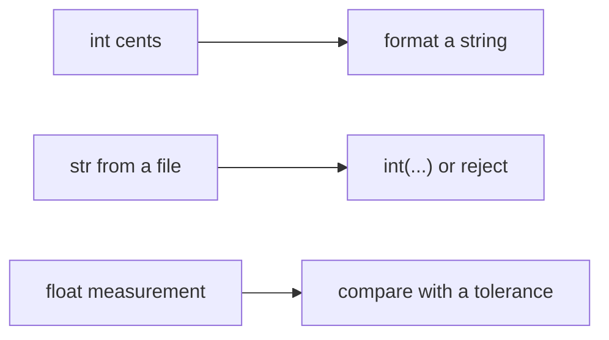

### Operators that do not do the school thing

`/` always produces a float. `7 / 2` is `3.5`, not `3`. `//` is floor division: it rounds toward negative infinity, not toward zero. `7 // 2` is `3`. `-7 // 2` is `-4`, because `-3.5` floored is `-4`. `%` is the remainder that makes the identity true: `dividend == (dividend // divisor) * divisor + (dividend % divisor)`. For `-7` and `2` that remainder is `1`, because `-4 * 2 + 1` is `-7`. If you wanted "chop the fractional part toward zero", floor division is the wrong operator. Use `int(n / d)` only when you have already decided a float is acceptable, or divide integers yourself in the direction you mean.

`**` is power. `and`, `or`, and `not` are the boolean operators, and they return one of their operands rather than forcing a `bool`. `0 or 5` is `5`. That is useful for a default and surprising inside an expression you thought was true or false.

`==` asks whether two values are equal. `is` asks whether two names point at the same object. Use `is` for `None`, because there is one `None`. Do not use `is` to compare numbers or strings you computed. Small integers may happen to share an object today and not after you do arithmetic.

### Why 0.10 is not a dime

Floats are fractions whose denominator is a power of two. `0.5` is fine. `0.1` is a repeating fraction in base two, so the value stored for `0.1` is a little off, and `0.1 + 0.2` is not the value stored for `0.3`. Printing them often hides it, because print rounds. `==` does not. Money, tax, and "10 percent off" do not belong in a float. Keep the amount as an `int` of the smallest unit, cents, and format only when you show it.

`round` uses banker's rounding: a tie at exactly `.5` goes to the even neighbour. `round(4.5)` is `4` and `round(5.5)` is `6`. That rule is stable and it is not "always away from zero". It is also the wrong tool for money if the value is already a float, because the float may not be the exact decimal you wrote down, so the tie you see in decimal is not the tie `round` sees. Format from integer cents instead: the euros are `cents // 100` and the remainder is `cents % 100`, printed as two digits. `250` cents is `2.50`. `7` cents is `0.07`. No binary fraction is involved.

An f-string formats a value into text. `f"{cents / 100:.2f}"` will look right for many small amounts and is still a float underneath. Prefer the integer split when the source of truth is cents. `str(n)` and `format` are the other conversions. None of them run unless you ask. `"Count: " + 2` is a `TypeError`. Python will not turn the integer into text to save the `+`. That strictness is why a bug is an exception at the line you wrote, instead of a label that looks fine in one report and crashes in the next.

### Strings are values, not buffers

A method such as `strip`, `upper`, `split`, or `replace` returns a new string. The name you called it on still points at the old one, because there is no way to edit the old one. `"-".join(["ab", "12"])` walks the list and builds one string with the separator between items. A trailing separator is what you get from adding `"-"` yourself in a loop, not from `join`. `split` with no argument splits on runs of whitespace and drops the empties at the ends. `split(",")` keeps empty fields, so `"a,,b".split(",")` has three items. Pick the one that matches the file you actually have. A code assembled in a loop with `+` and a separator also puts the separator after the last piece, or before the first, depending on where you put the `+`. `join` puts it only between pieces, which is why a warehouse code should be built that way once the pieces are already clean. The cleaning, stripping, and dropping blanks belongs in the list you hand to `join`, not in a special case after the string exists.

Indexing and slicing pick out code points, not bytes. `len("café")` is 4. The UTF-8 encoding of that word is longer, which matters when a protocol counts bytes and you counted characters. Build the string you want with a join or an f-string, then encode at the boundary that asked for bytes.

`int("199")` parses a whole decimal string. A string with a space or a unit, `"199c"`, raises `ValueError`. Catch that at the edge and keep the rest of the program in integers. `int` of a float truncates toward zero, so `int(1.9)` is `1`. That is a different operation from `round` and from `//`, and using it as "the integer version of this price" silently drops the cents.

### At work

Parse text at the edge into cents, quantities, and plain strings. Do arithmetic on integers. Format once, in the function that renders a line. Compare floats only when the value is a measurement, and then compare with a tolerance or round to a known number of places for display, not with `==` against a decimal you typed. Reject a mix of text and numbers with an f-string rather than `+`.

| You have | Use | Avoid |
|---|---|---|
| A price | `int` cents | `float` dollars |
| A split of a whole number of items | `//` and `%` | `int(a / b)` when both are already ints |
| A negative span that must shrink toward zero | an explicit sign check | `//`, which floors the other way |
| A label | f-string or `join` | `+` between a str and an int |
| "Is this missing?" | `is None` | `==` against a string `"None"` |

### You can now

- Predict `/`, `//`, and `%`, including when the dividend is negative.
- Explain why `0.1 + 0.2` is not a test you write with `==`, and keep money in cents.
- Format a fixed number of decimal places, and parse text into an int at the edge.
- Build a label with an f-string or `join` without converting types by accident.

::: predict lang=python
code:
```python
print(7 / 2, 7 // 2, 7 % 2)
print(type(7 / 2).__name__)
print("ab" * 3)
```
answer:
```
3.5 3 1
float
ababab
```
why: `/` always returns a float, `//` drops the fraction, `%` is what's left over. Multiplying a string repeats it.
:::

::: quiz
q: What happens with `"Total: " + 5`?
- It prints `Total: 5`
+ `TypeError`: you can't add a str and an int
- It prints `Total: ` and ignores the 5
- `5` is converted to `"5"` automatically
why: Python never converts silently between strings and numbers. Write `"Total: " + str(5)`, or better, `f"Total: {5}"`.
:::

::: write lang=python
task: Write `greeting(name, unread)` that returns `"Hi Ana, you have 3 new messages"`, using the singular `message` when `unread` is 1, and `"Hi Ana, you're all caught up"` when it's 0.
starter:
```python
def greeting(name, unread):
    pass
```
tests:
```python
from solution import greeting

def test_plural():
    assert greeting("Ana", 3) == "Hi Ana, you have 3 new messages"

def test_singular():
    assert greeting("Ben", 1) == "Hi Ben, you have 1 new message"

def test_zero():
    assert greeting("Cai", 0) == "Hi Cai, you're all caught up"
```
solution:
```python
def greeting(name, unread):
    if unread == 0:
        return f"Hi {name}, you're all caught up"
    word = "message" if unread == 1 else "messages"
    return f"Hi {name}, you have {unread} new {word}"
```
hint: An f-string with a conditional expression inside: `"message" if unread == 1 else "messages"`. Handle 0 first.
:::

::: quiz
q: What is `0.1 + 0.2 == 0.3`?
- `True`, because the totals are the same dime-and-nickel arithmetic
+ `False`. The stored values are binary fractions, and the sum is not the same float as `0.3`
- It raises `TypeError`, because floats cannot be compared
- `True` after `round`, and the `==` itself rounds both sides
why: `0.1` and `0.2` cannot be stored exactly in base two. Their sum differs from the float `0.3` by a tiny amount. `==` does not round. Format or use integer cents when the quantity is money.
:::

::: predict lang=python
code:
```python
print(round(2.5), round(3.5), round(-2.5))
print(-9 // 4, -9 % 4)
print(f"{199 / 100:.2f}")
```
answer:
```
2 4 -2
-3 3
1.99
```
why: Ties at `.5` round to the even neighbour, so `2.5` goes to `2` and `3.5` goes to `4`. Floor division of `-9` by `4` is `-3`, and the remainder is `3` because `-3 * 4 + 3` is `-9`. The f-string prints two decimal places.
:::

::: write lang=python
task: Write `format_price(cents)` that returns a price string from a non-negative integer number of cents. `199` is `1.99`, `5` is `0.05`, and `0` is `0.00`. Always show two digits after the dot. Raise `ValueError` when `cents` is negative. Do the split with integer division so a float never holds the money.
starter:
```python
def format_price(cents):
    return str(cents // 100)
```
tests:
```python
# Wrong answer: returning only the whole euros, so 199 becomes "1" and the cents are dropped.
from solution import format_price

def test_euros_and_cents():
    assert format_price(199) == "1.99"

def test_leading_zero_cents():
    assert format_price(5) == "0.05"

def test_zero():
    assert format_price(0) == "0.00"

def test_whole_euro():
    assert format_price(100) == "1.00"

def test_negative():
    try:
        format_price(-1)
    except ValueError:
        return
    raise AssertionError("negative cents must raise ValueError")
```
solution:
```python
def format_price(cents):
    if cents < 0:
        raise ValueError("cents")
    return f"{cents // 100}.{cents % 100:02d}"
```
hint: `// 100` is the euros and `% 100` is the cents. `:02d` prints the cents as two digits.
:::

::: write lang=python
task: Write `sku(parts)` that joins the pieces into one warehouse code. Strip each piece, uppercase it, and drop pieces that are empty after stripping. Separate the remaining pieces with a single `-`. Raise `ValueError` when nothing remains. `[" ab ", "12"]` is `AB-12`.
starter:
```python
def sku(parts):
    return "-".join(parts)
```
tests:
```python
# Wrong answer: joining the raw pieces, so spaces and lowercase survive and an
# all-blank input returns a string instead of raising.
from solution import sku

def test_strips_and_uppercases():
    assert sku([" ab ", "12"]) == "AB-12"

def test_three_parts():
    assert sku(["tea", "mug", "4"]) == "TEA-MUG-4"

def test_drops_blanks():
    assert sku(["tea", "  ", "mug"]) == "TEA-MUG"

def test_all_blank():
    try:
        sku(["", "  "])
    except ValueError:
        return
    raise AssertionError("no usable parts must raise ValueError")
```
solution:
```python
def sku(parts):
    cleaned = [part.strip().upper() for part in parts if part.strip()]
    if not cleaned:
        raise ValueError("empty sku")
    return "-".join(cleaned)
```
hint: Strip first, keep the pieces that are still non-empty, uppercase those, then `join` with `-`.
:::

::: card
q: Why keep a price as integer cents instead of a float of euros, if an f-string can print the float to two decimal places?
answer: Two decimal places on output does not repair the value. `0.1` is not stored exactly, so a later `==`, a running sum, or a split across people can be off by a fraction of a cent even when yesterday's print looked fine. Integer cents make `//` and `%` exact. Format the string once, at the edge that shows the price to a person.
:::

## Decisions and loops
id: control
stage: basics
needs: numbers-strings
minutes: 45
goal: Branch, loop, and tell a real zero from a missing value.
source: Python tutorial: More control flow tools | https://docs.python.org/3/tutorial/controlflow.html

A picker walks a shelf list until the order is filled or the shelf runs out. The program has to skip empty bins, stop when the quota is met, and notice the difference between "we looked and found nothing" and "we have not looked". `if`, `for`, and `while` are that walk. The mistakes are a condition that treats zero as missing, a `continue` that skips the wrong rows, and an `else` that people attach to the wrong clause.

Python marks a block by indentation, four spaces, after a colon. There are no braces. A line at the same indent as the `for` is outside the loop. A line indented under the `for` runs once per item.

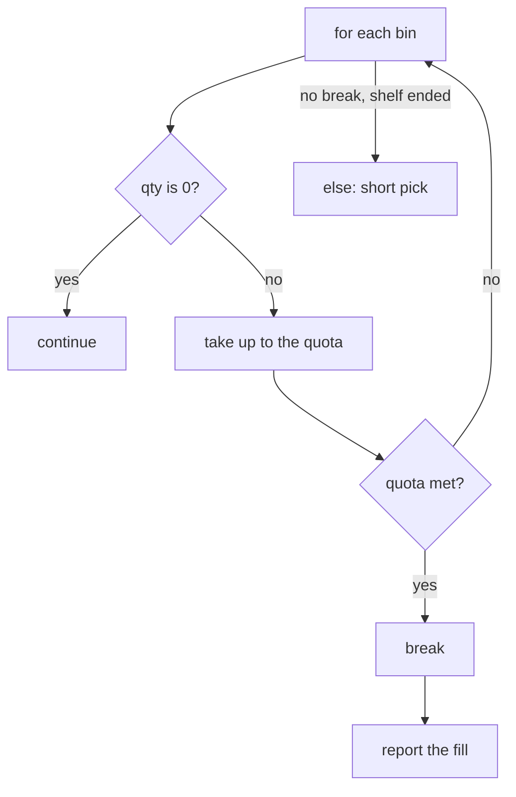

### Conditions

`if`, `elif`, and `else` try branches in order and run the first one whose condition is true. `elif` is "else if", so a later branch does not run after an earlier one matched. A value does not have to be a `bool` to sit in a condition. These are false: `False`, `None`, numeric zero (`0`, `0.0`), and empty containers (`""`, `[]`, `{}`, `set()`). Everything else is true, including the string `"0"` and the integer `-1`.

That rule reads well when you mean emptiness: `if not bins:` is "if there is nothing to walk". It reads badly when zero is a real measurement. `if sold:` is false when no tickets have been sold yet, which is a known count, and also false when `sold` is `None` and the count was never loaded. Those are different situations. Use `sold is not None` when zero must stay visible, and use the truthiness test only when you mean "is there anything here?".

Comparisons can be chained. `0 <= qty <= capacity` is one test, true only when both parts are true. `==` compares values. `is` compares identity, which is the right test for `None` and the wrong test for a quantity you just computed.

### Loops

`for item in bins` asks the shelf for items one at a time until it stops. The shelf can be a list, a string (one code point at a time), the keys of a dict, or `range(n)`, which yields `0` through `n - 1`. `range(1, n)` starts at 1 and still stops before `n`. The loop variable is a name that gets rebound each time. Rebinding it inside the loop does not edit the list. Calling a method that mutates the object you were given does.

`enumerate(bins, start=1)` yields pairs of `(number, item)` so a report can speak in aisle numbers without a separate counter. `break` leaves the loop immediately. `continue` skips the rest of the body and asks for the next item. A `continue` above the line that records a pick will drop that bin on the floor, which is what you want for an empty bin and a bug if it sits above the only place you count a success.

`while left > 0:` repeats as long as the condition is true. Something inside has to change `left`, or the loop runs until the process is killed. A `for` is the better default when you have a collection. A `while` fits "keep subtracting a step until the remainder is gone", where there is no list, only a number that shrinks.

### The else that belongs to the loop

A `for` or `while` may have an `else`. The `else` body runs when the loop finished without `break`. It does not mean "the condition was false" in the `if` sense, and it does not mean "the loop ran zero times". Zero trips and a normal end both take `else`, as long as `break` never ran. The shape is a search: walk the bins, `break` when you find a short-dated item, and in the `else` record that the shelf was clean. An `if` inside the loop with its own `else` is a different clause. Indentation decides which `else` you wrote. Reading the `else` as attached to the `if` three lines up is the usual misread, and the clean-shelf message then fires on the wrong bin.

### Editing the shelf while you walk it

Removing a bin from the list you are looping over skips the next bin. The `for` asked the list for index 0, then index 1, then index 2. If index 0 was deleted, the old index 1 slides into index 0 and the loop's next request, index 1, returns what used to be index 2. The item that slid forward never gets a turn. The safe patterns are to build a new list of the bins you are keeping, or to walk a copy (`for bin in bins[:]:`) when you really must delete from the original. Appending during the loop is the mirror image: the loop will also visit the items you just added, and a condition that appends every time never ends.

`range(len(bins))` plus an index is how that bug is usually written, and it is rarely what you want. `for bin in bins` names the item. `enumerate` adds the position when the position is the result, a line number or a slot. Carrying your own `i = 0` and remembering `i += 1` on every branch, including the `continue`, is a second piece of state the loop already had.

A `while` counter has the same duty. A loop that subtracts a step never finishes when the step is zero, because the remainder does not shrink, and a negative step walks away from the stopping condition. Reject a step that cannot make progress before you enter the loop. The body can then assume the number moves toward done.

Nested loops multiply. A loop per order and a loop per bin is fine when both collections are the size of a shelf. The same shape over every customer and every product is a product of the two lengths, and it belongs in a dict lookup rather than a second scan. You do not need that dict yet to write a correct inner `break`. You do need to know that an inner `break` leaves only the inner loop. The outer walk continues. Leaving both means a flag, or returning from the function, which stops everything above it as well.

### At work

Prefer `for` over a manual index. Reach for the index, through `enumerate`, when the position is part of the result, as in a line number. Put the cheapest rejection first so `continue` skips work you were going to throw away. Use `break` when a later item cannot change the answer. Do not use a loop condition of `while items:` if some items are valid and falsy. Test the length, or test `is not None`, so a zero quantity stays in the data.

| You mean | Write |
|---|---|
| Walk every item | `for item in items` |
| Walk and remember the position, starting at 1 | `enumerate(items, start=1)` |
| Skip this item | `continue` |
| Stop, the answer is known | `break` |
| Say what happened if you never stopped early | `else` on the `for` |
| Repeat until a number runs out | `while`, and change the number in the body |
| Zero is real data | `is not None`, not the truthiness of the number |

### You can now

- Choose `if`, `elif`, and `else` in an order that matches the first match you want.
- Tell a falsy zero from a missing `None`.
- Use `continue`, `break`, and a `for`'s `else` and predict which lines run.
- Write a `while` that shrinks a remainder, including a remainder of zero.

::: predict lang=python
code:
```python
total = 0
for n in range(10):
    if n % 2:
        continue
    if n > 6:
        break
    total += n
print(total)
```
answer: 12
why: Odd numbers are skipped (`n % 2` is 1, which is true). The even ones 0, 2, 4, 6 are added, then 8 hits the break. 0 + 2 + 4 + 6 = 12.
:::

::: quiz
q: Which of these values is **truthy**?
- `0`
- `""`
+ `"0"`
- `[]`
why: `"0"` is a non-empty string, so it's true. Emptiness and zero are what's false, not the look of the text.
:::

::: write lang=python
task: Write `first_error(lines)`: return the **1-based line number** of the first line that contains `ERROR`, or `None` if there isn't one.
starter:
```python
def first_error(lines):
    pass
```
tests:
```python
from solution import first_error

def test_finds_first():
    assert first_error(["ok", "ERROR one", "ERROR two"]) == 2

def test_first_line():
    assert first_error(["ERROR at start"]) == 1

def test_none():
    assert first_error(["fine", "also fine"]) is None

def test_empty():
    assert first_error([]) is None
```
solution:
```python
def first_error(lines):
    for number, line in enumerate(lines, start=1):
        if "ERROR" in line:
            return number
    return None
```
hint: `enumerate(lines, start=1)` gives you the line number with each line. `"ERROR" in line` checks for the substring.
:::

::: quiz
q: `sold` is `0` when no tickets have been sold and `None` when the count was never loaded. Which expression is true for a known zero and false when the count is missing?
- `sold`, because a number is always true
+ `sold is not None`
- `sold == True`
- `not sold`
why: `0` is falsy, so `sold` and `not sold` treat "nothing sold" the same as "unknown", only in opposite directions. `True` equals `1`, so `sold == True` is true for one ticket and false for a known zero. `is not None` keeps those cases apart.
:::

::: predict lang=python
code:
```python
label = "none"
for n in (2, 4, 6):
    if n % 2 == 1:
        label = "odd"
        break
else:
    label = "all-even"
print(label)
```
answer: all-even
why: None of the values is odd, so `break` never runs. The `else` attached to the `for` therefore runs and sets the label. An odd value anywhere in the tuple would `break` and leave `label` as `odd`.
:::

::: write lang=python
task: Write `index_of_odd(nums)` that returns the index of the first odd integer, or `None` when every value is even or the list is empty. Indexes start at 0.
starter:
```python
def index_of_odd(nums):
    return 0
```
tests:
```python
# Wrong answer: always returning 0, which is right only when the first item is odd.
from solution import index_of_odd

def test_later():
    assert index_of_odd([2, 4, 5]) == 2

def test_first():
    assert index_of_odd([1, 2]) == 0

def test_none():
    assert index_of_odd([2, 4]) is None

def test_empty():
    assert index_of_odd([]) is None
```
solution:
```python
def index_of_odd(nums):
    for index, n in enumerate(nums):
        if n % 2:
            return index
    return None
```
hint: `enumerate` yields the index. An odd `n % 2` is `1`, which is true. If the loop ends, return `None`.
:::

::: write lang=python
task: Write `hops(start, step)` that counts how many times you can subtract `step` from `start` until the remainder is no longer positive. `hops(10, 3)` is `4`. `hops(0, 3)` is `0`. Raise `ValueError` when `step` is less than 1. A partial last hop still counts.
starter:
```python
def hops(start, step):
    return start // step
```
tests:
```python
# Wrong answer: floor division, which drops the partial last hop. 10 // 3 is 3, not 4.
from solution import hops

def test_partial_last_hop():
    assert hops(10, 3) == 4

def test_exact():
    assert hops(3, 3) == 1

def test_already_done():
    assert hops(0, 3) == 0

def test_bad_step():
    try:
        hops(10, 0)
    except ValueError:
        return
    raise AssertionError("step < 1 must raise ValueError")
```
solution:
```python
def hops(start, step):
    if step < 1:
        raise ValueError("step")
    count = 0
    left = start
    while left > 0:
        left -= step
        count += 1
    return count
```
hint: Loop while the remainder is still above zero, and count every subtraction, including the one that crosses or lands on zero.
:::

::: card
q: A `for` loop has an `else` clause. When does that `else` run?
answer: It runs when the loop ends without `break`. Finishing the iterable, including an iterable that was empty, takes the `else`. A `break` skips it. The `else` is attached to the loop, not to an `if` inside the body. Indentation is what says which one you wrote.
:::

## Text, bytes, and UTF-8
id: text
stage: basics
needs: numbers-strings
minutes: 40
goal: Keep str and bytes apart, and encode or decode UTF-8 without hiding a bad byte.
source: Python docs: Unicode HOWTO | https://docs.python.org/3/howto/unicode.html

A `str` is a sequence of Unicode code points. A code point is a number in the Unicode catalog, such as the number for the letter a or the number for é. A `bytes` value is a sequence of raw bytes, each an integer from 0 through 255. Both types are immutable, so a method that looks like it edits them returns a new value. They are not two views of the same thing. Text has letters, and bytes have no letters until some encoding says how groups of bytes map to code points. Python refuses to guess. `"café" + b"!"` raises TypeError, and ordering them with `<` does too. `==` does not raise: it is simply False, because they are different types. An automatic conversion would have to pick an encoding, and the wrong pick corrupts data while the program keeps running.

Encoding is the direction from text to bytes. `label.encode("utf-8")` walks the code points and emits the bytes UTF-8 uses for each one. Decoding is the opposite direction. `wire.decode("utf-8")` walks bytes and rebuilds code points, or raises `UnicodeDecodeError` when the bytes are not legal UTF-8. The name of the encoding is an argument because the bytes do not carry it. A file, a socket, and a database column are just bytes on the outside of your process. The agreement about what they mean lives in the protocol, the HTTP header, or the column type. Inside the process, stay in `str` for anything you will search, slice, or show to a person. Cross the boundary with an explicit encode or decode at the edge, not in the middle of a calculation.

UTF-8 is the encoding you want on that edge unless a protocol forces something else. It can represent every Unicode code point. Code points below 128 are one byte with the same value as ASCII, so an old English-only file is already valid UTF-8. Other code points use two, three, or four bytes. The euro sign is one code point and three bytes. Those extra bytes are the encoding of one character, not extra characters. A continuation byte never looks like plain ASCII, so a strict decoder can see a broken sequence and raise instead of inventing text.

`len` does not count those bytes, and it does not count what a reader sees as one glyph. On a `str`, `len` counts code points. On a `bytes`, `len` counts bytes. That is why the two lengths diverge as soon as a character leaves ASCII. A precomposed é is one code point and two UTF-8 bytes. The same glyph built as the letter e plus a combining acute accent is two code points, so `len` is 2, and the UTF-8 form is longer still. A person sees one letter either way. Programs that truncate with `text[:10]` are counting code points, not screen columns and not bytes. Truncating a `bytes` value with a slice can even cut a character in half, and the next strict decode then fails. If you must cut bytes, decode first, cut code points, and encode again, or use an API that knows about the encoding.

The error handler is the policy for bytes that are not legal in the encoding you named. The default is strict: raise `UnicodeDecodeError`. That is what you want at a trust boundary, because a bad payload should stop the line and get counted, not become a wrong name in a database. `errors="replace"` inserts the replacement character U+FFFD and continues, so you can show a human that something was unreadable. `errors="ignore"` drops the bad bytes and continues with no marker at all. Ignore is how a log line loses the one token you needed. Replace is for display after you have already decided the data is bad. Strict is for deciding.

Latin-1 is the example of a decoder that almost never saves you. It maps every byte to one code point, so `decode("latin-1")` does not raise on arbitrary bytes. Those bytes might have been UTF-8. Decoded as Latin-1, the two UTF-8 bytes of é become two unrelated characters, the familiar mojibake. The call succeeded. The text is wrong. A decoder that cannot fail will turn corruption into data. Use Latin-1 only when the producer really encoded Latin-1.

Take the label on a coffee tin, which is ordinary text until it has to cross a socket.

```python
label = "café"
wire = label.encode("utf-8")
back = wire.decode("utf-8")
raw = b"caf\xff"
try:
    shown = raw.decode("utf-8")
except UnicodeDecodeError:
    shown = "unreadable: " + raw.decode("utf-8", errors="replace")
```

`label` has four code points. `wire` has five bytes, because é contributes two, and `back` equals `label`. The last byte of `raw` is not legal UTF-8, so strict decoding raises and the handler builds a marked display string. Without the prefix, a replacement character is easy to miss. A parser that must reject the line should let the exception propagate. `open(path, encoding="utf-8")` decodes as it reads. `open(path, "rb")` returns bytes and is what you want for an image or a file you have not checked. Text mode with no encoding uses the machine locale, which differs between a laptop and a container, so pass the encoding.

### Where it breaks

Slicing bytes in the middle of a character, then decoding strict, raises. Slicing with `errors="ignore"` hides the cut and glues the neighbors together. Either way you have the wrong token. Decode, then slice the string.

A combining accent makes `len` and a visible letter disagree. A cut can leave a dangling mark that sticks to the next letter. Normalize to a composed form before you count when the input may use both forms.

Encoding can fail too. A euro sign encoded as strict ASCII raises `UnicodeEncodeError`. `errors="replace"` on the way out writes a question mark, and a later decode succeeds with the euro gone. Calling `.decode` on a `str` raises AttributeError. The literal is already text. That error usually means a library handed you text and the caller decoded it again.

### At work

HTTP bodies and database drivers are bytes at the socket and text in your functions. Decode once, validate, and after that pass `str`. A strict failure can increment a counter and keep the raw bytes, while a display page uses a marked replacement so one bad line does not blank the page. Tests of a length should include one non-ASCII letter, because an English fixture hides a swap of code points and bytes. A round trip `decode(encode(s)) == s` checks that both sides named the same encoding.

### Which call matches the boundary

| You have | You need | Call | Because |
|---|---|---|---|
| Text, about to write bytes | `bytes` | `.encode("utf-8")` | the wire has no code points |
| Bytes from a trusted UTF-8 producer | `str` | `.decode("utf-8")` | strict mode raises on a bad sequence |
| Bytes that failed strict decode, for a human | a marked string | decode again with `errors="replace"` | the marker shows the loss |
| An image or an unknown file | `bytes` | binary `open` | decoding bytes that are not text corrupts them |
| A display width or a database column of characters | a count of code points | `len(text)` | `len` on `str` is not a byte count |

### You can now

- Say why a `str` and a `bytes` cannot be added, and where the encoding decision has to sit.
- Encode and decode UTF-8, and predict when `len` of the text and `len` of the bytes differ.
- Choose strict, replace, or ignore from the cost of hiding a bad byte.
- Explain why Latin-1 "fixes" a UTF-8 failure by producing the wrong characters.
- Cross a file or socket boundary once, then stay in text until the next boundary.

::: quiz
q: Why does `"café" + b"!"` raise TypeError instead of returning text or bytes?
- The quote styles differ, and Python only adds strings that use the same quotes.
+ A str is Unicode text and bytes are raw integers from 0 to 255, and Python will not guess an encoding in order to add them.
- Bytes are already UTF-8, so the addition is redundant and is rejected as a style error.
why: One side would have to be encoded or the other decoded. An automatic choice would hide the encoding and could corrupt the data. Call encode or decode yourself and pass the encoding name.
:::

::: quiz
q: Why can decoding the same bytes as Latin-1 succeed when strict UTF-8 raises UnicodeDecodeError?
- Latin-1 is a subset of UTF-8, so it checks the bytes more strictly.
+ Latin-1 maps every possible byte to some character, so no byte is illegal. UTF-8 only allows specific sequences, and strict mode refuses a sequence that breaks those rules.
- UTF-8 can only represent English letters, so any accented character fails UTF-8.
why: A decoder that never fails turns corrupted bytes into ordinary text. That is why Latin-1 can "succeed" on UTF-8 bytes and still show the wrong characters. Use Latin-1 only when the bytes really are Latin-1. Use strict UTF-8 when UTF-8 is the contract.
:::

::: predict lang=python
q: This word has one non-ASCII letter. What does this print?
code:
```python
s = "naïve"
print(len(s), len(s.encode("utf-8")))
```
answer:
```
5 6
```
why: `len` on the string counts five code points. The ï is one of them, and UTF-8 stores that code point as two bytes, so the encoded form is six bytes long. The other four letters are ASCII and stay one byte each.
:::

::: write lang=python
task: Write `decode_line(raw)` where `raw` is bytes. Decode it as strict UTF-8 and return the str. If that raises UnicodeDecodeError, return the text "bad: " followed by the same bytes decoded as UTF-8 with errors="replace".
starter:
```python
def decode_line(raw: bytes) -> str:
    pass
```
tests:
```python
# Wrong answer tried: always decode with errors="replace" and no "bad: " prefix, so a bad byte became a replacement character without the marker.
from solution import decode_line

def test_round_trip():
    assert decode_line("naïve".encode("utf-8")) == "naïve"
    assert decode_line(b"ok") == "ok"
    assert decode_line(b"") == ""

def test_bad_byte_is_marked():
    raw = b"a\xffb"
    assert decode_line(raw) == "bad: " + raw.decode("utf-8", errors="replace")

def test_truncated_sequence_is_marked():
    raw = b"\xc3"
    assert decode_line(raw).startswith("bad: ")
```
solution:
```python
def decode_line(raw: bytes) -> str:
    try:
        return raw.decode("utf-8")
    except UnicodeDecodeError:
        return "bad: " + raw.decode("utf-8", errors="replace")
```
hint: Try a strict decode. In the UnicodeDecodeError handler, decode again with errors="replace" and put "bad: " in front.
:::

::: write lang=python
task: Write `chars_and_bytes(s)`. Return a tuple of two ints: the number of Unicode code points in `s`, then the number of bytes in its UTF-8 encoding. An empty string returns `(0, 0)`.
starter:
```python
def chars_and_bytes(s):
    pass
```
tests:
```python
# Wrong answer tried: swap the two numbers, so "naïve" returned (6, 5) instead of (5, 6).
from solution import chars_and_bytes

def test_ascii_and_empty():
    assert chars_and_bytes("abc") == (3, 3)
    assert chars_and_bytes("") == (0, 0)

def test_multibyte():
    assert chars_and_bytes("naïve") == (5, 6)
    assert chars_and_bytes("€") == (1, 3)
    assert chars_and_bytes("🙂") == (1, 4)
```
solution:
```python
def chars_and_bytes(s):
    return (len(s), len(s.encode("utf-8")))
```
hint: len(s) is the code-point count. len(s.encode("utf-8")) is the byte count. Return the code points first.
:::

::: card
q: When should a failed UTF-8 decode use errors="replace", and when should it raise?
answer: Raise, or catch and count the failure, when a bad byte must not become stored text. Use errors="replace" only on a display path, and keep a visible marker so the replacement character is not mistaken for real input. Do not use errors="ignore": it drops bytes and leaves no trace.
:::

## Functions
id: functions
stage: functions
needs: control
minutes: 40
goal: Return a value, and pass arguments by position, keyword, or keyword-only.
source: Python tutorial: Defining functions | https://docs.python.org/3/tutorial/controlflow.html#defining-functions

A receipt function that sometimes hands back nothing is worse than one that crashes at the call. The caller stores the result, passes it on, and the `None` shows up three functions later as a `TypeError` on a number. The bug was the missing `return`. The stack trace points at the innocent arithmetic. A function is a named recipe with inputs and an output, and the output is part of the contract even when the output is "there is no result".

`def` creates a function object and binds it to a name. The names in the parentheses are **parameters**. The values at the call are **arguments**. Python matches them before the body runs. Too many positional arguments, a missing one with no default, or a keyword for a name that does not exist raises `TypeError` at the call. That is the failure you want. The body never starts on a half-filled signature.

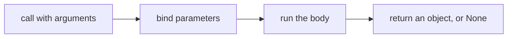

### Defaults and keywords

A default is the object used when the caller omits that argument. `def banner(text, width=12)` lets `banner("Tea")` run with width 12 and lets `banner("Tea", 20)` override it. The caller can also name the argument: `banner("Tea", width=20)`. Keywords do not depend on position, so a call with two optional numbers stays readable. A positional argument cannot follow a keyword in the same call. `banner(width=20, "Tea")` is a syntax error, because the parser no longer knows which slot the bare value fills.

A bare `*` in the parameter list ends the positional section. Names after it are keyword-only. `def ship(weight, *, express=False)` accepts `ship(2)` and `ship(2, express=True)`. It rejects `ship(2, True)`, because `True` would silently mean "express" today and "insured" the day someone inserts a parameter in front of it. Keyword-only parameters are how a boolean flag stays a boolean flag.

Defaults are evaluated once, when the `def` runs, not on each call. An integer default is harmless because nothing can change the integer. A list or dict default is one shared object, and a later call sees the mutations of an earlier one. When the omitted argument should mean "start empty", the usual shape is a default of `None` and a new list created inside the body. The binding rules for that shared object are the same rules as any other assignment. What matters at this point is that the default is not a fresh value per call.

### Return is the only output

The body can compute all it likes. The caller receives only what `return` sends back. A function that reaches the end without `return`, or that executes a bare `return`, yields `None`. `None` is a real object. It prints as `None`, and it is not the integer 0 and not the empty string. A price calculator that forgets `return` does not return 0. It returns `None`, and the next line that adds tax becomes the crash.

`return` also stops the function. Code after it in the same block does not run. Two returns are how you leave early: reject a bad input with `raise`, or return a simple answer before the general case. `raise ValueError("people")` is not a return value. It aborts the call and skips the caller unless the caller has a `try`. Use that when the arguments cannot mean a result, such as a count of people below 1. Use `return None` only when "no result" is a legitimate answer the caller agreed to check.

A parameter is a local name. `def add_fee(amount): amount = amount + 1` rebinds the local name. The caller's variable still points at the object it had before the call. If you need the caller to see a new number, return it. If you need the caller to see a change inside a list they passed, that is a mutation of the shared object, which is a different operation from assigning to the parameter. Returning the new value keeps the data flow visible in the call.

### A small worked example

This is a label, not a bill split. The width is optional. The flag after `*` cannot be passed by accident as a positional.

```python
def tag(code, width=8, *, upper=True):
    text = code.upper() if upper else code
    if len(text) >= width:
        return text
    pad = width - len(text)
    return "-" * pad + text
```

`tag("ab")` uses the default width and the default flag. `tag("ab", 4, upper=False)` names the flag. `tag("ab", 4, False)` raises `TypeError` because `upper` is keyword-only. The padding is computed from the length after the case decision, so a short code and a long code do not share one formula pasted over the return. The function always returns a string. There is no path that falls off the end.

### Where it breaks

The classic miss is storing the result of a function that does not return. The print inside the function looked fine, so the author thought the function "worked". The caller needed the string. Print is a side effect. Return is the value.

A default that is computed from another parameter does not work in the header. Defaults are bound left to right at definition time, and they cannot see the arguments of a later call. `def pad(text, width=len(text))` fails at the `def`, because `text` does not exist yet. Compute that relationship in the body.

Mutable defaults alias across calls. If the body appends to a default list, the second call is not empty. Pass `None` and build the list inside when each call needs its own list.

A keyword-only parameter with a default can be omitted. A keyword-only parameter without a default must be named at the call. Forgetting the name is a `TypeError` at the call site, which is earlier and clearer than a wrong positional silently filling the slot.

### At work

Keep the signature small enough to say in one breath. Required inputs first, then defaults, then keyword-only flags. Return a value the test can assert, and raise when the inputs are nonsense. A function that only reads its arguments and returns a result is the one you can call from a test without building a process. Side effects, printing, and writing files belong at the edge, in the function whose job is the edge.

| Call shape | Meaning |
|---|---|
| `f(1, 2)` | positional, left to right |
| `f(1, rate=0.2)` | the named parameter, regardless of readers' memory |
| `f(1, True)` when the flag is after `*` | `TypeError`. Name the flag |
| no `return` | the caller receives `None` |
| `raise ValueError` | there is no result, and the caller must handle it |

### One binding, then the body

The call does not look inside the body to decide which argument fills which name. It finishes the matching, builds the local namespace, and only then starts at the first line. That is why a default expression cannot see a parameter, and why a `TypeError` for a bad call never runs the first line of the body. Tests that expect a raise from a bad count of people are testing the body. Tests that pass a keyword the signature does not have are testing the matching, and they fail before any of your branches.

A docstring on the line after `def` is a string literal, stored on the function as `__doc__`. It does not check types and it does not supply a return value. Callers and tools can read it. The `return` is still required. Write the docstring for a human who will call the function without reading the body: what the arguments mean, what is returned, and what is raised. Keep the example in the docstring different from the one numeric case your test uses, or the test will pass by copying the docstring instead of computing.

### You can now

- Match positional arguments, defaults, and keyword-only parameters, and predict a `TypeError` from a bad call.
- Return the value the caller needs, and recognise a missing `return` as `None`.
- Rebind a parameter without believing the caller's name moved.
- Put a boolean flag behind `*` so a later parameter cannot capture it by position.

::: predict lang=python
code:
```python
def add_tax(amount):
    amount = amount * 1.2

price = 100
result = add_tax(price)
print(price, result)
```
answer: 100 None
why: `amount` inside the function is a new local name; rebinding it doesn't touch `price`. And with no `return`, the function returns `None`.
:::

::: write lang=python
task: Write `split_bill(total, people, tip=0.10)` that returns how much each person pays: the total plus the tip, divided by the number of people, **rounded to 2 decimals**. If `people` is less than 1, raise `ValueError`.
starter:
```python
def split_bill(total, people, tip=0.10):
    pass
```
tests:
```python
from solution import split_bill

def test_default_tip():
    assert split_bill(100, 4) == 27.5

def test_custom_tip():
    assert split_bill(90, 3, tip=0) == 30.0

def test_rounding():
    assert split_bill(10, 3, tip=0) == 3.33

def test_no_people():
    try:
        split_bill(10, 0)
    except ValueError:
        return
    assert False, "split_bill(10, 0) should raise ValueError"
```
solution:
```python
def split_bill(total, people, tip=0.10):
    if people < 1:
        raise ValueError("people must be at least 1")
    return round(total * (1 + tip) / people, 2)
```
hint: Check `people` first and `raise ValueError(...)`. Then `round(value, 2)`.
:::

::: quiz
q: `def ship(weight, *, express=False)` is defined. Which call is valid?
- `ship(2, True)`
+ `ship(2, express=True)`
- `ship(express=True, 2)`
- `ship(True, weight=2)`
why: Names after a bare `*` are keyword-only, so `True` cannot fill `express` by position. A bare positional cannot follow a keyword either, so `ship(express=True, 2)` is a syntax error. Naming `express` and passing the weight by position is the call the signature allows.
:::

::: predict lang=python
code:
```python
def choose(n):
    if n < 0:
        return "neg"
    if n == 0:
        return "zero"

print(choose(-4))
print(choose(0))
print(choose(3))
```
answer:
```
neg
zero
None
```
why: The negative branch and the zero branch each return a string. A positive `n` matches neither `if`, and the function ends with no `return`, so the caller receives `None`.
:::

::: write lang=python
task: Write `pad_left(text, width)`. Return `text` unchanged when it is already at least `width` characters. Otherwise return a new string of exactly `width` characters, with `-` on the left and `text` on the right. `pad_left("ab", 5)` is `---ab`. A `width` below 1 raises `ValueError`.
starter:
```python
def pad_left(text, width):
    return text
```
tests:
```python
# Wrong answer: returning the text unchanged, so a short string is not padded to width.
from solution import pad_left

def test_pads():
    assert pad_left("ab", 5) == "---ab"

def test_exact_and_longer():
    assert pad_left("abcd", 4) == "abcd"
    assert pad_left("abcdef", 4) == "abcdef"

def test_empty_text():
    assert pad_left("", 3) == "---"

def test_bad_width():
    try:
        pad_left("ab", 0)
    except ValueError:
        return
    raise AssertionError("width < 1 must raise ValueError")
```
solution:
```python
def pad_left(text, width):
    if width < 1:
        raise ValueError("width")
    if len(text) >= width:
        return text
    return ("-" * (width - len(text))) + text
```
hint: Reject a width below 1 first. If the text is already long enough, return it. Otherwise the number of dashes is `width - len(text)`.
:::

::: card
q: A function prints the answer and does not use `return`. The caller writes `n = compute()` and then `n + 1`. Why does that line fail?
answer: Print shows text to the person at the terminal. It is not the function's result. With no `return`, `compute()` yields `None`, and `None + 1` raises `TypeError`. Return the number if the caller has to keep computing with it.
:::

## Names, scopes, and what assignment does
id: scope
stage: functions
needs: functions
minutes: 40
goal: Predict which scope a name comes from, and choose return or nonlocal instead of a surprise global.
source: Python tutorial: Python scopes and namespaces | https://docs.python.org/3/tutorial/classes.html#python-scopes-and-namespaces
source: Python language reference: Resolution of names | https://docs.python.org/3/reference/executionmodel.html#resolution-of-names

A name in Python is a label in a namespace, and lookup follows LEGB: the local function, then any function the `def` is nested inside, then the module global, then the builtins. The search stops at the first binding, so an inner name hides an outer one. Enclosing scope is lexical. It is the function your `def` is written inside, not whichever function happened to call you, because the link is made when the function object is created. A helper defined at module level cannot see its caller's locals, so those values have to be arguments. A function that only reads its parameters is easier to follow than one that reaches for names it did not receive.

Reading a name does not claim it. If the function never assigns to `city`, a use of `city` walks outward and can print a value an outer function bound. Assignment is decided when the function is compiled, not when that line runs. If anywhere in the function you assign to a name, import it, use it as a `for` target, or bind it with `as`, Python marks that name local for the whole body. A read that happens earlier, or on a branch that never reaches the assignment, still looks only at the local. If that local is not bound yet, Python raises `UnboundLocalError`: "cannot access local variable 'count' where it is not associated with a value". It does not fall through to the global, because the compiler already hid that global.

```python
count = 10

def bump(flag):
    if flag:
        count = count + 1
    return count
```

`bump(False)` fails even though the assignment line does not run, because `count =` makes `count` local everywhere in `bump`. The right-hand `count` is that local, and it does not exist yet. People meet this when they add an update to a function that used to only read a module value. The new assignment changes the compile-time scope of every use, including uses that look unchanged. A `for` target is also a local of the function, so the name remains bound after the loop. A comprehension has its own scope, so its loop variable does not leak. The two shapes look alike and do not share a scope.

`global` and `nonlocal` are instructions to the compiler about which namespace an assignment means. `global count` says that every use of `count` in this function, including assignment, refers to the module global. You do not need it to read a global. You need it only when you assign, because assignment would otherwise create a local. `nonlocal count` says the name refers to the nearest enclosing function that already binds `count`. It does not create a module global, and it is a `SyntaxError` at definition time if no enclosing function has that name. Nested functions make the difference sharp. A `global` inside the inner function skips the outer function and writes the module. A `nonlocal` writes the outer function's local, which is the cell the closure is holding.

```python
def make_knob(start):
    level = start

    def twist(by):
        nonlocal level
        level = level + by
        return level

    return twist
```

Each call to `make_knob` creates a new local `level`, so two knobs do not share a number. `twist` cannot assign to `level` without `nonlocal`, because that assignment would make `level` local to `twist` and hide the outer value. A closure fits when the state belongs to a function you handed back. It is the wrong tool for program-wide state. A module global depends on call order, so a test has to reset it or the next test inherits the last total. Returning the new value keeps the data flow visible. A class attribute is the other honest place for state, because `self.level` is an object the caller holds.

### Where it breaks

The usual break is the half-updated function. It used to read a module name, someone adds `count = count + 1` under an `if`, and every call starts raising `UnboundLocalError`, including the calls that take the other branch. The fix is not to initialize the local with a trick. Decide where the value lives. If the caller should own it, take it as an argument and return the new one. If the module really owns it, declare `global` and accept that tests must control that module name. If an outer function owns it, declare `nonlocal` and keep the outer function small enough that the cell is obvious.

A class body is the other break, because it looks like an enclosing scope and it is not one. Names bound in the class block are attributes of the class, not locals of an enclosing function. A method that writes `return label` when `label` was set in the class raises `NameError`, because the lookup walks the method's local scope, then the module, then builtins, and never the class body. Reach the attribute through `self.label` or through the class name. A function defined inside the method does see the method's locals, because that is a real nested function. People mix those two stories up and add `nonlocal` or `global` for a name that is actually an attribute.

### At work

Prefer arguments in and a return value out, because a reviewer can test the function by calling it and can move it without dragging hidden names. Use `nonlocal` when a returned inner function must remember something of its own, such as a knob or a callback that counts its uses. Do not use `global` to dodge a parameter list. If many functions share a changing total, put the total on an object and pass the object, so the sharing is visible at each call. When you debug a scope error, search for every assignment to that name, not only the traceback line, because the assignment that marked it local may sit later or on a branch this call did not take.

Read a nested function from the inside out. Parameters and assignments are local. Names it only reads may come from the enclosing function, and that is legal. If it assigns to an enclosing name, it needs `nonlocal`, and if no enclosing function owns the name, you wanted a parameter or a `global`, not a `nonlocal`. After a `for` loop, assume the target name still exists in the function. After a comprehension, assume it does not.

### A decision table

| You want | Write this | Why not the other |
| --- | --- | --- |
| A function that only needs its inputs | Parameters in, a return value out | Reading module names ties the function to import order and to whatever the last caller left behind |
| To update a value the caller owns | Return the new value and let the caller assign it | Assigning a global hides the data flow and makes tests share state |
| Private memory for a function you return | An enclosing variable plus `nonlocal` | A module global is shared by every caller, so two machines advance one counter |
| To read an enclosing name and not write it | Use the name. No declaration | `global` or `nonlocal` is for assignment, and adding one changes what later assignments mean |
| A class attribute inside a method | `self.name` or the class name | The class block is not an enclosing function scope, so a bare name will not find it |
| A loop variable that must not leak | A comprehension, or a nested function | A `for` target stays bound in the function after the loop ends |

The table is a design check before you add a declaration. Most functions need no `global` and no `nonlocal`. Add `nonlocal` when a returned inner function must update the outer function's variable. Add `global` only when the module is truly the owner and every caller is supposed to see the same cell.

### You can now

You can walk LEGB and say which binding a read will find, because the search is lexical and it stops at the first hit. You can explain an `UnboundLocalError` on a line that only reads, because any assignment made the name local for the whole body. You can return a value instead of assigning a global, and you can use `nonlocal` when two factory calls must keep separate counters. A method reaches a class attribute through `self`, because the class block is not an enclosing function.

::: predict lang=python
q: What does this print? The inner function reads a name and does not assign to it.
code:
```python
def make_label(city):
    prefix = city.upper()

    def show(name):
        print(prefix, name)

    return show

make_label("linz")("ada")
```
answer: LINZ ada
why: show assigns to neither prefix nor name except for its parameter. prefix is found in the enclosing function, so the read is legal and prints the uppercased city. No global or nonlocal declaration is required for a read.
:::

::: quiz
q: A function used to read a module-level count. After a later line count = count + 1 is added inside the function, a call raises UnboundLocalError on the read, even when that assignment line does not run. Why?
- Integers are immutable, so count + 1 can never see a value that was defined outside the function.
+ Any assignment to count in the function makes count local for the whole body, so the read uses the local before anything has bound it and does not fall through to the global.
- Python rebinds every module name whenever any function assigns to any name.
- The read fails because a function is not allowed to use a name that also exists in an outer scope.
why: Scope is decided at compile time. One assignment is enough to mark the name local on every path, including paths that never reach the assignment. The local is not bound yet, so the read raises UnboundLocalError instead of using the module value. Pass the value in and return the new one, or declare global if the module really owns it.
:::

::: card
q: In what order does Python look up a name, and when does it stop?
answer: LEGB: the local function, then enclosing functions from the inside outward, then the module global, then builtins. The search stops at the first binding. Enclosing means the function the def is written inside, not the function that called it. An assignment does not fall through to an outer scope. It marks the name local for the whole function.
:::

::: card
q: When do you need a global statement, and why is returning a value usually better?
answer: You need global only to assign to a module name. A read of a global needs no declaration. Returning the new value is usually better because the caller sees the data flow, tests do not have to reset a shared module cell, and two callers cannot accidentally advance the same counter.
:::

::: write lang=python
task: Write `make_counter(start)` so it returns a zero-argument function. The first call returns the integer just after `start`, the next call returns the integer after that, and so on. `make_counter(10)()` is 11, and calling the same function again is 12. Two counters must not share state. Update the enclosed number with `nonlocal`, not with a global and not by returning `start + 1` from a function that has no memory.
starter:
```python
def make_counter(start):
    def next_value():
        return start + 1
    return next_value
```
tests:
```python
# Wrong answer: return start + 1 with no stored state, so every call returns the same integer, or a global that both counters share.
from solution import make_counter
import inspect

def test_counts_up():
    nxt = make_counter(10)
    assert nxt() == 11
    assert nxt() == 12
    assert nxt() == 13

def test_counters_are_independent():
    first = make_counter(0)
    second = make_counter(5)
    assert first() == 1
    assert second() == 6
    assert first() == 2
    assert second() == 7

def test_uses_nonlocal():
    lines = inspect.getsource(make_counter).splitlines()
    assert any(line.strip().startswith("nonlocal ") for line in lines)
```
solution:
```python
def make_counter(start):
    current = start

    def next_value():
        nonlocal current
        current += 1
        return current

    return next_value
```
hint: Bind current = start in make_counter. Inside the zero-arg function, declare nonlocal current, add 1, and return it. Each call to make_counter gets its own current, so two counters stay apart.
:::

## Functions as values
id: first-class
stage: functions
needs: scope
minutes: 40
goal: Pass functions around as objects, and capture loop values so closures do not all see the last assignment.
source: Python tutorial: Lambda expressions | https://docs.python.org/3/tutorial/controlflow.html#lambda-expressions
source: Python language reference: Naming and binding | https://docs.python.org/3/reference/executionmodel.html#naming-and-binding

A function is an object created by a `def` statement or by a `lambda` expression. `def` creates the object and binds it to a name in the usual way. `lambda` creates a function whose body is one expression and whose `__name__` is `<lambda>`, so it is for a short adapter, not for a block of logic you will have to debug by name. Once you have the object, the name is only one way to hold it. You can store the function in a list or a dict, pass it into another function, or return it. Rebinding the original name does not change the object that other names still point at, because assignment moves a label, and the function object stays where it was. That is what "first-class" means here: the function is a value with the same rights as a number or a string, so higher-order functions are ordinary code rather than a special feature.

`sorted` is the everyday case. It returns a new list, leaves the input alone, and calls `key` once per element. `key=str.lower` folds case. `key=len` orders by length. A lambda is enough for a field of a small tuple, and `sorted` is stable, so equal keys keep their original relative order. Keep the key cheap and free of side effects, because a key that mutates the row makes the order depend on that mutation. `map` and `filter` return iterators, not lists, so nothing runs until something walks them. A comprehension or a loop is clearer when you want the results now. Passing a function is still the right shape when the caller chooses the operation.

A nested function can use names from the function it is written inside. It does not copy those values at the moment it is created. It holds a reference to the enclosing variable, the cell from the scope lesson, and a later read sees whatever that cell holds then. That is useful when the outer function updates the cell with `nonlocal` and the inner function should see the update. It is a bug when you build several functions in a loop and expect each one to remember the value from its own turn. The loop has one variable. Every function closed over that same variable. After the loop, the variable holds the last value, so every function prints the last value. The functions were not wrong about what they captured. They captured the variable, and the variable moved.

```python
actions = []
for verb in ["open", "shut"]:
    actions.append(lambda: verb + " gate")
# both calls return "shut gate", because both lambdas read the one variable verb

fixed = []
for verb in ["open", "shut"]:
    fixed.append(lambda verb=verb: verb + " gate")
```

The default is evaluated when that `lambda` is created, once per trip, and stored on the function in `__defaults__`. The body then reads the parameter, which is local to that function, not the loop variable. The next trip creates another function with another default, so the first function still says "open" after the loop moves on. A factory does the same job by another route: each call creates a new local cell, and the inner function reads that cell. Use a default for a simple value known at definition time. Use a factory when setup is more than one expression. The bare loop variable does not freeze itself, because the closure keeps the variable unless you bind a new name.

You can see the binding on the function. A function produced with `factor=n` has `__defaults__` equal to a tuple that holds that factor. A function that only mentions the loop variable has no default, and it will keep looking the name up later. That check is a useful way to tell a real capture from a late read when the last loop value happens to make one example look right. Call every function, not only the last, because the last one agrees with both the bug and the fix.

### Where it breaks

The loop is the break that shows up in menus, callbacks, and validators. You append a lambda for each command, the screen looks right, and every button runs the last command, because each lambda closed over the same cell. Binding the current value as a default fixes the button without giving the callback an extra argument the UI has to pass. A comprehension that builds lambdas has the same shape even though a comprehension has its own scope: there is still one cell for the comprehension variable, the lambdas all point at it, and it holds the final value when the comprehension ends. The scope is not the caller's scope, and it is still one variable rather than one variable per function.

A second break is work in a default that you thought would run per call. Defaults run at definition, so a lambda whose default calls a function runs that call while the lambda is being built, not when someone later calls it. That is the same rule as a normal default. A third break is sorting the raw strings when you meant a folded comparison. `sorted(names)` and `sorted(names, key=str.lower)` differ, because uppercase code points sort before lowercase ones. Pass the key. Do not lowercase the stored names unless you meant to change them.

### At work

Keep a dict from an event name to a function, and dispatch with `handlers[event](payload)` when the key is present. That is easier to extend than a long `if` chain, and each handler can be tested by calling it. Pass `key=` to `sorted` instead of a parallel list of keys you have to keep aligned. When you build one function per row in a loop, ask which cell it reads. If the answer is the loop variable, bind a default or call a factory before you append it. If you apply several caller-supplied functions to one value, return a list of results and call them left to right, because a lazy map would surprise a caller who expected the side effects to have finished.

### A decision table

| You want | Do this | Not this |
| --- | --- | --- |
| Remember the current loop value in a new function | Bind it as a default, or call a factory that has its own local | A lambda that reads the loop variable bare, which sees the final value |
| Sort rows by a field without losing the rows | `sorted(rows, key=...)`, which is stable | Sorting a stripped-down list of keys and hoping the rows stay aligned |
| Let the caller choose the operation | Pass a function object and call it | A string mode that you `if` on, unless the set of modes is truly closed and small |
| Run several functions on one value and keep every result | Call them in order and append each result to a list | Assume `map` returns a list. It returns an iterator and waits |
| A one-expression adapter | A lambda, ideally as a `key` | A lambda with several steps jammed into one expression. Write a `def` so the traceback has a name |
| Shared state that changes over time inside a callback | A closure with `nonlocal`, or an object | Several lambdas that accidentally share one loop cell |

Use the default-argument capture for values that are known when the function is created and should not follow later assignments. Use a closure over a `nonlocal` when later calls are supposed to see updates. Those are opposite intentions, so pick the one the caller actually needs.

### You can now

You can put a function in a list, pass it to another function, and return it, because a function is an object and `def` only binds a name to it. You can explain why every lambda built in one loop returns the last value: they captured one variable, not a copy per turn. You can freeze the current value with a default argument, and you can check `__defaults__` to see that the snapshot is stored on that function. You can sort with `key` without changing the input, and you can apply a list of functions to one value and return each result.

::: predict lang=python
q: What does this print? sorted is stable, and uppercase code points sort before lowercase ones.
code:
```python
names = ["ada", "Bo", "al"]
print(sorted(names))
print(sorted(names, key=str.lower))
print(sorted(names, key=len))
```
answer:
```
['Bo', 'ada', 'al']
['ada', 'al', 'Bo']
['Bo', 'al', 'ada']
```
why: The plain sort compares the strings, so "Bo" comes first. key=str.lower compares ada, al, and bo, so Bo moves last and the original spelling is kept. key=len compares 3, 2, and 2. The two length-2 names keep their original order because sorted is stable, with Bo before al, and ada follows.
:::

::: quiz
q: Three functions are created in one loop, and each function prints the loop variable. After the loop, every function prints the last value. Why?
- Each function copied the value from its own turn, but print always shows the last copy.
+ They all close over the same variable, and that variable now holds the last value, because the closure keeps the variable rather than a copy of each value.
- A lambda cannot see names from a loop, so it falls back to a global with the same spelling.
- The loop variable becomes a tuple of every value, and print shows only the tail.
why: A loop rebinds one name. Each nested function holds that name's cell, so a later read sees the current contents. Bind the value as a default argument when the function is created, or call a factory so each function gets its own local cell.
:::

::: card
q: What does a closure capture, and how do you snapshot a loop value instead?
answer: A closure captures the enclosing variable, so a later read sees the current value, not a private copy from creation time. Give the new function a default argument set to the current value. The default is evaluated when that function is created and stored on it, so later assignments to the loop variable do not change it.
:::

::: write lang=python
task: Write `multipliers(nums)` so it returns a list of functions, one per number. Calling the function for `n` with `x` returns `x * n`. `multipliers([2, 3])[0](10)` is 20 and `multipliers([2, 3])[1](10)` is 30. Capture each number with a default argument so the functions do not all see the final loop value. Each returned function's `__defaults__` should hold the factor it multiplies by.
starter:
```python
def multipliers(nums):
    return [lambda x: x * n for n in nums]
```
tests:
```python
# Wrong answer: lambda x: x * n in the loop, which late-binds n, so every function multiplies by the last number.
from solution import multipliers

def test_two_factors():
    fns = multipliers([2, 3])
    assert fns[0](10) == 20
    assert fns[1](10) == 30

def test_order_and_zero():
    fns = multipliers([1, 4, 0])
    assert [fn(5) for fn in fns] == [5, 20, 0]

def test_each_default_holds_its_factor():
    fns = multipliers([2, 3])
    assert fns[0].__defaults__ == (2,)
    assert fns[1].__defaults__ == (3,)
```
solution:
```python
def multipliers(nums):
    return [lambda x, factor=n: x * factor for n in nums]
```
hint: In the lambda, write factor=n so the current n is stored as that function's default. Multiply x by factor, not by the loop variable. Check __defaults__ if every function still returns the last product.
:::

::: write lang=python
task: Write `apply_all(fns, value)` so it returns a list of `fn(value)` for each function in `fns`, in order. An empty `fns` returns an empty list. Call the functions immediately. Do not return a lazy map.
starter:
```python
def apply_all(fns, value):
    return []
```
tests:
```python
# Wrong answer: return [] or return map(...), so the caller does not get a list of results.
from solution import apply_all

def test_mixed_functions():
    assert apply_all([str, lambda n: n + 1, abs], -3) == ["-3", -2, 3]

def test_empty():
    assert apply_all([], 5) == []

def test_order():
    assert apply_all([lambda n: n * 2, lambda n: n + 10], 4) == [8, 14]
```
solution:
```python
def apply_all(fns, value):
    return [fn(value) for fn in fns]
```
hint: Walk fns from left to right, call each function with value, and collect the return values in a list. An empty input is just an empty walk.
:::

## Lists and tuples
id: lists
stage: lists
needs: functions
minutes: 40
goal: Index, slice, and sort lists without losing the list you started with.
source: Python tutorial: Data structures | https://docs.python.org/3/tutorial/datastructures.html

A picker has a row of bins and needs the last two, a copy to hand to someone else, and the row sorted by how full each bin is. The row is a list. The bugs are a sort that throws the list away, a slice that the author thought was a view onto the same bins, and an index that walks off the end because the end was counted from 1.

A list is an ordered sequence you can change. `bins = ["tea", "cake", "bun"]` stores three references in that order. `bins[0]` is the first. `bins[-1]` is the last, which is the same slot as `bins[len(bins) - 1]` without the arithmetic. A positive index past the end, or a negative index past the start, raises `IndexError`. An empty list has no `bins[0]` and no `bins[-1]`. Check the length, or catch the indexing, before you treat "the last bin" as guaranteed.

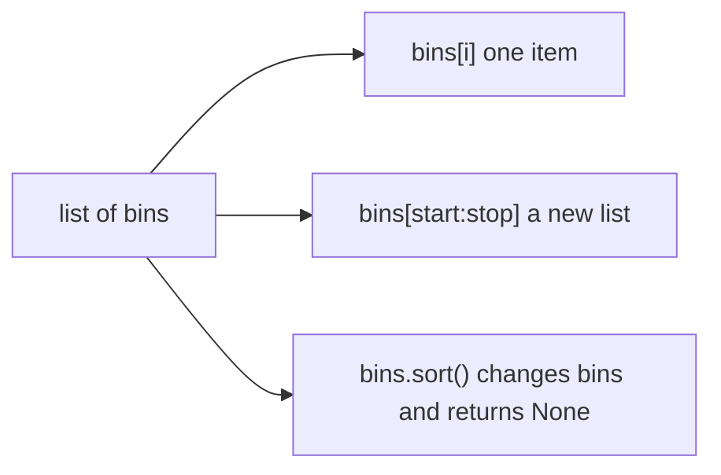

### Slices copy the outside

`bins[1:3]` builds a **new** list from index 1 up to, but not including, index 3. The stop is exclusive, so a slice of length `stop - start` is easy to reason about and a slice to the end is `bins[1:]`. Omit the start and you begin at 0: `bins[:2]`. A stop past the end does not raise. `bins[:100]` on a three-item list is a new list of those three items. That softness is useful for "the first n, or everything if there are fewer" and surprising if you expected an error when `n` was wrong.

The slice is a new list object. Appending to the slice does not append to `bins`. The items inside are still the same objects. If those items are themselves lists, a change inside an item is visible through both lists. A slice is a shallow copy. It is the right copy when the items are strings or numbers. It is not a deep copy of nested rows.

`bins[::-1]` is a new list in reverse order. The original stays put. A step of 2 keeps every other item. The step is part of the slice, not a second pass.

Assignment to a slice can replace a stretch of the original: `bins[1:3] = ["oat"]` removes two items and inserts one, so the length changes. That is a mutation of `bins`. Reading a slice never is.

### Adding and removing

`append` adds one object at the end and returns `None`. `extend` walks another iterable and appends each item. `append` of a list adds that list as a single item, so you get a nested list. `extend` of a list adds its items. `insert(i, x)` shifts the tail to the right. `pop()` removes and returns the last item. `pop(0)` removes the first and shifts everything, which gets expensive on a long list. `remove(x)` deletes the first item equal to `x` and raises `ValueError` when `x` is absent.

`x in bins` walks from the left. It is fine for a short row and the wrong tool for a membership test you repeat thousands of times. The list's job is order, not hashing.

### sort returns None

`bins.sort()` reorders **that** list and returns `None`. `sorted(bins)` returns a new list and leaves `bins` alone. `bins = bins.sort()` is the bug: the name `bins` now points at `None`, and the sorted list is gone. Both forms take `key` and `reverse`. `key` is a function called once per item. The list is ordered by the values the function returns, not by rewriting the items. `reverse=True` flips that order. Sorting is stable: items whose keys compare equal keep the order they already had.

A key that returns a tuple breaks ties. `(score, name)` sorts by score and then by name. A negative score sorts high scores first when you cannot pass `reverse` for only one field. The key function should not mutate the item. A key with a side effect makes the order depend on that effect.

Do not sort a list you are iterating if you also insert or delete. Finish the walk, or sort a copy.

### Where it breaks

`range` and a list are different. `range(3)` is 0, 1, 2. It is not a list until you ask for one. Indexing a `range` works and is not the same object as the list you meant to build.

Copying with `new = old` does not copy. Both names are the same list, so `append` on one is visible on the other. Copy with a slice, `list(old)`, or `old.copy()` when you mean a second list.

Deleting while you loop skips the item that slid into the index you just passed. Build a new list of the items you want to keep. The comprehension or the loop that appends to a fresh list is easier to read than the index dance.

### At work

Lists hold ordered records: the lines of a file, the stops on a route, the scores in the order they arrived. Sort a copy when the original order is the audit trail. Slice when you mean "a window", and remember the stop is exclusive. Return a new list from a function when the caller did not ask you to edit theirs. If the function's name is `sort` or `normalise`, the docstring or the tests should say whether the input survives.

| You mean | Write | You get |
|---|---|---|
| One item by position | `items[i]` or `items[-1]` | the item, or `IndexError` |
| A window | `items[start:stop]` | a new list, stop excluded |
| Reorder this list | `items.sort(key=...)` | `None`, and `items` changed |
| A sorted copy | `sorted(items, key=...)` | a new list |
| Add several items | `extend` | each item appended, not one nested list |
| A second list, same items | `items[:]` | shallow copy |

### Windows and the empty tail

A window of the last few items is a slice from a negative start. The start `-n` means "n items back from the end", and the omitted stop means "through the last item". When `n` is longer than the list, the start would fall before index 0, and the slice simply begins at the start. You get the whole list, not an exception. That is the right behaviour for "give me up to n". It is the wrong behaviour for `n` of 0. Negative zero is zero, so a slice that starts at `-0` starts at the beginning and returns everything. A function that promises an empty list for "no items requested" has to handle that case before it slices. The same softness applies to a start that is not an index you computed yourself. Slices forgive a stop that runs off the end. Indexing does not. `items[len(items)]` raises. `items[len(items):]` is an empty list. Pick the one that matches whether "just past the end" is a bug or an empty window.

Sorting a window is a sort of the copy, unless you assign the slice back. `items[1:4] = sorted(items[1:4])` replaces that stretch and leaves the head and the tail where they were. `items[1:4].sort()` sorts a temporary copy and throws it away, because the slice expression already built a new list and `sort` returns `None`. The original stretch does not move. If the goal is a reordered window inside the same list, assign the sorted copy back into the slice.

### You can now

- Index from either end, and predict `IndexError` on an empty list.
- Slice a window, including a stop past the end, and know the slice is a new list.
- Choose `sort` or `sorted` and never assign the `None` that `sort` returns.
- Add one item with `append` and several with `extend`.

::: predict lang=python
code:
```python
nums = [5, 2, 9, 1]
result = nums.sort()
print(result)
print(nums[1:3], nums[-1])
```
answer:
```
None
[2, 5] 9
```
why: `.sort()` sorts in place and returns `None`. After sorting the list is `[1, 2, 5, 9]`; the slice `[1:3]` is items 1 and 2, and `[-1]` is the last.
:::

::: write lang=python
task: Write `top_scores(scores, n)` that takes a list of `(name, score)` tuples and returns the names of the `n` highest scorers, highest first. On equal scores, keep alphabetical order of names. Don't change the input list.
starter:
```python
def top_scores(scores, n):
    pass
```
tests:
```python
from solution import top_scores

def test_basic():
    assert top_scores([("ana", 70), ("ben", 95), ("cai", 80)], 2) == ["ben", "cai"]

def test_ties_alphabetical():
    assert top_scores([("zoe", 90), ("ada", 90), ("bo", 50)], 2) == ["ada", "zoe"]

def test_input_unchanged():
    data = [("b", 1), ("a", 2)]
    top_scores(data, 1)
    assert data == [("b", 1), ("a", 2)]
```
solution:
```python
def top_scores(scores, n):
    ranked = sorted(scores, key=lambda pair: (-pair[1], pair[0]))
    return [name for name, _ in ranked[:n]]
```
hint: `sorted(..., key=lambda pair: (-pair[1], pair[0]))` sorts by score descending, then by name. Slice the first `n`.
:::

::: quiz
q: `b = a[:]` and then `b.append("z")`. What is true of `a`?
- `a` ends with `"z"`, because a slice is another name for the same list
+ `a` is unchanged. The slice built a new list, and `append` changed only that list
- `append` returns the new list, so `a` becomes that return value
- This raises `TypeError`, because a slice cannot be appended to
why: Reading a slice copies the outer list. The new list can grow without moving the original name. The items inside the copy are still shared, so this would not protect you from a mutation inside a nested list.
:::

::: write lang=python
task: Write `last_n(items, n)`. Return a new list of the last `n` items, or the whole list when `n` is greater than the length. `n` of 0 or less returns an empty list, not the whole list. Do not mutate `items`.
starter:
```python
def last_n(items, n):
    return items[-n:]
```
tests:
```python
# Wrong answer: items[-n:], which on n == 0 is the whole list because -0 is 0.
from solution import last_n

def test_tail():
    assert last_n(["a", "b", "c", "d"], 2) == ["c", "d"]

def test_longer_than_list():
    assert last_n(["a", "b"], 5) == ["a", "b"]

def test_zero_is_empty():
    assert last_n(["a", "b"], 0) == []

def test_input_unchanged():
    items = ["a", "b", "c"]
    last_n(items, 2)
    assert items == ["a", "b", "c"]
```
solution:
```python
def last_n(items, n):
    if n <= 0:
        return []
    return items[-n:]
```
hint: A non-positive `n` has to be handled before the slice. `items[-n:]` is already a new list, and a stop past the start simply returns everything.
:::

::: write lang=python
task: Write `clamp_all(nums, low, high)`. Return a new list where each number below `low` becomes `low` and each number above `high` becomes `high`. Other numbers stay. Do not mutate `nums`. `low` greater than `high` raises `ValueError`.
starter:
```python
def clamp_all(nums, low, high):
    nums.sort()
    return nums
```
tests:
```python
# Wrong answer: sorting the caller's list and returning it, which mutates and does not clamp.
from solution import clamp_all

def test_clamps():
    assert clamp_all([1, 5, 3, 9], 2, 6) == [2, 5, 3, 6]

def test_input_unchanged():
    nums = [1, 5, 9]
    clamp_all(nums, 2, 6)
    assert nums == [1, 5, 9]

def test_bad_bounds():
    try:
        clamp_all([1], 4, 2)
    except ValueError:
        return
    raise AssertionError("low > high must raise ValueError")
```
solution:
```python
def clamp_all(nums, low, high):
    if low > high:
        raise ValueError("bounds")
    out = []
    for n in nums:
        if n < low:
            out.append(low)
        elif n > high:
            out.append(high)
        else:
            out.append(n)
    return out
```
hint: Reject inverted bounds first. Append into a new list. Leave `nums` alone.
:::

::: card
q: Why does `items = items.sort()` leave you with `None`?
answer: `list.sort` reorders the list you already have and returns `None`, the same way `append` returns `None`. The assignment then points the name at that `None`. Call `sort` and keep using the same list, or call `sorted` when you need a new list and the old order must survive.
:::

## Names, objects and mutation
id: mutability
stage: lists
needs: lists
minutes: 40
goal: Predict when two names share one object, and copy only as deep as the mutation.
source: Python docs: Objects, values and types | https://docs.python.org/3/reference/datamodel.html#objects-values-and-types
source: Ned Batchelder: Facts and myths about Python names and values | https://nedbatchelder.com/text/names.html

Two stock counters showed the same delivery twice. The function that recorded it appended to "its" list. The caller's list grew as well. There was one list. Assignment had stuck a second name on it, and append changed the object rather than the name.

Assignment never copies. `b = a` means `b` and `a` are two labels for one object. What you can do next depends on the object. An `int`, `float`, `str`, `tuple`, `bool`, or `None` cannot be changed. Any operation that looks like a change builds a new object and rebinds a name. The other name still sees the old object, so sharing is harmless. A `list`, `dict`, `set`, or most objects you build with a class can be changed through a method or an item assignment. That change does not rebind either name. Both names see it, because both names were aimed at the object you changed.

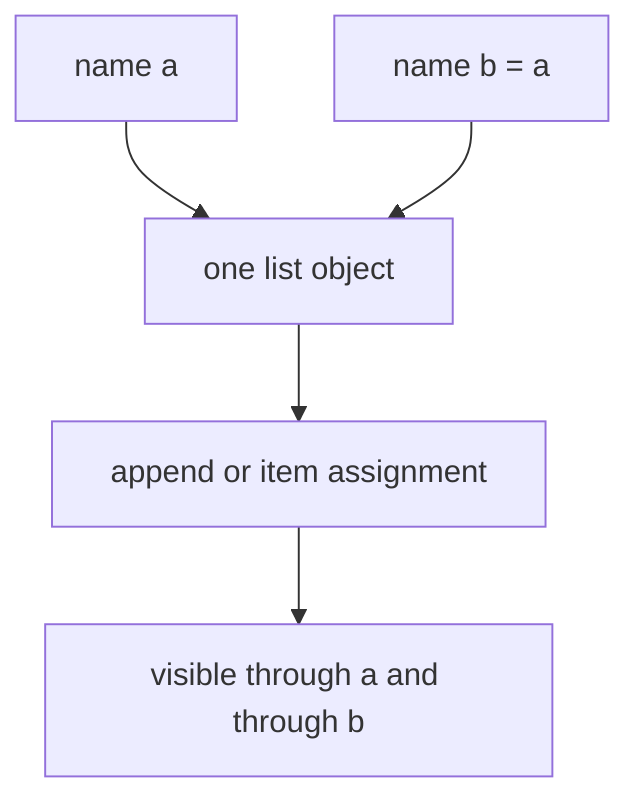

A function parameter is another name for the same object. Rebinding the parameter, `items = []` inside the function, moves only the local name. The caller keeps the original. Calling `items.append(...)` does not move a name. It changes the object, and the caller sees the new item. The difference is the operation, not the fact that a function was involved.

### Shallow copies share the inside

`a[:]`, `list(a)`, and `a.copy()` build a new outer list whose slots still point at the same items. Appending to the copy does not append to the original. Replacing `copy[0] = "x"` does not replace `a[0]`. If `a[0]` is itself a list, `copy[0].append(1)` appends to that inner list, and `a[0]` grows too. The outer lists are different objects. The inner list is one object with two slots pointing at it.

The same shape shows up when a row is repeated. An expression that copies the reference to one inner list, and then repeats that reference, builds a grid of aliases. Editing one row edits every row, because there was only one row object. Build each row on its own, in a loop or a comprehension that runs the inner list expression again each time. A tuple wrapped around those rows does not save you. The tuple cannot be resized, and the lists inside it still can.

`dict.copy()` is shallow in the same way. A new dict, the same values. If a value is a list, both dicts share it.

A deep copy walks the nest and builds new containers all the way down. `copy.deepcopy` does that. It is the right tool when you are about to hand a nested structure to code that mutates, and you need the original as an audit of what arrived. It is the wrong default for a huge tree you only meant to read. Copy as deep as the mutation you are about to allow, and no deeper.

### Where it breaks

A cache that stores the list the caller passed will change when the caller appends. Store a copy, or store a tuple of immutable items, if the cache must keep the old value.

Two names and `is` tell you whether you forgot the copy. `==` tells you whether the contents match. Equal contents can be two objects. One object always compares equal to itself. Tests that only check `==` miss a function that mutated the input and returned it.

A default argument that is a list is one object created when the function is defined, then reused. That is this same alias, stored on the function. Building a new list inside the call is the fix when each call needs its own. The alias rules do not change because the name is a parameter.

### At work

Return new containers from functions that claim to normalise, filter, or score. Mutate only when the function's name says it edits, and the caller passed the object for that purpose. In a test, keep the input, call the function, and assert the input is still the old value. That one assertion catches the shared-object bug more reliably than a comment that says "we copy".

| Operation | New object? | Nested objects |
|---|---|---|
| `b = a` | no | shared |
| `b = a[:]` or `a.copy()` | new outer list or dict | still shared |
| rebuilding each row in a comprehension | new outer and new rows | shared only if you put the same item in on purpose |
| `copy.deepcopy` | new all the way down | copies what it knows how to copy |
| `item.append` / `d[k] = v` | no | the change is the point |

### Building the nested object once

The repetition operator on a list repeats references. `[row] * 3` does not call a copy three times. It stores the same `row` in three slots. `[0] * 4` is safe only because the integer cannot be changed. Replace one slot, `numbers[0] = 1`, and the other slots stay 0, because you replaced a reference rather than changing the integer. The danger starts when the repeated object is a container. A grid written as one row object, repeated, has one row. A later reader who sets `grid[1][0]` is writing into that shared row, and `grid[0][0]` moves too. The fix is to evaluate the inner list once per row. A comprehension does that, because the expression on the left runs again for every outer item. A loop that appends `[]` and then fills it does that too. A loop that appends the same `row` name does not.

This shows up in defaults and in caches for the same reason. The object was built once, in a place that does not re-run when you hoped it would. The `def` line runs once. The list display that is the argument to `*` runs once. A function body runs per call, which is why the fresh container belongs in the body. When you are staring at a bug where two callers share state, find the line that built the container and ask how many times it ran.

Copies have a cost. A shallow copy of a million-row table is cheap next to a deep copy that duplicates every nested dict. Copy the level that the next function is allowed to edit. If it only appends to the outer list, a shallow copy is enough. If it appends to a list stored inside a row, that row's list has to be a new object too, or the append lands in the caller's row. `deepcopy` is the honest tool when you do not know how deep the next edit goes. It is also slower and it copies things you might have meant to share, such as a large lookup table stored on the object. Prefer an explicit rebuild of the fields you know are mutable.

### You can now

- Predict that two names bound by assignment see the same mutation.
- Choose a shallow copy when only the outer container must diverge.
- Build nested rows separately so each row is its own list.
- Test that a normalising function leaves the caller's object alone.

::: predict lang=python
code:
```python
grid = [[0] * 2] * 2
grid[0][0] = 9
print(grid)
```
answer: [[9, 0], [9, 0]]
why: `[row] * 2` repeats a reference to the same inner list, so both rows are one object. Build rows separately: `[[0] * 2 for _ in range(2)]`.
:::

::: predict lang=python
code:
```python
def register(user, seen=[]):
    seen.append(user)
    return len(seen)

print(register("ana"), register("ben"), register("cai", []))
```
answer: 1 2 1
why: The default list is created once and shared between calls, so the second call sees `ana` already in it. Passing a fresh `[]` gives a new list.
:::

::: write lang=python
task: `normalize(order)` should return a **new** order dict with every item name lower-cased, **without changing the order passed in**. The starter changes the caller's data. Fix it.
starter:
```python
def normalize(order):
    for item in order["items"]:
        item["name"] = item["name"].lower()
    return order
```
tests:
```python
from solution import normalize

def test_lowercases():
    out = normalize({"id": 1, "items": [{"name": "Tea", "qty": 2}]})
    assert out["items"][0]["name"] == "tea"

def test_input_untouched():
    order = {"id": 1, "items": [{"name": "Tea", "qty": 2}, {"name": "CAKE", "qty": 1}]}
    normalize(order)
    assert order == {"id": 1, "items": [{"name": "Tea", "qty": 2}, {"name": "CAKE", "qty": 1}]}

def test_keeps_other_fields():
    out = normalize({"id": 7, "items": [{"name": "A", "qty": 3}]})
    assert out == {"id": 7, "items": [{"name": "a", "qty": 3}]}
```
solution:
```python
def normalize(order):
    return {
        **order,
        "items": [{**item, "name": item["name"].lower()} for item in order["items"]],
    }
```
hint: Build new dicts instead of editing the old ones: `{**item, "name": ...}` copies an item and overrides one key.
:::

::: quiz
q: `outer = [[1], [2]]` and `copied = outer[:]`. Then `copied[0].append(9)`. What does `outer` contain?
- `[[1], [2]]`, because a slice copies everything inside
+ `[[1, 9], [2]]`. The slice copied the outer list only, so both outers still point at the same first row
- `[[1, 9], [2, 9]]`, because append writes through every row
- It raises `TypeError`, because a sliced list cannot share items
why: `outer[:]` is a new list of the same item references. Appending to `copied` itself would not change `outer`. Appending to the list that lives at index 0 changes that shared row, so `outer[0]` grows too.
:::

::: write lang=python
task: Write `fresh_grid(rows, cols)` that returns a list of `rows` lists, each of length `cols`, filled with 0. Changing one cell must not change any other cell. `rows` or `cols` below 1 raises `ValueError`.
starter:
```python
def fresh_grid(rows, cols):
    return [[0] * cols] * rows
```
tests:
```python
# Wrong answer: [[0] * cols] * rows, which repeats one row object, so grid[0][0] = 1
# also changes grid[1][0].
from solution import fresh_grid

def test_shape():
    assert fresh_grid(2, 3) == [[0, 0, 0], [0, 0, 0]]

def test_cells_are_independent():
    grid = fresh_grid(2, 2)
    grid[0][0] = 1
    assert grid == [[1, 0], [0, 0]]

def test_bad_size():
    try:
        fresh_grid(0, 2)
    except ValueError:
        return
    raise AssertionError("rows < 1 must raise ValueError")
```
solution:
```python
def fresh_grid(rows, cols):
    if rows < 1 or cols < 1:
        raise ValueError("size")
    return [[0] * cols for _ in range(rows)]
```
hint: Build each row in a comprehension so the inner list expression runs once per row. Repeating one row with `*` aliases that row.
:::

::: card
q: A test checks `result == expected` and the function also returns the same list the caller passed in, after editing it. Why can that test pass while the caller still loses the old data?
answer: `==` compares contents. It does not ask whether the result is a different object. The edited list matches `expected` and is also the caller's list, so the old contents are gone. Assert the input is still the original value, or compare with `is` when you need a different object.
:::

## Tuples as fixed records
id: tuples
stage: lists
needs: lists
minutes: 40
goal: Use a tuple for a fixed record, unpack it, and explain why it can be a dict key when a list cannot.
source: Python tutorial: Data structures | https://docs.python.org/3/tutorial/datastructures.html

A list is the right container when the number of items is part of the data. You append a finished score, pop a job, or sort a column, so the length is allowed to change and every slot holds the same kind of thing. A record is a different kind of value. A point is an x and a y. A socket address is a host and a port. A parsed grade is a student, a course, and a score. Those positions have jobs, and a fourth item would not grow a collection of peers. It would break the meaning. A tuple is the type Python gives that promise. Item assignment raises TypeError, so a function that receives a tuple cannot quietly change a field that another name still sees.

That refusal is also why a tuple can be a dictionary key and a list cannot. A dict does not scan its keys on every lookup. It hashes the key, jumps to a bucket, and then checks equality among the few keys that landed there. The hash is stored beside the entry. If the key could change after insertion, the stored hash would still point at the old bucket, and the search would miss an entry that is sitting in the table. So a key has to be hashable, which means its hash is not allowed to change. A list can gain or lose items, so hashing a list raises TypeError before any dict is involved. A tuple refuses item assignment, so Python will hash it. The hash is mixed from the hashes of the items, and the rule is recursive. A tuple of strings is a fine key. A tuple that contains a list is not, because the list inside can still be appended to. The outer tuple being frozen does not freeze its contents. Immutability here is shallow. The practical test is: if any nested value is unhashable, the whole tuple is unhashable.

Unpacking is how you treat that tuple as a record instead of as a tiny list. `host, port = ("db.internal", 5432)` requires the right-hand side to have exactly two items and binds them from left to right. A short record raises ValueError. A long one does too. That failure is the point. A missing port should stop the caller, not become a silent hole that fails three calls later. You can ignore a position with an underscore, and you can unpack a function return directly, because `return host, port` packs a tuple on the way out. The parentheses are optional. The comma is what builds the tuple. That is why a one-element tuple is written `(port,)` with a comma. `(port)` is only parentheses around a value, so the comma is the whole difference between a record of one and a bare object.

A starred name collects a variable middle. In `origin, *stops, dest = ("FRA", "CDG", "LHR", "JFK")` the first name takes the first item, the last name takes the last item, and `stops` takes everything between them. The star is allowed once. Two stars would not say where one middle ends and the next begins, so that is a syntax error. The collected middle is always a new list, even when the source was a tuple. Python picks a list because the middle has a runtime length and the next thing you usually do is iterate it. That choice matters the moment you try to hash the middle. A list cannot be a dict key, so you wrap it with `tuple(stops)` when the stops themselves are hashable. The ends do not need that wrap. They are already single objects.

Swapping uses that same packing rule. `x, y = y, x` evaluates the right-hand side first, so `y, x` is saved as a temporary tuple before either name is rebound. The first assignment cannot destroy the value the second assignment still needs. You do not write a temporary name yourself.

A routing table shows the pieces together. This is not a geometry problem. Each shipment is identified by a product code and a hub, and the dict value is how many units sit there.

```python
inventory = {
    ("AB-1", "FRA"): 4,
    ("AB-1", "CDG"): 1,
}
sku, hub = ("AB-1", "FRA")
inventory[(sku, hub)] = inventory[(sku, hub)] + 2
origin, *stops, dest = ("FRA", "CDG", "LHR", "JFK")
label = (origin, tuple(stops), dest)
```

After the addition the FRA row holds 6, because the lookup key equals the inserted key. `origin` is `"FRA"`, `stops` is `["CDG", "LHR"]`, and `dest` is `"JFK"`. `label` wraps the middle in a tuple so the whole label can be hashed. Leave the middle as the list the star built, and hashing `label` raises TypeError. `return sku, hub` is the same packing as an explicit tuple: a function that returns two things returns one tuple, and the caller unpacks it.

### Where it breaks

Dropping the trailing comma is a quiet shape bug. A function that returns `(name)` returns a string. The caller who writes `student, course = fetch()` then gets a ValueError, or, if they loop over the result, they iterate characters. Build a one-item record as `(name,)`.

A star hides a short record inside the middle. `head, *rest = (1,)` succeeds and `rest` is `[]`, so the crash moves to the later `rest[0]`. If an empty middle is not a real record, check the length before you index it.

Comparison stops at the first difference. `(1, 100) < (2, 0)` is true because `1 < 2`, and the `100` is never read. Sorting tuples does not rank a later score unless that score is first or you pass `key`.

A tuple does not freeze nested lists. Append to an inner list and every alias sees the new item, and the tuple is still unhashable. Freeze the inside, or do not put a mutable value there.

Replacing one field builds a new tuple. `updated = (sku, new_hub)` drops every later field you forgot. With five fields that is a review bug. When readers need names, use a `namedtuple` or a dataclass. Keep a plain tuple while the record is small, local, and hashed.

### At work

`str.partition` and `divmod` already return tuples, and a database row often arrives as one tuple in column order. Unpacking it at the top of the loop is how you stop writing `row[2]` for the rest of the function. A cache uses the argument tuple as the dict key, which works only when every argument is hashable. A list argument has to be converted first or that call cannot be stored. A graph edge `(start, end)` is the same idea: the pair is the identity, so it can be counted and joined. A tuple of tuples also stops a callee from appending to the caller's rows. A list would let that helper reorder them by accident.

### Which shape to reach for

| You need | Reach for | Because |
|---|---|---|
| A growing sequence of one kind of item | a list | the length is data, and you will append, pop, or sort |
| A fixed record of a few positions | a tuple | the shape is the meaning, and unpacking checks the width |
| A dict key or a set element | a tuple of hashable items | the hash has to stay valid after insertion |
| A record of exactly one item | `(value,)` | parentheses without a comma do not build a tuple |
| Fields that readers must name | a named tuple or a dataclass | positions get swapped in review, names do not |
| A variable middle you must hash | the star, then `tuple(...)` | the star always builds a list, and a list is not a key |

### You can now

- Choose a tuple or a list from the shape of the data, and say why a list cannot be a dict key.
- Unpack a fixed record, ignore a slot, and collect a middle with one star.
- Swap two names without a temporary, because the right-hand side is packed before the left-hand side binds.
- Spot a nested list that makes an otherwise frozen tuple unhashable.
- Build a new tuple when one field changes, instead of trying to edit the old one.

::: quiz
q: Why can a tuple of strings be a dictionary key when a list of those same strings cannot?
- A tuple is ordered and a list is not, and dictionary keys have to keep that order.
+ A tuple cannot be changed, so its hash stays valid, while a list could be changed after it was inserted, so Python refuses to hash the list.
- A tuple stores fewer pointers than a list, so the hash table has room for it.
why: Lookup stores the key's hash and jumps to that bucket. If the key changed, the dict would look in the old bucket and miss the entry. A list is unhashable for that reason. A tuple of strings is hashable because the tuple cannot be resized and each string is hashable. A tuple that contains a list is still unhashable, because immutability does not reach inside.
:::

::: quiz
q: What does `a, *b, c = (1, 2, 3, 4)` bind?
- `a` is 1, `b` is the tuple `(2, 3)`, and `c` is 4.
+ `a` is 1, `b` is the list `[2, 3]`, and `c` is 4.
- `a` is `(1,)`, `b` is `(2, 3)`, and `c` is `(4,)`.
why: A starred name is allowed once and always collects into a new list, even when the value on the right is a tuple. The unstarred names still receive single items. Two stars are a syntax error, because nothing would say where the first middle ends.
:::

::: predict lang=python
q: The star collects the middle into a list. What does this print?
code:
```python
first, *rest, last = (4, 5, 6, 7)
print(first)
print(rest)
print(last)
print(last, first)
```
answer:
```
4
[5, 6]
7
7 4
```
why: `first` takes 4 and `last` takes 7, so the star is left with the list `[5, 6]`, not a tuple. The last line prints the two saved ends separated by a space. Nothing in the original tuple was modified, because a tuple cannot be modified; the names were bound to its items.
:::

::: write lang=python
task: Write `bounds(points)`. `points` is a list of `(x, y)` pairs. Return one new tuple `(min_x, min_y, max_x, max_y)`. An empty list raises ValueError. A single point has equal mins and maxes. Do not mutate the input.
starter:
```python
def bounds(points):
    pass
```
tests:
```python
# Wrong answer tried: return (0, 0, 0, 0) for an empty list, and return a list [min_x, min_y, max_x, max_y] otherwise.
from solution import bounds

def test_span():
    assert bounds([(2, 8), (5, 1), (4, 3)]) == (2, 1, 5, 8)

def test_single_and_negative():
    assert bounds([(-2, 5)]) == (-2, 5, -2, 5)
    assert bounds([(0, -1), (-4, 2)]) == (-4, -1, 0, 2)

def test_empty_raises():
    try:
        bounds([])
    except ValueError:
        return
    raise AssertionError("expected ValueError")

def test_input_unchanged():
    points = [(3, 1), (0, 4)]
    bounds(points)
    assert points == [(3, 1), (0, 4)]
```
solution:
```python
def bounds(points):
    if not points:
        raise ValueError("empty points")
    xs = [x for x, _ in points]
    ys = [y for _, y in points]
    return (min(xs), min(ys), max(xs), max(ys))
```
hint: Reject an empty list first. Then take min and max of each coordinate and return them as one tuple, not a list.
:::

::: write lang=python
task: Write `rotate_left(triple)`. It takes a sequence of three items and returns a new 3-tuple moved one place to the left, so the old first item becomes the last. `(1, 2, 3)` becomes `(2, 3, 1)`. Do not change the input.
starter:
```python
def rotate_left(triple):
    pass
```
tests:
```python
# Wrong answer tried: rotate right, so (1, 2, 3) became (3, 1, 2) instead of (2, 3, 1).
from solution import rotate_left

def test_numbers():
    assert rotate_left((1, 2, 3)) == (2, 3, 1)

def test_leaves_original():
    original = ("a", "b", "c")
    assert rotate_left(original) == ("b", "c", "a")
    assert original == ("a", "b", "c")

def test_mixed():
    assert rotate_left((True, 0, None)) == (0, None, True)
```
solution:
```python
def rotate_left(triple):
    a, b, c = triple
    return (b, c, a)
```
hint: Unpack the three positions, then pack them back with the old first item at the end.
:::

::: card
q: When is a tuple the wrong container even though the value has several parts?
answer: When callers will add or remove items, when something nested must stay mutable, or when the fields need names so the next reader does not swap two positions. Use a tuple for a small fixed record, especially when that record is a dict key, a set element, or several return values.
:::

## How calls bind to parameters
id: args
stage: lists
needs: functions, mutability
minutes: 40
goal: Choose defaults, star-args, and positional-only or keyword-only parameters without sharing one mutable object across calls.
source: Python tutorial: More on defining functions | https://docs.python.org/3/tutorial/controlflow.html#more-on-defining-functions
source: Python FAQ: Why are default values shared between objects? | https://docs.python.org/3/faq/programming.html#why-are-default-values-shared-between-objects

A function header is a contract about objects, because the body never sees the caller's variable names, only the objects the arguments refer to. Names in the `def` line are parameters. Values at the call are arguments. Python fills parameters by position from left to right, and a keyword fills the parameter with that name, so a call stays readable when a second option appears. Matching finishes before the body runs. A name filled twice, left empty with no default, or given a keyword the signature does not accept raises `TypeError` at the call, which is what you want, because the mistake shows up there instead of as a `None` halfway through the work.

Defaults are computed once, when Python executes the `def`, not on each call. The expressions on the right of the equals signs run left to right at definition time, and the objects they produce are stored on the function. A call that omits the argument reuses the stored object. A default can mention a name that is later reassigned and still keep the old value, because the lookup already happened and the parameter holds the object. An `int` or a `str` hides this, because those objects do not change. A list, a dict, or a set does not hide it, because a change in place is visible to every caller who omitted the argument and therefore shares that one object.

```python
def remember_guest(name, book=None):
    if book is None:
        book = {}
    book[name] = book.get(name, 0) + 1
    return book
```

`None` is a safe sentinel because it is immutable, and the dict built inside the call belongs to that call. Test with `is None`, not with truthiness, because an empty dict the caller passed is a real book. An empty container is false, so `if not book` would discard it and the caller would never see the update. Mutation and rebinding also differ. `book[name] = ...` changes the object. `book = {**book, name: 1}` builds a new dict and moves the local name, so a stored default would stay as it was. A shared default only bites when the body changes the object rather than the name.

A star gathers leftover positional arguments into a new tuple, usually `*args`. You can loop over it, but it is not a list: it has no `append`. The objects inside are the caller's objects, so mutating a list that arrived in the tuple is visible to the caller, because the tuple only stored a reference. `**kwargs` gathers leftover keywords into a new dict. That dict is built for the call, so even `f(**existing)` does not hand you `existing` itself, and popping a key does not change the caller's dict. The values are still the caller's objects. Wrappers use both so they can forward with `inner(*args, **kwargs)` without an edit every time `inner` grows a parameter. They are a bad place to hide an undecided design, because a misspelled keyword then disappears instead of raising `TypeError`.

Parameters after a bare `*` or after `*args` are keyword-only. The caller must write the name, and a positional value cannot slide into that slot, so a flag cannot be read as data. `def fetch(url, *, timeout=5)` rejects `fetch(url, 10)`, because `10` has nowhere positional to go, so the call has to say `timeout=10`. Keyword-only defaults live on `__kwdefaults__`. Defaults for parameters that still allow position live on `__defaults__`. Put a threshold after `*args` when the gathered values are one sequence and the threshold must not be swallowed as one more item. If it sat in front of `*args`, the first number would bind to it and the flag would steal a data value.

A slash does the opposite. Names left of `/` are positional-only, so the caller cannot pass them by keyword and the parameter name is not part of the public call. `def clip(value, /, low, high)` accepts `clip(1.8, low=0, high=1)` and rejects `clip(value=1.8, low=0, high=1)`. Built-ins already work this way, which is why naming `len`'s argument fails. The payoff is renaming: if callers had been allowed to write `value=`, you could never rename that parameter. The header order is fixed: positional-only, `/`, names that accept either style, `*args` or a bare `*`, keyword-only names, `**kwargs`. A `/` after a `*` is a syntax error, because that order describes no real call.

### Where it breaks

The shared list reaches production because a one-call test looks pure, and the next request appends onto the first call's list. The call site did not change, so people blame the caller. The cause is the object stored when the `def` ran. A dict default becomes a cache that never forgets keys. That can be deliberate, and it is still a bad library default, because the cache is invisible and it lives as long as the process. Store `None`, and build the container in the body.

A default also cannot see the other arguments, because it ran before any call, so opening a file or reading a clock in the header happens once at import time and then shares that result. Do that work in the body. Forwarding fails the other way: accept `**kwargs` and forget to pass it on, and the caller's options vanish. The positional slide is the everyday version of the same bug. A new parameter in the middle of a positional list changes what every old call means. Options after `*` do not slide, so that is the shape to grow.

### At work

The signature is the documentation that cannot drift from the code. A measurement function takes the sensor name first, because every call has one, then `*samples`, because the number of readings changes, then a keyword-only limit, so a threshold is never parsed as another reading. A file writer takes the path positional-only, because the path is the obvious first idea, and takes `encoding` and `overwrite` by keyword, because swapping them by position would corrupt data. Wrappers stay thin: `*args, **kwargs`, maybe one keyword-only option of their own, then forward, so a new inner option does not force a second edit. Tests call the helper twice without the optional container and assert that the results do not share items, because that is the regression a mutable default passes when you only call it once.

Read a header from the slash and the stars outward. Left of `/` means position, and the name is private. Between `/` and `*` means position or name. Right of `*` means name only. `*args` is the rest of the positions, as a tuple. `**kwargs` is the rest of the names, as a dict. If you cannot say which job a parameter has, the call sites will drift.

### A decision table

| You need | Write this | Why not the other shape |
| --- | --- | --- |
| A value the caller may omit | A default on that parameter | Forcing every call to pass the same literal hides the real inputs |
| A new list or dict when the argument is omitted | `None`, then create the container in the body | `[]` or `{}` in the header is one object reused by every omitted call |
| A flag or threshold that must be named | A keyword-only parameter after `*` or `*args` | A trailing positional Boolean slides into the wrong slot |
| A first argument whose name is private | A positional-only parameter before `/` | If callers use the keyword, you can never rename it |
| To pass a call through | `*args, **kwargs`, forwarded onward | Naming every option twice lets the wrapper go stale |
| Many values of one kind, and nothing positional after them | `*args` | A list parameter is clearer when other positional arguments must follow |

Most functions need none of the stars. Use `*args` when the alternative is a throwaway list, keyword-only when a positional flag would be dangerous, and `/` when you want to rename the first argument later.

### You can now

You can read a header and say which calls are legal, because the order is positional-only, then flexible, then keyword-only. You can explain why two calls that omitted a list saw each other's items, and you can fix that with `None` plus a list created in the body. You can put a flag after `*` so it cannot swallow data, hide an obvious first name behind `/`, and forward a call without using stars as a substitute for a signature you are willing to document.

::: quiz
q: A function is defined with a default list and the body appends to that list, then returns it. The first call that omits the list returns a one-item list. The second call that also omits the list returns both items. Why?
- Each call copies the previous return value into the next call automatically.
+ The default list is created once, when the def statement runs, so both calls that omit the argument append to that same list.
- append builds a new list, and the second call starts from a global with the same name.
- Python rebuilds every default from the caller's local variables on each call.
why: Defaults are stored on the function object at definition time. A list is mutable, so append changes the one stored object. A later call that omits the argument sees the items the earlier call left there. Use None and create a new list inside the body.
:::

::: predict lang=python
q: What does this print? Both calls omit the optional list.
code:
```python
def remember(note, notes=[]):
    notes.append(note)
    return notes

print(remember("a"))
print(remember("b"))
```
answer:
```
['a']
['a', 'b']
```
why: The list in the header is built once and then reused. The first call appends "a". The second call appends "b" onto that same list, so the print shows both notes. Two separate print calls matter, because printing one shared list twice in a single print would show the final contents in both positions.
:::

::: write lang=python
task: Write `collect(item, bucket=None)`. When `bucket` is omitted or is None, append `item` to a new list and return that list. Two calls that omit `bucket` must not share a list. When the caller passes a list, including an empty one, append to that list and return it. Test with `is None`, not with a truthiness check.
starter:
```python
def collect(item, bucket=[]):
    bucket.append(item)
    return bucket
```
tests:
```python
# Wrong answer: bucket=[] in the header, so two calls that omit bucket append to one shared list.
from solution import collect

def test_fresh_each_call():
    assert collect("a") == ["a"]
    assert collect("b") == ["b"]

def test_supplied_bucket():
    box = ["x"]
    out = collect("y", box)
    assert out == ["x", "y"]
    assert box == ["x", "y"]

def test_empty_bucket_is_used():
    box = []
    assert collect("z", box) == ["z"]
    assert box == ["z"]

def test_explicit_none():
    assert collect("c", None) == ["c"]
    assert collect("d") == ["d"]
```
solution:
```python
def collect(item, bucket=None):
    if bucket is None:
        bucket = []
    bucket.append(item)
    return bucket
```
hint: Default the parameter to None. Inside the function, if bucket is None, assign a new [] and then append. An empty list the caller passed is not None, so it must be kept.
:::

::: write lang=python
task: Write `announce(name, *scores, passing=60)`. It returns the string "NAME: P pass, F fail", where NAME is `name` unchanged, P is how many scores are greater than or equal to `passing`, and F is how many are not. No scores at all is "NAME: 0 pass, 0 fail". Keep the words "pass" and "fail" even when the count is 1. `passing` is keyword-only because it comes after `*scores`.
starter:
```python
def announce(name, *scores, passing=60):
    return name
```
tests:
```python
# Wrong answer: putting passing before *scores, so the first number is read as the threshold, or writing "1 passes" instead of "1 pass".
from solution import announce

def test_mixed():
    assert announce("Lina", 59, 60, 100) == "Lina: 2 pass, 1 fail"

def test_no_scores():
    assert announce("Lina") == "Lina: 0 pass, 0 fail"

def test_keyword_threshold():
    assert announce("Lina", 40, 39, passing=40) == "Lina: 1 pass, 1 fail"

def test_all_fail():
    assert announce("Moe", 1, 2, 3) == "Moe: 0 pass, 3 fail"

def test_equal_counts_as_pass():
    assert announce("Ada", 60, passing=60) == "Ada: 1 pass, 0 fail"
```
solution:
```python
def announce(name, *scores, passing=60):
    passed = sum(1 for score in scores if score >= passing)
    failed = len(scores) - passed
    return f"{name}: {passed} pass, {failed} fail"
```
hint: Count scores that are >= passing. The fail count is len(scores) minus that. Format exactly f"{name}: {passed} pass, {failed} fail". Zero scores is already that formula.
:::

::: card
q: What does a bare star in a parameter list do to the parameters that follow it?
answer: It makes every parameter after the star keyword-only. Callers must pass those arguments by name, and a positional argument cannot slide into them. Use that when a flag or a threshold would be dangerous if it were matched by position.
:::

## Project: a terminal quiz
id: p-quiz
stage: lists
needs: control, mutability
minutes: 70
project: yes
goal: Build the pieces of a quiz that scores answers, ignores repeats, and does not share mutable state between rounds.
source: Python tutorial: More control flow tools | https://docs.python.org/3/tutorial/controlflow.html

The quiz is a small program you could run from a terminal: show a question, read an answer, keep a score, and offer another round. The exercises do not call `input()`. A test cannot type at a prompt, and a function that waits for a person cannot be checked. The pieces that decide a round are ordinary functions. A later `main` can call them in a loop. You are writing the pieces.

An answer is right when it matches the expected text after you strip the ends and ignore case. `"  Paris "` and `"paris"` are the same answer. `"parisian"` is not. The comparison is the whole string, not a substring, because a substring check marks `"paris"` correct for the expected answer `"pa"`.

A round is a list of pairs, each pair a given answer and the expected answer. The score is how many were right, and how many were asked. An empty round is zero of zero, not an error. A person who skips the file should see a calm zero, not a crash.

The running totals live in a dictionary, `{"correct": 0, "asked": 0}`. Adding a result must not change the dictionary the caller still holds. A later round starts from the same starting dictionary in the tests. If you append or update that object, the next round inherits the previous score. Return a new dictionary.

Questions are dictionaries with an `id` and a `prompt`. The ids already asked are a set. The next question is the first one whose id is not in that set. When every id has been asked, there is no next question. Returning the first question anyway repeats a prompt the person already saw.

The summary line is the thing you would print at the end. Three correct out of five is `3/5`. Zero questions is `none`, because `0/0` looks like a score you earned and you did not ask anything. A round that was asked and answered entirely wrong is still a fraction with a zero on the left. The person did play. The denominator is the fact that they did.

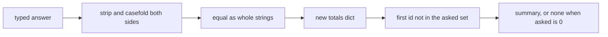

### One round, with different questions

Suppose the bank is two questions, Oslo and Bern, and the person types ` oslo ` and then `BERNE`. Stripping takes the spaces off the ends and does not touch the middle, so a space inside a word would still count. Case folding turns `OSLO` and `oslo` into the same string, including cases that `lower` gets wrong for some alphabets. The first pair matches. The second does not, because `berne` and `bern` are different strings after folding. The score is one correct out of two asked. A substring test would have been the wrong tool: `bern` occurs inside `berne`, and that must not award a point.

The totals you were handed are `{"correct": 0, "asked": 0}`. Recording the first answer builds a new dictionary. The caller's object still says zero and zero, so a second round that starts from that same object is not already carrying the first round. Recording a wrong answer increases `asked` and leaves `correct` alone. Skipping the increment on a wrong answer would make the summary look perfect.

The asked ids are a set. Order in the set does not matter. Membership does. If Oslo's id is already in the set, the next pick walks forward and returns Bern. If both ids are in the set, the pick returns nothing. Returning the first question anyway is how a quiz repeats itself. An empty bank also returns nothing. There is no first question to fall back on, and indexing an empty list would crash a round that has simply finished.

### A fresh state for every round

The totals dictionary is not the only object a round can share by accident. A set of seen ids created once, at import, and then reused, remembers the previous player. The next person is told the quiz is finished. A function that starts a round has to build the dictionary and the set at the moment the round starts. Two calls must return two objects. Mutating one, by adding an id or increasing a count, must leave the other at zero and empty.

That is the same rule as a shallow alias. Returning an object you built inside the function is safe. Returning an object that was created in the `def` line, or on the class, hands every caller the same one. The default-argument list is the usual way this happens. The quiz does not need a default list. It needs a function whose body creates the starting totals.

### Where this breaks

Matching with `in` asks whether one string contains the other. A one-letter answer would pass against a long expected answer. Compare the normalised strings with `==`, after both sides have been stripped and case-folded. Folding only the typed side marks `Paris` wrong when the stored answer is `PARIS`.

Updating the totals dict you were given writes into the caller's object. They reused it to start the next round, so the second round opens on the previous score. Building a new dict leaves them a clean start. Reading their numbers is fine. Writing into their keys is the leak.

Treating an empty string as "skip the question" drops it from `asked`. After stripping, an empty answer is still an answer, and it is wrong unless the expected answer is also empty. Count it. A summary that ignores blanks inflates the score.

Picking with "the first question" ignores the set. The first question is the right pick only when its id has not been asked. After that, the first unasked id later in the list is the right pick. When none remain, the result is absence, not a repeated prompt.

### How this is used at work

Any scoring loop has the same shape: normalise the input, compare it to a rule, record the outcome in a new value, and choose the next item from the ones not yet used. A support form that grades a checklist, a drill that tracks which items a person has already seen, and a quiz are the same four steps. The terminal is just where this one would print. The functions stay testable because they do not read the keyboard. A `main` that called `input()` would hang a test until a person typed. The tests pass the typed string in as an argument instead.

In review, look for a comparison that uses `in`, a dict or set created once and reused, and a summary that prints `0/0` for a round that never started. Those three are the bugs this project is for.

### A decision table

| Situation | Do | Why |
| --- | --- | --- |
| Spaces and case | Strip both sides, then casefold, then `==` | The whole answer is the match. A substring awards a prefix |
| Wrong answer | Count it in `asked`, not in `correct` | The person was asked. Dropping it inflates the score |
| Caller's totals | Return a new dict | They may reuse the object for the next round |
| Next question | First id that is not in the set | The set is what has already been shown |
| Nothing left, or an empty bank | Return no question | Repeating the first prompt is a different product |
| Zero questions | Summary `none` | `0/0` looks like a score |
| Starting a round | Build the dict and the set inside the call | An object created earlier is shared with the previous player |

### You can now

- Normalise an answer and compare the whole string.
- Score a round, including an empty one.
- Record a result without mutating the caller's dictionary.
- Pick the next unasked question, and format a zero-question summary as `none`.

::: write lang=python
task: Write `normalise(answer)` that returns the answer with ends stripped and case folded. Write `mark(given, expected)` that returns `True` when the normalised strings are equal.
starter:
```python
def normalise(answer):
    return answer

def mark(given, expected):
    return given in expected
```
tests:
```python
from solution import normalise, mark

# wrong answer tested: `given in expected`, so "a" matches "paris"
def test_normalise():
    assert normalise("  Paris ") == "paris"

def test_mark():
    assert mark("  Paris ", "paris") is True
    assert mark("parisian", "paris") is False
    assert mark("a", "paris") is False
```
solution:
```python
def normalise(answer):
    return answer.strip().casefold()

def mark(given, expected):
    return normalise(given) == normalise(expected)
```
hint: `strip` removes the ends. `casefold` ignores case more thoroughly than `lower`. Compare with `==` after both sides are normalised. `in` is a substring test.
:::

::: write lang=python
task: Write `score_round(pairs)` where each pair is `(given, expected)`. Return `(correct, asked)`. Use the same whole-string, stripped, case-folded comparison as a quiz mark. An empty list returns `(0, 0)`.
starter:
```python
def score_round(pairs):
    return (0, 0)
```
tests:
```python
from solution import score_round

# wrong answer tested: return (0, 0) always, and a version that treats "a" as correct for "paris"
def test_mixed():
    pairs = [(" Paris ", "paris"), ("nope", "paris"), ("A", "a")]
    assert score_round(pairs) == (2, 3)

def test_empty():
    assert score_round([]) == (0, 0)

def test_substring_is_wrong():
    assert score_round([("a", "paris")]) == (0, 1)
```
solution:
```python
def score_round(pairs):
    correct = 0
    for given, expected in pairs:
        if given.strip().casefold() == expected.strip().casefold():
            correct += 1
    return (correct, len(pairs))
```
hint: Count a pair only when the stripped, case-folded strings are equal. `asked` is the length of the list, including wrong answers.
:::

::: write lang=python
task: Write `add_result(totals, correct)` . `totals` is a dict with integer keys `correct` and `asked`. Return a new dict with `asked` one higher and `correct` increased by 1 when `correct` is true. Do not mutate `totals`.
starter:
```python
def add_result(totals, correct):
    totals["asked"] += 1
    if correct:
        totals["correct"] += 1
    return totals
```
tests:
```python
from solution import add_result

# wrong answer tested: mutating totals in place, so the caller's dict changes
def test_new_dict():
    start = {"correct": 1, "asked": 2}
    out = add_result(start, True)
    assert out == {"correct": 2, "asked": 3}
    assert start == {"correct": 1, "asked": 2}

def test_wrong_answer():
    start = {"correct": 0, "asked": 0}
    out = add_result(start, False)
    assert out == {"correct": 0, "asked": 1}
    assert start == {"correct": 0, "asked": 0}
```
solution:
```python
def add_result(totals, correct):
    return {
        "correct": totals["correct"] + (1 if correct else 0),
        "asked": totals["asked"] + 1,
    }
```
hint: Build a new dictionary. Reading `totals` is fine. Assigning into it changes the caller's object, and the next round would start from those numbers.
:::

::: write lang=python
task: Write `pick_next(questions, asked_ids)`. Each question is a dict with `id` and `prompt`. Return the first question whose `id` is not in `asked_ids`. Return `None` when every question was asked. Do not skip a later unasked question just because an earlier one was asked.
starter:
```python
def pick_next(questions, asked_ids):
    return questions[0]
```
tests:
```python
from solution import pick_next

# wrong answer tested: always questions[0], which repeats an asked prompt
def test_skips_asked():
    questions = [{"id": "a", "prompt": "A?"}, {"id": "b", "prompt": "B?"}]
    assert pick_next(questions, {"a"}) == {"id": "b", "prompt": "B?"}

def test_done():
    questions = [{"id": "a", "prompt": "A?"}]
    assert pick_next(questions, {"a"}) is None

def test_empty():
    assert pick_next([], set()) is None
```
solution:
```python
def pick_next(questions, asked_ids):
    for question in questions:
        if question["id"] not in asked_ids:
            return question
    return None
```
hint: Walk the list in order. `not in` on a set is the membership test. Fall off the end with `None`, including when the list itself is empty.
:::

::: write lang=python
task: Write `format_summary(correct, asked)`. Return `none` when `asked` is 0. Otherwise return `correct/asked`, for example `3/5`.
starter:
```python
def format_summary(correct, asked):
    return f"{correct}/{asked}"
```
tests:
```python
from solution import format_summary

# wrong answer tested: always an f-string, so zero questions prints 0/0
def test_score():
    assert format_summary(3, 5) == "3/5"

def test_zero_questions():
    assert format_summary(0, 0) == "none"

def test_all_wrong():
    assert format_summary(0, 4) == "0/4"
```
solution:
```python
def format_summary(correct, asked):
    if asked == 0:
        return "none"
    return f"{correct}/{asked}"
```
hint: Handle zero questions before the f-string. `0/0` would look like a score. A round that was asked and got nothing right is still `0/4`.
:::

::: quiz
q: A round's totals dict is reused as the starting totals of the next round. `add_result` updated that dict and also returned it. What goes wrong?
- Nothing. Returning the dict copies it
+ The next round starts from the previous score, because the caller's dict object was changed
- The next round cannot see the dict, because a returned dict is deleted
- Python forbids reusing a dict, so the second call raises
why: A returned name can still be the same object the caller passed in. Updating it updates the caller's object. The next round reads those updated numbers unless you build a new dict.
:::

::: write lang=python
task: Write `fresh_state()` that returns a new totals dict and a new set of seen ids on every call. The dict has `correct` and `asked`, both 0. Two results must not share either object.
starter:
```python
SHARED = {"correct": 0, "asked": 0, "seen": set()}

def fresh_state():
    return SHARED
```
tests:
```python
# Wrong answer: one dict and one set created outside the function, so the second round sees the first player's ids.
from solution import fresh_state

def test_shape():
    state = fresh_state()
    assert state["correct"] == 0
    assert state["asked"] == 0
    assert state["seen"] == set()

def test_separate():
    first = fresh_state()
    second = fresh_state()
    first["seen"].add("oslo")
    first["correct"] = 1
    assert second["seen"] == set()
    assert second["correct"] == 0
```
solution:
```python
def fresh_state():
    return {"correct": 0, "asked": 0, "seen": set()}
```
hint: Build the dictionary and the set inside the function. An object created once, above the function, is the same object on every call.
:::

::: card
q: Why casefold an answer instead of only calling lower?
answer: Case folding is the match used for case-insensitive comparison, and it covers mappings that lower leaves alone. Both sides have to be folded. Folding only the typed answer still misses when the stored answer has capitals.
:::

## Dictionaries and sets
id: dicts
stage: dicts
needs: lists
minutes: 40
goal: Look up, insert, and count with dicts, including a missing key.
source: Python docs: Mapping types (dict) | https://docs.python.org/3/library/stdtypes.html#mapping-types-dict
source: Python docs: collections.Counter | https://docs.python.org/3/library/collections.html#collections.Counter

A counter that used a list of pairs got slower every day, and a missing product crashed the page because the code indexed a key that had never been written. A dict is the table that makes "what is stored under this key?" a jump rather than a walk, and it makes a missing key a decision you have to write down.

A dict maps each key to one value. `stock = {"tea": 12}` stores the integer 12 under the string `"tea"`. `stock["tea"]` gets it back. `stock["coffee"]` raises `KeyError` when `"coffee"` was never inserted. That error is useful when a missing product is a bug. It is the wrong behaviour when a missing product means zero. `stock.get("coffee", 0)` returns 0 and does not insert the key. `stock.setdefault("coffee", 0)` returns 0 and **does** insert it, which is what you want before you append to a list stored under that key, and a surprise when a later loop treats every key you merely asked about as real data.

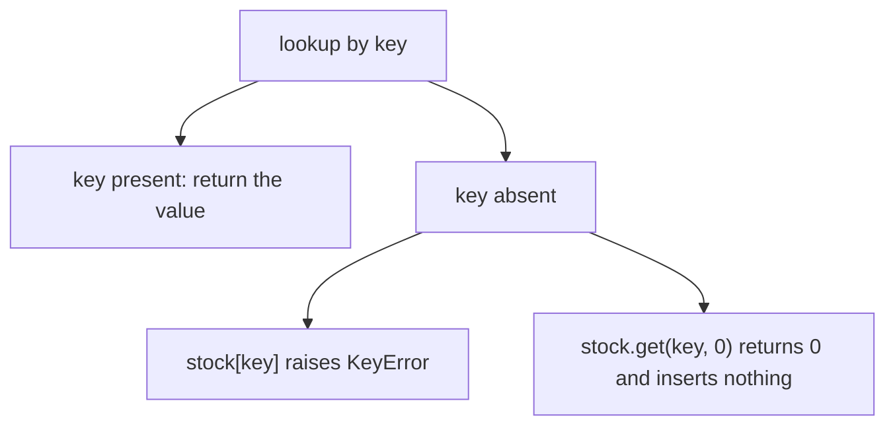

Assignment `stock["coffee"] = 5` inserts or replaces. There is one value per key. A second assignment to `"tea"` drops the previous integer. Keys are compared by equality and hashing, the same rule as set members. `True` and `1` compare equal, so they are one key. Use strings or a single kind of id for keys, not a mix of flags and numbers.

### Order, views, and what you may use as a key

Dicts keep insertion order. The first time a key is inserted fixes its place. Replacing the value does not move it. Iterating a dict yields keys in that order. `list(stock)` is the keys. `.values()` is the values. `.items()` is pairs of `(key, value)`, which is what you unpack in a `for` loop.

The objects from `.keys()`, `.values()`, and `.items()` are views. They see later insertions. Do not insert or delete while you iterate a view. Build the list of keys you intend to delete first, or build a new dict of the items you are keeping.

A key must be hashable, and its hash must not change while it sits in the table. Strings, numbers, and tuples of hashable items are the usual keys. A list cannot be a key. A dict cannot be a key. If the key could grow after insertion, the dict would look in the old bucket and miss an entry it still holds. Python refuses when you try to insert it.

### Counting without a second pass

The weekly pattern is a tally. Start from an empty dict. For each token, the next total is the old total or 0, plus one.

```python
counts = {}
for word in ["oak", "ash", "oak"]:
    counts[word] = counts.get(word, 0) + 1
```

After that loop, `counts["oak"]` is 2 and `counts["ash"]` is 1. `"oak"` was inserted first, so it is first in iteration order even though it was updated later. `get` is what keeps the first sight of a word from raising `KeyError`. Replacing `get` with `counts[word] + 1` crashes on the first word.

Grouping is the same shape with a list as the value. On first sight, store a new list. Then append. `setdefault` can create that list. A comprehension that builds the dict in one expression is the other spelling when the transformation is a single step. Either way, the key you choose is the question the table answers. Status code, user id, sku: lookup is only fast for the key you stored.

### Where it breaks

`stock["coffee"]` and `stock.get("coffee")` differ when the key is absent. `get` with no second argument returns `None`, and `None` can collide with a value you really stored. Pass the default that means "missing" in this table. Do not use `get` and then assume the key now exists. It does not.

Merging with `{**left, **right}` or `left | right` builds a new dict. Keys in `right` win. The inputs stay as they were. `left.update(right)` mutates `left`. A function named `merge` that calls `update` on the caller's dict surprises the next caller who still holds that dict.

Equality is by keys and values, not by identity. Two dicts built in different orders compare equal when they hold the same pairs. A test can use `==`. A test that depends on `repr` order is depending on insertion order, which is defined, but only if both sides inserted in the same order.

### At work

Use a dict when the access is "this key", not "the third one". Load configuration, index rows by id, count events, group by a field. Return a new dict from a pure function. Use `get` at the boundary where missing is a default, and direct indexing where missing is a bug you want loud. Keep keys dumb and immutable: an id string, a date string, a tuple of ids. Put the rich object in the value.

| You want | Write |
|---|---|
| The value, and missing is a bug | `table[key]` |
| The value, or a default, and do not insert | `table.get(key, default)` |
| Insert a list on first use, then mutate it | `setdefault`, knowing it inserts |
| A new dict with the right-hand keys winning | `left \| right` |
| Count occurrences | `get(key, 0) + 1` stored back under `key` |
| Iterate stably | the insertion order, or sort the keys when you print |

### Missing keys at the boundary

Configuration and request data arrive as dicts built by someone else. A typo in a key and a genuinely optional key look the same to `[]`: both raise `KeyError`. Decide at the boundary which keys are required. Required keys can be read with square brackets so a missing one fails in the parser, not in a template an hour later. Optional keys go through `get` with a default written next to the call, so the default is visible. Filling every missing key into the dict "so the rest of the code can assume it exists" is a third policy. It is helpful when the rest of the program really does not care whether the user set the value. It is harmful when a later audit wants to know which keys the user actually sent. `get` leaves that record intact. `setdefault` and assignment do not.

Updating one dict from another is the merge you will write by habit. `update` walks the pairs and assigns them into the receiver. Keys already present are replaced. Keys only on the left stay. The return value of `update` is `None`, the same trap as `sort`. `left = left.update(right)` throws the merged dict away and stores `None`. Call `update` and keep using `left`, or build a new dict with `left | right` when the old `left` must survive for the next request. The `|` form needs both sides to be dicts. It does not quietly accept a list of pairs. Convert those pairs first, in the order you want insertion to follow, because the first time a key appears is the order you will iterate later.

Integer keys and string keys that look alike are different keys. JSON objects become dicts with string keys. A row id you computed as an `int` will not find `"14"`. Convert at the edge, once, and keep one type inside the program. The crash is a `KeyError` on a key you are sure you inserted, which is a miserable afternoon if you do not print `repr` of both keys.

### You can now

- Index a dict, and choose `get` when a missing key has a default.
- Insert, replace, and predict that a key occurs once.
- Count and group by updating a value you first read with `get` or `setdefault`.
- Say why a list cannot be a key, and why insertion order is the iteration order.

::: predict lang=python
code:
```python
deployed = {"api", "web", "worker"}
wanted = {"api", "web", "cron"}
print(sorted(wanted - deployed), sorted(deployed - wanted))
counts = {}
for w in "the cat the hat".split():
    counts[w] = counts.get(w, 0) + 1
print(counts)
```
answer:
```
['cron'] ['worker']
{'the': 2, 'cat': 1, 'hat': 1}
```
why: Set difference gives what's in one and not the other: `cron` is wanted but missing, `worker` runs but isn't wanted. The `get(w, 0) + 1` pattern counts, and dicts keep first-insertion order.
:::

::: write lang=python
task: Write `group_by_status(requests)`. Each request is a dict like `{"path": "/api", "status": 500}`. Return a dict mapping each status **class** (`"2xx"`, `"4xx"`, `"5xx"`…) to the **sorted list of distinct paths** that got it.
starter:
```python
def group_by_status(requests):
    pass
```
tests:
```python
from solution import group_by_status

def test_groups():
    reqs = [
        {"path": "/api", "status": 200},
        {"path": "/api", "status": 503},
        {"path": "/login", "status": 401},
        {"path": "/api", "status": 500},
        {"path": "/", "status": 200},
    ]
    assert group_by_status(reqs) == {"2xx": ["/", "/api"], "5xx": ["/api"], "4xx": ["/login"]}

def test_empty():
    assert group_by_status([]) == {}
```
solution:
```python
from collections import defaultdict

def group_by_status(requests):
    groups = defaultdict(set)
    for r in requests:
        groups[f"{r['status'] // 100}xx"].add(r["path"])
    return {k: sorted(v) for k, v in groups.items()}
```
hint: `status // 100` gives the first digit. Collect paths in a `defaultdict(set)`, then turn each set into a sorted list.
:::

::: quiz
q: `stock = {"tea": 4}`. What does `stock["bun"]` do?
- It returns `None` and leaves `stock` unchanged
+ It raises `KeyError`, because direct indexing does not invent a missing key
- It returns `0`, the numeric default for a missing count
- It inserts `"bun"` with the value `None` and returns `None`
why: Square brackets require the key to be present. `get` is the call that supplies a default without inserting. `setdefault` is the call that inserts. Using `[]` for a maybe-missing key is how a page crashes on the first unknown sku.
:::

::: write lang=python
task: Write `index_by(rows, key)`. `rows` is a list of dicts. Return a new dict mapping `row[key]` to the whole row. When two rows share a key, the later row wins. Do not mutate `rows` or the row dicts. An empty list returns an empty dict.
starter:
```python
def index_by(rows, key):
    found = {}
    for row in rows:
        if row[key] not in found:
            found[row[key]] = row
    return found
```
tests:
```python
# Wrong answer: keeping the first row for a key, so a later correction is dropped.
from solution import index_by

def test_later_wins():
    rows = [{"sku": "tea", "qty": 1}, {"sku": "bun", "qty": 2}, {"sku": "tea", "qty": 5}]
    assert index_by(rows, "sku") == {
        "tea": {"sku": "tea", "qty": 5},
        "bun": {"sku": "bun", "qty": 2},
    }

def test_empty():
    assert index_by([], "sku") == {}

def test_input_unchanged():
    rows = [{"sku": "tea", "qty": 1}]
    index_by(rows, "sku")
    assert rows == [{"sku": "tea", "qty": 1}]
```
solution:
```python
def index_by(rows, key):
    found = {}
    for row in rows:
        found[row[key]] = row
    return found
```
hint: Assign every row under its key. A later assignment to the same key replaces the value. That is the later-wins rule.
:::

::: write lang=python
task: Write `totals(pairs)`. Each pair is `(sku, qty)`. Return a dict of sku to summed qty. The first time a sku appears is its insertion order. A qty of 0 still counts. An empty list returns an empty dict.
starter:
```python
def totals(pairs):
    found = {}
    for sku, qty in pairs:
        found[sku] = qty
    return found
```
tests:
```python
# Wrong answer: storing the last qty instead of adding it to the previous total.
from solution import totals

def test_sums():
    assert totals([("tea", 2), ("bun", 1), ("tea", 3)]) == {"tea": 5, "bun": 1}

def test_zero_qty():
    assert totals([("tea", 0)]) == {"tea": 0}

def test_empty():
    assert totals([]) == {}
```
solution:
```python
def totals(pairs):
    found = {}
    for sku, qty in pairs:
        found[sku] = found.get(sku, 0) + qty
    return found
```
hint: `get(sku, 0)` is the old total when the sku is new. Add `qty` and store it back.
:::

::: card
q: Why does `table.get("missing")` return `None` without adding the key, and when is that the wrong default?
answer: `get` with one argument uses `None` as the default and does not insert. That is wrong when `None` is also a real stored value, because the caller cannot tell missing from stored. Pass the default that means missing here, such as `0` for a count, or use `key in table` when you only needed a yes or no.
:::

## Sets and uniqueness
id: sets
stage: dicts
needs: dicts
minutes: 40
goal: Use a set for uniqueness and membership, combine sets with operators, and freeze one when it must be hashed.
source: Python docs: Set types | https://docs.python.org/3/library/stdtypes.html#set-types-set-frozenset

A list keeps every item you append, including duplicates, and it keeps them in order. That is what you want for a log of events. It is the wrong tool for the question "have I already seen this host?" A scan of a list looks at every element, so a loop that checks membership on each new event becomes slower as the history grows. A set answers that question by hashing. The value's hash picks a bucket, and equality checks the few items that share the bucket. An average lookup does not walk the whole collection. The cost of that speed is the same rule you already met with dict keys: every element has to be hashable, and the set does not promise an order you can rely on.

Building a set drops duplicates because two items that compare equal and share a hash are the same member. `set([3, 1, 3])` has two members, not three. A later `add` of `3` does not grow it. Order of insertion is not part of the value. Two sets built in different orders compare equal when they hold the same members. Printing a set can show a different order on a different run, or even look stable on your machine and then move when the hash seed changes. Whenever a human or a test must see a stable sequence, wrap the set in `sorted` and treat the list as the display form. Leave the set as a set while you are still testing membership.

The operators answer the questions you actually ask about two collections. Intersection `&` keeps what is in both. Union `|` keeps what is in either. Difference `-` keeps what is in the left and not in the right. Symmetric difference `^` keeps what is in one side only. Difference is not symmetric: `wanted - running` is the work you still have to start, and `running - wanted` is the work you should stop. Swapping the operands changes the meaning, so read the operator from left to right. Union and intersection do commute. Symmetric difference does too, because "in one but not both" does not pick a side.

Those operators require real sets on both sides. `{1, 2} & [2, 3]` raises TypeError, because a list has no set protocol for `&`. The method form is looser on purpose: `{1, 2}.intersection([2, 3])` accepts any iterable, builds the membership test itself, and returns a set. Use the method when the other side is still a list from a file. Use the operator when both sides are already sets and you want the expression to read like the question. In either case the result is a new set. The inputs are not modified. Methods with `_update` in the name, such as `difference_update`, do modify the receiver. Reach for those only when you mean to.

A list cannot be a set element, for the same reason it cannot be a dict key. The set stores the hash. If you appended to the list after insertion, the set would look in the old bucket and miss an element it still holds. Python refuses at `add` time instead of letting that happen. A tuple of hashable items can be an element, so `{(1, 2), (3, 4)}` works and `{[1, 2], [3, 4]}` does not. Equality still has a trap among hashables. `True == 1` and they share a hash, so `{1, True, 1.0}` has a single element. `False` collapses with `0` the same way. A set of mixed flags and numbers will silently eat a value you thought was distinct. Keep one kind of element in a given set.

A normal set is mutable, so it is not itself hashable. You cannot put a set inside a set, and you cannot use a set as a dict key. A `frozenset` is the immutable form. It has the same membership and the same operators, but it has no `add` and no `remove`. Because it cannot change, Python will hash it. `frozenset([1, 2])` and `frozenset([2, 1])` compare equal, so a set of frozensets treats them as one member. You build the frozenset at the moment the collection has to become a key. Until then you want a normal set, because the whole point of the working collection is that you add to it.

Consider a deploy check, which is a membership question and not a gradebook. The process list and the desired list arrive with duplicates and with no useful order.

```python
running = set(["api", "web", "worker", "api"])
wanted = set(["api", "web", "cron"])
both = running & wanted
start = wanted - running
stop = running - wanted
catalog = {frozenset(running): "batch-a"}
```

`running` has three members, because the second `"api"` was already there. `both` is the services that are desired and alive. `start` holds `"cron"`, the thing you still need to launch. `stop` holds `"worker"`, the thing that is alive but not desired. `sorted` on any of those sets is what you would print in a ticket, because the set order is not a promise. `catalog` can use the frozenset as a key. The plain `running` set cannot be that key, and trying it raises TypeError. Freezing is a copy: later adds to `running` do not change the key already stored.

### Where it breaks

`print(some_set)` is a bad assertion. The members are determined and the printed order is not. Sort, or compare set to set with `==`.

A set of rows fails as soon as a row is a list. Convert the row to a tuple of hashables at the boundary. If one column is itself a list, that tuple is still unhashable, because the freeze is shallow. `1` and `True` collapse for the same equality rule, so do not mix flags and counts in one set. `&` will not coerce a list: call `.intersection` or wrap with `set`. And `set("abc")` keeps characters, not one string. Wrap a whole name as `{name}`. `remove` raises KeyError when the member is absent. `discard` does not.

### At work

Directory accounts minus app accounts is the revocation list, and the intersection is who is already provisioned. A handler that must ignore a repeated request id keeps a set, because `in` stays a hash lookup as the set grows. Tag filters are intersections. When that tag set must itself be a cache key, store a frozenset: a list is unhashable, and a different order would look like a different filter. Tests compare sets with `==` so a shuffle does not fail. If the test cares about order, it sorts both sides. Mixing those checks is how a flaky test is born.

### Which operation answers the question

| Question | Use | Because |
|---|---|---|
| Is this member already present? | `x in items` on a set | one hash lookup, not a walk |
| Which values occur in both? | `&` or `.intersection` | duplicates and order are irrelevant |
| Which of the left are absent from the right? | `left - right` | the operand order is the meaning |
| Which values are in exactly one side? | `^` | union minus intersection, without a manual loop |
| A stable list for display or a diff | `sorted(items)` | a set has no order contract |
| This unique collection must be a key | `frozenset(...)` | a mutable set cannot be hashed |

### You can now

- Build a set to drop duplicates and test membership without scanning a list.
- Read `&`, `|`, `-`, and `^` as questions about two collections, and keep the direction of `-` straight.
- Say why a list cannot be an element, and why `True` can collapse with `1`.
- Freeze a set with `frozenset` at the moment it must become a key or a member.
- Sort only at the edge where a human or a test needs a stable sequence.

::: quiz
q: Why does `{[1, 2], [3, 4]}` raise TypeError while `{(1, 2), (3, 4)}` succeeds?
- A set accepts only tuples, so every other element type is rejected.
+ A set stores hashes. A list is unhashable because it can change, and a tuple of ints is hashable because it cannot.
- Lists use more memory than tuples, so a set rejects them to stay small.
why: Membership hashes the element and then checks equality in that bucket. If a list could be appended to after insertion, the bucket would be stale. Python raises at insertion instead. The tuple works only because each int is hashable and the tuple itself cannot be resized. A tuple that contains a list still cannot be added.
:::

::: quiz
q: Why can a frozenset be an element of another set, when a set cannot?
+ A frozenset cannot gain or lose members, so Python will hash it. A set is mutable, so it is unhashable and cannot sit inside a set or be a dict key.
- A frozenset keeps insertion order and a set does not, and nested sets require that order.
- A frozenset holds only numbers, which is what an outer set requires.
why: Freezing is what keeps the hash valid. `frozenset([1, 2])` and `frozenset([2, 1])` compare equal, so an outer set stores them once. Build the frozenset when the collection must become a key. Until then a normal set is the one you add to.
:::

::: predict lang=python
q: Set operators ignore duplicates and order. What does this print when each result is sorted?
code:
```python
left = {"oak", "ash", "elm", "ash"}
right = {"elm", "yew"}
print(sorted(left & right))
print(sorted(left | right))
print(sorted(left - right))
print(sorted(left ^ right))
```
answer:
```
['elm']
['ash', 'elm', 'oak', 'yew']
['ash', 'oak']
['ash', 'oak', 'yew']
```
why: The extra `"ash"` does not create a second member. Intersection keeps elm. Union keeps all four names. Difference keeps the left side without elm. Symmetric difference drops elm because it is in both, and keeps yew because it is only on the right. `sorted` is what makes the printed order a contract.
:::

::: write lang=python
task: Write `common(left, right)`. Return a sorted list of the values that occur in both inputs. Duplicates count once. Order in the inputs does not matter. An empty overlap returns an empty list.
starter:
```python
def common(left, right):
    pass
```
tests:
```python
# Wrong answer tried: keep left-to-right order instead of sorting, so common([3, 1], [1, 3]) returned [3, 1] instead of [1, 3].
from solution import common

def test_numbers_are_sorted():
    assert common([3, 1, 1], [1, 3, 2]) == [1, 3]

def test_strings_and_empty():
    assert common(["b", "a", "a"], ["a", "c"]) == ["a"]
    assert common(["a"], ["b"]) == []
    assert common([], [1]) == []
```
solution:
```python
def common(left, right):
    return sorted(set(left) & set(right))
```
hint: Turn both sides into sets, intersect them, and sort the result so the order is stable.
:::

::: write lang=python
task: Write `missing(have, need)`. Return a sorted list of the values that are in `need` but not in `have`. Duplicates count once. Values only in `have` are not returned.
starter:
```python
def missing(have, need):
    pass
```
tests:
```python
# Wrong answer tried: subtract in the other direction (have minus need), so missing(["a", "b"], ["b", "c"]) returned ["a"] instead of ["c"].
from solution import missing

def test_direction():
    assert missing(["a", "b"], ["b", "c"]) == ["c"]

def test_duplicates_and_empty():
    assert missing([1, 1], [1, 2, 2]) == [2]
    assert missing(["z"], []) == []
    assert missing([], ["b", "a"]) == ["a", "b"]
```
solution:
```python
def missing(have, need):
    return sorted(set(need) - set(have))
```
hint: The ones still needed are `set(need) - set(have)`. Sort that set before returning it.
:::

::: card
q: When do you sort a set, and when do you leave it unsorted?
answer: Sort it when a person or a test needs a stable sequence, because a set has no order you can rely on. Leave it as a set while you are testing membership or combining collections with the set operators. If that collection must become a dict key, freeze it with frozenset instead of sorting it.
:::

## Comprehensions
id: comprehensions
stage: dicts
needs: dicts
minutes: 40
goal: Build a list, dict, or set in one expression, and know when a loop is clearer.
source: Python tutorial: List comprehensions | https://docs.python.org/3/tutorial/datastructures.html#list-comprehensions

A loop that built a list of discounted prices spent half its lines on `result = []` and `append`. The actual rule was one expression: keep the price when the sku is active, and multiply it by the rate. A comprehension is that rule written as the collection itself. The moment the rule needs several statements, a file write, or a comment to explain the nesting, the loop is clearer and the comprehension is showing off.

Read a comprehension from the middle. `for item in source` is the walk. `if condition` decides whether this item is kept. The expression in front is what goes into the result. The brackets decide the kind of result. Square brackets build a list and keep duplicates and order. Braces with a colon build a dict. Braces without a colon build a set, which drops duplicates and does not promise order.

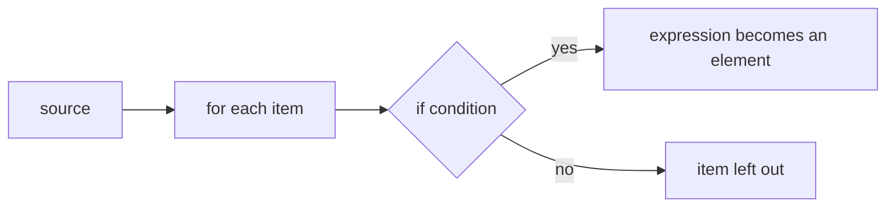

```python
temps = [18, 21, 19, 30]
hot = [t for t in temps if t >= 25]
```

`hot` is `[30]`. The source is unchanged. Nothing is appended by hand. The filter reads as part of the same sentence as the value.

A dict comprehension is the same sentence with a key and a value. `{sku: qty for sku, qty in pairs}` builds a table. If a key appears twice, the later value wins, because a dict holds one value per key and the comprehension assigns as it goes. The insertion order is the order of first appearance. Replacing a value does not move the key.

A set comprehension drops values that compare equal. `{name.lower() for name in names}` folds case and keeps each folded string once. The order of the set is not a promise, so wrap it in `sorted` when a test or a person needs a stable list. Sorting the set, not asking the set to remember order, is the whole trick.

### What a comprehension does not do

It does not replace a loop whose body prints, writes, or needs `try`. Those are statements. A comprehension is an expression. You can call a function inside it, and if that function prints, the print still happens, which is a side effect hiding in a place readers expect to be a pure build. Keep the expression free of side effects. Build the collection, then do the work in an ordinary loop if each item has a side effect.

Nesting is legal and usually a mistake past one level. `[x for row in grid for x in row]` flattens. Readers parse it from the outside `for` to the inside `for`, which is the opposite of the way the brackets look at a glance. A loop with one append is kinder when the flatten has a condition on both levels.

A comprehension builds the whole list, dict, or set before the next line runs. That is what you want for a few thousand prices. It is the wrong shape for a file of millions of lines when you only need a running total. A generator expression uses round brackets, `sum(n * n for n in nums)`, and yields one value at a time. It does not build the list. The parentheses of a function call can hold that expression without a second pair. Exhausting it once spends it. A list comprehension can be walked again because the list remains.

The condition filters. It does not catch exceptions. A key that might be absent still raises inside the expression. Guard in the `if`, or use `.get`, with the same care you would use in a loop.

### Where it breaks

A dict comprehension that silently replaces duplicate keys loses rows. If the second row is a correction, later-wins is what you want. If both rows should survive, the value has to be a list, and a comprehension that assigns `key: row` is the wrong shape. Group with a loop, or be sure the keys are unique.

A set comprehension of mutable-looking data still requires hashable values. A set of lists raises `TypeError`. A set of tuples of numbers works. And `True` collapses with `1` inside a set, the same way it does anywhere else equality and hashing meet.

The source is read in order, once. Deleting from the source inside the expression is the same bug as deleting during a `for` loop. Build a new collection. Leave the source alone.

### At work

Use a comprehension to filter and transform rows into the collection you will return. Put `sorted` outside a set comprehension when the caller sees a list. Prefer a loop when you are about to reach for a nested comprehension and a comment. Tests should assert the collection, including duplicates for a list, absence of duplicates for a set, and which duplicate key survived for a dict.

| Brackets | Result | Duplicates | Order |
|---|---|---|---|
| `[...]` | list | kept | source order |
| `{k: v ...}` | dict | later key wins | first insertion |
| `{v ...}` | set | dropped | not a promise |
| `(v ...)` in a call | generator expression | kept, one pass | source order, then spent |

### Filters that read as the collection

The condition belongs in the comprehension when it is part of the definition of the collection: active rows, positive quantities, codes long enough to be a sku. A condition that handles a special case, logs a skip, or counts how many were dropped does not belong there. The count of dropped rows is a second result, and a comprehension has one result. Write the loop, increment a counter, and append. You can still extract the pure filter later if it earns a name.

Unpacking in the `for` is the same unpacking as in a loop. `for sku, qty in pairs` fails if a pair has the wrong length, which is what you want when a short row is corrupt. `(sku, qty)` in the value position builds a tuple of the two, which is how you reshape a list of dicts into a list of pairs without a temporary. The expression can call a function. If the function can raise, the comprehension raises at that item and you do not get a partial list back. There is no `else` clause on the comprehension that runs when an item fails. Catch inside a named function, or filter first to the items you know are safe.

A dict built to index rows is a comprehension when each key is unique and the value is the row. `{row["sku"]: row for row in rows}` is that index. Duplicate skus keep the later row, with no signal. If a duplicate is a bug, the comprehension hides it. A loop that raises when the key is already present is longer and is the right length for an import. Use the comprehension when the contract really is "last write wins", and test a duplicate so that contract stays visible.

Generator expressions and list comprehensions look similar and behave differently once the consumer takes over. A list exists. You can len it, slice it, and walk it twice. A generator expression produces values for one consumer. `any` and `sum` are good consumers. Storing the generator and also passing it to a second function yields an empty second pass. If you need the items twice, build the list. The parentheses are a small mark for a large difference in lifetime.

### You can now

- Read a comprehension as value, `for`, and optional `if`.
- Pick list, dict, or set from whether you need order, keys, or uniqueness.
- Predict that a repeated dict key keeps the later value.
- Leave a side effect or a nested walk in an ordinary loop.

::: predict lang=python
code:
```python
words = ["Kube", "pod", "Node", "pod", "svc"]
print([w.lower() for w in words if len(w) > 3])
print({w.lower() for w in words} == {"kube", "pod", "node", "svc"})
print({w: len(w) for w in words[:2]})
```
answer:
```
['kube', 'node']
True
{'Kube': 4, 'pod': 3}
```
why: The filter keeps words longer than 3. The set removes the duplicate `pod`. The dict maps each of the first two words to its length.
:::

::: write lang=python
task: Write `active_emails(users)`: return a **sorted list of distinct, lower-cased emails** of users whose `active` is true. One comprehension (plus `sorted`) is enough.
starter:
```python
def active_emails(users):
    pass
```
tests:
```python
from solution import active_emails

def test_filters_and_dedupes():
    users = [
        {"email": "Ana@X.io", "active": True},
        {"email": "ben@x.io", "active": False},
        {"email": "ana@x.io", "active": True},
        {"email": "cai@x.io", "active": True},
    ]
    assert active_emails(users) == ["ana@x.io", "cai@x.io"]

def test_none_active():
    assert active_emails([{"email": "a@b.c", "active": False}]) == []
```
solution:
```python
def active_emails(users):
    return sorted({u["email"].lower() for u in users if u["active"]})
```
hint: A **set** comprehension removes duplicates; `sorted()` turns it into a sorted list.
:::

::: quiz
q: What does `{sku: qty for sku, qty in [("tea", 1), ("bun", 2), ("tea", 5)]}` store under `"tea"`?
- `1`, because a comprehension keeps the first assignment
+ `5`, because a later assignment to the same dict key replaces the value
- Both quantities, in a list `[1, 5]`
- A `KeyError`, because a comprehension rejects a repeated key
why: A dict holds one value per key. The comprehension assigns as it walks, so the second `"tea"` overwrites the first. The key stays where it was first inserted. If both rows must survive, the value has to be a collection built in a loop.
:::

::: predict lang=python
code:
```python
codes = ["ab", "abcd", "Ab"]
print([c.upper() for c in codes if len(c) >= 3])
print({c.lower(): len(c) for c in codes})
```
answer:
```
['ABCD']
{'ab': 2, 'abcd': 4}
```
why: `"ab"` and `"Ab"` both have length 2, so the list filter drops them and only `"abcd"` remains, uppercased. The dict still stores both keys. `"Ab"` writes `"ab"` again with length 2, and `"abcd"` stays 4. First-seen order puts `"ab"` before `"abcd"`.
:::

::: write lang=python
task: Write `loud_codes(codes)`. Return a sorted list of the distinct uppercased codes whose length is at least 4. Shorter codes are left out. Duplicates that fold to the same uppercase string appear once. An empty input returns an empty list.
starter:
```python
def loud_codes(codes):
    return sorted(codes)
```
tests:
```python
# Wrong answer: sorting the raw codes and keeping the short ones, so case and length both survive.
from solution import loud_codes

def test_filters_and_folds():
    assert loud_codes(["ab", "mint", "MINT", "pear"]) == ["MINT", "PEAR"]

def test_empty():
    assert loud_codes([]) == []

def test_none_long_enough():
    assert loud_codes(["a", "bb"]) == []
```
solution:
```python
def loud_codes(codes):
    return sorted({code.upper() for code in codes if len(code) >= 4})
```
hint: A set comprehension uppercases and drops duplicates. The filter is `len(code) >= 4`. Sort the set when you return it.
:::

::: card
q: When is a plain loop a better way to build a collection than a comprehension?
answer: When the body needs more than one statement, when it writes or prints, or when two levels of nesting take longer to read than a loop that appends. A comprehension is an expression for a filter and a transformation. A side effect hidden inside it still runs, and readers will not look for it there.
:::

## Counting, defaults, and deques
id: collections
stage: dicts
needs: dicts
minutes: 40
goal: Count with Counter, group with defaultdict, and keep a sliding window honest with a deque.
source: Python docs: collections | https://docs.python.org/3/library/collections.html

A dict already counts if you write the empty-key dance yourself: read the old total or zero, add one, store it back. That pattern is correct and noisy. `collections.Counter` is a dict built for the pattern. You construct it from an iterable of hashable items and it tallies them. `counts["oak"]` is how many times that item was seen. A key you never saw returns `0` and, unlike a `defaultdict`, the lookup does not insert the key. A missing tally really is zero, so asking does not pollute the dict. `Counter` is still a dict, so the keys still have to be hashable, and a list still cannot be a key.

`most_common(n)` returns the n highest counts as pairs. Ties are not alphabetical. They stay in first-seen order, because that is the order the dict already had. If two words both occur three times, the one that appeared earlier in the input wins `most_common`. That is a fine default for "what did we hit first," and it is the wrong default for "the name that sorts first." When a tie must be alphabetical, sort the keys yourself with a key of `(-count, word)`. The negative count sorts large tallies first, and the word breaks the tie in ordinary string order. An empty input has no winner. Returning `None` is more honest than returning an empty string, because an empty string can be a real token and `None` cannot be confused with one.

`defaultdict` solves a different hole. You pass a factory, usually `list`, `set`, or `int`. The first time you read a missing key, the factory is called, the result is stored under that key, and that result is returned. So `groups[city].append(name)` works on the first package for a city, with no `setdefault` and no `KeyError`. The cost is that a read is also a write. `city in groups` asks without creating. `groups[city]` creates. A debug print of a missing key, or a `.get` you rewrote as a subscript by habit, inserts an empty list and your later "which keys exist?" check is lying. Use `defaultdict` when every lookup in the loop is "give me the bucket I am about to fill." Use an ordinary dict when a missing key should stay missing.

Prefer `Counter` for a ready iterable and a zero-on-missing lookup. Prefer `defaultdict(list)` when you are grouping rows. A `Counter` of lists tries to hash each list and raises.

A `deque` is a sequence that is cheap at both ends. Appending or popping the right end of a list is cheap. `pop(0)` or inserting at the front is not, because every later item slides down. A deque keeps blocks so `append`, `appendleft`, `pop`, and `popleft` stay constant time. That matters once the sequence is long and the loop is hot. `deque(maxlen=3)` adds a second behavior: a new append past the maxlen drops the oldest item from the other end. A recent-error buffer is that object. You do not slice a log down to the last three lines yourself.

The same cheap ends are how a sliding-window maximum stays linear. The naive way recomputes `max` on every window of `k` items. That is correct and does too much work when both the list and the window are long, because each item is scanned again for every window that covers it. A deque of indexes can remember only the candidates that could still become the max. Walk the list once. Drop the left index when it has slid out of the window, which you can see because the index is less than or equal to `i - k`. Drop indexes from the right while their values are less than or equal to the new value, because a smaller, older item can never be the max while the new item is still inside the window. Then append the new index. The front of the deque is the index of the current maximum. You store indexes rather than values because the value cannot tell you when it expires. The index can.

Walk a temperature sample that is not a graded input. Values `[8, 3, 5, 4]`, window `3`. At 8 the deque holds index 0. At 3, 3 is smaller, so index 1 waits behind 0. At 5, 5 knocks out the older 3, and 5 is still below 8, so the deque holds indexes 0 then 2. The window is full and the max is 8. At 4, index 0 has fallen out of a window that ends at index 3, so it is popped from the left. 4 is below 5, so it waits behind index 2. The max is 5. The maxima are 8 then 5. A running max that only does `max(previous, new)` would still say 8 for the second window, because it never notices that 8 has left. That bug is why the index has to expire.

A short access log shows the three tools in their ordinary jobs.

```python
from collections import Counter, defaultdict, deque

paths = ["/", "/health", "/", "/v1"]
hits = Counter(paths)
by_status = defaultdict(list)
recent = deque(maxlen=3)
for path, status in [("/", 200), ("/v1", 500), ("/health", 200), ("/", 404)]:
    by_status[status].append(path)
    recent.append(status)
```

`hits["/"]` is 2 and `hits["/missing"]` is 0 without creating a key. `by_status[500]` is the list `["/v1"]`, created by the first append for that status. `list(recent)` is `[500, 200, 404]`, because the oldest 200 was pushed out by the maxlen. None of these lines sort a tie, and none of them compute a window maximum. They are the shapes you reach for before the problem gets a custom rule.

### Where it breaks

`most_common` on a tie stays green until two keys share the top count and the later alphabetical one appears first. A `defaultdict` subscript creates keys, so a report can list cities nobody ordered from. Ask with `in` before you read.

Indexing a deque walks from an end, and a deque has no slices. Use a list for random access and a deque for both ends. The window fails if you store values instead of indexes, or if `i - k` is off by one, because the old max then dies a step early or lives one extra window. Test the step where the max is the item leaving, not only the step where the new item is larger. A lookup that returned 0 did not insert that key, so two counters compare equal from the counts you actually added.

### At work

Status codes and paths become counters, and a tie has to be specified or two equal paths swap when the upstream order changes. Exceptions grouped by deploy id are a `defaultdict(list)` plus a sort of each bucket. The last n failures are a `deque(maxlen=n)`. A trailing maximum, such as the worst latency in each window, stays linear with a deque of indexes. Recomputing `max` on every slice is fine for a short test and becomes the hotspot once the window is wide.

### Which tool

| Job | Tool | Because |
|---|---|---|
| Tally hashable items from an iterable | `Counter` | missing keys read as 0 and are not inserted |
| A tie must follow a sort key, not first-seen order | `sorted` on the counter | `most_common` keeps first-seen order |
| Group items into lists without a KeyError | `defaultdict(list)` | the first read creates the bucket |
| Ask whether a bucket exists | `key in mapping` | a defaultdict subscript would create it |
| Queue, or a fixed trail of recent events | `deque`, often with `maxlen` | both ends are cheap, and maxlen drops the oldest |
| Max of each trailing window | `deque` of indexes | values do not know when they expire |

### You can now

- Count with `Counter` and break a tie by an explicit sort instead of `most_common`.
- Group with `defaultdict` and avoid creating keys you only meant to ask about.
- Say why `pop(0)` on a long list is the wrong queue.
- Explain a sliding-window maximum as a deque of indexes that expire on the left.
- Pick the container from the question, not from whichever one you imported last.

::: quiz
q: What does a defaultdict(list) do the first time you read a missing key?
- It raises KeyError, the same as an ordinary dict.
+ It calls list(), stores that new empty list under the key, and returns it, so an append works without an earlier assignment.
- It returns None and leaves the dict unchanged.
why: The factory runs on a missing lookup and the result is inserted immediately. That is why append works on the first sight of a key. It also means a lookup you meant as a question creates the key. Use `in` when you only wanted to ask.
:::

::: quiz
q: What does a Counter return for a key that was never counted?
+ 0, and it does not store that key.
- A KeyError, the same as an ordinary dict.
- None, and it stores the key with that value.
why: A tally that has not been seen is zero. Unlike defaultdict, the lookup does not insert, so a later pass over the keys does not suddenly contain everything you asked about. most_common still breaks ties by first-seen order, not by sorting the keys.
:::

::: predict lang=python
q: A Counter tallies characters. What does this print?
code:
```python
from collections import Counter
c = Counter("abca")
print(sorted(c.items()))
print(c["a"], c["z"])
```
answer:
```
[('a', 2), ('b', 1), ('c', 1)]
2 0
```
why: a occurs twice, and b and c occur once. sorted on the items orders them by the character, so the print does not depend on insertion order. The missing character z reads as 0 and is not inserted, which is why it does not appear in the items.
:::

::: write lang=python
task: Write `top_word(text)`. Split on whitespace, lowercase each word, and return the word with the highest count. If several words share that count, return the one that comes first alphabetically. Punctuation stays attached to the word. If there are no words, return None.
starter:
```python
def top_word(text):
    pass
```
tests:
```python
# Wrong answer tried: break ties by first-seen word via most_common, and return "" for empty text. "bb aa bb aa" came back as "bb" instead of "aa".
from solution import top_word

def test_tie_is_alphabetical():
    assert top_word("bb aa bb aa") == "aa"
    assert top_word("b a b a c c") == "a"

def test_case_and_single():
    assert top_word("One TWO one") == "one"
    assert top_word("solo") == "solo"

def test_empty():
    assert top_word("") is None
    assert top_word("   ") is None
```
solution:
```python
from collections import Counter

def top_word(text):
    words = text.lower().split()
    if not words:
        return None
    counts = Counter(words)
    return sorted(counts, key=lambda word: (-counts[word], word))[0]
```
hint: Count the lowercased words. Sort the keys by negative count, then by the word, and take the first. Return None when the split is empty. most_common is the wrong tie-break.
:::

::: write lang=python
task: Write `window_max(nums, k)`. Return the maximum of each contiguous window of length k, in order. k is an int of at least 1. If there is no full window, return an empty list. Use collections.deque in your solution. A running max that never forgets a value after it leaves the window is wrong.
starter:
```python
def window_max(nums, k):
    pass
```
tests:
```python
# Wrong answer tried: keep a running max and never drop the value that left the window, so window_max([3, 1, 2], 2) returned [3, 3] instead of [3, 2].
from solution import window_max

def test_max_must_expire():
    assert window_max([3, 1, 2], 2) == [3, 2]
    assert window_max([5, 4, 3, 2], 3) == [5, 4]

def test_k_equals_length():
    assert window_max([4, 1, 7], 3) == [7]
    assert window_max([9], 1) == [9]

def test_each_step_and_empty():
    assert window_max([1, 3, 2, 5], 1) == [1, 3, 2, 5]
    assert window_max([1, 2, 3, 4], 2) == [2, 3, 4]
    assert window_max([-2, -5, -1], 2) == [-2, -1]
    assert window_max([], 1) == []
```
solution:
```python
from collections import deque

def window_max(nums, k):
    waiting = deque()
    out = []
    for i, value in enumerate(nums):
        if waiting and waiting[0] <= i - k:
            waiting.popleft()
        while waiting and nums[waiting[-1]] <= value:
            waiting.pop()
        waiting.append(i)
        if i >= k - 1:
            out.append(nums[waiting[0]])
    return out
```
hint: Keep indexes in a deque, largest value at the left. Pop the left index when it slides out of the window. Pop smaller indexes from the right before you append the new index. Record the left value once the window is full.
:::

::: card
q: Why does a sliding-window maximum store indexes in a deque instead of storing only the values?
answer: The value says how large a candidate is, but only the index says when that candidate has slid out of the window. The deque holds indexes in decreasing order of value, drops an expired index from the left, and drops beaten indexes from the right. popleft stays cheap as the list grows. A running max that never expires reports a winner that is no longer in the window.
:::

## Project: a gradebook
id: p-gradebook
stage: dicts
needs: comprehensions, collections, tuples, sets
minutes: 70
project: yes
goal: Turn comma-separated grade rows into per-course lists, averages, a ranking, a missing-work list, and a stable report.
source: Python tutorial: Data structures | https://docs.python.org/3/tutorial/datastructures.html

A gradebook file is text in whatever order the export used this morning. The questions you actually ask are different: what a course contains, what a fair average is, who is ahead, which required pairs never arrived, and which lines a reviewer could diff tomorrow. Each question forces a shape. The project is that sequence.

`Priya, chemistry, 88` is not a record yet. Split on the comma and strip each field. Stripping only the whole line leaves the spaces that sit beside the commas. The score is still text. Convert it with `int`, not `float`, because a grade here is a whole number of points. `int` already raises ValueError on `"x"` and on `"9.5"`. Then reject integers outside 0 through 100 yourself, because `101` is a broken export, not extra credit. The wrong number of fields is ValueError too. Two fields have no score. Four fields usually mean a comma leaked into a name, and keeping the first three would store somebody else's column. The success value is the tuple `(student, course, score)`. A list would let a later helper append a letter grade and change the width every unpack assumes.

That tuple is the only row the rest of the project accepts. After parsing, nothing searches for a comma and nothing calls `int`. The exercises are graded one function at a time, so you inline the average rule instead of calling a sibling. In a real module one function would own that rule so the ranking and the report cannot drift. The contract is still a single rule.

Group by course next, because a teacher reads one class and the file is not sorted that way. The dict maps a course to a list of `(student, score)` pairs. The course is the key, so copying it into the pair would be a second value that can disagree. `setdefault` or a `defaultdict(list)` creates the list on the first row. Then sort each list by student name with ordinary, case-sensitive, stable order. Two exports of the same grades can arrive shuffled. If you keep file order, a diff of two correct runs is red everywhere. Stability matters when one student has two rows in a course: both scores are real, so sort by the name only and leave a tie in input order. Do not sort the caller's list.

The average is separate because two callers need it and an empty bag is not zero. Use true division, so `1` and `2` become `1.5`, then `round(mean, 2)` so the ranking and the report share a hundredth. An empty list raises ValueError. Substituting zero would rank a missing student as a failure and would print `0.00` for a course that has no rows. `round` is half-even on exact halfway cases, and many decimals are not exact in binary: `round(2.675, 2)` is `2.67`, and `round(1.005, 2)` is `1.0`. Keep the inputs as whole points and round once. Formatting with two digits turns `80.5` into the text `80.50`. That format is not a second rounding.

Ranking groups the other way: by student, across courses. Priya's `88` and `91` are one person at `89.5`. Jonah's `73` stands alone. The list is `(student, average)`, sorted by average descending and then by name ascending, so a tie does not follow the file. A key of negative average, then name, uses the ascending sort Python already has. Students with no rows do not appear. An empty file is an empty ranking, not an error, because "nobody" is a real result. You only average a bucket that at least one row created.

Missing work is a set of pairs that do occur. A score of zero still occurs: the student submitted and scored nothing. Walk the roster and the catalog, not "whoever showed up in the file." A row for an unknown student does not invent a required pair. Emit an absent pair as `"student course"`. Names have no spaces, so that string sorts like the pair. Take each required name once, or a duplicated roster line will duplicate the gap. Membership in the set is the whole test. Scanning the file once per pair only repeats the same question more slowly.

The report is the grouping plus the average, rendered as text a diff can eat. Courses go in alphabetical order, not file order, for the same reason the student lists are sorted. For the sample rows Priya chemistry `88`, Jonah chemistry `73`, and Priya physics `91`, chemistry sorts before physics, and inside chemistry Jonah sorts before Priya. The lines are:

```
COURSE chemistry
Jonah 73
Priya 88
average 80.50

COURSE physics
Priya 91
average 91.00
```

A block is `COURSE` and the name, then `student score` as a plain integer (`0`, not `0.0`), then `average` and the mean with exactly two decimal places. One blank line sits between blocks only. Empty input is an empty list, not a list that holds an empty string. Two scores for the same student both appear, in input order when the name ties, and both enter the mean.

The pipeline is a boundary, an index, a reduction, a sort, a set difference, and a renderer. The renderer is the only step allowed to care about spaces and decimal places. A ranking that returned preformatted lines could not be sorted as numbers anymore. Skip a shape and the bug is predictable: a list where a tuple belongs, a zero where an error belongs, file order where a name sort belongs, or a zero score reported missing because the code looked for a positive number instead of a key.

### Where it breaks

A comma inside a name breaks the split. `Ada, Lovelace, chemistry, 90` has four fields and must raise. The `csv` module would understand quotes. This project keeps the split visible, so do not keep the first three fields and hope.

`int("+88")` is `88` and `int("08")` is `8`. Store that integer. `100` is valid. `100.0` is not, because `int` rejects the dot. Case is significant: `priya` and `Priya` are different students. The report lists only courses that have a row. An empty required course shows up in the missing list, once per roster student, not as a fake average of zero.

### At work

Billing files and rosters are the same skeleton: parse strictly, key a dict, reduce with an explicit empty policy, sort so the page is stable, and compute absence from the required set rather than from whoever appeared in the file. Pin the report text, including the blank line between groups, so a sort regression fails in the diff. A second helper that floor-divides "just for a badge" will contradict the page, and the contradiction will be blamed on the data.

### Which shape answers which question

| Question | Shape | Because |
|---|---|---|
| Was this line a real grade? | a tuple, or ValueError | three fields, score in 0..100, no partial row |
| What is on each course? | dict of course to sorted `(student, score)` pairs | the key is the course, and the sort stabilizes the file |
| What is the mean? | `round(sum / count, 2)`, or ValueError if empty | zero is a fake mean, and the hundredth must be shared |
| Who is ahead? | list of `(student, average)` sorted by average desc, name asc | a tie must not follow file order |
| Which required work never arrived? | sorted `"student course"` strings from a set difference | a zero score is present, and the roster defines required |
| What do we show a reviewer? | exact lines, courses A to Z, two decimal places | a diff cannot review an unordered set |

### You can now

- Parse a padded comma line into a fixed tuple and reject a bad width or a bad score.
- Group rows by course without losing a second score for the same student.
- Average with shared rounding, and refuse the empty case instead of returning zero.
- Rank students by that average with a name as the tie-break.
- List missing roster pairs with a set, treating a zero as present.
- Render a report whose exact text stays put when the input rows are shuffled.

::: write lang=python
task: Write `parse_row(line)`. Split on commas and strip each field. A row must have exactly three fields, otherwise raise ValueError. The score field must be accepted by int, and the integer must be from 0 through 100 inclusive, otherwise raise ValueError. Return `(student, course, score)` with the stripped student and course. Do not require the names to be non-empty. `int` may accept a leading plus or zeros; store the integer it returns.
starter:
```python
def parse_row(line):
    pass
```
tests:
```python
# Wrong answer tried: skip strip and keep an out-of-range score, so " Ana , math , 91 " stayed padded and 101 was returned instead of raising ValueError.
from solution import parse_row

def _raises(fn):
    try:
        fn()
    except ValueError:
        return
    raise AssertionError("expected ValueError")

def test_basic_and_padding():
    assert parse_row("Ana, math, 91") == ("Ana", "math", 91)
    assert parse_row(" Ana , math , 91 ") == ("Ana", "math", 91)
    assert parse_row("Ana,math,0") == ("Ana", "math", 0)
    assert parse_row("Ana,math,100") == ("Ana", "math", 100)

def test_bad_width():
    _raises(lambda: parse_row("Ana, math"))
    _raises(lambda: parse_row("Ana, math, 91, extra"))

def test_bad_score():
    _raises(lambda: parse_row("Ana, math, 101"))
    _raises(lambda: parse_row("Ana, math, -1"))
    _raises(lambda: parse_row("Ana, math, 9.5"))
    _raises(lambda: parse_row("Ana, math, x"))
    _raises(lambda: parse_row("Ana, math, "))
```
solution:
```python
def parse_row(line):
    parts = [part.strip() for part in line.split(",")]
    if len(parts) != 3:
        raise ValueError("expected student, course, score")
    student, course, raw = parts
    try:
        score = int(raw)
    except ValueError:
        raise ValueError("score must be an integer") from None
    if score < 0 or score > 100:
        raise ValueError("score out of range")
    return (student, course, score)
```
hint: Strip every comma-separated field, require exactly three, convert the last with int, and reject an integer outside 0 through 100.
:::

::: write lang=python
task: Write `by_course(rows)`. Each row is a tuple `(student, course, score)`. Return a dict mapping each course to a list of `(student, score)` pairs. Keep every row, including two scores for the same student in one course. Sort each list by student name using ordinary string order, and when the name ties keep the original relative order. Do not mutate the input list. An empty input returns an empty dict.
starter:
```python
def by_course(rows):
    pass
```
tests:
```python
# Wrong answer tried: group the pairs but leave each course in input order, so math was [("Bo", 80), ("Ana", 100)] instead of sorted by student.
from solution import by_course

def test_groups_and_sorts():
    rows = [("Bo", "math", 80), ("Ana", "math", 100), ("Ana", "art", 70)]
    assert by_course(rows) == {
        "math": [("Ana", 100), ("Bo", 80)],
        "art": [("Ana", 70)],
    }

def test_duplicate_student_keeps_order():
    rows = [("Ana", "math", 20), ("Bo", "math", 10), ("Ana", "math", 15)]
    assert by_course(rows)["math"] == [("Ana", 20), ("Ana", 15), ("Bo", 10)]

def test_empty_and_input():
    assert by_course([]) == {}
    rows = [("Bo", "math", 80), ("Ana", "math", 100)]
    by_course(rows)
    assert rows == [("Bo", "math", 80), ("Ana", "math", 100)]
```
solution:
```python
def by_course(rows):
    grouped = {}
    for student, course, score in rows:
        grouped.setdefault(course, []).append((student, score))
    for course in grouped:
        grouped[course] = sorted(grouped[course], key=lambda pair: pair[0])
    return grouped
```
hint: Append (student, score) under the course, then sort each list by the student only so equal names keep their original order.
:::

::: write lang=python
task: Write `average(scores)`. Return the arithmetic mean of the numbers, rounded with round(mean, 2). Use true division, not floor division. An empty sequence raises ValueError.
starter:
```python
def average(scores):
    pass
```
tests:
```python
# Wrong answer tried: floor division and a 0 for the empty case, so average([1, 2]) was 1 instead of 1.5 and average([]) returned 0.
from solution import average

def test_mean_and_rounding():
    assert average([1, 2]) == 1.5
    assert average([90, 91]) == 90.5
    assert average([1, 1, 2]) == 1.33
    assert average([100]) == 100.0

def test_empty():
    try:
        average([])
    except ValueError:
        return
    raise AssertionError("expected ValueError")
```
solution:
```python
def average(scores):
    if not scores:
        raise ValueError("no scores")
    return round(sum(scores) / len(scores), 2)
```
hint: Reject an empty sequence. Otherwise return round(sum(scores) / len(scores), 2).
:::

::: write lang=python
task: Write `ranking(rows)`. Each row is `(student, course, score)`. Return a list of `(student, average)` pairs. Average every score that student has, across courses, with round(mean, 2) and true division. Sort by that average descending, then by student name ascending. Do not call any other gradebook function. An empty input returns an empty list.
starter:
```python
def ranking(rows):
    pass
```
tests:
```python
# Wrong answer tried: sort by name only and skip rounding, so a lower average named Ana ranked above Bo, and 4/3 stayed an unrounded float.
from solution import ranking

def test_order_and_rounding():
    rows = [
        ("Bo", "math", 1),
        ("Bo", "art", 2),
        ("Ana", "math", 1),
        ("Ana", "art", 1),
        ("Ana", "lab", 2),
    ]
    assert ranking(rows) == [("Bo", 1.5), ("Ana", 1.33)]

def test_tie_breaks_by_name():
    rows = [("Cai", "math", 10), ("Bea", "math", 10)]
    assert ranking(rows) == [("Bea", 10.0), ("Cai", 10.0)]

def test_empty():
    assert ranking([]) == []
```
solution:
```python
def ranking(rows):
    totals = {}
    counts = {}
    for student, _course, score in rows:
        totals[student] = totals.get(student, 0) + score
        counts[student] = counts.get(student, 0) + 1
    ranked = [
        (student, round(totals[student] / counts[student], 2))
        for student in totals
    ]
    ranked.sort(key=lambda item: (-item[1], item[0]))
    return ranked
```
hint: Sum and count per student, round sum/count to 2 decimals, then sort by negative average and then by name. Do not call average().
:::

::: write lang=python
task: Write `missing(rows, students, courses)`. Each row is `(student, course, score)`. Return a sorted list of "student course" strings, separated by one space, for every pair of a required student and a required course that has no row. A score of 0 still counts as present. Duplicate names in the student or course lists emit the pair only once. Names contain no spaces. Rows whose student or course is not in the required lists do not add lines. Do not call any other gradebook function.
starter:
```python
def missing(rows, students, courses):
    pass
```
tests:
```python
# Wrong answer tried: emit every roster pair including ones that already have a row, joined with a comma, so a present pair was included and the separator was wrong.
from solution import missing

def test_absent_pairs_only():
    rows = [("Ana", "math", 90)]
    assert missing(rows, ["Ana", "Bo"], ["math", "art"]) == [
        "Ana art",
        "Bo art",
        "Bo math",
    ]

def test_zero_is_present_and_duplicates_collapse():
    assert missing([("Ana", "math", 0)], ["Ana", "Ana"], ["math", "math"]) == []
    assert missing([], ["Bo", "Ana"], ["math"]) == ["Ana math", "Bo math"]
```
solution:
```python
def missing(rows, students, courses):
    have = {(student, course) for student, course, _score in rows}
    found = []
    for student in sorted(set(students)):
        for course in sorted(set(courses)):
            if (student, course) not in have:
                found.append(f"{student} {course}")
    return found
```
hint: Put the present (student, course) pairs in a set. Walk each required name once, and append "student course" when the pair is absent. The nested walk over sorted unique names is already sorted.
:::

::: write lang=python
task: Write `report_lines(rows)`. Each row is `(student, course, score)`. Return a list of strings. Group by course and emit courses in alphabetical order. A course block is a line `COURSE name`, then one line per row `student score` with students sorted alphabetically and tied names left in their original relative order, then a line `average X` where X is the mean of that course rounded with round(mean, 2) and formatted with exactly two digits after the decimal point. Put one blank line between blocks and nowhere else. Both scores count when a student has two rows in a course. An empty input returns an empty list. Do not mutate the input. Do not call any other gradebook function. For rows `[("Bo", "math", 80), ("Ana", "math", 100), ("Ana", "art", 70)]` the list is exactly:
```
COURSE art
Ana 70
average 70.00

COURSE math
Ana 100
Bo 80
average 90.00
```
starter:
```python
def report_lines(rows):
    pass
```
tests:
```python
# Wrong answer tried: courses in input order, averages printed with the default float text so 90.0 showed as 90.0 instead of 90.00, and no blank line between blocks.
from solution import report_lines

def test_exact_report():
    rows = [("Bo", "math", 80), ("Ana", "math", 100), ("Ana", "art", 70)]
    assert report_lines(rows) == [
        "COURSE art",
        "Ana 70",
        "average 70.00",
        "",
        "COURSE math",
        "Ana 100",
        "Bo 80",
        "average 90.00",
    ]

def test_duplicate_rows_keep_order_and_both_scores():
    rows = [("Cai", "band", 2), ("Cai", "band", 1)]
    assert report_lines(rows) == [
        "COURSE band",
        "Cai 2",
        "Cai 1",
        "average 1.50",
    ]

def test_empty_zero_and_input():
    assert report_lines([]) == []
    assert report_lines([("Ana", "art", 0)]) == [
        "COURSE art",
        "Ana 0",
        "average 0.00",
    ]
    rows = [("Bo", "math", 80), ("Ana", "art", 70)]
    report_lines(rows)
    assert rows == [("Bo", "math", 80), ("Ana", "art", 70)]
```
solution:
```python
def report_lines(rows):
    grouped = {}
    for student, course, score in rows:
        grouped.setdefault(course, []).append((student, score))
    lines = []
    for course in sorted(grouped):
        if lines:
            lines.append("")
        lines.append(f"COURSE {course}")
        items = sorted(grouped[course], key=lambda pair: pair[0])
        for student, score in items:
            lines.append(f"{student} {score}")
        scores = [score for _student, score in grouped[course]]
        mean = round(sum(scores) / len(scores), 2)
        lines.append(f"average {mean:.2f}")
    return lines
```
hint: Group pairs by course, walk the course names in sorted order, and put a blank line before every block after the first. Sort each course's rows by student only. Format the rounded mean with two decimal places.
:::

## Errors and exceptions
id: exceptions
stage: errors
needs: functions
minutes: 40
goal: Catch a specific failure, clean up on every exit, and raise an error that names what went wrong.
source: Python tutorial: Errors and exceptions | https://docs.python.org/3/tutorial/errors.html

A bad quantity that becomes a zero is worse than a crash at the parse. The caller stores the zero, the stock movement looks legitimate, and the shelf count drifts until someone notices a week later. The function that saw the bad text was the place that knew what was wrong. It swallowed the failure, so the traceback never pointed there. An exception is how a function refuses to invent an answer. If nobody handles it, Python stops and prints a traceback. That stop is the useful outcome when the alternative is silent wrong data.

Read a traceback from the bottom. The last line is the exception type and the message. Above it, the stack is the chain of calls that were still running, with the innermost frame last. The file and line on that bottom frame are where the exception was raised, which is often not where the bug was decided. A `TypeError` on `None + 1` points at the addition. The function that returned `None` is a frame or two higher. Start at the error, then walk up until a frame is code you own and ask what that frame assumed.

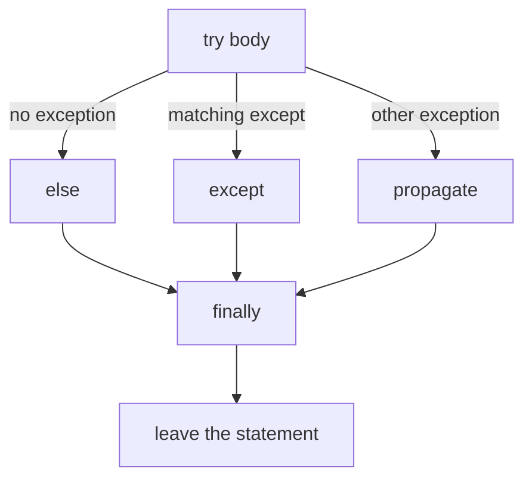

`try` marks the region that might fail. `except SomeError` runs only when that type, or a subclass of it, is raised inside the try. `else` runs only when the try finished without an exception. `finally` runs on the way out in every case: success, a handled error, an error that is still propagating, and a `return` or `break` that leaves the try. Cleanup belongs in `finally` because the other clauses are conditional. Closing a socket, releasing a lock, or finishing a unit of work has to happen when the work failed too.

### Catch the failure you can name

An `except` clause names a type. `except ValueError` does not catch `KeyError` or `TypeError`. That narrowness is the point. A bug is often a type you did not expect, and a wide net turns the bug into a quiet continue. A bare `except:` catches `BaseException`, including `KeyboardInterrupt` and `SystemExit`, so it also swallows a request to stop the process. `except Exception` is narrower than a bare except, and it is still too wide when the body is `pass`. The program then carries on as if the operation worked. Catch the specific error you can repair or translate, and let every other error propagate to a place that can log it or crash.

The `as` name is the exception object. `except ValueError as err` binds that object for the handler. The message is `str(err)`. Two different failures that share a type are a sign you wanted a more specific type of your own, because the caller cannot tell them apart except by reading the message. The name `err` is removed when the handler ends, so keep the message in an ordinary variable if something after the `try` still needs it.

Order matters when you list several handlers. Python picks the first matching clause. A subclass listed after its parent never runs, because the parent already matched. `FileNotFoundError` is a subclass of `OSError`, so the file-not-found handler has to come first. If you only know how to handle the missing file, do not also catch `OSError`. A disk-full error would then look handled.

### else is the success path, finally is the exit

`else` exists so that code which should run only on success is not inside the `try`. If that success code raised, an `except` aimed at the risky call would also catch the success code's bugs. A conversion that might raise `ValueError` stays in the `try`. The work that uses the converted value goes in `else`, where a later `KeyError` propagates instead of being reported as a bad conversion.

`finally` does not decide whether the operation succeeded. It runs, and then the original outcome continues. If the `try` was leaving by `return`, `finally` runs before the caller receives that value. If an exception was propagating, `finally` runs and then the exception continues, unless the `finally` itself raises or returns. A `return` inside `finally` replaces the value the `try` was going to return, and it also discards an exception that was in flight. The caller sees the cleanup's return value and never sees the real failure. Use `finally` to release a resource, and let the return or the exception that was already chosen stay in charge.

A handler can raise a new exception. That new exception becomes the one the caller sees. By default Python also remembers the original as the context, and the traceback prints that another exception occurred while one was being handled. `raise ShelfError("bad code") from err` sets the cause explicitly, and the traceback says the new error was the direct result of the old one. `raise ShelfError("bad code") from None` sets the cause to `None` and suppresses the context, so the caller sees only the message you wrote. Suppress the context when the original message is an implementation detail you have already explained in the caller's vocabulary. Keep the chain when the operator needs the root cause, such as a permission failure underneath a higher-level "could not publish" error.

### Your own type

`ValueError` means a builtin operation rejected a value. Once the failure is about your domain, a subclass of `Exception` tells the caller what to catch without catching every bad value in the process.

```python
class ShelfError(Exception):
    pass

def shelf_row(code):
    try:
        letter, number = code.split("-")
        row = int(number)
    except ValueError:
        raise ShelfError(f"bad shelf code: {code!r}") from None
    if letter not in "ABC" or row < 1:
        raise ShelfError(f"unknown shelf: {code!r}")
    return letter, row
```

`shelf_row("B-4")` returns `("B", 4)`. `shelf_row("nope")` raises `ShelfError` and hides the `ValueError` from `split` or `int`, because the caller asked for a shelf, not for a lecture on those builtins. `shelf_row("Z-1")` raises `ShelfError` from the range check. Same type, different rule, so the message has to say which rule failed. A caller that can pick another shelf writes `except ShelfError`. A caller that cannot handles nothing, and the program stops with the message.

The message should name the rule and the value received. `f"bad shelf code: {code!r}"` uses the repr, so a string of spaces is visible and is not confused with a blank display. A message that says only "invalid" forces the next person to reproduce the call to learn what arrived. If you add fields later, put them on the exception instance as attributes. Callers can read attributes. They should not have to scrape a sentence.

### EAFP, and when the check is the better tool

"Easier to ask forgiveness than permission" means you attempt the operation and handle the exception, instead of checking a precondition that can disagree with the operation. `int(text)` either returns an integer or raises `ValueError`. A handwritten scan of the characters can reject a string that `int` would accept, including surrounding spaces, or accept one that `int` would reject. The operation is the authority. Catch the error it actually raises.

Look before you leap still wins when the check is the whole question and there is no operation to attempt, or when a failed attempt would have a side effect you cannot undo. Asking whether a key is in a dict, when a missing key is a normal branch and you do not want an exception for control flow, is a membership test. Charging a card and catching every error is not a membership test. The failure should stay visible, and the success path should stay readable, so you attempt the charge and handle the decline type you know.

Exceptions are a poor replacement for ordinary control flow. Using `try` around one field conversion is a parse. Using an exception to break out of a loop three functions up forces the reader to search for the handler to learn where the loop goes. Return a value or set a flag when the branch is normal. Raise when the contract cannot be kept.

### Where it breaks

The quiet failure is `except Exception: pass`, or a log line and then nothing. The row was not written, and the next statement behaves as if it was. The traceback was the evidence, and the handler destroyed it. If you catch a wide type at a process boundary, log the traceback and then re-raise, or translate into one error the boundary documents. Do not continue the happy path.

A second break is an `except` that wraps more than the line that can fail. The `try` contains the conversion, the database write, and the email. A `ValueError` from a bug in the email builder is reported as a bad request. Shrink the `try` until it covers one operation, and put the following steps in `else` or after the whole statement.

A third is losing the chain by accident, or keeping a chain that leaks a secret. `from None` is a choice you make because the original text would confuse the caller. A token that arrived inside the original message should not be copied into the new message either. A fourth is `return` inside `finally`, which replaces a real result with whatever the cleanup returned, often `None`. The caller then fails on that `None` in a later function, and the original reason is gone. A fifth is a test that catches `Exception` so the suite stays green when the function raises. The assertion never ran. The test hid the failure it was supposed to prove.

### At work

Library code raises specific errors and rarely catches them. The caller knows the context. The library does not. Application code at the edge of a request, a job, or a command catches the errors it can turn into a response, and lets the rest crash the task so a supervisor can retry it and the log has a stack. A domain error such as `ShelfError` is part of the API. A `TypeError` is a bug. Do not convert bugs into a client error that says the request was bad, because the client will retry a call that cannot succeed until the code changes, and the bug will look like user error in the metrics.

In review, ask what the handler does that a crash would not do better. If the answer is "keep going", the handler needs a reason that is true for that type alone. Ask whether `finally` can raise. A cleanup error that replaces the original error is a worse page, because the person on call sees the secondary failure and starts investigating the lock or the socket instead of the bug that happened first. Catch inside the cleanup only when you can name that secondary error, log it, and leave the first exception in flight.

### A decision table

| Situation | What to write | Why |
| --- | --- | --- |
| You can repair one known failure | `except ThatError` | Other bugs still crash and keep their traceback |
| Success code must not be caught by the handler | `else` | An exception in `else` is a different failure from the one you handled |
| A resource must be released on every exit | `finally`, with no `return` inside it | It runs after success, after a handler, and while an exception propagates |
| The caller needs your words, not the builtin message | `raise DomainError(...) from None` | The context is suppressed, so one message is the story |
| The caller needs the root cause | `raise DomainError(...) from err` | The traceback names the direct cause |
| A missing key is an ordinary branch | A membership test | An exception for a normal case is harder to read than `in` |
| You are at a process boundary and the error is unexpected | Log the traceback and re-raise, or exit | Swallowing it continues with a lie |

### You can now

You can read a traceback from the bottom and separate the raising line from the bug that caused it. You can put a risky call in `try`, the success path in `else`, and the cleanup in `finally`. You can catch one specific type, raise a domain error whose message includes the bad value, and choose `from err` or `from None` on purpose. You can say why `except Exception: pass` hides bugs, and why a precondition check is the wrong tool when the operation itself is the authority.

::: quiz
q: What's wrong with this?

```python
try:
    charge(card, amount)
except Exception:
    pass
```
- Nothing, it prevents crashes
+ Every failure, including bugs and declined payments, disappears silently and the code carries on as if it charged
- `pass` isn't allowed inside `except`
- It should be `except Exception as e: pass`
why: The worst bugs are the ones that don't crash. Catch the specific errors you can handle, and log or re-raise the rest.
:::

::: predict lang=python
code:
```python
def f():
    try:
        print("try")
        return "from try"
    finally:
        print("finally")

print(f())
```
answer:
```
try
finally
from try
```
why: `finally` runs on the way out of the `try`, even when it's leaving through a `return`. The return value is printed after.
:::

::: write lang=python
task: Write `parse_config(lines)`. Each line is `key=value`. Blank lines and lines starting with `#` are skipped. Return a dict. A line without `=` raises `ValueError` whose message includes the **1-based line number** (for example `"line 3: expected key=value"`).
starter:
```python
def parse_config(lines):
    pass
```
tests:
```python
from solution import parse_config

def test_parses():
    assert parse_config(["# app", "port=8080", "", "host = db "]) == {"port": "8080", "host": "db"}

def test_bad_line_has_number():
    try:
        parse_config(["a=1", "", "oops"])
    except ValueError as e:
        assert "line 3" in str(e)
        return
    assert False, "a line without = should raise ValueError"

def test_value_may_contain_equals():
    assert parse_config(["url=http://x?a=b"]) == {"url": "http://x?a=b"}
```
solution:
```python
def parse_config(lines):
    config = {}
    for number, line in enumerate(lines, start=1):
        line = line.strip()
        if not line or line.startswith("#"):
            continue
        if "=" not in line:
            raise ValueError(f"line {number}: expected key=value")
        key, value = line.split("=", 1)
        config[key.strip()] = value.strip()
    return config
```
hint: `line.split("=", 1)` splits only at the first `=`. Strip spaces around keys and values.
:::


::: quiz
q: A function must close a socket whether the work succeeds, returns early, or raises. Where does the close belong?
- In the else clause, because else runs both when the try succeeded and when it raised
+ In finally, because finally runs on the way out in every case, and else runs only when the try did not raise
- In the except clause, because cleanup matters only after a failure
- After the whole try statement, because an exception always comes back and continues on the next line
why: else is the success path. Code after the try statement does not run if an exception is still propagating. finally runs before that propagation continues, and it also runs when the try returns, so the close belongs there. A return inside finally would replace the original result, so the finally should close the socket and not return a value.
:::

::: predict lang=python
q: What does this print? One call takes a number, and one call does not.
code:
```python
def classify(text):
    try:
        n = int(text)
    except ValueError:
        print("bad")
    else:
        print("good")
        print(n)
    finally:
        print("done")

classify("8")
classify("no")
```
answer:
```
good
8
done
bad
done
```
why: int("8") succeeds, so else prints good and the number, then finally prints done. int("no") raises ValueError, so the except prints bad and else is skipped, then finally still prints done. The second call does not print a number because the conversion never produced one.
:::

::: write lang=python
task: Write `positive_qty(text)`. It returns `int(text)` when that integer is 1 or greater. `int` already accepts surrounding spaces. If `int` raises `ValueError`, raise a new `ValueError` whose message contains `not a number`, and attach it with `from None` so the original conversion error is suppressed. If the integer is below 1, raise `ValueError` whose message contains `at least 1`. Do not turn a bad value into 0.
starter:
```python
def positive_qty(text):
    return int(text)
```
tests:
```python
# Wrong answer: return int(text) unchanged, so 0 is accepted and a word leaks the raw conversion error, or return 0 when the text is not a number.
from solution import positive_qty

def test_accepts():
    assert positive_qty("4") == 4
    assert positive_qty(" 3 ") == 3

def test_zero():
    try:
        positive_qty("0")
    except ValueError as err:
        assert "at least 1" in str(err)
        return
    raise AssertionError("0 should raise")

def test_negative():
    try:
        positive_qty("-2")
    except ValueError as err:
        assert "at least 1" in str(err)
        return
    raise AssertionError("negative should raise")

def test_word_hides_context():
    try:
        positive_qty("x")
    except ValueError as err:
        assert "not a number" in str(err)
        assert err.__suppress_context__ is True
        return
    raise AssertionError("a word should raise ValueError")
```
solution:
```python
def positive_qty(text):
    try:
        n = int(text)
    except ValueError:
        raise ValueError(f"not a number: {text!r}") from None
    if n < 1:
        raise ValueError("qty must be at least 1")
    return n
```
hint: Call int inside try. On ValueError, raise a new ValueError from None. After a successful conversion, reject anything below 1, then return the integer.
:::

::: card
q: When do you attach a new error with "from err", and when with "from None"?
answer: Use "from err" when the caller needs the original failure as the direct cause, so the traceback keeps the chain. Use "from None" when you have already explained the failure in the new message and the original text would be noise or a leak. "from None" sets the cause to None and suppresses the context. A bare raise of a new error keeps the context and prints both.
:::

## Files, JSON and paths
id: files
stage: errors
needs: exceptions, dicts
minutes: 40
goal: Read and write text, JSON, and CSV with paths and encodings that survive another machine.
source: Python docs: pathlib | https://docs.python.org/3/library/pathlib.html
source: Python docs: json | https://docs.python.org/3/library/json.html
source: Python docs: csv | https://docs.python.org/3/library/csv.html

A report that opens on your laptop and fails on the server is usually a path, an encoding, or a file left open. The string `"data" + "/" + name` works until a name is absolute, or the program runs on a system that uses a different separator, or the directory was never created. The file object from a bare `open` stays open when the next line raises, and a later part of the same process hits a limit on open files that looks unrelated to the report. Paths, text encoding, and a guaranteed close are one problem. The bytes on disk are useless if you cannot name them, decode them, and give the descriptor back.

`pathlib.Path` is the object to build those names with. The `/` operator joins segments and refuses to pretend that string addition knows what a directory is. `Path("data") / "2026" / "jan.json"` is a path whether or not the file exists yet. Existence is a separate question, `exists()`, and it can change before you use the answer, so a check followed by an open is not a lock. `suffix` is the last suffix, including the dot, so `jan.json` has suffix `.json`. `parent` is the directory that contains the path. `parent.mkdir(parents=True, exist_ok=True)` creates that directory and any missing ancestor, and it does not raise when the directory is already there. `exist_ok=True` is what makes the call safe to repeat. Without it, the second run crashes on a directory the first run created.

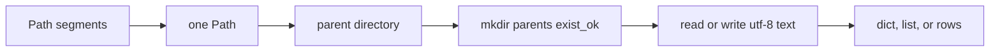

### Text is an encoding, not a hope

A file on disk is bytes. A `str` is Unicode text. Something has to say which encoding turns one into the other. If you omit `encoding`, Python uses the locale's preferred encoding, which is UTF-8 on many developer machines and something else on a server or a colleague's laptop. The file you wrote is then undecodable in the other place, or it decodes into different characters and the bug looks like bad data. Pass `encoding="utf-8"` on every text open, `read_text`, and `write_text`. UTF-8 can represent every Unicode character, it is the encoding JSON requires, and it is the one other tools expect from a new file.

Binary mode is the other door. `open(path, "rb")` returns bytes and does not take a text encoding. Use it for images, archives, and formats whose library wants bytes. Using text mode on those files splits on the wrong boundaries and may change newline bytes. Using binary mode on a CSV forces you to decode by hand. Pick the mode that matches the consumer.

Small configuration files fit in a string. `Path(path).read_text(encoding="utf-8")` reads the whole file. `write_text` replaces the whole file. A multi-gigabyte log should not go through `read_text`, because the string has to live in memory. Iterate the file object instead. Each iteration yields one line, and only that line has to be resident. A missing path raises `FileNotFoundError`, a subclass of `OSError`. It does not return an empty string, and it does not create the file. Create a file by writing it. Catch `FileNotFoundError` only when absence is a case you have a response for, such as a first run with no saved state.

### with closes on the way out

`open` returns a file object that holds an operating-system descriptor. The descriptor is released when the file is closed. A `with` statement is a context manager: it calls the file's closing method when the block ends, including when the block raises or returns. That is the difference from `f = open(...)` followed by a `close()` on the next line. The `close()` never runs if the line between them raises, and it never runs if someone returns early. The `with` form runs the close anyway.

```python
import json
from pathlib import Path

def dock_names(path):
    raw = Path(path).read_text(encoding="utf-8")
    payload = json.loads(raw)
    return [dock["name"] for dock in payload["docks"]]
```

`read_text` is itself a small `with`. It opens, reads, and closes. Use the longer `with Path(path).open(...)` when you need to iterate, pass the file to another library, or write in pieces. `Path.open` takes the same encoding argument as the builtin. For a loop over lines, `for line in handle` is the streaming form. `line.rstrip("\n")` removes the line ending the iterator kept. Stripping with a bare `strip()` also removes spaces the line was allowed to contain, so only strip the ending unless the format says surrounding space is decoration.

### JSON remembers fewer types than Python

`json.loads` turns a JSON string into Python objects. A JSON object becomes a `dict`. A JSON array becomes a `list`. Numbers become `int` or `float`. `true`, `false`, and `null` become `True`, `False`, and `None`. Strings stay strings. That is the whole set. A tuple encoded with `json.dumps` is written as an array, because JSON has no tuples, and `json.loads` builds a list for every array. A `set` is not serializable. A `datetime` is not serializable. Both raise `TypeError` from `json.dumps` unless you convert them first. Convert a timestamp to an ISO string before you dump it, and convert it back after you load it. The file will not remember the Python type for you.

`json.dumps(payload, sort_keys=True)` writes object keys in sorted order. Dicts remember insertion order, so two processes that built the same mapping in a different order would otherwise produce different bytes. Sorted keys make a diff show a real change. `indent=2` is for files a person will read. A machine-to-machine payload can stay on one line. `json.load` and `json.dump` take a file object instead of a string. The file still wants `encoding="utf-8"`, because the json module does not open the path itself.

### CSV and the newline argument

CSV is text with a grammar the `csv` module already implements. `csv.DictReader` uses the first row as keys and yields one dict per following row. Every value is a string, including numbers, because the file does not store types. Convert the fields you will do arithmetic on. A missing column is a `KeyError` when you look it up, which is the right failure. Inventing a zero hides a broken export.

Open the file with `newline=""` as well as `encoding="utf-8"`. The csv module wants to see newline characters itself so it can handle quoted fields that contain line breaks. If the text mode translation changes newlines before the reader sees them, quoted fields split in the wrong places on some platforms. `newline=""` turns that translation off for the file you hand to `csv`.

```python
import csv
from pathlib import Path

def berth_codes(path):
    with Path(path).open(encoding="utf-8", newline="") as handle:
        return [row["berth"] for row in csv.DictReader(handle)]
```

A header `berth,dock` produces dicts whose keys are those names. Extra spaces in the header become part of the key, so `"berth "` does not match `"berth"`. Strip headers when you do not control the export, or reject the file. Writing CSV goes through `csv.DictWriter` on a file opened the same way, with `writeheader()` before the rows. Skipping the header makes the next reader treat the first record as column names.

### Where it breaks

The break that shows up a week later is a path built by string concatenation. `root + "/" + name` produces a doubled separator or drops one, and an absolute `name` does not replace `root` the way `Path` joining documents. Use `/`. A second break is writing with the default encoding and reading with UTF-8, or the reverse. The round trip works on the machine that wrote the file and fails in CI. Pass the encoding at both ends. A third is catching `OSError` around a read and returning `{}`. A permission error and a missing file are different. Only absence was a case you understood. A fourth is `json.loads` on a file that is a JSON array when the rest of the program expects an object. Check the type of the loaded value at the boundary, because the failure otherwise happens on the first key lookup, far from the open.

A fifth is holding the file open across a network call or a long computation. The `with` block should cover the read or the write, and the processing of an already-loaded string can sit outside it. A sixth is assuming `write_text` is a transaction. It replaces the file's contents as it writes. A crash in the middle can leave a partial file. For a small config, write a temporary file in the same directory and replace the destination when the write finishes. The point of that dance is that readers open either the old complete file or the new one.

### At work

Configuration, exports, and fixtures are files. The path comes from configuration or from a known directory next to the program, not from string fragments scattered through the code. The encoding is UTF-8 in the call, not in a comment. JSON is the usual choice for nested data you want other languages to read. CSV is the usual choice for a rectangular export a person will open in a spreadsheet, and you convert types at the edge because the sheet stored text. Large inputs are streamed line by line or row by row. Small inputs may be read whole, parsed, and closed before any other work starts.

In review, look for `open` without `encoding`, `open` outside a `with`, and `json.dumps` of a value that is not made of dicts, lists, strings, numbers, booleans, and `None`. Look for a bare `except` around `read_text` that hides a missing directory. Look for tests that depend on the process's current directory. Build the path from a fixture directory you created, so the test does not read or write a file in someone's home.

### A decision table

| You have | Use | Why |
| --- | --- | --- |
| A directory and a file name | `Path(directory) / name` | Joining stays correct when a segment is absolute or the separator differs |
| A small text file | `read_text` or `write_text` with `encoding="utf-8"` | The whole file is the unit, and the encoding is explicit |
| A large text file | `with path.open(encoding="utf-8")` and a line loop | Only one line has to sit in memory |
| Nested JSON | `json.loads` / `json.dumps` | Objects become dicts and arrays become lists, and unsupported types fail at the dump |
| A stable JSON diff | `sort_keys=True` | Key order in the file no longer depends on insertion order |
| A spreadsheet export | `csv.DictReader` or `DictWriter`, `newline=""` | Types are strings, and the csv module must see real newlines |
| A directory that might already exist | `mkdir(parents=True, exist_ok=True)` | Parents are created, and a second run is not an error |
| A path that might be absent | Let `FileNotFoundError` raise, or catch that type alone | An empty string would look like a file that was present and blank |

### You can now

You can build a path with `/`, create its parent directories in a way that is safe to run twice, and read or write UTF-8 text that closes even when the body raises. You can say what JSON keeps and what it turns a tuple into. You can load a CSV through `DictReader` with `newline=""`, and you can treat a missing file as `FileNotFoundError` instead of as an empty document.

::: quiz
q: Why `with open(...) as f:` instead of `f = open(...)`?
- It reads faster
+ The file is closed when the block ends, even if an exception happens inside
- It's the only way to read line by line
- It creates the file if it doesn't exist
why: Context managers guarantee cleanup. With a bare `open`, an exception before `close()` leaves the file open.
:::

::: write lang=python
task: Write `summarize(csv_text)`. The text is CSV with a header `name,team,hours`. Return a JSON **string** mapping each team to its total hours (as numbers), keys sorted. Use the `csv` and `json` modules (`io.StringIO(csv_text)` turns the text into something `csv` can read).
starter:
```python
import csv, io, json

def summarize(csv_text):
    pass
```
tests:
```python
import json
from solution import summarize

def test_totals():
    text = "name,team,hours\nana,platform,6\nben,web,3.5\ncai,platform,2\n"
    assert json.loads(summarize(text)) == {"platform": 8, "web": 3.5}

def test_sorted_keys():
    text = "name,team,hours\na,zeta,1\nb,alpha,1\n"
    assert summarize(text) == '{"alpha": 1.0, "zeta": 1.0}'
```
solution:
```python
import csv, io, json

def summarize(csv_text):
    totals = {}
    for row in csv.DictReader(io.StringIO(csv_text)):
        totals[row["team"]] = totals.get(row["team"], 0) + float(row["hours"])
    return json.dumps(totals, sort_keys=True)
```
hint: `csv.DictReader(io.StringIO(csv_text))` gives one dict per row. Convert `hours` with `float()`, and use `json.dumps(..., sort_keys=True)`.
:::


::: quiz
q: Path("saved.json").read_text(encoding="utf-8") runs and that path does not exist. What happens?
- It returns an empty string, so the caller can treat a missing file as empty JSON
+ It raises FileNotFoundError. Reading does not create the file, and absence is not the same as a blank file
- It creates saved.json and returns an empty string
- It raises ValueError because the encoding cannot be applied to nothing
why: read_text opens the path for reading. A missing path fails with FileNotFoundError before any decoding happens. Create the file with write_text or open it in a write mode when absence means "start a new file". Catch FileNotFoundError only when you have a real response to absence.
:::

::: predict lang=python
q: What does this print? The pair is a tuple, and the object is dumped with its keys sorted.
code:
```python
import json
parsed = json.loads(json.dumps(("a", "b")))
print(type(parsed).__name__)
print(json.dumps({"b": 1, "a": 2}, sort_keys=True))
```
answer:
```
list
{"a": 2, "b": 1}
```
why: JSON has arrays, not tuples, so dumps writes an array and loads builds a list. sort_keys writes object keys in sorted order, so a comes before b even though b was inserted first. The default separators put a space after each colon and comma.
:::

::: write lang=python
task: Write `dump_pairs(path, pairs)`. `pairs` is a list of `(key, value)` string pairs. Write one JSON object to `path` as UTF-8 text, with keys sorted. A repeated key keeps the later value. Return how many keys were written. Create parent directories as needed, including when `pairs` is empty (the file is `{}` and the return value is 0). Do not write a JSON array of the pairs.
starter:
```python
import json
from pathlib import Path

def dump_pairs(path, pairs):
    Path(path).write_text(json.dumps(list(pairs)))
    return len(pairs)
```
tests:
```python
# Wrong answer: dump a JSON list of pairs, skip parent directories, or count a repeated key twice.
import json
from pathlib import Path
from solution import dump_pairs

def test_writes_sorted_object():
    path = "box/prices.json"
    assert dump_pairs(path, [("b", "2"), ("a", "1")]) == 2
    assert Path(path).read_text(encoding="utf-8") == '{"a": "1", "b": "2"}'

def test_later_key_wins():
    path = "box/later.json"
    assert dump_pairs(path, [("a", "1"), ("a", "9")]) == 1
    text = Path(path).read_text(encoding="utf-8")
    assert json.loads(text) == {"a": "9"}

def test_empty_creates_parent():
    path = "empty-dir/note.json"
    assert dump_pairs(path, []) == 0
    assert Path(path).read_text(encoding="utf-8") == "{}"
```
solution:
```python
import json
from pathlib import Path

def dump_pairs(path, pairs):
    data = {}
    for key, value in pairs:
        data[key] = value
    dest = Path(path)
    dest.parent.mkdir(parents=True, exist_ok=True)
    dest.write_text(json.dumps(data, sort_keys=True), encoding="utf-8")
    return len(data)
```
hint: Build a dict so a later pair replaces an earlier one with the same key. mkdir the parent with parents and exist_ok, then write_text the dumps with sort_keys and encoding utf-8. Return the number of keys in the dict, not the length of the input list.
:::

::: card
q: Why does a file you hand to csv.DictReader get newline="" as well as encoding="utf-8"?
answer: encoding="utf-8" says how to decode the bytes. newline="" tells text mode not to translate newlines first. The csv module has to see the original newline characters so a quoted field that contains a line break stays one field. Translating newlines before the reader runs splits those fields on some platforms.
:::

## Modules, packages and environments
id: modules
stage: errors
needs: functions
minutes: 40
goal: Import a module once, keep script code off the import path, and pin a project's dependencies apart from the system Python.
source: Python Packaging User Guide: Writing pyproject.toml | https://packaging.python.org/en/latest/guides/writing-pyproject-toml/
source: uv documentation | https://docs.astral.sh/uv/
source: Python tutorial: Modules | https://docs.python.org/3/tutorial/modules.html

A function that works in one file becomes a liability the day a second command needs it. Copying the function gives you two bugs to fix. Pasting the whole file and running it imports the command-line behavior too, so a test that only wanted the price calculation also opens a socket or prints a menu. A module is how you give that function a name other files can import, and how you keep the command from running just because somebody imported the name.

Any `.py` file is a module. The file `pricing.py` is the module `pricing`, and its global names are attributes of the module object. `import pricing` runs the file and binds the module to the name `pricing`. `pricing.gross(10)` looks the function up on that object. `from pricing import gross` looks `gross` up once and binds the local name `gross` to whatever object it found. After that binding, `gross(10)` does not consult the module again.

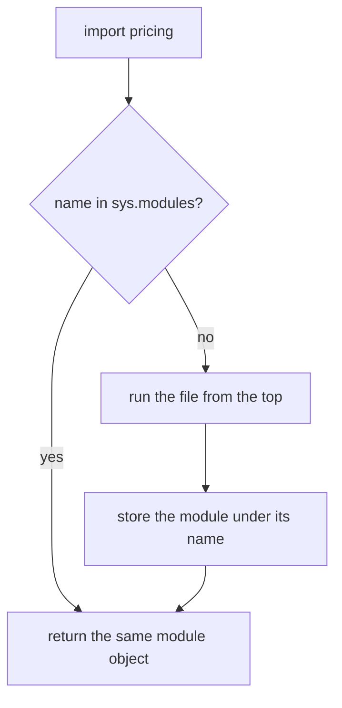

### The file runs once

The first import executes the module body from top to bottom. Assignments, function definitions, and class statements all run. A `def` at top level runs in the sense that it creates the function and binds the name. The function body does not run until a later call. A print, a network call, or a `main()` call at top level does run during the import. That is why a side effect at import time happens in every program that imports the module, including a test runner that never asked for the command.

The import system stores the new module in `sys.modules` under its name. A second import in the same process finds that entry and returns the same object. The file does not run again. That cache is why a module-level name is a shared singleton, and why a test cannot recover from import-time work by importing twice. If you need a fresh value per call, build it inside the function. If you need to reload during a long-running process, you are usually papering over a design that should have taken the value as an argument.

Because the module object is shared, mutating a list or dict that lives on it is visible to every importer. Rebinding the attribute is a different operation. `from pricing import RATE` binds the local name to the object `RATE` referred to at that moment. If `RATE` is a float, `pricing.RATE = 0.2` later does not move the importer's name. The local name still refers to the old float, because numbers are not updated in place. If `RATE` were a list and someone appended to that same list, every name that still points at the list would see the new item. The import did not copy the object. It bound a name.

### Script and library in one file

A file can be both something you run and something you import, if the running part is guarded.

```python
def serve():
    print("listening")

if __name__ == "__main__":
    serve()
```

`__name__` is `"__main__"` only when Python was asked to run that file as the program. When another file imports it, `__name__` is the module name, such as `"pricing"`, and `serve()` is not called. The functions are still defined, so the importer can call them on purpose. Without the guard, `serve()` at the bottom runs on import. Tests, other commands, and anything else that wanted one function now also start the server.

The guard belongs around the side effects of being a program: reading command arguments, opening the real database, printing the report. It does not belong around the function definitions. Those have to run on import or there is nothing to import. A small `main` function that the guard calls is easier to test than a pile of statements under the guard, because a test can call `main` with explicit arguments. The guard itself is one comparison.

### Packages, path, and circular imports

A package is a way to group modules under one name. `warehouse/pricing.py` imported as `warehouse.pricing` is a module inside the package `warehouse`. A regular package is a directory that Python treats as one unit, historically marked by `warehouse/__init__.py`. That file runs when the package is first imported. It can be empty. Its job is to mark the directory and, when you want, to re-export the names callers should see. Namespace packages can span directories without that file. When you own the directory, an `__init__.py` keeps the layout obvious.

Imports are found by walking `sys.path`. The directory of the script you ran is on that list, along with the standard library and the site-packages of the environment. That search is why a file named `json.py` in your project hides the standard library `json`. Your module is found first, then it tries to import the standard library and finds itself. Name a module after what it is about, not after a library you also import.

A circular import is two modules whose bodies import each other. Python can start the cycle, because the module is entered into `sys.modules` before the body finishes, but the other module then sees a half-initialized object. A name used at the bottom of the first file may not exist yet, and the error is `ImportError` or `AttributeError` that mentions a name you can see in the source. The fix is to break the cycle. Move the shared names to a third module, or import inside the function that needs the name so the import happens after both modules have finished loading. An import inside a function runs on the first call, which is later than import time, and the cache still makes later calls cheap.

### Each project gets its own environment

Installing a package into the system Python couples every project on the machine. Project A needs one version of a library. Project B needs another. The second install wins, and A breaks with no change to A's source. A virtual environment is a directory with its own interpreter links and its own `site-packages`. Packages installed there are visible only when that environment is the one running Python. `python3 -m venv .venv` creates it. Activating it, or running `.venv/bin/python`, puts its `site-packages` on `sys.path`. `.venv` is a product of the machine and the lock file. It does not belong in git.

`pyproject.toml` declares the project: its name, the Python version it requires, and the dependencies it needs, usually as ranges. A lock file records the exact versions that were resolved for those ranges, including transitive dependencies, so the next install on another machine gets the same set. The declaration is allowed to say "at least this version". The lock file says "this exact version". CI, a teammate, and an image build install from the lock file. Editing the declaration without updating the lock file means the declaration and the install disagree.

`uv` is one tool that creates the environment, writes `pyproject.toml`, and maintains `uv.lock`. `uv add` records a dependency and updates the lock. `uv run` executes a command in the project's environment. `pip` inside a venv is the older way to install what a requirements file lists. Either way, the rule is the same. Do not `pip install` into the system interpreter on a server or a shared laptop. The system Python belongs to the operating system. Your project's dependencies belong to the project.

### Where it breaks

The break at import time is a call that does real work in the module body. Opening a database, reading a required environment variable, or starting a thread means every importer pays that cost and fails when the variable is absent, including a unit test that imported the module for one pure function. Put that work in a function the program calls from the `__main__` guard or from the application entry point.

A second break is `from module import name` followed by the belief that the local name tracks the module attribute. Rebinding the attribute updates the module, not the other bindings. If a test swaps a function by assigning `module.compute = fake`, importers who wrote `from module import compute` still hold the original function. Patch the name in the module that uses it, or import the module and call `module.compute` so the lookup happens at call time.

A third is two projects sharing one environment and one unpinned install. "It worked yesterday" is what a floating version looks like after a transitive dependency released a breaking change. Pin through a lock file. A fourth is a module name that collides with the standard library, or a directory that is not a package sitting on `sys.path` and shadowing one that is. A fifth is catching `ImportError` around an import to hide a missing dependency. The program then fails later, on the first call, with a name that does not exist. Let the import fail at startup so the missing package is the error message.

### At work

A small tool can live in one file with a `main` guard until a second caller appears. Then the pure operations move to a module with no side effects at import, and the command stays thin. A service is a package. The entry point parses configuration, builds the objects that talk to the network, and calls into modules that take those objects as arguments. Tests import the pure modules without the entry point.

Dependencies are declared in `pyproject.toml` and locked. The environment is local and disposable. Deleting `.venv` and recreating it from the lock file is a normal repair, because the environment is not the source of truth. The lock file is. In review, look for work at import time, for `from x import y` of a name the tests need to replace, and for a requirements list that was edited by hand while the lock file stayed old.

### A decision table

| You want | Do this | Why |
| --- | --- | --- |
| Run a file as a program and also import it | Guard the program part with `if __name__ == "__main__"` | Import sets `__name__` to the module name, so the guard skips the side effects |
| Share a function with no extra behavior | Put it in a module and import it | The definition runs on import. A call at top level would run too |
| A fresh object every time | Build it inside the function | A module-level object is created once and then shared from `sys.modules` |
| See later rebinding of a function | `import module` and call `module.fn` | `from module import fn` bound the name to the old object |
| Two modules that need each other | Move the shared part to a third module | A cycle imports a module whose body has not finished |
| The same installs in CI and on a laptop | Declare ranges in `pyproject.toml` and commit the lock file | The lock file is the exact set. The declaration is the request |
| Install a library for one project | Install into that project's virtual environment | The system interpreter is shared with everything else on the machine |

### You can now

You can explain why a module body runs on the first import and not on the second. You can put program side effects under a `__name__` guard so a test can import a function without running them. You can tell a `from` binding from a later rebinding on the module. You can say what `pyproject.toml` asks for, what a lock file pins, and why those packages live in a virtual environment rather than in the system Python.

::: quiz
q: `report.py` ends with `main()` (no `if __name__ == "__main__":`). What happens when a test file does `from report import summarize`?
- Only `summarize` is loaded
+ `main()` runs during the import, whatever the test wanted
- Python raises ImportError
- `main` is skipped because it isn't imported
why: Importing a module runs its top-level code. The `__name__` guard is what keeps the script part from running on import.
:::

::: card
q: What's the difference between `pyproject.toml` and the lock file?
answer: `pyproject.toml` says what the project needs, with ranges ("requests >= 2.31"). The lock file records the exact versions actually resolved, so every install gets the same ones.
:::


::: quiz
q: app.py does `from tax import VAT` while VAT is the float 0.2. Later another part of the program rebinds tax.VAT = 0.25. What does the name VAT inside app.py refer to?
- 0.25, because a from-import looks the attribute up again every time the name is used
+ 0.2. The from-import bound the local name to the float that existed at import time, and rebinding tax.VAT does not move that local name
- It raises ImportError, because a module attribute cannot be rebound after import
- 0.25, but only if app.py imported the tax module as well
why: from tax import VAT copies the binding, not a subscription. Floats cannot be changed in place, so the local name keeps the old number. If VAT had been a list and the code mutated that same list, every holder of the list would see the mutation, because the import never copied the object.
:::

::: predict lang=python
q: What does this print? import_once stores a module name the way a cache would, and the body calls it twice on the same name.
code:
```python
loaded = {}

def import_once(name):
    if name in loaded:
        print("cached")
        return loaded[name]
    print("running")
    loaded[name] = name.upper()
    return loaded[name]

print(import_once("app"))
print(import_once("app"))
```
answer:
```
running
APP
cached
APP
```
why: The first call misses the cache, prints running, and stores APP. The second call finds the name, prints cached, and returns the stored value without running the load again. A real import caches the module object in sys.modules the same way: the file runs once.
:::

::: write lang=python
task: Write `entry_point(module_name, run)`. Call `run` and return its result only when `module_name` is `"__main__"`. Otherwise return `None` and do not call `run`. A test import passes a module name such as `"app"` and a function that must not run.
starter:
```python
def entry_point(module_name, run):
    return run()
```
tests:
```python
# Wrong answer: always call run(), so an import still starts the program.
from solution import entry_point

def test_main_calls():
    assert entry_point("__main__", lambda: 5) == 5

def test_import_skips():
    def explode():
        raise AssertionError("ran")
    assert entry_point("app", explode) is None

def test_other_name_skips():
    assert entry_point("solution", lambda: 1) is None
```
solution:
```python
def entry_point(module_name, run):
    if module_name == "__main__":
        return run()
    return None
```
hint: Compare module_name to the string __main__. Call run only in that branch and return what it returns. Every other name returns None without calling run.
:::

## Iterators and exhaustion
id: iteration
stage: iteration
needs: lists
minutes: 40
goal: Tell an iterable from an iterator, and predict what a second pass over each one does.
source: Python tutorial: Iterators | https://docs.python.org/3/tutorial/classes.html#iterators
source: Python docs: Iterator types | https://docs.python.org/3/library/stdtypes.html#iterator-types

A `for` loop does not know how a list, a file, or a generator stores its items. It asks for an iterator and then asks that iterator for the next item until the iterator says it is done. The protocol is small, which is why so many types can be looped over. `iter(obj)` asks the object for an iterator. `next(iterator)` asks for one item. When there are no items left, `next` raises `StopIteration`, and the `for` loop treats that exception as the end, not as a failure. `next(iterator, default)` returns the default instead of raising, which is how you take one item from a stream that might already be empty without a `try`. The rest of this lesson is what those two calls do to different objects, because the same `for` syntax hides two very different second passes.

An iterable is anything `iter` can turn into an iterator. A list, a tuple, a string, a dict, and a set are iterables. They are not themselves iterators: a list has no `__next__`, so `next(some_list)` fails, and you have to call `iter` first. Each call to `iter` on a list builds a new list iterator positioned at the start. The list is unchanged, so a second `for` loop over the same list runs again. The iterator is the cursor. The list is the data. Keeping those apart is the whole distinction. A dict iterator yields keys. A string iterator yields one-character strings. A file object is already its own cursor, which is why reading a file in two loops does not behave like a list.

An iterator is an object with `__next__`, and its `__iter__` returns itself. That last part is required, because `for` always calls `iter` on whatever you hand it. If `iter` on an iterator returned a new cursor, the protocol would restart by accident. It returns the same object, so a cursor stays a cursor. The first `for` loop calls `next` until `StopIteration`. The second `for` loop calls `iter`, gets the same exhausted iterator, and the first `next` raises immediately, so the body never runs. The loop is not skipping a copy. There is nothing left to yield. `list(iterator)` does the same walk and leaves the iterator exhausted, which is why saving `list(it)` once and then using the list is the way to look twice.

```python
class Revealer:
    def __init__(self, text):
        self.text = text

    def __iter__(self):
        for char in self.text:
            yield char
```

`Revealer` is restartable because `__iter__` returns a new generator each call, and the generator walks `self.text` from the beginning. `list(Revealer("ab"))` twice produces `['a', 'b']` both times. A one-shot cursor does the opposite: it stores the position on itself, `__iter__` returns `self`, and `__next__` moves that position. The second `list()` of that same instance is empty, because the position is already at the end. Both designs are legal. They answer different questions. A container that can be scanned many times should mint a new iterator. A stream that has already produced its values cannot mint them again, so it returns itself and the caller has to keep what they need.

`StopIteration` belongs in `__next__` when the cursor is finished. It does not belong as a casual signal inside a generator function. Since Python 3.7, a `StopIteration` that leaks out of a generator is turned into `RuntimeError`, because a generator is supposed to end with `return` or by falling off the end. The `for` loop still stops on `StopIteration` from `__next__`. The translation exists so a generator that is used as an iterator does not swallow a bug where inner code raised `StopIteration` by mistake. End a generator with `return`. End a handwritten `__next__` with `raise StopIteration`.

### Where it breaks

The break at an API boundary is consuming a caller's iterator without saying so. A function that writes `for item in data` calls `iter(data)` once. If `data` is a list, the caller's list is intact. If `data` is a generator or a list iterator, the call drains it, and the caller's later loop is empty. The function did not delete the source. It advanced the only cursor. Document whether you consume the argument, or materialize with `list` at the edge if you must walk twice. Materializing costs memory, which is why streams exist, so do not hide a `list()` on a multi-gigabyte file. Make the one-pass contract visible.

A second break is implementing `__iter__` so that it returns `self` and also expecting a second loop to restart. Returning `self` means one cursor. If you want restart, return a new iterator and keep the data on the object. A third is catching `StopIteration` too widely. The `for` loop already catches it. An extra `except StopIteration` around a loop does nothing useful, and catching it around a generator call can hide the `RuntimeError` story rather than explain an empty sequence. A fourth is partial use. `next` once, then `list` on the same iterator, skips the item you already took and then exhausts the rest. The source list, if you still have it, still contains every item. People print the list, see the first item, and think the iterator must still be at the start. The list and the cursor diverged at `iter`.

### At work

Use a list when you need length, indexing, and several passes, because those operations do not fit a one-way cursor. Use an iterator or a generator when the values arrive over time or do not fit in memory, and accept that the walk is forward only. A database cursor and an open file are iterators in this sense: you read the next row or the next line, and you do not ask for the previous one without a new query or a new open. In review, if a function receives an iterable and loops twice, either require a sequence or turn it into a list at the start and loop over that list. If you write a class that counts down or streams pages, decide in `__iter__` whether each `for` starts over. Tests should loop twice on the same instance when the class claims to be one-shot, because a fresh iterator hiding inside `__iter__` will make the second loop look successful and the production stream will not.

`next` with a default is the right way to take an optional first line. A bare `next` is the right way when a missing item is a real error. Do not use an empty except to turn `StopIteration` into a default if `next`'s second argument already does that.

### A decision table

| You have | What a second for-loop does | Why |
| --- | --- | --- |
| A list, tuple, dict, set, or string | Runs again from the start | `iter` builds a new iterator each time, and the container is unchanged |
| The iterator from `iter(some_list)`, after it has been walked | The body never runs | `iter` on an iterator returns that same object, and it is already exhausted |
| A generator or a generator function's result | Empty on the second pass | Producing the values was the first pass. They are not stored |
| A file object after you have read it | No more lines | The file is its own cursor, unless you seek, which not every stream can do |
| A class whose `__iter__` returns a new generator | Runs again | Each call to `iter` starts a fresh walk over stored data |
| A class whose `__iter__` returns `self`, after one full walk | Empty | The position lives on the instance, and it is already at the end |

If a test fails only on the second loop, look at whether you stored a cursor or the underlying data. If a function sometimes returns a list and sometimes returns a generator, callers cannot know whether they may iterate twice, so pick one contract.

### You can now

You can describe a `for` loop as `iter`, then `next` until `StopIteration`. You can say why a second loop over a list reprints the items and a second loop over an iterator prints nothing. You can use `next(iterator, default)` when a stream might be empty. You can write a one-shot iterator whose `__iter__` returns `self` and whose `__next__` yields the remaining values, and you can write a restartable `__iter__` that returns a new generator when the data can be walked again.

::: predict lang=python
q: What does this print? The third next asks for a default instead of raising.
code:
```python
it = iter([1, 2])
print(next(it))
print(next(it))
print(next(it, "done"))
```
answer:
```
1
2
done
```
why: iter on a list returns a new iterator at the first item. The first next returns 1 and the second returns 2. The iterator is then exhausted, so next with a default returns "done" instead of raising StopIteration.
:::

::: predict lang=python
q: What does this print? One next runs on the iterator, then the list and the iterator are each passed to list().
code:
```python
nums = [1, 2]
it = iter(nums)
print(next(it))
print(list(nums))
print(list(it))
```
answer:
```
1
[1, 2]
[2]
```
why: next consumes the first item from the iterator only. The list is a separate object, so list(nums) still builds a full copy. list(it) then takes whatever the iterator has left, which is the single remaining item, and leaves it exhausted.
:::

::: quiz
q: You build it = iter([1, 2, 3]), a for-loop over it prints every number, and a second for-loop over that same it prints nothing. Why is the second loop empty?
- The for loop deletes the list after the first pass, so there is no data left anywhere.
+ The iterator is already exhausted. The second loop asks it for the next item, StopIteration is raised immediately, and the body never runs.
- iter can be called only once in a program, so Python skips the second loop.
- The second loop walks a fresh copy that was allocated empty.
why: for calls iter on its target. iter of an iterator returns the same object, and that object has already produced 1, 2, and 3. The next call raises StopIteration at once. Loop over the list again if you need another pass, because iter on the list builds a new cursor.
:::

::: card
q: What is the difference between an iterable and an iterator?
answer: An iterable can produce an iterator when you call iter on it. A list is an iterable and is not an iterator. An iterator has __next__, and its __iter__ returns itself, so it is a one-way cursor. A second loop over the iterable can start over. A second loop over the iterator cannot.
:::

::: write lang=python
task: Write a class `Countdown`. `Countdown(n)` is an iterator whose `__iter__` returns `self` and whose `__next__` yields `n`, then `n - 1`, down through `1`. `list(Countdown(3))` is `[3, 2, 1]`. A second `list()` of that same instance is `[]`, because the cursor is used up. Stop with `StopIteration` when the remaining count is below 1. Do not return a fresh generator from `__iter__`.
starter:
```python
class Countdown:
    def __init__(self, n):
        self.n = n

    def __iter__(self):
        return self

    def __next__(self):
        raise StopIteration
```
tests:
```python
# Wrong answer: __iter__ returns a new generator each call, so the second list() repeats the countdown, or __next__ counts upward.
from solution import Countdown

def test_counts_down_once():
    c = Countdown(3)
    assert iter(c) is c
    assert list(c) == [3, 2, 1]
    assert list(c) == []

def test_one():
    c = Countdown(1)
    assert list(c) == [1]
    assert list(c) == []

def test_separate_instances():
    assert list(Countdown(2)) == [2, 1]
    assert list(Countdown(2)) == [2, 1]
```
solution:
```python
class Countdown:
    def __init__(self, n):
        self.n = n

    def __iter__(self):
        return self

    def __next__(self):
        if self.n < 1:
            raise StopIteration
        value = self.n
        self.n -= 1
        return value
```
hint: Store n on self. __iter__ returns self. __next__ raises StopIteration when self.n is below 1. Otherwise remember the current n, subtract 1, and return the remembered value so the first yield is n rather than n - 1.
:::

## Iterators and generators
id: generators
stage: iteration
needs: comprehensions, files
minutes: 40
goal: Yield values one at a time, and know that a generator is empty after the first pass.
source: Python docs: Generators (HOWTO) | https://docs.python.org/3/howto/functional.html#generators
source: PEP 479: Change StopIteration handling inside generators | https://peps.python.org/pep-0479/

A function that builds a list of every warning in a 20 GB log has to hold those warnings, and often the whole file, before the caller can print the first one. The machine runs out of memory on a file that would have been easy to scan one line at a time. A generator is a function that produces values as the caller asks for them and then forgets them. The log stays on disk. One line is in memory. The caller still writes an ordinary `for` loop.

A generator function contains `yield`. Calling it does not run the body. The call returns a generator object, which is an iterator. The body starts when something asks for the next value, runs until it hits `yield`, hands that value back, and pauses with its local variables intact. The next request resumes after that `yield`. When the body returns or falls off the end, the generator is finished. A `for` loop asks for values until that end, and it treats the end as a stop rather than as a failure the loop should print.

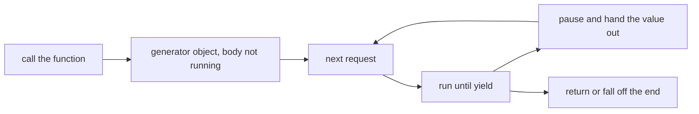

```python
def warnings(lines):
    for line in lines:
        if "WARN" in line:
            yield line.rstrip("\n")
```

`warnings(open_lines)` returns immediately. Nothing has been read. `for item in warnings(open_lines)` pulls one warning at a time. If the caller breaks out of the loop after three warnings, the rest of the file is not scanned, because nobody asked for those values. That early stop is the other half of laziness. Building a list cannot offer it. The function would already have walked everything to fill the list.

### Pipelines stay lazy until something pulls

A generator expression is the same idea in one expression. `(sku.upper() for sku in rows if sku)` does not build a list of codes. It remembers the expression and waits. A list comprehension with square brackets builds the list at once, which is what you want when you need the length, the indexes, or a second pass. A generator expression is what you want when the next stage can take the values one by one.

Stages can sit in a line. One generator reads lines. The next keeps the interesting ones. The next pulls a field off each kept line. Nothing walks the file until a consumer at the end starts pulling. `Counter` is a consumer that pulls until the generator is finished, so the counts appear and the lines do not have to be stored. If you wrap the generator in `list` in the middle "just to look", you have given up the memory win and you have also emptied the generator for every stage after you.

`yield from other` yields each value from another iterable, and then continues the current function. It is how a generator delegates to a helper without a handwritten loop of `yield`. The helper can itself be a generator. The consumer still sees one flat stream.

### One pass, then it is empty

A generator does not store the values it has yielded. After a loop has pulled them all, the generator is exhausted. A second loop asks for the next value, the generator is already finished, and the body does not run again. There is no restart hidden inside the object. If you need the values twice, ask the generator once and keep a list, or call the generator function again to get a new generator. Calling the function again is a new walk. It repeats the work, and it sees whatever the source looks like now. Iterating the old generator again does not repeat the work. It does nothing.

The same rule applies to a generator expression and to any iterator you already pulled. A list is different because iterating a list builds a new cursor each time and the list still holds the items. A generator is the cursor and the production of the items. When production is finished, nothing remains.

`next(generator)` takes one value. `next(generator, default)` takes one value or returns the default when the generator is already finished, which is how you accept an empty stream without a `try`. A bare `next` on a finished generator raises `StopIteration`. That exception is the protocol's way of saying "no more values". The `for` loop catches it. Your own code usually should not need to.

### How a generator is allowed to end

End a generator by `return`, or by letting the body finish. A `return` with no value, or falling off the end, is a clean finish. `return` with a value stores that value where a careful caller can see it, and the consumer's `for` loop still just stops. You do not use that value in ordinary loops.

Do not end a generator by `raise StopIteration`. Since Python 3.7, a `StopIteration` that leaves a generator body is turned into `RuntimeError`. The change exists because `StopIteration` already means "this iterator is finished". An accidental raise inside the body, often from a helper that used `StopIteration` as an ordinary signal, used to look like a normal end. The loop stopped, the bug vanished, and the caller thought the stream was simply short. Turning it into `RuntimeError` makes the accident loud. A handwritten `__next__` method is different. That method is the iterator protocol itself, so it finishes by raising `StopIteration`. A generator function is not that method. It finishes by returning.

`send` can push a value into a generator at the yield point. Almost no application code needs it. A generator that only yields, and a caller that only iterates, is the design to reach for. Coroutines that await are a separate mechanism for programs that wait on many operations. A generator that yields lines is not that. It is a lazy sequence.

### Where it breaks

The break at an API boundary is returning a generator and not saying that the caller may iterate once. The caller loops to validate, then loops to write, and the write loop is empty. Document the one-pass contract, or return a list when the result is small and will be reused. Hiding `list()` inside a function that claimed to stream a huge file brings the memory problem back. Put the `list` at the edge that truly needs random access.

A second break is a generator that runs a side effect after its last `yield` and a caller that stops early. The trailing work does not run if the consumer breaks. A file opened inside the generator can stay open. Wrap the source in `with` inside the generator when the generator owns the file, and prefer the consumer to exhaust the generator or close it. Generators support `close()`, and a `with` around the generator calls it. A third break is catching `StopIteration` around a generator call. You will not see it. You will see `RuntimeError` if the body raised `StopIteration`, and you will see a normal end if the body returned. Catching the wrong type hides nothing useful and can swallow the `RuntimeError` if you catch `Exception`.

A fourth is infinite generators without a consumer that stops. `yield` inside `while True` is legal and is how you model a stream that has no natural end. A `list()` of that generator never returns. Pull a fixed number, or break on a condition. A fifth is assuming `yield` builds a list in the background. It does not. Until a caller pulls, the work has not happened, including work you were counting on for a side effect. If the work must happen now, do not put it behind a generator that nobody iterates.

### At work

Use a generator to read files, page through an API, or transform a stream you cannot hold. Use a list when the caller needs the length, sorts the values, or walks them more than once. A pipeline of generator expressions is easy to test one stage at a time, because each stage is a function of an iterable. Tests can pass a short list and pull the result with `list`. Production passes a file and never materializes it.

In review, if a function returns a generator, the name and the docstring should say it is one pass. If the function both opens a resource and yields, the resource's lifetime has to be tied to the generator, not to the hope that the caller finishes the loop. If a bug report says the second loop prints nothing, the object was a generator or another exhausted iterator. Call the function again or keep a list. Do not look for a cleared global.

### A decision table

| You need | Use | Why |
| --- | --- | --- |
| Every value, more than once, and the set is small | A list, or `list` around a generator once | A generator is empty after the first full pull |
| One pass over data that may be large | A generator function and `yield` | Values are produced on request and need not be stored |
| A one-expression filter or transform in a pipeline | A generator expression | It stays lazy. Square brackets would build the list immediately |
| The first value, or a default if the stream is empty | `next(stream, default)` | A bare `next` raises `StopIteration` when nothing is left |
| To delegate to another iterable | `yield from` | The helper's values become this generator's values |
| To signal that a generator is finished | `return`, or fall off the end | Raising `StopIteration` inside the generator becomes `RuntimeError` |
| The same walk a second time | Call the generator function again | The old generator object will not restart |

### You can now

You can write a function that `yield`s values and explain why the call returns before the body runs. You can build a lazy pipeline and name the consumer that finally pulls it. You can predict that a second loop over the same generator is empty, and that a new call starts a new walk. You can end a generator with `return` and say why `raise StopIteration` inside it becomes `RuntimeError`.

::: predict lang=python
code:
```python
def countdown(n):
    print("start")
    while n > 0:
        yield n
        n -= 1

g = countdown(3)
print("made")
print(list(g))
print(list(g))
```
answer:
```
made
start
[3, 2, 1]
[]
```
why: Calling `countdown` runs nothing yet, so `made` prints first. `list(g)` runs it to the end. The second `list(g)` finds the generator already exhausted.
:::

::: write lang=python
task: Write a generator `batches(items, size)` that yields lists of up to `size` items, in order, from any iterable (it may be a generator, so don't use `len` or slicing on the input).
starter:
```python
def batches(items, size):
    pass
```
tests:
```python
from solution import batches
import types

def test_batches():
    assert list(batches([1, 2, 3, 4, 5], 2)) == [[1, 2], [3, 4], [5]]

def test_is_generator():
    assert isinstance(batches([], 3), types.GeneratorType)

def test_works_on_generators():
    gen = (n for n in range(4))
    assert list(batches(gen, 3)) == [[0, 1, 2], [3]]

def test_empty():
    assert list(batches([], 3)) == []
```
solution:
```python
def batches(items, size):
    batch = []
    for item in items:
        batch.append(item)
        if len(batch) == size:
            yield batch
            batch = []
    if batch:
        yield batch
```
hint: Collect items in a list; `yield` it when it reaches `size` and start a new one. After the loop, yield what's left if anything.
:::


::: quiz
q: A function body is a single statement, yield 1. You call the function and do not iterate the result. What did the call return?
- The integer 1, because yield is another spelling of return
+ A generator object. The body has not run, so nothing has been yielded yet
- The list [1], because yield collects every yielded value for the caller
- None, and the 1 is printed as a side effect of the call
why: Calling a generator function only builds the generator. The body runs when a for loop or next asks for a value, and it pauses at yield. If nobody asks, the body stays unstarted and any work inside it has not happened.
:::

::: predict lang=python
q: What does this print? The generator yields once, then raises StopIteration.
code:
```python
def boom():
    yield 1
    raise StopIteration

g = boom()
print(next(g))
try:
    next(g)
except RuntimeError:
    print("runtime")
```
answer:
```
1
runtime
```
why: The first next runs the body up to yield and returns 1. The second next resumes after the yield, the body raises StopIteration, and that exception leaving a generator is reported as RuntimeError. A generator finishes with return or by falling off the end, not by raising StopIteration.
:::

::: write lang=python
task: Write a generator `prefixed(tag, lines)`. For each line, strip surrounding whitespace. Skip the line if nothing remains. Otherwise yield `tag`, then `": "`, then the stripped line. Pulling the generator must work when `lines` is itself a generator, so do not call `len` on it or index it. An input of only blank lines yields nothing.
starter:
```python
def prefixed(tag, lines):
    out = []
    for line in lines:
        text = line.strip()
        if text:
            out.append(tag + ": " + text)
    return out
```
tests:
```python
# Wrong answer: return a list instead of yielding, so the result is not a generator.
import types
from solution import prefixed

def test_skips_blanks():
    assert list(prefixed("E", [" a ", "", "b"])) == ["E: a", "E: b"]

def test_is_generator():
    assert isinstance(prefixed("E", []), types.GeneratorType)

def test_pulls_a_generator():
    source = (line for line in ["", "  z", "q "])
    assert list(prefixed("W", source)) == ["W: z", "W: q"]

def test_all_blank():
    assert list(prefixed("E", [" ", ""])) == []
```
solution:
```python
def prefixed(tag, lines):
    for line in lines:
        text = line.strip()
        if not text:
            continue
        yield f"{tag}: {text}"
```
hint: Loop over lines. Strip each one. continue when the result is empty. yield the tag, a colon, a space, and the stripped text. Do not build a list and return it. yield is what makes the function a generator.
:::

::: card
q: You looped over a generator until it finished. Why is a second loop over that same object empty, and what do you do if you needed the values again?
answer: The generator produced each value as it was pulled and did not store those values. The second loop finds it already finished, so the body does not run again. Keep a list from the first pull when the values are small and you need them twice, or call the generator function again when a fresh walk is acceptable.
:::

## itertools: chain, slice, group, batch
id: itertools
stage: iteration
needs: generators
minutes: 40
goal: Combine and slice iterators lazily, and group only after equal keys are actually adjacent.
source: Python docs: itertools | https://docs.python.org/3/library/itertools.html

`itertools` is a set of iterator tools that pull values only when something asks for the next one. That laziness matters because the input may itself be a generator, a file, or another iterator you are not allowed to rewind. `chain`, `islice`, `groupby`, and `batched` cover the jobs people otherwise do by building a big temporary list: concatenate several sources, take a window, group neighbors, and cut a stream into fixed-size chunks. Each one returns an iterator. Wrapping it in `list` is a choice you make at the edge when you need a concrete result, not something the tool does for you. Because they share the iterator protocol, using one consumes its input. A later loop over that same input sees only what the tool did not take.

`chain(first, second, ...)` yields every item from the first iterable, then the second, and so on. It does not copy the sources first, so a chained generator is spent as `chain` walks it. `chain.from_iterable(pieces)` is the form when the pieces are already one iterable of iterables. `chain(*pieces)` passes every piece as its own argument, which is fine for two tuples and a bad idea for a long list of chunks, because the call has to build that argument list. `islice(source, stop)` and `islice(source, start, stop)` are the slice for things with no length and no random access. Items before `start` are pulled and thrown away. Items from `start` up to but not including `stop` are yielded. There is no negative index, because an iterator cannot jump to the end, and the source is left positioned after the window.

```python
import itertools
stream = itertools.chain([1, 2, 3], [4])
window = list(itertools.islice(stream, 2))
rest = list(stream)
```

`window` is `[1, 2]` and `rest` is `[3, 4]`. Nothing puts those items back. If you needed the window and a full replay, materialize before slicing, or slice a list, which can be indexed without destroying a cursor. `islice` returns an iterator, not a list slice, even when the source happens to be a list. The list stays intact only because it can mint an iterator without being one.

`groupby` is the tool people mistake for a database `GROUP BY`. It only merges runs of equal keys that are already adjacent, the way the Unix `uniq` command only collapses neighboring duplicates. It does not sort, and it does not look ahead to find a matching key later in the stream. Give it `[("b", 2), ("a", 9), ("b", 4)]` and you get three groups, because the two `b` rows are not neighbors. Sort first when you want every equal key in one group. The group object you receive is itself an iterator tied to the same underlying walk. You have to consume it before the `groupby` loop advances, because moving to the next group reads the rest of the current group in order to find the boundary. If you store the group iterators and convert them later, they are empty. Call `list` on the group inside the loop.

```python
import itertools
readings = [("b", 2), ("a", 9), ("b", 4), ("a", 1)]
ordered = sorted(readings, key=lambda pair: pair[0])
for key, group in itertools.groupby(ordered, key=lambda pair: pair[0]):
    print(key, [value for _, value in group])
```

That sort uses only the first field, and it is stable, so `(a, 9)` stays ahead of `(a, 1)`. A full sort of the tuples would put `(a, 1)` first. Say which order you mean. `sorted` copies, so the caller's list stays put. `.sort()` does not. Dicts remember insertion order, so keys inserted as `groupby` yields them follow the group order. After an alphabetical sort, those keys come out alphabetical without a second pass.

`batched(iterable, n)` yields tuples of length `n`. The last tuple is shorter when the length is not a multiple of `n`. It arrived in Python 3.12. In 3.13 it gained a keyword-only `strict` argument, default `False`. `strict=True` raises `ValueError` if the final batch would be short, which is what you want when a short tail means a corrupt record and not what you want when you are merely chunking work. `n` has to be at least 1. The batches are tuples, not lists, so code that appends to a batch will fail, and that immutability is useful when you hand the chunk to another worker. `batched` is lazy until you iterate it. `list(itertools.batched(...))` is the concrete list of tuples.

### Where it breaks

The common `groupby` bug is forgetting the sort. The function runs, it returns groups, and counts are quietly wrong because one key was split by a different neighbor. Sort by the same key you pass to `groupby`, unless the source is already ordered that way, as a log sorted by day would be. The next bug is not draining the group. The loop variable looks like a sequence. It is a live view of the underlying iterator, so saving it in a list of pairs and reading it after the loop yields empty groups and drops data. Build the list, or the dict entry, before the next iteration.

`islice` is not a peek. Skipping the first two records consumes them, and a later reader of that generator does not see them. `chain` does the same if you also wanted to walk that iterator yourself. `batched` breaks when code assumes every tuple has length `n` and unpacks a short tail, or when `strict=True` meets a length that is not a multiple of `n`. A chunker that asks for `len(items)` also fails on a generator. `batched` does not need a length, which is why it belongs on streams.

### At work

Chunk an upload with `batched` so each request gets at most `n` records and the last request keeps the remainder. Merge separated sequences with `chain` when you do not need a global sort. Take a page of a generator with `islice`, because a generator cannot be sliced with brackets. Group a report only after the rows are ordered by that key, and store `list(group)` immediately. Sort a copy if the caller still needs the original order. Tests should pass unsorted input, because an already-sorted test passes even when `groupby` forgot to sort.

Read the signature before you wrap the result. If you need random access, convert to a list once and say so. If you are in the middle of a pipeline, leave the iterator lazy so you do not build every batch before the first is sent. Do not sort by a key function that only looks at the first letter when you actually wanted the words themselves in alphabetical order inside the group. A stable sort by the letter keeps the old relative order. A full sort of the words changes it.

### A decision table

| Job | Tool | Watch for |
| --- | --- | --- |
| Concatenate a few iterables | `chain(a, b, c)` | The inputs are consumed. Chain a list if you still need it later |
| Concatenate a long series of chunks | `chain.from_iterable(chunks)` | `chain(*chunks)` builds a giant argument list |
| Take a window from a stream | `islice(it, start, stop)` | No negative indexes. Skipped items are discarded, not unread |
| Group every equal key, wherever it sat | `groupby` on a list sorted by that key | Without the sort, only adjacent duplicates collapse |
| Use each group as a list | `list(group)` inside the loop | The group iterator is empty once `groupby` moves on |
| Split a stream into chunks of n | `batched(it, n)` | The last tuple may be short unless `strict=True`, which raises instead |
| Keep the caller's order | `sorted(...)`, which copies | `.sort()` reorders the list they passed in |

Pick `groupby` when neighbors matter or when you have just made them neighbors. Pick an ordinary dict if you are already looping and the data fits in memory and you do not need the runs to be separate. `groupby` earns its place when the input is ordered and you want to walk each run once without a second pass.

### You can now

You can concatenate iterators with `chain` and take a forward-only window with `islice`, knowing both consume what they touch. You can explain why `groupby` splits one key into two groups when a different key sits between them, and you can sort a copy so equal keys become adjacent before you group. You can materialize each group inside the loop so the values are not lost. You can turn `batched` into a list of tuples, including a short final tuple, when the caller wants chunks rather than a single flat sequence.

::: predict lang=python
q: What does this print? islice takes two items, then list walks whatever chain has left.
code:
```python
import itertools
parts = itertools.chain(["oak", "ash"], ["elm"])
print(list(itertools.islice(parts, 2)))
print(list(parts))
```
answer:
```
['oak', 'ash']
['elm']
```
why: chain yields oak, then ash, then elm, one at a time. islice asks for the first two, so elm is still sitting in the chain. The second list call takes that remainder. The items are not copied back onto the front.
:::

::: quiz
q: groupby is given the rows b, then a, then b, with no sort. Why is there not one group for b that holds both b rows?
- groupby sorts its input and then drops duplicate keys, so one b is removed.
+ groupby only merges equal keys that are already next to each other, so the two b rows stay separate because an a row sits between them.
- groupby returns a dict, and a dict cannot store two groups under one key, so the second b replaces the first.
- groupby compares only the first character of the key function's name, not the row itself.
why: groupby is a single forward pass, like uniq. It starts a new group whenever the key changes from the previous item. Sort by that key first if matches that are not neighbors should land in one group, and list each group before the loop moves on.
:::

::: card
q: Why can't islice use a negative index, and what happens to items it skips?
answer: An iterator cannot jump backward or know its length without consuming it, so islice only walks forward and rejects a negative index. Items before the start are pulled from the source and discarded. They are not left for a later read of that same iterator.
:::

::: card
q: Why must you consume a groupby group before the next trip around the loop?
answer: The group is an iterator over the same underlying source as groupby itself. Advancing to the next key reads past the current run. If you saved the group object and only then called list on it, the run is already gone and the list is empty. Call list(group) inside the loop.
:::

::: write lang=python
task: Write `batches(items, n)` using `itertools.batched`. Return a list of tuples, each of length `n`, except the last tuple may be shorter. `batches([1, 2, 3, 4, 5], 2)` is `[(1, 2), (3, 4), (5,)]`. An empty input returns an empty list. Import the `itertools` module and call `itertools.batched`. Do not drop the short tail.
starter:
```python
def batches(items, n):
    return []
```
tests:
```python
# Wrong answer: return [] or build lists and drop a short final batch, instead of itertools.batched tuples.
from solution import batches
import inspect

def test_short_tail():
    assert batches([1, 2, 3, 4, 5], 2) == [(1, 2), (3, 4), (5,)]

def test_even():
    assert batches([1, 2, 3, 4], 2) == [(1, 2), (3, 4)]

def test_wider_than_input():
    assert batches(["a", "b"], 5) == [("a", "b")]

def test_empty():
    assert batches([], 3) == []

def test_calls_batched():
    src = inspect.getsource(batches)
    assert "itertools.batched" in src
```
solution:
```python
import itertools

def batches(items, n):
    return list(itertools.batched(items, n))
```
hint: import itertools and return list(itertools.batched(items, n)). The last batch is already a shorter tuple when items do not divide evenly. Do not pass strict=True.
:::

::: write lang=python
task: Write `group_by_initial(words)` for a list of non-empty strings. Sort a copy of the words with the normal case-sensitive sort, then use `itertools.groupby` on the first character so each letter is one adjacent run. Return a dict whose keys are those first characters in alphabetical order and whose values are the words of that letter in sorted order. Do not reorder the list the caller passed. `group_by_initial(["plum", "pear", "apple"])` is `{"a": ["apple"], "p": ["pear", "plum"]}`. A `groupby` that does not sort first fails on unsorted input. Import `itertools` and materialize each group inside the loop.
starter:
```python
import itertools

def group_by_initial(words):
    out = {}
    for letter, group in itertools.groupby(words, key=lambda word: word[0]):
        out[letter] = list(group)
    return out
```
tests:
```python
# Wrong answer: groupby on the original order. Equal letters that are not adjacent become separate runs, and the dict keys are not alphabetical.
from solution import group_by_initial
import inspect

def test_sorts_before_grouping():
    assert group_by_initial(["plum", "pear", "apple"]) == {"a": ["apple"], "p": ["pear", "plum"]}

def test_key_order_and_words():
    grouped = group_by_initial(["fig", "date", "apple", "avocado"])
    assert list(grouped) == ["a", "d", "f"]
    assert grouped["a"] == ["apple", "avocado"]
    assert grouped["f"] == ["fig"]

def test_keeps_duplicates():
    assert group_by_initial(["be", "ax", "be"]) == {"a": ["ax"], "b": ["be", "be"]}

def test_empty():
    assert group_by_initial([]) == {}

def test_input_unchanged():
    data = ["plum", "pear", "apple"]
    group_by_initial(data)
    assert data == ["plum", "pear", "apple"]

def test_uses_groupby():
    src = inspect.getsource(group_by_initial)
    assert "groupby" in src
```
solution:
```python
import itertools

def group_by_initial(words):
    grouped = {}
    ordered = sorted(words)
    for letter, group in itertools.groupby(ordered, key=lambda word: word[0]):
        grouped[letter] = list(group)
    return grouped
```
hint: ordered = sorted(words) so the caller's list stays put and equal initials become neighbors. groupby that copy with key=lambda word: word[0], and assign list(group) into the dict before the next letter. Full sorted order puts pear before plum, not the original order inside the letter.
:::

## With, __exit__, and contextlib
id: context-managers
stage: iteration
needs: exceptions, generators
minutes: 40
goal: Guarantee cleanup with a context manager, and let the block's exception propagate unless you deliberately suppress it.
source: Python language reference: The with statement | https://docs.python.org/3/reference/compound_stmts.html#the-with-statement
source: Python docs: contextlib.contextmanager | https://docs.python.org/3/library/contextlib.html#contextlib.contextmanager

A `with` statement takes an object that knows how to start a block and how to finish it, including the finish that happens because the block raised. That object is a context manager. Python calls `__enter__` before the block and `__exit__` afterward, so the cleanup is tied to the structure of the block rather than to the programmer remembering a later line. `try` / `finally` can do the same cleanup for one specific block. A context manager packages the policy in a value you can pass around, return, or use at every call site that needs the same setup and teardown. Files, locks, transactions, and temporary changes of directory are context managers because each of them is a resource that must be released on the way out, and the interesting failures are exactly the paths where a hand-written close is most likely to be skipped.

The order is fixed. Python evaluates the expression after `with` and calls `__enter__`. If you wrote `as target`, that name is bound to whatever `__enter__` returned, which is often the manager and is not always the manager. `open` returns the file, so the name after `as` is the file. If `__enter__` raises, the block does not run and `__exit__` is not called, because nothing was started. If `__enter__` succeeded and binding the name failed, `__exit__` does run. Otherwise the block runs, and Python calls `__exit__(exc_type, exc, traceback)`. On a normal finish all three are `None`. On a raise they describe that exception. A false return, including `None` and `False`, lets the exception continue. A true return suppresses it, and execution continues after the block as if the block had ended normally.

```python
class Indent:
    def __init__(self):
        self.level = 0

    def __enter__(self):
        self.level += 1
        return self

    def __exit__(self, exc_type, exc, tb):
        self.level -= 1
        return False
```

`Indent` returns `self` so the caller can use the same object inside the block and after it. Returning `False` is deliberate. The manager's job is the level, not the question of whether the block's error is handled, so the error stays the caller's. Returning `True` would hide a bug in the block, which is worse than a noisy traceback. You rarely want to suppress. The cases that do are narrow, such as a manager whose contract is "ignore this expected exception and restore state." Even then, suppress only the type you mean, and return `False` for everything else, because a blanket `return True` turns every failure into a successful `with`.

`contextlib.contextmanager` builds a manager from a generator, so a short setup does not need a class. Code before `yield` is `__enter__`. The yielded value is what `as` receives. Code after `yield` is `__exit__` only if it runs. If the block raises, that exception is thrown in at the `yield`, and cleanup after a bare `yield` is skipped. Put the teardown in `finally`, then let the exception leave the generator. If the generator catches it and ends normally, `with` treats that as suppression, the same as `__exit__` returning true. Yield once. A second `yield` raises `RuntimeError`.

```python
from contextlib import contextmanager

@contextmanager
def logged(phase, trail):
    trail.append(phase + " start")
    try:
        yield phase
    finally:
        trail.append(phase + " end")
```

`logged` records the end even when the block raises, and it does not swallow the error, because `finally` runs and then the original exception continues out of the generator. That is the pattern to copy when the cleanup is a few lines and a class would only hold one method pair. Use a class when you need several methods, or when the same object is entered more than once and has to show its history after the block, because the generator form is used up by a single `with`.

Several managers in one `with`, or nested `with` statements, enter from left to right and exit in reverse, like nested `try` / `finally`. If a later `__enter__` raises, the managers that already entered still get `__exit__`, so a lock acquired before a failed connect is released. That reverse order is why you can open a file and then a lock around its contents without leaking the file when the lock fails.

### Where it breaks

The dangerous break is swallowing. `__exit__` that returns `True`, or a generator that catches `Exception` and does not re-raise, makes the block look successful. The caller continues with half-finished work, and the traceback is gone. Return `False` or `None` unless suppression is the feature you are selling. The matching generator bug is cleanup after a bare `yield`. The success path records the close. The failure path, which is why you wrote the manager, skips it. `try` / `finally` around the `yield` is the fix, not a broader `except` that forgets to raise again.

A second break is irreversible work in `__enter__` before the acquire has succeeded. If a later step raises, `__exit__` will not run, so `__enter__` itself has to release what it already took before it re-raises. A third is assuming `as` names the manager when `__enter__` returned a file or a connection. A fourth is expecting `__exit__` to replace the caller's `except`. `__exit__` runs on the way out of the block. An `except` around the whole `with` runs only after `__exit__` returns false, which is how a log can record the close and the caller can still see the `ValueError`.

Opening a file without `with` is the everyday form of the same leak. The file object closes when it is garbage-collected. CPython often does that quickly by reference counting, and that is not a promise. Cycles, other interpreters, and a process that keeps a reference in a list all leave the handle open until some later collection, or until the process exits. `with open(path) as handle` calls the file's `__exit__`, which closes the handle, on success and on exception. The close does not depend on the collector noticing.

### At work

Use `with open(...) as handle` for every file, and keep the work that needs it inside the block so you cannot use a closed handle. Use a class when the caller must inspect the manager afterward, and append the cleanup in `__exit__` while returning `False` so the error still propagates. Use `@contextmanager` for a short paired action, and put the restore in `finally`. For a transaction, commit only when `exc_type is None`, roll back otherwise, and still return `False`. Tests should raise inside the block and assert both that cleanup ran and that the exception left the `with`. A success-only test passes a manager that forgot `finally`.

Read `__exit__`'s three arguments before you branch. `None` means the block succeeded. A real type means it failed. Do not reraise that exception yourself as the normal policy. Return a false value and let `with` reraise it, so the traceback still points at the original `raise`. Raise from `__exit__` only when the cleanup itself failed.

### A decision table

| Situation | Use | Why |
| --- | --- | --- |
| Cleanup for one block that will never be reused | `try` / `finally` | No object to pass around, and `finally` runs on raise, return, and break |
| The same setup and teardown at many call sites | A context manager and `with` | `__exit__` is the packaged `finally`, and the caller cannot forget the second half |
| A few lines around one `yield` | `@contextmanager` with `try` / `finally` | Less boilerplate than a class, as long as the generator yields once |
| State the caller must read after the block | A class that returns `self` from `__enter__` | The generator form does not leave you a rich object |
| The block's exception should keep going | Return `False` or `None` from `__exit__` | `True` suppresses it, and the caller thinks the block succeeded |
| Open a file | `with open(...) as handle` | `__exit__` closes the file even when the body raises. A bare `open` waits on the garbage collector |

`finally` and `__exit__` both run when the block raises. The extra decision `__exit__` has, and `finally` does not, is the return value that either hides the exception or lets it go. Default to letting it go.

### You can now

You can say what `with` calls, and in which order: `__enter__`, the block, then `__exit__`, and you know `__exit__` still runs when the block raises. You can return `False` so the error propagates, and you can explain why `True` would swallow it. You can write a small manager with `@contextmanager`, with the teardown in `finally`, so a raised body still records the exit. You can open a file with `with` because the close is `__exit__`, not a hope that the garbage collector runs soon.

::: predict lang=python
q: What does this print? __exit__ returns False, and the second with raises RuntimeError.
code:
```python
class Door:
    def __enter__(self):
        print("open")
        return self

    def __exit__(self, exc_type, exc, tb):
        print("shut", exc_type.__name__ if exc_type else "ok")
        return False

with Door():
    print("inside")
try:
    with Door():
        print("inside")
        raise RuntimeError("no")
except RuntimeError:
    print("propagated")
```
answer:
```
open
inside
shut ok
open
inside
shut RuntimeError
propagated
```
why: __exit__ runs after the block on both paths, so "shut" prints before the except outside the with. The first block has no exception, so exc_type is None and the word is ok. The second returns False, so RuntimeError keeps going and the except prints propagated.
:::

::: quiz
q: A with block raises ValueError. How is __exit__ related to a finally clause?
- __exit__ runs only when the block finishes without an error, and finally is the only construct that runs after a raise.
+ Both run on the way out, including when the block raises. __exit__ also returns a value: true suppresses the exception, and false lets it propagate.
- __exit__ replaces the block's return value with None, so the caller cannot see a result.
- __exit__ runs before the block, and finally runs only if __enter__ itself raises.
why: with is a reusable try/finally. Python calls __exit__ after the suite whether the suite succeeded or raised. The difference from finally is the return value. Return False or None so ValueError continues. Return True only when hiding that exception is the manager's job.
:::

::: card
q: Why open a file with a with statement instead of a bare open call?
answer: with calls the file's __exit__, which closes the file, even if the block raises. A bare open leaves closing to garbage collection, which is not guaranteed to run at a known time, so the handle can stay open. The with form releases it on the way out of the block.
:::

::: card
q: What does a true return value from __exit__ do with an exception raised in the block?
answer: It suppresses the exception. The with statement ends normally and execution continues after the block, so the caller never sees the error. Return False or None when the error should propagate. A generator that swallows the error and finishes normally suppresses it in the same way.
:::

::: write lang=python
task: Write a class `BoundLog`. On construction, `events` is an empty list. `__enter__` appends "open" and returns self. `__exit__` appends "close" and returns False, including when the block raised, so the error still propagates. After `with log:` and `log.events.append("work")`, `events` is `["open", "work", "close"]`. If the block raises ValueError, the error leaves the with, and `events` still ends with "close".
starter:
```python
class BoundLog:
    def __init__(self):
        self.events = []

    def __enter__(self):
        return self

    def __exit__(self, exc_type, exc, tb):
        return True
```
tests:
```python
# Wrong answer: returning True from __exit__, which swallows ValueError, or appending "close" only when the block succeeds.
from solution import BoundLog

def test_records_work():
    log = BoundLog()
    with log:
        log.events.append("work")
    assert log.events == ["open", "work", "close"]

def test_close_when_body_raises():
    log = BoundLog()
    try:
        with log:
            log.events.append("work")
            raise ValueError("boom")
    except ValueError as exc:
        assert str(exc) == "boom"
    else:
        raise AssertionError("ValueError should propagate")
    assert log.events == ["open", "work", "close"]
```
solution:
```python
class BoundLog:
    def __init__(self):
        self.events = []

    def __enter__(self):
        self.events.append("open")
        return self

    def __exit__(self, exc_type, exc, tb):
        self.events.append("close")
        return False
```
hint: Append "open" in __enter__ and return self. Append "close" in __exit__ before you return False. True would swallow the ValueError and the test's except would not run.
:::

::: write lang=python
task: Write `traced(label, events)` with `contextlib.contextmanager`. Before the yield, append "enter " plus the label. Yield the label. In a finally, append "leave " plus the label, so a raised body still records the leave and the error still propagates. `events` starts as a list the caller owns.
starter:
```python
from contextlib import contextmanager

@contextmanager
def traced(label, events):
    events.append("enter " + label)
    yield label
    events.append("leave " + label)
```
tests:
```python
# Wrong answer: cleanup after a bare yield, so a raised body skips the leave line, or catching the error and not re-raising, so the caller never sees it.
from solution import traced

def test_normal_phase():
    events = []
    with traced("db", events) as label:
        assert label == "db"
        events.append("work")
    assert events == ["enter db", "work", "leave db"]

def test_leave_when_body_raises():
    events = []
    try:
        with traced("db", events):
            raise ValueError("nope")
    except ValueError as exc:
        assert str(exc) == "nope"
    else:
        raise AssertionError("ValueError should propagate")
    assert events == ["enter db", "leave db"]
```
solution:
```python
from contextlib import contextmanager

@contextmanager
def traced(label, events):
    events.append("enter " + label)
    try:
        yield label
    finally:
        events.append("leave " + label)
```
hint: Append the enter line, then try: yield label, and put the leave append in finally. Do not catch the exception. finally runs, then ValueError leaves the generator, so the with does not swallow it.
:::

## Classes and dataclasses
id: classes
stage: classes
needs: mutability, exceptions
minutes: 45
goal: Bundle data with the behaviour that protects it.
source: Python tutorial: Classes | https://docs.python.org/3/tutorial/classes.html
source: Python docs: dataclasses | https://docs.python.org/3/library/dataclasses.html

A class describes a kind of object: the data each one holds, and the rules that are allowed to change that data. A withdrawal that can drive a balance negative is a bug no matter which function forgot the check. Putting the check on the object means every caller goes through it.

```python
class Account:
    def __init__(self, owner, balance=0):
        self.owner = owner
        self.balance = balance

    def withdraw(self, amount):
        if amount > self.balance:
            raise ValueError("insufficient funds")
        self.balance -= amount

acc = Account("ana", 100)
acc.withdraw(30)
acc.balance        # 70
```

`Account("ana", 100)` builds a new object and passes it to `__init__` as `self`, along with the arguments you wrote. `__init__` does not return the object. The call expression does. `self.owner = owner` stores the string on that object. A second account is a second object. Assigning on one does not assign on the other, as long as the value you stored was created for that object and not looked up from the class.

`acc.withdraw(30)` looks like one argument. The function was defined with two, `self` and `amount`. The call finds `withdraw` on the class and passes the instance in front, so it runs as `Account.withdraw(acc, 30)`. `self` is not a keyword. It is the usual name for that first parameter. Forgetting it makes the instance land in `amount`, and the body then compares a number with an account.

The point of the class is the rule in one place. Balance never goes negative, because the only method that changes it refuses. Code that does `acc.balance -= 40` from outside walks around the method. The attribute is still a plain number. A class protects a rule only for the callers that use the method. If the rule matters, the method is the public way to change the field, and a review looks for the raw assignment.

### Where the attribute is found

Lookup starts on the instance. If the name is not there, Python looks on the class, then on base classes. A method is found on the class. That is why every account can withdraw without each account holding its own copy of the function. Data that must differ per account has to be set on the instance, usually in `__init__`.

The class body runs once, when the class statement finishes. A list written there is one list object, stored on the class. An instance that does not have its own `items` finds that list. `self.items.append(...)` then mutates the shared list, and a second instance sees the append. The method used `self`, which makes the line look per-instance. The lookup still found the class attribute, because nobody had assigned `self.items` on that instance yet.

`__init__` runs on every construction. A list created there, and assigned to `self.items`, is a new list each time. Later appends stay on that instance. This is the usual bug when two carts, two meters, or two accounts "mysteriously" share history. The list was born in the class body.

### A dataclass when the class would only name fields

Some objects are a bundle of fields and the comparisons those fields imply. Writing `__init__`, `__repr__`, and `__eq__` by hand repeats the field list in three places, and they drift. A dataclass generates those methods from the field list. Two instances with the same field values compare equal. They are still two objects, so identity is false. The generated representation prints the fields, which is what you want in a log and a failing test.

That generation does not invent a business rule. A withdrawal check is still a method you write. A frozen dataclass refuses assignment to fields after construction, which is useful for a value you want to use as a dict key, and it is the wrong tool for a balance that changes. A mutable default on a dataclass field is the shared-list bug again, unless the field builds a fresh list per instance. Use a class when behaviour protects the data. Use a dataclass when the data is the point and the generated methods match the comparison you want. Use a function when nothing is shared and nothing needs to be protected.

Do not build a deep inheritance tree so that a cart can be an account can be a log line. Small classes, composed together, and plain functions where no behaviour is shared, are the usual design. Inheritance is a later question. The question here is which object holds the data, and which function is allowed to change it.

### Where this breaks

The shared class list is the break you will hit first. The second is a method defined without the instance parameter, so the first real argument is shifted. The third is a rule that exists only in one caller: another caller assigns the attribute and the rule is gone. The fourth is a dataclass you chose because the decorator was short, then you mutate it and also put it in a set, and the hash no longer matches the fields. A value that changes should not be a dict key. A value that must be a key should not change.

A fifth is storing a mutable object that the caller still holds. If `__init__` keeps the list it was given, the caller's later append shows up inside the instance. Copy the list when the instance must own its history.

### At work

Domain code is full of small classes whose methods are the only legal edits: a cart that refuses a non-positive price, an account that refuses an overdraft, a meter that refuses a negative reading. The tests build two instances and show that an edit to one leaves the other alone. That test fails when the collection lives on the class. Dataclasses show up as the rows inside those objects, the points and the lines, where equality should follow the fields and the constructor should be boring.

In review, find every list, dict, or set created in a class body. Each one is shared until you prove an instance assigns over it. Find every attribute write that bypasses the method named for that change.

### A decision table

| You want | Put it | Why |
| --- | --- | --- |
| Behaviour every instance shares | A method on the class | Lookup finds one function and passes the instance |
| Data each instance owns | Assigned in `__init__` | The class body runs once and would share a list |
| A rule about the data | Inside the method that changes it | Callers that use the method cannot forget the check |
| Equal when the fields match, and a useful repr | A dataclass | Hand-written `__init__` and `__eq__` drift apart |
| A value used as a dict key | Fields that do not change | A key that mutates is found under the old hash |
| Nothing to protect | A function | A class with no rule is a dict with extra steps |

### You can now

You can say what a class statement creates, and what calling it creates. You can explain a method call as a function on the class with the instance passed first. You can put per-instance data in `__init__` so two objects do not share a list. You can choose a dataclass when equality and representation should follow the fields, and a method when a rule has to travel with the data.

::: predict lang=python
code:
```python
from dataclasses import dataclass

@dataclass
class Point:
    x: int
    y: int

a = Point(1, 2)
b = Point(1, 2)
print(a == b, a is b)
print(a)
```
answer:
```
True False
Point(x=1, y=2)
```
why: Dataclasses compare field by field, so `==` is True, but they're still two different objects. The generated `__repr__` prints the fields.
:::

::: write lang=python
task: Write a class `Cart`. `Cart()` starts empty. `add(name, price, qty=1)` adds items (adding the same name again increases its quantity; a price ≤ 0 or qty < 1 raises `ValueError`). `total()` returns the sum of price × quantity. `count()` returns the total number of units.
starter:
```python
class Cart:
    pass
```
tests:
```python
from solution import Cart

def test_total():
    c = Cart()
    c.add("tea", 3.5, 2)
    c.add("cake", 4)
    assert c.total() == 11.0
    assert c.count() == 3

def test_same_item_adds_up():
    c = Cart()
    c.add("tea", 3.5)
    c.add("tea", 3.5, 2)
    assert c.count() == 3
    assert c.total() == 10.5

def test_rejects_bad_input():
    c = Cart()
    for args in [("x", 0), ("x", 2, 0)]:
        try:
            c.add(*args)
        except ValueError:
            continue
        assert False, f"add{args} should raise ValueError"

def test_carts_are_separate():
    a, b = Cart(), Cart()
    a.add("tea", 1)
    assert b.count() == 0
```
solution:
```python
class Cart:
    def __init__(self):
        self.items = {}

    def add(self, name, price, qty=1):
        if price <= 0 or qty < 1:
            raise ValueError("price must be positive and qty at least 1")
        _, old = self.items.get(name, (price, 0))
        self.items[name] = (price, old + qty)

    def total(self):
        return sum(price * qty for price, qty in self.items.values())

    def count(self):
        return sum(qty for _, qty in self.items.values())
```
hint: Keep a dict `name → (price, qty)` in `self.items`, created in `__init__` (so each cart has its own).
:::

::: quiz
q: What does `acc.withdraw(30)` become?
- A search for a global function named withdraw, called with 30
+ `Account.withdraw(acc, 30)`. The instance is passed in front of the argument you wrote
- A copy of the class, then a call that has no instance
- An error, because the method was defined with two parameters and the call has one
why: Lookup finds the function on the class. The call supplies the object before the dot as the first parameter, the one usually named self. The 30 is the amount.
:::

::: predict lang=python
q: What does this print? The list is created in the class body.
code:
```python
class Bowl:
    items = []

    def add(self, name):
        self.items.append(name)

a = Bowl()
b = Bowl()
a.add("tea")
print(b.items)
```
answer:
```
['tea']
```
why: The class body runs once, so there is one list. `b` has no items of its own, so lookup finds the list on the class. The append through `a` changed that list. A list assigned in `__init__` would have stayed on `a`.
:::

::: card
q: Why create a list on `self` inside `__init__` rather than in the class body?
answer: The class body runs once, when the class is defined, and a list created there is one object every instance can find. `__init__` runs for each new instance, so a list created there belongs to that instance. Appends then stay on the object you added to.
:::

::: quiz
q: Two dataclass instances are constructed with the same field values. What is true?
- They are one object, so `is` is true
+ `==` is true because the generated comparison walks the fields, and `is` is false because construction ran twice
- `==` is false until you write `__eq__` yourself
- They cannot be printed until you write `__repr__`
why: A dataclass generates equality and a representation from the fields. Equal fields make `==` true. Each call still builds a new object, so identity is false. You write your own methods only when that generated behaviour is the wrong rule.
:::

::: write lang=python
task: Write a class `Meter`. `Meter()` starts with its own empty readings. `record(value)` appends a non-negative int or float and rejects a bool or a negative value with ValueError. `latest()` returns the last reading, or raises ValueError when none have been recorded. Two meters must not share readings.
starter:
```python
class Meter:
    readings = []

    def record(self, value):
        self.readings.append(value)

    def latest(self):
        if not self.readings:
            return 0
        return self.readings[-1]
```
tests:
```python
# Wrong answer: a list on the class, so the second meter sees the first reading, and no check, so True and -1 are stored.
from solution import Meter

def test_records():
    meter = Meter()
    meter.record(3)
    meter.record(1.5)
    assert meter.latest() == 1.5
    assert meter.readings == [3, 1.5]

def test_rejects():
    meter = Meter()
    for bad in (-1, True):
        try:
            meter.record(bad)
        except ValueError:
            continue
        raise AssertionError(bad)

def test_separate():
    first, second = Meter(), Meter()
    first.record(1)
    assert second.readings == []

def test_empty():
    try:
        Meter().latest()
    except ValueError:
        return
    raise AssertionError("empty")
```
solution:
```python
class Meter:
    def __init__(self):
        self.readings = []

    def record(self, value):
        if isinstance(value, bool) or not isinstance(value, (int, float)) or value < 0:
            raise ValueError("reading")
        self.readings.append(value)

    def latest(self):
        if not self.readings:
            raise ValueError("empty")
        return self.readings[-1]
```
hint: Create the list in `__init__`. Reject a bool before you accept a number, and reject a negative value. `latest` raises when the list is empty instead of inventing a zero.
:::

## Frozen records and dict keys
id: dataclasses
stage: classes
needs: classes, args
minutes: 40
goal: Model a record with a frozen dataclass and use it as a dict key.
source: Python docs: dataclasses | https://docs.python.org/3/library/dataclasses.html

A warehouse kept each measurement in a dict with string keys. One caller wrote `grams`, another wrote `weight`, and a third stored the number as text. Two measurements that meant the same thing compared false once a debug key was left in, because dict equality cares about every pair, not about the fields you consider essential. The printed form was a raw dict, so a log line did not even name the type. A hand-written class fixed the names, but every new record repeated `__init__`, `__repr__`, and `__eq__`, and the next edit forgot one of them. A default of `tags=[]` on that hand-written `__init__` then shared one list across records, because a default argument is created once, when the function is defined, and a list can be changed in place. The dataclass decorator exists so a record can be declared as fields and those repetitive methods are written from the declaration.

`@dataclass` reads the annotations on the class and adds methods. With no arguments it writes `__init__`, `__repr__`, and `__eq__`. The generated `__init__` takes the fields in order and assigns each one to `self`. A field with a default becomes a parameter with a default, so the rule you already know from functions applies here for the same reason: the generated signature is an ordinary function, and a parameter with a default cannot sit to the left of one without a default. Put required fields first. The generated `__repr__` prints the class name and every field by name, which is what a log and a list need, because a container prints elements with `repr`. The generated `__eq__` is true only when the other object has the same class and the same field values. Two equal instances are still two objects, so `is` stays false. A list you pass in is still your list, because the decorator does not copy it.

Hashing follows from whether the value is allowed to change. The defaults are `eq=True` and `frozen=False`. In that combination the decorator sets `__hash__` to `None`, so `hash(instance)` raises `TypeError`. The instances compare by value, but they are not keys, because a dict key that can be mutated would sit in the wrong bucket after the change. `frozen=True` blocks assignment to a field with `FrozenInstanceError`, a subclass of `AttributeError`. Frozen together with equality generates `__hash__` from the fields, so the instance can be a dict key when every field is hashable. A list field still refuses `hash`. Freezing is also shallow: `sample.tags = []` raises, and `sample.tags.append("wet")` does not, because the list is a separate object.

`field(default_factory=list)` is how you give each instance its own list. The factory is called once for every instance that omits the argument, so two notes do not share tags. A bare `tags: list = []` is rejected while the class body runs. Python raises `ValueError` and the message names `default_factory`, because the module would rather fail at import than ship the shared-list bug that a normal function still allows. `field(default_factory=list)` passes the list type, which builds a fresh list when called. `field(default_factory=[])` fails because a list is not callable. A lambda that always returns one list created outside is still the shared-list bug, because the call helps only when it builds a new container. The same trap exists for a dict or a set.

```python
from dataclasses import dataclass, field, replace

@dataclass
class Note:
    text: str
    tags: list = field(default_factory=list)

@dataclass(frozen=True)
class Sample:
    name: str
    grams: int

ore = Sample("ore", 2)
moved = replace(ore, grams=5)
bins = {ore: "rack-a"}
```

`Note("a")` and `Note("b")` do not share tags, so appending `"wet"` on the first leaves the second empty. `replace` builds a new `Sample` and leaves `ore.grams` at 2, because a frozen instance has no in-place update. The new object is a different identity with the same name. `bins[Sample("ore", 2)]` is `"rack-a"`, because equality and the hash both use the fields, so a newly built sample finds the entry that an equal sample left there. `Sample` is a lab measurement. The same shape is what you want whenever a small immutable record is a key: build it, store it, and produce a new one when a number changes.

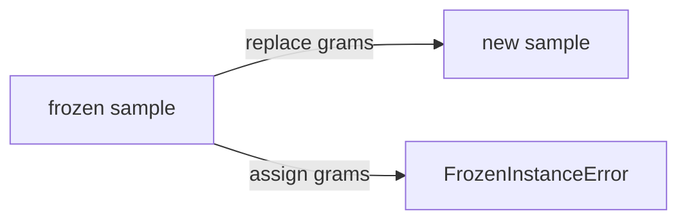

`order=True` adds the four comparisons, field by field, and it requires `eq=True`. `slots=True` drops the per-instance `__dict__`, so a typo that assigns an unknown name fails at once. A subclass of a frozen dataclass must also be frozen, or class creation raises `TypeError`, because the child would otherwise write fields the parent promised to keep still. `kw_only=True` forces names at the call, so a new field in the middle cannot swallow a positional value.

### Where a frozen record still changes

The shallow freeze is the bug that passes a test which only tries assignment. Code reviews miss it because the exception proves the name cannot be rebound, and the list inside the name is a different question. If a key must contain several tags, store a tuple. Tuples of hashable items are hashable, so the frozen record stays a legal key, and appending is impossible because a tuple has no `append`.

`__post_init__` runs at the end of the generated `__init__`. It is the right place to reject a negative mass or to normalise text. On a frozen class the line `self.grams = abs(self.grams)` raises `FrozenInstanceError`, because the instance is already frozen by the time your method runs. The escape hatch is `object.__setattr__(self, "grams", value)`, which skips the frozen `__setattr__`. Use it only inside `__post_init__`, and only for a value you just checked. A later write leaves the dict holding the object under the old hash.

`replace` calls the constructor, so `__post_init__` runs again on the copy and rechecks the whole record. Assigning and returning the same object is not a copy. On a frozen record that assignment raises, and a caller who swallows the exception keeps the old quantity. Return the new instance even when the added amount is zero, so identity still means "the object you passed in".

Two classes with the same field names are not equal. Generated equality asks whether the other object's class is this class, not whether the shapes look alike. Defining the class inside a function creates a new class on every call, so two records you just built never compare equal and never share a dict key. The fields match and the lookup still fails, because the class is part of the value. Define the class once, at module level, and construct instances in the function.

### At work

Use a frozen dataclass for a value other code should treat as data: a cache key, a message header, a row in a test fixture. The dict that maps a sample to a bin follows the same rule as any other dict. The key must not change while it sits in the table, so the fields have to be frozen and hashable. A mutable dataclass is still the right model for a form being filled in, because freezing would force a copy on every keystroke and the extra objects would not buy an invariant you did not need. Validation that is richer than "do not rebind this name", such as stripping a code or rejecting an empty one, belongs in `__post_init__` or on a property. The decorator will not invent that rule.

A tuple is smaller and already frozen, and it becomes a poor record once index 2 has to mean grams. A `namedtuple` names the fields, and it is clumsy when one field needs a factory. A dataclass keeps ordinary class syntax, so a later method can sit beside the fields. Reach for it when the class is mostly data. When the type protects a real rule, a normal class is still the better tool, and the dataclass is only the data it moves. `unsafe_hash=True` on a mutable class turns off the guard and will corrupt a dict if a field changes after insertion, so leave it off.

### Which declaration to write

| You need | Write this | Why not the neighbour |
| --- | --- | --- |
| Named fields, equality, a useful repr | `@dataclass` | A dict has no required keys, and a hand-written class repeats three methods |
| A new list or dict per instance | `field(default_factory=list)` | `= []` is a `ValueError` here, and a shared lambda brings the bug back |
| A dict key that compares by value | `@dataclass(frozen=True)` and hashable fields | Unfrozen plus `eq=True` sets `__hash__` to `None` |
| An updated frozen record | `replace(old, grams=new)` | Assigning to a field raises `FrozenInstanceError` |

Most records need the plain decorator or the frozen one, plus a factory when a field is a container.

### You can now

You can declare a record so `__init__`, `__repr__`, and `__eq__` come from the fields, and you can say why defaults obey the same order as function parameters. You can give each instance its own list with `default_factory`, freeze a record, use it as a dict key when the fields are hashable, and build a changed copy with `replace`. A freeze does not freeze a list stored in a field, a class built inside a function is a new type on every call, and a child of a frozen dataclass has to be frozen too.

::: quiz
q: A dataclass field is declared as tags with field(default_factory=list). Two instances are created and one of them appends a tag. The other instance still has an empty list. Why?
- The decorator copies one list at import time into every instance, so append on one of them is ignored.
+ default_factory is called once for each instance that omits the field, so each instance receives its own new list.
- frozen=True deep-copies every list when you append, even if you never set frozen.
- Dataclasses store the default list on the class and rewrite append so it assigns a fresh list back to the field.
why: The factory callable runs per omitted field, and list builds a new container each time it is called. A default written as tags=[] is rejected with ValueError for a dataclass, because that object would have been shared the way a function default is shared. Freezing is a separate switch and does not copy on append.
:::

::: quiz
q: A frozen dataclass has a field that holds a list. Assigning a new list to that field raises FrozenInstanceError, but appending to the existing list succeeds and is visible to every holder of the instance. Why?
- FrozenInstanceError means the decorator was forgotten, so only some assignments are blocked by a typo in the name.
+ frozen=True blocks rebinding the field on the instance. It does not freeze the object the field already points at.
- Append is rewritten into a thaw, a change, and a freeze, so the list changes while the field name stays protected.
- A list field is stored on the class, so append changes the class and assignment changes only the instance.
why: Frozen replaces __setattr__ for the fields. sample.tags = [] assigns the name and raises. sample.tags.append(...) calls a method on the list, and the field still refers to that list, so the freeze never sees the call. A tuple field is the fix when the contents must not change, and it stays hashable when its items are.
:::

::: predict lang=python
q: What does this print? Slip uses a list factory. Batch is frozen, and the dict is keyed by a Batch.
code:
```python
from dataclasses import dataclass, field, replace

@dataclass
class Slip:
    text: str
    tags: list = field(default_factory=list)

@dataclass(frozen=True)
class Batch:
    code: str
    n: int

a = Slip("a")
b = Slip("b")
a.tags.append("wet")
s = Batch("ore", 2)
t = replace(s, n=5)
bag = {s: "rack"}
print(a.tags, b.tags)
print(t.n, s.n, bag[Batch("ore", 2)])
```
answer:
```
['wet'] []
5 2 rack
```
why: Each omitted tags field calls list, so appending on a leaves b empty. replace builds a new Batch, so s.n stays 2 while t.n is 5. A new Batch("ore", 2) equals s and hashes the same way, because the class is frozen and both fields are hashable, so the dict returns rack.
:::

::: predict lang=python
q: What does this print? Open is a normal dataclass. Closed is frozen. Both compare by their field.
code:
```python
from dataclasses import dataclass

@dataclass
class Open:
    x: int

@dataclass(frozen=True)
class Closed:
    x: int

def kind(obj):
    try:
        hash(obj)
    except TypeError:
        return "unhashable"
    return "hashable"

print(kind(Open(1)))
print(kind(Closed(1)))
print(Open(1) == Open(1))
```
answer:
```
unhashable
hashable
True
```
why: eq=True and frozen=False sets __hash__ to None, so Open compares equal by value and still cannot be a dict key. frozen=True keeps equality and adds a hash from the fields, so Closed is hashable. Equality never required the two Open instances to be the same object.
:::

::: write lang=python
task: Write `freeze_line(sku, qty)`. Return an instance of a frozen dataclass named `Line` with exactly those two fields, `sku` then `qty`. Define `Line` once at module level, not inside the function, so two calls with the same values compare equal, are different objects, and work as the same dict key. Assigning to `qty` on the returned object must fail, because the instance is frozen. Do not give `Line` a list field.
starter:
```python
from dataclasses import dataclass

@dataclass
class Line:
    sku: str
    qty: int

def freeze_line(sku, qty):
    return Line(sku, qty)
```
tests:
```python
# Wrong answer: an unfrozen Line, so qty can be assigned and the value cannot be a dict key.
import dataclasses
from solution import freeze_line

def test_fields_and_equality():
    line = freeze_line("sku-1", 3)
    assert line.sku == "sku-1"
    assert line.qty == 3
    assert type(line).__name__ == "Line"
    other = freeze_line("sku-1", 3)
    assert line == other
    assert line is not other

def test_frozen_dataclass():
    line = freeze_line("sku-1", 3)
    assert dataclasses.is_dataclass(line)
    assert type(line).__dataclass_params__.frozen is True
    try:
        line.qty = 9
    except Exception:
        pass
    else:
        raise AssertionError("assigning qty should fail")
    assert line.qty == 3

def test_dict_key():
    line = freeze_line("sku-1", 3)
    table = {line: "bin"}
    assert table[freeze_line("sku-1", 3)] == "bin"
    assert freeze_line("sku-1", 4) not in table
```
solution:
```python
from dataclasses import dataclass

@dataclass(frozen=True)
class Line:
    sku: str
    qty: int

def freeze_line(sku, qty):
    return Line(sku, qty)
```
hint: Decorate a module-level class with frozen=True and two fields, sku and qty. Return Line(sku, qty). A class created inside the function is a new type on every call, so equality and the dict lookup both fail. An unfrozen dataclass compares equal and still raises TypeError when used as a key.
:::

::: write lang=python
task: Write `merge_qty(line, extra)`. `line` is a frozen dataclass with fields `sku` and `qty`. Return a new instance of the same class, with the same `sku`, and with `qty` equal to the old quantity plus `extra`. Do not mutate `line`. Returning `line` itself is wrong, even when `extra` is 0. Assigning to `line.qty` is wrong, because a frozen instance raises instead of changing. The result must stay frozen.
starter:
```python
def merge_qty(line, extra):
    line.qty = line.qty + extra
    return line
```
tests:
```python
# Wrong answer: assign line.qty in place and return the same object.
from dataclasses import dataclass
from solution import merge_qty

@dataclass(frozen=True)
class Line:
    sku: str
    qty: int

def test_new_instance_keeps_sku():
    line = Line("ab", 2)
    out = merge_qty(line, 3)
    assert out is not line
    assert line.qty == 2
    assert line.sku == "ab"
    assert out.qty == 5
    assert out.sku == "ab"
    assert type(out) is type(line)

def test_zero_extra_is_still_a_copy():
    line = Line("ab", 2)
    out = merge_qty(line, 0)
    assert out is not line
    assert out == Line("ab", 2)
    assert line.qty == 2

def test_result_stays_frozen():
    line = Line("ab", 2)
    out = merge_qty(line, 4)
    try:
        out.qty = 1
    except Exception:
        pass
    else:
        raise AssertionError("result should stay frozen")
    assert out.qty == 6
```
solution:
```python
from dataclasses import replace

def merge_qty(line, extra):
    return replace(line, qty=line.qty + extra)
```
hint: dataclasses.replace builds a new instance of the same class and copies the fields you do not name. Pass qty=line.qty + extra. Do not assign to line.qty. On a frozen instance that assignment raises FrozenInstanceError before you can return anything.
:::

::: card
q: When can a frozen dataclass be a dict key, and what does freezing not protect?
answer: It can be a key when every field is hashable, because frozen=True together with the default eq=True generates __hash__ from the fields, so equal records land on the same slot. An unfrozen dataclass with eq=True sets __hash__ to None and cannot be a key. Freezing blocks rebinding a field. It does not freeze a list stored in a field, and a list field is not hashable anyway. Build changes with replace, which returns a new instance.
:::

## Inheritance, super, and composition
id: inheritance
stage: classes
needs: classes
minutes: 40
goal: Follow the MRO, call super() along that order, and prefer composition when a part is not a kind-of.
source: Python docs: Inheritance | https://docs.python.org/3/tutorial/classes.html#inheritance
source: Python docs: The method resolution order | https://docs.python.org/3/howto/mro.html
source: Python docs: super | https://docs.python.org/3/builtins/functions.html#super

A logging change looked like a one-line bug. `Tee` was declared as a subclass of `Disk` and of `Net`, both of which wrote a path by calling `super` and then appending the root label. On a `Tee` instance the disk branch ran and the network branch never did, but only after someone removed the `super()` call inside `Disk` while cleaning it up. The method resolution order still listed `Net`. The call chain had stopped, so the order never got there. A second design in the same service treated a printer as a subclass of its print head so the shipping weight could read `self.grams`. That worked until the head became a part you could swap. The printer was not a head. It had a head. Inheritance answers "is a kind of". Composition answers "has a". `super()` does not answer either question. It only continues a chain that the instance's class already ordered.

When you create a class, Python builds a method resolution order, the MRO, and stores it as `__mro__`. Attribute lookup walks that tuple and uses the first class that defines the name. The order is C3, not "depth first, and visit the parent twice". A class appears before its bases, and it appears once. The bases stay in the order they were written. For `class Tee(Disk, Net)` where both subclass `Log`, the order is `Tee`, `Disk`, `Net`, `Log`, `object`. The tempting order that puts `Log` between `Disk` and `Net` would run `Log` before `Net` could override it, and it would list `Log` twice. C3 keeps `Net` ahead of `Log`. Print the names in `__mro__` when the hierarchy changes, because a wrong guess aims every `super()` call at the wrong class.

`super()` continues at the next class after the running method in that order. The zero-argument form, used inside a method, does not mean "the class written in the parentheses". That syntactic parent is the next class only on a single inheritance line, where the MRO and the parentheses name the same place. On a `Tee` instance, `super()` inside `Disk.path` continues at `Net`, because `Net` is next after `Disk` in `Tee`'s MRO. On a plain `Disk` instance the same line continues at `Log`, because that MRO is `Disk`, `Log`, `object`. One body, two next classes, chosen from the instance that started the call. Copying `super()` into a loose function raises `RuntimeError`, because the zero-argument form needs the `__class__` cell a method defined in the class body carries.

```python
class Log:
    def path(self):
        return "log"

class Disk(Log):
    def path(self):
        return "disk>" + super().path()

class Net(Log):
    def path(self):
        return "net>" + super().path()

class Tee(Disk, Net):
    def path(self):
        return "tee>" + super().path()
```

`Tee().path()` is `tee>disk>net>log`. `Tee` calls `super()`, which enters `Disk`. `Disk` calls `super()`, which enters `Net`, not `Log`. `Net` calls `super()`, which enters `Log`, and `Log` returns the root label without calling `super()` again. The MRO names are `Tee`, `Disk`, `Net`, `Log`, `object`. A plain `Disk().path()` is `disk>log`, because that instance never had `Net` in its order. If `Disk.path` returns `"disk"` and does not call `super()`, `Tee().path()` becomes `tee>disk`. `Net` is still in the MRO and still never runs. `super()` is a call you make, not a subscription that runs every base for you. The root implementation should exist and should not call `super()` unless the class above it, usually `object`, really has that method. `object` does not have `path`, so a `super().path()` in `Log` raises `AttributeError` at the end of an otherwise healthy chain.

```text
Tee instance
  Tee.path -> Disk.path -> Net.path -> Log.path
Disk instance
  Disk.path -> Log.path
```

Cooperative inheritance means every override that is not the root calls `super()` once. A common break is `super().__init__(name)` when the next class's `__init__` takes a different list. The order is data, so the arguments have to be data too. Prefer an explicit signature until you actually have two bases, because a catch-all `**kwargs` hides a typo instead of raising `TypeError`.

### Where the chain lies

The syntactic-parent story feels right because tutorials show one subclass and one base, and in that picture `super()` and "my parent" name the same class. The diamond is where the picture costs you a missing side effect: a header not written, a permission not checked, a network path not added. The failure is quiet when the method returns a string you can still print. Test a `Tee` instance and a plain `Disk` instance. If those two disagree about whether `Net` ran, the MRO is doing what it should, and a test that only builds the subclass will not see a broken `super()` inside `Disk`.

A second lie is "inheritance is how you reuse a method". Reuse is not a kind-of relationship. A printer that subclasses its head so it can read `grams` becomes unusable when the head is a different class that merely has the same attribute. `isinstance` checks start failing, `super()` starts running the head's initialiser on the printer, and a second head cannot be attached without a second inheritance edge. The shipping weight was never an is-a question. It was the head's grams plus the body's grams.

```python
class Head:
    def __init__(self, grams):
        self.grams = grams

class Printer:
    def __init__(self, head, body_grams):
        self.head = head
        self.body_grams = body_grams

def shipping_grams(printer):
    return printer.head.grams + printer.body_grams
```

`shipping_grams(Printer(Head(30), 70))` is `100`. The function asks the printer for its head, then reads `grams` on that object, so a test double that is not a `Head` still works. The printer does not inherit `grams`, and swapping the head is an assignment, not a new subclass. Subclassing the part instead makes `grams` look local and then breaks on the first owner that is not that part.

### At work

Django's class-based views are the production version of this diamond. A view class lists mixins, and each mixin is written to call `super()` so the next mixin in the MRO still runs. A mixin that handles the request and returns without `super()` silently drops every mixin to its right. The fix is not a deeper tree. The fix is to keep the mixin cooperative, or to stop using a mixin for a part that is really a collaborator. Application code usually wants the collaborator. A machine owns an engine object. A request owns a clock and a store. Those are attributes. Inheritance earns its place when the new class truly is a more specific version of the old one, and when callers who expect the base type are right to accept the subclass. That is the Liskov test in plain language: code written against `Log` should still make sense when it receives `Disk`. Code written against `Head` does not make sense when it receives `Printer`, because a printer does not have the head's job.

Multiple inheritance of concrete classes that were not designed to share an MRO gives you two `__init__` methods and no safe `super()` call. If you cannot point at the next class after each `super()`, do not add a base. Compose the part and pass it in.

### Which tool to pick

| Question | Use | Why the other one fails |
| --- | --- | --- |
| Is this value a more specific kind of that type? | A subclass, with `super()` if you extend a method | Composition hides a real is-a and forces callers to unwrap |
| Does this value own a part with its own mass, grams, or client? | An attribute holding that part | Subclassing the part makes `isinstance` lie and blocks a swap |
| Two bases both override one method and both must run | Cooperative `super()` along the MRO | Calling the syntactic parent skips the other base on a diamond |
| You only wanted a helper function | A function, or a small object you call | A base class you never `isinstance` is inheritance used as a junk drawer |
| You are unsure what `super()` will hit | Print the MRO of the instance's class | Guessing from the parentheses is right only for a single base |

If a design needs a paragraph to explain why the subclass is a kind of the base, it is probably a part, and the paragraph is the argument for an attribute.

### You can now

You can read a diamond's MRO and say why the shared base appears once, after both branches, instead of being visited in the middle of the first branch. You can trace `super()` from the class that is running to the next class on the instance's MRO, and you can explain why the same line in `Disk` reaches `Net` for a `Tee` and reaches `Log` for a plain `Disk`. You can see a missing `super()` as a broken chain rather than as a missing entry in the MRO. You can also refuse an inheritance edge when the relationship is "has a", and write a function that adds a part's measurement to a measurement stored on the owner.

::: quiz
q: Class D lists bases B and C, in that order. B and C both subclass A. A method defined on B calls super().ping(), and the instance you called it on is a D. Which class runs next, and why?
- super() always calls the class written as the syntactic parent, ignoring the instance MRO.
+ super() continues at the next class after B in the MRO of the instance's class, so on a D it can run C before A.
- super() restarts the search at object and walks back toward D, so object runs before A.
- super() calls every base of B and then every base of C, so A runs twice.
why: super() means "the next class after the one whose method is running, in the MRO of the instance". For D that order is D, B, C, A, object, so B's super() lands on C. The class written in B's parentheses is A, and that answer is right only when the instance's MRO really does put A next, such as a plain B instance. The zero-argument form does not look at the source line's base list by itself.
:::

::: quiz
q: For class D(B, C), where B and C both subclass A, and A subclasses object, what is D's method resolution order?
- D, B, A, C, A, object, with A listed twice so each branch keeps its own parent.
+ D, B, C, A, object. Each class appears once, B stays ahead of C, and A comes after both.
- D, C, B, A, object, because the second base is the more specific sibling.
- D, object, A, B, C, because object is always visited before any of your classes.
why: C3 keeps a class ahead of its own bases and keeps the written base order, and it lists each class once. Putting A between B and C would run A before C had a chance to override it. Swapping B and C would ignore the order in class D(B, C). object is the end of the tuple, not the start.
:::

::: quiz
q: A printer has a head object with a grams attribute, and it stores body_grams itself. Shipping weight is those two numbers added. Why is that composition, and why is subclassing the head the wrong model?
- Subclassing is required whenever one object stores another, because Python has no other way to share an attribute.
+ The printer is not a head. It has a head, so the weight reads head.grams plus body_grams, and the head can be replaced without a new subclass.
- super() cannot see attributes of a contained object, so inheritance is the only way to add two weights.
- A subclass copies the head's grams onto the printer, so the total stays correct after the head object is swapped for another one.
why: Inheritance says the printer is a kind of head, which makes isinstance and the head's initialiser apply to the printer. The weight is a sum of a part and a local number. An attribute holds the part, so a different object with grams still works and swapping the part is an assignment. Copying grams onto the subclass would go stale on the swap anyway.
:::

::: predict lang=python
q: What does this print? D subclasses B and C, and both B and C subclass A. Every override calls super() before the chain ends.
code:
```python
class A:
    def ping(self):
        print("A")

class B(A):
    def ping(self):
        print("B")
        super().ping()

class C(A):
    def ping(self):
        print("C")
        super().ping()

class D(B, C):
    def ping(self):
        print("D")
        super().ping()

D().ping()
print([c.__name__ for c in D.__mro__])
```
answer:
```
D
B
C
A
['D', 'B', 'C', 'A', 'object']
```
why: D's MRO is D, B, C, A, object. super() inside B therefore enters C, not A. A is the syntactic parent of B, and it runs only after C, because the instance that started the call is a D. The print of __mro__ includes object at the end, once.
:::

::: write lang=python
task: Write `total_mass(machine)`. A machine has an `engine` object, and that engine has a `mass` attribute. The machine also has `frame_mass`. Return the engine's mass plus `frame_mass`. Do not subclass the engine and do not read `mass` from the machine itself. A machine that merely stores an engine has no `mass` attribute, and the function must still work when the engine's class is not a particular base you defined.
starter:
```python
class Engine:
    def __init__(self, mass):
        self.mass = mass

class Machine(Engine):
    def __init__(self, mass, frame_mass):
        super().__init__(mass)
        self.frame_mass = frame_mass

def total_mass(machine):
    return machine.mass + machine.frame_mass
```
tests:
```python
# Wrong answer: subclass Engine and add machine.mass to machine.frame_mass, which fails when the machine is not an engine.
from solution import total_mass

class Engine:
    def __init__(self, mass):
        self.mass = mass

class Press:
    def __init__(self, engine, frame_mass):
        self.engine = engine
        self.frame_mass = frame_mass

def test_press():
    assert total_mass(Press(Engine(40), 15)) == 55

def test_zero_frame():
    assert total_mass(Press(Engine(8), 0)) == 8

def test_engine_is_not_a_required_base():
    class Motor:
        def __init__(self, mass):
            self.mass = mass

    class Rig:
        def __init__(self, engine, frame_mass):
            self.engine = engine
            self.frame_mass = frame_mass

    assert total_mass(Rig(Motor(3), 4)) == 7

def test_does_not_swap_the_two_masses():
    assert total_mass(Press(Engine(1), 100)) == 101
```
solution:
```python
def total_mass(machine):
    return machine.engine.mass + machine.frame_mass
```
hint: The machine has an engine. Read machine.engine.mass, then add machine.frame_mass. Do not treat the machine as a subclass of the engine, and do not expect a mass attribute on the machine itself. Any object with those two attributes is enough.
:::

::: card
q: In a diamond, B and C both override ping and both are supposed to call super(). D subclasses B then C. What fails if B's override returns without calling super(), even though C is still listed in D's MRO?
answer: The chain stops in B. C's override never runs for a D instance. super() only moves to the next class when that method calls it. It is not a loop over the MRO, and it does not mean the syntactic parent written on B, which would also skip C. The MRO still contains C. The call never reaches it.
:::

## Special methods on the class
id: dunder
stage: classes
needs: classes, iteration, dicts
minutes: 45
goal: Make a small class support repr, equality, addition, len, iteration, and indexing.
source: Python docs: Special method names | https://docs.python.org/3/reference/datamodel.html#special-method-names
source: Python docs: Special method lookup | https://docs.python.org/3/reference/datamodel.html#special-lookup

A pair of coordinates printed as `<Pair object at 0x10ab>` inside a list of hits, so the log told you the memory address and not the numbers. Two pairs that both held 1 and 2 compared false, because nobody had written `__eq__` and the default `==` is `is`. A third bug showed up when someone added two pairs and stored the result: the name was `None`, and the left pair had grown extra numbers, because `__add__` changed a list and then fell off the end of the function. Operators felt like syntax. They are method calls, and the method is looked up on the class, not on the instance. A small class named `Pair` is enough to see the whole set: how it prints, how it compares, how `+` builds a new value, and how `len`, indexing, and a `for` loop walk the two numbers. The same methods are what make a later collection feel built in instead of like a bag of attributes you have to know by name.

`p + q` does not search the instance dictionary for `__add__`. Python looks up `__add__` on the type of `p` and calls `type(p).__add__(p, q)`. Assigning `p.__add__ = something` changes the explicit call `p.__add__(q)` and does not change `p + q`. The same rule covers `__eq__`, `__len__`, `__iter__`, and `__getitem__`. Define the method in the class body. If it returns `NotImplemented`, Python tries the reflected method on the other operand, `__radd__` for addition. `NotImplemented` is a sentinel, not an exception and not `None`. A function with no `return` returns `None`, and `None` is a finished result, so `__radd__` never runs and the caller receives `None`. Return `NotImplemented` when you do not recognise the other type, and a new instance when you do.

Equality has a second consequence for dictionaries. If you define `__eq__` and you do not define `__hash__`, Python sets `__hash__` to `None` on the class. `hash(pair)` then raises `TypeError`. The reason is the dict invariant you already rely on: equal keys must share a hash, and an object whose fields can change would break the table if it stayed hashable by identity after it became equal by value. Leave the object unhashable, or define `__hash__` from the same fields as `__eq__` and do not change those fields afterwards. Do not hash the identity once `__eq__` compares values, because two equal pairs would miss each other in a dict.

`repr` is the string for developers, logs, and containers. `print(pair)` uses `__str__` if you defined it, and otherwise it uses `__repr__`. `print([pair])` does not use `__str__` for the element. A list's own `repr` asks each element for `repr`, because the result is supposed to be unambiguous and, when you can manage it, look like a constructor call. Defining only `__str__` makes `print(pair)` look fine and leaves the list on the default angle-bracket form. Prefer `Pair(1, 2)`. That string is not evaluated for you. It is a promise to the reader, so include the class name and the values `__eq__` cares about.

```python
class Pair:
    def __init__(self, a, b):
        self.a = a
        self.b = b

    def __repr__(self):
        return f"Pair({self.a}, {self.b})"

    def __eq__(self, other):
        if not isinstance(other, Pair):
            return NotImplemented
        return (self.a, self.b) == (other.a, other.b)
```

`Pair(1, 2)` and another `Pair(1, 2)` compare equal and are not the same object. `Pair(1, 2) == (1, 2)` returns `NotImplemented` from `Pair`, and the tuple does not know how to compare with `Pair`, so the result is false rather than a crash. Returning `False` immediately would also look false against a tuple, and it would be wrong against a later class that knows how to compare with `Pair`, because a definite `False` stops the reflected call. `NotImplemented` keeps that door open. `isinstance` is the right guard here because equality is part of the type's public value. Comparing the tuple of fields is enough. You do not need to compare identities as well.

Addition should follow the same value idea. `Pair(1, 2) + Pair(3, 4)` ought to be a new `Pair(4, 6)`, and the left pair ought to stay `Pair(1, 2)`. That happens only when `__add__` builds a new instance and returns it. If the numbers live in a list and `__add__` calls `extend`, the left operand changes and every other name that points at it changes too, because there was only one list. Returning `self` after that extend makes `p + q is p` true. Forgetting the return makes the sum `None` while the list still grows. Store a tuple. It rejects `extend`, so concatenate the tuples and pass the result to a new `Pair`.

`len(pair)` calls `__len__` and expects a non-negative int. `pair[i]` calls `__getitem__`. A `for` loop calls `__iter__` if it exists. If `__iter__` is missing, iteration falls back to the old sequence protocol: Python calls `__getitem__(0)`, then `__getitem__(1)`, and stops when that call raises `IndexError`. The fallback is why a small class can be iterable with only `__getitem__`, and it is also how you write an infinite loop by accident. If a missing index returns `None` instead of raising `IndexError`, the loop never sees a stop signal. `None` is a legal stored value, so it cannot mean "end". Still raise `IndexError` from `__getitem__` so the fallback stays safe. Each `__iter__` should return a new iterator. One stored iterator is empty on the second `list(pair)`.

### Where the methods disagree

The methods are one contract, and the bugs are disagreements inside it. `__eq__` says two pairs are equal and `__repr__` prints different text, so a failed test is hard to read. `__eq__` uses the numbers and `__hash__` uses the identity, so a dict lookup misses a pair you can see is equal. `__add__` returns a new pair but `__iadd__` is also defined and mutates. `+=` will use `__iadd__` when it exists, and otherwise it will use `__add__` and rebind the name. If you do not want a mutating `+=`, do not define `__iadd__`. The inherited absence means `p += q` runs `__add__` and assigns the new object to `p`.

A subclass that adds a field and forgets `__eq__` compares with `Pair.__eq__` and ignores the new field. `len` on a class with no `__len__` raises `TypeError`, not `AttributeError`, because the interpreter is reporting a failed operation. Provide the method, or catch that error. Do not expect `AttributeError` to mean "this pair has no length".

### At work

Records that move through logs and tests need `__repr__` and `__eq__` first. You will read them in assertion failures, and an address does not tell you which coordinates failed. Small numeric values, money, and intervals earn `__add__` when addition is a real operation in the domain and not just a way to avoid writing a function. If the reader would not guess what `+` means, a named function is clearer and you should not define the operator. Collections earn `__len__`, `__iter__`, and `__getitem__` together. Callers will write `len`, a `for` loop, and an index because that is what a sequence does. Meet that expectation, or do not ship a half implementation that iterates once and then looks empty. If the fields are fixed, `__hash__` can follow `__eq__`. If they change, leave `__hash__` as `None` so insertion raises `TypeError` instead of losing the key after a later append. Equality, hash, and mutation have to tell one story.

### Which method to add

| Call site | Method | Return |
| --- | --- | --- |
| `repr(p)`, and elements inside a list | `__repr__` | A string a developer can read, ideally `Pair(1, 2)` |
| `p == q` | `__eq__` | True, False, or `NotImplemented` if this class does not recognise the other |
| `p + q` | `__add__` | A new value, or `NotImplemented`. Do not return `None` and do not change `p` |
| `len(p)` | `__len__` | A non-negative int |
| `for x in p` | `__iter__` | A new iterator each call |
| `p[i]` | `__getitem__` | The item, or raise `IndexError` for a bad index |
| `hash(p)` as a dict key | `__hash__` | A hash of the same fields as `__eq__`, and only if those fields stay still |

Add the row when a real call site needs it. A class with twenty operators and one caller is harder to review than a class with the six operations the caller actually uses.

### You can now

You can put `__repr__`, `__eq__`, `__add__`, `__len__`, `__iter__`, and `__getitem__` on a small class and say which piece of syntax calls which method. You can explain why those methods are found on the class even when the instance dictionary has a different function under the same name. You can return `NotImplemented` so the other operand still gets a chance, and you can see a bare `return` as `None`, which throws that chance away. You can keep addition from mutating by storing a tuple and returning a new instance. You can also say why defining `__eq__` without `__hash__` makes the object unhashable, and why a `for` loop over a class that only has `__getitem__` stops on `IndexError` and never on `None`.

::: quiz
q: A class defines __repr__ and does not define __str__. You print a list that contains one instance. What appears for that instance, and why?
- The list calls __str__, finds nothing, and skips the element, so the brackets are empty.
+ The list builds its text from repr of each element, so the __repr__ you wrote is what appears inside the brackets.
- print always prefers __repr__ over __str__, even when both exist and you print the bare instance.
- __repr__ is consulted only by the debugger, so the list still shows the default angle-bracket form.
why: A container's repr uses repr on the elements so the text stays unambiguous. print on the bare instance uses __str__ if it exists and otherwise falls back to __repr__. Defining only __str__ therefore decorates the bare print and leaves the list on the default repr, address and all. The wrong claim that print always prefers __repr__ fails as soon as both methods exist.
:::

::: quiz
q: __add__ extends an internal list and then reaches the end of the function with no return. The caller writes total = left + right. Why is total None, and why does the right-hand class not get __radd__?
- Operators ignore the return value and always rebind the left name to a new object of the same class.
+ A missing return is a return of None. None is a real result, so Python does not treat it as NotImplemented and does not try the reflected method.
- __add__ is only used for integers, so a user class always produces None from +.
- None means the same object, so total is left and the name total stays unbound until you call list on it.
why: Falling off the end returns None, and the + expression's value is that None. NotImplemented is the only sentinel that means "try the other side". The list was still extended if the body did that before returning, so the left operand can be mutated and the caller can still observe None. Return a new instance instead, and keep the stored numbers in a tuple so extend is not available.
:::

::: quiz
q: A class defines __getitem__ and does not define __iter__. A for-loop over an instance starts at index 0. When does that loop stop, and what goes wrong if a missing index returns None?
+ The loop is the old sequence protocol: it calls __getitem__ with 0, then 1, then 2, and stops when that call raises IndexError.
- A for-loop always calls __iter__ first, so a missing __iter__ raises TypeError before any index is used.
- The loop stops when __getitem__ returns None, because None marks the end of every sequence.
- __getitem__ is only used for slices, so the fallback never indexes with an integer.
why: If __iter__ is absent, iteration uses __getitem__ and treats IndexError as the end. None can be a stored item, so it must not mean stop. A method that returns None for every bad index never raises, and the loop does not end. Implement __iter__ for clarity, and still raise IndexError from __getitem__ so the fallback stays safe.
:::

::: predict lang=python
q: What does this print? Pair equality and addition are defined on the class. After that, one instance's dictionary gets a different __add__.
code:
```python
class Pair:
    def __init__(self, a, b):
        self.a = a
        self.b = b

    def __repr__(self):
        return f"Pair({self.a}, {self.b})"

    def __eq__(self, other):
        if not isinstance(other, Pair):
            return NotImplemented
        return (self.a, self.b) == (other.a, other.b)

    def __add__(self, other):
        return Pair(self.a + other.a, self.b + other.b)

    def __len__(self):
        return 2

p = Pair(1, 2)
q = Pair(1, 2)
print(p == q, p is q)
p.__add__ = lambda other: Pair(9, 9)
print(p + Pair(3, 4))
print(p.__add__(Pair(3, 4)))
print(len(p))
```
answer:
```
True False
Pair(4, 6)
Pair(9, 9)
2
```
why: == uses Pair.__eq__, so the two pairs match by values and are not the same object. p + Pair(3, 4) still calls Pair.__add__ on the class, which returns Pair(4, 6). The function stored on the instance runs only when you call p.__add__ yourself, and that one returns Pair(9, 9). len also uses the class, so it stays 2.
:::

::: predict lang=python
q: What does this print? Pair stores a tuple and implements len, indexing, and iteration.
code:
```python
class Pair:
    def __init__(self, a, b):
        self._v = (a, b)

    def __iter__(self):
        yield self._v[0]
        yield self._v[1]

    def __getitem__(self, i):
        return self._v[i]

    def __len__(self):
        return 2

p = Pair(10, 20)
print(len(p), p[1], list(p))
```
answer:
```
2 20 [10, 20]
```
why: len calls __len__. The index 1 calls __getitem__ and gets the second number, 20. list() iterates by calling __iter__, which yields 10 and then 20. The tuple is not printed as a tuple because list() builds a list from those yields.
:::

::: write lang=python
task: Write class `Shift`, a value object of hour offsets. `Shift((1, 2))` stores those ints. `Shift((1, 2)) + Shift((3,))` must equal `Shift((1, 2, 3))`, and both inputs must stay unchanged. `len`, iteration, and indexing walk the offsets, and iteration must work more than once. `repr(Shift((1, 2)))` is the string `Shift((1, 2))`, and `repr(Shift((3,)))` is `Shift((3,))`. Equality compares the offsets, not object identity. Do not mutate a list inside `__add__`, and do not return None from `__add__`.
starter:
```python
class Shift:
    def __init__(self, hours):
        self.hours = list(hours)

    def __add__(self, other):
        self.hours.extend(other.hours)
        return None

    def __len__(self):
        return len(self.hours)

    def __iter__(self):
        return iter(self.hours)

    def __getitem__(self, index):
        return self.hours[index]

    def __eq__(self, other):
        if not isinstance(other, Shift):
            return NotImplemented
        return self.hours == list(other.hours)

    def __repr__(self):
        return f"Shift({tuple(self.hours)!r})"
```
tests:
```python
# Wrong answer: store a list and return None from __add__ after extending that list in place.
from solution import Shift

def test_add_returns_new_value():
    left = Shift((1, 2))
    right = Shift((3,))
    total = left + right
    assert total == Shift((1, 2, 3))
    assert left == Shift((1, 2))
    assert right == Shift((3,))
    assert total is not left

def test_len_index_iter_repr():
    shift = Shift((1, 2))
    assert len(shift) == 2
    assert shift[0] == 1
    assert shift[1] == 2
    assert list(shift) == [1, 2]
    assert list(shift) == [1, 2]
    assert repr(shift) == "Shift((1, 2))"
    assert repr(Shift((3,))) == "Shift((3,))"

def test_eq_by_offsets():
    assert Shift((4, 5)) == Shift((4, 5))
    assert Shift((4, 5)) != Shift((5, 4))
    assert Shift((4, 5)) is not Shift((4, 5))

def test_empty_plus_one():
    left = Shift(())
    total = left + Shift((7,))
    assert total == Shift((7,))
    assert left == Shift(())
    assert repr(total) == "Shift((7,))"
```
solution:
```python
class Shift:
    def __init__(self, hours):
        self.hours = tuple(hours)

    def __add__(self, other):
        return Shift(self.hours + tuple(other.hours))

    def __len__(self):
        return len(self.hours)

    def __iter__(self):
        return iter(self.hours)

    def __getitem__(self, index):
        return self.hours[index]

    def __eq__(self, other):
        if not isinstance(other, Shift):
            return NotImplemented
        return self.hours == other.hours

    def __repr__(self):
        return f"Shift({self.hours!r})"
```
hint: Store a tuple so the offsets cannot be extended in place. __add__ should return Shift(self.hours + tuple(other.hours)), not None and not self. __iter__ should call iter on that tuple each time, so a second list() still sees the offsets. __repr__ can format the tuple with !r, which already includes the comma in a one-element tuple.
:::

::: card
q: You define __eq__ on a class and you do not define __hash__. Can instances be used as dict keys, and why does Python choose that?
answer: No. Defining __eq__ without __hash__ sets __hash__ to None, so hash(instance) raises TypeError. Equal objects have to share a hash for a dict to work, and an object whose compared fields can still change would corrupt the table if it stayed hashable by identity. Define __hash__ from the same fields only when those fields do not change. Operators and hash still look the method up on the class, not on the instance dictionary.
:::

## Properties that run on assignment
id: properties
stage: classes
needs: dunder
minutes: 35
goal: Validate an attribute with a property, and say why assignment calls the setter.
source: Python docs: Descriptor HowTo Guide | https://docs.python.org/3/howto/descriptor.html
source: Python docs: property | https://docs.python.org/3/builtins/functions.html#property

A stock count went negative because any line of code could execute `item.quantity = -3`. The class had a method `set_quantity` that rejected a negative number, and the method was fine. Callers did not have to use it. Assignment writes an ordinary attribute straight into the instance dictionary, so the rule lived in a function people could walk around. Renaming the attribute to `_quantity` only helps if every reader agrees to stay out, and a later edit will still type the public name. A property puts the rule on the name itself. Reading `item.quantity` runs a function. Assigning to `item.quantity` runs a function. The call sites still look like attributes, because the point of the feature is that you do not have to remember a different verb for "change this with a check".

A property is a descriptor stored on the class. A descriptor defines `__get__`, and often `__set__` or `__delete__`. A data descriptor, one that defines `__set__` or `__delete__`, is found before the instance dictionary. The property type defines `__set__`, so a property is a data descriptor even with no setter of yours. Lookup calls `__get__`. Assignment calls `__set__` instead of storing the value under that public name. Your setter then writes a different key, usually `_quantity`. The next read goes through `__get__` again, so a raw value cannot slip past the rule.

This is why a later assignment revalidates. People expect the setter to run from `__init__` and then retire, because `__init__` is where attributes are born. `__init__` is just another method. The line `self.quantity = 3` inside it uses the same lookup as `item.quantity = 3` in a function written months later. Both find the property on the class and call `__set__`. There is no second, weaker path for "the object already exists". If the setter strips text or rejects a negative count, it does that on every write, including the first one. That only works when `__init__` assigns to the public name. If `__init__` writes `self._quantity = quantity` directly, the first value skips the check, and only later assignments are clean. The bug is invisible until you construct an object with a bad value and notice that the constructor was the one door you left open.

Looking the name up on the class is a different call. `Stock.quantity` runs `__get__` with no instance, and a property returns itself in that case, so you get the property object rather than a number. Its printed form contains a memory address, which changes between processes, so the useful check is the type: `type(Stock.quantity).__name__` is `property`. That class-level object is also why the decorator syntax works. `@property` builds the descriptor. `@quantity.setter` registers the setter function on that same descriptor and replaces the class attribute with the result. The names have to match. A setter decorated under a different name is a new, unused function, and assignment still hits the getter-only property.

```python
class Stock:
    def __init__(self, quantity):
        self.quantity = quantity

    @property
    def quantity(self):
        return self._quantity

    @quantity.setter
    def quantity(self, value):
        if not isinstance(value, int) or value < 0:
            raise ValueError("quantity must be a non-negative int")
        self._quantity = value
```

`Stock(3)` stores `{'_quantity': 3}`. The public name is not a key in the instance dictionary, because the setter wrote the private one. `stock.quantity` returns `3`. `Stock(-1)` raises `ValueError` from the setter before the caller ever receives an instance, because `__init__` assigned through the property. `Stock(0)` is legal. Zero is a real count of an empty bin. A check written as `if not value` rejects zero, because zero is falsy, and it does so for a reason that has nothing to do with stock. Test the boundary you mean. Negative is the illegal side. Zero is the empty side. A non-int takes the same `ValueError` path here so callers do not have to catch `TypeError` for `"3"` and `ValueError` for `-1`. Pick one error and use it on purpose.

A getter without a setter still has `__set__`. Assignment raises `AttributeError` with a message that the property has no setter, and Python does not then write the instance dictionary. Stuffing `stock.__dict__["quantity"] = 99` leaves the next read on `_quantity`, because the data descriptor outranks that shadow key. Omit the setter when the value is computed and must not be assigned. Write a setter when there is a rule. Use neither when the name is just data.

### Where the rule leaks

The leak people ship is a second name. The setter stores `_quantity`, and another method assigns `self._quantity = -1` because that author was inside the class and thought the underscore meant "already checked". The property only guards the public name. The private name is an ordinary attribute. Keep writes to `_quantity` inside the setter, or route every internal write through `self.quantity = ...` so there is one door. A computed property that returns `price * quantity` has the opposite shape: no setter, and no stored total that can drift from the two inputs. Store the inputs. Compute the total. A setter on the total invites someone to write a number that no pair of inputs could produce.

A subclass that defines its own property replaces the base descriptor for its instances. A subclass that only adds methods still uses the base property, which is what you want when the rule belongs to the base. Overriding `__setattr__` is the bigger tool, and it is easy to recurse by assigning `self._quantity` inside it. Use a property when one name has a rule. You also cannot insert a descriptor into a class you do not own, so a wrapper function is the honest fix there. A frozen dataclass will fight a setter that assigns a field the decorator already froze, so do not stack both mechanisms on the same name.

### At work

Use a property for an invariant on one attribute that callers already think of as data: a non-negative quantity, a code that must be stripped and non-empty, a percentage clamped to a range. The constructor and every later assignment then share the check, so a second screen cannot skip the form. Leave plain attributes alone when there is no rule. A property that stores the value unchanged only teaches the next person that every name is magical. Put the property on the name that has bitten you, and leave the other names as attributes assigned in `__init__`.

This is the same reason special methods live on the class. Python consults the class for `+` and for `obj.name = value` when a descriptor is present, because the behaviour belongs to the type, not to one object's dictionary. A test that only calls `set_quantity` will stay green while production assigns the attribute. Test the assignment. Construct with a bad value, assign a bad value later, assign a value that needs cleaning, and read back the cleaned value. Also assign a plain field on the same object and check that it round-trips unchanged, so the property did not swallow every write via a custom `__setattr__`.

### When to use one

| Situation | Use | Why |
| --- | --- | --- |
| Reading computes a value from other fields | A property with no setter | A stored copy goes stale, and assignment should fail |
| Every write must strip, clamp, or reject | A property with a setter, assigned from `__init__` too | A method is optional. Assignment is not |
| No invariant, just a value to keep | A plain attribute | A property with no rule hides where the data lives |
| The same policy for every attribute | `__setattr__`, carefully, using `object.__setattr__` | A property per name is clearer until the policy is truly shared |
| You need the rule on a class you do not own | A wrapper function, not a property on their class | You cannot insert a descriptor into a type you do not control |

If you cannot name the bad value that the setter rejects, you do not have a property yet. You have an attribute.

### You can now

You can explain attribute assignment as a lookup of a data descriptor on the class: `__set__` runs, and the instance dictionary is not the first place the value goes. You can put a property on a name, reject illegal values with `ValueError`, store the accepted value under a private name, and assign through the public name from `__init__` so construction and later writes share the check. You can say why a getter-only property still raises `AttributeError` on assignment instead of creating a public key, and why a key you force into `__dict__` does not win against that descriptor. You can also leave a field as a plain attribute when it has no rule, and avoid rejecting zero just because it is falsy.

::: quiz
q: A class defines a property named quantity with a setter. Later code runs item.quantity = 4. Why does that assignment run the setter instead of storing 4 under the key "quantity" in the instance dictionary?
- Assignment always calls __init__ again, and __init__ is what calls the setter.
+ quantity on the class is a data descriptor. Assignment looks that descriptor up and calls __set__, which runs before the instance dictionary is considered.
- The @property line rewrites every assignment statement in the module into a function call while the file is imported.
- Setters run only while the name is missing from the instance dictionary. After the first store, later assignments bypass the property.
why: A property defines __set__, so it is a data descriptor and it outranks the instance dictionary. The setter function is what __set__ calls. __init__ is not replayed. Import time does not rewrite other modules' assignment statements. A later assignment uses the same path as the first, which is why the check still runs after the object exists.
:::

::: quiz
q: __init__ assigns self.quantity through a setter that rejects a negative int. A different function later executes item.quantity = -5 on the live object. What happens?
- The setter runs only inside __init__, so the later assignment stores -5 on the instance.
+ The later assignment uses the same descriptor path, so the setter runs again and raises ValueError.
- Properties become read-only after __init__ returns, so the later assignment raises AttributeError even though a setter exists.
- The instance dictionary already holds quantity, so the second assignment updates that key and the setter is skipped.
why: self.quantity = -5 looks up the property on the class and calls __set__. The setter does not know or care that the call came from __init__ the first time. The stored key is the private name the setter chose, not quantity, and even a public key in the instance dictionary would lose to the data descriptor. A getter-only property is the case that raises AttributeError, and this one has a setter.
:::

::: predict lang=python
q: What does this print? Stock.quantity is a property with a setter. After a normal Stock(3), the instance dictionary is given a shadow key.
code:
```python
class Stock:
    def __init__(self, quantity):
        self.quantity = quantity

    @property
    def quantity(self):
        return self._quantity

    @quantity.setter
    def quantity(self, value):
        if not isinstance(value, int) or value < 0:
            raise ValueError("quantity")
        self._quantity = value

s = Stock(3)
s.__dict__["quantity"] = 99
print(type(Stock.quantity).__name__)
print(s.quantity)
print(sorted(s.__dict__))
```
answer:
```
property
3
['_quantity', 'quantity']
```
why: Looking the name up on the class returns the property object, so the type name is property. The read on s uses the descriptor and returns _quantity, which is 3, not the shadow 99. Both keys are in the instance dictionary because the setter wrote _quantity and the test wrote quantity, and the data descriptor wins the lookup anyway.
:::

::: write lang=python
task: Write class `Account` with `__init__(self, holder, cents)`. `holder` is a property. The getter returns the stored holder. The setter accepts text, strips leading and trailing whitespace, and raises `ValueError` if the stripped text is empty. A string of spaces is not a holder. `__init__` must go through that setter, and a later assignment to `holder` must strip and validate again. After a rejected assignment, the previous holder stays. `cents` is a plain attribute with no property: it is stored under the name `cents`, and assigning it does not strip or raise. `Account.holder` itself is a `property`.
starter:
```python
class Account:
    def __init__(self, holder, cents):
        self.holder = holder
        self.cents = cents
```
tests:
```python
# Wrong answer: store holder without stripping, so " Ann " stays padded and a blank holder does not raise.
from solution import Account

def test_strips_on_init():
    account = Account(" Ann ", 100)
    assert account.holder == "Ann"
    assert account.cents == 100
    assert Account(" A  B ", 1).holder == "A  B"
    assert Account("\tAnn\n", 1).holder == "Ann"

def test_holder_is_property():
    assert isinstance(Account.holder, property)

def test_later_assignment_strips():
    account = Account("Ann", 100)
    account.holder = " Bob "
    assert account.holder == "Bob"
    assert account.cents == 100

def test_blank_assignment_keeps_old():
    account = Account("Ann", 40)
    try:
        account.holder = "   "
    except ValueError:
        pass
    else:
        raise AssertionError("blank holder should raise ValueError")
    assert account.holder == "Ann"

def test_blank_init_raises():
    try:
        Account("  ", 5)
    except ValueError:
        pass
    else:
        raise AssertionError("blank holder should raise ValueError")

def test_cents_is_plain():
    account = Account("Ann", 10)
    account.cents = 4
    assert account.cents == 4
    assert account.__dict__.get("cents") == 4
```
solution:
```python
class Account:
    def __init__(self, holder, cents):
        self.cents = cents
        self.holder = holder

    @property
    def holder(self):
        return self._holder

    @holder.setter
    def holder(self, value):
        if not isinstance(value, str):
            raise ValueError("holder must be text")
        cleaned = value.strip()
        if cleaned == "":
            raise ValueError("holder must not be empty")
        self._holder = cleaned
```
hint: Define holder as a property. In the setter, reject a non-string with ValueError, strip, then raise ValueError if the stripped text is empty. A string of spaces is truthy, so strip before the emptiness check. Assign self.holder inside __init__ so construction uses the setter. Assign self.cents as a normal attribute and do not put cents through a property.
:::

::: quiz
q: A field has no invariant. Callers should store it and read it back unchanged, including zero or a string of spaces. How should that field be declared on the class?
- As a property whose setter stores the value unchanged, so every attribute goes through the descriptor protocol.
+ As a plain attribute assigned in __init__. A property is for a rule you must not bypass, not for every name on the object.
- As a class variable, so each instance shares one value and an assignment on one instance updates the class for all of them.
- As a name with a getter and no setter, so the only way to change it is to edit the instance dictionary from outside.
why: A pass-through property adds a descriptor and teaches nothing about the value. A class variable is shared, so one assignment surprises every instance. A getter-only property refuses assignment with AttributeError, which is the opposite of a field people are meant to set. Leave the name as a normal attribute when there is no rule.
:::

::: card
q: A property has a getter and no setter. You assign to that name on an instance, and you also stuff the same name into the instance dictionary. What runs, and which value does a later read return?
answer: Assignment calls the property's __set__, which raises AttributeError because no setter function was registered. The property type still defines __set__, so the name stays a data descriptor and Python does not store the assigned value. A key forced into the instance dictionary does not win the next read. The read calls __get__ and returns whatever the getter computes. Lookup of the name on the class, with no instance, returns the property object itself.
:::

## Functions as values and decorators
id: decorators
stage: patterns
needs: functions, classes
minutes: 40
goal: Wrap a function, keep its name, and stack decorators in a deliberate order.
source: Real Python: Primer on Python decorators | https://realpython.com/primer-on-python-decorators/
source: Python docs: functools.wraps | https://docs.python.org/3/library/functools.html#functools.wraps

A checkout function started printing its own timing, then its own retry, then its own auth check. Every new concern was pasted into the same body, so a change to the retry count had to be repeated in a dozen copies, and one of the copies forgot the `finally` that recorded the failure. The work of charging a card and the work of "try again, and tell me how long it took" are different jobs. A decorator is how the second job wraps the first without the first function having to know the wrapper's name.

A function is an object. It can be stored in a dict, passed as an argument, and returned from another function. `sorted(rows, key=pick_date)` does not call `pick_date` itself. It hands the function to `sorted`, and `sorted` calls it once per row. That is the same mechanism a decorator uses. The decorator receives a function and returns a function. The name the caller uses is rebound to the returned function.

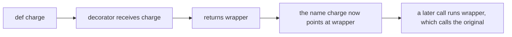

### The wrapper closes over the original

The usual shape is a nested function. The outer function's parameter is the original function. The inner function is what callers will actually hit. It can look at the arguments, call the original, and look at the result. Because the inner function was defined while the outer one was running, it keeps a reference to that original function after the outer call has returned. That remembered reference is a closure. The wrapper does not look the original up by the public name, because the public name is about to be rebound to the wrapper itself. If the wrapper called the public name, it would call itself.

```python
def box(fn):
    def wrapper(text):
        return "[" + fn(text) + "]"
    return wrapper
```

`box` is not the thing you put in the call. `box(render)` returns `wrapper`. From then on, a call with one string goes to `wrapper`, and `wrapper` calls `render`. The brackets are the decorator's job. The string is still `render`'s job. If `render` starts returning a number, the wrapper's `+` fails, which is the right failure. The wrapper assumed a string because that was the contract it added.

`@box` above a `def` is an assignment written in another order. Python defines the function, then calls the decorator with it, then binds the name to whatever came back.

```python
def render(text):
    return text.strip()

render = box(render)
```

That is the same end state as the `@` form. The shorthand matters because it keeps the wrapper next to the function it wraps. It does not change when the decorator runs. The decorator runs at definition time, once, not on each call. The wrapper runs on each call. A slow computation inside `box`, before it defines `wrapper`, happens when the module is imported. A slow computation inside `wrapper` happens when someone calls the function.

### Arguments and the name you erased

A wrapper that names one parameter can only wrap functions of one parameter. `*args` and `**kwargs` forward whatever the caller passed, so the wrapper does not have to copy the original signature. The original still receives the same positional and keyword arguments. A wrapper that drops `kwargs` turns a legal keyword call into a `TypeError` that mentions the wrapper, which is a confusing place for the caller to look.

There is a second loss. The function object that callers see is the wrapper, so its `__name__` is `wrapper` and its docstring is the wrapper's docstring. Tracebacks, logs, and test names then all say `wrapper`, and you cannot tell which function failed. `functools.wraps(fn)` is a decorator you put on the wrapper. It copies the original's name, docstring, and a few other attributes onto the wrapper, and it stores the original on `__wrapped__`. The call behaviour does not change. The metadata does. A decorator that forgets `wraps` still computes the right result and still makes the next reader blame the wrong function.

### A decorator that takes an argument

`@box` passes the function to `box`. `@suffix("!")` cannot pass the function to `suffix`, because `suffix` was already called with the string `"!"`. The `@` line is an expression. `suffix("!")` runs first and must return the real decorator, the function that accepts the original and returns a wrapper. That is three functions, and the extra one exists only because the configuration had to be captured before the function was seen.

The outer function remembers the mark in a closure, the same way the wrapper remembers the original function. Each use of the decorator with a different mark builds a different wrapper. They do not share the mark. A mutable default on that outer function would be shared across every function you decorate with the same call, for the same reason any other default is created once. Pass the configuration in as an argument and close over that value. Do not store the configuration on a default list that later calls append to.

### Order when they stack

Two decorators stack from the bottom up, because that is the order of the assignments. The decorator closest to the `def` runs first and wraps the original. The decorator above it wraps that result. A call then enters the top wrapper first and reaches the original last. If one wrapper uppercases and the other adds a prefix, the prefix is added to whatever the inner wrapper returned, or the other way around, depending on which decorator sits on top. Swapping the lines swaps the result. The functions did not change. The order of wrapping did.

The same rule is why a tracing decorator and a retry decorator do not commute. Tracing outside retry logs one call and the retries stay inside. Retry outside tracing logs every attempt. Pick the order from the behaviour you want on the way in and on the way out, and write it down in the name or the docstring if a reader would otherwise have to expand the stack in their head.

### Where it breaks

The wrapper that returns nothing is the quiet bug. The original returned a price. The wrapper logged it and then fell off the end, so the caller received `None` and failed on the next addition. A wrapper must return what the caller of the original was promised, unless the decorator's contract is explicitly to replace the result. Swallowing an exception has the same shape as a bare `except`. If the decorator exists to retry, retry the exceptions you named and let the last one propagate. If it exists to log, log and re-raise. A decorator that turns every failure into `None` has hidden the bug in every function it touches.

A second break is decorating a method and forgetting that the first argument is the instance. `*args` forwards `self` with the rest, so a generic wrapper is fine. A wrapper written as `def wrapper(value)` steals `self` as `value` and the method looks broken only when you call it on an instance. A third is applying the decorator at call time inside the function. The `@` line runs once. Calling the decorator on every request builds a new wrapper per request and, if you are not careful, decorates the wrapper you just built. A fourth is a decorator that only works when the original takes the exact names you wrote. Forward `*args, **kwargs` unless the wrapper's purpose is to change the signature, and then change it on purpose and document it.

### At work

You will use decorators more often than you write them. A route table, a test fixture, a cache, and a dataclass are all "take this function or class and register or rewrite it." When you write one, it should be the cross-cutting piece you are about to copy for the third time: one retry policy, one way of adding a request id to a log line, one check that a caller passed a non-empty id. The business function stays readable because the wrapper is not inlined.

In review, look for a wrapper that drops the return value, a wrapper that catches `Exception` and continues, a missing `wraps`, and a stack whose order is accidental. Look for work done at decoration time that should have been done at call time, such as reading a request header while the module is importing. The request does not exist yet. The decorator can close over configuration that exists at import. It cannot close over a request that arrives later. That value has to be an argument to the wrapper.

### A decision table

| You want | Write | Why |
| --- | --- | --- |
| Behaviour around one function, no configuration | A function that takes the original and returns a wrapper | `@name` passes the function in |
| Configuration, such as a limit or a label | A function that takes the configuration and returns a decorator | The `@` line calls your function before it sees the `def` |
| The original name in tracebacks | `@functools.wraps(fn)` on the wrapper | Otherwise every wrapped function is named `wrapper` |
| To pass the call through unchanged | `*args, **kwargs` forwarded, and `return` the original result | A narrower wrapper changes the signature and drops keyword calls |
| Two wrappers | The outer behaviour above the inner one | The top decorator runs first on the way in |
| A one-off key for a sort | A lambda or a named function passed as an argument | A decorator would replace the function for every caller, which is a bigger change than one sort |

### You can now

You can say that `@decorator` is a rebinding of the function name to whatever the decorator returned, and that the rebinding happens once, when the function is defined. You can write a wrapper that forwards arguments, returns the original result, and keeps the original name with `wraps`. You can add a configuration argument by returning a decorator from an outer function. You can predict which wrapper runs first when two decorators are stacked, and you can explain why a wrapper that forgets to return the original result looks like a bug in the caller.

::: predict lang=python
code:
```python
def shout(fn):
    def wrapper(name):
        return fn(name).upper() + "!"
    return wrapper

@shout
def hello(name):
    return f"hello {name}"

print(hello("ana"))
print(hello.__name__)
```
answer:
```
HELLO ANA!
wrapper
```
why: `@shout` replaced `hello` with `wrapper`. Without `functools.wraps`, the new function's name is `wrapper`, which is why decorators should use it.
:::

::: write lang=python
task: Write a decorator `retry(times)` (a decorator **with an argument**, so it's a function that returns a decorator). The wrapped function is called again when it raises, up to `times` attempts in total; if the last attempt fails, that exception propagates. Keep the function's `__name__` with `functools.wraps`.
starter:
```python
import functools

def retry(times):
    pass
```
tests:
```python
from solution import retry

def test_succeeds_after_failures():
    calls = []
    @retry(3)
    def flaky():
        calls.append(1)
        if len(calls) < 3:
            raise ConnectionError("down")
        return "ok"
    assert flaky() == "ok"
    assert len(calls) == 3

def test_gives_up():
    calls = []
    @retry(2)
    def broken():
        calls.append(1)
        raise TimeoutError("slow")
    try:
        broken()
    except TimeoutError:
        assert len(calls) == 2
        return
    assert False, "the last error should propagate"

def test_keeps_name_and_args():
    @retry(1)
    def add(a, b=0):
        return a + b
    assert add(2, b=3) == 5
    assert add.__name__ == "add"
```
solution:
```python
import functools

def retry(times):
    def decorate(fn):
        @functools.wraps(fn)
        def wrapper(*args, **kwargs):
            for attempt in range(1, times + 1):
                try:
                    return fn(*args, **kwargs)
                except Exception:
                    if attempt == times:
                        raise
        return wrapper
    return decorate
```
hint: Three levels: `retry(times)` returns `decorate(fn)`, which returns `wrapper(*args, **kwargs)`. In the wrapper, loop over the attempts and re-raise on the last one with a bare `raise`.
:::


::: quiz
q: A decorator is written as three nested functions, and the outermost one takes a string. Why is the extra function there?
- Python requires every decorator to accept a string before it accepts a function
+ The line above the def calls that outer function first, so it can remember the string and return the function that actually receives the original
- The string is the original function's name, and wraps reads it from that argument
- The middle function is optional and only exists to make tracebacks shorter
why: @suffix("!") evaluates suffix("!") before the function is passed in. The value of that call has to be a decorator. The outer function exists to capture the mark in a closure. A decorator with no configuration is only two functions, the decorator and the wrapper.
:::

::: predict lang=python
q: What does this print? Two decorators each prepend their own label.
code:
```python
def tag(label):
    def decorate(fn):
        def wrapper(x):
            return label + fn(x)
        return wrapper
    return decorate

@tag("A")
@tag("B")
def core(x):
    return x

print(core("z"))
```
answer:
```
ABz
```
why: The decorator closest to the def runs first, so B wraps core and A wraps that result. A call enters A first. A calls B, B calls core with "z", and the labels are prepended on the way out, A outside B.
:::

::: write lang=python
task: Write `suffix(mark)`, a decorator that takes the string to append. The wrapped function may take any arguments. Return whatever it returns, with `mark` concatenated on the end. Keep the original function's `__name__` with `functools.wraps`.
starter:
```python
def suffix(mark):
    def decorate(fn):
        def wrapper(*args, **kwargs):
            return fn(*args, **kwargs)
        return wrapper
    return decorate
```
tests:
```python
# Wrong answer: call the function and return its result unchanged, and leave the wrapper's __name__ as wrapper.
from solution import suffix

def test_appends_and_forwards():
    @suffix("!")
    def greet(name, punct="."):
        return name + punct
    assert greet("ana") == "ana.!"
    assert greet("ana", punct="?") == "ana?!"

def test_keeps_name():
    @suffix("?")
    def ping():
        return "p"
    assert ping() == "p?"
    assert ping.__name__ == "ping"
```
solution:
```python
import functools

def suffix(mark):
    def decorate(fn):
        @functools.wraps(fn)
        def wrapper(*args, **kwargs):
            return fn(*args, **kwargs) + mark
        return wrapper
    return decorate
```
hint: suffix(mark) returns decorate. decorate(fn) returns a wrapper. The wrapper calls fn with *args and **kwargs and adds mark to the return value. Put functools.wraps on the wrapper so __name__ stays the original name.
:::

::: card
q: What does functools.wraps change, and what does it leave alone?
answer: wraps copies the original function's name, docstring, and related metadata onto the wrapper, and it records the original as __wrapped__. It does not change arguments, return values, or exceptions. Without it the wrapper still runs, but tracebacks and logs call every wrapped function wrapper.
:::

## Project: a todo list
id: p-todo
stage: patterns
needs: files, exceptions, modules, decorators, itertools, p-gradebook
minutes: 70
project: yes
goal: Parse todo lines, update tasks without sharing the caller's list, and summarise the open work.
source: Python docs: Errors | https://docs.python.org/3/tutorial/errors.html

A todo list breaks in the same ways a gradebook breaks. One helper appends onto the list it was given, so the caller's screen changes too, because the parameter was a second label on that object. A blank line becomes an empty title. A status line of `0/0 open` makes "nothing yet" look like "everything is done." Parse one line into one record, refuse a bad line, copy when you update, and give the empty collection its own answer.

Each function is graded alone, in a fresh `solution.py`. Do not import a sibling. The tests load one function at a time, so restate the dict instead of calling across steps.

A task is a dict with `"title"` and `"done"`. The title is a string and `done` is a bool. Order is list order. Nothing sorts. Two rows with the same title are two rows, so completing one must not complete the other.

### Parsing a line

Strip the ends first. If nothing remains, raise `ValueError`. A blank line and a line of spaces are the same failure, because both mean there was no title, and storing `""` would make `pending` print a ghost. Do not return `None`. `None` would sit in the list and break the next loop.

If the first whitespace-separated token is exactly `x` and there is more text after it, the task is done. The title is the remainder with its ends stripped and its internal whitespace kept. `"x buy milk"` is done, title `"buy milk"`. `"x  buy  milk"` keeps the two spaces, because collapsing them would change what was typed. A tab is whitespace, so `"x\tbuy milk"` is the same kind of done row. The marker is a token, not a prefix. `"xbuy"` is not done, and the title is `"xbuy"`. `"x"` alone is not done either, because the marker needs a title after it, so the title is the word `"x"`. `"X buy"` is not done, because the marker is the lowercase word `x`. `"  wash "` strips to `"wash"` and is not done.

`startswith("x")` marks `xbuy` done. Splitting on a single space misses a tab. `split` with no separator and a max of one keeps the remainder and treats a tab as a boundary. A bad line is `ValueError`. This function does not open a file and does not call `input()`, because the line is an argument a test can pass in. The reader catches `ValueError` and can name the line.

### Adding and completing

`add_task` returns a new list. The new row is `{"title": title, "done": False}`. Store the title as given. Do not strip it and do not mark it done. The old list and the dicts inside it must stay untouched. `tasks + [new]` builds a new outer list, but the dicts in front are still the caller's dicts, so a later edit of `out[0]` checks off the caller's row. Copy each dict. Assignment never copied, and a one-level concatenation does not copy the inner objects either.

`complete` also returns a new list of new dicts. Find the first title that matches with `str.casefold`, and set that copy's `done` to `True`. If it was already done, it stays done. Later rows with the same folded title stay as they were, because one completion is one row. Use `casefold`, not `lower` and not `==`. `lower` leaves `"Straße"` and `"STRASSE"` apart. `casefold` folds both to `"strasse"`. It does not consult the process locale, so do not call `setlocale`. If nothing matches, raise `KeyError` and leave the caller's list and dicts unchanged. Returning the original list looks like success. `ValueError` would collide with a bad line. `KeyError` already means the title is not there.

Copy before you change `done`. Mutating the dict you found, then wrapping those same dicts in a new list, still changes the caller. If you raise, raise without having written into the input.

### Open rows, a status line, and pages

`pending` returns titles whose `done` is false, in the original order, with the stored spelling. Do not casefold what you return. An empty list returns `[]`, not `None` and not `"none"`. Duplicate open titles both appear. Do not sort.

`summary` is text. An empty list returns `"none"`. Any other list returns `"N/M open"`, where `N` is how many rows are not done and `M` is the length. One done row and two open rows is `"2/3 open"`. All done is `"0/2 open"`, not `"none"`, because zero open means the work exists and is finished. One space before `open`, and no other words.

`batches` cuts the list into chunks. Return a list of tuples, in order, each of length `size`, except the last tuple may be shorter. Do not drop that tail. Dropping it hides the last tasks whenever the length is not a multiple of the page size. `size < 1` raises `ValueError`. A batch of zero has no meaning, and a negative size would walk backward. An empty task list returns `[]`. `itertools.batched` (Python 3.12) yields those tuples, short tail included. `list(itertools.batched(tasks, size))` is the concrete result. The tuples hold the same task dicts. Batching is a window, not an update, so you do not copy. `add_task` and `complete` copy because they change data. A loop that appends only when the chunk is full throws the remainder away when the loop ends, and that is the failure the tests are aimed at.

### Files, errors, modules, decorators

A file reader iterates lines and passes each one here. A blank line is `ValueError`. A missing title on complete is `KeyError`. One `except Exception` would treat those as the same failure, so the types stay different. These functions never call `input()`, because a test passes the line or the list in, and a waiting `input()` would hang.

A decorator may log `complete`, but the wrapper must return the new list. A wrapper that falls off the end returns `None`. Use `functools.wraps` so the name stays. Do not hide the copy in the decorator, because a caller who forgot the wrapper would share the list again. The copy is the contract. `groupby` is the wrong tool, because these rows are not runs of equal keys. You cut them by count.

### One list, followed through

Start with `[]`. The summary is `"none"`. Add `"wash"`, then `"Buy milk"`. The summary is `"2/2 open"`, and the original empty list is still empty. Completing `"buy milk"` folds case, marks only that second row done, and pending is `["wash"]`. The summary is `"1/2 open"`. A third open row, batched by 2, leaves a one-element tail. Dropping that tail would disagree with the summary. Each add and each complete returns a new list of new dicts. The parser takes one line, not the list, and either returns one dict or raises.

### Where it breaks

`startswith("x")` marks `xbuy` done. A new outer list that still holds the old dicts is the alias bug one level down. `==` misses a case change, and `lower` misses `"Straße"` against `"STRASSE"`. Updating every match checks off two rows that share a name. Raising `KeyError` after mutating the input reports failure and still changes the caller. `"0/0 open"` is not `"none"`. A dropped short batch hides the last tasks, and `size` of `0` must raise rather than return `[]`.

### At work

This is the gradebook pipeline with a smaller record. Parse strictly, update by a folded title, refuse the empty case instead of inventing a zero, and keep order so two runs diff cleanly. A dict keyed only by title would destroy a second `"milk"`. A set would destroy order. Copy on update for the same reason a request handler must not append into a module-level list: the next caller still holds the old object. Batch with `itertools.batched` and keep the tail, because the tail is data.

### Which function answers which question

| Question | Answer | Because |
|---|---|---|
| Is this line a task? | a dict, or `ValueError` if the stripped line is empty | `x` is a token, not a prefix, and an empty title is not a task |
| What does adding do? | a new list of new dicts, plus one not-done row | the caller's list and dicts must stay put |
| What does completing do? | the first `casefold` match becomes done, or `KeyError` | one request is one row, and `lower` misses some folds |
| What is left? | titles with `done` false, original order | the stored spelling is what the screen shows |
| How do we say it in one line? | `"none"`, or `"N/M open"` | empty and all-done are different |
| How do we page it? | `itertools.batched`, short tail kept, `size < 1` raises | a dropped tail is a missing task |

### You can now

- Parse a padded line into a done or not-done dict, and reject a blank line.
- Add and complete by returning new lists of new dicts, without writing into the caller's objects.
- Match a title with `casefold`, change only the first hit, and raise `KeyError` when nothing matches.
- List the open titles in order, and summarise with `"none"` only when there are no rows.
- Cut the list into tuples of a given size, keeping a short last tuple and rejecting a size below 1.

::: write lang=python
task: Write `parse_task(line)`. Strip the line. If nothing remains, raise ValueError. If the first whitespace-separated token is exactly `x` and there is further text, return `{"title": rest, "done": True}` where `rest` is that remainder with its ends stripped and its internal whitespace kept. A tab counts as whitespace. Otherwise return `{"title": stripped, "done": False}`. So `"x buy milk"` is done with title `"buy milk"`, `"x  buy  milk"` keeps the two spaces, `"  wash "` is not done with title `"wash"`, `"x"` and `"xbuy"` and `"X buy"` are not done, and `""` or `" \n "` raises ValueError.
starter:
```python
def parse_task(line):
    text = line.strip()
    if text.startswith("x"):
        return {"title": text[1:].strip(), "done": True}
    return {"title": text, "done": False}
```
tests:
```python
# Wrong answer: treat any stripped line that starts with x as done, so "xbuy" loses a letter and a blank line becomes an empty title.
from solution import parse_task

def _raises(fn):
    try:
        fn()
    except ValueError:
        return
    raise AssertionError("expected ValueError")

def test_done_and_open():
    assert parse_task("x buy milk") == {"title": "buy milk", "done": True}
    assert parse_task("  wash ") == {"title": "wash", "done": False}
    assert parse_task("  x buy milk ") == {"title": "buy milk", "done": True}

def test_whitespace_inside():
    assert parse_task("x  buy  milk") == {"title": "buy  milk", "done": True}
    assert parse_task("x\tbuy milk") == {"title": "buy milk", "done": True}

def test_not_a_marker():
    assert parse_task("x") == {"title": "x", "done": False}
    assert parse_task("xbuy") == {"title": "xbuy", "done": False}
    assert parse_task("X buy") == {"title": "X buy", "done": False}

def test_blank():
    _raises(lambda: parse_task(""))
    _raises(lambda: parse_task(" \n "))
    _raises(lambda: parse_task("   "))
```
solution:
```python
def parse_task(line):
    text = line.strip()
    if not text:
        raise ValueError("blank task")
    parts = text.split(None, 1)
    if parts[0] == "x" and len(parts) == 2:
        return {"title": parts[1].strip(), "done": True}
    return {"title": text, "done": False}
```
hint: Strip first and reject an empty result. Split once on any whitespace. The marker is a first token equal to x with a remainder, not a leading character.
:::

::: write lang=python
task: Write `add_task(tasks, title)`. Return a new list. Copy every existing task dict, keep that order, then append `{"title": title, "done": False}`. Do not strip or rewrite title. Do not mutate the list object or any dict inside it. A later edit of a dict in the returned list must not change the caller's dict.
starter:
```python
def add_task(tasks, title):
    tasks.append({"title": title, "done": True})
    return tasks
```
tests:
```python
# Wrong answer: append onto the caller's list and mark the new row done, so the input grows and the flag is already True.
from solution import add_task

def test_appends_open_row():
    tasks = [{"title": "wash", "done": True}]
    out = add_task(tasks, "Buy milk")
    assert out == [
        {"title": "wash", "done": True},
        {"title": "Buy milk", "done": False},
    ]

def test_does_not_share():
    tasks = [{"title": "wash", "done": False}]
    out = add_task(tasks, "dry")
    assert out is not tasks
    assert out[0] is not tasks[0]
    assert tasks == [{"title": "wash", "done": False}]
    out[0]["done"] = True
    out.append({"title": "more", "done": False})
    assert tasks == [{"title": "wash", "done": False}]

def test_empty():
    assert add_task([], "wash") == [{"title": "wash", "done": False}]
```
solution:
```python
def add_task(tasks, title):
    copied = [dict(task) for task in tasks]
    copied.append({"title": title, "done": False})
    return copied
```
hint: Build a new list of dict copies, then append a new not-done dict. tasks.append changes the caller's list, and a bare concatenation still shares the inner dicts.
:::

::: write lang=python
task: Write `complete(tasks, title)`. Return a new list of new dicts. Compare titles with casefold, not lower and not ==. Set done to True on the first match only. Later matches stay as they were, and an already-done first match stays done. If nothing matches, raise KeyError and leave the caller's list and dicts unchanged. `"STRASSE"` must complete a row titled `"Straße"`. Do not mutate the input.
starter:
```python
def complete(tasks, title):
    for task in tasks:
        if task["title"] == title:
            task["done"] = True
    return tasks
```
tests:
```python
# Wrong answer: compare with ==, mutate every match in the caller's list, and return that same list instead of raising KeyError.
from solution import complete

def test_casefold_first_only():
    tasks = [
        {"title": "Milk", "done": False},
        {"title": "milk", "done": False},
    ]
    out = complete(tasks, "MILK")
    assert out[0]["done"] is True
    assert out[1]["done"] is False
    assert tasks[0]["done"] is False
    assert tasks[1]["done"] is False
    assert out is not tasks
    assert out[0] is not tasks[0]
    assert out[1] is not tasks[1]

def test_strasse():
    tasks = [{"title": "Straße", "done": False}]
    out = complete(tasks, "STRASSE")
    assert out[0]["done"] is True
    assert tasks[0]["done"] is False

def test_already_done_first():
    tasks = [
        {"title": "milk", "done": True},
        {"title": "milk", "done": False},
    ]
    out = complete(tasks, "milk")
    assert out[0]["done"] is True
    assert out[1]["done"] is False

def test_missing():
    tasks = [{"title": "wash", "done": False}]
    before = [dict(task) for task in tasks]
    try:
        complete(tasks, "milk")
    except KeyError:
        assert tasks == before
        return
    raise AssertionError("expected KeyError")
```
solution:
```python
def complete(tasks, title):
    key = title.casefold()
    found = False
    out = []
    for task in tasks:
        copy = dict(task)
        if not found and copy["title"].casefold() == key:
            copy["done"] = True
            found = True
        out.append(copy)
    if not found:
        raise KeyError(title)
    return out
```
hint: Copy every dict into a new list. Fold both titles with casefold, flip done on the first hit only, and raise KeyError if the loop never hits.
:::

::: write lang=python
task: Write `pending(tasks)`. Return the titles of rows that are not done, in the original order, with the stored spelling. Skip done rows. An empty list returns an empty list. Do not sort and do not casefold the titles you return.
starter:
```python
def pending(tasks):
    return [task["title"] for task in tasks if task["done"]]
```
tests:
```python
# Wrong answer: keep the done titles and drop the open ones, so the list is the finished work instead of the open work.
from solution import pending

def test_order_and_spelling():
    tasks = [
        {"title": "Wash", "done": True},
        {"title": "Buy milk", "done": False},
        {"title": "sweep", "done": True},
        {"title": "Buy milk", "done": False},
    ]
    assert pending(tasks) == ["Buy milk", "Buy milk"]

def test_all_done_and_empty():
    assert pending([{"title": "wash", "done": True}]) == []
    assert pending([]) == []

def test_all_open():
    tasks = [
        {"title": "a", "done": False},
        {"title": "b", "done": False},
    ]
    assert pending(tasks) == ["a", "b"]
```
solution:
```python
def pending(tasks):
    return [task["title"] for task in tasks if not task["done"]]
```
hint: Keep the title when done is false. The stored string is the one to return, in the order the rows already have.
:::

::: write lang=python
task: Write `summary(tasks)`. Return `"none"` when tasks is empty. Otherwise return `"N/M open"`, where N is the number of rows that are not done and M is len(tasks). One done row and two open rows is `"2/3 open"`. All done is `"0/M open"`, not `"none"`. Do not add any other words.
starter:
```python
def summary(tasks):
    return f"{len(tasks)}/{len(tasks)} open"
```
tests:
```python
# Wrong answer: report every row as open, so an empty list is "0/0 open" and one done plus two open is "3/3 open".
from solution import summary

def test_empty():
    assert summary([]) == "none"

def test_mixed():
    tasks = [
        {"title": "a", "done": True},
        {"title": "b", "done": False},
        {"title": "c", "done": False},
    ]
    assert summary(tasks) == "2/3 open"

def test_all_done_and_all_open():
    assert summary([{"title": "a", "done": True}, {"title": "b", "done": True}]) == "0/2 open"
    assert summary([{"title": "a", "done": False}]) == "1/1 open"
```
solution:
```python
def summary(tasks):
    if not tasks:
        return "none"
    open_count = sum(1 for task in tasks if not task["done"])
    return f"{open_count}/{len(tasks)} open"
```
hint: An empty list is the string none. Otherwise count rows whose done flag is false, and format that count, a slash, the length, and the word open.
:::

::: write lang=python
task: Write `batches(tasks, size)`. Return a list of tuples of the task dicts, in order. Each tuple has length `size` except the last, which may be shorter. Do not drop a short tail. An empty task list returns `[]`. If `size` is less than 1, raise ValueError. You may use `itertools.batched`. Three tasks with size 2 is a tuple of two followed by a tuple of one.
starter:
```python
def batches(tasks, size):
    if size < 1:
        return []
    full = len(tasks) - (len(tasks) % size)
    return [tuple(tasks[i:i + size]) for i in range(0, full, size)]
```
tests:
```python
# Wrong answer: drop the short final tuple, and return an empty list when size is below 1 instead of raising ValueError.
from solution import batches

def test_short_tail():
    tasks = [
        {"title": "a", "done": False},
        {"title": "b", "done": True},
        {"title": "c", "done": False},
    ]
    assert batches(tasks, 2) == [
        ({"title": "a", "done": False}, {"title": "b", "done": True}),
        ({"title": "c", "done": False},),
    ]

def test_even_and_wide_and_empty():
    tasks = [
        {"title": "a", "done": False},
        {"title": "b", "done": False},
    ]
    assert batches(tasks, 2) == [
        ({"title": "a", "done": False}, {"title": "b", "done": False}),
    ]
    assert batches(tasks, 5) == [
        ({"title": "a", "done": False}, {"title": "b", "done": False}),
    ]
    assert batches([], 3) == []

def test_size_one():
    tasks = [{"title": "a", "done": False}, {"title": "b", "done": True}]
    assert batches(tasks, 1) == [
        ({"title": "a", "done": False},),
        ({"title": "b", "done": True},),
    ]

def test_bad_size():
    tasks = [{"title": "a", "done": False}]
    for size in (0, -1):
        try:
            batches(tasks, size)
        except ValueError:
            continue
        raise AssertionError("expected ValueError")
```
solution:
```python
import itertools

def batches(tasks, size):
    if size < 1:
        raise ValueError("size must be at least 1")
    return list(itertools.batched(tasks, size))
```
hint: Reject size below 1. itertools.batched already yields tuples and keeps a short last batch. Wrap it in list. Do not stop when the remainder is shorter than size.
:::

## Duck typing, ABCs, and Protocols
id: protocols
stage: patterns
needs: inheritance, dunder
minutes: 40
goal: Accept any object that can do the job, and recognise typing.Protocol as structural typing.
source: Python docs: abc | https://docs.python.org/3/library/abc.html
source: Python docs: typing.Protocol | https://docs.python.org/3/library/typing.html#typing.Protocol

A helper was rejected in review because it opened with `isinstance(source, io.TextIOBase)`. A real `io.StringIO` passes, because `StringIO` is a text IO object. A test double fails, because its class statement never mentions `TextIOBase`, even though it has `read` and returns canned text. The check asks "what is your family?" when the next line only needs "can you read?". Every fake then has to join the IO family, or the helper refuses it, so the family test is the bug.

Duck typing asks the other question. You call the method. If the object can do the job, the call returns. If it cannot, lookup raises `AttributeError`. There is no base class the caller must inherit, because lookup walks the instance and then the class and does not consult an approved family. A small object written for a test can stand in for a file. A `str` cannot, because a `str` has `split` and does not have `read`. That `AttributeError` is the honest result. Catching it and guessing that the caller passed words already split hides the mistake, so the helper should let the error propagate.

```python
class Note:
    def read(self):
        return "two words"

print(Note().read().split())
```

That prints `['two', 'words']`. `split` runs on the string `read` returned, not on the `Note`. A stream is pickier, because the cursor moves. `io.StringIO("alpha  beta\ngamma").read()` returns the remaining text, and `str.split` with no arguments breaks on any whitespace and drops empty pieces, so the words are `alpha`, `beta`, and `gamma`. A second `read` returns `""`, because the cursor is already at the end. Call `read` once and split that string. Calling `split` on the stream fails, because a `StringIO` has no `split`. Calling `read` on a `str` fails the other way.

### Nominal checks and collections.abc

Inheritance is nominal. `class Dog(Animal)` is a dog because the class statement says so, so `isinstance` walks the method resolution order. The abstract base classes in `collections.abc` sit between a family tree and a structural check. `Iterable`, `Sized`, `Container`, `Sequence`, and `Mapping` document operations, and several implement `__subclasshook__`. The hook looks for dunder methods rather than for a base you wrote. `isinstance(["ab"], Iterable)` is true, and `isinstance("ab", Iterable)` is true as well, because a `str` yields characters. `list("ab")` is `['a', 'b']`. A gate that only asks for `Iterable` therefore accepts a string where the caller meant a list of lines, and the loop walks characters. The check succeeded and the behavior is still wrong, because the ABC answered a narrower question than the one you asked.

Inheriting can also give you methods. A `Sequence` subclass that implements `__getitem__` and `__len__` picks up `__iter__`, `__contains__`, `index`, and `count` from the mixin, so `"n" in pair` and `list(pair)` work without those methods in the class body. Inherit when you want the implementations. A `Protocol` does not hand you those mixins. If you only needed a badge, inheritance was the expensive way to get it.

`register` can lie. `Sized.register(Ghost)` makes `isinstance(Ghost(), Sized)` true even when `Ghost` has no `__len__`. The virtual subclass is recorded on the ABC, but `len(Ghost())` still raises `TypeError`, because registration did not install a method. Use `register` when a third-party class really does meet the contract and you cannot change its bases. Do not use it to silence a failing test.

### typing.Protocol is a shape, not a family

`typing.Protocol` names your own shape for a type checker, without a subclass hook and without forcing callers to inherit. The class body lists the members the checker should require. Any object with those members is acceptable, whether or not its class mentions the protocol. That is structural typing. Nominal typing would have required the class statement to opt in. A `Note`, a `StringIO`, and a socket wrapper can all be passed where a reader protocol is annotated, as long as each one can `read`. The annotation is a claim for mypy or pyright. At runtime Python does not enforce annotations, so the call still succeeds or fails by ordinary lookup.

You may subclass a `Protocol`. You do not have to. Explicit subclassing is documentation, and it makes a nominal `isinstance` succeed for that one family. Put shared behavior in a normal base class or in a function. A protocol method is usually a stub, because the protocol describes a shape and does not supply mixin code. Applying `@runtime_checkable` to a normal class raises `TypeError`, because the decorator only applies to protocol classes.

Leave the decorator off and `isinstance` raises `TypeError`: instance and class checks can only be used with `@runtime_checkable` protocols. The checker can still see the protocol. The runtime will not pretend that a static shape is a cheap `isinstance` test. Reach for the protocol when the reader is the checker. Reach for a direct call when the reader is the running program. Importing `Protocol` into a function that only needs to call `read` does not make that function more correct, because the contract is the call, not a badge.

### What runtime_checkable actually looks at

`@runtime_checkable` opts the protocol into `isinstance` and `issubclass`. The check looks for the declared names. It does not read the parameter list, the annotations, or the body. A class whose `close` attribute is the string `"nope"` still passes `isinstance` against a protocol that declares `def close`, because the name exists. The later call raises `TypeError`. Presence is not behavior. `hasattr` has the same hole, and it is worse, because it also swallows errors from a property. Calling the method tells you more.

For a method-only protocol, `issubclass` can be true for a class that defines the methods and never inherits, because the methods live on the class. Attributes assigned only inside `__init__` are not on the class. `isinstance` sees them on the instance. `issubclass` does not. Since Python 3.12 the runtime check also considers non-method members, such as `label: str`, not only callables. `issubclass` on a protocol with a non-method member raises `TypeError` and names that member. `isinstance` on an instance still looks for the attribute. Do not treat `issubclass` as a full check of objects you build in `__init__`. The call is still the contract. `StringIO` works, a tiny object with `read` works, and a `str` raises `AttributeError`, whether or not you imported a protocol.

### Where this breaks

A nominal gate on `io.TextIOBase`, or on a base you invented only so `isinstance` would pass, pushes tests into inheritance instead of the text. `isinstance(source, Iterable)` is a bad stand-in for "a bunch of lines," because a `str` passes and yields characters. `register`, or a runtime-checkable protocol, can be true while the attribute is missing or not callable, so neither one proves the call is safe. Catching `AttributeError` and then calling `split` on the source, or returning zero, turns a wrong object into a quiet answer. A wide protocol that lists every method a concrete class happens to have has the same cost as a base class, because every fake must grow those methods. Keep the shape to the operations you actually call.

### At work

Upload handlers, storage backends, and test doubles for clocks or mail are the usual boundary. Annotate a small protocol when a type checker is part of the build, so a missing method is a review comment instead of a production `AttributeError`. Keep the body as a straight call, so a fake that did not inherit still runs. Use an ABC when you want mixin methods, as `Sequence` does, or when the library already defined the hook, as `Iterable` does. Use `register` only for a class that already implements the operations. A mixin and a reader protocol solve different problems, so do not swap them.

### Which tool

| You want | Use | Because |
|---|---|---|
| Any object with `read` to work | Call `read` | The lookup is the test, so a fake does not need a base class |
| Mixin methods such as `index` and `__contains__` | Subclass the ABC and implement the abstract methods | The ABC supplies the rest |
| A type checker to require a shape | `typing.Protocol` | Callers do not have to inherit |
| `isinstance` on your own shape | `@runtime_checkable`, then still call the method | The check only proves that the names exist |
| A third-party class to count as an ABC | `ABC.register` | It does not add methods, so the class must already work |
| "A sequence of lines" | Do not use `isinstance(..., Iterable)` alone | A `str` is iterable and yields characters |

### You can now

- Tell a nominal `isinstance` check from a duck-typed call, and say why a test double wants the call.
- Explain why a `str` passes `Iterable` and why that makes a bad gate for lines.
- Describe `typing.Protocol` as structural typing for a checker, and why it is not a runtime badge unless you opt in.
- Predict that `@runtime_checkable` checks presence, not signatures, and that a plain protocol raises `TypeError` from `isinstance`.
- Accept a `StringIO` and a tiny reader, and let a `str` raise `AttributeError`, because the helper calls `read` and then splits the text that came back.

::: quiz
q: A helper should accept both io.StringIO and a tiny object whose only method is read. Why do both work?
- Both inherit from io.TextIOBase, and Python refuses the call otherwise
+ Both have read, and the helper calls that method, so the class name does not matter
- Both are strings, so split counts the words without calling read
- isinstance against a Protocol is required before the call, or Python will not look up the method
why: Duck typing is a call, not a family test. StringIO and the tiny object both answer read, so the helper does not care that only one of them is a real IO class. A str has no read, and requiring a Protocol subclass would reject a double that never inherited.
:::

::: quiz
q: You define class Reader(Protocol) with a read method and you do not apply @runtime_checkable. What does isinstance(io.StringIO("a"), Reader) do?
- It returns True, because StringIO has read and every Protocol is checked structurally at runtime
+ It raises TypeError, because isinstance is allowed only when the protocol is marked runtime_checkable
- It returns False, because Protocol checks are hard-coded to fail
- It returns the string "a", because isinstance calls read for you
why: A plain Protocol is for type checkers. At runtime, isinstance and issubclass raise TypeError until you opt in with @runtime_checkable. The call to read would still work, because attribute lookup does not consult the protocol.
:::

::: quiz
q: @runtime_checkable marks a Protocol that declares def read. A class sets the attribute read to the string "nope" and does not inherit from the protocol. What does isinstance report, and why is that not enough?
- False, because the check requires a real function with the annotated parameters
+ True, because the check only looks for a member named read, not at its signature or what a call would do
- TypeError, because a string attribute is illegal on a runtime-checkable protocol
- False, because the class does not list the protocol as a base
why: Since 3.12, runtime_checkable checks that the declared names exist, including on an instance, and it does not inspect callability or annotations. The later call raises TypeError. Presence is not behavior, so a passing isinstance is not a substitute for calling read.
:::

::: quiz
q: Why is isinstance(value, collections.abc.Iterable) a bad gate when value is supposed to be a list of lines?
- Iterable rejects lists, so a real list of lines cannot pass
+ A str is iterable, so a string passes and the loop yields characters instead of lines
- Iterable is true only for file objects, so a list fails the gate
- Iterable requires the class to inherit from list, so a tuple of lines is rejected
why: Iterable's subclass hook looks for __iter__. str defines __iter__ and yields characters, so list("ab") is ['a', 'b']. The check answers "can I iterate?" and not "is this a sequence of lines?". Call the operation you mean, or check a narrower shape.
:::

::: predict lang=python
q: What does this print? Page does not inherit from Reader. Plain is a Protocol with no runtime_checkable decorator.
code:
```python
from typing import Protocol, runtime_checkable

@runtime_checkable
class Reader(Protocol):
    def read(self) -> str:
        ...

class Page:
    def read(self):
        return "north south"

class Plain(Protocol):
    def read(self) -> str:
        ...

page = Page()
print(isinstance(page, Reader))
print(isinstance("north south", Reader))
print(len(page.read().split()))
try:
    isinstance(page, Plain)
    print("checked")
except TypeError:
    print("unchecked")
```
answer:
```
True
False
2
unchecked
```
why: Reader is runtime_checkable, so isinstance looks for a read attribute. Page has one, and a str does not, even though a str can be split. Splitting the text that read returned yields two words. Plain has no runtime_checkable decorator, so isinstance raises TypeError instead of returning False.
:::

::: write lang=python
task: Write `word_count(source)`. Call `source.read()` once, split the returned text on whitespace, and return how many pieces that produced. Empty text is zero. `io.StringIO` must work. A tiny object that only defines `read` must work. A `str` has no `read`, so the call must raise AttributeError. Do not catch that error. Do not call `split` on `source` itself. Do not import `Protocol`.
starter:
```python
def word_count(source):
    return len(source.split())
```
tests:
```python
# Wrong answer: call source.split(), which StringIO and a tiny reader do not have, and which a str does have.
import io
from solution import word_count

class Slip:
    def __init__(self, text):
        self._text = text

    def read(self):
        return self._text

class Once:
    def __init__(self, text):
        self._text = text
        self.calls = 0

    def read(self):
        self.calls += 1
        if self.calls > 1:
            raise RuntimeError("read twice")
        return self._text

def test_stringio_words():
    assert word_count(io.StringIO("buy milk now")) == 3
    assert word_count(io.StringIO("")) == 0
    assert word_count(io.StringIO("  a\tb\n")) == 2
    assert word_count(io.StringIO("hello,world")) == 1

def test_tiny_reader():
    assert word_count(Slip("one two")) == 2
    assert word_count(Slip("  ")) == 0
    assert word_count(Once("a b c")) == 3

def test_str_raises():
    try:
        word_count("buy milk")
    except AttributeError:
        return
    raise AssertionError("expected AttributeError")
```
solution:
```python
def word_count(source):
    text = source.read()
    return len(text.split())
```
hint: Call read once and split the string you got back. Do not split the source. A missing read raises AttributeError, and that is what a str should do.
:::

::: card
q: When do you reach for typing.Protocol instead of collections.abc or a plain method call?
answer: Use a Protocol when a type checker should accept any object with a small shape, and callers should not have to inherit. Use an ABC when you want mixin methods, a subclass hook the library already wrote, or register for a class that already implements the operations. At runtime, call the method. Add @runtime_checkable only when isinstance is part of the contract, and remember that it checks whether the names exist, not whether the call will behave.
:::

## Match statements and enums
id: match
stage: patterns
needs: dataclasses, tuples
minutes: 40
goal: Branch on the shape of a tuple or a dataclass with match, and keep a wildcard for the rest.
source: Python docs: match | https://docs.python.org/3/tutorial/controlflow.html#match-statements
source: Python docs: enum | https://docs.python.org/3/library/enum.html

A command parser that grew as a chain of `if` statements keeps getting the shape wrong. `command[0] == "move"` treats `("move",)` and `("move", "n")` as the same command, so the next line reads `command[1]` and raises `IndexError` when the direction was never sent. `str(command).startswith("quit")` is worse, because the text of a tuple is an accident of `repr`, and a later field that happens to contain the letters `quit` can trip it. The thing you actually have is a small record: a fixed tuple, or a dataclass, and the branch should depend on that shape. `match` is that branch. It compares one subject with a series of patterns, top to bottom, and runs the first body that fits.

The subject is evaluated once, so a call in the head of the `match` does not run again for every case. Patterns are tried in order. The first one that matches wins, its body runs, and the `match` ends. There is no fall-through. You do not write `break`, and a later case that would also have matched does not run. That is the opposite of a C `switch` that forgets `break`. Every case needs a body. `match` and `case` are soft keywords, so a variable already named `match` still works.

```python
def handle(command):
    match command:
        case ("quit",):
            print("bye")
        case ("move", direction):
            print("go", direction)
        case _:
            print("stay")

handle(("move", "n"))
handle(("quit",))
handle(("move", "n", "fast"))
handle("quit")
```

That prints `go n`, then `bye`, then `stay`, then `stay`. `("quit",)` matches only a one-element sequence. `("move", "n", "fast")` has the wrong length for `("move", direction)`, so it does not fall through into a partial match. The string `"quit"` is not a one-element sequence, so it hits the wildcard. Once `("move", "n")` matched, the function was finished with that subject.

### What a pattern can bind

A literal pattern compares with `==`. `("quit",)` demands a sequence of one element equal to that string. A capture is a bare name. In `("move", direction)` the string is a literal and `direction` becomes the second element, only inside that case. It is not a lookup of an outer variable. The wildcard `_` matches anything and binds nothing, so reading `_` in the body raises `NameError`. Use `_` for "everything else" so you do not clobber a name you still need.

Both `_` and a bare capture are irrefutable. Python rejects them unless they are the last case, with a `SyntaxError` that the capture or the wildcard makes the remaining patterns unreachable. Put `_` last. A bare name is the wrong spelling of "anything else," because it looks like a constant and it binds.

An or-pattern joins alternatives with `|` and gives them one body. `("quit",) | ("exit",)` handles both spellings without copying the suite, because cases do not fall through. An as-pattern binds a piece after you have tested it: `("move", ("n" | "s" | "e" | "w") as direction)` matches a compass letter and stores that letter. The parentheses matter, because `|` and `as` do not group the way a quick reading suggests.

### Enums are closed, and a bare name is not a constant

Strings drift. One module sends `"n"`, another sends `"north"`, and a typo sends `"m"`. An `Enum` makes the set closed. Members are singletons, and `match` compares the member, not the member's value.

```python
from enum import Enum

class Direction(Enum):
    NORTH = "n"
    SOUTH = "s"
    EAST = "e"
    WEST = "w"

def label(direction):
    match direction:
        case Direction.NORTH:
            return "north"
        case Direction.SOUTH | Direction.EAST | Direction.WEST:
            return "cardinal"
        case _:
            return "no"
```

`label(Direction.NORTH)` is `"north"`. `label(Direction.EAST)` is `"cardinal"`. `label("n")` is `"no"`, because `Direction.NORTH == "n"` is false. The wire string lives on `.value`. Inside the process, pass the member. The pattern has to be a dotted name. `case NORTH:` does not look up the member. A bare name is a capture, so if another case follows it, Python raises `SyntaxError`. If it is last, it matches everything and rebinds `NORTH`. Dotted names and literals are value patterns. Bare names are not, so enums are written `case Direction.NORTH:` and string commands are written `case "quit":`.

A guard is the `if` after a pattern. The pattern binds first. If the guard is false, the body does not run, and `match` tries the next case. The subject is not evaluated again. This is not fall-through. Fall-through would run a body and continue. A failed guard rejects the candidate before the body, so a later case can still accept a move whose direction is outside the compass.

```python
def guarded(command):
    match command:
        case ("move", direction) if direction in {"n", "s", "e", "w"}:
            return "go " + direction
        case ("move", direction):
            return "bad " + direction
        case _:
            return "stay"
```

`guarded(("move", "n"))` is `"go n"`. `guarded(("move", "up"))` is `"bad up"`, because the guard failed and the next case ran. `guarded(("quit",))` is `"stay"`. A name bound while a guard fails does not leak into the next case.

### Sequences, strings, and dataclass shapes

A sequence pattern matches any sequence of that length except `str`, `bytes`, and `bytearray`. `case (a, b):` and `case [a, b]:` both accept a tuple and a list, so the brackets do not tell those types apart, and neither unpacks a word into characters. The string `"quit"` falls through to a later case. For a command, a tuple is the right record, because a fixed shape should not grow the way a list does.

A class pattern checks `isinstance` and then the attributes. A dataclass fills `__match_args__`, so fields can be matched by position or by name. Keyword patterns can pin one field and capture another.

```python
from dataclasses import dataclass

@dataclass
class Point:
    x: int
    y: int

def place(value):
    match value:
        case Point(x=0, y=y):
            return "axis " + str(y)
        case Point(x, y) if x == y:
            return "diag"
        case Point():
            return "point"
        case _:
            return "other"
```

`place(Point(0, 4))` is `"axis 4"`. `place(Point(2, 2))` is `"diag"`, because `x == 0` failed and the guard then saw equal coordinates. `place(Point(1, 5))` is `"point"`. `place((0, 4))` is `"other"`, because a tuple is not a `Point`. `case Point():` matches every point, so it has to follow the narrower patterns, or the axis and the diagonal never run. The final `_` is for values that are not points. Omit it and a miss returns `None`, which a caller can mistake for a real command.

### Where this breaks

Reading `[0]` and then assuming the rest of the tuple is present treats `("move",)` as a full move, so the next index raises. That short tuple has to hit the wildcard. A bare name used as a constant either fails to compile, because the capture shadows later cases, or swallows every subject. Expecting fall-through writes two bodies as two cases when they should have been one or-pattern. A guard is for a relation the pattern cannot say, such as `x == y`, not a replacement for the shape. `str` and `bytes` deliberately do not match as sequences of characters, and `[a, b]` still accepts a tuple. Matching `Direction.NORTH` against the string `"n"` takes the wildcard, so the bug looks like a missing case.

### At work

Command buses and job messages are the usual subjects. A tuple is enough when the record is small and positional. A dataclass is better when the class pattern should pin `x=0` by name. An enum is better than loose strings when a typo should fail at the call site, not invent a command. Keep a wildcard on anything that crossed a process boundary, because JSON will hand you a string, a list, or `None`, and a missing case must not return `None` by accident. Decide the width, match that width, and send every other width down one path.

### Which pattern

| Shape you have | Pattern | Because |
|---|---|---|
| One command and no payload | `("quit",)` | The length is part of the meaning, so a longer tuple must not match |
| A command and one field | `("move", direction)` | The bare name captures the field. It does not look up a constant |
| Several literals, one body | `("quit",) \| ("exit",)` | Or-patterns share a body. Cases do not fall through |
| Anything else | `case _:` last | `_` binds nothing. A later case would be unreachable |
| A closed set inside the process | `case Direction.NORTH:` | Dotted names compare the member. `"n"` is a different value |
| A dataclass | `case Point(x=0, y=y):` | `isinstance` plus attributes. A tuple of two ints is not a point |
| A relation between fields | a guard `if x == y` | A failed guard tries the next case and does not run the body |

### You can now

- Say that the subject is evaluated once, the first matching case runs, and later cases do not fall through.
- Capture a tuple field with a bare name, and refuse to use a bare name when you meant a constant or an enum member.
- Put `_` last, and explain why the body cannot read it.
- Use a guard without treating a failed guard as fall-through.
- Match a dataclass by class and fields, and keep a wildcard so an unexpected shape does not return `None`.

::: quiz
q: A match handles ("quit",) by returning "bye", and a later case handles ("quit",) or ("exit",) by returning "leave". The subject is ("quit",). What does the function return?
- "leave", because a later case that also matches replaces the earlier return
+ "bye", because the first matching case runs and the match ends, so later cases do not fall through
- "bye leave", because every matching case runs, the way a switch runs without break
- It raises SyntaxError, because two cases are not allowed to mention the same literal
why: Match tries patterns from top to bottom, runs the first body that fits, and stops. There is no fall-through and no break to write. If both spellings should share a body, put them in one or-pattern instead of two cases.
:::

::: quiz
q: The case is ("move", direction) and the subject is the tuple ("move", "n"). What is direction inside that case?
- "move", because a name always captures the first element
+ "n", because a bare name in a pattern captures the matched piece
- The whole tuple ("move", "n"), because a name captures the subject
- A NameError, because direction is looked up as a constant and was never assigned
why: In a sequence pattern the literal "move" is compared, and the bare name binds whatever sat in that position. The binding is local to the case. A bare name is not a lookup of an outer variable, which is why it cannot mean a constant.
:::

::: quiz
q: QUIT is a variable holding the string "quit". A match uses case QUIT: and then another case after it. What happens?
- The first case matches only when the subject equals the string stored in QUIT
+ SyntaxError, because a bare name captures any value, so a later case is unreachable. A constant has to be a literal or a dotted name
- The case matches only None, because a bare name is the wildcard
- The case compares, binds QUIT, and then falls through to the next case
why: A bare name is an irrefutable capture, not a value pattern. Python rejects it when another case follows, at compile time. Enum members and module constants are written as dotted names, such as Direction.NORTH, so they are compared instead of captured.
:::

::: quiz
q: Direction.NORTH is an Enum member whose value is the string "n". The subject is "n", and one case is Direction.NORTH. Why does that case not run?
- Enum members always compare equal to their values, so the case does run
+ The pattern matches the member itself, and Direction.NORTH == "n" is false, so the string fails the case
- Match cannot see Enum classes, so every enum case is skipped
- The wildcard has to be written first, so the enum case is never tried
why: Match uses equality on the member object. The wire string lives on Direction.NORTH.value and is a different object, so "n" falls through to a later case or the wildcard. Pass the member inside the process, or match the string literal at the boundary.
:::

::: predict lang=python
q: What does this print? Compass letters are accepted, any other two-element move is bad, and every other shape is no.
code:
```python
def act(command):
    match command:
        case ("quit",):
            return "bye"
        case ("move", ("n" | "s" | "e" | "w") as direction):
            return "go " + direction
        case ("move", _):
            return "bad"
        case _:
            return "no"

print(act(("quit",)))
print(act(("move", "n")))
print(act(("move", "up")))
print(act(("move",)))
print(act(("look", "n")))
```
answer:
```
bye
go n
bad
no
no
```
why: ("quit",) hits the first case and stops, so it does not fall through. ("move", "n") captures the compass letter. ("move", "up") fails that or-pattern and hits the two-element move wildcard. ("move",) has the wrong length, and ("look", "n") is a different command, so both reach the final wildcard.
:::

::: write lang=python
task: Write `route(command)` using match. Return "pong" for the tuple ("ping",), the uppercased text for ("echo", text), and str(a + b) for ("add", a, b). Every other value must return "no", including ("echo",), ("echo", "a", "b"), ("ping", "extra"), ("add", 1), ("add", 1, 2, 3), a string, None, and an empty tuple. Do not index the tuple and do not use startswith. A short echo must not raise, and it must not return an empty string.
starter:
```python
def route(command):
    if command[0] == "ping":
        return "pong"
    if command[0] == "echo":
        return command[1].upper() if len(command) > 1 else ""
    if command[0] == "add":
        return str(command[1] + command[2])
    return "no"
```
tests:
```python
# Wrong answer: branch on the first element only, so ("echo",) returns "" or raises, and ("ping", "extra") is treated as ping.
from solution import route

def test_ping_and_echo():
    assert route(("ping",)) == "pong"
    assert route(("echo", "Hi")) == "HI"
    assert route(("echo", "a b")) == "A B"

def test_add():
    assert route(("add", 2, 3)) == "5"
    assert route(("add", -1, 4)) == "3"

def test_short_echo():
    assert route(("echo",)) == "no"

def test_other_shapes():
    assert route(("ping", "extra")) == "no"
    assert route(("echo", "ab", "cd")) == "no"
    assert route(("add", 1)) == "no"
    assert route(("add", 1, 2, 3)) == "no"
    assert route(("nope",)) == "no"
    assert route("echo") == "no"
    assert route(None) == "no"
    assert route(()) == "no"
```
solution:
```python
def route(command):
    match command:
        case ("ping",):
            return "pong"
        case ("echo", text):
            return text.upper()
        case ("add", a, b):
            return str(a + b)
        case _:
            return "no"
```
hint: Match the whole tuple, including its length. ("echo", text) requires a second element, so ("echo",) falls through to case _ and returns "no".
:::

::: card
q: In a match pattern, what does the wildcard _ do, and why must no case follow it?
answer: _ matches any value and does not bind a name, so the case body cannot read _ (that raises NameError). It is irrefutable. If another case follows it, Python raises SyntaxError because that later case could never run. Put _ last to mean everything else. A bare name is also irrefutable, but it binds the subject, so it is the wrong way to spell "anything" and the wrong way to spell a constant.
:::

::: card
q: A match pattern matches, but the guard (the if after the pattern) is false. Does that case body run, and does matching stop?
answer: The body does not run. A failed guard is not a successful case, so match tries the next pattern. That is not fall-through. Fall-through would run a body and then continue. The subject was still evaluated only once. Names captured while testing the failed guard do not leak into the next case.
:::

## Project: a hold desk
id: p-library
stage: patterns
needs: properties, protocols, match, p-todo
minutes: 75
project: yes
goal: Build hold records that refuse bad values, route a desk command, and rank patrons without sharing the caller's list.
source: Python docs: dataclasses | https://docs.python.org/3/library/dataclasses.html
source: Python docs: match | https://docs.python.org/3/tutorial/controlflow.html#match-statements

A hold desk looks like a list of names until the second screen opens. One screen stores a patron with the spaces still on it, so a later search for the trimmed name misses. Another stores zero days, and the fee code treats zero as a real wait. A third sorts the caller's list in place, so the screen that still had "arrival order" now shows rank order and nobody asked it to. The records are small. The bugs are the usual ones: a value that should have been refused, a command that was only half a shape, and an update that changed someone else's list.

Each function below is graded on its own, in a fresh `solution.py`. Do not import a sibling. Restate the tiny type when you need it. In a real package the fee would call the hold, and the rank would call the fee. Here the tests load one function at a time, so a call across steps fails for a boring reason. The rules still have to agree. A patron is a stripped non-empty string. A day count that means "how long" is an integer of at least 1. A bool is not a day count, even though a bool is a kind of int at runtime. Zero is not a wait. A blank title is not a slip.

### A hold is a value

Build a hold as a frozen dataclass with two fields, `patron` and `days`. Frozen means assignment to a field raises, and the value can be a dict key because equality and hashing both follow the fields. Two holds with the same patron and the same days are equal and are still two objects. The constructor people call is a function, not the raw generated one, because the generated constructor will accept an empty name and a zero. The function strips the patron, refuses a blank, refuses a bool, and refuses a days value that is not an int of at least 1. Then it returns the frozen hold.

That split is the whole design. The dataclass declares the shape and the printing and the comparison. The function declares the rule. Putting the rule only in a comment means the next caller uses the constructor and skips the comment. Putting the rule in the function means a bad hold cannot be built by the path the rest of the desk uses.

A fee is a separate function of a day count, not a method you have to construct a hold to reach. Zero and negative days are "not late" and cost nothing. Each late day costs 25 cents, and the total stops at 500 cents. A 40-day late book is the cap, not 1000 cents. The cap is part of the contract, so a test that only checks three days will not see it. Write the cap down.

### Commands are shapes

The desk receives a tuple, not a free string, because a string hides whether the code and the title were present. Match the tuple.

A pair whose first item is `place` and whose second is a non-empty code means put that code on a shelf. The result names the code. A pair whose first item is `find` and whose second is a non-empty title means search. A one-item tuple `drop` means the patron gave up the hold. Anything else, including a `place` with no code, a `find` with a blank title, and a pair with an extra field, is `no`. The match is how you refuse a shape you do not handle instead of indexing and hoping. An index of a short tuple raises. A match arm that does not fit falls through to the default, and the default is a word the caller can show.

### A slip checks its title on every write

A slip is a small class with a `title` property. Assignment goes through the setter, including the assignment in `__init__`. The setter strips and refuses a blank. Reading gives the stored title, not the raw input. `"  Pond "` is stored as `Pond`. A later assignment of spaces raises and leaves the previous title in place, because the setter raises before it replaces the stored string. If `__init__` wrote the private attribute directly, the first title would skip the check and only later edits would be clean. Assign to the public name.

### Rank without rearranging the caller

Ranking takes a list of holds and returns the patron names. Longer waits come first. The same number of days breaks ties by patron name, ascending. The input list stays in the order the caller had. Sort a copy, or sort a new list of the items. An in-place sort on the argument is the bug from the opening, even if the names come out right. An empty list returns an empty list. Do not drop a hold because its days look large. The fee caps money. The rank does not cap the wait.

### Where this set breaks

The bool is the quiet one. `True` equals `1`, and `isinstance(True, int)` is true, so a check that only says `isinstance(days, int)` accepts `True` and builds a one-day hold from a flag. Exclude bools before you accept the integer. The blank patron is the other quiet one. A string of spaces is not empty until you strip it, and storing the spaces makes two patrons who look the same compare different. Strip first, then refuse empty.

The command shape fails open if you treat any tuple that starts with `place` as success. An extra field is a different command that a newer client might send, and accepting it hides the mismatch. Require the length you understand. The property fails open if the setter strips and then stores the original, unstripped value. The reader sees the spaces you claimed to remove.

The rank fails by mutating. Compare the caller's list after the call, not only the returned names. A correct order with a shuffled input is still the bug.

### At the desk

These pieces are the domain, not the files and not the HTTP. A later package can load holds from a file and call these functions. The functions stay easy to test because they take values and return values. Nothing here reads the clock, the network, or `input()`. A days count is an argument. A command is an argument. The tests can pass the bad ones and see the refusal.

### A decision table

| Piece | Reject | Keep |
| --- | --- | --- |
| Patron | Blank after stripping | The stripped name |
| Days on a hold | A bool, a non-int, or an int below 1 | The integer |
| Late fee | Nothing. Zero and negative are a zero fee | 25 cents a day, capped at 500 |
| `place` / `find` | A missing or blank second field, or an extra field | The code or the title |
| `drop` | Any extra field | The one-item tuple |
| Slip title | Blank after stripping | The stripped title, on every assignment |
| Rank | Do not reject a long wait | Names, longest wait first, then name, caller's list unchanged |

### You can now

You can build a frozen hold that will not accept a blank patron or a fake day count, and use that value as a dict key. You can price a late wait with a cap. You can match a desk command by the shape of the tuple and refuse the shapes you do not know. You can put a strip-and-refuse rule on a property so the constructor cannot sneak past it. You can rank holds onto a new list and leave the caller's order alone.

::: write lang=python
task: Write `make_hold(patron, days)`. Return a frozen dataclass `Hold` with fields `patron` and `days`. Strip `patron` and raise ValueError if it is empty afterward. `days` must be an int of at least 1, and a bool must raise ValueError even though bool is a subclass of int. Two calls with the same cleaned fields compare equal.
starter:
```python
from dataclasses import dataclass

@dataclass(frozen=True)
class Hold:
    patron: str
    days: int

def make_hold(patron, days):
    return Hold(patron, days)
```
tests:
```python
# Wrong answer: return Hold(patron, days) with no strip and no check, so a blank name and 0 are accepted.
from solution import Hold, make_hold

def test_strips_and_equals():
    assert make_hold(" Ana ", 2) == Hold("Ana", 2)
    assert make_hold("Ana", 2) == make_hold("Ana", 2)

def test_is_a_key():
    found = {make_hold("Ana", 2): "shelf"}
    assert found[Hold("Ana", 2)] == "shelf"

def test_rejects():
    for args in [("", 1), ("  ", 1), ("Ana", 0), ("Ana", True), ("Ana", 1.5)]:
        try:
            make_hold(*args)
        except ValueError:
            continue
        raise AssertionError(f"make_hold{args} should raise")
```
solution:
```python
from dataclasses import dataclass

@dataclass(frozen=True)
class Hold:
    patron: str
    days: int

def make_hold(patron, days):
    name = patron.strip()
    if not name:
        raise ValueError("patron")
    if isinstance(days, bool) or not isinstance(days, int) or days < 1:
        raise ValueError("days")
    return Hold(name, days)
```
hint: Strip the patron and reject a blank. Reject bool before the int check, then reject anything that is not an int of at least 1. Return a frozen Hold of the cleaned name and the days.
:::

::: write lang=python
task: Write `fee_cents(days_late)`. Return 0 when `days_late` is less than 1. Otherwise return 25 cents per day, and never more than 500. `fee_cents(3)` is 75. `fee_cents(40)` is 500. `fee_cents(0)` and `fee_cents(-2)` are 0.
starter:
```python
def fee_cents(days_late):
    return 25 * days_late
```
tests:
```python
# Wrong answer: return 25 * days_late, so a negative wait is a negative fee and 40 days is 1000 cents.
from solution import fee_cents

def test_ordinary():
    assert fee_cents(3) == 75
    assert fee_cents(1) == 25

def test_cap_and_zero():
    assert fee_cents(40) == 500
    assert fee_cents(0) == 0
    assert fee_cents(-2) == 0
```
solution:
```python
def fee_cents(days_late):
    if days_late < 1:
        return 0
    return min(500, 25 * days_late)
```
hint: If days_late is below 1, return 0. Otherwise return the smaller of 500 and 25 times the day count.
:::

::: write lang=python
task: Write `desk(action)`. `action` is a tuple. `("place", code)` with a non-empty code returns `place` plus a space plus that code. `("find", title)` with a non-empty title returns `find` plus a space plus that title. `("drop",)` returns `drop`. Every other value, including a blank code or title, a missing field, or an extra field, returns `no`.
starter:
```python
def desk(action):
    return action[0]
```
tests:
```python
# Wrong answer: return action[0], so a short or extra tuple is accepted and a blank title still counts as find.
from solution import desk

def test_known():
    assert desk(("place", "A1")) == "place A1"
    assert desk(("find", "Pond")) == "find Pond"
    assert desk(("drop",)) == "drop"

def test_rejects_shapes():
    for bad in [("place",), ("place", ""), ("place", "A1", "x"), ("find", ""), ("find", "Pond", 1), ("drop", "now"), "place"]:
        assert desk(bad) == "no"
```
solution:
```python
def desk(action):
    match action:
        case ("place", code) if isinstance(code, str) and code:
            return f"place {code}"
        case ("find", title) if isinstance(title, str) and title:
            return f"find {title}"
        case ("drop",):
            return "drop"
        case _:
            return "no"
```
hint: Match the tuple. Guard place and find so the second item is a non-empty string. A one-item drop tuple returns drop. The default case returns no, which also covers a non-tuple.
:::

::: write lang=python
task: Write a class `Slip`. `Slip(title)` stores a stripped title. The title is a property. Assigning a blank or whitespace-only title raises ValueError, including from the constructor. `"  Pond "` is stored as `Pond`. A failed later assignment leaves the previous title.
starter:
```python
class Slip:
    def __init__(self, title):
        self.title = title
```
tests:
```python
# Wrong answer: store title on the instance with no strip and no check, so spaces remain and a blank is accepted.
from solution import Slip

def test_strips():
    slip = Slip("  Pond ")
    assert slip.title == "Pond"

def test_rejects_blank():
    try:
        Slip("   ")
    except ValueError:
        pass
    else:
        raise AssertionError("blank title should raise")

def test_failed_write_keeps_old():
    slip = Slip("Pond")
    try:
        slip.title = "  "
    except ValueError:
        pass
    else:
        raise AssertionError("blank assignment should raise")
    assert slip.title == "Pond"
```
solution:
```python
class Slip:
    def __init__(self, title):
        self.title = title

    @property
    def title(self):
        return self._title

    @title.setter
    def title(self, value):
        text = str(value).strip()
        if not text:
            raise ValueError("title")
        self._title = text
```
hint: Assign self.title in __init__ so the setter runs. The setter strips and raises ValueError before replacing _title when the result is empty. The getter returns _title.
:::

::: write lang=python
task: Write `by_wait(holds)`. Each hold has `patron` and `days`. Return the patron names, longest wait first. Break ties by patron name, ascending. Do not reorder the list you were given. An empty list returns an empty list.
starter:
```python
def by_wait(holds):
    holds.sort(key=lambda hold: hold.patron)
    return [hold.patron for hold in holds]
```
tests:
```python
# Wrong answer: sort the caller's list in place by patron name, so arrival order is lost and a longer wait does not come first.
from solution import by_wait

class Hold:
    def __init__(self, patron, days):
        self.patron = patron
        self.days = days

def test_rank_and_ties():
    holds = [Hold("zoe", 2), Hold("ann", 5), Hold("bea", 5)]
    assert by_wait(holds) == ["ann", "bea", "zoe"]
    assert [(h.patron, h.days) for h in holds] == [("zoe", 2), ("ann", 5), ("bea", 5)]

def test_empty():
    assert by_wait([]) == []
```
solution:
```python
def by_wait(holds):
    ranked = sorted(holds, key=lambda hold: (-hold.days, hold.patron))
    return [hold.patron for hold in ranked]
```
hint: sorted builds a new list, so the caller's list stays put. The key is the day count negated, then the patron name. Return only the names from that ranked list.
:::

## Type hints
id: type-hints
stage: types
needs: classes
minutes: 40
goal: Annotate parameters and returns, and remember that Python does not enforce them while the program runs.
source: Python docs: typing | https://docs.python.org/3/library/typing.html
source: mypy: Type hints cheat sheet | https://mypy.readthedocs.io/en/stable/cheat_sheet_py3.html

A function returned a user dict, or `None` when the email was unknown. The next line treated the result as a dict and asked for a name. Half the time that was fine. The other half was a `TypeError` on `None`, three frames away from the search. The type of the result was a fact the author knew and the caller had to rediscover by crashing. A type hint writes that fact next to the function, in a form a person and a type checker can both read.

Python does not enforce the note. The interpreter executes the function whether or not the arguments match the annotations. `def twice(n: int) -> int` will still multiply a string if that is what you pass, because the body says `n * 2` and a string supports that operation. The annotation is stored on the function object as `__annotations__` and otherwise ignored. A crash still happens only when some real operation refuses the value. The hint did not insert a check. That surprise is the point of separating the two tools. The running program is the language. The checker is a second program that reads the same source and reports mismatches before you run it.

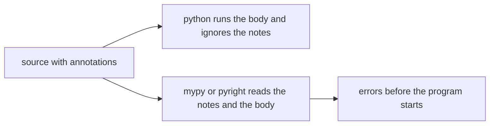

### What you write on the way in and the way out

Annotate parameters and the return. Leave local variables alone unless a local is genuinely hard to read. The checker infers locals from what you assigned. A parameter has no assignment inside the function, so the annotation is how the checker knows what callers may pass. The return annotation is how the checker knows what callers may do with the result.

`list[str]` means a list whose items are strings. `dict[str, int]` means string keys and integer values. `tuple[str, int]` means a pair of that shape, and the length is part of the type. `str | None` means either a string or `None`. Older code writes `Optional[str]` for the same union. Prefer `|` in new code. It is the same idea and it does not require an import. `Callable[[int], str]` means a function that takes an integer and returns a string, which is what you need when a parameter is itself a function.

`Any` means "stop checking this value." It is useful at a boundary you do not control yet, and it is expensive. A value typed as `Any` can be passed anywhere, and the checker will not follow it. Reaching for `Any` to silence an error keeps the error and spreads it. Fix the annotation, or narrow the value, before you give up.

Hints on a dataclass field are the same language. The class declaration lists the fields and their types, and the checker uses that when you construct the object or read an attribute. A wrong keyword at the constructor is then a checker error instead of a surprise attribute that shows up in a log.

### None is the case the hint forces you to see

`-> str | None` is the annotation that pays for itself. The checker refuses `shelf_of(code).upper()` because the result might be `None`, and `None` has no `upper`. You handle the missing case first.

```python
def shelf_of(code: str) -> str | None:
    if code == "A1":
        return "north"
    return None
```

The call site becomes a branch. Bind the result, test it against `None`, and use it only in the branch where it is a string. The checker treats the value inside that branch as `str`. That narrowing is ordinary control flow, which is why the hint and the `if` belong together. A cast that says "trust me, this is a string" skips the branch and will be wrong the day the function starts returning `None` for a new code.

The same pattern applies to a dict lookup that you annotated as possibly missing. `row.get("bin")` returning `int | None` makes the next arithmetic wait until you have checked. A bare `row["bin"]` raises `KeyError` at runtime if the key is absent. The hint does not change that. It changes whether the caller is told, before running, that absence is part of the contract.

### Where the checker and the runtime disagree

The runtime will accept a list of strings annotated as `list[int]`, store it, and print the strings. Nothing in the list object remembers the annotation. The checker, reading the source, flags the assignment if it can see the wrong item. Both can be true. Tests that only run the program can pass while the checker is red, and a green checker does not execute the code. You want both. The checker covers the combinations you did not run. The tests cover the behaviour the annotations only describe.

Hints also do not see into data that arrives as JSON. `json.loads` returns a value the checker often treats loosely, because the file can contain anything the grammar allows. The boundary is where you check the shape yourself and return a typed object. Annotating the JSON dict as `dict[str, str]` without a check is a wish. A function that reads the fields and raises if they are the wrong type is a parser. The annotation on the parser's return is then honest, because the function did the work the hint claims.

Third-party libraries that validate at runtime, such as the ones that turn annotations into parsers, are a separate choice. The language did not grow that behaviour. A library walks `__annotations__` and checks the values you pass. If you are not using such a library, a hint is documentation that a checker can also read. Do not tell a caller that a bad argument will raise `TypeError` at the call unless something in the body, or a library wrapped around the body, actually raises it.

### Where it breaks

The break is annotating a lie. `-> str` when the function sometimes returns `None` teaches every caller to skip the check, and the checker will agree with the lie. The crash comes back. Annotate the union you really return, including `None`. A second break is `Any` on the way out of a parser. Every caller is then unchecked. A third is a comment that silences the checker for a whole file. One awkward import becomes an untyped module, and the next mistake is invisible. Silence one line, with a reason, when you truly cannot express the type. Do not silence the function.

A fourth is depending on the hint to reject bad user input. A web request is bytes until you parse it. The annotation on the view does not inspect the JSON. Validate at the edge. A fifth is a hint so complicated that the function should have been two functions. A union of six shapes is often a sign that the caller is doing the dispatch the callee should have done, or that a dataclass per shape would be clearer than a dict with optional keys.

### At work

Public functions and methods get annotations. So do dataclass fields and the values you pass across a module boundary. Locals stay inferred. `None` is explicit. `Any` is rare and sits at the edge, not in the middle of the program. A type checker runs in the editor and again in CI, in a strict mode, so a missing return annotation is an error rather than a quiet hole. The running tests do not replace that run. They answer a different question, which is whether the behaviour matches the examples you cared about.

In review, read the return annotation before the body. If it says `str` and the body can fall off the end, the annotation is already wrong. If it says `str | None`, find the call site and see whether `None` is handled. If the only way the file stays green is a cast or a silenced error, the type is hiding a branch the code still has.

### A decision table

| Situation | Write | Why |
| --- | --- | --- |
| A function others call | Parameter and return annotations | Callers and the checker cannot see a missing annotation as a real contract |
| A missing result is normal | `str \| None`, and a check at the caller | The checker then refuses the unchecked attribute |
| A list, dict, or pair | `list[str]`, `dict[str, int]`, `tuple[str, int]` | The item types are the part a reader cannot guess from the container |
| A callback parameter | `Callable[[int], str]` | The checker can tell a wrong callback from a wrong argument |
| JSON or other untyped input | Parse into a typed value at the edge | The annotation on the raw dict does not inspect the file |
| A value the checker cannot follow | A narrow escape, not `Any` on every child call | `Any` turns checking off for everything it touches |
| A local with an obvious assignment | No annotation | The checker infers it, and a repeated note adds noise |

### You can now

You can annotate parameters and returns, including `str | None` and the container forms, and you can say that Python stores those notes and does not enforce them while the program runs. You can narrow a possibly missing value with a `None` check before you use it. You can explain why a green test run and a red type checker are both information, and why `Any` and a silenced file are not a fix for a wrong return type.

::: quiz
q: You annotate `def area(r: float) -> float` and call `area("3")`. What happens when the program runs?
- Python raises a TypeError before calling the function
+ Python runs it anyway; hints aren't enforced at runtime (a type checker like mypy would flag the call beforehand)
- Python converts "3" to 3.0 automatically
- The function returns None
why: Hints are for tools and readers. Python ignores them at runtime unless a library (such as Pydantic) reads them on purpose.
:::

::: quiz
q: `def get(id: int) -> User | None`. Which line would a type checker reject?
- `u = get(1)`
+ `print(get(1).name)`
- `if (u := get(1)) is not None: print(u.name)`
- `u = get(1) or default_user`
why: The result might be `None`, and `None` has no `.name`. The checker makes you handle that case first.
:::


::: predict lang=python
q: What does this print? The annotations say int, and the values are not ints.
code:
```python
def twice(n: int) -> int:
    return n * 2

nums: list[int] = ["x"]
print(nums[0])
print(twice("ab"))
```
answer:
```
x
abab
```
why: The annotations are stored and then ignored by the running interpreter. The list holds the string you put in it, so the first item prints as x. twice("ab") runs the body, and a string multiplied by 2 is that string repeated, so the result is abab. A type checker would reject both lines. The interpreter does not.
:::

::: quiz
q: A function is annotated `-> str | None`. Which change makes a type checker accept `result.upper()`?
- Change the annotation to Any, so the checker stops looking
+ Bind the result, and call upper only in the branch where the result is not None
- Add a comment that the caller promises never to pass a missing code
- Call upper on the function object instead of on the result
why: str | None means the value might be None, and None has no upper. The checker treats the value as str only after a branch has ruled None out. Any would silence the symptom and every later use of that value.
:::

::: card
q: Why is a hint not a substitute for checking JSON that just arrived?
answer: json.loads can return any shape the grammar allows, and the annotation is not consulted while the program runs. A hint on the raw value does not reject a missing field or a number where you expected a string. Parse at the boundary, raise if the shape is wrong, and annotate the value you return after that check.
:::

::: write lang=python
task: Annotate `shelf_of` so it says what it really does: it takes a `str` and returns a `str` or `None`. Keep the body as it is.
starter:
```python
def shelf_of(code):
    if code == "A1":
        return "north"
    return None
```
tests:
```python
from typing import get_type_hints
from solution import shelf_of

# wrong answer tested: -> str, which hides the None path from every caller
def test_parameter():
    assert get_type_hints(shelf_of)["code"] is str

def test_return_includes_none():
    assert get_type_hints(shelf_of)["return"] == (str | None)

def test_body_unchanged():
    assert shelf_of("A1") == "north"
    assert shelf_of("Z9") is None
```
solution:
```python
def shelf_of(code: str) -> str | None:
    if code == "A1":
        return "north"
    return None
```
hint: Annotate the parameter after its name, `code: str`, and the return after the parentheses, `-> ...`. The function returns `None` for an unknown code, so the return type is a union that includes `None`.
:::

## Reading a type checker
id: type-check
stage: types
needs: type-hints
minutes: 40
goal: Read a strict type-checker error, narrow the value, and leave Any and ignores for the line you cannot express.
source: mypy documentation | https://mypy.readthedocs.io/en/stable/
source: Pyright documentation | https://microsoft.github.io/pyright/

A function was annotated `-> str` and one path returned `None`. The tests passed, because the test only took the path that returned a string. The next caller took the other path and called a string method on `None`. A type checker is a program that reads the source, including the annotations, and reports that disagreement without running the function. mypy and pyright are the two you will meet. They do not replace tests. A test runs one input. The checker asks whether the annotations and the body can be true at the same time for every path it can see.

The checker does not start your program, open your database, or read the request that will arrive tonight. It follows types. If you say a value is `str | None`, it refuses an operation that only `str` has, until a branch has ruled `None` out. If you say a value is `int` and you return a string from the same function, it reports that the return paths disagree. The running interpreter still does both, which is why a green test suite and a red checker can happen on the same commit. You fix the checker by making the annotation true or by making the body match the annotation. You do not fix it by turning the checker off for the file.

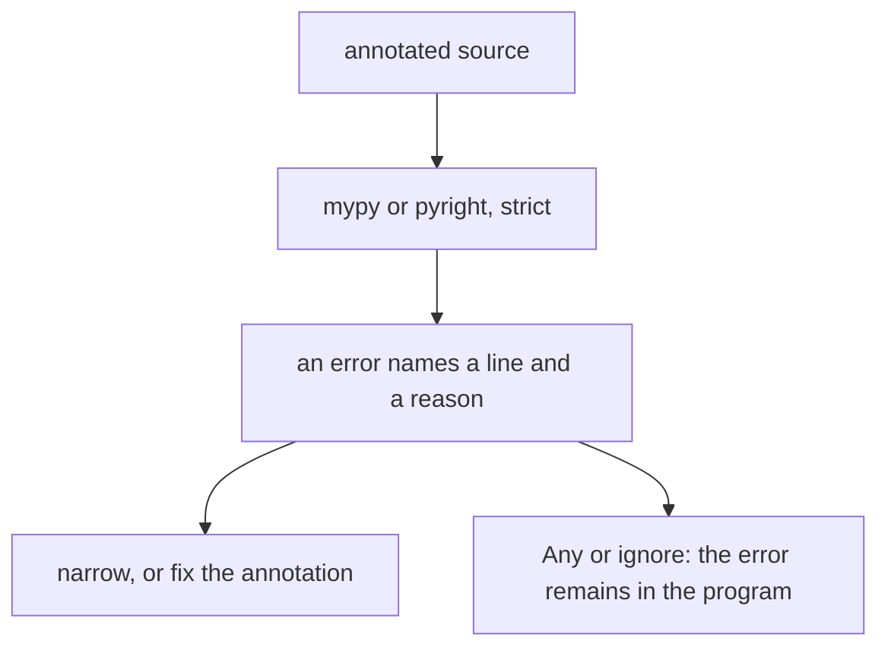

### Strict means the holes are errors

A lenient run skips untyped functions and missing returns. Those are the holes bugs crawl through. Strict mode treats a missing annotation on a public function as an error, and it follows values into the functions it can see. Turn it on in the project so a new file does not get a quieter set of rules than an old one. The editor plugin and the CI job should use the same mode. A local run that is lenient and a CI run that is strict trains people to ignore the editor.

An error is a line number, a value, and a reason. "Item of `str | None` has no attribute `upper`" means you used the value as a string while `None` was still possible. The fix is a branch. Bind the result, test `is not None`, and call `upper` inside the branch. The checker narrows the type in that branch. It does not narrow it after a function that "usually" returns a string, unless that function's annotation says it returns a string.

"Returning `str` where `int` is expected" means two paths disagree, or a caller passed the wrong thing. Read the annotation you wrote before you change the caller. If both paths are real, the annotation should be `int | str` and every caller has to handle both, or the function should be split so each path has one return type. A union at the return is a promise that callers branch. Do not write it because two returns were convenient and then access attributes as if only one type existed.

### Narrowing is ordinary code

The checker understands the tests you already write. `isinstance(value, str)` narrows to `str` in the true branch. `value is not None` removes `None`. A comparison that exhausts a `Literal` can narrow a small set of strings. After the branch, the wider type comes back, because the guard's result no longer applies. Do not bind a narrowed name, leave the branch, and expect the checker to remember. Use the narrowed value inside the branch, or assign a new name that exists only there.

`cast` and a comment that says to ignore the next line are escapes. `cast` tells the checker to treat a value as a type without a check at runtime. It does not convert anything. If you were wrong, the crash is the same as before, and the checker will not warn the next caller. An ignore comment hides one error. An ignore without a code hides whatever the next edit puts on that line. When you truly cannot express the type, ignore the specific error code and write why. Do not ignore a missing attribute that a branch would have fixed.

`Any` is the wide escape. A value of type `Any` accepts every operation, and the result of those operations is often `Any` again. One `Any` at the edge of a JSON parse, converted immediately into a dataclass you checked, stays at the edge. `Any` as the return type of a helper that the rest of the program calls turns checking off for every caller. That is the same as not having run the checker.

### Where people silence the wrong line

The wrong silence is on the call that crashed in production. The annotation said `str | None`, the caller did not branch, and someone casts to `str` because the test data never omitted the field. The next payload omits it. The right edit is the branch, or a parser that raises before this function is called so the annotation can honestly say `str`.

A second wrong silence is a blanket ignore at the top of a module you are about to edit. Every new mistake in that file is invisible. A third is annotating a parameter as `Any` to make a bad call site pass. The call site was the information. A fourth is two tools configured differently, so the editor is green and CI is red, or the reverse. Pick one checker for the project, run it strictly, and use that result.

The checker cannot see a value that only exists at runtime. A dict you built from a file is as typed as the annotation you put on it. If you annotate it as `dict[str, int]` and the file contains a string, the checker believes you and the program fails later. Parse, then annotate the result of the parser. The checker's job after that is the code you wrote, not the file you have not read.

### At work

CI runs the checker on the change. A new error fails the job. The person who introduced it fixes the annotation or the branch, in the same change as the behaviour. Ignoring the error to merge, with a ticket to "look at types later," leaves the red line for the next person and trains the team to ignore the tool. Strict from the start of a project is cheaper than strict after a year of `Any`.

In review, open the error and find the branch that is missing before you read the ignore. If the ignore stays, the comment should say which error code and why a branch will not do. If a function returns `Any`, ask what the caller is supposed to do with it. If the answer is "anything," the function has no contract.

### A decision table

| The error says | Do | Why |
| --- | --- | --- |
| A `str \| None` has no attribute | Branch on `is not None`, then use the attribute | The checker narrows inside the branch. The runtime would have crashed on None |
| Return paths disagree | Make the annotation a union and handle it, or split the function | Callers cannot guess which path they are on |
| Missing annotation, in strict mode | Annotate the parameter or the return | An untyped public function is a hole, not a style nit |
| JSON or other external data | Parse into a checked value, then return that type | Annotating the raw dict does not read the file |
| A type you cannot express | Ignore that error code on that line, with a reason | A file-wide ignore hides the next bug |
| Tempted to use `Any` | Keep it at the edge, and convert before callers see it | `Any` turns checking off downstream |

### You can now

You can read a checker error as a disagreement between an annotation and a use, and you can fix the common `None` case by narrowing. You can say what strict mode adds, and why a green runtime test does not make a red checker wrong. You can keep `Any` and ignore comments at the single line that needs them, instead of silencing the file. You can point a parser at external data so the type you annotate is a type you checked.

::: quiz
q: pyright says the result of a function annotated `-> str | None` has no attribute `upper`. What is the fix?
- Cast the result to str so the call site stays one line
+ Test the result against None and call upper only in the branch where it is a string
- Change the annotation to Any so this error and later errors go away
- Delete the return annotation. Strict mode prefers functions with no notes
why: The annotation says None is possible, and None has no upper. A cast does not check, and it is wrong when the function returns None. A branch is both the runtime check and the narrowing the checker understands.
:::

::: predict lang=python
q: What does this print? The two return paths produce different types, and nothing here runs a type checker.
code:
```python
def pick(flag):
    if flag:
        return 1
    return "no"

print(pick(True))
print(pick(False))
```
answer:
```
1
no
```
why: The interpreter runs both paths and prints what each path returns. A strict checker, reading the same function, reports that the returns disagree. The printout is not evidence that the function is one type. It is evidence that both paths ran.
:::

::: quiz
q: A module starts with a comment that ignores every type error in the file, so the checker is green. What did that buy?
- A stricter reading, because ignored errors are rechecked at runtime
+ Silence. The next mistake in the file is invisible, including a mistake that a branch would have fixed
- The same result as annotating each function, because the checker remembers the ignored lines
- Faster tests, because the checker skips the file's asserts
why: An ignore hides the diagnostic. It does not run a check later, and it does not speed up tests. Ignore one error code on one line when you cannot express the type. A whole file is how a real bug stops being reported.
:::

::: card
q: Why can tests pass while mypy or pyright is still red?
answer: Tests run the paths you called. The checker reads the annotations and the other paths too, and it does not execute the program. A suite that never passes None will stay green while a caller who can receive None is unchecked. Fix the annotation or the branch. Do not treat a green run as a type check.
:::

::: write lang=python
task: A strict checker reports *Item "None" of "str | None" has no attribute "upper"* on `label`. Fix `label` with a branch, not a cast: return the shelf in capitals, or `"UNSHELVED"` when `shelf_of` returns `None`. Keep the annotations.
starter:
```python
def shelf_of(code: str) -> str | None:
    return {"A1": "north", "B2": "south"}.get(code)

def label(code: str) -> str:
    return shelf_of(code).upper()
```
tests:
```python
from solution import label

# wrong answer tested: shelf_of(code).upper() with no branch, which raises AttributeError for an unknown code
def test_known():
    assert label("A1") == "NORTH"
    assert label("B2") == "SOUTH"

def test_unknown():
    assert label("Z9") == "UNSHELVED"
```
solution:
```python
def shelf_of(code: str) -> str | None:
    return {"A1": "north", "B2": "south"}.get(code)

def label(code: str) -> str:
    shelf = shelf_of(code)
    if shelf is None:
        return "UNSHELVED"
    return shelf.upper()
```
hint: Bind the result to a name, test it against `None` first, and call `upper` only after that test. The checker narrows the name to `str` below the `if`.
:::

## One function, many types
id: generics-py
stage: types
needs: type-check, protocols
minutes: 40
goal: Write one function or class that keeps the same type in and out, using the modern type parameter syntax.
source: Typing spec: generics | https://typing.python.org/en/latest/spec/generics.html

A cache for patron ids returned a string when the caller stored an int, because the cache was annotated as "anything in, anything out." The bug was not a crash inside the cache. The crash was the next line, which added one to a string. The cache had thrown away the only fact that mattered: the value that comes out is the same kind of value that went in. A generic is that fact, written so a type checker can follow it. The function is still one function. The type parameter is a name for "whatever this call uses," and it is the same name in the argument and in the result.

Since Python 3.12 the parameter sits on the function or the class. `def identity[T](value: T) -> T` means: for this call, pick a type, call it `T`, require the argument to be that type, and return that same type. The next call may pick a different type. `identity(3)` is an int in and an int out. `identity("ab")` is a string in and a string out. You do not write two functions. The checker treats each call separately. The running interpreter does not. It stores the annotation and then runs the body, so a wrong value still runs if the body happens to accept it. The generic is a promise the checker can read, not a check inserted into the call.

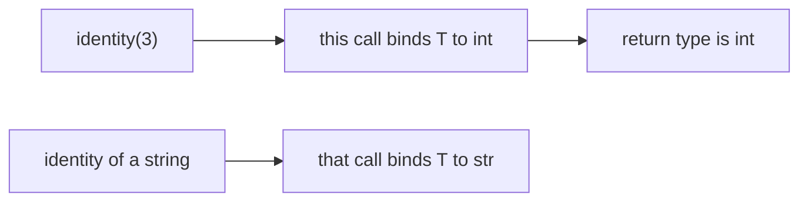

### The parameter is not a value

`T` is not a variable you can print, and it is not a default. It is a placeholder the checker substitutes per call. Using `T` at runtime as if it were the class `int` does not work, because no class object was passed. If you need the real class at runtime, take the class as an ordinary argument. The type parameter exists for the checker and for the reader.

`def first[T](items: list[T]) -> T` says the list holds one kind of item and the return is one of those items. A checker then refuses to treat `first(names)` as an int when `names` is a list of strings. It also refuses `first` on an empty story only if you annotated a different contract. The body can still raise `IndexError` on an empty list, because the annotation did not say the list was non-empty. If emptiness is part of the contract, raise a clear error, or return `T | None` and force the caller to handle the missing item. `T | None` is different from `T`. The caller may not use the result as a `T` until they have ruled `None` out.

A class is generic the same way. `class Box[T]` has a field of type `T`, and `put` accepts `T` and `get` returns `T`. Two boxes in one program can hold different types. `Box[str]` and `Box[int]` are the same class at runtime. The parameters are how the checker keeps their contents apart. A box that accepts `Any` and returns `Any` is the bug from the opening, written in a longer form.

### Bounds and several parameters

Sometimes `T` cannot be every type. `def lower[T: str](value: T) -> T` says `T` is a string, or a subclass of `str`. The checker then allows `value.lower()`, which it would refuse for a bare `T`, because an int has no `lower`. The bound is the methods you need, not a wish. If the only thing you need is a method, a `Protocol` with that method is often a better bound than a concrete class. The caller can pass any object with the method, and the checker still knows the return. A bound of `object` adds nothing. A bound of a huge class forces callers into an inheritance tree they do not need.

Two parameters stay independent. `class Cache[K, V]` has keys of type `K` and values of type `V`. `get` returns `V`. Putting the same letter on both would claim that keys and values are the same type, which is wrong for a cache of string keys and int values. The checker uses that distinction when you pass the result of `get` into a function that wants an int. If both letters are `T`, that mistake is invisible.

The old spelling `TypeVar` and `Generic[T]` still appears in libraries and in code that must run on interpreters older than 3.12. It means the same thing. The variable is declared up front, then used in the annotations. New code in a 3.12 or later project should use the brackets on the `def` or `class`. Do not mix a `TypeVar` named `T` with a function parameter `[T]` for the same idea in one function. One spelling per function.

### Where it breaks

The break is a generic that lies. `def first[T](items: list[T]) -> T` whose body returns `items[0]` on the happy path and `""` when the list is empty is not a `T` on the empty path, unless `T` happens to be `str`. The checker can catch a return that is a constant of the wrong type. A return of `None` from a function annotated `-> T` is the same lie. Annotate `T | None`, or raise.

A second break is erasing the parameter at the boundary. A function reads JSON, annotates the result as `Any`, and returns it from a generic function as `T`. The checker believes the annotation. The value is whatever was in the file. Parse into a real type, then put that type in the box. A third is using a generic class as a way to avoid two fields. If a structure always holds a string name and an int count, those are two fields, not `T` and `U` that happen to be string and int today. A generic is for a container or a function that truly does not care what it holds, only that it holds the same thing consistently.

A fourth is expecting the interpreter to reject `Box[int]` when someone puts a string in it. It will not. Tests that only run the program can pass with the wrong type inside. The checker is the tool that sees the misuse. A test still matters for the empty cache, the missing key, and the overwrite, because those are behaviour, not annotations.

### At work

Containers, caches, and "give me back the same object I gave you" are the functions worth making generic. Domain records are dataclasses with concrete fields. A public helper that returns the first acceptable item should say whether it returns `T` or `T | None`, and the callers should be able to use the result without a cast. Strict checking is what makes the parameter earn its keep. Without a checker, the brackets are documentation. With a checker, a swapped key and value becomes a red line at the call.

In review, look for one letter reused for two independent types, for a `-> T` that can return `None`, and for `Any` flowing into a generic. Look for a `TypeVar` that is not bound to the function and is reused across the module, because a module-level variable can accidentally tie two functions together. The bracket form keeps the parameter on the function that uses it.

### A decision table

| You need | Write | Why |
| --- | --- | --- |
| The output is the same type as the input | `def f[T](value: T) -> T` | Each call picks its own `T`. The checker follows it |
| A list of that type, one item out | `def first[T](items: list[T]) -> T` | The item type and the return type stay tied |
| A missing item is normal | `-> T \| None` | Callers must handle `None`. A bare `T` would be a lie |
| The value must support a method | A bound, or a `Protocol` | A bare `T` has no methods the checker can see |
| Keys and values differ | `class Cache[K, V]` | One letter would force keys and values to be the same type |
| A fixed record | A dataclass with real fields | A generic is for code that does not care what it holds |
| Code that must run before 3.12 | `TypeVar` and `Generic` | The meaning matches. The spelling is the one those interpreters parse |

### You can now

You can read `def identity[T](value: T) -> T` as one function whose argument and return are the same type for a given call. You can write a generic class with two independent parameters. You can say that the interpreter does not enforce the parameter and a type checker does. You can spot a `-> T` that sometimes returns `None`, and you can choose a concrete dataclass when the types are not actually generic.

::: predict lang=python
q: What does this print? The function is generic, and the two calls pass different types.
code:
```python
def identity[T](value: T) -> T:
    return value

print(identity(3))
print(identity("ab"))
```
answer:
```
3
ab
```
why: The brackets declare a type parameter for the checker. The body returns the argument unchanged, so the first call prints 3 and the second prints ab. Nothing at runtime rejects a type. A checker uses T to make sure the caller treats each result as the type that went in.
:::

::: write lang=python
task: Write a class `Cache`. `put(key, value)` stores the value under the key, replacing any earlier value. `get(key)` returns the stored value, or raises KeyError if the key was never stored. Two instances do not share their contents.
starter:
```python
class Cache:
    def put(self, key, value):
        pass

    def get(self, key):
        raise KeyError(key)
```
tests:
```python
# Wrong answer: get always raises, or one class-level dict is shared by every cache.
from solution import Cache

def test_round_trip_and_replace():
    cache = Cache()
    cache.put("ana", 1)
    cache.put("ana", 4)
    assert cache.get("ana") == 4

def test_missing():
    cache = Cache()
    try:
        cache.get("nope")
    except KeyError:
        return
    raise AssertionError("missing key should raise")

def test_separate():
    left, right = Cache(), Cache()
    left.put("ana", 1)
    try:
        right.get("ana")
    except KeyError:
        return
    raise AssertionError("caches should not share keys")
```
solution:
```python
class Cache:
    def __init__(self):
        self._data = {}

    def put(self, key, value):
        self._data[key] = value

    def get(self, key):
        if key not in self._data:
            raise KeyError(key)
        return self._data[key]
```
hint: Create the dict in __init__, not on the class. put assigns the value. get raises KeyError when the key is absent and otherwise returns the stored value.
:::

::: quiz
q: A function is annotated `def first[T](items: list[T]) -> T` and the empty list returns None. What is wrong with that annotation?
- Nothing. None is a value of every type T
+ The empty path returns None, which is not a T. Callers are told they can use the result as a T without a check
- The brackets are illegal unless T is int or str
- The checker inserts a runtime check, so None is converted to the first type it has seen
why: T stands for the item type. None is not that type unless you wrote T | None. Returning None from a function that promises T teaches every caller to skip the missing case. Raise, or annotate the union and make the caller branch.
:::

::: card
q: When do you use two type parameters instead of one?
answer: Use two when the types are independent, such as a cache key and a cache value. One letter means "these are the same type." K and V can differ on each use of the class. Reusing T for both hides a swapped key and value from the checker.
:::

::: card
q: Why can the same generic function accept an int on one call and a string on the next?
answer: The checker binds the type parameter separately for each call. The interpreter runs one body and does not look up that parameter, so both calls execute as long as the body only returns what it was given. A checker still treats the first result as an int and the second as a string.
:::

## Projects, locks, and uv
id: uv-projects
stage: tooling
needs: modules
minutes: 40
goal: Declare a project in pyproject.toml, lock the exact installs, and run it in its own environment.
source: uv: Working on projects | https://docs.astral.sh/uv/guides/projects/
source: Python Packaging User Guide: Writing pyproject.toml | https://packaging.python.org/en/latest/guides/writing-pyproject-toml/

Two services on one machine imported the same library. Someone upgraded it for the service that needed a new function. The other service started failing on a keyword it used to accept. Nothing in that service's source had changed. The install had changed, and both services were sharing one environment. A project is the opposite arrangement. The source lists what it needs. A lock file lists the exact versions that were resolved. An environment private to the project is where those versions are installed. uv is a tool that creates the project, writes those files, and runs commands inside the environment. You can understand the files without the tool installed. The tool is what keeps them in step.

`uv init` starts a project. It writes `pyproject.toml` and, when you ask it to manage a package, the layout for importable code. `uv add httpx` records a dependency and updates the lock. `uv sync` installs what the lock says into the project's environment. `uv run python app.py` uses that environment so the import finds the locked library and not whatever the system Python happens to have. The commands are thin. The contract is the two files.

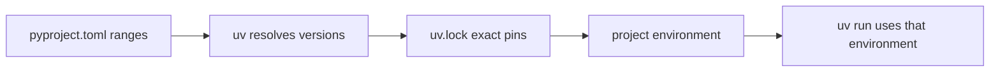

### What the declaration says

The `[project]` table is the part installers and uv agree on. `name` is the import or distribution name. `version` is the version you release. `requires-python` is the range of interpreters you tested, such as `>=3.12`. `dependencies` is a list of requirements, usually a name plus a range. `httpx>=0.27` means a version of httpx at least that one. It does not mean "whatever was current on my laptop this morning." The range is a request. It leaves room for a later compatible release, and it is also how two requests can conflict. If one dependency needs `httpx>=0.28` and another needs `httpx<0.28`, there is no version that satisfies both, and the resolver fails. That failure is better than a silent mix.

Optional groups hold tools you need in development and not in the deployed environment. A test runner and a type checker belong there. The production install can skip them. Putting the test runner in the main dependency list ships it to every user of the library. Putting a library you import from production code into the development group means production fails on import. The group is about who needs the package, not about whether you personally installed it.

`pyproject.toml` is TOML. Strings are quoted. Lists are square brackets. A table starts with `[project]`. Indentation does not create nesting the way YAML does. A nested table is `[project.scripts]` or a dotted key. Quoting a version range is required because `>=` is not bare TOML. You can read the file with the standard library. `tomllib.loads` accepts the text and returns nested dicts and lists. It does not install anything. It only parses. That is enough to check that the name is present and that the dependency list is a list of strings before you hand the file to a tool.

### The lock is the install

A range can resolve to different versions on different days, because a new release may appear. The lock file records the versions that were chosen, including the dependencies of your dependencies, and a hash so the download can be checked. CI, a teammate, and an image build install from the lock. They do not re-resolve and hope. When you change a range, you update the lock in the same change. A declaration that says `>=0.28` and a lock that still pins `0.27` is a disagreement. The install follows the lock. The reader of the declaration thinks they asked for something else.

The environment is disposable. Delete it and sync again from the lock and you are back to the same imports. The environment is not committed. It is large, it is specific to the operating system, and it can be rebuilt. The lock is committed. It is the source of truth for versions. The declaration is the source of truth for what you meant to ask.

`uv run` is how a script sees that environment without you remembering to activate it. Activation still works. It puts the environment's interpreter first on the path. Forgetting to activate is how a script passes on your machine, against the system interpreter, and fails in CI, where the system interpreter does not have the library. The run command removes that fork.

### Where it breaks

The break is `pip install` into the system interpreter, or into whatever environment the shell happened to have active. The package is then available to every project and owned by none of them. The next upgrade is the outage from the opening. Install into the project. If a command cannot see a library, check which interpreter is running before you install a second copy.

A second break is editing `pyproject.toml` and not updating the lock, or editing the lock by hand. The lock has hashes and a graph. A hand-edited pin drifts from a hash and the install fails in a way that looks like the network. Change the declaration and let the tool rewrite the lock. A third is a script with no `requires-python`. It runs on 3.14 on your laptop and uses a syntax CI's 3.11 rejects. State the interpreter you need. A fourth is a dependency that is imported and missing from the declaration, because it was installed globally and the import worked anyway. CI does not have that global install. The import error there is the declaration catching up with the source.

A fifth is treating the lock as optional for an application. An application that deploys from ranges will deploy different code next Tuesday with no commit. Lock it. A library that is published for other people to depend on still locks its own tests and tools, and it declares ranges for the people who depend on it. Their lock file pins the result.

### At work

An application repo has a `pyproject.toml`, a lock file, and a CI job that installs from the lock and then runs the tests and the type checker. A new dependency is a commit that changes both the declaration and the lock. Reviewers can see the range and the resolved version. A script that operators run uses the same project so the library versions match the service. A one-off `pip install` on a server is a change nobody can reconstruct.

In review, look for a dependency imported in the source and absent from `dependencies`. Look for a range with no lock update in the diff. Look for `requires-python` missing or older than the syntax in the files. Look for a virtual environment that was committed. It should be ignored.

### A decision table

| You want | Use | Why |
| --- | --- | --- |
| Name what the project needs | `[project]` dependencies as ranges | The range is the request. It is readable and it can conflict on purpose |
| The same installs everywhere | The lock file, committed | Resolution happened once. Later installs repeat it |
| A library only the tests import | A development group | Production does not need the test runner |
| Run inside the project | `uv run` or the project's interpreter | The system interpreter is a different set of packages |
| Read the declaration in Python | `tomllib` | The file is TOML. Parsing it does not install it |
| Rebuild a broken environment | Delete it and sync from the lock | The environment is a cache of the lock, not a thing you edit |

### You can now

You can read a `pyproject.toml` and separate the dependency request from the locked versions. You can say why two projects should not share an environment, and why the lock file is what CI installs. You can parse the project table with `tomllib` and refuse a declaration that has no name. You can tell a development tool from a runtime dependency, and you can name the failure mode of upgrading a library in the system Python.

::: predict lang=python
q: What does this print? The text is a pyproject-shaped TOML document, parsed and not installed.
code:
```python
import tomllib

data = tomllib.loads("""
[project]
name = "holds"
version = "0.1.0"
dependencies = ["httpx>=0.27"]
""")
print(data["project"]["name"])
print(data["project"]["dependencies"][0])
```
answer:
```
holds
httpx>=0.27
```
why: tomllib.loads reads the TOML into dicts and lists. The project table is a dict, dependencies is a list of strings, and the first requirement is the range you wrote. Nothing is installed. The range is still just text until a resolver runs.
:::

::: write lang=python
task: Write `project_deps(text)`. Parse `text` as TOML. Return a dict with `name` (the project name string) and `dependencies` (the list of dependency strings, or an empty list if that key is absent). Raise KeyError if `project` or `name` is missing. Raise ValueError if the name is not a non-empty string, or if dependencies is not a list of strings.
starter:
```python
def project_deps(text):
    return {"name": "holds", "dependencies": []}
```
tests:
```python
# Wrong answer: return a fixed holds project, so a different name or a missing table still looks valid.
from solution import project_deps

def test_reads():
    text = '[project]\nname = "desk"\ndependencies = ["httpx>=0.27"]\n'
    assert project_deps(text) == {"name": "desk", "dependencies": ["httpx>=0.27"]}

def test_missing_dependencies_key():
    text = '[project]\nname = "desk"\n'
    assert project_deps(text) == {"name": "desk", "dependencies": []}

def test_missing_project():
    try:
        project_deps("[tool]\nname = \"desk\"\n")
    except KeyError:
        return
    raise AssertionError("missing project should raise KeyError")

def test_bad_name():
    try:
        project_deps('[project]\nname = ""\n')
    except ValueError:
        return
    raise AssertionError("empty name should raise ValueError")
```
solution:
```python
import tomllib

def project_deps(text):
    data = tomllib.loads(text)
    project = data["project"]
    name = project["name"]
    if not isinstance(name, str) or not name.strip():
        raise ValueError("name")
    deps = project.get("dependencies", [])
    if not isinstance(deps, list) or any(not isinstance(item, str) for item in deps):
        raise ValueError("dependencies")
    return {"name": name, "dependencies": list(deps)}
```
hint: tomllib.loads parses the text. Look up data["project"] and then ["name"] so a missing table or name raises KeyError. Use get for dependencies so a missing key becomes an empty list. Reject a blank name and any dependency that is not a string.
:::

::: quiz
q: You change requires to httpx>=0.28 in pyproject.toml and you do not change the lock file. What does a clean install use?
- Whatever the resolver would pick today from the new range
+ The version already pinned in the lock, so the declaration and the install disagree until the lock is updated
- The newest httpx on the index, because a lock is only a comment
- Nothing. An install refuses to run when the files disagree, before it reads either one
why: Installers that promise reproducibility follow the lock. The declaration is the request you have not resolved again. Update the lock in the same change as the range, or the running environment is the old pin.
:::

::: card
q: Why is the project environment disposable while the lock file is committed?
answer: The environment is the installed files for one machine and one operating system. It can be deleted and built again from the lock. The lock is the exact versions and hashes that make that rebuild the same install. Committing the environment stores a cache. Committing the lock stores the decision.
:::

## Testing with pytest
id: pytest
stage: tooling
needs: modules, exceptions
minutes: 40
goal: Pin one behaviour with an assert, including the edge and the error, using the shape pytest runs.
source: pytest: Get started | https://docs.pytest.org/en/stable/getting-started.html
source: pytest: Parametrizing tests | https://docs.pytest.org/en/stable/how-to/parametrize.html

A refund function had a test, and the test checked that ten percent off one hundred was ninety. The bug was a percent of 150, which produced a negative price and was stored as a real refund. The test was green because it never passed 150. A test is a small program that calls your code and fails when the result is not the one you wrote down. It pins one behaviour. It does not pin the behaviours you forgot to name.

pytest is the runner people use for that program. It collects files whose names match `test_*.py`, and inside them it collects functions whose names match `test_*`. It runs each one, and a failing `assert` stops that test and shows the values on both sides. You do not call a special `assertEqual`. A plain `assert gross(100) == 120` is enough, because pytest rewrites assertions to remember the two sides. When it fails, you see the numbers, not only the word `AssertionError`.

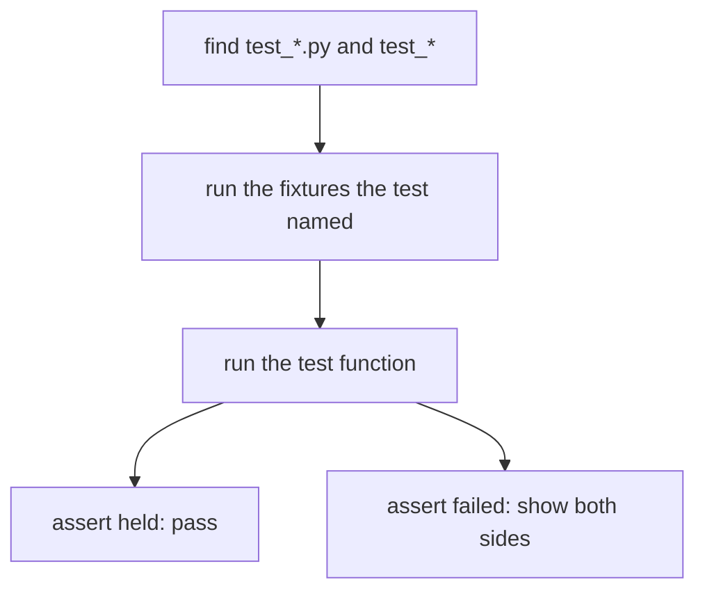

The command is `pytest` from the project directory, or `uv run pytest` when the project has its own environment. `-x` stops at the first failure, which is what you want while you are fixing one bug. `-k vat` runs the tests whose names contain that text, so you can rerun one behaviour without the whole file. The tool is not required to understand the idea. The idea is the function, the assert, and the case that would have caught the bug.

### One behaviour, and the edges

Name the test after the behaviour. `test_refund_cannot_exceed_charge` tells you what broke. `test_1` does not. Inside it, arrange the inputs, call the function, and assert one outcome. A second outcome belongs in a second test, or the failure message has to explain which of the two asserts fired.

The cases that find bugs are the edges and the refusals. Empty input, zero, one item, the last legal value, and the first illegal value. A happy path of a typical order can pass while the empty order divides by zero. Write the empty case on purpose. For a refusal, assert that the function raises the exception you promised, and that it does not return a made-up zero instead. pytest expresses that as `with pytest.raises(ValueError):` around the call. The test fails if the call returns normally. Matching a fragment of the message, when the message is part of the contract, keeps a different `ValueError` from counting as the right failure.

Floats need a tolerance. `0.1 + 0.2` is not a clean `0.3` in binary floating point, so `==` on a computed price will flake between machines and between operations that look identical. `pytest.approx` compares with a tolerance. Use it for results of real arithmetic. Do not use it to hide an integer that should have been exact.

Several inputs of the same shape do not need several copies of the test. `@pytest.mark.parametrize` runs one test function once per row of examples. The rows are the data. The function is the behaviour. A failure tells you which row failed. Copying the function four times means four places to update when the behaviour's name changes, and one of the copies will drift.

### Fixtures are the setup you stopped pasting

A test that needs a directory, a database connection, or a parsed sample should not build that object in every function by hand. A fixture is a function pytest calls because a test named it as a parameter. The test does not call the fixture. The runner sees the parameter name, finds a fixture with that name, runs it, and passes the return value in.

`tmp_path` is a fixture pytest provides. Each test that asks for it gets a fresh directory, and the directory goes away with the test. Write the sample file there. Do not write it into the project directory, and do not write it into the home directory. Those locations survive the test and then the next test reads the previous test's file. A fixture you write yourself is the same idea for a domain object. Build a valid order once, return it, and let tests that need an order ask for it by name.

The fixture runs before the test that requested it. If the fixture raises, the test does not run, and the failure is in the setup rather than in the assertion. That is useful. A broken sample should not look like a broken refund rule. Keep fixtures small. A fixture that calls the function under test and asserts has mixed the setup with the behaviour, and every test that uses it inherits that assertion.

### A failure you keep

When a bug is reported, the first edit is a test that fails on the current code and passes on the fixed code. The test is the bug, written as an input and an expected result. Then you change the function. The test stays. The next person who "simplifies" the function and brings the bug back will see that test fail, which is the point of having written it down. Deleting a failing test to make the suite green deletes the record of the bug.

The tests in this course's exercises are plain functions that call `assert`. They are the same idea, run by a small harness rather than by the pytest command, because the sandbox does not depend on pytest being installed. The structure you are practising is the structure pytest runs. A function named `test_...`, an assert, a case the wrong implementation fails.

### Where it breaks

The break is a test that cannot fail. `assert True`, or an assert on a constant the function never produced, stays green while the function returns anything. A test of `isinstance(result, float)` accepts a wrong number. Assert the value, or the exception, that the behaviour promised.

A second break is a test that depends on the clock, the random module without a seed, or the order of a set. It passes today and fails tomorrow with no change in the function. Freeze the time, seed the random, or assert on a sorted copy. A third is sharing a mutable fixture and modifying it. The next test sees the mutation and fails for a reason that is not its own. Build a new object inside the fixture, or copy it at the start of the test. A fourth is catching the exception in the function so the test can use `pytest.raises` and then "fixing" the function to return `None`. The raises test goes red, and someone deletes it. The right fix is the exception the contract named, or a change to the contract and the test together.

A fifth is a test that reads a file checked into the repo and writes the output beside it. Two runs overlap, and a developer machine has a different path. Use `tmp_path`, or pass the text in as a string if the function does not need a real file.

### At work

The suite runs in CI on every change, and a red suite is not merged. Locally you run the one test that matches the function you are in, then the file, then the suite. Slow tests are the ones that start a database or call a network. Most tests should call a function with data in memory and finish in milliseconds. The expensive ones are marked and split out so the fast suite stays fast enough that people run it.

In review, read the test name and the assert before you read the production code. If you cannot tell what would make the test fail, the test will not catch a regression. If every test builds twenty objects of setup for one assert, a fixture is missing. If the only coverage of an error path is a comment, the path is untested.

### A decision table

| You want | Write | Why |
| --- | --- | --- |
| One behaviour pinned down | A `test_` function with an assert of the expected value | The name and the assert are the specification |
| The same behaviour, many rows | `@pytest.mark.parametrize` | One function, and the failure names the row |
| A refusal | `pytest.raises` around the call | A normal return is the failure of that test |
| A float from real arithmetic | `pytest.approx` | Exact `==` on binary floats fails values that are close enough |
| A scratch file | The `tmp_path` fixture | Each test gets a fresh directory and does not share the project tree |
| Shared setup | A fixture named as a parameter | The runner calls it. The test does not paste the setup |
| A reported bug | A new test that fails first | The test remains after the fix and catches the return of the bug |

### You can now

You can describe what pytest collects and why a plain `assert` is the whole check. You can name a test after one behaviour and add the edge that a happy path misses. You can write a parametrized test, a test that expects an exception, and a test that uses a fresh directory. You can say why a test that cannot fail is not a test, and why the bug report becomes a failing assert before it becomes a fix.

::: quiz
q: Which test catches `discount(price, percent)` returning a negative price for `percent=150`?
- `assert discount(100, 10) == 90`
- `assert discount(0, 0) == 0`
+ `with pytest.raises(ValueError): discount(100, 150)` (or a test that the result is never below 0)
- `assert isinstance(discount(100, 10), float)`
why: Edge and invalid inputs are where bugs hide. Only a test that feeds the out-of-range percent can notice what happens to it.
:::

::: write lang=python
task: The tests for `slugify` are already written (hidden). Make them pass. `slugify("Hello, World!")` is `"hello-world"`: lower-case, runs of anything that isn't a letter or digit become one `-`, no `-` at either end. An empty or symbol-only title raises `ValueError`.
starter:
```python
import re

def slugify(title):
    return title.lower().replace(" ", "-")
```
tests:
```python
from solution import slugify

def test_basic():
    assert slugify("Hello, World!") == "hello-world"

def test_runs_collapse():
    assert slugify("  Kubernetes --  for   Devs ") == "kubernetes-for-devs"

def test_digits_kept():
    assert slugify("Top 10 Tips") == "top-10-tips"

def test_no_letters():
    for bad in ["", "!!!", "   "]:
        try:
            slugify(bad)
        except ValueError:
            continue
        assert False, f"slugify({bad!r}) should raise ValueError"
```
solution:
```python
import re

def slugify(title):
    slug = re.sub(r"[^a-z0-9]+", "-", title.lower()).strip("-")
    if not slug:
        raise ValueError("title has no letters or digits")
    return slug
```
hint: `re.sub(r"[^a-z0-9]+", "-", text)` replaces each run of other characters with one dash. Then `.strip("-")`.
:::


::: quiz
q: Four calls of the same function differ only by the input row and the expected code. What keeps those cases in one place?
- Four copies of the test function, so each assert has its own name
+ One test function, parametrized with one row per input and expected result
- A loop inside the test that catches every AssertionError and continues
- A fixture that returns True, because the rows are setup rather than behaviour
why: parametrize runs the same function once per row and reports which row failed. Copied tests drift. A loop that swallows AssertionError turns four failures into a pass. The rows are the behaviour's examples, not a fixture.
:::

::: write lang=python
task: Write `aisle(code)`. Strip the ends, uppercase, and return the character when it is exactly one of A, B, or C. Otherwise raise ValueError. `" b "` is `"B"`. `"ab"`, `"d"`, and `""` raise.
starter:
```python
def aisle(code):
    return code.upper()
```
tests:
```python
# Wrong answer: return code.upper() with no strip and no check, so " b " stays padded and "d" is accepted.
from solution import aisle

def test_strips_and_upper():
    assert aisle(" b ") == "B"
    assert aisle("c") == "C"

def test_rejects():
    for bad in ["ab", "d", "", "  "]:
        try:
            aisle(bad)
        except ValueError:
            continue
        raise AssertionError(f"aisle({bad!r}) should raise")
```
solution:
```python
def aisle(code):
    text = code.strip().upper()
    if len(text) != 1 or text not in "ABC":
        raise ValueError("aisle")
    return text
```
hint: Strip, then uppercase. Accept only a one-character string that is A, B, or C. Every other result raises ValueError, including a blank string after stripping.
:::

::: card
q: What is tmp_path for, and why not write the test file into the project directory?
answer: tmp_path is a fixture that gives each test its own new directory and removes it afterward. A file written into the project, or into your home directory, survives the test. The next test can read it and pass or fail for a reason that is not the function. Ask for tmp_path by naming it as a parameter. The runner passes the directory in.
:::

## Lint and format with Ruff
id: ruff
stage: tooling
needs: uv-projects
minutes: 40
goal: Let one tool format the file and catch the bug patterns a review would otherwise repeat.
source: Ruff documentation | https://docs.astral.sh/ruff/

A review comment said the same three things on every change. An import was unused. A comparison used `== None`. The file was formatted differently from the one next to it. None of those comments was the feature. They were noise, and one of them was a real bug that got lost in the noise. Ruff is one tool that formats Python and lints it. The formatter makes the layout a decision the project made once. The linter names a set of patterns, such as an unused import or a bare `except`, and fails the run when it sees them. You fix the code or you change the rule on purpose. You do not spend the review on whitespace.

Ruff reads the project from `pyproject.toml`. A `[tool.ruff]` table selects the line length and the rule families. `uv run ruff check` reports problems. `uv run ruff format` rewrites layout. CI runs both. A developer runs both before pushing, or a hook runs them. The sandbox you are in does not have the Ruff binary, so the exercises here are the judgement the tool is automating, not a shell call to `ruff`. The judgement is the part you need when the tool flags a line and you have to decide what the line should have been.

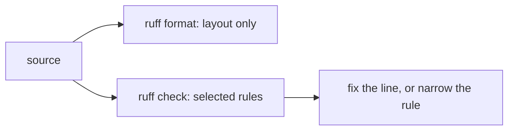

### Format and lint are different jobs

The formatter changes whitespace, quotes, and where a line breaks, and it is not supposed to change what the program does. A trailing comma in a call, blank lines between functions, and spaces around `=` in an argument are layout. After the formatter runs, the diff of a feature is the feature. Two people do not produce two layouts from the same code, so a merge does not contain a fight about indentation.

The linter looks at patterns that are often mistakes. An imported name that is never used is a stale import. `== None` should be `is None`, because `==` can be overridden and `is` asks the question you meant. A bare `except:` swallows `KeyboardInterrupt`. A variable that is assigned and never read is a typo waiting to happen. Each rule has a code. The message names the code and the line. You fix the line, or you mark one line with a reason when the pattern is deliberate, or you turn that rule off in the project if it does not belong. Turning a rule off is a project decision written in the config, not a habit of deleting the comment.

`ruff check --fix` can repair some patterns, such as removing an unused import or rewriting `== None`. It cannot repair a logic bug that happens to look like a style issue. Read the diff it offers. An automatic fix that deletes an import you needed under a `TYPE_CHECKING` guard is the kind of fix you reject. The tool is fast enough that running it twice is cheap. The review is whether the fix matches the rule you think fired.

### A small, explicit set

Turn on a known set instead of every rule that exists. The default set covers a lot of real mistakes. Add the bug-shaped rules you already comment on in review, such as unused imports and suspicious comparisons. Leave experimental or opinionated rules off until someone has wanted them twice. A project that fails on rules nobody agreed to trains people to ignore the tool. A project that only formats, and never lints, still lets `except: pass` through.

The config lives next to the dependencies, in `pyproject.toml`, so a fresh environment sees the same rules. A line length of 100, or whatever the project picks, is one number. Per-file ignores belong in the config too, for a generated file or a migration that cannot be clean yet. An inline ignore is for one line, with the rule code, when the pattern is intentional. An ignore of every rule on a whole file is how the next bug hides.

Imports are part of this. One name per import, sorted, with unused names removed, makes a module's dependencies readable. A duplicate import is noise. A blank line in the list is not an import. The exercise at the bottom is that cleanup as a pure function, which is the decision an import rule is making, without running Ruff itself.

### Where it breaks

The break is treating a green `ruff check` as a test suite. The linter did not run the program. A function can be formatted, imported cleanly, and still return the wrong total. Tests and a type checker answer those questions. Ruff answers whether the source matches the patterns you selected.

A second break is `--fix` on a dirty tree you have not read. The fixer rewrites files in place. Look at the diff. A third is a rule silenced in the editor and enabled in CI, or the reverse, so one of the two runs is a surprise. The same config should drive both. A fourth is formatting a file that was excluded, or not formatting a file that was included, because the exclude list was copied from another project and matches too much. A fifth is a long ignore comment that stays after the code changed. The line no longer triggers the rule, and the comment now hides a different one if it was broad.

### At work

CI runs `ruff format --check` and `ruff check` on the change. Format failures are fixed by running the formatter, not by hand. Lint failures are fixed in the code when the rule is right. A new rule is a separate change from a feature, so the diff that turns the rule on is not mixed with the feature that happens to violate it. Generated code and vendored code are excluded on purpose.

In review, if you are commenting on whitespace, the formatter is not running. If you are commenting on an unused import, the linter is not running or the rule is off. The review that remains is behaviour, names, and the rules you deliberately did not enable.

### A decision table

| You see | Use | Why |
| --- | --- | --- |
| A layout disagreement | `ruff format` | Layout is a project setting, not a review thread |
| An unused import, `== None`, a bare except | `ruff check`, then fix the line | Those patterns are mistakes often enough to fail the run |
| A pattern that is deliberate on one line | An inline ignore of that rule code, with a reason | A file-wide ignore hides the next finding |
| A fixer offers a change | Read the diff, then keep it | Some fixes are wrong for a guard or a side effect |
| A green lint run | Still run tests and the type checker | Lint did not execute the function |
| A rule nobody wants | Turn it off in `pyproject.toml` | A noisy rule teaches people to skip the output |

### You can now

You can separate formatting from linting, and you can say why both belong in CI. You can read a rule code as a specific pattern, fix it, or ignore that code on one line. You can clean a list of imports into sorted, unique, stripped lines. You can explain why a green linter is not a test, and why `--fix` still needs a look at the diff.

::: quiz
q: Ruff reports that a name was imported and never used. What should you do?
- Leave the import so the next reader knows the module exists
+ Delete the import. If a tool or a type checker needs it under a guard, keep it under that guard and do not silence the whole file
- Rename the import to _unused and keep it
- Turn off every import rule in the user settings on your laptop only
why: An unused import is a stale dependency of the module. The fix is to remove it. A name used only for typing belongs in the typing guard the project uses, which is a deliberate pattern, not a laptop-only config. The CI config is the one that counts.
:::

::: write lang=python
task: Write `import_lines(names)`. Strip each name. Skip blanks. Reject a name that is not an identifier. Drop duplicates, keeping the first spelling you kept. Return `import` lines for the remaining names, sorted alphabetically.
starter:
```python
def import_lines(names):
    return [f"import {name}" for name in names]
```
tests:
```python
# Wrong answer: keep blanks, duplicates, and the original order, so " sys" and a second os both survive.
from solution import import_lines

def test_sorts_and_uniques():
    assert import_lines(["os", " sys", "os", ""]) == ["import os", "import sys"]

def test_rejects():
    try:
        import_lines(["9bad"])
    except ValueError:
        return
    raise AssertionError("a non-identifier should raise")
```
solution:
```python
def import_lines(names):
    kept = []
    for name in names:
        text = name.strip()
        if not text:
            continue
        if not text.isidentifier():
            raise ValueError("name")
        if text not in kept:
            kept.append(text)
    return [f"import {name}" for name in sorted(kept)]
```
hint: Strip each name and skip an empty result. Raise ValueError when the stripped name is not an identifier. Remember the first of each name, then return import lines in sorted order.
:::

::: quiz
q: `ruff format` rewrote whitespace and quotes in a function that still returns the wrong total. What did the formatter guarantee?
- The function is correct, because a formatted file has been checked
+ Only the layout. Formatting is not supposed to change behaviour, and it does not run the function
- The tests passed, because format implies check
- The type checker is satisfied, because quotes are part of the annotations
why: The formatter's job is a single layout so diffs stay readable. A wrong return survives formatting. Tests, and a type checker if you use one, are the runs that ask whether the function does what it claims.
:::

::: card
q: Why is `== None` a lint finding when it often works?
answer: `==` calls a method the other object can define, so a value can compare equal to None without being None. `is None` asks whether the object is None itself. The linter flags the comparison because the identity test is the one you almost always meant, and the cases where `==` differs are surprising.
:::

::: predict lang=python
q: What does this print? The class defines equality so that it compares equal to everything.
code:
```python
class Box:
    def __eq__(self, other):
        return True

print(Box() == None)
print(Box() is None)
```
answer:
```
True
False
```
why: == calls Box.__eq__, which returns True for any other object, including None. is asks whether the two names point at the same object. A linter prefers is None because this class would pass an == None test without being None.
:::

## Logging instead of print
id: logging
stage: tooling
needs: functions
minutes: 40
goal: Send operational messages through the logging hierarchy, at a chosen level, without losing the traceback.
source: Python docs: Logging HOWTO | https://docs.python.org/3/howto/logging.html
source: Python docs: logging | https://docs.python.org/3/library/logging.html

A checkout worker printed `failed` and the line landed in a terminal that nobody was watching. The next deploy restarted the process, the terminal was gone, and the only clue left was that a customer had been charged twice. Print has no level, no logger name, and no standard place to attach the exception that actually failed, so a later reader cannot tell a routine retry from a dropped payment.

The logging module is a small pipeline. You ask for a logger by a dotted name, you call a method that names a level, and the logging package decides where that record goes.

```mermaid
flowchart LR
  call["log.error(...)"] --> gate["logger level"]
  gate --> handlers["this logger's handlers"]
  gate --> prop["propagate to parent"]
  prop --> parent["shop, then root"]
```

A name such as `shop.pay` is a child of `shop`, which is a child of the root logger. The level on a logger is a gate. DEBUG is 10, INFO is 20, WARNING is 30, ERROR is 40, CRITICAL is 50. A record below the effective level is dropped before any handler sees it. A logger whose level is NOTSET (0) does not decide for itself: the effective level walks up the parents until one of them has a level set. A fresh child therefore follows the root.

Handlers are the outputs: a stream, a file, a socket. Each handler has its own formatter and can have its own level, which filters a second time. The default formatter on a handler you construct yourself writes only the message. `basicConfig` is different: if you let it install the root handler, its default line looks like `WARNING:shop.pay:card declined`.

```python
import logging
import sys

logging.basicConfig(level=logging.INFO, stream=sys.stderr)
log = logging.getLogger("shop.pay")
log.info("charged %s", "order-14")
log.debug("token present")
```

`info` passes a root gate set to INFO. `debug` does not, so the token line is never formatted. Passing the order id as an argument, rather than building the string yourself, matters for the same reason: the message is formatted only if the record will actually be emitted. A library should not call `basicConfig`. That call belongs in the program that owns the process, once, at startup. A library that configures the root logger surprises every other library in the process.

### Where a record actually goes

`propagate` defaults to true. After a logger's own handlers run, the record is offered to the parent as well. That is useful when only the root has a handler, which is the usual shape: each module does `log = logging.getLogger(__name__)` and the application attaches one handler to the root. It is a bug when both the child and the root write to the same stream, because every line is then printed twice. Set `propagate` to false only on a logger that is supposed to be a private channel, such as an audit log with its own file.

`basicConfig` refuses to run when the root logger already has a handler, unless you pass `force=True`. A second call in a test, or a library that tried to be helpful, silently does nothing, and the level you thought you set is not the level that is in force. Look at `logging.getLogger().handlers` when a line you expected does not show up.

If nobody configured anything, a record at WARNING or above still appears. Python installs a last-resort handler that writes those records to stderr, once the record has fallen off the top of the tree with no handler claimed. DEBUG and INFO vanish in that situation. A process that "logs" only through that fallback is one configuration change away from silence, and the line format is not yours to control.

`log.exception("charge failed")` is `error` plus the current exception. It has to run inside an `except`, because that is where the interpreter keeps the traceback. Called from ordinary code, it records `NoneType: None` and you have lost the stack you meant to keep. `log.error("charge failed", exc_info=True)` is the same idea when you want a level other than ERROR.

### At work

Use one logger per module, named `__name__`, so a log aggregator can filter `shop.pay` without a string search. Log at INFO for a business event you would page on if it stopped (a charge, a refund), at WARNING for a handled oddity (a retry), and at ERROR when an operation failed for a user. DEBUG is for a developer who opted in. Never put a card number, a password, or a session token in a message or in `extra` fields: the log store is a second copy of production data, often kept longer than the database and read by more people.

| You want | Use |
|---|---|
| A one-off script you are reading live | `print`, then delete it |
| A library or a service | `logging.getLogger(__name__)` |
| A deprecation aimed at other developers | `warnings.warn` |
| The stack of the failure you just caught | `log.exception(...)` inside `except` |

### Reading a line six months later

A useful line answers three questions without a meeting: what happened, to which thing, and how bad it was. `charged order-14` answers the first two only if the logger name already says which service, and only if the level is the severity you would filter on. Put the stable id in the message or in an `extra` field, and keep the sentence stable so a search for `charged` still works next year. Interpolating a whole dict of the request is the opposite. It is huge, it changes shape every release, and it often contains the email address or the card token that was sitting on the object.

The hierarchy earns its keep when more than one module logs. `logging.getLogger("shop")` set to WARNING quiets every child whose own level is NOTSET, including `shop.pay` and `shop.ship`. A child that sets its own level to DEBUG is a deliberate exception: that module is noisy, the rest of `shop` stays quiet, and you did not edit a single call site. This is also why a library must not call `basicConfig` or set the root level. The application owner is the only place that knows whether this process is a laptop or a production container. A library that forces DEBUG undoes that decision for every other logger in the process.

Handlers stack. If a test attaches a stream handler and forgets to remove it, the next test attaches another, and one `error` call writes two lines. Clearing `handlers` before you add one, or using a logger name unique to the test, keeps the assertion on a single line. Production has the same footgun when an import-time helper configures logging and the real entry point configures it again. Decide once, at process start, after you know the environment.

`log.exception` belongs inside `except` because that is the only moment the interpreter still has the traceback for this failure. Logging the exception's string and moving on drops the stack: you learn that a `KeyError` said `sku`, and you do not learn which line indexed the dict. The level and the traceback are separate. The level says "page someone" or "keep it for the morning". The traceback says where to look. A handler's formatter decides whether the level name is on the line. The traceback is appended after the formatted message when `exc_info` is set, so a formatter of `%(message)s` alone still shows `KeyError` underneath. It will not show the word ERROR unless the format includes `%(levelname)s`.

### You can now

- Attach a level and a handler to a named logger and predict which lines survive the gate.
- Stop a record from being written twice by choosing where `propagate` stays on.
- Keep the traceback with the message when you log a caught exception.
- Leave `basicConfig` to the application entry point.

::: quiz
q: `shop.pay` has level NOTSET and no handler. The root logger is at WARNING and has one handler. You call `logging.getLogger("shop.pay").info("charged")`. What is emitted?
- The line, because INFO is a normal level
+ Nothing. The child's effective level is the root's WARNING, and INFO is below it
- The line twice, once for the child and once for the root
- A TypeError, because a NOTSET logger cannot log
why: NOTSET means "ask my parent." The root gate is WARNING, so info is dropped before the handler runs. error on that same logger would pass and, with propagate left on, would be written by the root handler.
:::

::: quiz
q: The root logger already has a handler. A later call runs `logging.basicConfig(level=logging.DEBUG)` with no force flag. What changes?
- The root level becomes DEBUG and a second handler is added
+ Nothing about the existing configuration. basicConfig returns immediately when the root already has a handler
- Every logger in the process is set to DEBUG
- The old handler is removed and replaced
why: basicConfig is a one-time convenience for scripts. Once a handler is installed it will not override that setup unless force is true, so a DEBUG call later in the program does not turn debug lines on.
:::

::: predict lang=python
code:
```python
import logging
import io

root = logging.getLogger()
root.handlers.clear()
root.setLevel(logging.WARNING)
buf = io.StringIO()
handler = logging.StreamHandler(buf)
handler.setFormatter(logging.Formatter("%(levelname)s %(name)s %(message)s"))
root.addHandler(handler)
log = logging.getLogger("inventory.pick")
log.info("skip-me")
log.error("short")
print(buf.getvalue().strip())
```
answer:
```
ERROR inventory.pick short
```
why: The child level is NOTSET, so the root WARNING gate applies. info is discarded. error propagates to the root handler, and the formatter prints the child logger's name, the one you called, not the name root.
:::

::: write lang=python
task: Write `attach(name, stream, level)` that returns a logger with that name. The logger's level is `level`, it does not propagate to its parents, and it has exactly one stream handler writing to `stream`. Each emitted line is `LEVEL message`, for example `ERROR ping`. Calling `attach` again on the same name must not stack a second copy of the line.
starter:
```python
import logging

def attach(name, stream, level):
    log = logging.getLogger(name)
    log.setLevel(logging.DEBUG)
    log.addHandler(logging.StreamHandler(stream))
    return log
```
tests:
```python
# Wrong answer: leaving propagate on, so the root handler also receives the
# record, and leaving the level at DEBUG so an info line is written.
import io
import logging
from solution import attach

def test_warning_gate():
    buf = io.StringIO()
    log = attach("gate.alpha", buf, logging.WARNING)
    log.info("skip")
    log.error("boom")
    assert buf.getvalue().strip() == "ERROR boom"

def test_debug_when_asked():
    buf = io.StringIO()
    log = attach("gate.beta", buf, logging.DEBUG)
    log.debug("scan")
    assert buf.getvalue().strip() == "DEBUG scan"

def test_does_not_bubble():
    root = logging.getLogger()
    root.handlers.clear()
    root.setLevel(logging.DEBUG)
    leaked = io.StringIO()
    root.addHandler(logging.StreamHandler(leaked))
    buf = io.StringIO()
    log = attach("gate.gamma", buf, logging.INFO)
    log.error("ping")
    assert buf.getvalue().strip() == "ERROR ping"
    assert leaked.getvalue() == ""
    root.handlers.clear()

def test_second_attach_does_not_duplicate():
    buf = io.StringIO()
    attach("gate.delta", buf, logging.INFO)
    log = attach("gate.delta", buf, logging.INFO)
    log.error("once")
    assert buf.getvalue().strip() == "ERROR once"
```
solution:
```python
import logging

def attach(name, stream, level):
    log = logging.getLogger(name)
    log.handlers.clear()
    log.setLevel(level)
    log.propagate = False
    handler = logging.StreamHandler(stream)
    handler.setFormatter(logging.Formatter("%(levelname)s %(message)s"))
    log.addHandler(handler)
    return log
```
hint: Clear the logger's handlers, set propagate to false, and give the new handler a formatter of `%(levelname)s %(message)s`.
:::

::: write lang=python
task: Write `emit_exc(log, message)` that records `message` at ERROR together with the exception currently being handled. The traceback text must be part of what the logger's handler writes.
starter:
```python
def emit_exc(log, message):
    log.error(message)
```
tests:
```python
# Wrong answer: log.error(message) with no exc_info, so the line has no
# exception type and no traceback.
import io
import logging
from solution import emit_exc

def _logger(buf):
    log = logging.getLogger("exc.demo")
    log.handlers.clear()
    log.setLevel(logging.ERROR)
    log.propagate = False
    handler = logging.StreamHandler(buf)
    handler.setFormatter(logging.Formatter("%(levelname)s %(message)s"))
    log.addHandler(handler)
    return log

def test_includes_type_and_message():
    buf = io.StringIO()
    log = _logger(buf)
    try:
        raise KeyError("sku")
    except KeyError:
        emit_exc(log, "failed")
    text = buf.getvalue()
    assert "failed" in text
    assert "KeyError" in text

def test_still_says_error():
    buf = io.StringIO()
    log = _logger(buf)
    try:
        raise ValueError("qty")
    except ValueError:
        emit_exc(log, "bad row")
    assert "ERROR" in buf.getvalue()
    assert "ValueError" in buf.getvalue()
```
solution:
```python
def emit_exc(log, message):
    log.exception(message)
```
hint: `Logger.exception` is error-level logging with `exc_info` taken from the current `except` block.
:::

::: card
q: Why is an order id passed as `log.info("charged %s", order_id)` instead of `log.info(f"charged {order_id}")`?
answer: The logging call formats the message only after the level gate says the record will be emitted. An f-string builds the text every time, including for DEBUG lines that are about to be thrown away, and it tempts you to interpolate a secret that then exists in the process even when logging is quiet. Arguments stay as data until a handler actually wants the line.
:::

## Project: a small package
id: p-package
stage: tooling
needs: generics-py, pytest, ruff, logging, p-library
minutes: 80
project: yes
goal: Name a package, point a script at a function, and emit a log line a test can assert.
source: Python Packaging User Guide: Writing pyproject.toml | https://packaging.python.org/en/latest/guides/writing-pyproject-toml/
source: uv: Working on projects | https://docs.astral.sh/uv/guides/projects/

A hold-desk tool worked as a file you ran by hand. The week someone else needed it, they copied the file, installed a library into the system Python, and the log line was a print that CI could not tell from a real failure. A package is the same code with a name, a declared dependency list, a lock, a way to start it, and a log line that has a level. The build tool and the installer are uv or the standard packaging tools. This lesson does not run them. The sandbox has no network and no project installer. The functions below are the decisions those tools enforce: what the name is, which function a console script calls, and what a log line looks like when a test reads it back.

Each function is graded alone, in a fresh `solution.py`. Do not import a sibling. A real package would have one module call another. Here a cross-import fails for a boring reason, so each rule is restated in the function that owns it.

### A name that normalizes the same way everywhere

Distribution names are compared in a normalized form. `Holds_Desk` and `holds-desk` are the same project to an installer. The normalized form is lowercase, with underscores turned into hyphens, and runs of punctuation collapsed in the full packaging rules. The version you need here is the part people get wrong first: strip the ends, lowercase, turn `_` into `-`, and refuse a name that is empty, that starts or ends with a hyphen, that contains `--`, or that contains a character other than a letter, a digit, or a hyphen. `Holds_Desk` becomes `holds-desk`. `..` does not become a name. The function returns the normalized name. It does not write `pyproject.toml`. A later step can put that string in the `name` field knowing two spellings will not fork the project.

### A console script is module:function

`[project.scripts]` maps a command name to a callable written as `module:function`, or `package.module:function`. The command `holds` might point at `holds.cli:main`. The module is a dotted name whose every segment is an identifier. The function is an identifier. There is exactly one colon. `holds.cli:main` is the string you store. `holds.cli` with no function is not a callable. `holds:main:extra` has two colons and is not the form the installer expects. Building that string in a function means a test can reject the bad forms without creating a script on disk.

The function that the script calls should be small. It parses arguments and then calls into the library. The library does not call `input()` and does not read the real clock. The script is the edge. Tests import the library the way the earlier hold-desk functions were tested, and one test checks the script string.

### A log line a test can pin

A print has no level. A log line here is a level, a single space, and a message. The levels you accept are `INFO`, `WARNING`, and `ERROR`. Anything else raises, including a lowercase `info`, because the line would not match the one the logging configuration prints and the test would pass for a spelling the operator does not filter on. The message is stripped. It must be non-empty and must not contain a newline, because a newline would look like a second record. `INFO hold.created` is one record. The function returns the string. It does not configure a handler. A test asserts the string, which is the same fact a log capture would assert if the logging module were wired up.

### The first item is a generic idea with a concrete failure

A helper that returns the first item of a list is the generic pattern: what goes in is what comes out, and an empty list is not an item. Raise `ValueError` when the list is empty. Do not return `None`. `None` would force every caller to handle a missing item that this helper promised not to produce. The type parameter on a real signature would say the return is the item type. The behaviour here is the part a test can run. A checker would add that the result is that type. Both belong in the package. Only the behaviour is graded in this step.

### Where the package breaks

The name breaks when two configs use `holds_desk` and `holds-desk` and someone installs both, or neither, because they did not normalize before comparing. Normalize at the boundary. The script string breaks when it points at a module that runs work on import. Importing the module should define `main`. Calling `main` should do the work. The log line breaks when the message includes a token or a full email and the line is shipped to a shared log. Pass an id. The first-item helper breaks when it returns `None` for empty and a caller appends `None` into a hold list.

Nothing here calls `uv build`. A project that has these rules, a `pyproject.toml` you can read, and tests for the library, is what that build packages. The build fails later for a missing dependency or a bad filename. It does not invent the name or the log format for you.

### What sits beside these functions

A real tree also has `pyproject.toml`. The `[project]` table holds the name, the version, and `requires-python`. `[project.scripts]` holds the command and the colon form that points at a function. A lockfile records the dependency set the installer should trust, so a later machine does not resolve a newer library than the one the tests ran against. The name field stores the normalized spelling. A comparison then does not depend on who typed the underscore. Dependencies are declared in that table. They are not installed, by hand, into the system interpreter, which is how a copied file broke a shared Python. Tests import the library functions. Continuous integration runs the tests, then the linter, then the type checker, and only then a build. The build packages the tree those checks already accepted. It does not re-decide that `INFO` is a level, or that an empty list has no first item. A dependency missing from the table fails the install. A script string that names a function which does not exist fails when the command is installed or first started, which is late. The function that builds the string fails in the unit test, while the mistake is still a string you can print.

### At the desk

The package name is `holds-desk` after normalization. The console script is `holds` pointing at `holds.cli:main`. A created hold logs `INFO hold.created`. A missing first item is a `ValueError`, not an empty report. Tests cover those strings and those refusals. Ruff and a type checker run in CI on the same tree. They are not imported by the functions.

### A decision table

| Piece | Accept | Reject |
| --- | --- | --- |
| Package name | Lowercase letters, digits, and single hyphens after `_` becomes `-` | Empty, `--`, a leading or trailing hyphen, any other character |
| Script target | A dotted module of identifiers, one colon, a function identifier | A missing colon, a second colon, a segment that is not an identifier |
| Log line | `INFO`, `WARNING`, or `ERROR`, then a stripped one-line message | Another level, a blank message, a newline in the message |
| First item | The item at index 0 | An empty list, by raising ValueError rather than returning None |

### You can now

You can normalize a distribution name so two spellings land on one project. You can build a `module:function` script target and refuse a string the installer would not call. You can format one log record with a fixed set of levels. You can return the first item or raise, instead of inventing a `None` the caller did not expect.

::: write lang=python
task: Write `normalize_name(name)`. Strip the ends, lowercase, and replace `_` with `-`. Raise ValueError if the result is empty, starts or ends with `-`, contains `--`, or contains anything other than a letter, a digit, or `-`. `Holds_Desk` returns `holds-desk`.
starter:
```python
def normalize_name(name):
    return name.lower()
```
tests:
```python
# Wrong answer: lowercase only, so underscores remain and ".." is accepted.
from solution import normalize_name

def test_normalizes():
    assert normalize_name(" Holds_Desk ") == "holds-desk"

def test_rejects():
    for bad in ["", "..", "-holds", "holds-", "holds--desk", "holds desk"]:
        try:
            normalize_name(bad)
        except ValueError:
            continue
        raise AssertionError(f"{bad!r} should raise")
```
solution:
```python
def normalize_name(name):
    text = name.strip().lower().replace("_", "-")
    if not text or text.startswith("-") or text.endswith("-") or "--" in text:
        raise ValueError("name")
    if not all(c.isalnum() or c == "-" for c in text):
        raise ValueError("name")
    return text
```
hint: Strip, lowercase, then turn underscores into hyphens. Reject an empty result, a leading or trailing hyphen, a double hyphen, and any character that is not a letter, digit, or hyphen.
:::

::: write lang=python
task: Write `script_target(module, func)`. Return `module:func`. Every dot-separated segment of `module`, and `func` itself, must be an identifier. Raise ValueError otherwise. `holds.cli` and `main` return `holds.cli:main`.
starter:
```python
def script_target(module, func):
    return module + func
```
tests:
```python
# Wrong answer: concatenate without a colon, so the installer string is holds.climain.
from solution import script_target

def test_dotted():
    assert script_target("holds.cli", "main") == "holds.cli:main"
    assert script_target("holds", "main") == "holds:main"

def test_rejects():
    for module, func in [("", "main"), ("holds.cli", ""), ("holds-cli", "main"), ("holds", "main-now"), ("holds..cli", "main")]:
        try:
            script_target(module, func)
        except ValueError:
            continue
        raise AssertionError(f"{module!r} {func!r} should raise")
```
solution:
```python
def script_target(module, func):
    parts = module.split(".")
    if not parts or any(not part.isidentifier() for part in parts):
        raise ValueError("module")
    if not func.isidentifier():
        raise ValueError("func")
    return f"{module}:{func}"
```
hint: Split the module on dots and require every segment to be an identifier. An empty segment from a double dot fails that test. Require func to be an identifier. Return the module, a colon, and the function.
:::

::: write lang=python
task: Write `log_event(level, event)`. `level` must be `INFO`, `WARNING`, or `ERROR`. `event` must be a non-empty string after stripping, with no newline. Return the level, a space, and the stripped event.
starter:
```python
def log_event(level, event):
    return event
```
tests:
```python
# Wrong answer: return the event alone, so the level is dropped and a blank event is accepted.
from solution import log_event

def test_line():
    assert log_event("INFO", " hold.created ") == "INFO hold.created"

def test_rejects():
    for level, event in [("info", "hold.created"), ("INFO", "  "), ("INFO", "a\nb"), ("DEBUG", "hold.created")]:
        try:
            log_event(level, event)
        except ValueError:
            continue
        raise AssertionError(f"{level!r} {event!r} should raise")
```
solution:
```python
def log_event(level, event):
    if level not in ("INFO", "WARNING", "ERROR"):
        raise ValueError("level")
    if not isinstance(event, str) or "\n" in event or not event.strip():
        raise ValueError("event")
    return f"{level} {event.strip()}"
```
hint: Accept only the three uppercase levels. Reject an event that is not a string, that contains a newline, or that is blank after stripping. Return the level, a space, and the stripped event.
:::

::: write lang=python
task: Write `first_item(items)`. Return `items[0]` when the list is not empty. Raise ValueError when it is empty. Do not return None.
starter:
```python
def first_item(items):
    if not items:
        return None
    return items[0]
```
tests:
```python
# Wrong answer: return None for an empty list, so the caller has to handle a value this function promised not to produce.
from solution import first_item

def test_first():
    assert first_item(["ana", "bo"]) == "ana"
    assert first_item([3]) == 3

def test_empty():
    try:
        first_item([])
    except ValueError:
        return
    raise AssertionError("empty should raise")
```
solution:
```python
def first_item(items):
    if not items:
        raise ValueError("empty")
    return items[0]
```
hint: If items is empty, raise ValueError. Otherwise return the item at index 0, whatever type it is.
:::

## Project: an order report
id: p-orders
stage: tooling
needs: pytest, classes, files, type-hints
minutes: 75
project: yes
goal: Tie the module together: parse messy input, model it, validate it, and report on it, with tests deciding when you're done.
source: Python docs: csv | https://docs.python.org/3/library/csv.html

A shop exports orders as CSV lines: `order_id,customer,item,qty,unit_price`. The data is messy (spaces, upper-case names, a bad row now and then):

```text
order_id,customer,item,qty,unit_price
1, Ana ,tea,2,3.5
1,ana,cake,1,4
2,BEN,tea,1,3.5
oops,this,row
3,cai,mug,3,10
4,dee,tea,-1,3.5
```

Build `report(csv_text)` that returns, for that input:

```python
{
    "orders": 3,             # distinct order ids among the valid rows
    "revenue": 44.5,         # sum of qty × unit_price, rounded to 2 decimals
    "top_customer": "cai",   # most revenue; names are lower-cased and stripped (" Ana " is "ana")
    "rejected": [5, 7],      # line numbers in the file (the header is line 1) of rows that can't be parsed
}
```

A row is rejected if it doesn't have 5 fields, `qty` isn't a positive integer, or `unit_price` isn't a number ≥ 0. Rejected rows don't count anywhere else. Ties for top customer go to the alphabetically first name. With no valid rows, `top_customer` is `None`.

Use what the module taught: a dataclass for a line, a function that parses one row and raises `ValueError`, a loop that collects rejects, and `Counter` or a dict for revenue by customer. Add type hints.

The file is text, not a list of already-split fields. A comma inside a quoted cell is part of the cell, so splitting on every comma invents extra columns and then rejects a row that was valid. The csv reader understands quotes. The header is the first record the reader returns, and it is also line 1 of the file the person has open. The first data record is line 2. A bad row on the fifth line of the file is rejected as 5, not as 4 with the header skipped in the count. The person who has to fix the export counts lines in the file.

A name is stripped and lower-cased before it is used as a key. ` Ana ` and `ana` are one customer. The revenue for that customer is the sum of quantity times unit price across their valid rows. A rejected row contributes nothing to that sum and nothing to the set of order ids. Two valid rows with the same order id are one order. The id is an identifier, not a count of lines.

The top customer is the name with the greatest revenue. When two names share that revenue, the alphabetically first name wins. Arrival order is the wrong tie break, because the export can be regenerated and the rows can come out in a different order while the money stays the same. An empty set of names has no top customer. Returning the header, or an empty string, would look like a person.

```mermaid
flowchart TD
  text["csv text"] --> rows["reader yields records"]
  rows --> head["skip the header, count file lines from 1"]
  head --> one["parse one record or record its line number"]
  one --> sums["revenue by normalised name, set of order ids"]
  sums --> out["orders, rounded revenue, top name, rejected lines"]
```

### Where a report goes wrong

A quantity of `1.5` is not a positive integer, even though it is a number. A quantity of `-1` is an integer and is not positive. A price of `abc` is not a number. A price of `0` is allowed. Those failures raise, the loop records the line, and the row is absent from the totals. Catching a broader error and then counting the row anyway would put a half unit into the revenue.

Rounding happens on the final sum, to two decimal places, so a column of prices does not accumulate a display of `44.5000000001`. Rounding each line before adding can move a cent. The report rounds once.

The parser and the report are separate. The parser raises when a record is the wrong shape. The report decides that a raised parse is a rejected line rather than a crashed job. A shop export with one bad row should still produce the totals for the good rows. An empty file that is only a header produces zeros, no top customer, and no rejected lines. There was nothing to reject.

### At the desk

Someone sends this file every morning. The useful result is a small dictionary a person can read and a test can pin: how many orders, how much money, who spent the most, and which lines to send back. The rejected list is part of the product. A silent skip looks like a smaller day. A crash on the first bad row hides the rest of the day.

In review, check the line numbers against the file, the tie against two equal customers, and a second run of the same text. The function should not remember the previous file. It builds its totals from the argument.

### A decision table

| Input | In the report | Out of the report |
| --- | --- | --- |
| Header | Line 1, not an order | Not rejected. It is not a data row |
| Five fields, positive integer qty, price ≥ 0 | Revenue, order id, customer | |
| Wrong number of fields, bad qty, or bad price | The file's line number in `rejected` | Revenue and order ids |
| Same order id on two valid rows | One order | Two orders |
| Same revenue, different names | The alphabetically first name | Whichever row appeared first |
| Only a header | Zeros and no top customer | An error |

### A smaller file, counted by hand

Take a header, then `1, Bo ,pen,2,1.5`, then `1,bo,pad,1,0`, then a line that is only the word `bad`, then `2,ANN,pen,1,4`, then `3,ann,x,-2,1`. The header is line 1 and is not rejected. The pen line is line 2: quantity 2, price 1.5, customer `bo`, order `1`, revenue 3. The pad line is line 3, same order and same customer, price 0, which is allowed, so it adds 0 and does not create a second order. `bad` is line 4 and does not have five fields, so it is rejected and adds no money. The ANN line is line 5: customer `ann`, order `2`, revenue 4. The last line is line 6: quantity `-2` is not a positive integer, so it is rejected, and order `3` never enters the set.

The valid revenue is 7. There are two orders. Ann's 4 beats Bo's 3, so the top customer is `ann`. The rejected lines are 4 and 6. If Ann's revenue were also 3, the tie would go to `ann` because the name sorts first, not because her row was lower in the file. Running the same text again builds those totals from scratch. Nothing in the function keeps the previous file's customers.

### You can now

You can parse a CSV record without splitting on every comma. You can number rejected lines the way a person counts them in the file. You can normalise a customer name before adding revenue, and you can break a tie by name so a reshuffled file does not change the winner. You can return a report for the valid rows when some rows are bad, and a zero report when there are no valid rows.

::: write lang=python
task: Write `report(csv_text)` as described above. The hidden tests cover the example, bad rows, ties and empty input.
starter:
```python
from dataclasses import dataclass

@dataclass(frozen=True)
class Line:
    order_id: str
    customer: str
    item: str
    qty: int
    unit_price: float


def parse_line(fields: list[str]) -> Line:
    raise NotImplementedError


def report(csv_text: str) -> dict:
    raise NotImplementedError
```
tests:
```python
from solution import report

DATA = """order_id,customer,item,qty,unit_price
1, Ana ,tea,2,3.5
1,ana,cake,1,4
2,BEN,tea,1,3.5
oops,this,row
3,cai,mug,3,10
4,dee,tea,-1,3.5
"""

def test_example():
    r = report(DATA)
    assert r["orders"] == 3
    assert r["revenue"] == 44.5
    assert r["top_customer"] == "cai"
    assert r["rejected"] == [5, 7]

def test_tie_goes_alphabetically():
    r = report("order_id,customer,item,qty,unit_price\n1,zoe,a,1,5\n2,abe,b,1,5\n")
    assert r["top_customer"] == "abe"

def test_bad_numbers():
    r = report("order_id,customer,item,qty,unit_price\n1,a,x,two,1\n2,b,y,1,abc\n3,c,z,1.5,2\n")
    assert r["rejected"] == [2, 3, 4]
    assert r["orders"] == 0

def test_empty():
    assert report("order_id,customer,item,qty,unit_price\n") == {"orders": 0, "revenue": 0, "top_customer": None, "rejected": []}
```
solution:
```python
import csv, io
from dataclasses import dataclass


@dataclass(frozen=True)
class Line:
    order_id: str
    customer: str
    item: str
    qty: int
    unit_price: float


def parse_line(fields: list[str]) -> Line:
    if len(fields) != 5:
        raise ValueError("expected 5 fields")
    order_id, customer, item, qty_s, price_s = (f.strip() for f in fields)
    if not qty_s.isdigit() or int(qty_s) < 1:
        raise ValueError("qty must be a positive integer")
    price = float(price_s)
    if price < 0:
        raise ValueError("price must not be negative")
    return Line(order_id, customer.lower(), item, int(qty_s), price)


def report(csv_text: str) -> dict:
    rows = list(csv.reader(io.StringIO(csv_text)))
    lines: list[Line] = []
    rejected: list[int] = []
    for number, fields in enumerate(rows[1:], start=2):
        try:
            lines.append(parse_line(fields))
        except ValueError:
            rejected.append(number)
    by_customer: dict[str, float] = {}
    for l in lines:
        by_customer[l.customer] = by_customer.get(l.customer, 0) + l.qty * l.unit_price
    top = min(by_customer, key=lambda c: (-by_customer[c], c)) if by_customer else None
    return {
        "orders": len({l.order_id for l in lines}),
        "revenue": round(sum(by_customer.values()), 2),
        "top_customer": top,
        "rejected": rejected,
    }
```
hint: Parse with `csv.reader`, skip the header, and enumerate from 2 so numbers match the file. `float("abc")` already raises `ValueError`, which your loop can catch. For the top customer, `min(totals, key=lambda c: (-totals[c], c))` handles ties.
:::

::: write lang=python
task: Write `customer_key(name)` that strips the ends and lower-cases the name. ` Ana ` returns `ana`. `BEN` returns `ben`.
starter:
```python
def customer_key(name):
    return name
```
tests:
```python
# Wrong answer: return the name unchanged, so the spaces and capitals stay and " Ana " is not "ana".
from solution import customer_key

def test_spaces_and_case():
    assert customer_key(" Ana ") == "ana"
    assert customer_key("BEN") == "ben"
```
solution:
```python
def customer_key(name):
    return name.strip().lower()
```
hint: Strip first, then lower-case. The report uses that string as the customer key, so two spellings of one person land on one total.
:::

::: write lang=python
task: Write `top_name(totals)`. `totals` maps a customer name to revenue. Return the name with the greatest revenue. Ties go to the alphabetically first name. An empty mapping returns None.
starter:
```python
def top_name(totals):
    if not totals:
        return ""
    return max(totals)
```
tests:
```python
# Wrong answer: max by name, or the empty string, so a tie ignores revenue and an empty report looks like a customer.
from solution import top_name

def test_tie():
    assert top_name({"mira": 9, "lena": 9, "otto": 3}) == "lena"

def test_only():
    assert top_name({"cai": 1}) == "cai"

def test_empty():
    assert top_name({}) is None
```
solution:
```python
def top_name(totals):
    if not totals:
        return None
    return min(totals, key=lambda name: (-totals[name], name))
```
hint: An empty mapping has no name. Otherwise pick the smallest pair of negative revenue and name, so the larger revenue wins and a tie falls through to alphabetical order.
:::

::: predict lang=python
q: What does this print? The key prefers higher revenue, then the earlier name.
code:
```python
totals = {"zoe": 4, "ann": 4, "bo": 1}
print(min(totals, key=lambda name: (-totals[name], name)))
```
answer:
```
ann
```
why: Zoe and Ann both have 4, which beats Bo. The name is the tie break, and ann comes before zoe. Choosing the last row that reached 4 would depend on insertion order.
:::

::: quiz
q: The header is line 1. A bad row is the third line of the file. Which number belongs in the rejected list?
- 2, because the header does not count
+ 3, because the number is the line in the file the person will open
- 1, because data rows are numbered from the first record
- 4, because the header occupies two lines
why: The person counts every line, including the header. The first data row is line 2. Recording 2 for the third line sends them to a different row.
:::

::: card
q: Why break a revenue tie by name, instead of by whichever row arrived first?
answer: A regenerated export can list the same orders in a different order. The money has not changed, so the winner should not change. Alphabetical order is a rule the next run can repeat. Arrival order is an accident of the file.
:::

## Regular expressions
id: regex
stage: work
needs: text
minutes: 40
goal: Pull structured fields out of a line with a pattern, and notice when the pattern matches more than you meant.
source: Python docs: Regular expression HOWTO | https://docs.python.org/3/howto/regex.html
source: Python docs: re | https://docs.python.org/3/library/re.html

A log line was split on spaces to get the method and the byte count. That worked until a path contained a space, and the byte count became the word `static`. The line was not a row of columns. It was text with a shape, and the shape needed a pattern.

The `re` module compiles a pattern into a small program that walks a string. `search` finds a match anywhere. `match` anchors at the start. `fullmatch` requires the whole string. `findall` returns every non-overlapping match, and if the pattern has groups it returns the groups rather than the whole match. `sub` builds a new string with each match replaced.

```mermaid
flowchart LR
  line["raw line"] --> search["search: a match somewhere"]
  line --> full["fullmatch: the entire line"]
  search --> groups["group 1, group method"]
```

A raw string, `r"..."`, keeps backslashes for the pattern. `\d` is a digit class. Written as a normal string it is still `\d` because `\d` is not a Python escape, but `\b` is a backspace character in a normal string and a word boundary in a raw string. Use raw strings for patterns so the two languages do not share one backslash.

```python
import re

line = "GET 2048"
found = re.fullmatch(r"(?P<method>GET|POST) (?P<nbytes>\d+)", line)
print(found.group("method"), found.group("nbytes"))
print(re.fullmatch(r"(?P<method>GET|POST) (?P<nbytes>\d+)", "GET 2048 extra") is None)
```

`(?P<method>...)` names a group, so you can ask for `method` instead of remembering that it was group 1. The alternation is tried left to right. `\d+` is greedy: it takes as many digits as it can and still lets the rest of the pattern succeed. `fullmatch` fails on the extra word, which is what you want for a validator. `search` would have succeeded and ignored the tail.

### Where a pattern over-matches

Greedy `.*` takes the rest of the line and then gives characters back only until the rest of the pattern can finish. In `start .* end` against `start one end start two end`, one match swallows both halves, because the first `.*` can stretch to the final `end`. A non-greedy `.*?` stops at the first `end`. Neither version knows that you meant two records. If the records are separated by a marker, split on the marker, or anchor the pattern so it cannot cross the marker.

`.` does not match a newline unless you pass `re.DOTALL`. A pattern you tested on one line silently fails on a stack trace. `^` and `$` match the ends of the string, and also the ends of each line when `re.MULTILINE` is set. A validator that should accept only a sku wants `fullmatch`, not `search`, because `search` succeeds when the sku is hiding inside a longer sentence.

Character classes are inclusive of what you list. `\w` is letters, digits, and underscore, and with Unicode it includes letters from other alphabets. A sku pattern written as `\w+` therefore accepts characters you may not want in a filename. Listing `[A-Za-z0-9-]+` is longer and says what you meant. A hyphen at the end of a class, or escaped, is a literal hyphen. A hyphen between characters is a range.

Compiling once with `re.compile` matters in a tight loop. It does not change what matches. The same compiled pattern is safe to use from several threads.

When the pattern starts to need comments, a real parser is the better tool. A regular expression does not count nested brackets, and a JSON or CSV library already handles the quoting. Use a pattern for a flat piece of a line: an id, an email-shaped token, a status code. Test the pattern with the near misses, not only the happy line. `ordering #A17` is not an order id. `preorder #A17` is not either, unless you allowed a prefix by forgetting a boundary.

### At work

Keep the pattern next to the tests that describe the lines you have actually seen. Name the groups for fields a person will read in an incident. Prefer `fullmatch` for input you reject, and `search` or `findall` for a field buried in a message. Do not use a regular expression to decide that a string is safe to put in SQL or in HTML. Those need an API that understands the language. Log the line that failed to match, not only "parse error", or the next new shape will take the same afternoon.

| Tool | When |
|---|---|
| `str.split` / `partition` | The separator is a fixed string and fields cannot contain it |
| `fullmatch` | The whole string must be the pattern, or it is invalid |
| `search` / `findall` | You are extracting pieces from a larger line |
| `csv`, `json`, `configparser` | The format has quoting, nesting, or escapes |
| A parser | The pattern grew an `if` for each new customer |

### What the engine is actually doing

A pattern is tried at a position, left to right. If a piece fails, the engine backs up to the previous piece that could have taken fewer characters and tries again. That backtracking is why `.*` can be slow as well as too long. A pattern like `(.+)+x` against a long string of `a`s with no `x` tries an enormous number of ways to split the string before it admits failure. You will not hit that on a log line. You will hit it if you accept a pattern from a user and run it on a request body. Prefer a simple class, a bounded repetition such as `{1,32}`, and `fullmatch` on a short field. If a pattern needs comments to be read, `re.VERBOSE` lets you write whitespace and `#` comments inside it. The match does not change. The review does.

Groups are numbered by their opening parenthesis, from the left. `findall` changes what it returns based on those groups. No groups means the whole match. One group means a list of the strings that group captured. Two groups means a list of tuples. A named group is still numbered, so `findall` will still return it. If you wanted the whole match and you added a group only to say "this part is the id", switch to `finditer` and ask each match for `group(0)` or for the name. The surprising empty list is often a group that was optional and captured `None`, or a pattern that matched an empty string at every position. `*` and `?` can match nothing. A validator almost never wants that. Use `+` for "at least one" unless empty is a real value you intend to accept.

Flags apply to the whole pattern when you pass them to `compile` or as the inline `(?i)`. Inline `(?i)` does not mean "only the next word", unless you turn it off again. Case-folding is not the same as lowercasing and comparing for every alphabet, but for the ASCII ids in these exercises it is the right switch, and it keeps the class `[A-Za-z0-9]` honest rather than duplicating it. A lookbehind such as `(?<![A-Za-z])` checks characters before the match without including them in the match. That is how `preorder` fails while a line that starts with `order` still succeeds: at the start of the string there is no preceding letter.

Test the misses on purpose. A trailing space fails `fullmatch` and passes `search`. A prefix fails a lookbehind and passes a naked word. An extra repetition should show up twice if the requirement says it counts twice. Those three tests hold the pattern still when someone later "simplifies" it into `split`.

### You can now

- Choose `search`, `match`, or `fullmatch` from how much of the string is allowed to remain.
- Name a group and ask for it by name when the line has several fields.
- Spot a greedy `.*` that swallows two records, and a missing boundary that accepts a prefix.
- Leave quoted formats to a library that understands them.

::: quiz
q: `re.search(r"sku-\d+", "see sku-10 now")` and `re.fullmatch(r"sku-\d+", "see sku-10 now")`. What do they return?
- Both return a match, because the sku is in the string
+ `search` returns a match. `fullmatch` returns `None`, because the string has more than the sku
- Both return `None`, because of the surrounding words
- `search` returns `None` and `fullmatch` returns a match
why: `search` succeeds on a match anywhere. `fullmatch` requires every character to be in the match. A validator for a whole field wants `fullmatch`. An extractor for a field inside a sentence wants `search`.
:::

::: quiz
q: The pattern `r"start .* end"` is applied, with `search`, to `start one end start two end`. How much does the match cover?
- Only `start one end`, because `.*` stops at the first `end`
+ From the first `start` through the last `end`. `.*` is greedy, so it stretches as far as the final `end` still allows
- Nothing, because two copies make the pattern ambiguous and `search` gives up
- Only `start two end`, because the engine searches from the right
why: Greedy `.*` takes as much as it can and still lets `end` match. The last `end` is the one that lets the pattern finish. A non-greedy `.*?` would stop at the first `end`.
:::

::: predict lang=python
code:
```python
import re

text = "id=ab-9; id=Q3"
print(re.findall(r"id=([A-Za-z0-9-]+)", text))
print(re.fullmatch(r"sku-\d+", "sku-10") is not None)
print(re.fullmatch(r"sku-\d+", "sku-10 ") is not None)
```
answer:
```
['ab-9', 'Q3']
True
False
```
why: `findall` with one group returns the groups, so the `id=` prefix is not part of each item. The hyphen is inside the class, so `ab-9` is one id. `fullmatch` accepts `sku-10` and rejects the same characters with a trailing space, because the space is part of the string.
:::

::: write lang=python
task: Write `order_ids(text)` that returns every order id in the text, in order. An id is the token after `order #`, and the word `order` must not be part of a longer word. Matching is case-insensitive. The id itself is one or more letters or digits. `preorder #Z9` and `ordering #A17` contribute nothing. The same id may appear twice and both count.
starter:
```python
def order_ids(text):
    ids = []
    for word in text.split():
        if word.startswith("#"):
            ids.append(word[1:])
    return ids
```
tests:
```python
# Wrong answer: taking any token that starts with #, and treating "preorder"
# as an order because it ends with the letters order.
from solution import order_ids

def test_two_ids_either_case():
    text = "See order #A17, then Order #b3."
    assert order_ids(text) == ["A17", "b3"]

def test_repeats():
    assert order_ids("order #A17 order #A17") == ["A17", "A17"]

def test_prefix_is_not_an_order():
    assert order_ids("preorder #Z9 and ordering #A17") == []

def test_none():
    assert order_ids("no orders today") == []
```
solution:
```python
import re

def order_ids(text):
    return re.findall(r"(?i)(?<![A-Za-z])order #([A-Za-z0-9]+)", text)
```
hint: A negative lookbehind `(?<![A-Za-z])` stops `preorder` from matching. `(?i)` makes only the match case-insensitive. `findall` returns the id group.
:::

::: write lang=python
task: Write `redact(text)` that returns a new string in which every email-shaped token is replaced by `[email]`. An email-shaped token has letters, digits, dots, underscores, percent signs, plus signs or hyphens, then `@`, then a domain with a dot and a suffix of at least two letters. Text that is not an email stays as it is, including the spaces around the token. Two addresses in one line are both replaced.
starter:
```python
def redact(text):
    if "@" in text:
        return "[email]"
    return text
```
tests:
```python
# Wrong answer: replacing the whole string as soon as it contains an @,
# which destroys the surrounding words and still fails when two addresses
# need the same treatment inside a longer sentence.
from solution import redact

def test_one_address():
    assert redact("mail ann@shop.test today") == "mail [email] today"

def test_two_addresses():
    assert redact("ann@shop.test and bo@ex.com") == "[email] and [email]"

def test_untouched():
    assert redact("no address here") == "no address here"

def test_short_suffix_is_not_an_address():
    assert redact("ping a@b.c later") == "ping a@b.c later"
```
solution:
```python
import re

def redact(text):
    return re.sub(
        r"[A-Za-z0-9._%+-]+@[A-Za-z0-9.-]+\.[A-Za-z]{2,}",
        "[email]",
        text,
    )
```
hint: `re.sub` replaces every non-overlapping match. Require a dot and at least two trailing letters so `a@b.c` is left alone.
:::

::: card
q: A pattern that "parses JSON" by matching braces has started to fail on nested objects. Why is a JSON library the right replacement, rather than a longer pattern?
answer: A regular expression does not count nesting. Each `.*` or character class can describe a flat span, and a quoted brace inside a string will fool it. The `json` module understands strings, escapes and nesting, and it fails with a clear error on a broken document. Keep the regular expression for a flat field inside a line.
:::

## Dates, times and offsets
id: datetime
stage: work
needs: classes
minutes: 40
goal: Tell a clock reading from an instant, and do duration arithmetic that survives a day boundary and a non-zero offset.
source: Python docs: datetime | https://docs.python.org/3/library/datetime.html
source: Python docs: zoneinfo | https://docs.python.org/3/library/zoneinfo.html

A reminder service stored `2026-10-04 09:00` and nothing else. The laptop that created it was on British Summer Time. The server that sent the mail was set to UTC. Customers in Lisbon got the reminder an hour early, and the bug report said the time "looked right" because every machine displayed those five fields. The fields were a clock reading. The reminder needed an instant.

`datetime` gives you both, and it will not guess which one you meant. A **naive** datetime has `tzinfo is None`. It is a picture of a wall clock: year, month, day, hour, minute, second. An **aware** datetime has a `tzinfo`. It names an instant, because the offset says how that clock relates to UTC. `timezone.utc` is the offset zero. `timezone(timedelta(hours=2))` is a fixed offset of two hours, the same all year.

```mermaid
flowchart LR
  wall["naive 09:00"] -->|"not an instant"| refuse["cannot subtract from aware"]
  utc["aware 09:00+00:00"] -->|"plus 2 hours"| later["11:00+00:00"]
  utc -->|"astimezone +02:00"| shown["11:00+02:00"]
```

`timedelta` is a duration: days, seconds, microseconds. It is not a calendar unit. Thirty days is not "one month", and a day is not always 24 hours on a civil clock when a region starts or ends daylight saving time. Adding a timedelta to an aware datetime moves the instant and keeps the same `tzinfo`. It does not re-fold the clock the way a zone with a spring-forward would.

```python
from datetime import datetime, timedelta, timezone

start = datetime(2026, 1, 15, 16, 0, tzinfo=timezone.utc)
later = start + timedelta(hours=5, minutes=30)
india = timezone(timedelta(hours=5, minutes=30))
print(later.isoformat())
print(start.astimezone(india).strftime("%Y-%m-%d %H:%M"))
```

`later` is 21:30 UTC the same day. The same instant, shown with a fixed +05:30 offset, is 21:30 on that offset: 16:00 UTC plus five and a half hours. `isoformat` keeps the offset on the string, which is what you want in a file. A string with no offset parses back as naive, and you have thrown away the fact you just stored.

### Where the arithmetic lies

Subtracting two aware datetimes converts both to UTC and returns a timedelta. `09:00+00:00` minus nothing: compared with `12:00+02:00`, the second instant is 10:00 UTC, so the gap is one hour, not three. The clock numbers 12 and 9 are not the duration. Subtracting a naive datetime from an aware one raises `TypeError`. Python refuses to invent an offset for the naive side. That error is the bug you want at the boundary of the program, not a silent hour shifted in a report.

`datetime.fromisoformat` accepts `2026-10-04T09:00:00+00:00` and also a space instead of `T`. A date with no time comes back as midnight, naive. `strftime` prints whatever you ask and drops the offset unless the format includes `%z`. Two printed lines can look equal while the instants differ by hours.

Months and years do not belong on `timedelta`. If you need "the same day next month", you are doing calendar arithmetic, and February will not forgive `days=30`. Keep instants and durations in `datetime` and `timedelta`, and do calendar steps at the edge where a person asked for a month.

Fixed offsets are also the wrong tool for a region. `Europe/Paris` is +01:00 in January and +02:00 in July, and on the last Sunday in March an hour of wall time does not exist. `zoneinfo.ZoneInfo` knows those rules when the timezone database is installed on the machine. A fixed `timezone(timedelta(hours=1))` does not. Store UTC, and convert to a zone only when you show a clock to a person or when a rule such as "09:00 in Lisbon" is the actual requirement.

### At work

Parse at the edge into an aware datetime. Store and compare instants in UTC. Format for a person in an explicit zone at the last moment. Reject naive input in anything that crosses a machine. Tests should use fixed offsets so they do not depend on whether a particular zone file is present, and production display code can use `zoneinfo` once you have decided the zone is part of the product.

| Value | What it is | Good for |
|---|---|---|
| `date` | A civil day, no clock | A birthday, a holiday |
| naive `datetime` | A clock picture | A local appointment before you know the zone |
| aware `datetime` | An instant | Anything you store, sort, or subtract |
| `timedelta` | A duration | Timeouts, gaps, "in 90 minutes" |
| `ZoneInfo` | A region's rules | Showing a local clock, including daylight saving |

### The hour that happens twice

Daylight-saving time is a rule about wall clocks, not about instants. In a region that goes back an hour in the autumn, the clock reaches 01:30, then later it reaches 01:30 again. Those are two different instants with the same civil fields. A naive datetime cannot tell them apart, because it has nowhere to store "the first 01:30" versus "the second". An aware datetime in that zone can. `zoneinfo` calls the flag `fold`. The first occurrence has `fold` 0 and the second has `fold` 1. If you build the datetime from the clock fields and you ignore `fold`, you have picked one of the two instants without saying which, and a reminder or a cron-like "run at 01:30" fires on one of them and looks wrong for half the tickets.

The spring change hides an hour instead of repeating one. The wall clock jumps from 01:59 to 03:00. A naive time of 02:30 on that morning did not occur. Converting it to UTC without a policy is a guess. `ZoneInfo` can apply the zone's rules, and it still needs you to decide what a non-existent time means: reject it, or shift it forward. A fixed offset has no such hour, so code that only adds `timedelta(hours=1)` will happily produce a civil time the region skipped. That is correct arithmetic on an instant and the wrong answer to "what did the clock say in Lisbon".

This is why storage and display are different steps. Store the instant in UTC, where none of these folds exist. Store the zone name, `Europe/Lisbon`, next to it when the requirement really is a local clock. Convert with `astimezone` at the moment you render. Do not store the rendered string and add durations to that. A string of `01:30` has already thrown away the fold, the offset, and the date.

`date` and `datetime` also split on purpose. A birthday is a day, not an instant. Adding a timezone to it invents a midnight that depends on the zone and then shifts the birthday across the international date line for part of the world. Keep a birthday as a `date`. Keep a meeting as an aware `datetime`. `timedelta` between two dates is a number of midnights, which is what "how many days until then" means, and it is not what "how many hours is this shift" means if the shift crosses a daylight-saving change. For the shift, subtract aware datetimes.

Tests in this environment should build offsets with `timezone` and `timedelta`, not with a named zone. A named zone is right in production display code and wrong in a test that would fail on a machine whose timezone database has no entry for that region. UTC itself is safe. The arithmetic you are proving, a day boundary or two different offsets, does not need a political zone to be true.

### You can now

- Say why a datetime with no `tzinfo` is not an instant.
- Add a duration that crosses midnight without touching the hour field by hand.
- Compute a gap between two offsets by subtracting aware values, not the printed hours.
- Keep zone rules out of code that only has a fixed offset.

::: quiz
q: `start` is `09:00+00:00` and `end` is `12:00+02:00` on the same civil day. What is `end - start`?
- Three hours, because 12 minus 9 is 3
+ One hour. `12:00+02:00` is 10:00 UTC, one hour after 09:00 UTC
- Twelve hours, because the offsets are added
- TypeError, because the offsets differ
why: Both values are aware, so subtraction is allowed. Each side is converted to UTC first. Differing offsets are the reason to subtract, not a reason it fails. The failure appears when one side is naive.
:::

::: quiz
q: A function does `later = start + timedelta(days=30)` to mean "the same time next month". What goes wrong?
- timedelta cannot be added to an aware datetime
+ A month is not 30 days. February and 31-day months land on the wrong civil day
- The offset is stripped, so the result is naive
- It raises OverflowError for any start date
why: timedelta adds an exact duration. Calendar months have different lengths, so "next month" is calendar arithmetic, not a duration. The offset of an aware start is kept.
:::

::: predict lang=python
code:
```python
from datetime import datetime, timedelta, timezone

start = datetime(2026, 6, 1, 22, 30, tzinfo=timezone.utc)
print((start + timedelta(hours=3, minutes=45)).isoformat())
east = timezone(timedelta(hours=9))
print(start.astimezone(east).strftime("%H:%M"))
```
answer:
```
2026-06-02T02:15:00+00:00
07:30
```
why: 22:30 UTC plus 3 hours 45 minutes crosses midnight to 02:15 the next day, and the UTC offset stays. The same instant shown at a fixed +09:00 is 07:30, because 22:30 plus 9 hours is 07:30 the next morning. The format string does not print the date.
:::

::: write lang=python
task: Write `duration_minutes(start, end)`. Both arguments are ISO-8601 strings. Return the whole minutes from start to end as an integer, negative when end is earlier. Raise `ValueError` if either string parses to a naive datetime. Use the offsets in the strings. Do not subtract the clock hours as plain numbers.
starter:
```python
from datetime import datetime

def duration_minutes(start, end):
    a = datetime.fromisoformat(start)
    b = datetime.fromisoformat(end)
    return (b.hour - a.hour) * 60 + (b.minute - a.minute)
```
tests:
```python
# Wrong answer: subtracting the printed hours and minutes, so a +02:00
# clock three hours ahead looks like 180 minutes instead of 60.
from solution import duration_minutes

def test_offset_is_not_a_clock_gap():
    assert duration_minutes(
        "2026-10-04T09:00:00+00:00",
        "2026-10-04T12:00:00+02:00",
    ) == 60

def test_plain_half_hour():
    assert duration_minutes(
        "2026-10-04T10:00:00+00:00",
        "2026-10-04T10:30:00+00:00",
    ) == 30

def test_negative_when_reversed():
    assert duration_minutes(
        "2026-10-04T10:30:00+00:00",
        "2026-10-04T10:00:00+00:00",
    ) == -30

def test_naive_rejected():
    try:
        duration_minutes("2026-10-04T10:00:00", "2026-10-04T11:00:00+00:00")
    except ValueError:
        return
    raise AssertionError("naive start must raise ValueError")
```
solution:
```python
from datetime import datetime

def duration_minutes(start, end):
    a = datetime.fromisoformat(start)
    b = datetime.fromisoformat(end)
    if a.tzinfo is None or b.tzinfo is None:
        raise ValueError("naive datetime")
    return int((b - a).total_seconds() // 60)
```
hint: `fromisoformat` keeps the offset when the string has one. Subtract the two aware datetimes and divide the total seconds by 60.
:::

::: write lang=python
task: Write `add_hours(stamp, hours)` where `stamp` is an aware ISO-8601 string and `hours` is an integer, possibly negative. Return an aware ISO-8601 string for that many hours later, still on the original offset. Raise `ValueError` when `stamp` is naive. A result past midnight must carry the next or previous civil day.
starter:
```python
from datetime import datetime

def add_hours(stamp, hours):
    dt = datetime.fromisoformat(stamp)
    return dt.replace(hour=dt.hour + hours).isoformat()
```
tests:
```python
# Wrong answer: replace(hour=...) which either raises past 23 or, if wrapped
# with modulo, keeps the original date.
from solution import add_hours

def test_crosses_midnight():
    assert add_hours("2026-10-04T22:00:00+00:00", 5) == "2026-10-05T03:00:00+00:00"

def test_goes_backward_a_day():
    assert add_hours("2026-10-04T01:00:00+00:00", -2) == "2026-10-03T23:00:00+00:00"

def test_keeps_a_nonzero_offset():
    assert add_hours("2026-10-04T10:00:00+02:00", 1) == "2026-10-04T11:00:00+02:00"

def test_naive_rejected():
    try:
        add_hours("2026-10-04T10:00:00", 1)
    except ValueError:
        return
    raise AssertionError("naive stamp must raise ValueError")
```
solution:
```python
from datetime import datetime, timedelta

def add_hours(stamp, hours):
    dt = datetime.fromisoformat(stamp)
    if dt.tzinfo is None:
        raise ValueError("naive datetime")
    return (dt + timedelta(hours=hours)).isoformat()
```
hint: Add a `timedelta`. `replace` only overwrites fields, and an hour of 27 is not a time.
:::

::: card
q: You stored UTC and you want to show "09:00 in a region that observes daylight saving". Why is `timezone(timedelta(hours=1))` the wrong tzinfo for that display?
answer: A fixed offset is the same every day. A region such as western Europe is one hour ahead of UTC in winter and two hours ahead in summer, and one wall-clock hour is skipped or repeated on the changeover. `zoneinfo.ZoneInfo` applies those rules. A fixed offset cannot. Keep the stored value in UTC and convert only for display.
:::

## Scripts that touch the machine
id: scripting
stage: work
needs: files, exceptions
minutes: 40
goal: Build a command as a list of arguments, and refuse a path segment that could escape the folder you meant.
source: Python docs: subprocess | https://docs.python.org/3/library/subprocess.html
source: Python docs: shutil | https://docs.python.org/3/library/shutil.html

A backup script built a shell command by gluing strings. The folder name was `notes; rm -rf /tmp/demo`. The shell ran the backup, then ran the second command, because a semicolon is shell syntax and the string was interpreted as a script. The folder name was data. The shell treated it as code. A script that runs another program has to keep that boundary. The program and its arguments are a list. The shell is not invited. Paths stay inside the directory you chose, because a segment of `..` is not a clever way to name a file. It is a way to leave.

`subprocess` runs a program. `subprocess.run(args, check=True, capture_output=True, text=True)` waits for it to finish. `args` is a list whose first item is the program and whose later items are arguments. `check=True` raises `CalledProcessError` when the exit code is not zero, instead of returning a result you can forget to read. `capture_output` collects stdout and stderr. `text=True` decodes them as text. Without `text`, you get bytes, and a later `.split()` fails in a way that looks like the program produced nothing useful. The return value's `.returncode`, `.stdout`, and `.stderr` are the whole story of that run.

```mermaid
flowchart LR
  list["list of arguments"] --> run["subprocess.run, no shell"]
  run --> code["exit code"]
  code --> ok["zero: read stdout"]
  code --> bad["nonzero and check=True: CalledProcessError"]
```

### The shell is a second language

`shell=True` passes one string to a shell. The shell then splits words, expands globs, and runs whatever the string says. A space in a filename becomes a break between arguments. A quote, a dollar sign, or a semicolon becomes syntax. You can quote carefully and still miss a character you did not know was special. Passing a list does none of that. Each item is one argument, spaces included. `"my file"` as one list item is one argument whose value is those seven characters. The program sees the space. The shell never sees the string.

The program itself is the first list item, and it is looked up on `PATH` unless you give a full path. Do not take that item from an untrusted string either. A user who can choose the program can choose `bash`. Build the program name from a fixed string in your code, and pass only the data, such as a filename you have already checked, as later arguments.

`shutil` covers the file operations people otherwise shell out for. `copy2` copies a file and keeps metadata as far as the platform allows. `which` finds a program on `PATH`. `rmtree` deletes a tree and is as dangerous as it sounds, so the path you give it has to be one you created, not one you concatenated from a request. `disk_usage` reports free space. Prefer these to `subprocess` of `cp` and `rm`, because there is no shell and the errors are Python exceptions. Use `subprocess` when the operation really is another program, such as `git` or `tar`.

### Paths that stay where you put them

A backup name is a single path segment plus a stamp. The segment the user gives must not contain a slash, and it must not be `.` or `..`. A slash would make it two segments. `..` would step out of the backup directory the moment you joined it onto a parent. Check the segment before you join. `Path(parent) / segment` is the join, and it is only safe after the segment has been refused or accepted. Joining first and then checking the result is easy to get wrong, because a path can look normal after normalisation and still have come from `..`.

The stamp is data too. Eight digits are a date stamp you can sort. A stamp with a slash or a letter is another attempt to smuggle a path. Refuse it. The result is one filename, `notes-20261004.tar`, which you can then place in a directory you chose. The function that builds the name does not delete anything and does not run `tar`. It returns a string. A later step can run `tar` with a list of arguments whose archive name is that string. The pure function is the part you can test without touching the disk.

### Failure is an exit code or an exception

A program that prints an error and exits 1 has failed even if it also printed a partial path on stdout. `check=True` turns that into an exception so the caller cannot keep going with the partial path. Catch `CalledProcessError` when you can add context, such as which folder you were backing up, and include the stderr in the message you log. Do not catch it and return an empty string. The empty string looks like a successful backup of nothing.

`FileNotFoundError` is what you get when the program itself is not on `PATH`. That is different from the program running and failing. Installing the tool, or calling it by a full path you resolved earlier, is the fix. A timeout is a third failure. `run(..., timeout=30)` raises `TimeoutExpired` if the program is still going. A backup that hangs on a prompt you did not expect should not hang the caller forever. Pass input with the `input` argument if the program needs stdin, and do not call the builtin `input()` in a script that is supposed to run unattended. A prompt with nobody at the keyboard waits until the timeout, or forever.

### Where it breaks

The break that deletes the wrong tree is a path built from a request and passed to `rmtree` or to `tar` extracting into it. Check the segment. Resolve the final path and confirm it is still inside the directory you intended before you delete or extract. A second break is `shell=True` with an f-string. It is the semicolon bug, and it shows up the first time a name is odd rather than the first time a name is malicious. A third is ignoring the exit code because stdout looks plausible. Partial output with a failure is still a failure. A fourth is decoding with the wrong encoding. Pass `text=True` and, when you need to be sure, an encoding of UTF-8, so a machine whose locale is not UTF-8 does not change the names.

A fifth is a script that only works when the current directory is the developer's home. Build paths from an argument or from the script file's location. A relative path in a cron job is relative to a directory you did not expect, and the backup lands somewhere else, still with exit code 0.

### At work

Small operational scripts are programs. They have a project, a lock, and tests for the pure parts: the argument list, the name check, the parsing of a tool's stdout. The part that calls `subprocess` is thin and is tested against a fake program where you can, and against the real program in one integration test. Logs include the arguments as a list, not a shell string, so a space in a name is visible. Secrets do not appear in the argument list of a process table if you can pass them on a file descriptor or an environment entry that you do not also print.

In review, look for `shell=True`, for `rmtree` on a path that came from outside, for a missing `check=True`, and for `input()` in a script that runs from cron. Look for a command built with `+` or `join` where a list would do.

### A decision table

| You need | Use | Why |
| --- | --- | --- |
| Run `git` or `tar` | `subprocess.run` with a list and `check=True` | Each argument stays one argument, and a nonzero exit raises |
| Copy or delete a tree you created | `shutil` | There is no shell, and errors are exceptions |
| A filename from a user | One segment, no slash, not `.` or `..` | Joining `..` walks out of the directory you picked |
| The program's text | `text=True`, and read stderr on failure | Bytes and a ignored exit code both look like an empty success |
| A program that might hang | `timeout` | An unexpected prompt should not stall the caller |
| A name you can test without disk | A pure function that returns the filename or the argument list | The risky call stays thin and the rule is asserted directly |

### You can now

You can build a command as a list and say why `shell=True` turns a filename into shell syntax. You can run a program with `check=True` and tell a missing program from a nonzero exit. You can reject a path segment that contains a slash or `..` before you join it onto a backup directory. You can keep the name-building rules in a pure function so a test does not need the real `tar`.

::: quiz
q: A folder name from a user is inserted into a command string and run with shell=True. The name contains a semicolon and another command. What runs?
- Only the backup program, because a folder name cannot contain shell syntax
+ The shell splits the string and runs both commands. The name was data and became script
- Python raises ValueError before the shell starts, because semicolons are illegal in run
- The second command is passed as one argument to the backup program
why: shell=True hands the string to a shell. A semicolon separates commands in that language. A list of arguments does not invoke that language, so the semicolon would be characters inside one argument instead of a second command.
:::

::: write lang=python
task: Write `command_args(program, args)`. Return a list whose first item is `program` and whose remaining items are the strings in `args`, unchanged. Raise ValueError if `program` is not a non-empty string or if it contains whitespace. Raise ValueError if any argument is not a string. Do not join the command into one string.
starter:
```python
def command_args(program, args):
    return program + " " + " ".join(args)
```
tests:
```python
# Wrong answer: join everything into one shell string, so a space inside an argument is not a single list item.
from solution import command_args

def test_keeps_spaces():
    assert command_args("git", ["status", "my file"]) == ["git", "status", "my file"]

def test_empty_args():
    assert command_args("pwd", []) == ["pwd"]

def test_rejects_program():
    for bad in ["", "  ", "git status"]:
        try:
            command_args(bad, [])
        except ValueError:
            continue
        raise AssertionError(f"program {bad!r} should raise")
```
solution:
```python
def command_args(program, args):
    if not isinstance(program, str) or not program or program.strip() != program or any(ch.isspace() for ch in program):
        raise ValueError("program")
    if any(not isinstance(item, str) for item in args):
        raise ValueError("arg")
    return [program, *args]
```
hint: Reject a program that is empty, has surrounding space, or contains any whitespace. Reject a non-string argument. Return a new list starting with the program, then each argument as its own item.
:::

::: write lang=python
task: Write `backup_name(folder, stamp)`. `folder` must be a single segment: non-empty, not `.` or `..`, and containing no slash or backslash. `stamp` must be exactly eight digits. Return `folder`, a hyphen, `stamp`, and `.tar`. `"notes"` and `"20261004"` return `notes-20261004.tar`.
starter:
```python
def backup_name(folder, stamp):
    return folder + "-" + stamp + ".tar"
```
tests:
```python
# Wrong answer: concatenate without checking, so ".." and a short stamp become a filename.
from solution import backup_name

def test_joins():
    assert backup_name("notes", "20261004") == "notes-20261004.tar"

def test_rejects_folder():
    for bad in ["", ".", "..", "a/b", "a\\b"]:
        try:
            backup_name(bad, "20261004")
        except ValueError:
            continue
        raise AssertionError(f"folder {bad!r} should raise")

def test_rejects_stamp():
    for bad in ["2026", "2026100a", "202610041"]:
        try:
            backup_name("notes", bad)
        except ValueError:
            continue
        raise AssertionError(f"stamp {bad!r} should raise")
```
solution:
```python
def backup_name(folder, stamp):
    if not isinstance(folder, str) or folder in ("", ".", "..") or "/" in folder or "\\" in folder:
        raise ValueError("folder")
    if not isinstance(stamp, str) or len(stamp) != 8 or not stamp.isdigit():
        raise ValueError("stamp")
    return f"{folder}-{stamp}.tar"
```
hint: Reject an empty folder, "." , ".." , and any slash or backslash. Require a stamp of exactly eight digits. Then join folder, a hyphen, the stamp, and .tar.
:::

::: card
q: When should a script use shutil instead of subprocess for a copy or a delete?
answer: Use shutil when the operation is a file operation Python already implements, such as copy2 or rmtree on a tree you created. You get an exception instead of an exit code, and there is no shell. Use subprocess when the work is another program, such as git or tar, and pass that program a list of arguments with check=True.
:::

## SQLite from Python
id: sqlite
stage: work
needs: files, dicts
minutes: 45
goal: Keep rows in a SQLite file, change them inside a transaction, and pass values as parameters.
source: Python docs: sqlite3 | https://docs.python.org/3/library/sqlite3.html

Two workers updated a stock file at the same moment. Each one read the JSON, added its own delivery, and wrote the whole file back. The second write replaced the first, and a case of tea disappeared without an error. A later fix built the insert with an f-string. The first sku that contained a quote, `o'malley`, broke the statement, and a sku that contained a semicolon would have been able to finish the statement early and run another one. The file needed a database, and the statement needed a boundary between the SQL and the values.

`sqlite3` is in the standard library. A connection is a session with one database, which can be a file path or the special name `:memory:` for a private database that vanishes when the connection closes. You execute a statement, you commit a transaction, and you close the connection, usually with `with`, because a connection is a resource just like a file.

```mermaid
flowchart TD
  exec["execute INSERT or UPDATE"] --> txn["open transaction"]
  txn --> ok["commit: the file keeps the change"]
  txn --> bad["rollback or close without commit: the change is discarded"]
```

The sqlite3 connection begins a transaction before a statement that modifies data, and it holds those changes until `commit` or `rollback`. A crash, an exception, or a close without a commit throws the uncommitted work away. That is the behaviour you want when two updates belong together: move a quantity from one sku to another, and if the second update fails, the first one must not stay behind alone.

```python
import sqlite3

with sqlite3.connect(":memory:") as con:
    con.execute("create table shift(who text, hours integer)")
    con.execute("insert into shift(who, hours) values (?, ?)", ("anu", 4))
    con.execute("insert into shift(who, hours) values (?, ?)", ("bo", 8))
```

Leaving the `with` block commits if the block succeeded and rolls back if it raised. The question marks are placeholders. The tuple is the data. SQLite binds the values after it has parsed the statement, so a quote inside a sku is data, not a broken string, and a semicolon inside a sku is not a second statement.

### Where hand-built SQL fails

```python
sku = "o'malley"
con.execute(f"insert into shift(who, hours) values ('{sku}', 4)")
```

The statement text is now `values ('o'malley', 4)`, which ends the string early. `executemany` with a placeholder runs one parsed statement for many rows and avoids building that text in a loop. Never format a value into SQL with an f-string, `%`, or `+`. Identifiers such as table names cannot be placeholders. If a table name comes from outside the program, check it against a fixed allow-list and then insert that known string. Values from users, files, and HTTP bodies are always parameters.

`fetchone` returns one tuple or `None`. `fetchall` returns every remaining row. Without an `order by`, SQLite may return rows in an order that happens to look stable and then changes after a vacuum or an upgrade. If the caller sees a list, sort it in the query.

A connection is not safe to share across threads. Check-same-thread is on by default, and a second thread using it raises. Give each thread its own connection to the same file. Writers still queue inside SQLite. A long transaction holds the write lock, so commit as soon as the related changes are consistent rather than leaving a transaction open while you call the network.

`row_factory = sqlite3.Row` lets you read `row["hours"]` as well as `row[0]`. The query is still positional underneath. Selecting `sum(hours)` without a name means the column is the expression text. Alias it, `sum(hours) as total`, when you want a stable key.

### At work

Use SQLite for a single-machine tool: a local queue, a cache of rows, an application whose data fits in one file and one writer. It is the right step up from a JSON file when you need a partial update, a constraint, or a query. It is the wrong place for many app servers writing one shared file over a network filesystem. Parameterise every value. Put a multi-step change in one transaction. Assert on the SQL result in tests by opening the same path, so a function that forgot `commit` fails the second call rather than only looking correct inside the connection that made the change.

| Choice | Because |
|---|---|
| `?` parameters | Values cannot change the shape of the statement |
| `commit` / `with` | A crash rolls back an unfinished change |
| `order by` | Callers do not depend on storage order |
| One connection per thread | The connection object is not shared |
| A JSON or CSV file | You really do replace the whole document, and nothing reads it concurrently |

### Constraints that fail the write

A table is a place to say no. `sku text primary key` means a second insert with the same sku fails, instead of storing two rows and letting the next reader guess. `qty integer not null` means a missing quantity is an error at the write, not a `None` that becomes a crash in a report three screens later. `on conflict(sku) do update` is the explicit choice when a second write should add to the row rather than fail. Leaving the conflict clause off and catching the integrity error is the other honest choice. A bare `insert` that sometimes fails and sometimes is swallowed is how the JSON bug comes back: the caller thinks the delivery was recorded.

Foreign keys are off until you ask for them. `con.execute("pragma foreign_keys = on")` on every connection is the switch. Without it, a line that names an order id which does not exist is stored anyway, and the constraint you wrote in `create table` is documentation rather than a check. Turn it on in the same function that opens the file, not in a session you hope every caller remembers.

Reads do not see an uncommitted write from another connection. That isolation is what makes the rollback example true: the update to zero existed inside the connection that issued it, and the committed view stayed at the old sum. It also means a function which inserts and then, on the same connection, reads, will see its own uncommitted row. A test that only reads through the connection that wrote will pass even when `commit` was forgotten. Open a second connection, or close and reopen the path, when the thing you are proving is that the file kept the row.

Indexes are the other half of a query you will run a lot. A `where sku = ?` on a primary key is a lookup. The same filter on an unindexed column becomes a scan, which is fine for a thousand rows and painful for a few million. You do not need an index for a learning exercise. You do need `order by` the moment a test compares a list, because a scan's order is not a promise.

Parameter placeholders have a cousin that still is not string formatting. Named placeholders, `:sku`, bind from a dict. They are still parameters. The moment the value is glued into the SQL text, the quote bug and the second-statement bug are back, including for a "quick" admin script. Build the SQL from trusted pieces, the clause you wrote yourself, and bind every value that came from a file, a request, or a neighbour's service.

### You can now

- Open a database file, create a table, and insert rows with placeholders.
- Group and sum in SQL instead of losing earlier rows in a hand-rolled dict.
- Roll back a failed multi-step change so the file stays at the last commit.
- Add to an existing quantity with one statement that is safe when two calls use the same sku.

::: quiz
q: A sku from a CSV cell is inserted with `con.execute(f"insert into item values ('{sku}', 1)")`. The cell contains `o'malley`. What happens?
- SQLite stores the five characters o, apostrophe, m, a, l, l, e, y
+ The statement is invalid SQL, because the apostrophe ends the quoted string early
- The `?` placeholder escapes the apostrophe automatically
- sqlite3 rejects the f-string before SQLite sees it
why: An f-string builds the statement text. The apostrophe is syntax, not data. A `?` placeholder is how the value is kept out of the SQL. The f-string version never created a placeholder.
:::

::: quiz
q: A function inserts a row and then raises, and the connection closes without `commit`. A second connection opens the same file. What does it see?
- The inserted row, because execute writes the file immediately
+ The row is gone. The uncommitted transaction is rolled back when the connection closes
- The row is visible but locked forever
- sqlite3 commits automatically on every execute, unless you say otherwise
why: A modifying statement starts a transaction and does not end it. Commit makes it durable. Close or rollback without commit discards it. The second connection can only read what was committed.
:::

::: predict lang=python
code:
```python
import sqlite3

con = sqlite3.connect(":memory:")
con.execute("create table shift(who text, hours integer)")
con.execute("insert into shift values (?, ?)", ("anu", 4))
con.execute("insert into shift values (?, ?)", ("anu", 3))
con.execute("insert into shift values (?, ?)", ("bo", 8))
con.commit()
try:
    con.execute("update shift set hours = 0")
    raise RuntimeError("disk")
except RuntimeError:
    con.rollback()
print(con.execute("select sum(hours) from shift").fetchone()[0])
rows = con.execute("select who from shift where hours > 3 order by who").fetchall()
print(" ".join(who for who, in rows))
```
answer:
```
15
anu bo
```
why: The inserts were committed, so they sum to 15. The update to 0 was not committed. The exception triggers a rollback, and the select sees the committed hours again. `order by who` makes the names stable: anu has a row of 4, bo has 8.
:::

::: write lang=python
task: Write `sku_totals(rows)` where each row is a `(sku, qty)` pair. Return a list of `(sku, total)` pairs, one per sku, totals summed, sorted by sku. A sku may contain quotes or spaces. An empty input returns an empty list. Do the grouping in SQLite, with placeholders.
starter:
```python
def sku_totals(rows):
    totals = {}
    for sku, qty in rows:
        totals[sku] = qty
    return sorted(totals.items())
```
tests:
```python
# Wrong answer: storing the last quantity for a sku instead of the sum.
# An f-string insert also breaks when the sku contains a quote.
from solution import sku_totals

def test_sums_and_sorts():
    rows = [("bun", 1), ("tea", 2), ("bun", 4)]
    assert sku_totals(rows) == [("bun", 5), ("tea", 2)]

def test_quote_in_sku():
    assert sku_totals([("o'malley", 2), ("o'malley", 1)]) == [("o'malley", 3)]

def test_empty():
    assert sku_totals([]) == []
```
solution:
```python
import sqlite3

def sku_totals(rows):
    con = sqlite3.connect(":memory:")
    con.execute("create table line(sku text, qty integer)")
    con.executemany("insert into line(sku, qty) values (?, ?)", rows)
    found = con.execute(
        "select sku, sum(qty) from line group by sku order by sku"
    ).fetchall()
    con.close()
    return [(sku, qty) for sku, qty in found]
```
hint: `executemany` with `(?, ?)` inserts every pair. `group by sku` plus `sum(qty)` and `order by sku` is the whole result.
:::

::: write lang=python
task: Write `restock(path, sku, qty)`. Add `qty` to the sku in the SQLite file at `path`, creating the file and the table when needed. Return the sku's new total. A second call on the same path must see the first call's committed total. Raise `ValueError` when `qty` is less than 1, and do not change the file in that case.
starter:
```python
def restock(path, sku, qty):
    return qty
```
tests:
```python
# Wrong answer: returning the qty argument and ignoring stock already in the file.
import sqlite3
from solution import restock

def test_second_call_sees_the_first():
    assert restock("tea-stock.db", "tea", 2) == 2
    assert restock("tea-stock.db", "tea", 3) == 5

def test_skus_are_separate():
    assert restock("mix-stock.db", "tea", 2) == 2
    assert restock("mix-stock.db", "bun", 4) == 4

def test_rejects_non_positive():
    try:
        restock("neg-stock.db", "tea", 0)
    except ValueError:
        pass
    else:
        raise AssertionError("qty 0 must raise")
    try:
        con = sqlite3.connect("neg-stock.db")
        tables = con.execute("select name from sqlite_master").fetchall()
        con.close()
    except sqlite3.Error:
        tables = []
    assert tables == []
```
solution:
```python
import sqlite3

def restock(path, sku, qty):
    if qty < 1:
        raise ValueError("qty must be at least 1")
    con = sqlite3.connect(path)
    try:
        con.execute(
            "create table if not exists stock(sku text primary key, qty integer not null)"
        )
        con.execute(
            """
            insert into stock(sku, qty) values (?, ?)
            on conflict(sku) do update set qty = qty + excluded.qty
            """,
            (sku, qty),
        )
        con.commit()
        row = con.execute("select qty from stock where sku = ?", (sku,)).fetchone()
        return row[0]
    finally:
        con.close()
```
hint: Create the table if it is missing, then insert with an `on conflict` update that adds to `qty`. Commit before you close, or the next call opens a file that never kept the row.
:::

::: card
q: Why does each thread need its own sqlite3 connection, even when both threads open the same file?
answer: The connection object holds transaction state and is not safe to use from two threads. sqlite3 raises if another thread uses it while the check is on. The file itself can be opened by many connections. SQLite serialises writers, so the threads stay correct as long as they do not share one connection and they commit when a change is complete.
:::

## Calling an HTTP API
id: http-client
stage: work
needs: exceptions, dicts
minutes: 40
goal: Treat a response as a status plus a body, and stop a page walk when the API says there is no next page.
source: HTTPX documentation | https://www.python-httpx.org/

A job printed a partial list of patrons and exited zero. The second page had come back as 500, the code had treated the error page's HTML as an empty item list, and the caller published the first page as if it were the whole result. The request is the easy half. The response is a status code plus a body, and the status decides whether the body is data. An HTTP client such as httpx turns a URL into that pair and raises on a timeout. The sandbox has no network, so nothing here opens a socket. The exercises take the response you already have, which is the decision the client would force you to make after the bytes arrived.

A call needs a method, a URL, a timeout, and usually headers. `GET` reads. `POST` sends a body. Query parameters belong in a dictionary the client encodes, not in a string you concatenate, because a space or an ampersand in a value is how a query breaks. A timeout is not optional. The default of "wait forever" becomes a worker stuck on a server that accepted the connection and never answered. httpx takes `timeout` in seconds. When the timer fires, the call raises. The caller can retry a timeout. The caller cannot retry a wait that never returns.

```mermaid
flowchart TD
  call["request with a timeout"] --> status["status code"]
  status --> ok["200: decode the body"]
  status --> missing["404: the resource is absent"]
  status --> rate["429: back off, do not treat it as data"]
  status --> other["anything else: fail with the status"]
```

### The status is the branch

200 means the body is the representation you asked for, often JSON. Decode it and then check the shape. A 200 whose JSON is a list when you expected an object is still a bug, just not a transport bug. 204 means success and no body. Do not decode an empty body as JSON. 404 means the resource is not there. That is often a `LookupError` in your program, not a generic failure, because the caller may want to create the resource or show "missing." 401 and 403 mean you are not allowed. Retrying them with the same credentials will fail again. 429 means you went too fast. The honest reaction is to slow down and try that page again, not to record an empty page. 500 and the other 5xx codes are the server failing. They are worth a retry with a limit. A 400 is your request. Retrying the same body will not help.

httpx can raise for any status at or above 400 when you ask it to, with `raise_for_status()`. That is a good default when only 200 is success. You still branch when 404 is a case you handle differently from 500. Catching every error and returning `[]` is the bug in the opening. The partial list looked complete.

Headers carry the token and the content type. A token does not belong in the URL, because URLs end up in logs. A JSON body wants `Content-Type: application/json` and a dict passed as JSON, not a string you hope is valid. The client encodes the dict. You do not paste braces around user input.

### Pages end on purpose

A collection that does not fit in one response sends a page and a way to ask for the next one. The way might be a `next` field that is a URL, a cursor, or `null` when you are done. Read the items on this page, then follow `next` only if it is present. Stop when it is missing or null. A loop that always requests another page, or that keeps going through a prepared list after `next` has ended, either hangs or appends a page the server said not to read. A loop that stops before recording the items on the last page drops the tail.

Stop also when the status is not a success. A 429 in the middle of a walk is not an empty item list. Surface it. A later retry starts from the cursor you have not passed, or from the beginning if you did not save a cursor. Do not mark the job successful because the first page parsed.

### Where it breaks

The break is a missing timeout. The worker sits in the pool until the process is killed, and the log never shows an error. Set a timeout that is longer than a healthy call and shorter than your patience. A second break is decoding the body before reading the status. Error pages are often HTML or a different JSON shape, and the decoder's exception hides the status that would have told you to retry or to stop. A third is following a redirect to a host you did not intend, with the same `Authorization` header. Clients follow redirects by default. A token sent to the first host can be sent to the next one. Be deliberate about redirects when the header is a secret.

A fourth is retrying forever. A 500 on every try is a down API. Three attempts with a pause, then raise, is a policy. Retrying a 400 forever is a bug. A fifth is building the query by hand. `f"?q={text}"` breaks as soon as `text` contains `&`. Pass a dictionary of parameters.

### At work

The client is created once, with a base URL and a timeout, and closed when the program ends. Each call passes the path, the parameters, and the headers that vary. The function that interprets the response is pure: status and body in, a value or an exception out. That function is the one tests can hit with saved responses, which is what you are doing here. The integration test that uses the network is one test, not the whole suite. Logs include the method, the path, and the status. They do not include the token.

In review, look for a request with no timeout, a body parsed before the status, a retry on 404, and a page loop that cannot end. Look for an empty list used as the result of an error.

### A decision table

| Status | Do | Why |
| --- | --- | --- |
| 200 with the shape you expect | Decode and return the value | The body is the representation |
| 204 | Return nothing, and do not parse JSON | Success, and there is no body |
| 404 | Raise a not-found error the caller can catch | Absence is different from a broken server |
| 401 or 403 | Stop. Do not retry the same credentials | The next try fails the same way |
| 429 or 5xx | Retry a small number of times, then raise | The call may work later. It may not |
| 400 | Raise and show the status | The request is wrong. A retry will not fix it |
| A `next` that is missing or null | Stop after the items on this page | The server told you the walk is over |
| Any error status | Do not append an empty page and continue | A partial list would look complete |

### You can now

You can name a timeout, a method, and a status as the parts of a call that decide what happens next. You can refuse to decode an error body as if it were data. You can walk pages until `next` is absent, and you can stop the walk on 404 or 429 instead of publishing a short list. You can keep that decision in a function that takes saved responses, so a test does not need the network.

::: write lang=python
task: Write `collect_pages(pages)`. Each page is a dict with `status` and `body`. Walk the pages in order. On 200, append `body["items"]` to the result. If `body["next"]` is missing or false, stop after that page and do not read later pages. On 404 raise LookupError. On 429 raise RuntimeError. On any other status raise ValueError. An empty page list returns an empty list.
starter:
```python
def collect_pages(pages):
    items = []
    for page in pages:
        items.extend(page["body"]["items"])
    return items
```
tests:
```python
# Wrong answer: ignore the status and next, so a 404 still contributes items and a page after next is included.
from solution import collect_pages

def test_stops_after_next():
    pages = [
        {"status": 200, "body": {"items": ["a"], "next": "c2"}},
        {"status": 200, "body": {"items": ["b"], "next": None}},
        {"status": 200, "body": {"items": ["nope"], "next": None}},
    ]
    assert collect_pages(pages) == ["a", "b"]

def test_empty():
    assert collect_pages([]) == []

def test_not_found():
    try:
        collect_pages([{"status": 404, "body": {"items": [], "next": None}}])
    except LookupError:
        return
    raise AssertionError("404 should raise LookupError")

def test_too_many():
    try:
        collect_pages([{"status": 429, "body": {"items": ["a"], "next": None}}])
    except RuntimeError:
        return
    raise AssertionError("429 should raise RuntimeError")
```
solution:
```python
def collect_pages(pages):
    items = []
    for page in pages:
        status = page["status"]
        if status == 404:
            raise LookupError("missing")
        if status == 429:
            raise RuntimeError("retry")
        if status != 200:
            raise ValueError(f"status {status}")
        body = page["body"]
        items.extend(body.get("items", []))
        if not body.get("next"):
            break
    return items
```
hint: Read the status before the items. 404 and 429 raise their own errors. Any status other than 200 raises ValueError. On 200, extend items, then break when next is missing or false so later pages are not read.
:::

::: quiz
q: A client call has no timeout, and the server accepts the connection but never sends a response. What happens to the worker?
- The call raises TimeoutError immediately, because HTTP has a default of one second
+ The worker waits until something else kills it. A timeout is what turns that wait into an error you can log or retry
- The status is treated as 204 and the body as empty
- Python retries the call three times on its own
why: Without a timeout, "no bytes yet" looks the same as "still working" forever. Set a timeout so a stuck server becomes an exception. Retry only the failures where a later try could succeed.
:::

::: card
q: Why do query parameters belong in a dictionary the client encodes, rather than in an f-string?
answer: A value can contain a space, an ampersand, or a question mark. Those characters are syntax in a URL. The client encodes them as part of one value. An f-string leaves them as syntax, so one value becomes extra parameters or an invalid URL.
:::

::: predict lang=python
q: What does this print? The helper classifies a saved status before it looks at the items.
code:
```python
def take(status, items):
    if status == 404:
        raise LookupError(status)
    if status != 200:
        raise ValueError(status)
    return list(items)

try:
    print(take(404, ["x"]))
except LookupError:
    print("missing")
print(take(200, ["p", "q"]))
```
answer:
```
missing
['p', 'q']
```
why: 404 is absence, so the items on that page are not a result. 200 returns a new list of the items. Decoding before the status would have printed x from a page that was not found.
:::

::: quiz
q: The last saved page has items, and its next field is missing. What should the walk do?
- Skip that page, because a missing next means the page is invalid
+ Take that page's items, then stop, and do not read any later page
- Keep requesting until a page returns 204
- Treat the missing field as 429 and retry the same page
why: The server puts the last items on the page and then says there is no next page. Stopping before those items drops the end of the list. Reading further pages ignores the stop and can append an error page that arrived after the real end.
:::

## Arrays, dtypes, and broadcasting
id: numpy
stage: data
needs: lists, comprehensions
minutes: 40
goal: Picture a rectangular block of one dtype, and add it without the list concatenation trap.
source: NumPy: absolute beginners | https://numpy.org/doc/stable/user/absolute_beginners.html

A loop added a one-element list of prices to a list of quantities and produced a longer list of mixed numbers, not a price per row. The `+` on lists concatenates. The author wanted "add this price to each quantity," which is what an array library means by a vectorised operation. NumPy is that library. An array is a rectangular block of values of one dtype, stored so an operation can run across the block without a Python loop you write yourself. This environment does not have NumPy installed, so the code you run is ordinary lists that follow the same rules. The rules are the part that transfers. The speed is what the real library adds.

A list can hold a string next to an int. An array's dtype is the one type of every cell: integers, floats, or booleans. Asking for an integer dtype and then storing a string is an error, or a conversion, depending on how you built the array. The point of the dtype is that the addition knows what a cell is. A float array plus an int promotes in a documented way. A Python list plus a Python list does not add cell by cell. It splices the two lists. That single difference is why a number that "looks added" is actually a longer list, and why a later sum is wildly wrong.

```mermaid
flowchart LR
  shape["shape, such as 3 rows by 1 column"] --> op["one operation for every cell"]
  dtype["one dtype for every cell"] --> op
  op --> out["a new array, inputs unchanged"]
```

### Shape and broadcasting

The shape is the size along each axis. Three prices are a shape of `(3,)`. A table of two columns and three rows is `(3, 2)`. Operations normally require shapes that match. Broadcasting is the exception that makes a shape of `(3,)` and a shape of `(1,)` line up: the length-1 axis is repeated to length 3, then the cells add. A single tax rate added to every price is that rule. A length-2 vector added to a length-3 vector does not broadcast. The shapes are incompatible, and NumPy raises. Silently truncating to the shorter one, or cycling the shorter one, would pair the wrong cells. The error is the feature.

The repeated axis is not a copy you have to write in the source when you are in NumPy. The library treats the length-1 axis as if it were repeated. In the list exercise you will stretch a length-1 list yourself so the pairing is visible. Stretching a length-2 list to match a length-3 list is the behaviour you must not invent. Raise instead.

Boolean masks are the other everyday tool. `prices[prices > 10]` is an array of the cells where the comparison is true. The comparison itself produces an array of booleans, one per cell, and indexing with that array keeps the matches. A Python list has no such index. The equivalent is a comprehension that keeps the values under the cutoff. The idea is the same: build a condition per cell, then keep the cells, without a loop that appends by hand and forgets one branch.

### Copies and views

A slice of a list is a new list. A slice of a NumPy array is often a view onto the same buffer. Changing a cell of the view changes the original array. That is fast, and it is surprising when a function was given a slice and "cleaned" a negative value by writing into it. Copy when you need a detached block. The library's copy is explicit. A function that documents "I may update this array in place" is a different contract from one that returns a new array. Prefer the new array unless the block is large enough that the copy matters and the caller agreed.

Vectorisation is not a style prize. A Python loop over a million cells pays the interpreter per cell. An array operation pays it once and then runs the rest in compiled code. The result is the same numbers. The reason to reach for the array is the size, or an operation the library already got right, such as a matrix product. For twenty prices, a comprehension is clearer and fast enough. For a block that does not fit in memory, an array is the wrong tool too. You want a stream. The dtype and the shape still describe each chunk.

### Where it breaks

The break you can hit without NumPy is `+` on two lists. `[1, 2] + [10]` is `[1, 2, 10]`, not `[11, 12]`. The type of the result is still a list, so the next function runs and the bug travels. Add cell by cell when that is the meaning, and require the lengths to match unless one side is a single value you intend to broadcast.

A second break is a dtype that quietly became a float, or an object array that holds Python objects and then runs at list speed with array syntax. Look at the dtype when a result is `nan` or a rounded integer you did not expect. A third is a view that wrote back to the caller's data. A fourth is broadcasting that aligned the wrong axis. A column vector and a row vector can become a table under the rules, which is powerful and easy to misread. Print the shape before the operation and the shape after it when the ranks differ. A fifth is comparing floats in a mask with exact equality. A tolerance, or a bound, belongs in the comparison the same way it belongs anywhere else.

### At work

Use an array when the data is a rectangle of numbers and the operation is the same for every cell: scale a column, mask outliers, multiply matrices. Keep the loading and the cleaning at the edge, and put a checked rectangle into the computation. Log the shape and the dtype when a job fails, because "the array was empty" and "the array was object dtype" are different bugs. Do not import NumPy in a request path that handles one small record. The cost of the import and the loss of an obvious loop are not paid back.

In review, look for `+` used on sequences that were supposed to be numeric, for a slice that is written into, and for a broadcast between shapes that only happen to work on this week's file. Ask what the shape is when a new column arrives.

### A decision table

| You have | Do | Why |
| --- | --- | --- |
| Two lists you want added cell by cell | Pair them by index, and require equal lengths | List `+` concatenates |
| One value added to every cell | Broadcast the length-1 side, or repeat it on purpose | That is the rule for a single rate or offset |
| Shapes that differ and neither length is 1 | Raise | Guessing the alignment pairs the wrong cells |
| A condition per cell | A boolean mask, or a comprehension that keeps matches | The condition is data, the same shape as the values |
| A slice you will write into | Copy first, unless a view was the contract | A view shares the buffer with the original |
| Twenty numbers and a clear loop | A comprehension | An array earns its keep on bulk numeric work |

### You can now

You can describe an array as a shape plus a dtype, and you can say why list concatenation is not cell-wise addition. You can broadcast a length-1 list across a longer one and refuse two longer lists of different lengths. You can explain a mask as a boolean per cell. You can choose a copy when a write must not leak back to the caller, and you can leave NumPy for blocks large enough that the library's speed matters.

::: predict lang=python
q: What does this print? The first expression repeats a length-1 list and adds cell by cell. The second uses list addition.
code:
```python
left = [1]
right = [10, 20, 30]
wide = left * len(right)
print([a + b for a, b in zip(wide, right)])
print([1, 2] + [10])
```
answer:
```
[11, 21, 31]
[1, 2, 10]
```
why: Multiplying a list by an integer repeats the list, so the 1 is paired with 10, 20, and 30. The sums are a new list. [1, 2] + [10] concatenates, so the 10 is a third item, not an addend. Numeric code has to pair cells on purpose.
:::

::: write lang=python
task: Write `add_lists(left, right)`. Add the numbers cell by cell and return a new list. If one side has length 1 and the other does not, add that single value to every cell of the longer side. If both lengths are greater than 1 and they differ, raise ValueError. Do not concatenate the lists.
starter:
```python
def add_lists(left, right):
    return left + right
```
tests:
```python
# Wrong answer: concatenate with +, so [1] + [10, 20] is [1, 10, 20] and unequal lengths do not raise.
from solution import add_lists

def test_broadcasts_one():
    assert add_lists([1], [10, 20]) == [11, 21]
    assert add_lists([10, 20], [1]) == [11, 21]

def test_pairs():
    assert add_lists([1, 2], [10, 20]) == [11, 22]

def test_rejects_unequal():
    try:
        add_lists([1, 2], [10, 20, 30])
    except ValueError:
        return
    raise AssertionError("different lengths above 1 should raise")
```
solution:
```python
def add_lists(left, right):
    if len(left) == 1 and len(right) != 1:
        left = left * len(right)
    elif len(right) == 1 and len(left) != 1:
        right = right * len(left)
    elif len(left) != len(right):
        raise ValueError("shape")
    return [a + b for a, b in zip(left, right)]
```
hint: If one list has a single value, repeat it to the other list's length. If both are longer and the lengths differ, raise ValueError. Otherwise add each pair. Repeating a list does not change the caller's list if you rebind the local name.
:::

::: card
q: Why can a slice of a NumPy array change the array it was sliced from?
answer: Many slices are views onto the same buffer, not copies. Writing a cell in the view writes that buffer. Copy the array when the callee must not change the caller's data. A Python list slice is already a copy, so the surprise shows up when the code moves from lists to arrays.
:::

::: quiz
q: You add a one-element list to a three-element list with +. What do you get?
- Three sums, because a short list stretches to the longer one
+ Four items. List addition concatenates, so the single number becomes another item
- An error, because the lengths differ
- One number, the sum of every cell
why: + on lists builds a new list by placing the second list after the first. Cell-wise addition has to pair positions, and a length of 1 is a special case you write yourself. The language will not infer that case from +.
:::

::: quiz
q: Both lists are longer than one element, and the lengths differ. What should cell-wise addition do?
- Repeat the shorter list until the lengths match
+ Raise. There is no single value to reuse, and the shapes are not the same rectangle
- Add the shared prefix and drop the extra cell
- Concatenate, then the lengths no longer matter
why: Broadcasting a length of 1 has one obvious value to reuse. Two longer lists of different lengths do not. Dropping or repeating would invent cells the caller did not pass, so the honest result is an error that names the shape.
:::

## Rows, columns, and group totals
id: pandas
stage: data
needs: numpy, dicts
minutes: 40
goal: Treat a table as columns with a shared index, and total a column by a key without losing a row.
source: pandas: getting started | https://pandas.pydata.org/docs/getting_started/index.html

A report of trips by city was a list of dicts and a loop that added into another dict. It worked until a row arrived without the `trips` key, the loop threw, and the partial dict was printed as the answer. A table library exists so a rectangle of data stays a rectangle: one index, named columns, and operations that either keep that shape or fail before you publish a half-built total. pandas is that library. A DataFrame is the table. A Series is one column. This environment does not import pandas, so the exercise totals plain rows. The ideas are the ones the library is stricter about: a missing column is an error, a filter keeps the rows that match, and a group total names the key and the measure.

A CSV becomes a table by reading it with a dtype in mind. Everything in a CSV is text until you convert it. A column of trip counts that stays as strings will sort alphabetically, so `"10"` comes before `"2"`. Convert at the load. Dates are dates, counts are numbers, identifiers that happen to be digits often stay strings so a leading zero is not lost. pandas will infer types and sometimes infer wrong. An explicit conversion at the boundary is the same lesson as parsing JSON into a typed value.

```mermaid
flowchart LR
  rows["rows with the same keys"] --> frame["a table: index plus named columns"]
  frame --> filt["filter rows"]
  frame --> grp["group by a column, sum another"]
  grp --> out["one row per group, sorted if you asked"]
```

### Selecting is not looping

A column is a name. `frame["trips"]` is that column, aligned to the same index as the table. A new column assigned from an expression is computed per row and stays aligned. Adding two columns adds values in the same row, not values that happen to sit next to each other in memory. The index is the alignment. If two tables share an index, an operation lines the rows up by label. If they do not, you can get missing values where a label exists on only one side. Those missing values are `NaN`, and a later sum may skip them or poison the result depending on the operation. Decide, at the merge, whether a missing partner is a zero, a drop, or a failure.

Filtering with a boolean column keeps rows and drops the others. The index of the kept rows is the original index, not a fresh range, unless you reset it. A later `iloc` that assumes "row 0 is the first survivor" is wrong after a filter if you meant the label. `loc` uses labels. `iloc` uses positions. Mixing them is how a cleanup deletes the wrong city.

`groupby` splits the rows by a key, applies an aggregation, and returns one row per key. Summing `trips` by `city` is that. The key is not summed. The measure is. A groupby that sums every column will also sum an id column and produce a meaningless number. Name the column you aggregate. Sort the result if a reader expects alphabetical cities. The library does not promise a sorted group key unless you sort.

### Missing cells and joins

A missing cell is not zero. Zero trips means nobody rode. A missing cell means the export failed to say. Filling missing with zero is a decision you write down, and it changes totals. Dropping rows with a missing measure drops those keys from the report. Either can be right. Doing it by accident, because `NaN` propagated through a sum and became `NaN` for a city that had some good rows, is the bug. Check the count of rows before and after a drop.

A merge combines two tables on a key. An inner merge keeps keys that appear in both. A left merge keeps every row of the left table and fills the right side when the key is absent. The trips table left-merged to a city table keeps a city that had trips and no metadata, with an empty name, which you can then reject. An inner merge would have dropped that city quietly. Pick the merge by which rows you are willing to lose.

### Where it breaks

The break in plain rows is the same break as in a frame. A total that uses `row.get("trips", 0)` hides a missing column and publishes a zero. Look the key up so a missing measure raises. A second break is summing the wrong field, such as adding the zip code because it was numeric. Name the measure. A third is sorting the groups by the total and then by the label in a way you did not test when two cities tie. Say which order is the contract. A fourth is a filter that uses `=` in a place the library needs `==`, which is a syntax problem, or a filter on a string column with the wrong case, which silently returns no rows. A fifth is chaining a long series of temporary frames you cannot name. Bind the filtered table and the grouped table. A reader, and you tomorrow, can print the shape in between.

The library will happily hold a million rows. It will not make a wrong key correct. The group key `"Zurich"` and `"zurich"` are two cities until you normalize them before the group.

### At work

A notebook or a job that answers a question about a table should read, convert types, filter, group, and then export a small result. The raw extract stays raw. The result is a frame small enough to check by eye or by a test: known cities, known totals, no negative counts. pandas is the usual tool when the data fits in memory and the question is rectangular. A query in the database is the better tool when the table does not fit or the filter belongs next to the data. Do not pull a huge extract to sum one column you could have summed in SQL.

In review, look for a sum of every column, a silent fill of missing values, and an inner merge that drops rows the report claimed to include. Ask what a missing `trips` should do, and make the code do that on purpose.

### A decision table

| You want | Do | Why |
| --- | --- | --- |
| One column | Select it by name | The result stays aligned to the table's index |
| Rows that pass a test | A boolean filter | Positions change. Labels remain until you reset them |
| A total per city | Group by the city, sum the named measure | Summing every column also sums ids |
| A missing measure | Raise, or fill with a value you chose | A default of zero hides a broken export |
| Two tables | Merge, and choose inner or left from the rows you may lose | The wrong join drops cities quietly |
| Case and whitespace in a key | Normalize before the group | `"Zurich"` and `"zurich"` would be two groups |
| A table that does not fit | Aggregate in the database | A DataFrame is an in-memory rectangle |

### You can now

You can describe a table as an index plus named columns, and a group total as one row per key. You can say why a missing measure is not the same as zero, and why a merge has to say which side wins. You can total a named column from plain rows and return the groups in a stable order. You can leave pandas for rectangles that fit in memory, and leave a huge sum to the database.

::: write lang=python
task: Write `group_sum(rows, key, value)`. Each row is a dict. Add `row[value]` into a total for `row[key]`. A missing key or value raises KeyError. Return a list of `(group, total)` pairs sorted by the group name. An empty row list returns an empty list. Do not treat a missing measure as zero.
starter:
```python
def group_sum(rows, key, value):
    return []
```
tests:
```python
# Wrong answer: return an empty list, or fill a missing measure with zero so a broken row still totals.
from solution import group_sum

def test_totals_sorted():
    rows = [
        {"city": "zurich", "trips": 2},
        {"city": "bern", "trips": 1},
        {"city": "zurich", "trips": 3},
    ]
    assert group_sum(rows, "city", "trips") == [("bern", 1), ("zurich", 5)]

def test_empty():
    assert group_sum([], "city", "trips") == []

def test_missing_measure():
    try:
        group_sum([{"city": "bern"}], "city", "trips")
    except KeyError:
        return
    raise AssertionError("a missing measure should raise")
```
solution:
```python
def group_sum(rows, key, value):
    totals = {}
    for row in rows:
        group = row[key]
        totals[group] = totals.get(group, 0) + row[value]
    return [(group, totals[group]) for group in sorted(totals)]
```
hint: Look up row[key] and row[value] so a missing name raises KeyError. Add the measure into a dict of totals. Return pairs sorted by the group name. An empty input never enters the loop and returns an empty list.
:::

::: quiz
q: A city is missing from the metadata table, and the trips table has rows for it. You need those trips in the report. Which merge keeps them?
- An inner merge, because it keeps every key that appears anywhere
+ A left merge from the trips table, so a city with trips and no metadata stays, with an empty metadata side
- A merge that sums the two tables' indexes
- Dropping the metadata table and hoping the names were already on the trips
why: An inner merge keeps only keys in both tables, so the city with no metadata disappears. A left merge keeps every trips row. The empty metadata is then visible and you can fill it or fail it on purpose.
:::

::: card
q: Why convert a count column before you sort or sum it?
answer: A CSV column arrives as text. The string "10" sorts before the string "2", and adding strings concatenates them. Convert counts to numbers at the load. Leave identifiers as strings when a leading zero is part of the id.
:::

::: predict lang=python
q: What does this print? Rows are totaled by city, then printed in sorted city order.
code:
```python
rows = [("basel", 2), ("zurich", 4), ("basel", 3)]
totals = {}
for city, count in rows:
    totals[city] = totals.get(city, 0) + count
for city in sorted(totals):
    print(city, totals[city])
```
answer:
```
basel 5
zurich 4
```
why: Basel appears twice, so the counts add. Sorting the keys after the loop makes the print order independent of which city arrived first. A string sort of the counts themselves would not be this addition.
:::

::: card
q: Why is a missing measure different from a measure of zero?
answer: Zero is a real total: the city had no trips. A missing column means the export is broken or the name was mistyped. Filling that hole with zero makes the report look complete. Raising keeps the broken row visible.
:::

## A chart that answers one question
id: plotting
stage: data
needs: pandas
minutes: 40
goal: Pick a mark that matches the question, and label the axis with the unit the reader needs.
source: Matplotlib quick start | https://matplotlib.org/stable/users/explain/quick_start.html

A slide had a pie of fourteen cities and a title that said "trips." The slices were too close to compare, the percentages added to a hundred and hid the actual counts, and nobody could tell whether Zurich had grown. A chart is an argument about data, not a decoration of a table. Matplotlib draws the marks. You decide which mark matches the question, and you put the unit on the axis so a bar of `3` is not "3 of something." This environment does not import matplotlib. The exercise builds the labelled text of a bar chart. The drawing library would take the same pairs and the same rule: one question, a mark that can answer it, and a label a reader can check.

Start from the sentence you want the reader to walk away with. "Trips per city, this month" is a comparison of magnitudes. Bars do that. "Trips each day this month" is a sequence. A line does that. "Two measures on each city" might be a scatter if you are looking for a relationship, not a ranking. A pie compares parts of one whole when there are a few parts and the whole is the point. Fourteen pies-worth of cities is a bar chart, sorted. A histogram is the distribution of one measure, such as trip lengths, not a bar chart of named cities. Using a histogram for named categories throws the names away and bins them.

```mermaid
flowchart TD
  q["one sentence the chart should make true"] --> mark["bar, line, scatter, or histogram"]
  mark --> axis["unit on the axis, source in the title or caption"]
  axis --> check["a reader can restate the sentence from the picture"]
```

### Axes, zero, and sorting

A bar chart of counts should include zero on the value axis unless you have a reason you can say out loud. Starting the axis at a number near the smallest bar exaggerates a tiny difference. A line of a rate over years sometimes has a narrower range, and cutting zero can be honest when the rate cannot be near zero and the change is the point. The default for counts is zero. Label the axis `trips`, not `value`. Put the month in the title. A legend is for two series. One series does not need a legend that repeats the axis.

Sort bars by the value when the question is "who is largest," and sort them by a natural order of the category when the question is "what about each city in the usual list." Alphabetical order makes a small city sit between large ones and hides the ranking. Time order on a line is not optional. Sorting a time series by the value scrambles the sequence and invents a trend.

Colour is a key, not a theme. The same colour for the same series in two charts lets a reader compare them. A rainbow per bar, when the bars are already distinguished by their labels, adds ink and no information. A colour that means "above the cap" is information. State it in the legend or the caption.

### What not to draw

Do not draw a dual axis, with trips on the left and a rate on the right, unless you have tried two charts and the comparison truly needs the overlay. Two axes let you scale either series until the story appears. A 3D bar chart hides the heights behind each other. A pie with a slice pulled out does not make the count more readable than a bar. Gridlines that are darker than the data steal the sentence. If the table is five numbers, the table may be the better picture. A chart earns its place when the shape is the point: a spike, a gap, a ranking.

The text form in the exercise is the same contract a plotting call would have. Each pair is a label and a count. A negative count is a bad input, not a bar that grows downward in a chart about trips. A blank label is a bar nobody can name. The marks show the count again as a number, because a picture without the number forces the reader to guess the axis. Matplotlib's `bar` takes the labels and the heights. Your function returns the lines a test can assert, which is the check that the heights match the data.

### Where it breaks

The break is a chart whose title is the name of the file. "chart.png" is not a sentence. The title is the question, and the caption is the source and the filter, such as "weekdays in March, cancelled trips excluded." A second break is plotting the raw extract of a million points as a scatter that becomes a solid blob. Aggregate first. A third is a line chart with missing days dropped, so Monday connects to Wednesday and the gap disappears. A missing day is a gap or a marked point, not a silent join. A fourth is saving the figure and not closing it, in a loop that builds a hundred charts and runs out of memory. Create the figure, save it, close it. A fifth is a test that looks at the PNG with human eyes only. Assert the data you passed to the plot. The pixels are a later check.

### At work

A report has a few charts, each with one sentence you could read over the phone. The data behind each chart is a small table in the same report, so a reader who does not trust the picture can see the numbers. The job that builds the report fails if a count is negative or a label is blank, rather than drawing a misleading mark. Matplotlib, or a library built on it, is the usual tool when you are already in Python and the output is a file. A dashboard tool is the usual tool when someone needs to filter interactively. Do not invent a second plotting style per project.

In review, read the title and the axis before you admire the theme. If you cannot restate the sentence, the chart is not done. If the axis does not say the unit, the chart is not done.

### A decision table

| The question is | Mark | Why |
| --- | --- | --- |
| Which categories are larger | Bars, sorted by the value, axis from zero | Lengths compare. A pie hides that past a few slices |
| How a measure moves over time | A line in time order | The connection is the sequence. Sorting by value destroys it |
| Whether two measures move together | A scatter | Position shows the relationship. Bars would hide it |
| The distribution of one measure | A histogram | Bins are ranges, not named categories |
| Five exact numbers and no shape to see | A table | A chart would only repeat the cells |
| Two series | The same colours as last time, and a legend | Colour is a key. A rainbow per bar is not |

### You can now

You can choose bars, a line, a scatter, or a histogram from the question, and you can say when a table is enough. You can keep zero on a count axis, sort a ranking by the value, and leave a time series in time order. You can reject a negative count and a blank label before drawing. You can put the unit and the sentence where a reader can check the picture against the data.

::: write lang=python
task: Write `bars(pairs)`. Each pair is a label and an integer count. A blank label or a bool or a negative count raises ValueError. Return one line per pair, in order. A count of 3 for `a` is `a ### (3)`. A count of 0 is `a (0)`, with a single space and no hash marks. A count of 1 is `b # (1)`.
starter:
```python
def bars(pairs):
    return [label for label, _value in pairs]
```
tests:
```python
# Wrong answer: return the labels only, so the counts and the hash marks disappear, and a negative count is accepted.
from solution import bars

def test_marks():
    assert bars([("a", 3), ("b", 1), ("c", 0)]) == ["a ### (3)", "b # (1)", "c (0)"]

def test_rejects():
    for bad in [("", 1), ("a", -1), ("a", True)]:
        try:
            bars([bad])
        except ValueError:
            continue
        raise AssertionError(f"{bad} should raise")
```
solution:
```python
def bars(pairs):
    lines = []
    for label, value in pairs:
        if not isinstance(label, str) or not label.strip():
            raise ValueError("label")
        if isinstance(value, bool) or not isinstance(value, int) or value < 0:
            raise ValueError("value")
        marks = "#" * value
        gap = " " if marks else ""
        lines.append(f"{label} {marks}{gap}({value})")
    return lines
```
hint: Reject a blank label. Reject a bool before you accept an int, and reject a negative int. Build hash marks of length value. Put a space before the parenthesis only when there is at least one mark, so zero reads as "c (0)".
:::

::: quiz
q: Fourteen cities should be compared by trip count. Which picture answers that?
- A pie, because every chart about parts of a whole is a pie
+ A bar chart sorted by count, with the axis starting at zero and labelled in trips
- A histogram, because there are many cities
- A line chart sorted by count, so the slope shows the ranking
why: Bars compare magnitudes, and sorting by the value makes the largest obvious. A pie cannot show fourteen close slices. A histogram drops the city names into bins. A line implies a sequence the cities do not have.
:::

::: card
q: Why does a count axis usually start at zero?
answer: Bar length is the comparison. If the axis starts near the smallest value, a small difference looks like a large one. Start at zero for counts. Narrow the axis only when zero is meaningless for that measure and the caption says what you cut.
:::

::: predict lang=python
q: What does this print? Ties keep alphabetical order after the larger count.
code:
```python
pairs = [("zurich", 4), ("bern", 4), ("basel", 2)]
ranked = sorted(pairs, key=lambda pair: (-pair[1], pair[0]))
for name, count in ranked:
    print(name, count)
```
answer:
```
bern 4
zurich 4
basel 2
```
why: The sort key is the count descending, then the name. Bern and Zurich both have 4, so the name breaks the tie. Basel is smaller, so it is last. Sorting only by name would put basel first and hide the ranking.
:::

::: card
q: Why is a dual axis, trips on the left and a rate on the right, a risky default?
answer: Each axis has its own scale, so you can stretch either series until the picture matches the story you wanted. Two separate charts keep one scale each. Overlay them only when you have already tried that and the comparison still needs the shared horizontal axis.
:::

## Project: a trip report
id: p-report
stage: data
needs: regex, datetime, scripting, sqlite, http-client, plotting, p-package
minutes: 90
project: yes
goal: Turn a saved payload into a SQLite snapshot, keep a UTC day, and publish a short report.
source: Python docs: sqlite3 | https://docs.python.org/3/library/sqlite3.html
source: Python docs: datetime | https://docs.python.org/3/library/datetime.html

A morning note says how many trips each city had, and which trip ids were mentioned in the operator's log. The numbers come from an HTTP API. This project does not open a socket. The payload is already a list of rows you were handed, the way a saved response is handed to a parser. The job that would have run on a schedule is the same function, called again on the latest payload. A cron line is how an operator starts that call. It is not something the function installs.

The report has three decisions that are easy to get wrong in the same morning. A trip id in prose is a token, not a substring of a longer token. A timestamp with an offset has to be read in UTC before you decide which day it belongs to. A snapshot of cities is a new total built from the rows you passed, not an append onto yesterday.

```mermaid
flowchart LR
  log["operator text"] --> ids["trip ids as whole tokens"]
  stamps["timestamps with offsets"] --> day["UTC date"]
  rows["city counts in the payload"] --> db["SQLite group by city"]
  db --> page["lines a person can read"]
```

### Tokens, days, and a replace

A trip id here is the letter `T` and four digits. `T3001` is one id. `AT3001` is not, because a letter sits against the `T`. `T30` is not, because two digits is a different code. The same id mentioned twice is still one id. The list you return is sorted, so two runs of the same note do not change order just because the sentences moved. A pattern that searches for `T` and then some digits will accept the short code and the code glued to a word. The look-around is what keeps the token whole.

A stamp written as `2026-01-01T00:30:00+01:00` is half an hour after midnight in a zone one hour ahead of UTC, so the UTC date is the day before. Taking the first ten characters of the string answers "which day was on the clock that wrote the stamp," which is the wrong question when the report's day is a UTC day. A stamp with no offset is naive. You cannot place it on a UTC day without inventing a zone, so it is an error, not a guess of UTC.

The city rows go into a short-lived SQLite database. The insert uses placeholders, so a city that contains a quote stays a value and does not become SQL. The read groups by city and sums the counts. `Zurich` and `zurich` are one city after you strip and lower-case. A negative count, a bool, or a blank city is a bad payload, not a bar that points the wrong way. The function returns the grouped rows. It does not keep the database. The next call, even in the same process, builds a new one from the rows it was given. That is the replace. Yesterday is in the report only when yesterday's rows are in the argument.

### What the page says

Grouped rows are already sorted by city. The page is one line per city, the name, a space, and the total, then a last line that names the busiest city. A tie goes to the alphabetically first city, for the same reason a reshuffled file must not change a winner. No rows means there is no busiest city. The line says so. It does not invent a zero for a city you did not pass.

A chart library would draw those same pairs as bars, sorted so the largest is obvious, with the axis in trips. The text page is the check that the numbers and the sentence match. A pie of many cities, or a line that implies the cities are a sequence, would be the wrong picture. The sentence is "who had the most trips in this payload."

### A payload, counted once

Suppose the note contains `T3001` twice, plus `AT3001` and `T30`. The id list is only `T3001`. Suppose one stamp is `2026-01-01T00:30:00+01:00`. Its UTC date is `2025-12-31`. Suppose the rows are Lausanne 2, geneva 3, and lausanne 1. The snapshot is geneva 3 and lausanne 3. The page names geneva as busiest, because the totals tie and the name comes first. Calling the snapshot again with only geneva 3 returns only geneva. Lausanne does not linger from the previous call.

### Where this breaks

The id break is a pattern that is only "T and digits." It reports codes that are part of a word and codes that are too short. The day break is slicing the string, or treating a naive stamp as UTC. The snapshot break is inserting with an f-string, or appending into a database that outlives the call, so Monday's cities are still there on Tuesday. The page break is picking the busiest city by whichever row arrived last. Arrival order is not in the payload's contract. The name is.

A schedule that runs the function twice on the same payload must print the same page. If the second run is larger, the function remembered state. Nothing in this project should.

### At the desk

The operator saves the API body, or a job writes that body to disk, and then runs one command that feeds the rows to the snapshot and prints the page. The HTTP client, the clock, and the chart window are outside these functions. Tests pass strings, stamps, and tuples. They do not need the network, a cron daemon, or a plotting window. pandas would group the same rows in a frame. The SQL `GROUP BY` is the same total, and it is what this environment can run.

In review, look for a live URL, a naive timestamp accepted as UTC, a database file that grows every morning, and a busiest-city line that depends on row order.

### A decision table

| Piece | Accept | Reject |
| --- | --- | --- |
| Trip id | `T` and four digits, not touching a letter or digit on the left, not followed by another digit | A shorter code, or the same digits glued to a word |
| Stamp | An aware timestamp, compared as a UTC date | A naive timestamp, or the first ten characters of the original text |
| City row | A non-blank name, a non-negative int count | A blank name, a bool, a negative count |
| Snapshot | One total per city, from the rows in this call | Yesterday's rows, unless they were passed again |
| Busiest | Highest total, then the earlier name | The last row that reached that total |
| Empty payload | A page that says there is no busiest city | A zero for a city that was not in the payload |

### You can now

You can pull trip ids out of a note without taking a prefix of a longer token. You can place an aware timestamp on a UTC day and refuse a naive one. You can load city counts into SQLite, group them, and return a new snapshot each call. You can publish that snapshot as lines plus one busiest city, with a tie broken by name.

::: write lang=python
task: Write `find_trip_ids(text)`. Return a sorted list of unique ids. An id is `T` and four digits, not preceded by a letter or digit, and not followed by a digit. `T1001` counts. `XT1002` and `T100` do not.
starter:
```python
import re

def find_trip_ids(text):
    return sorted(set(re.findall(r"T\d+", text)))
```
tests:
```python
# Wrong answer: any run of digits after T, so T100 and the T1002 inside XT1002 both count.
from solution import find_trip_ids

def test_token():
    text = "see T1001 and T1001, skip XT1002 and T100"
    assert find_trip_ids(text) == ["T1001"]

def test_another():
    assert find_trip_ids("pre T2040 end") == ["T2040"]
```
solution:
```python
import re

def find_trip_ids(text):
    return sorted(set(re.findall(r"(?<![A-Za-z0-9])T\d{4}(?!\d)", text)))
```
hint: Four digits, not more and not fewer. A look-behind keeps a letter or digit off the left of the T. A look-ahead keeps another digit off the right. Sort the unique matches.
:::

::: write lang=python
task: Write `on_utc_day(stamp, day)`. `stamp` is an ISO timestamp and `day` is `YYYY-MM-DD`. Return True when the stamp's UTC date is that day. A naive stamp raises ValueError.
starter:
```python
def on_utc_day(stamp, day):
    return stamp[:10] == day
```
tests:
```python
# Wrong answer: compare the first ten characters, so the offset never moves the day, and a naive stamp is accepted.
from solution import on_utc_day

def test_same_utc_day():
    assert on_utc_day("2026-10-04T23:30:00+02:00", "2026-10-04") is True

def test_previous_utc_day():
    assert on_utc_day("2026-10-04T01:30:00+02:00", "2026-10-04") is False
    assert on_utc_day("2026-10-04T01:30:00+02:00", "2026-10-03") is True

def test_naive():
    try:
        on_utc_day("2026-10-04T12:00:00", "2026-10-04")
    except ValueError:
        return
    raise AssertionError("naive")
```
solution:
```python
from datetime import date, datetime, timezone

def on_utc_day(stamp, day):
    parsed = datetime.fromisoformat(stamp)
    if parsed.tzinfo is None:
        raise ValueError("naive")
    utc_day = parsed.astimezone(timezone.utc).date()
    year, month, day_n = (int(part) for part in day.split("-"))
    return utc_day == date(year, month, day_n)
```
hint: Parse the stamp. Refuse a missing offset. Convert to UTC and compare the date with the date you parsed from `day`. The first ten characters are the clock that wrote the stamp, not the UTC day.
:::

::: write lang=python
task: Write `snapshot(rows)`. Each row is a city and a count. Strip and lower-case the city. Reject a blank city, a bool, or a negative count with ValueError. Store the rows in SQLite, group by city, and return `(city, total)` pairs sorted by city. A second call sees only the rows it was given.
starter:
```python
def snapshot(rows):
    return sorted(rows)
```
tests:
```python
# Wrong answer: sort the input and do not sum, so Zurich and zurich stay split and the totals are not grouped.
from solution import snapshot

def test_groups():
    rows = [("Zurich", 2), ("bern", 1), ("zurich", 4)]
    assert snapshot(rows) == [("bern", 1), ("zurich", 6)]

def test_one_call_does_not_keep_extra():
    assert snapshot([("bern", 1)]) == [("bern", 1)]

def test_rejects():
    for bad in [("", 1), ("bern", -1), ("bern", True)]:
        try:
            snapshot([bad])
        except ValueError:
            continue
        raise AssertionError(bad)
```
solution:
```python
import sqlite3

def snapshot(rows):
    conn = sqlite3.connect(":memory:")
    conn.execute("create table trip (city text, n integer)")
    for city, count in rows:
        if not isinstance(city, str) or not city.strip():
            raise ValueError("city")
        if isinstance(count, bool) or not isinstance(count, int) or count < 0:
            raise ValueError("count")
        conn.execute(
            "insert into trip (city, n) values (?, ?)",
            (city.strip().lower(), count),
        )
    found = conn.execute(
        "select city, sum(n) from trip group by city order by city"
    ).fetchall()
    return [(city, total) for city, total in found]
```
hint: Open a new memory database on every call. Insert with placeholders after you validate. `GROUP BY` city, with the name already stripped and lower-cased, sums Zurich and zurich. Sort in the query.
:::

::: write lang=python
task: Write `publish(pairs)`. `pairs` is a list of `(city, total)` in any order. Return one line `city total` per pair, in the order given, then `busiest: name`. The busiest city has the highest total. Ties go to the alphabetically first name. An empty list returns `["busiest: none"]`.
starter:
```python
def publish(pairs):
    if not pairs:
        return []
    return [pairs[0][0]]
```
tests:
```python
# Wrong answer: return the first city only, so the totals and a tie disappear, and an empty list is an empty page.
from solution import publish

def test_lines():
    assert publish([("bern", 1), ("zurich", 6)]) == [
        "bern 1",
        "zurich 6",
        "busiest: zurich",
    ]

def test_tie():
    assert publish([("basel", 2), ("bern", 2)]) == [
        "basel 2",
        "bern 2",
        "busiest: basel",
    ]

def test_empty():
    assert publish([]) == ["busiest: none"]
```
solution:
```python
def publish(pairs):
    if not pairs:
        return ["busiest: none"]
    lines = [f"{city} {total}" for city, total in pairs]
    city = min(pairs, key=lambda pair: (-pair[1], pair[0]))[0]
    lines.append(f"busiest: {city}")
    return lines
```
hint: Keep the pair order for the lines. Choose the busiest with the total first and the name second. An empty list has a single line that says there is no busiest city.
:::

::: predict lang=python
q: What does this print? The stamp is half an hour after midnight, one zone ahead of UTC.
code:
```python
from datetime import datetime, timezone

stamp = datetime.fromisoformat("2026-05-01T00:30:00+02:00")
print(stamp.astimezone(timezone.utc).date().isoformat())
```
answer:
```
2026-04-30
```
why: 00:30 at UTC+2 is 22:30 on the previous UTC date. The date in the string is the offset's clock. The report day is the UTC date after the conversion.
:::

::: quiz
q: Tuesday's payload does not include Monday's cities. The snapshot function runs again. What should it return?
- Monday's cities plus Tuesday's, because a report accumulates
+ Only the cities in the rows it was given on this call
- Whatever the previous process left in a memory database
- An error, because a snapshot is allowed to run once
why: The function builds a new database from its argument. Monday is in Tuesday's report only when those rows are passed again. A database that outlives the call would make the page depend on which mornings had already run.
:::

::: card
q: Why insert the city with a placeholder instead of an f-string?
answer: The city is data. A quote or a semicolon inside it must stay inside the value. An f-string pastes the text into the statement, so the city can change what the statement means. A placeholder keeps the SQL fixed and passes the value beside it.
:::

## Threads, processes and the GIL
id: gil
stage: concurrency
needs: functions
minutes: 40
goal: Decide when threads share memory usefully, and when the default GIL means another process is the one that can use a second core.
source: Python docs: threading | https://docs.python.org/3/library/threading.html
source: Python docs: Free-threaded Python | https://docs.python.org/3/howto/free-threading-python.html
source: PEP 779: Criteria for supported status for free-threaded Python | https://peps.python.org/pep-0779/

A batch job resized a folder of images by starting eight threads. The machine had eight cores and the job still pinned one of them. The same program, pointed at eight slow disks, kept all eight busy. Nothing about the `Thread` calls had changed. What the threads were doing had changed, and the default CPython build has a rule about that.

A thread is another stream of execution inside the same process. It can read and write the same objects the main thread can. That is why appending to a shared list from several threads is visible to the main thread after those threads have finished, and it is also why two threads updating one dict can interleave. A process is a separate memory space. A child process starts with a copy of what it needs to run a function. Writes it makes to its own list do not appear in the parent. Getting a result back means returning it, through a queue or a pool, not hoping the child mutated a list it does not share.

```mermaid
flowchart TB
  subgraph oneprocess [One process]
    t1["thread A"] --> heap["shared objects"]
    t2["thread B"] --> heap
    gil["default GIL: one thread runs Python bytecode"]
  end
  subgraph other [Another process]
    child["its own heap"]
  end
```

On the default build, the global interpreter lock lets one thread at a time run Python bytecode. Threads still help when the work releases that lock. Blocking I/O releases it: a thread waiting on a socket, a disk read, or `time.sleep` is not holding the others back. Many C extensions release it around the heavy numerical work. Pure Python that burns CPU, a tight loop in bytecode, holds the lock, so extra threads take turns on one core and add switching cost.

Since Python 3.13 there is an optional free-threaded build, configured with `--disable-gil`, where that lock is not taken and threads can run Python on several cores. In 3.13 that build was experimental. Since Python 3.14 it is officially supported (PEP 779). It is no longer experimental. It is still optional, and it is still not the default. The official macOS and Windows installers can install it. It is a different interpreter, not a mode you toggle on the default `python3`. `sys._is_gil_enabled()` reports whether the running process actually has the lock enabled. Some extension modules are not ready for the free-threaded build and turn the lock back on. Code that mutates a shared object still needs a lock or a queue either way: the GIL was never a promise that `count += 1` is one indivisible step. That statement loads the value, adds one, and stores it. Two threads can both load the same value.

`threading.Thread(target=work, args=(item,))` does not run `work` until `start`. `join` waits until that thread returns. Forgetting `join` and then reading the shared list is a race: sometimes the appends have happened, sometimes the main thread looks too early. A test that passes on a quiet laptop fails under load. `Lock` makes a read-modify-write block other threads for the few lines inside `with lock`. It does not make a CPU-bound program faster. It makes the shared update mean one thing.

`multiprocessing` starts extra interpreters. On macOS the default start method is `spawn`: the child imports the module and runs a picklable target. A lambda, a local function, or a live database connection cannot be sent across. The parent receives return values, not a mutated copy of its own list.

### At work

Use threads for waiting: several HTTP calls, several files, a timeout beside a read. Use processes, or a pool of them, for CPU-bound Python. Use a lock or, better, a queue around anything both threads mutate. Do not time a tiny example and treat the number as the lesson. The shape of the work decides. On a free-threaded build, CPU-bound Python threads can scale, and every piece of code that was accidentally safe only because the GIL switched threads between bytecodes becomes a real race. Take the lock because the data needs it, not because of which build you last installed.

| Work | Default build | What to reach for |
|---|---|---|
| Waiting on sockets or disks | Threads run it concurrently | `threading` or a thread pool |
| Pure Python over lots of numbers | Threads take turns on one core | Separate processes |
| A shared counter or dict | Interleaving is allowed | A lock, or a queue of messages |
| CPU Python on a free-threaded build | Threads can use several cores | Still a lock for shared writes |

### What join is waiting for

`start` schedules the thread. It does not run `worker` on the caller, and it does not wait. The caller continues on the next line while the new thread is ready to be scheduled. `join` is the wait. It returns when that thread's target returns, or when the target raises out. An exception inside a thread does not arrive at the caller's `join`. The thread's traceback goes to stderr, by default, and `join` still returns. If the worker was supposed to append a result and it raised first, the list is simply missing an item. A pool that stores exceptions on a future is easier to test. A raw thread needs the worker to catch, or a wrapper that records the error onto a list the caller can read after `join`.

The order of appends is not the order of `items`. The operating system runs whichever thread it wants. After every `join`, every append that did not raise has happened, and the set of results is complete. The sequence is still not a promise. Sort when you need a stable assertion. Sleeping inside a test to "give the threads time" is the race with a number in front of it. On a loaded machine the sleep ends first.

A `Lock` is only around the lines that must not interleave. Holding it across a network call means every other thread waits on that call, which recreates the one-at-a-time behaviour you were trying to leave behind, and it can deadlock if two threads take two locks in opposite orders. The usual shape is: do the slow work, then take the lock only to publish the result into a shared structure. A `queue.Queue` is that shape already made. Workers `put` results, the caller `get`s them, and the lock is inside the queue.

Processes cost more to start and they isolate faults. A segmentation fault in a C extension kills that process, not the parent, if you used a pool that replaces a dead worker. A thread shares the address space, so the same fault kills the whole program. That isolation, plus a second core for bytecode on the default build, is the case for processes. Threads remain the case for a handful of waits that should share a dict of cancellations or an open cache without serialising every value through pickle.

`daemon=True` means the process may exit without joining that thread. The thread is killed mid-write. Use it only for a side activity you are willing to abandon, never for the function that commits a row. The batch in front of you should be joined.

### You can now

- Explain why eight CPU-bound Python threads do not fill eight cores on the default build.
- Wait for worker threads with `join` before reading what they appended.
- Name `count += 1` as several steps, and protect it when two threads share `count`.
- Check `sys._is_gil_enabled` instead of assuming every `python3` on a machine is the same build.

::: quiz
q: On the default CPython build, eight threads run a tight pure-Python loop each. Why does the job use about one core?
- The operating system refuses to schedule more than one thread of a Python process
+ The GIL allows only one thread to execute Python bytecode at a time, so the threads take turns
- Python lists lock themselves and the other seven threads block on the list
- Threads share a core because they share memory. Separate processes would too
why: Sharing memory is why threads can see one list. The GIL is a separate rule of the default build: one thread runs bytecode. Processes have their own interpreters, so each can use a core. I/O threads do not hit this limit while they are waiting.
:::

::: quiz
q: Two threads execute `count += 1` on the same integer, with no lock, on the default build. Which statement is true?
- The GIL makes `+=` atomic, so the count cannot lose an update
+ `+=` is several bytecode steps. Both threads can read the same value before either stores, so an update can be lost
- Integers are immutable, so the statement raises AttributeError
- This can happen only on the free-threaded build. The default build runs threads one after another for the whole function
why: The GIL switches threads between bytecodes, not around a whole statement. Both threads can load 5, both can compute 6, and both can store 6. Immutability means the integer object is replaced, not updated in place, which is exactly how a lost update looks.
:::

::: predict lang=python
code:
```python
import threading

parts = []

def work(n):
    parts.append(n * n)

threads = [threading.Thread(target=work, args=(n,)) for n in (1, 5)]
for thread in threads:
    thread.start()
for thread in threads:
    thread.join()
print(sum(parts))
```
answer: 26
why: Each thread appends to the same list, because threads share objects. join waits until both have appended. 1 and 25 sum to 26. Reading parts before join would be a race, and the printed total would not be something you could assert.
:::

::: write lang=python
task: Write `fan_out(worker, items)`. Start one thread per item, calling `worker(item)` on that thread, and return only after every thread has finished. Items run on worker threads, not on the thread that called `fan_out`. An empty `items` starts nothing and returns.
starter:
```python
def fan_out(worker, items):
    for item in items:
        worker(item)
```
tests:
```python
# Wrong answer: calling worker on the main thread. The work happens, so a
# result-only test would pass, but the caller's thread did the work.
import threading
from solution import fan_out

def test_workers_are_not_the_caller():
    seen = []

    def worker(n):
        seen.append(threading.current_thread().name)

    fan_out(worker, [1, 2, 3])
    caller = threading.current_thread().name
    assert seen == [name for name in seen]
    assert len(seen) == 3
    assert all(name != caller for name in seen)

def test_empty():
    def worker(n):
        raise AssertionError("no item, no call")

    fan_out(worker, [])

def test_waits_for_the_append():
    sink = []

    def worker(n):
        sink.append(n)

    fan_out(worker, ["tea", "bun"])
    assert sorted(sink) == ["bun", "tea"]
```
solution:
```python
import threading

def fan_out(worker, items):
    threads = []
    for item in items:
        thread = threading.Thread(target=worker, args=(item,))
        thread.start()
        threads.append(thread)
    for thread in threads:
        thread.join()
```
hint: `Thread(target=worker, args=(item,))`, then `start`, then `join` every thread. Calling `worker(item)` yourself runs it on the caller.
:::

::: card
q: Why is "it worked without a lock on my default interpreter" not evidence that a shared `count += 1` is safe to ship?
answer: The GIL switches threads between bytecodes, so a short run often never lands in the gap between the load and the store. A busier process, or a free-threaded build where several threads really do run at once, hits that gap and loses updates. Take a lock because two threads share the counter. `sys._is_gil_enabled()` tells you which build you are on. It does not make the increment one step.
:::

## Pools of work
id: futures
stage: concurrency
needs: gil, exceptions
minutes: 40
goal: Submit a batch of calls to a pool, keep their results in input order, and record one failure without losing the rest.
source: Python docs: concurrent.futures | https://docs.python.org/3/library/concurrent.futures.html

A report had to thumbnail forty photos and fetch forty captions. Writing the threads by hand meant a list of `Thread` objects, a second list for the results, a lock around that list, and an `except` inside every worker so one bad photo did not kill the process with a traceback nobody joined. `concurrent.futures` is that bookkeeping. An executor owns a pool of workers. You submit callables. You get back `Future` objects, each of which will eventually hold a result or an exception.

`ThreadPoolExecutor` runs the calls on threads in this process. It fits waiting: sockets, files, a caption service. `ProcessPoolExecutor` runs them in other processes. It fits CPU-bound Python, with the spawn cost and the rule that the target and its arguments must be picklable. The rest of the API is the same, which is the point of the module: the choice of pool is one line, and the way you collect results does not change.

```mermaid
flowchart LR
  submit["submit or map"] --> queue["pool queue"]
  queue --> workers["threads or processes"]
  workers --> fut["Future: value or exception"]
  fut --> caller["result in the order you choose"]
```

`executor.map(fn, items)` applies `fn` to each item and yields the return values in the same order as `items`. Order is the input order, not the order in which the workers finished. That makes `list(pool.map(...))` easy to zip back onto the inputs. The cost is failure. If `fn` raises, `map` raises that exception when you pull the corresponding item, and a plain loop that does not catch it stops there. Later results may already have been computed. You will not see them unless you catch and keep going, and `map` does not hand you the exception as a value.

`submit` returns a future immediately. `future.result()` waits and re-raises the worker's exception in the caller. If you submit everything first, then call `result` on the futures in the order you submitted them, you can catch around each one. Input 0 can fail and input 1 can still be recorded. `as_completed` yields futures as they finish. That order depends on timing, so it is the right tool for "show something as soon as the first photo is done" and the wrong tool for a list you will compare in a test or zip onto the original ids.

```python
from concurrent.futures import ThreadPoolExecutor

def pad(n):
    return f"{n:02d}"

with ThreadPoolExecutor(max_workers=2) as pool:
    print(" ".join(pool.map(pad, [3, 10, 7])))
```

The `with` block shuts the executor down on the way out and waits for the running futures. `max_workers` caps how many run at once. For threads that are waiting on the network, a small number often matches the service's patience better than one thread per row. For processes, a number around the count of cores matches the CPU. Creating the pool inside the function is honest for a batch. Creating it on every single call, for one item, spends more time starting workers than doing the work.

An exception in a worker is not printed when it happens. It is stored on the future. If nobody calls `result` or iterates `map`, the executor may report the exception later as a warning, or not in the place your logs are. Always retrieve the result, even when you only care that the call finished.

### At work

Keep the function you submit small and pure: arguments in, a value out, no appending to a shared list. Shared mutation throws away the reason you used a pool. Catch per item when one bad row should become a row in the report rather than an aborted batch. Use `map` when any failure should stop the batch and the outputs must line up with the inputs. Use processes for CPU-bound Python on the default build, and threads for waiting. Shut the pool down with `with`, including in tests, or the test process hangs until the workers idle out.

| Call | Order you see | When one item raises |
|---|---|---|
| `map` | Input order | The exception surfaces as you iterate, unless you catch it |
| `submit`, then `result` in that order | The order you stored the futures | You can catch one and still read the next |
| `as_completed` | Whichever future finishes first | Same per-future catch, unstable order |

### Shutdown, and the work you still own

The `with` block on an executor calls `shutdown(wait=True)`. Workers that are already running finish. Futures you have not retrieved still finish. The call returns when those workers return, so a worker stuck on a socket sticks the exit of the block. That is usually what you want in a batch tool, and it is a reason to put a timeout on the socket itself rather than on the pool. `shutdown(wait=False, cancel_futures=True)` is the other policy: queued calls that have not started are cancelled, and running ones are left to finish in the background. A cancelled future's `result` raises `CancelledError`. You only get that policy by asking for it. Falling off the end of `with` waits.

`Future.result(timeout=...)` waits a limited time and then raises `TimeoutError` in the caller. The worker keeps going. A timeout on `result` is not a cancellation. If you need the worker to stop, the worker has to notice, usually by checking an event you passed in, or by using an I/O call that itself times out. Killing a thread is not available. Killing a process is, and it is abrupt: `finally` blocks in the child may not run.

`map` takes an iterable and a `chunksize`. For a process pool, a chunk size above 1 sends several items per pickle, which matters when each item is tiny and there are hundreds of thousands of them. For a thread pool the chunks are less important. The order guarantee does not change with chunk size. What changes is overhead.

Exceptions are part of the result, and they are typed. Catching `Exception` around `result` records a `ValueError` and a `KeyError` and also a `RuntimeError` you did not anticipate. It does not catch `KeyboardInterrupt`, which inherits from `BaseException`, so a user hitting Ctrl-C still stops the caller. That split is what you want. A blanket `except BaseException` would swallow the interrupt and keep submitting work during shutdown.

Process pools import the module in the child. Code under `if __name__ == "__main__"` does not run there. The function you submit must be importable by name, which means it lives at module level, not as a closure that captured a local database handle. If the child cannot unpickle the arguments, the future fails with that error and the parent learns about it at `result`, the same as any other worker failure. Put the data you need in the arguments. Read files inside the worker if the path is what you passed.

A pool is a resource. Constructing one per item, or leaving one in a global that a test never shuts down, leaks threads into the next test. Construct it around the batch, use `with`, and let the block end before you assert on anything the workers were supposed to finish.

### You can now

- Pick a thread pool or a process pool from whether the work waits or burns Python CPU.
- Get results back in input order with `map`.
- Record one worker's exception and still keep the other results, by catching around each `result`.
- Leave `as_completed` for live progress, where finish order is the point.

::: quiz
q: `list(pool.map(fn, items))` finishes, and one call of `fn` raised. The others returned values. What does `list` do if you do not catch anything?
- It returns a list with `None` in the failing position
+ It raises the worker's exception, and you do not get the list
- It returns only the successful values, in finish order
- It waits forever, because a failed future is never complete
why: `map` yields values in input order and re-raises a worker exception at the failing position. `list` stops on that raise. Catching around each future's `result` is how one failure becomes data instead of an aborted batch.
:::

::: quiz
q: You need a dict of `{id: value}` for a report that is compared in a test. Workers finish in an unpredictable order. Which collector matches the inputs?
- `as_completed`, because it is the only API that returns futures
+ `map`, or `submit` followed by `result` in submission order. Both line up with the input ids
- A shared dict appended from the workers, with no lock, because the GIL orders the keys
- `ProcessPoolExecutor` always returns results in input order and `ThreadPoolExecutor` does not
why: Both pools preserve input order for `map` and for a list of futures you created yourself. `as_completed` is finish order, which a test cannot pin down. The kind of pool does not change that contract.
:::

::: predict lang=python
code:
```python
from concurrent.futures import ThreadPoolExecutor

def pad(n):
    return f"{n:02d}"

with ThreadPoolExecutor(max_workers=2) as pool:
    print(" ".join(pool.map(pad, [3, 10, 7])))
```
answer: 03 10 07
why: `map` yields in input order, not finish order. Each integer is formatted to two digits, so 3 becomes 03. Two workers may finish 10 before 3. The joined string is still in the order of the list you passed.
:::

::: write lang=python
task: Write `run_all(funcs)`. Each item in `funcs` is a function of no arguments. Run them on a thread pool. Return a list of the same length, in the same order: `("ok", value)` when the function returns, and `("err", "ValueError")` (the exception class name) when it raises. One failure must not discard the other results or raise out of `run_all`.
starter:
```python
def run_all(funcs):
    return [("ok", fn()) for fn in funcs]
```
tests:
```python
# Wrong answer: calling the functions on the caller. The first raise aborts
# the list, so later successes disappear and run_all itself raises.
from solution import run_all

def _ok(value):
    def fn():
        return value
    return fn

def _boom():
    raise ValueError("bad row")

def test_keeps_later_success():
    assert run_all([_ok(3), _boom, _ok(5)]) == [
        ("ok", 3),
        ("err", "ValueError"),
        ("ok", 5),
    ]

def test_all_ok():
    assert run_all([_ok("a"), _ok("b")]) == [("ok", "a"), ("ok", "b")]

def test_empty():
    assert run_all([]) == []

def test_error_type_name():
    def missing():
        raise KeyError("sku")

    assert run_all([missing]) == [("err", "KeyError")]
```
solution:
```python
from concurrent.futures import ThreadPoolExecutor

def run_all(funcs):
    with ThreadPoolExecutor(max_workers=4) as pool:
        futures = [pool.submit(fn) for fn in funcs]
        out = []
        for future in futures:
            try:
                out.append(("ok", future.result()))
            except Exception as exc:
                out.append(("err", type(exc).__name__))
        return out
```
hint: `submit` each function, then call `result` in that same order inside `try`. Append the exception type name instead of letting it propagate.
:::

::: card
q: A worker raised and the caller never called `result` or iterated `map`. Why can that failure show up far from the call, or only as a warning at shutdown?
answer: The exception is stored on the future. Nothing prints it at the moment the worker fails. The executor notices an abandoned exception when the future is destroyed or the pool shuts down, which may be the end of the request, on a different stack, after you have already told the user it worked. Retrieve every future. Then the `except` sits next to the batch that caused it.
:::

## Async and await
id: why-async
stage: concurrency
needs: generators, decorators
minutes: 40
goal: Overlap waits on one event loop, and keep blocking calls and CPU work off that loop.
source: Python docs: asyncio, coroutines and tasks | https://docs.python.org/3/library/asyncio-task.html
source: FastAPI: Concurrency and async/await | https://fastapi.tiangolo.com/async/

A worker handled one request by waiting on a user lookup, then an order lookup, then a stock lookup. Each lookup took about the same time, and almost all of that time was waiting for another computer. The worker's CPU was idle. A second request sat in a queue behind the first even though the thread had nothing to compute. Threads would let a second request wait at the same time, and each thread costs memory and a switch. Async is the other way to overlap waits. One thread starts many waits and runs whichever one is ready, because the waits are the slow part and the bookkeeping between them is small.

The model is an event loop on a single thread. You do not start it by hand in ordinary programs. `asyncio.run` starts the loop, runs one coroutine until that coroutine is finished, and then closes the loop. A coroutine function is an `async def`. Calling it does not run the body. It returns a coroutine object, the same way calling a generator function returns a generator that has not started. The body runs when the loop drives it. `await` is the point where the coroutine says it cannot make progress until something else finishes. The loop parks it and runs another coroutine that is ready. When the wait is over, the loop resumes the parked one after the `await`.

```mermaid
flowchart TD
  run["asyncio.run starts the loop"] --> c1["coroutine A runs until await"]
  c1 --> park["A is parked"]
  park --> c2["coroutine B runs until await"]
  c2 --> resume["whichever wait finishes is resumed"]
```

### Waiting is the only thing that overlaps

`await asyncio.sleep(0)` gives the loop a chance to run something else, and then comes back. A real program awaits a socket read, a database driver, or an HTTP client that knows how to pause. While that coroutine is paused, other coroutines on the same loop can run. `asyncio.gather` schedules several coroutines and waits until all of them have finished. The list it returns is in the order you passed the coroutines, not in the order they happened to finish. That stable order is why you can zip the results back onto the inputs. Finish order is not a promise. Input order is.

The overlap is real only if each coroutine actually awaits. A function that does all of its work and then returns never gives the loop a turn. From the loop's point of view it was one long straight line, even if you wrote `async def`. The `async` marks the function as a coroutine. The `await` is the pause. Without a pause, nothing else runs.

CPU work does not become faster by awaiting. A loop that multiplies matrices occupies the thread the whole time. Other coroutines wait, not because they are queued on a lock, but because there is only one thread and it is busy. Async is for many waits. A process pool is for heavy computation, because another process has another interpreter. A thread is for a blocking call you cannot rewrite as async, or for a small amount of overlapping work where the simplicity of a thread is worth it. Putting `async` on a CPU-bound function does not move the work off the thread.

### One blocking call freezes the loop

The loop runs on the thread. Anything that blocks the thread blocks the loop. `time.sleep` blocks. A synchronous HTTP client blocks. A tight numeric loop blocks. None of them await, so the loop cannot switch away. Every other request on that worker waits behind the blocking call, which is worse than a thread-per-request design, because those other requests were counting on the loop to interleave them. The fix is an async version of the client, or `asyncio.to_thread` for the rare blocking call you cannot replace. `to_thread` runs the callable on a worker thread and awaits its completion, so the loop can serve other coroutines while that thread is blocked. It is a bridge. A program made entirely of `to_thread` is a thread pool with extra steps.

You can only `await` inside `async def`. A normal function that needs the result of a coroutine has to go through `asyncio.run` at the edge, once, or it has to be called from a coroutine that awaits. Calling a coroutine and forgetting to await it builds the object and does not run it. The request quietly does nothing. A warning on recent Python tells you a coroutine was never awaited. Treat that warning as a bug.

### Where it breaks

The break under load is a single blocking call inside an otherwise async handler. The test with one request looks fine, because nothing else was trying to run. The second concurrent request shows the stall. Tests that care about overlap should show that two tasks were in progress together, not that a wall clock moved by a particular number of milliseconds. Clocks vary. The loop's interleaving, given awaits, is the thing you can assert.

A second break is sharing a mutable value across tasks without a story. The tasks are on one thread, so you do not get a torn increment from two cores, but you do get surprises at `await`. An `await` is a place another task can run and change the same dict before you continue. If the invariant has to hold across the await, do not await in the middle of it, or protect the update. A third is `gather` of a huge list of tasks that each hold a response body. You overlapped the waits and also held every result in memory. Bound the number in flight if the payloads are large. A fourth is assuming finish order. The fast call often finishes first. `gather` still returns results in input order. Code that pops from the front of the result list and treats it as "whoever finished" is wrong the first time the second call is faster.

A fifth is running CPU work in the loop "because async is modern." The process stays busy, latency of the health check goes up, and adding more coroutines makes it worse. Move the CPU work to a process. Leave the loop for waits.

### At work

An API handler that spends its time on other services is the usual fit. The handler awaits the database and the downstream HTTP call. A batch job that awaits a hundred fetches with `gather`, and a limit so you do not open a hundred connections, is the same idea. A data export that burns CPU on one machine is not. A script that renames files on disk is usually not, unless the disk waits dominate and the calls are truly async.

In review, look for `time.sleep` and for HTTP clients that are not async, inside `async def`. Look for a coroutine that is called and not awaited. Look for `gather` whose result is indexed as if finish order mattered. Look for a lock or a shared dict updated on both sides of an `await` without a reason. The loop is one thread. It is not one uninterrupted function, because every `await` is a gap.

### A decision table

| The time goes to | Use | Why |
| --- | --- | --- |
| Many network or disk waits | `async def` and `await`, often `gather` | One thread can park the waits and resume whichever is ready |
| One blocking library you cannot replace | `asyncio.to_thread` around that call | The loop keeps running while a worker thread blocks |
| Heavy computation | A process pool | Another process is another interpreter, and the CPU work actually leaves this one |
| A few blocking calls and simple code | Threads | Overlap without rewriting the calls as coroutines |
| A straight script with nothing to overlap | Ordinary functions | Async adds a loop and a rule about not blocking it, and there is no second wait to hide |

### You can now

You can explain an event loop as one thread that runs a coroutine until it awaits, then runs another. You can say why calling an `async def` does not run it, and why `gather` returns results in input order. You can tell a wait, which can overlap, from CPU work and from `time.sleep`, which occupy the thread. You can choose async, threads, or processes from what the time is spent on, and you can spot a blocking call that will stall every other task on the loop.

::: predict lang=python
code:
```python
import asyncio

async def step(name, delay):
    await asyncio.sleep(delay)
    print(name)
    return name

async def main():
    r = await asyncio.gather(step("slow", 0.2), step("fast", 0.1))
    print(r)

asyncio.run(main())
```
answer:
```
fast
slow
['slow', 'fast']
```
why: Both run concurrently, so the shorter wait prints first. `gather` still returns results in the order you passed the coroutines, not the order they finished.
:::

::: quiz
q: An async web handler calls `time.sleep(2)` (not `await asyncio.sleep(2)`). What happens under load?
- Only that request waits 2 seconds
+ The whole event loop is blocked for 2 seconds: every other request on that worker waits too
- Python converts it to asyncio.sleep automatically
- It raises an error
why: `time.sleep` blocks the thread, and the event loop runs on that one thread. Nothing else can make progress until it returns.
:::

::: write lang=python
task: Write `async def fetch_all(fetch, ids)`. `fetch(id)` is an async function. Call it for every id **concurrently** and return a dict `{id: result}`. If a fetch raises, store the string `"error"` for that id instead of failing the whole call.
starter:
```python
import asyncio

async def fetch_all(fetch, ids):
    pass
```
tests:
```python
import asyncio, time
from solution import fetch_all

async def fake(i):
    await asyncio.sleep(0.2)
    if i == 3:
        raise RuntimeError("boom")
    return i * 10

def test_results_and_errors():
    out = asyncio.run(fetch_all(fake, [1, 2, 3]))
    assert out == {1: 10, 2: 20, 3: "error"}

def test_concurrent():
    start = time.perf_counter()
    asyncio.run(fetch_all(fake, [1, 2, 4, 5, 6]))
    assert time.perf_counter() - start < 0.6, "the fetches should run at the same time"
```
solution:
```python
import asyncio

async def fetch_all(fetch, ids):
    results = await asyncio.gather(*(fetch(i) for i in ids), return_exceptions=True)
    return {i: ("error" if isinstance(r, Exception) else r) for i, r in zip(ids, results)}
```
hint: `asyncio.gather(..., return_exceptions=True)` returns exceptions as values instead of raising. Zip the ids with the results.
:::


::: predict lang=python
q: What does this print? Each coroutine records a start, awaits a zero sleep, then records an end. gather is given a, then b.
code:
```python
import asyncio

log = []

async def tick(name):
    log.append("start " + name)
    await asyncio.sleep(0)
    log.append("end " + name)
    return name

async def main():
    out = await asyncio.gather(tick("a"), tick("b"))
    print("\n".join(log))
    print(out)

asyncio.run(main())
```
answer:
```
start a
start b
end a
end b
['a', 'b']
```
why: tick("a") runs until its await, then the loop starts tick("b") until its await. After both have paused, each resumes and records the end. gather returns the results in the order the coroutines were passed, so a comes before b even though both waits were the same yield.
:::

::: write lang=python
task: Write `async def run_all(worker, items)`. `worker` is an async function. Run it for every item concurrently and return a list of results in the same order as `items`. An empty `items` returns an empty list. The workers must actually overlap. Awaiting them one by one in a loop is not enough.
starter:
```python
async def run_all(worker, items):
    out = []
    for item in items:
        out.append(await worker(item))
    return out
```
tests:
```python
# Wrong answer: await each worker fully before starting the next, so the overlap counter stays at 1.
import asyncio
from solution import run_all

def test_order_and_overlap():
    state = {"n": 0, "peak": 0}

    async def worker(n):
        state["n"] += 1
        state["peak"] = max(state["peak"], state["n"])
        await asyncio.sleep(0)
        state["n"] -= 1
        return n * 2

    out = asyncio.run(run_all(worker, [1, 2, 3]))
    assert out == [2, 4, 6]
    assert state["peak"] >= 2

def test_empty():
    async def worker(n):
        return n

    assert asyncio.run(run_all(worker, [])) == []
```
solution:
```python
import asyncio

async def run_all(worker, items):
    return list(await asyncio.gather(*(worker(item) for item in items)))
```
hint: asyncio.gather on one coroutine per item runs them concurrently and returns results in input order. An empty items list is an empty gather. Wrap the result in list so a tuple from gather still compares equal to a list.
:::

::: card
q: Why does a CPU-heavy loop inside an async handler not speed up when you add more coroutines?
answer: The event loop runs on one thread. A loop that never awaits occupies that thread until it finishes, so other coroutines cannot run. Async overlaps waits, not computation. Heavy CPU work belongs in another process, where it has another interpreter.
:::

## Project: a parallel downloader
id: p-downloader
stage: concurrency
needs: futures, why-async, p-package
minutes: 80
project: yes
goal: Retry a failed fetch, show progress as text, and tell a sequential run from one that overlaps.
source: Python docs: concurrent.futures | https://docs.python.org/3/library/concurrent.futures.html

A folder of files can be fetched one at a time, or several at a time. The sequential run is easy to explain: start the next file when the previous one has finished, so the number in flight is always one. A thread pool starts several fetches and lets them wait together. A process pool starts several interpreters so CPU work can actually run together. This project does not download anything and does not read the clock. A test that asserts "faster than 0.6 seconds" fails on a busy machine and passes on an idle one for the wrong reason. The fact you can assert is how many fetches were in flight at once, how a retry walks a list of outcomes, and what the progress line says.

The sandbox has no network. A fetch here is a function you pass in, or a list of outcomes such as `"err"` then `"ok"`. The shape is the same shape a downloader uses: try, record the failure, try again until you succeed or you run out of attempts, and show the operator how far the batch has gone.

```mermaid
flowchart TD
  batch["names to fetch"] --> mode{"workers"}
  mode -->|one| seq["in flight stays 1"]
  mode -->|several threads| overlap["in flight rises to the worker count"]
  overlap --> retry["each name walks its own outcomes"]
  seq --> retry
  retry --> bar["a progress line of done and total"]
```

### Overlap you can count

Give the pool four jobs and four workers. Each job increments a counter as it enters, waits until the others in that wave have entered, then decrements. The peak of the counter is four, because four jobs were inside at once. The same four jobs with one worker never increment past one, because the next job starts only after the previous job has left. That peak is the measurement. It does not depend on how fast the machine is. It depends on whether the jobs were allowed to be inside together.

A process would give you the same kind of overlap for CPU work, with a much larger startup cost and no shared counter unless you pass messages. This exercise uses threads for the overlapping case and a plain loop for the sequential case. The prose is where processes stay: use them when the work is computation, because another process has another interpreter. Use threads when the work is waiting and the call is a blocking function you are not rewriting as async. Use the plain loop when there is one file, or when you are still debugging the retry.

Do not submit more jobs than workers into a barrier that expects every submitted job to arrive together. A leftover job waiting for partners that will never start is a deadlock, and a test will sit until the time limit kills it. The overlapping case in the exercise uses a worker count at least as large as the job count, except for the sequential case, which is a loop and needs no barrier.

### Retries are a list, not a sleep

A real client sleeps between attempts so a brief outage can pass. The sleep is a policy. The decision is smaller: look at the next outcome, stop on success, and remember how many attempts you used. `"err"`, `"err"`, `"ok"` uses three attempts and returns the success. A list of only `"err"` uses every attempt and then raises. Returning the first outcome ignores the later success. Sleeping inside the test makes the test slow and does not prove you looked at the second attempt.

The progress line is text, because a terminal bar is text. Two done out of four is a row of marks and `2/4`. Zero done is a row of waiting marks and `0/4`. Done larger than the total, or a total below 1, is a bad call. The line is not a chart of cities. It is a count of files finished against files requested.

### A batch of four

Four names, four workers, the peak is 4. The same four names in a sequential loop, the peak is 1. One name fails, then fails, then succeeds: three attempts, and the result is the success. After two of the four names have finished, the progress line shows two marks of progress, two marks still waiting, and `2/4`. Nothing in those answers is a duration.

### Where it breaks

The break you will ship by accident is a shared counter without a lock. Two threads increment, and the peak you read is lower than the number that were actually inside, or the counter tears. The counter in this exercise changes only while the lock is held. The barrier is the part that makes them overlap on purpose. Without it, a fast job can enter and leave before the next job is scheduled, and the peak stays 1 even though you asked for threads. That is a real outcome on a quiet function. The barrier is what makes the test about the pool, not about luck.

A second break is retrying forever. The list of outcomes is the budget. When it ends in `"err"`, you raise. A third is a progress line that prints only the done count, so `2` might be two of two or two of four. Always print both. A fourth is timing the pool and checking the number into the test. The next machine is slower, and a correct overlap fails the test.

### At the desk

A downloader people run is a command that takes a list of names, a worker count, and a retry budget. The command prints the progress line as each name finishes and a final line if any name exhausted its attempts. Threads are the default when each fetch is a blocking call to storage. Processes are the choice when each file is decompressed on the CPU. Async is the choice when the client is an async client and the loop must stay free. This project implements the decisions those commands share: the peak, the retry, and the line. It does not open a URL.

In review, look for a sleep used as proof, a counter updated outside a lock, and a retry that returns the first error without reading the rest of the outcomes.

### A decision table

| You have | Run it with | The check |
| --- | --- | --- |
| One file, or you are debugging | A plain loop | Peak stays 1 |
| Many blocking waits | A thread pool, workers equal to the batch you are measuring | Peak equals the worker count |
| Heavy CPU per file | A process pool | Another interpreter, and you do not share a list without a queue |
| A failure that might be brief | A fixed list of attempts | Stop on success, raise when the list runs out |
| An operator watching | `done/total` in the line | Both numbers are visible |

### You can now

You can say what a sequential fetch keeps at one, and what a pool of workers lets rise. You can retry from a list of outcomes without sleeping. You can print progress with both the done count and the total. You can refuse a timing assertion as the proof that work overlapped.

::: write lang=python
task: Write `peak_in_flight(n, workers)`. Run `n` jobs. If `workers` is 1, run them in a loop. Otherwise use a thread pool of `workers` threads. Count how many jobs are inside at once. When `workers` is greater than 1, hold each job until `min(n, workers)` jobs have entered, then let them leave. Return the peak. `n` or `workers` below 1 raises ValueError. The tests call you with `n` less than or equal to `workers`, except the sequential case.
starter:
```python
def peak_in_flight(n, workers):
    return 1
```
tests:
```python
# Wrong answer: always return 1, so a pool of four looks the same as a loop.
from solution import peak_in_flight

def test_sequential():
    assert peak_in_flight(6, 1) == 1

def test_pool():
    assert peak_in_flight(4, 4) == 4

def test_fewer_jobs_than_workers():
    assert peak_in_flight(2, 5) == 2

def test_rejects():
    for args in [(0, 1), (2, 0)]:
        try:
            peak_in_flight(*args)
        except ValueError:
            continue
        raise AssertionError(args)
```
solution:
```python
import threading
from concurrent.futures import ThreadPoolExecutor

def peak_in_flight(n, workers):
    if n < 1 or workers < 1:
        raise ValueError("size")
    lock = threading.Lock()
    state = {"cur": 0, "peak": 0}
    parties = min(n, workers)
    barrier = threading.Barrier(parties) if parties > 1 else None

    def job(_i):
        with lock:
            state["cur"] += 1
            state["peak"] = max(state["peak"], state["cur"])
        if barrier is not None:
            barrier.wait()
        with lock:
            state["cur"] -= 1

    if workers == 1:
        for i in range(n):
            job(i)
    else:
        with ThreadPoolExecutor(max_workers=workers) as pool:
            list(pool.map(job, range(n)))
    return state["peak"]
```
hint: A loop of one job at a time peaks at 1. A pool needs a lock around the counter. A barrier of min(n, workers) parties makes those jobs stay inside together. Do not wait on a barrier in the sequential loop.
:::

::: write lang=python
task: Write `take_attempts(outcomes)`. Walk the list in order. Count every item. Return `("ok", attempts)` when you see `"ok"`. If the list ends without one, raise RuntimeError. An empty list raises RuntimeError.
starter:
```python
def take_attempts(outcomes):
    return ("ok", 1)
```
tests:
```python
# Wrong answer: return success on the first call, so two errors followed by success look like one attempt.
from solution import take_attempts

def test_third():
    assert take_attempts(["err", "err", "ok"]) == ("ok", 3)

def test_immediate():
    assert take_attempts(["ok"]) == ("ok", 1)

def test_exhausted():
    try:
        take_attempts(["err", "err"])
    except RuntimeError:
        return
    raise AssertionError("exhausted")
```
solution:
```python
def take_attempts(outcomes):
    for index, outcome in enumerate(outcomes, start=1):
        if outcome == "ok":
            return ("ok", index)
    raise RuntimeError("exhausted")
```
hint: Count from 1. Return as soon as an item is the string ok. If the loop finishes, raise. An empty list never sees ok.
:::

::: write lang=python
task: Write `progress_line(done, total)`. `total` below 1, or `done` outside 0..total, raises ValueError. Return `#` repeated `done` times, then `.` repeated for the rest, then a space, then `done/total`. `progress_line(2, 4)` is `##.. 2/4`. `progress_line(0, 4)` is `.... 0/4`.
starter:
```python
def progress_line(done, total):
    return str(done)
```
tests:
```python
# Wrong answer: print only the done count, so 2 of 4 looks the same as 2 of 2, and a bad total is accepted.
from solution import progress_line

def test_mid():
    assert progress_line(2, 4) == "##.. 2/4"

def test_zero():
    assert progress_line(0, 4) == ".... 0/4"

def test_rejects():
    for args in [(2, 0), (-1, 4), (5, 4)]:
        try:
            progress_line(*args)
        except ValueError:
            continue
        raise AssertionError(args)
```
solution:
```python
def progress_line(done, total):
    if total < 1 or not isinstance(done, int) or isinstance(done, bool) or done < 0 or done > total:
        raise ValueError("progress")
    marks = "#" * done + "." * (total - done)
    return f"{marks} {done}/{total}"
```
hint: Reject a total below 1 and a done count outside the range before you build the string. Hash marks are the finished files. Dots are the ones still waiting. Put both numbers after the marks.
:::

::: predict lang=python
q: What does this print? The loop stops on the first ok.
code:
```python
outcomes = ["err", "err", "ok", "ok"]
used = 0
for item in outcomes:
    used += 1
    if item == "ok":
        break
print(used)
```
answer:
```
3
```
why: The first two outcomes are errors, so the loop keeps going. The third is success, so it stops. The fourth success is never read. A retry that always returns on the first item would have printed 1.
:::

::: quiz
q: Each file is decompressed on the CPU for several seconds. You want that work off the downloader's interpreter. What do you add?
- More threads. The GIL will share the cores
+ A process pool. Each process has its own interpreter, so the CPU work can run together
- More async tasks. An await moves CPU work to another core
- A longer retry list
why: Threads take turns on one interpreter when the work is Python bytecode. Async stays on one thread. A process is the boundary that gives the decompression its own interpreter.
:::

::: card
q: Why is "the batch finished in under a second" a bad assertion for overlap?
answer: A quiet machine and a busy machine take different amounts of time for the same correct pool. The number of jobs inside at once does not. Assert the peak, or the retry count, or the progress text.
:::

## One thread, switching only at await
id: t-one-thread
stage: async
needs: why-async
minutes: 40
goal: Predict the order of two coroutines from the awaits, not from the clock.
source: Python docs: Coroutines and tasks | https://docs.python.org/3/library/asyncio-task.html

Two coroutines print as if they were braided. A reader who thinks of threads goes looking for a race. There is one thread. The loop runs one coroutine until that coroutine awaits, then it runs another that is ready. The braid is the list of awaits. Move an await and the print order changes. Add a computation with no await and the other coroutine does not run until that computation finishes, no matter how many tasks you created.

`await asyncio.sleep(0)` is a yield. It asks the loop for a turn and then comes back. It is not a measurement of time. A test that depends on `sleep(0.01)` finishing before `sleep(0.02)` is a test of the clock. A test that records letters around a zero sleep is a test of the switch.

```mermaid
flowchart LR
  a1["A runs up to await"] --> b1["B runs up to await"]
  b1 --> a2["A resumes"]
  a2 --> b2["B resumes"]
```

### What the loop actually does

You create both tasks before you wait for either of them. Creation schedules them. It does not run them to completion. The loop then picks the first scheduled coroutine and runs it until an await. The lines above that await have run. The lines below it have not. The loop parks that coroutine and starts the other, which also runs until its await. When both are parked on a zero sleep, the loop resumes the first one, which may hit another await, and the second one gets the next turn.

That is why a coroutine with two awaits can print between the two halves of the other. The second coroutine is not "in parallel" in the sense of two cores. It is next, because the first one gave the thread up. If the first coroutine never awaits, the second one's first line waits until the first function returns. `async def` did not create a thread. It created a coroutine the loop can suspend, and only at await.

Shared data follows the same cut. On one thread an increment cannot tear the way it can across cores. It can still surprise you, because an await is a gap. You read a dict, you await, someone else writes the dict, you continue with the old plan. The critical section is the stretch that must not contain an await. Keep that stretch short. Do not await while you have decided and not yet written.

### A trace with two awaits

One coroutine appends `a1`, awaits, appends `a2`, awaits, appends `a3`. Another appends `b1`, awaits, appends `b2`. Started together, the log is `a1`, `b1`, `a2`, `b2`, `a3`. The first coroutine reached its first await before the second coroutine started. The second reached its only await before the first resumed. The first then ran only as far as its second await, which let the second finish, and only then did `a3` run. Nothing slept for a visible time. The zeros were switches.

If you await the first coroutine completely before you create the second, the log is `a1 a2 a3 b1 b2`. Both functions are still coroutines. The schedule is sequential because you never gave the loop two runnable coroutines at once. Concurrency is a property of how you schedule, not of the `async` keyword.

### Where it breaks

The break is a comment that says "these run in parallel" above a loop that awaits each coroutine before starting the next. The log is sequential, and the author is surprised. A second break is `time.sleep` inside the coroutine. That call does not await. The thread blocks. The other task, already scheduled, does not run until the sleep returns. A third is mutating a shared dict on both sides of an await and calling it safe because "async has no races." It has no torn writes from two cores. It has interleaving at every await. A fourth is reading a flaky log from two real timeouts and treating the winner as a rule. The zero-sleep trace is the rule. The clock is not.

### At work

When a handler mis-orders two writes, you do not start with a lock. You list the awaits between the writes. The task that should have finished its update before the other one read the row did an await in the middle, and the other task ran. Pull the update together, above one await, or make the second task wait for the first task's result instead of for a shared dict. The loop will do exactly what the awaits say.

In review, ask where the function gives the thread up. If the answer is "nowhere," it will not overlap anything. If the answer is "in the middle of updating the account," the other request can see the account half-updated.

### A decision table

| You see | It means | So |
| --- | --- | --- |
| A line above the first await | It runs before any other task gets in | Do not expect interleaving there |
| `await` | This coroutine parks. Another ready one may run | Shared data can change before the next line |
| `await` of one coroutine, then create the next | Sequential | Both are coroutines, and they still did not overlap |
| `time.sleep` | The thread is blocked | No other coroutine runs |
| Two awaits in one coroutine | The other task can run between them | The log can show the other task's lines in the gap |

### Reading a log from a real handler

Take a handler that writes "load", then awaits a customer lookup, then writes "price", then awaits a stock lookup, then writes "save". A second request on the same loop writes "load" as well. If both were scheduled before either finished, the log can show the first load, the second load, then the first price. The second request did not run during the first request's lookup. It ran because the first request awaited. The price line is after that await, so it is late enough for the other request to have started. If the price line had been above the first await, the other request could not have printed between load and price. People draw a timeline with two columns and call it threads. Draw one column and mark the awaits. The other request's lines sit in those marks and nowhere else.

A bug report that says "the price was saved for the wrong customer" is often this picture. The handler read the customer, awaited, and then used a variable that the other request had replaced. The variable lived on the object both tasks could see. Moving the price write to sit with the customer read, with no await between them, closes the gap. Splitting the two requests into two processes would also stop the sharing, and it would throw away the reason you used a loop. The smaller fix is to notice the await.

### You can now

You can read a log as a list of switches at await, on one thread. You can explain why creating both tasks first braids their lines, and why awaiting one fully does not. You can keep a shared update on one side of an await. You can treat `sleep(0)` as a yield, and a wall-clock race as something a test should not depend on.

::: predict lang=python
q: What does this print? Both coroutines are scheduled before either is waited on.
code:
```python
import asyncio

async def main():
    log = []

    async def a():
        log.append("a1")
        await asyncio.sleep(0)
        log.append("a2")
        await asyncio.sleep(0)
        log.append("a3")

    async def b():
        log.append("b1")
        await asyncio.sleep(0)
        log.append("b2")

    await asyncio.gather(a(), b())
    print(" ".join(log))

asyncio.run(main())
```
answer:
```
a1 b1 a2 b2 a3
```
why: a runs until its first await, then b runs until its await. a resumes only as far as its second await, which lets b finish, and a then appends a3. The zeros are switches. They are not a delay you should measure.
:::

::: write lang=python
task: Write `async def braid()`. Schedule two coroutines together. The first appends `p` and `q` around one `await asyncio.sleep(0)`. The second appends `x` and `y` around one `await asyncio.sleep(0)`. Return the log list. Awaiting one coroutine to the end before starting the other is the wrong schedule.
starter:
```python
import asyncio

async def braid():
    log = []

    async def first():
        log.append("p")
        await asyncio.sleep(0)
        log.append("q")

    async def second():
        log.append("x")
        await asyncio.sleep(0)
        log.append("y")

    await first()
    await second()
    return log
```
tests:
```python
# Wrong answer: await the first coroutine to the end before starting the second, so the log is p q x y.
import asyncio
from solution import braid

def test_braid():
    assert asyncio.run(braid()) == ["p", "x", "q", "y"]
```
solution:
```python
import asyncio

async def braid():
    log = []

    async def first():
        log.append("p")
        await asyncio.sleep(0)
        log.append("q")

    async def second():
        log.append("x")
        await asyncio.sleep(0)
        log.append("y")

    await asyncio.gather(first(), second())
    return log
```
hint: gather schedules both before either finishes. Each runs until its await, so p and x land before q and y.
:::

::: quiz
q: A coroutine updates a balance, awaits a log write, then updates the balance again. Another task is runnable. What can happen at the await?
- Nothing. One thread means the function runs straight through
+ The other task can run and read the balance after only the first update
- The runtime locks the balance until the coroutine returns
- The await copies the balance so the other task sees the final number
why: The await parks this coroutine. The other task is ready, so it runs on the same thread and can read the object. Finish the pair of updates before you await, or have the other task wait for a result instead of reading the half-updated object.
:::

::: quiz
q: The first three lines of a coroutine are ordinary assignments, and the await is on the fourth line. When do those three lines interleave with another task?
- Between each assignment, because the function is async
+ They do not. Another task runs only when this one reaches an await
- Before the first line, because tasks are parallel
- After the function returns, and also between the lines
why: The loop does not switch because of the async keyword. It switches at await. Lines above the first await are one uninterrupted stretch on the thread.
:::

::: card
q: Why is asyncio.sleep(0) useful in a test when it does not wait any visible time?
answer: It is an await, so the loop may run another ready coroutine before the next line. The test records that switch. A real sleep would measure the machine instead of the schedule.
:::

## Coroutines, await, and the loop
id: coroutines
stage: async
needs: t-one-thread
minutes: 40
goal: Tell a coroutine object from a running coroutine, and let asyncio.run own the loop.
source: Python docs: Coroutines and tasks | https://docs.python.org/3/library/asyncio-task.html

A handler was "async" and the row never changed. The function was called. The call returned immediately. The body did not run. `async def` builds a coroutine object when you call it. That object is a suspended function, closer to a generator that has not started than to a thread that is running. `await` is what tells the loop to drive it. `asyncio.run` is what creates the loop, drives one top-level coroutine, and closes the loop. Forgetting either step is a program that constructed work and then threw it away.

```mermaid
flowchart LR
  defin["async def"] --> call["call it"]
  call --> obj["coroutine object, body not started"]
  obj --> drive["await, or asyncio.run at the edge"]
  drive --> body["body runs until the next await"]
```

### The object is not the result

`ping()` where `ping` is an `async def` that returns `"pong"` does not return `"pong"`. It returns a coroutine. The type name is `coroutine`. Passing that object to `asyncio.run` drives it, and the run returns `"pong"`. Printing the object, putting it in a list, or returning it from a normal function leaves the body unexecuted. Recent Python warns that the coroutine was never awaited. Treat the warning as a failed request, not as noise. The work you thought you started is still sitting in the object.

You can `await` only inside `async def`. A normal function that wants the result has two honest options. It is itself called from a coroutine that awaits, or it is the edge of the program and it calls `asyncio.run` once. `asyncio.run` while a loop is already running raises. You do not start a second loop to escape an `async def` you did not want to await. You await.

`await ping()` inside another coroutine is the inner case. The outer coroutine parks until `ping` finishes, and the value that continues is `"pong"`. The outer function must be driven too. One `asyncio.run` at the edge is enough to drive a whole tree of awaits. A second `asyncio.run` inside that tree is the error.

### Driving one function from a sync edge

Tests in this course are ordinary functions. They may call `asyncio.run` on one coroutine and assert the value. That is the edge. The helper you write for "run this async function and give me the value" belongs there: call the async function to obtain the coroutine, hand it to `asyncio.run`, return what the run returns. Returning the coroutine object makes the assertion compare a number with a coroutine, and the body still has not run.

A coroutine object can be awaited once. Driving it twice is an error. If you need the body twice, call the async function twice. Each call builds a new coroutine. The function is reusable. The object is one run.

### Where it breaks

The common break is `result = fetch(url)` inside an async function, with no await, and then `result` is used as the page. The page is a coroutine object. A later attribute access fails, or a later JSON decode fails, and the message is about a coroutine rather than about the URL. The fix is `result = await fetch(url)`.

A second break is catching the "never awaited" warning in a log filter. The warning is the bug report. A third is calling `asyncio.run` from a web handler that is already on a loop. The framework drove the handler. You await. A fourth is storing the coroutine object to "run it later" and then letting the reference die. When it is collected, the warning fires and the request is gone. If you must defer it, schedule a task, which is the next lesson. A bare object on a local variable is not a schedule.

### At work

The edge of a script is `asyncio.run(main())`. The inside of `main` is awaits. A test is another edge: `asyncio.run` around the coroutine under test, with fakes that await a zero sleep instead of a network. A framework is an edge you do not write. The handler is `async def`, and every coroutine it calls is awaited. The review comment is mechanical. Find every call to an `async def`. Each one is either awaited, scheduled as a task, or a bug.

### A decision table

| You wrote | You have | You need |
| --- | --- | --- |
| `async def` and you call it | A coroutine object | `await`, or `asyncio.run` if this is the edge |
| `await` in a normal function | A syntax error | Make the function `async def`, or move the await up to one |
| `asyncio.run` inside a running loop | RuntimeError | `await` the coroutine instead |
| The same coroutine object driven twice | An error on the second drive | Call the async function again |
| A warning that a coroutine was never awaited | A body that did not run | Await it, or stop calling it |

### What the test is actually holding

A test calls an async function and asserts that the result equals 7. If the helper returns the call, the assertion compares 7 with a coroutine, and it fails. That failure is useful. It means the body did not run. The fix is not to change 7 into a look at the coroutine's repr. The fix is to drive the object. At the edge of the test, `asyncio.run` does that and returns 7. Inside a coroutine, `await` does that and the next line sees 7. Both are the same drive. The difference is who owns the loop. The test owns it because no loop was running. A handler does not own it, because the framework already called `asyncio.run` or the equivalent, and a nested run raises.

You can see the same split in a log line. "fetched" printed from inside the async function appears only after something drives it. A line printed by the caller, next to the call, appears even when the body never starts. If a request log shows the caller's line and never shows "fetched", look for a missing await before you look for a bad URL. The URL was never used. The coroutine object was created and then dropped, and the warning on the way out is the same fact the missing log line is telling you.

Calling the function twice and driving each result is how a test checks two inputs. Saving one coroutine and passing it to two waits is a second run of a spent object, and the second wait fails. The function is cheap to call. Call it per input. A framework that already drove the handler is not a place to call `asyncio.run` again. The error is immediate, and the temptation is to catch it and drop the work. Await the inner call instead. The outer run the framework started is the one loop this request gets.

### You can now

You can tell a coroutine object from the value the body returns. You can drive one coroutine from a synchronous edge with `asyncio.run`, and you can await it from another coroutine. You can say why a second `asyncio.run` inside a live loop fails. You can treat "never awaited" as a request that did not happen.

::: predict lang=python
q: What does this print? ping is an async function that returns pong.
code:
```python
import asyncio

async def ping():
    return "pong"

obj = ping()
print(type(obj).__name__)
print(asyncio.run(obj))
```
answer:
```
coroutine
pong
```
why: Calling ping builds a coroutine and does not run the body, so the type name is coroutine. asyncio.run drives that object, and the value the body returns is pong.
:::

::: write lang=python
task: Write `run_one(factory)`. `factory` is an async function of no arguments. Drive it and return the value the body returns. Returning the coroutine object is not the value.
starter:
```python
def run_one(factory):
    return factory()
```
tests:
```python
# Wrong answer: return the coroutine object, so the body never runs and the result is not 7.
import asyncio
from solution import run_one

def test_value():
    async def give():
        return 7

    assert run_one(give) == 7

def test_second_call():
    async def give():
        return "ab"

    assert run_one(give) == "ab"
```
solution:
```python
import asyncio

def run_one(factory):
    return asyncio.run(factory())
```
hint: Call the factory to get a new coroutine, then asyncio.run that object. The run returns what the body returns. Call the factory again when you want the body again.
:::

::: quiz
q: An async function calls another async function and stores the call in `page`. A later line treats `page` as text. What is `page`?
- The response text. Calling an async function runs it
+ A coroutine object. The body has not run, because nothing awaited the call
- A thread that will fill the text in later
- None, until the loop notices the call
why: The call builds the object and returns it. Without await, the body does not start, and the variable holds that object. Await the call if you want the text.
:::

::: quiz
q: A coroutine is already running under asyncio.run. Code inside it calls asyncio.run on another coroutine. What happens?
- The inner run shares the loop and returns the value
+ RuntimeError. A loop is already running, so the inner coroutine has to be awaited
- The outer run is cancelled
- Python queues the inner run until the outer one returns
why: asyncio.run creates a loop and refuses to do that when one is active. The way to drive a coroutine from inside a coroutine is await.
:::

::: card
q: Why does driving the same coroutine object twice fail, when the function can be called twice?
answer: The object is one suspended run. After it finishes, it is spent. The async function is the template. Call it again to build a new coroutine, and drive that one.
:::

## Tasks, gather, and TaskGroup
id: tasks
stage: async
needs: coroutines
minutes: 40
goal: Schedule work so it overlaps, and let one failure cancel the group.
source: Python docs: Task groups | https://docs.python.org/3/library/asyncio-task.html#task-groups

Awaiting a coroutine runs it, and the caller parks until it finishes. That is the right tool when the next line needs the value. It is the wrong tool when twenty fetches do not need each other. A task is a coroutine the loop is driving independently of the line you are on. You create the tasks, you do other work or you wait for the group, and the awaits inside those tasks are where they take turns.

`asyncio.gather` waits for every coroutine you pass and returns their values in the order you passed them. `asyncio.TaskGroup` is the structured form. The tasks are created inside the `async with` block. Leaving the block waits for them. If one raises, the group cancels the tasks still running and raises an `ExceptionGroup`. The failure is not a value hiding in the result list unless you asked for that. It is an exception the caller has to see.

```mermaid
flowchart TD
  block["enter TaskGroup"] --> made["create tasks"]
  made --> wait["leave the block, which waits"]
  wait --> ok["all succeeded: continue"]
  wait --> bad["one raised: cancel the rest, ExceptionGroup"]
```

### Gather keeps input order

Two fetches, the second finishes first. `gather` still returns a list whose first slot is the first fetch. Code that treats slot 0 as "whoever won" is wrong on the day the second call is faster. Zip the results back onto the inputs. If you need finish order, record it yourself inside the task. Do not read it off the result list.

`gather` by default lets the first exception propagate and leaves the other awaits in a state you have to think about. `TaskGroup` makes the policy visible. Everyone created in the block is part of the block. One failure cancels the others at their next await, and the block raises a group that contains the error. You catch `ExceptionGroup` when the policy is "this batch failed," and you read the exception inside it. You do not pretend the batch succeeded because some tasks printed a start line.

### A failure is a group

A task that raises `RuntimeError` before it awaits, beside a task that only sleeps zero, makes the block raise `ExceptionGroup`. The first exception in that group is the `RuntimeError`. A batch where nothing raises leaves the block normally. The caller can return `"ok"` in that case and the exception's type name in the other. That is a complete policy for a test: success is the string ok, failure is the type name, and the group is not ignored.

Cancelling the siblings happens at await. A task that has already finished is done. A task that is sitting on an await receives cancellation. Do not assert a fragile interleaving of their logs. Assert the type that escaped the group.

### Where it breaks

The break is a loop that awaits each fetch before creating the next, and a comment that says the fetches are concurrent. They are not. Create them, then wait. A second break is indexing `gather`'s list as finish order. A third is a bare `create_task` with no group and no stored reference. The task can be garbage-collected, or its exception can surface as a warning long after the request that cared. A group ties the task's lifetime to the block. A fourth is catching `Exception` and missing `ExceptionGroup`, so the failure becomes a traceback on a different line. Catch the group, or let it propagate on purpose.

A fifth is starting an unbounded number of tasks because the group makes it easy. The group waits for all of them. It does not limit how many are in flight. A later lesson bounds that. Here, notice that "wait for all" and "no more than ten at once" are different sentences.

### At work

A request that needs a user and an invoice, and neither depends on the other, creates two tasks and waits. The handler then uses both values. A batch job uses a group so one poisoned item cancels the rest of that batch instead of letting them write a half-finished export. The log records the exception type from the group. The next batch starts clean, because the group has left and the tasks are done.

In review, every `create_task` is either inside a group or stored and awaited. Every use of a gather result is zipped to the input order. Every `except Exception` around concurrent work is checked for whether it also handles the group.

### A decision table

| You need | Use | You get |
| --- | --- | --- |
| The next line needs the value | `await` the coroutine | No overlap with later lines in this coroutine |
| Several results, input order, you handle errors yourself | `gather` | A list in the order you passed |
| Several tasks whose lifetimes match a block | `TaskGroup` | Wait on the way out. One error cancels the rest and raises ExceptionGroup |
| Finish order | A note inside the task | The result list will not tell you |
| A limit on how many run | A semaphore around the body | The group does not provide one |

### A batch of three names

Suppose the names are `a`, `bad`, and `c`, and a task for `bad` raises as soon as it starts. The group does not return a list with a hole where `bad` was. It leaves the block by raising `ExceptionGroup`, and the tasks that are still parked are cancelled at their next await. The caller's policy in this lesson is to turn that group into the string `RuntimeError` and to turn a clean block into `ok`. An empty list of names never creates a task, the block finishes, and the result is `ok`. That empty case matters. A crawler that treats "nothing to do" as a failure will page someone for an empty file.

Contrast that with awaiting each name in a loop before you create the next task. `a` would finish, then `bad` would raise, and `c` would never start. You also would not get a group. You would get the `RuntimeError` directly, and you would have overlapped nothing. The group is what makes the three tasks exist together and what wraps the error when one of them fails. Gather would instead hand you a list, and only if you passed `return_exceptions` would the error sit in a slot instead of propagating. Pick the group when the batch should fail as a batch. Pick gather when you want a slot per input and you will decide what to do with each slot. Do not pick a loop of awaits and call it either one.

### You can now

You can schedule coroutines so they overlap, and await one when you truly depend on it. You can read a gather result in input order. You can use a TaskGroup so one failure cancels the rest and arrives as an ExceptionGroup. You can refuse a bare task that nothing waits for.

::: predict lang=python
q: What does this print? One task raises RuntimeError. The block catches ExceptionGroup.
code:
```python
import asyncio

async def main():
    try:
        async with asyncio.TaskGroup() as group:
            group.create_task(asyncio.sleep(0))

            async def boom():
                raise RuntimeError("x")

            group.create_task(boom())
        print("ok")
    except ExceptionGroup as eg:
        print(type(eg.exceptions[0]).__name__)

asyncio.run(main())
```
answer:
```
RuntimeError
```
why: boom raises, so the group does not finish normally and does not print ok. The error is wrapped in ExceptionGroup. The first exception in that group is the RuntimeError the task raised.
:::

::: write lang=python
task: Write `async def batch(names)`. `names` is a list of strings. For a name other than `"bad"`, the task finishes. For `"bad"`, the task raises RuntimeError. If every task finishes, return `"ok"`. If the group fails, return `"RuntimeError"`. Do not return the ExceptionGroup itself.
starter:
```python
async def batch(names):
    return "ok"
```
tests:
```python
# Wrong answer: always return ok, so a batch that contains bad looks successful.
import asyncio
from solution import batch

def test_ok():
    assert asyncio.run(batch(["a", "b"])) == "ok"

def test_bad():
    assert asyncio.run(batch(["a", "bad"])) == "RuntimeError"

def test_empty():
    assert asyncio.run(batch([])) == "ok"
```
solution:
```python
import asyncio

async def batch(names):
    async def one(name):
        if name == "bad":
            raise RuntimeError(name)
        await asyncio.sleep(0)
        return name

    try:
        async with asyncio.TaskGroup() as group:
            for name in names:
                group.create_task(one(name))
    except ExceptionGroup:
        return "RuntimeError"
    return "ok"
```
hint: Create one task per name inside the group. A name of bad raises RuntimeError. Catch ExceptionGroup and return the string RuntimeError. If the block finishes, return ok. An empty list creates no task and finishes.
:::

::: quiz
q: gather returns `[slow, fast]` when you passed the slow coroutine first and the fast one finished earlier. What is slot 0?
- The fast result, because it finished first
+ The slow result, because slot 0 is the first coroutine you passed
- Whichever one raised
- Undefined. gather does not promise an order
why: The result list follows the input list. Finish order is not that list. Zip the results to the inputs. Record finish order inside the task if you need it.
:::

::: card
q: Why prefer a TaskGroup over a create_task that you do not store?
answer: The group waits for the tasks when the block ends, and it cancels the rest when one raises. A task you do not store can be collected or can fail where nobody is waiting, so the request that started it has already moved on.
:::

::: quiz
q: One task in a group raises. When do the other tasks notice?
- Immediately, even in the middle of a multiplication
+ At their next await. Cancellation is delivered there
- Never. The group only records the error
- When the process exits
why: The other tasks are on the same thread. They run until they await. Cancellation is an exception thrown at that await. A task that already finished is unchanged.
:::

## Cancellation and timeouts
id: cancellation
stage: async
needs: tasks
minutes: 40
goal: Treat cancellation as an exception at an await, and release the resource in finally.
source: Python docs: Timeouts | https://docs.python.org/3/library/asyncio-task.html#timeouts

A request is abandoned. The user went away, or the deadline passed. The coroutine is still parked on a read. Cancellation is how the loop tells it to stop. It is not a flag you hope the coroutine polls. It arrives as `CancelledError` at an await. The lines after that await do not run. The `finally` clause does run, which is why the close belongs there and not after the await.

A timeout is a deadline around a block. `asyncio.timeout` cancels the work inside if the deadline passes, and the cancellation shows up as `TimeoutError` at the `async with`. The body can still use `finally` to release what it acquired. A deadline of zero around a sleep that would have lasted a second does not wait out the second. The await is the point that notices.

```mermaid
flowchart TD
  wait["parked on await"] --> cancel["CancelledError at that await"]
  cancel --> fin["finally runs"]
  fin --> out["the error propagates unless you suppress it"]
```

### Finally is the release

Open a resource, await the work, close the resource. If you close it on the line after the await, a cancellation skips that line. The resource stays open. `try` / `finally` puts the close on the path that runs both when the work finishes and when the await is cancelled. Swallowing `CancelledError` inside the work, and not raising it again, tells the loop the task finished normally. The caller waits for a result that is not coming, or thinks the shutdown worked. Clean up, then let the cancellation propagate.

The trace of a small task is short. It logs that it started, it awaits, it is cancelled, `finally` logs, and the waiter sees the cancellation. The line after the await does not log. That missing line is the proof. A test that only checks "no exception escaped" can pass while the resource is still held, because somebody caught the cancellation and returned.

### A deadline is a timeout, not a short sleep

`asyncio.timeout(0)` around a coroutine that awaits `sleep(1)` cancels at the await. The log is that the block was entered, then the timeout, and not that the sleep finished. You do not wait the second. You do not assert that the wall clock moved by a particular amount. You assert which lines ran. A timeout with a real budget, a second or ten, is the production policy. The mechanism is the same one the zero deadline demonstrates: the await is interrupted, `finally` runs, `TimeoutError` reaches the `async with`.

`CancelledError` is a `BaseException`, not an `Exception`, on current Python. An `except Exception` does not catch it. That is deliberate. A broad handler that used to swallow cancellation had to be written again on purpose. Do not catch `BaseException` to be safe. Catch cancellation only when you are releasing something, and reraise.

### Where it breaks

The break is cleanup after the await, so cancellation leaks a connection. A second is catching cancellation and returning a normal value, so the group thinks the task succeeded. A third is shielding every call, so a deadline never reaches the work and the request hangs until the socket does. Shield is for a short critical section that must finish, such as a commit you have already decided, not for the whole handler. A fourth is a timeout that sleeps for the budget in the test. The test is slow, and it still does not prove the `finally` ran. Log the release, or return the log.

A fifth is assuming the coroutine stops between two ordinary lines. It stops at the await. A tight loop with no await cannot be cancelled until it awaits. That is another reason a CPU loop does not belong on the loop: you cannot cancel it either.

### At work

Every outbound call has a timeout. The handler awaits inside that deadline. The client is an async context manager, so leaving the block closes it, including on the way out through cancellation. A shutdown cancels the tasks in the group, and each task's `finally` returns its connection to the pool. The process then exits. A shutdown that cancels and does not await the tasks leaves those `finally` clauses unrun. Cancel, then wait, so the releases happen before you close the pool.

In review, look for a close that is not in `finally`. Look for `except Exception` that the author believes also handles cancellation. Look for a deadline with no release on the failure path.

### A decision table

| Event | Where it arrives | What you do |
| --- | --- | --- |
| `task.cancel()` | `CancelledError` at the next await | Release in `finally`, then let it propagate |
| `asyncio.timeout` expires | `TimeoutError` at the `async with`, after the inner await is cancelled | Same release. The outer handler decides whether to retry |
| Work finishes | The line after the await | Release in `finally` as well, so there is one path |
| `except Exception` | Does not see `CancelledError` | Do not use it as a cancellation handler |
| A loop with no await | Cannot be cancelled yet | Do not put a long CPU loop on the loop |

### A request that the user abandoned

The handler has logged that it started, and it is awaiting the upstream call. The client disconnects. The framework cancels the handler task. The upstream await raises `CancelledError`. A line under that await, the one that would have written the response, does not run. The user has gone, and writing the response is wasted work. The line in `finally` that returns the connection to the pool does run. If that return was under the await, the pool is one connection smaller until the process restarts, and the next hundred cancellations shrink it further. The log you want after a cancel is start, then the release, then the waiter's view of the cancellation. You do not want the response line in that log.

A deadline is the same shape with a clock the timeout owns. Zero in a test means "already late," so a sleep that would have lasted a second is cut off at the await. Production uses a second, or five, or whatever the peer's budget is. The structure does not change when the number changes. The await is still where the deadline bites, and `finally` is still where the connection goes home. A test that sleeps for the production budget only proves that the machine waited. The zero deadline proves which lines ran. Shield is the exception you reach for when a commit has already started and must finish. It is a bad default around the whole upstream call, because then the deadline cannot reach the await you most want to interrupt. Use it on the few lines that are worse to abandon than to finish, and leave the rest cancellable.

### You can now

You can say that cancellation is an exception thrown at an await. You can put the release in `finally` so the skipped line is not the close. You can use a timeout as a deadline around a block, and you can prove it by which lines ran. You can let `CancelledError` propagate after the cleanup.

::: predict lang=python
q: What does this print? The task awaits, then the waiter cancels it.
code:
```python
import asyncio

async def main():
    log = []

    async def work():
        try:
            log.append("start")
            await asyncio.sleep(0)
            log.append("after")
        finally:
            log.append("finally")

    task = asyncio.create_task(work())
    await asyncio.sleep(0)
    task.cancel()
    try:
        await task
    except asyncio.CancelledError:
        log.append("saw")
    print(" ".join(log))

asyncio.run(main())
```
answer:
```
start finally saw
```
why: work logs start and parks on await. Cancel arrives there, so after is skipped. finally still runs. The cancellation then reaches the waiter, which logs saw. Cleanup after the await would not have run.
:::

::: write lang=python
task: Write `async def bounded(work)`. `work` is an async function. Run it inside `asyncio.timeout(0)`. Return `"done"` if it finishes, or `"timeout"` if TimeoutError is raised. A work that awaits `asyncio.sleep(1)` must come back as `"timeout"` without waiting out that second.
starter:
```python
async def bounded(work):
    await work()
    return "done"
```
tests:
```python
# Wrong answer: await the work with no deadline, so a one-second sleep is waited out and the result is done.
import asyncio
from solution import bounded

def test_fast():
    async def work():
        return 1

    assert asyncio.run(bounded(work)) == "done"

def test_slow():
    async def work():
        await asyncio.sleep(1)
        return 1

    assert asyncio.run(bounded(work)) == "timeout"
```
solution:
```python
import asyncio

async def bounded(work):
    try:
        async with asyncio.timeout(0):
            await work()
    except TimeoutError:
        return "timeout"
    return "done"
```
hint: Put the await inside asyncio.timeout(0). TimeoutError means the deadline won. A work that returns without awaiting still finishes and returns done.
:::

::: quiz
q: The close of a connection is on the line after `await read()`. The read is cancelled. What runs?
- The close, because cancellation always finishes the function
+ The finally block, if you wrote one. The line after the await does not run
- Nothing, including finally
- The close, because async with is implied by await
why: Cancellation raises at the await and skips the rest of the try body. finally runs on the way out. A close that is only on the happy-path line is skipped, and the connection leaks.
:::

::: card
q: Why must a task that caught CancelledError raise it again after releasing its resource?
answer: Swallowing it looks like success to the waiter. The task ends with a normal return, and the shutdown thinks the work finished. Release the resource, then let the cancellation propagate so the waiter sees that the work stopped.
:::

::: quiz
q: A timeout of zero wraps a coroutine whose only await is a one-second sleep. Which lines run?
- The sleep finishes, then the timeout fires, because the budget is checked at the end
+ The block is entered, the sleep is cancelled at its await, and TimeoutError reaches the timeout block
- Nothing. A zero timeout refuses to enter
- The sleep is turned into sleep(0)
why: The deadline is already due at the await, so the sleep does not run for a second. The test's proof is the timeout result, not a measurement of the clock.
:::

## Async I/O without a socket
id: async-io
stage: async
needs: tasks
minutes: 40
goal: Close an async resource on the way out, and walk an async stream one chunk at a time.
source: HTTPX: Async support | https://www.python-httpx.org/async/

A client holds a connection pool. Opening it per request is slow and leaks sockets when a request is cancelled halfway. The usual shape is one client, created when the program starts, closed when the program stops, and used with `async with` so the close runs on every exit. Streaming a body is the other half. You do not wait for the entire payload and then process it. You `async for` chunk after chunk, and you can stop. This environment does not open a socket and does not import an HTTP library. The same two protocols are what that library implements: an async context manager, and an async iterator.

```mermaid
flowchart LR
  enter["async with opens"] --> body["use the client"]
  body --> chunks["async for each chunk"]
  chunks --> leave["exit closes, including on error"]
```

### async with is a protocol

An object used in `async with` needs `__aenter__` and `__aexit__`. Enter runs first and may return the object you use inside the block. The body runs. Exit runs afterwards, whether the body finished or raised. Exit receives the exception if there was one. Returning false from exit lets the exception propagate. Returning true would swallow it, which is rarely what a close should do. The log of a block that raises is open, the body, close, and then the error in the caller. Close is not skipped because the body failed. That is the point of the protocol.

A synchronous `with` does not await. An async client that needs to send a close frame cannot do that in a sync `__exit__` without blocking the loop. The async methods are allowed to await. The block itself can only appear inside `async def`.

### async for is a stream

An async iterator implements `__aiter__` and `__anext__`. Each next is a coroutine. It returns the next chunk or raises `StopAsyncIteration` when the stream is over. `async for` awaits those calls and stops on that exception. The caller can collect the chunks, or handle one and drop it, so a large body does not have to sit in a list. Building the list is a choice you make when the test wants the whole page. A production reader can count, or write each chunk onward, and break early.

The iterator in this lesson is a list you already have, handed out one item at a time with an await between items. That await is the stand-in for "the next bytes are not here yet." A real stream awaits the socket. The loop can run other tasks between chunks. A function that pulls every chunk with no await, in a normal `for`, never gives the loop that gap, and it cannot talk to an async iterator anyway. `async for` is the loop that awaits.

### A shared client

HTTPX's async client is the production version of this shape. You create it once, you pass it into the calls, and you close it at shutdown. Each request is a method on that client, awaited. A stream is an async iterator of bytes. Creating a new client per request builds a new pool per request and throws it away. Sharing one client across tasks is safe when the client is built for that, and it is a bug when the client is a mutable list you append to from those tasks without a story. The connection pool is the library's object. Your dict of half-parsed rows is yours, and the awaits between chunks are gaps.

### Where it breaks

The break is a client opened and closed only on the happy path. An error skips the close, and the pool stays open. `async with` puts the close in the exit. A second break is reading `response.text` when you meant to stream, so a huge body is one string before you can reject it. Walk the chunks and stop when you have seen enough. A third is `for` instead of `async for`, which does not await `__anext__`. A fourth is swallowing the exception in `__aexit__` by returning true, so the caller thinks the body succeeded. Close, and let the error propagate.

A fifth is opening the real network in a unit test. Pass an async iterator of saved chunks. The protocol is what you are testing. One integration test can open a socket later, outside this exercise.

### At work

A service creates the client in startup and closes it in shutdown, both async. Handlers take the client as an argument and await its methods. A download that may be large uses the stream and writes each chunk to disk, and the async with around the response closes it if the handler is cancelled. Tests pass a fake that yields two saved chunks and a gate object that records open and close.

In review, every client construction is paired with an async exit. Every stream is an `async for` or an explicit await of the next chunk. Every `__aexit__` that returns true is a decision to hide an error, and it should be rare.

### A decision table

| You have | Write | Why |
| --- | --- | --- |
| A resource to open and close | `async with` | Exit runs on success and on error |
| Chunks that arrive over time | `async for` | Each step awaits, and StopAsyncIteration ends it |
| The whole small page | Collect the chunks in the test | A list is fine when you chose it |
| A huge page | Handle one chunk and drop it | Waiting for the whole body defeats the stream |
| An error in the body | Let it propagate after close | Returning true from exit hides it |
| A unit test | A fake iterator of saved chunks | The protocol does not need a socket |

### Two saved chunks

A test has the chunks `p` and `q` in a list it wants to keep. The iterator copies that list and pops from the copy, awaiting between pops. The collector builds a new list. After the run, the result is `p` then `q`, and appending to the result does not append to the saved list. If the collector had returned the input list, the assertion on the contents would still pass and the saved fixture would be ruined for the next test. The copy is the difference between "I read the stream" and "I handed back your buffer."

The gate is the other half of the same test. Enter appends open, the body appends body and raises, exit appends close and does not swallow the error, and the caller appends err. The four words in that order are the whole protocol. Any order that puts close before body means you closed before use. Any order that omits close means the raise skipped the release. A real client sends bytes in those methods. The log is enough to see that the methods ran at the right time, which is what you need before you point the same shape at a socket.

### You can now

You can open and close an async resource so the close runs when the body raises. You can walk an async iterator one chunk at a time and stop at the end of the stream. You can say why a shared client outlives a single request, and why a test can pass saved chunks instead of opening a socket.

::: write lang=python
task: Write `async def use_gate(log)`. Append `"open"` when the block is entered and `"close"` when it is left, using an async context manager. Inside the block, append `"body"` and raise ValueError. The function should let the ValueError propagate. Close still has to run. Return nothing.
starter:
```python
async def use_gate(log):
    log.append("open")
    log.append("body")
    raise ValueError("x")
```
tests:
```python
# Wrong answer: close only on the path after the body, so a raised ValueError skips close.
import asyncio
from solution import use_gate

def test_closes_on_error():
    log = []
    try:
        asyncio.run(use_gate(log))
    except ValueError:
        log.append("err")
    assert log == ["open", "body", "close", "err"]
```
solution:
```python
class Gate:
    def __init__(self, log):
        self.log = log

    async def __aenter__(self):
        self.log.append("open")
        return self

    async def __aexit__(self, exc_type, exc, tb):
        self.log.append("close")
        return False


async def use_gate(log):
    async with Gate(log):
        log.append("body")
        raise ValueError("x")
```
hint: __aenter__ appends open. The body appends body and raises. __aexit__ appends close and returns False so the ValueError still propagates.
:::

::: write lang=python
task: Write `async def collect_chunks(chunks)`. Yield the chunks from an async iterator, with an await between them, and return them as a list in the same order. An empty input returns an empty list. Do not return the input list object itself.
starter:
```python
async def collect_chunks(chunks):
    return chunks
```
tests:
```python
# Wrong answer: return the same list, so the caller can mutate the result and change the saved chunks.
import asyncio
from solution import collect_chunks

def test_order():
    saved = ["p", "q"]
    out = asyncio.run(collect_chunks(saved))
    assert out == ["p", "q"]
    out.append("z")
    assert saved == ["p", "q"]

def test_empty():
    assert asyncio.run(collect_chunks([])) == []
```
solution:
```python
import asyncio

class Pages:
    def __init__(self, chunks):
        self.chunks = list(chunks)

    def __aiter__(self):
        return self

    async def __anext__(self):
        if not self.chunks:
            raise StopAsyncIteration
        await asyncio.sleep(0)
        return self.chunks.pop(0)


async def collect_chunks(chunks):
    found = []
    async for item in Pages(chunks):
        found.append(item)
    return found
```
hint: Copy the input into the iterator so popping chunks does not empty the caller's list. async for stops when __anext__ raises StopAsyncIteration. Append each item to a new list.
:::

::: predict lang=python
q: What does this print? The body raises, and exit returns false.
code:
```python
import asyncio

class Gate:
    def __init__(self, log):
        self.log = log

    async def __aenter__(self):
        self.log.append("open")
        return self

    async def __aexit__(self, exc_type, exc, tb):
        self.log.append("close")
        return False

async def main():
    log = []
    try:
        async with Gate(log):
            log.append("body")
            raise ValueError("x")
    except ValueError:
        log.append("err")
    print(" ".join(log))

asyncio.run(main())
```
answer:
```
open body close err
```
why: Enter runs before the body. The body raises. Exit still runs, and returning false lets the ValueError reach the caller, which logs err. A close written after the raise would not have run.
:::

::: quiz
q: A response body may be hundreds of megabytes. You need the first chunk to decide whether to keep it. What do you do?
- Await the whole text, then slice the first chunk
+ Async-iterate and stop when you have seen enough
- Read it with a normal for, because the bytes are already a list
- Open a new client for that one chunk
why: Waiting for the entire body spends the memory before you can reject it. An async iterator hands you one chunk at a time, and you can break. A normal for does not await an async iterator.
:::

::: card
q: Why return false from __aexit__ after you close?
answer: False means the exception still propagates. The caller learns the body failed. Returning true hides the error after the close, and the caller treats a failed request as a success.
:::

## Backpressure: semaphores and queues
id: backpressure
stage: async
needs: tasks, cancellation
minutes: 40
goal: Keep a bound on work in flight, and let a queue slow the producer down.
source: Python docs: Synchronization primitives | https://docs.python.org/3/library/asyncio-sync.html
source: Python docs: Queues | https://docs.python.org/3/library/asyncio-queue.html

A fan-out of five hundred fetches will open five hundred connections if you let it. The peer, or your own pool, will then fail the ones it cannot hold. Backpressure means the fast side waits when the slow side is full. Two tools do that on one loop. A semaphore counts how many coroutines are inside a block. A queue of a fixed size makes `put` await when the size is reached, so the producer cannot run ahead of the consumer by more than that many items.

Neither tool creates threads. Both are awaits. A coroutine that cannot acquire the semaphore parks. A producer that cannot put parks. The loop runs whoever is ready, which includes the coroutine that will release the semaphore or take from the queue.

```mermaid
flowchart LR
  many["many tasks"] --> sem["semaphore of N"]
  sem --> inflight["at most N inside"]
  prod["producer"] --> q["queue of max size"]
  q --> cons["consumer"]
```

### The semaphore is the limit

`asyncio.Semaphore(2)` lets two coroutines enter `async with` at once. The third waits at the enter. If the ones inside await, they still hold the semaphore. The waiter does not enter, so a counter incremented only inside the block peaks at 2 even if five tasks were scheduled. That peak is the assertion. Scheduling five tasks is not the same sentence as "five are inside the critical section."

Release happens when the block exits, including when the body raises or is cancelled, because `async with` uses the exit path. A manual acquire that is not paired with a release on cancellation leaks a slot forever. The limit slowly becomes zero. Use the context manager.

The semaphore does not order the results. Gather, or a list you fill by index, keeps input order. The semaphore only decides who may be inside.

### The queue is the buffer

`asyncio.Queue(maxsize=1)` holds one item. The next `put` awaits until a `get` makes room. The producer and the consumer are two tasks. The producer cannot pile the whole job into memory, because the second item does not enter until the first has been taken. A sentinel, such as `None` when `None` is not a real item, tells the consumer to stop. The consumer returns the items in the order they were put.

A queue without a max size is a list that happens to be async. It will grow to the whole input if the consumer is slower. Set the size to the number of items you are willing to hold. A semaphore around the fetch and a queue between parse and write are often both present: one bounds the network, the other bounds the parsed rows waiting to be written.

### Where it breaks

The break is `gather` of every URL with no semaphore. The peak equals the batch, and a rate limit on the far side starts returning 429. A second is acquiring the semaphore and awaiting a long call without a timeout. You have bounded the count and still hung one of the slots. Cancellation and a deadline belong inside the block, so a stuck call releases the slot. A third is a queue with no sentinel and a consumer that waits forever after the producer has finished. The producer puts one agreed stop value. A fourth is measuring the bound with a clock. Five fast tasks can look concurrent on a clock and still have peaked at five. Read the counter that lives inside the semaphore.

A fifth is sharing one semaphore across a process boundary. It is an object on this loop. Another process has its own. The bound is per process unless you built a different limit.

### At work

A crawler sets the semaphore to the number of connections the operator allowed, often a small integer. Each fetch acquires, awaits the client, and releases. A pipeline puts raw pages on a bounded queue and lets a second task parse them. When the parser is slow, the fetcher blocks on `put` and stops opening more connections. That is the rate limit, expressed as waiting rather than as dropped work.

In review, find every `gather` of a batch. If there is no semaphore and no other bound, the batch size is the concurrency. Find every `acquire` that is not an `async with`. Find every queue whose consumer can wait after the producer is done.

### A decision table

| You want | Use | The bound is |
| --- | --- | --- |
| At most N fetches inside the call | `Semaphore(N)` around the body | N holders at once |
| A producer that must not run ahead | `Queue(maxsize=K)` | K items waiting |
| Input order of results | `gather` or an indexed list | Unrelated to the semaphore |
| A consumer that knows the producer finished | One sentinel value | A missing sentinel waits forever |
| A stuck holder to free the slot | A timeout inside the block | The exit releases |

### Five tasks and a queue of one

Five tasks and a semaphore of 2. All five are scheduled. The counter that lives inside the block reaches 2 and then waits for a release before it can reach a third. The other three tasks are runnable only in the sense that the loop knows about them. They are parked on the semaphore. If your counter sits outside the block, it will reach 5 and you will think the limit did nothing. The limit was real. The counter was in the wrong place.

A producer with the items 4 and 5, and a queue that holds one, puts 4 and then has to wait before 5 can enter. The consumer takes 4, then 5, then the sentinel, and returns the two numbers. The sentinel is how the consumer knows to stop. Leave it out, and the consumer awaits a get that never comes, and the test sits until the time limit. A max size without a consumer is the other hang: the producer fills the one slot and awaits forever on the next put. The two tasks are started together. One without the other is a deadlock, not a pipeline.

A rate limit from the far side is the same idea wearing a different number. If the peer allows ten fetches at once, the semaphore is ten, not "however many ids were in the file." If the parser can hold twenty rows, the queue's max size is twenty. The file having five hundred ids is the work list. It is not the concurrency. People set the semaphore to the length of the list because that makes the code look concurrent in a trace, and then the peer answers 429. The 429 is the peer's semaphore, applied too late. Set yours lower than theirs.

### You can now

You can cap how many coroutines are inside a block, and you can show the cap with a peak counter. You can put a max size on a queue so the producer waits. You can stop the consumer with a sentinel. You can keep result order separate from the limit that bounded the work.

::: write lang=python
task: Write `async def peak_limited(n, limit)`. Schedule `n` tasks. Inside an `asyncio.Semaphore(limit)`, increment a counter, await `asyncio.sleep(0)`, and decrement it. Return the peak of that counter. `n` of 5 and `limit` of 2 peaks at 2.
starter:
```python
import asyncio

async def peak_limited(n, limit):
    state = {"n": 0, "peak": 0}

    async def one():
        state["n"] += 1
        state["peak"] = max(state["peak"], state["n"])
        await asyncio.sleep(0)
        state["n"] -= 1

    await asyncio.gather(*(one() for _ in range(n)))
    return state["peak"]
```
tests:
```python
# Wrong answer: no semaphore, so five tasks are inside together and the peak is 5.
import asyncio
from solution import peak_limited

def test_capped():
    assert asyncio.run(peak_limited(5, 2)) == 2

def test_one():
    assert asyncio.run(peak_limited(3, 1)) == 1
```
solution:
```python
import asyncio

async def peak_limited(n, limit):
    sem = asyncio.Semaphore(limit)
    state = {"n": 0, "peak": 0}

    async def one():
        async with sem:
            state["n"] += 1
            state["peak"] = max(state["peak"], state["n"])
            await asyncio.sleep(0)
            state["n"] -= 1

    await asyncio.gather(*(one() for _ in range(n)))
    return state["peak"]
```
hint: The increment belongs inside the semaphore, around the await. Tasks outside the block must not count. async with releases the slot when the body finishes.
:::

::: write lang=python
task: Write `async def drain(items)`. Put each item on an `asyncio.Queue` with maxsize 1, then put None. A consumer gets items until None and returns them in order. Return that list. An empty items list returns an empty list.
starter:
```python
async def drain(items):
    return list(items) + [None]
```
tests:
```python
# Wrong answer: return the items plus the sentinel, so None leaks into the result.
import asyncio
from solution import drain

def test_order():
    assert asyncio.run(drain(["a", "b", "c"])) == ["a", "b", "c"]

def test_empty():
    assert asyncio.run(drain([])) == []
```
solution:
```python
import asyncio

async def drain(items):
    queue = asyncio.Queue(maxsize=1)

    async def producer():
        for item in items:
            await queue.put(item)
        await queue.put(None)

    async def consumer():
        found = []
        while True:
            item = await queue.get()
            if item is None:
                return found
            found.append(item)

    _produced, found = await asyncio.gather(producer(), consumer())
    return found
```
hint: maxsize 1 makes the second put wait until the consumer has taken the first. None is the stop value and is not appended. gather runs the producer and the consumer together.
:::

::: quiz
q: Five tasks are scheduled and the semaphore is 2. What is the highest number inside the protected block?
- 5, because five tasks were created
+ 2, because the other three wait at the semaphore
- 1, because the loop is one thread
- 0, because a semaphore blocks the loop
why: Creation is not entry. Two coroutines can hold the semaphore. The others park on acquire, which is an await, so the loop keeps running. The counter inside the block peaks at 2.
:::

::: card
q: Why set a max size on the queue between a fetcher and a parser?
answer: Without a size, a fast fetcher holds every page in memory while the parser is behind. A full queue makes put await, so the fetcher slows down until the parser takes an item. The bound is the number of pages you can afford to have waiting.
:::

::: predict lang=python
q: What does this print? The queue holds one item, and the consumer stops on None.
code:
```python
import asyncio

async def main():
    queue = asyncio.Queue(maxsize=1)

    async def producer():
        for item in (4, 5):
            await queue.put(item)
        await queue.put(None)

    async def consumer():
        found = []
        while True:
            item = await queue.get()
            if item is None:
                return found
            found.append(item)

    _put, found = await asyncio.gather(producer(), consumer())
    print(found)

asyncio.run(main())
```
answer:
```
[4, 5]
```
why: The producer and the consumer run as two tasks. None is the sentinel, so it is not kept. The items stay in put order. maxsize 1 only changes when the producer is allowed to put, not the order of the values.
:::

## Don't block the loop
id: blocking
stage: async
needs: t-one-thread
minutes: 40
goal: Keep the event-loop thread free by moving a blocking call onto a worker thread.
source: Python docs: Developing with asyncio | https://docs.python.org/3/library/asyncio-dev.html

The loop is one thread. A call that does not await, and that does not return, occupies that thread. Every other coroutine waits, including the ones that only wanted to read a header. `time.sleep` does this. A synchronous HTTP client does this. A library that reads a socket in a blocking way does this. Wrapping the call in `async def` does not change it. There is still no await inside the call, so the loop cannot switch.

`asyncio.to_thread` runs a normal function on a worker thread and returns an awaitable. The loop parks the coroutine that awaited it and keeps serving other tasks. The worker thread is allowed to block. When the function returns, the coroutine resumes with the value. This is a bridge for a call you cannot rewrite. A program that sends all of its work through `to_thread` is a thread pool with extra steps. CPU-heavy Python still wants a process, because the worker thread shares the interpreter.

```mermaid
flowchart TD
  loop["loop thread"] --> await["await to_thread"]
  await --> worker["worker thread runs the blocking function"]
  await --> others["other coroutines keep running"]
  worker --> resume["the value comes back to the coroutine"]
```

### The thread name is the proof

A function that records `threading.current_thread().name` and returns a number can be called two ways. Called directly, the name is the loop's thread. Awaited through `to_thread`, the name is different, and the number is the same. That difference is the test. It does not measure time. It asks which thread entered the function. A starter that calls the function inline returns the right number and fails this test, which is what you want. The right number on the wrong thread is still a blocked loop.

Debug mode can log slow callbacks. It is how you find the call when you do not already suspect it. The fix is still the same. Replace it with an async client, or move the one blocking call off the loop. Do not raise the slow-callback threshold until the log is quiet.

### What does not belong on a worker thread

The worker thread must not touch asyncio objects. A future, a queue from `asyncio`, a semaphore: those belong to the loop. The function you hand to `to_thread` should be ordinary Python and return an ordinary value. If it needs data, pass arguments. If it needs to report progress, use a thread-safe queue, not an asyncio queue. The coroutine on the loop awaits `to_thread` and then talks to the loop's objects.

A long CPU loop on the worker thread holds a thread, and the GIL means other Python threads make little progress on pure bytecode. Use it for a blocking library call, a file read that has no async form, or a short computation. Use a process when the point is to fill another core with Python numbers.

### Where it breaks

The break is `requests.get` inside an async handler. One slow peer freezes every connection on that worker. A second is `time.sleep` left in a retry. The retry should `await asyncio.sleep`. A third is `to_thread` of a function that calls `asyncio.run` or awaits. The worker thread has no loop. A fourth is moving the call and then forgetting to await `to_thread`, so you have a coroutine and the function has not started. A fifth is a shared list appended from the worker and from the loop without a lock. The loop thread and the worker thread are two threads. The "async has one thread" rule does not cover the worker.

### At work

Most of a service stays async: the database driver, the HTTP client, the cache. One vendor library is synchronous. That call is the `to_thread`. A comment names why, so the next person does not "simplify" it back onto the loop. A health check that only awaits stays responsive while the vendor call is in flight. If the health check stalls too, the vendor call is still on the loop.

In review, search async functions for `time.sleep`, for synchronous clients, and for `to_thread` results that are not awaited. Search the function passed to `to_thread` for any use of the loop.

### A decision table

| The call | Where it runs | Why |
| --- | --- | --- |
| An async client | The loop, at an await | The loop can switch |
| `time.sleep`, a sync HTTP client | Not on the loop | It blocks every coroutine |
| A sync library you cannot replace | `await asyncio.to_thread(...)` | A worker thread blocks instead |
| A long numeric loop in Python | A process | A worker thread still shares the interpreter |
| Loop objects | The loop thread only | The worker must not touch them |

### The same function, two threads

A function returns 41 and writes the name of the thread it ran on. Called from the coroutine, the name is the loop's thread, and for a script started with `asyncio.run` that thread is the main thread. The number is right and the loop was busy for the whole call. Passed through `to_thread`, the number is still 41 and the name is a worker. Other coroutines can run while that worker is inside the function. The test checks both facts. A test that checks only 41 accepts the blocked loop.

That split is the review of a handler that "already returns the right JSON." The JSON is the number. The thread is whether the peer's slow response froze the health check. If the client call is in the handler with no await and no `to_thread`, the health check waits behind it. Moving the call is a small edit and it changes the thread the library runs on. Leaving the call and adding more workers in the process manager hides the freeze behind more processes, each of which will still freeze its own loop. Fix the call.

Debug mode is how you find the call when the handler is long. It reports callbacks that ran longer than a threshold. The report names the stack. You still have to change the call. Raising the threshold until the log is empty keeps the freeze and deletes the evidence. After the move, a slow vendor shows up as a worker that is busy, and the loop's callbacks stay short. That is the shape you want in the log the next time someone says the health check is late. If the vendor library also calls back into your code, that callback still runs on the worker thread. Do not touch the loop from there. Put the result somewhere the coroutine can read after `to_thread` returns.

### You can now

You can explain why a blocking call inside `async def` freezes every other task. You can move that call to a worker thread with `to_thread` and await the result. You can prove the move by the thread name, not by a timer. You can leave loop objects on the loop thread, and leave heavy Python computation to a process.

::: write lang=python
task: Write `async def off_loop(work, box)`. `work` is a normal function that accepts `box`. Run it on a worker thread and return its value. Calling `work(box)` directly on the loop thread is the wrong thread.
starter:
```python
async def off_loop(work, box):
    return work(box)
```
tests:
```python
# Wrong answer: call work on the loop thread, so the recorded thread name matches the caller.
import asyncio
import threading
from solution import off_loop

def test_value_and_thread():
    box = {}

    def work(box):
        box["name"] = threading.current_thread().name
        return 41

    value = asyncio.run(off_loop(work, box))
    assert value == 41
    assert box["name"] != threading.current_thread().name
```
solution:
```python
import asyncio

async def off_loop(work, box):
    return await asyncio.to_thread(work, box)
```
hint: await asyncio.to_thread with the function and the box. The return value is what work returns. The function runs on a worker thread, so the name it records is not the loop thread.
:::

::: predict lang=python
q: What does this print? The function records whether it is on the main thread.
code:
```python
import asyncio
import threading

async def main():
    def work():
        return threading.current_thread() is threading.main_thread()

    inline = work()
    moved = await asyncio.to_thread(work)
    print(inline, moved)

asyncio.run(main())
```
answer:
```
True False
```
why: Calling work from the coroutine runs it on the loop thread, which is the main thread here. to_thread runs it on a worker, so it is not the main thread. Both calls are the same function. The thread is what changed.
:::

::: quiz
q: An async handler calls a synchronous client and the peer never answers. What happens to the other requests on that loop?
- They keep running, because the handler is async
+ They wait. The client blocks the loop thread, and there is no await inside the call
- They fail at once with TimeoutError
- Python moves the client to a worker by default
why: async def does not create a thread. A call that does not await holds the only thread the loop has. Other requests are ready and cannot run. An async client, or to_thread around this one, gives the loop its thread back.
:::

::: quiz
q: The function you pass to to_thread wants to notify the loop. What may it do?
- Await a future
+ Return a value, or use a thread-safe queue. It must not touch asyncio objects
- Call asyncio.run
- Put on an asyncio.Queue
why: The worker thread has no loop. Futures and asyncio queues belong to the loop thread. Pass arguments in and return a value out. The coroutine that awaited to_thread is the one that may use the loop.
:::

::: card
q: When is to_thread the wrong place for a long numeric loop written in Python?
answer: The worker thread shares the interpreter with the loop. Pure Python bytecode does not run on two cores at once. A process has its own interpreter, so that is where a long numeric loop goes. to_thread is for a blocking call that spends its time off the interpreter.
:::

## Project: an async fetcher
id: p-crawler
stage: async
needs: backpressure, async-io, blocking
minutes: 90
project: yes
goal: Fetch saved pages with a concurrency cap, a retry budget, and a close on cancellation.
source: Python docs: Coroutines and tasks | https://docs.python.org/3/library/asyncio-task.html

Five hundred pages, fetched with no limit, is five hundred tasks inside the client at once. The useful crawler is smaller than that. A semaphore caps how many fetches are in flight. Each fetch has a retry budget and stops on the first success. A deadline cancels a fetch that does not await its way to a result. The client is an async context manager, so a cancelled run still closes it. Nothing here opens a socket. The page is a function you pass, or a list of outcomes. A test that demands "ten times faster than sequential" is a test of the machine. The tests here demand a peak, a retry count, a timeout result, and a close.

```mermaid
flowchart TD
  ids["page ids"] --> cap["semaphore"]
  cap --> try["attempt, then retry while the budget remains"]
  try --> deadline["timeout around the await"]
  deadline --> close["async exit closes the client"]
```

### The cap and the order

Schedule every id, and let only `limit` of them enter the fetch at once. A counter inside the semaphore peaks at `limit` when there are at least that many ids, because each holder awaits before it leaves. The results come back in input order. The semaphore does not reorder them. A crawler that returns pages in finish order makes the caller match a page to the wrong id as soon as one id is slower. Zip by the order you asked.

The worker in the test records the peak and returns the id doubled, after a zero sleep. That sleep is the await a real client would do on the socket. Without an await inside the semaphore, the peak can collapse to 1, because each task enters and leaves before the next is scheduled. The await is part of the contract.

### Retries, deadlines, and close

An attempt is one await of the worker. `"ok"` stops the loop and returns how many attempts you used. A `RuntimeError` tries again until the budget is gone, then the last error propagates. There is no sleep in the exercise. The budget is the number of calls. A worker that succeeds on the third call must have been awaited three times.

A deadline of zero around a worker that sleeps for a second returns `"timeout"` and does not spend the second. A worker that returns immediately returns `"done"`. That is the same deadline you would set to a real number of seconds in production. The test uses zero so the assertion is about which path ran.

The client logs `"open"` on enter and `"close"` on exit. The body logs `"body"`. Cancelling the task after it has entered skips a line that sits after an await, and `finally` or the async exit still logs the close. A shutdown that cancels and does not run the exit leaks the pool. The log is the proof the exit ran.

### A run of three

Three ids, limit two. The peak is 2, and the values are the ids doubled, in the order of the ids. One id whose outcomes are error, error, ok takes three attempts. A slow await under a zero timeout is a timeout. A gate that raises inside the block still closes. None of those checks reads the clock.

### Where it breaks

The break is a gather with no semaphore, so the peak is the length of the batch. A second is retrying without a budget, so a permanent error spins. A third is matching results by finish order. A fourth is closing the client on the line after the fetches, where cancellation skips it. A fifth is calling a blocking client inside the task. The semaphore will cap how many block, and each of them still freezes the loop. The fetch has to await, or the blocking call has to sit in `to_thread`. A sixth is asserting a speedup. Keep the peak and the logs.

### At the desk

The command takes ids, a limit, a retry budget, and a timeout. It opens one client, runs the batch, prints a line per id, and closes the client. Ctrl-C cancels the group. Each task's exit releases its semaphore slot and the client closes. This project is those functions, separated so each one can be tested without the others and without the network.

In review, the limit is visible, the retry stops, the timeout is around the await, and the close is on the exit path.

### A decision table

| Piece | Pass | Fail |
| --- | --- | --- |
| Concurrency | Peak equals the limit when the batch is larger | Peak equals the batch |
| Results | Input order | Finish order |
| Retry | Stop on ok, raise after the budget | The first error, or an endless loop |
| Deadline | Timeout path when the await outlasts it | Waiting out a long sleep in the test |
| Client | Close on the exit path | Close only after a successful body |
| Fetch | An await, or a blocking call moved off the loop | A sync client called directly |

### Three ids, then a cancel

The ids are 1, 2, 3, and 4, and the limit is 2. Two workers can be inside the fetch. Each awaits, so they actually overlap, and the peak is 2 rather than 4 and rather than 1. The results are 2, 4, 6, and 8. The slow id, if you had one, would still occupy the first slot if it was the first id. The cap never reorders.

A worker that raises twice and then returns ok has been called with attempt indexes 0, 1, and 2. The result is success on the third try. A worker that always raises spends the budget and the last error leaves the function. A zero timeout around a long sleep logs that the block was entered and then times out, and it does not log that the sleep finished. A client cancelled after open and body still logs close, and it does not log the line that was sitting under the await. Put those four checks together and you have the crawler without a single socket and without a stopwatch. A real run adds a client that awaits, a limit copied from the operator's note, and a timeout in seconds rather than zero. The tests stay on the fake worker so a broken cap fails in a second. The integration run against a stub server can come later, and it should still assert the cap, not a speedup, because the stub's latency is something you chose.

### You can now

You can run a batch of fetches with a cap on how many are inside at once, and still return results in input order. You can retry a fixed number of times and stop on the first success. You can treat a zero timeout as a deadline instead of as a nap. You can close a client when the body is cancelled or raises.

::: write lang=python
task: Write `async def bounded(worker, items, limit)`. `worker` is an async function. Run it for every item, with at most `limit` calls inside the worker at once. Return `(results, peak)` where results are in input order and peak is the highest number of calls inside at once. The worker will await. An empty items list returns `([], 0)`.
starter:
```python
import asyncio

async def bounded(worker, items, limit):
    results = []
    for item in items:
        results.append(await worker(item))
    return results, 1 if items else 0
```
tests:
```python
# Wrong answer: await one item fully before the next, so the peak stays 1, or drop the input order.
import asyncio
from solution import bounded

def test_cap_and_order():
    state = {"n": 0, "peak": 0}

    async def worker(item):
        state["n"] += 1
        state["peak"] = max(state["peak"], state["n"])
        await asyncio.sleep(0)
        state["n"] -= 1
        return item * 2

    results, peak = asyncio.run(bounded(worker, [1, 2, 3, 4], 2))
    assert results == [2, 4, 6, 8]
    assert peak == 2

def test_empty():
    async def worker(item):
        return item

    assert asyncio.run(bounded(worker, [], 2)) == ([], 0)
```
solution:
```python
import asyncio

async def bounded(worker, items, limit):
    if not items:
        return [], 0
    sem = asyncio.Semaphore(limit)
    state = {"n": 0, "peak": 0}

    async def one(item):
        async with sem:
            state["n"] += 1
            state["peak"] = max(state["peak"], state["n"])
            try:
                return await worker(item)
            finally:
                state["n"] -= 1

    results = await asyncio.gather(*(one(item) for item in items))
    return list(results), state["peak"]
```
hint: Take the semaphore before you increment, and await the worker before you decrement. gather keeps input order. An empty items list does not need a peak.
:::

::: write lang=python
task: Write `async def attempts(worker, budget)`. `worker(i)` is an async function. Call it with 0, then 1, and so on, for at most `budget` calls. Return `("ok", used)` when a call returns `"ok"`. If a call raises RuntimeError, try again. When the budget is spent, raise the last RuntimeError. `budget` below 1 raises ValueError.
starter:
```python
async def attempts(worker, budget):
    return ("ok", 1)
```
tests:
```python
# Wrong answer: return success after one imagined call, so a worker that fails twice is not actually retried.
import asyncio
from solution import attempts

def test_third():
    seen = []

    async def worker(i):
        seen.append(i)
        if i < 2:
            raise RuntimeError("not yet")
        return "ok"

    assert asyncio.run(attempts(worker, 5)) == ("ok", 3)
    assert seen == [0, 1, 2]

def test_spent():
    async def worker(i):
        raise RuntimeError("no")

    try:
        asyncio.run(attempts(worker, 2))
    except RuntimeError:
        return
    raise AssertionError("spent")
```
solution:
```python
async def attempts(worker, budget):
    if budget < 1:
        raise ValueError("budget")
    last = None
    for index in range(budget):
        try:
            result = await worker(index)
        except RuntimeError as exc:
            last = exc
            continue
        if result == "ok":
            return ("ok", index + 1)
        raise RuntimeError("result")
    raise last
```
hint: Await the worker once per index, starting at 0. A return of ok stops the loop and reports how many calls you made. A RuntimeError is remembered and the loop continues. After the budget, raise the last error.
:::

::: write lang=python
task: Write `async def closed(log)`. Use an async context manager that appends `"open"` on enter and `"close"` on exit. Inside, append `"body"`, await `asyncio.sleep(0)`, and append `"after"`. Cancel the task after it has had a chance to enter. Return the log. `close` must be in the log. `after` must not.
starter:
```python
import asyncio

async def closed(log):
    log.append("open")
    log.append("body")
    await asyncio.sleep(0)
    log.append("after")
    log.append("close")
    return log
```
tests:
```python
# Wrong answer: append close after the await, so cancellation skips it and after may appear.
import asyncio
from solution import closed

def test_cancel_closes():
    log = []

    async def main():
        task = asyncio.create_task(closed(log))
        await asyncio.sleep(0)
        task.cancel()
        try:
            await task
        except asyncio.CancelledError:
            return log

    assert asyncio.run(main()) == ["open", "body", "close"]
```
solution:
```python
import asyncio

class Client:
    def __init__(self, log):
        self.log = log

    async def __aenter__(self):
        self.log.append("open")
        return self

    async def __aexit__(self, exc_type, exc, tb):
        self.log.append("close")
        return False


async def closed(log):
    async with Client(log):
        log.append("body")
        await asyncio.sleep(0)
        log.append("after")
    return log
```
hint: open belongs in __aenter__ and close in __aexit__. The await is inside the block, so cancellation skips after and still runs the exit. Do not append close after the await.
:::

::: predict lang=python
q: What does this print? The deadline is already due, and the work awaits a long sleep.
code:
```python
import asyncio

async def main():
    log = []
    try:
        async with asyncio.timeout(0):
            log.append("in")
            await asyncio.sleep(1)
            log.append("done")
    except TimeoutError:
        log.append("timeout")
    print(" ".join(log))

asyncio.run(main())
```
answer:
```
in timeout
```
why: The block is entered, so in is logged. The sleep is an await and the deadline is already due, so done never runs. TimeoutError is what the async with raises. The second is not waited out.
:::

::: quiz
q: Results are zipped back onto the ids you asked for. One fetch is much slower than the others. Which result belongs to the first id?
- Whichever fetch finished first
+ The first slot of the result list, because that slot is the first id
- The last slot, because slow fetches are moved to the end
- None, until every fetch has the same duration
why: The semaphore changes how many run at once. It does not change gather's order. Slot 0 is the first id even when that fetch is the slow one. Finish order would attach a fast page to the wrong id.
:::

::: card
q: Why is a sync HTTP client still wrong inside a semaphore of 4?
answer: The semaphore lets four coroutines enter. Each call to the sync client blocks the loop thread, so those four do not overlap and nobody else on the loop runs. The fetch has to await an async client, or the blocking call has to run in a worker thread.
:::
