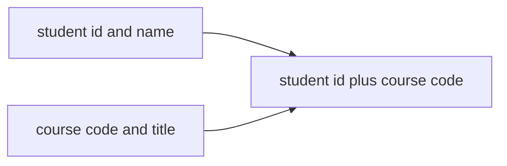
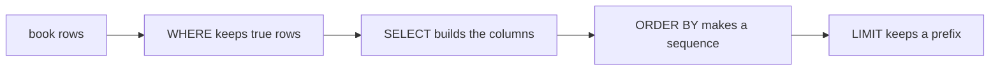
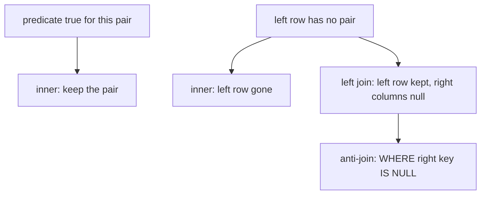
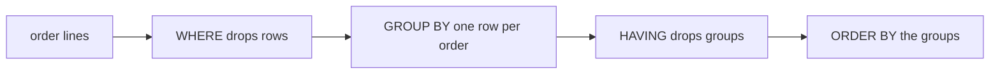
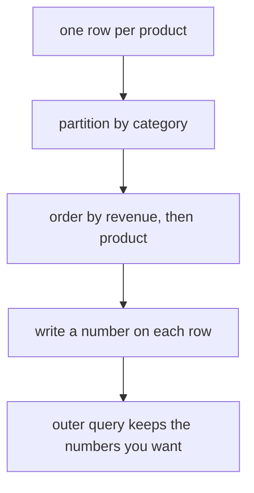
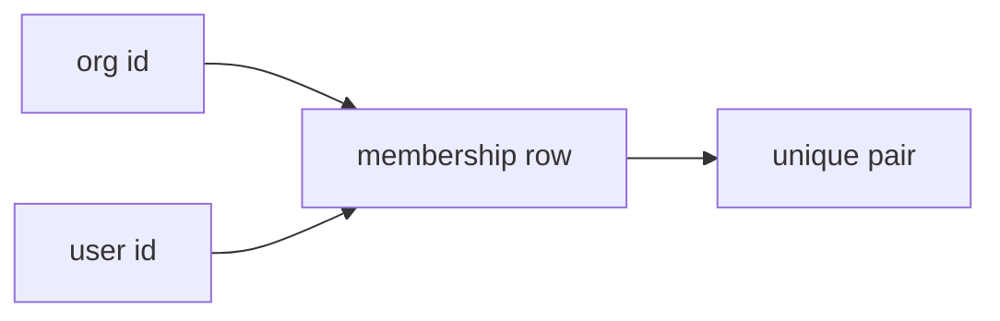
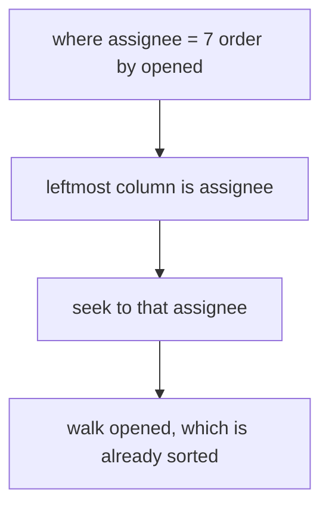
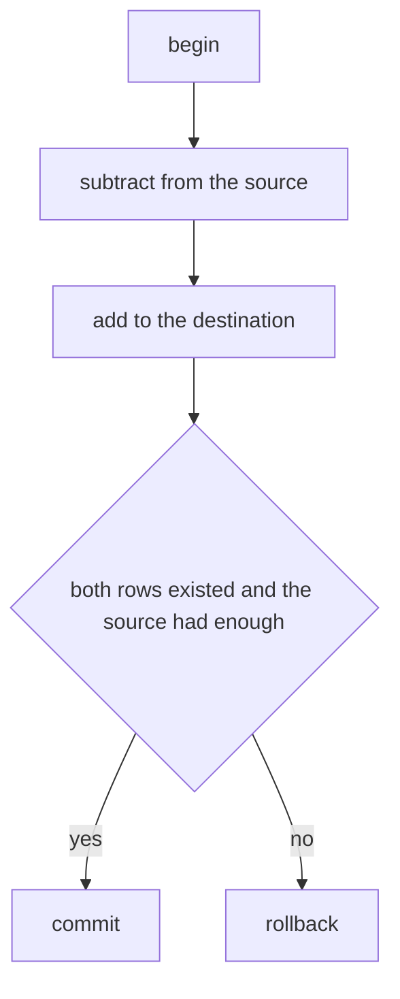
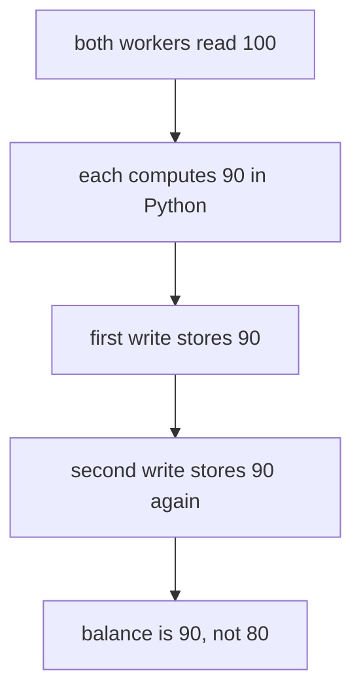

# SQL
id: sql
blurb: Rows, keys, and the queries that turn them into a report: filters, joins, groups, windows, indexes, transactions, and migrations.
why: A program that stores facts in tables has to say which rows are allowed, which result it means, and which change is durable. Those rules hold on a laptop sqlite file and on the Postgres service the app will use later.
stage: data | Tables and queries | Model the rows, write the query the report means, and keep a change atomic.

## Rows, keys, and foreign keys
id: t-relations
stage: data
needs: python/sqlite
minutes: 40
goal: Say which column identifies a row, and why a SQLite foreign key does nothing until that connection turns it on.
source: SQLite CREATE TABLE | https://www.sqlite.org/lang_createtable.html
source: PostgreSQL constraints | https://www.postgresql.org/docs/current/ddl-constraints.html
source: Python sqlite3 | https://docs.python.org/3/library/sqlite3.html

A registrar kept enrolments in one spreadsheet. Each row held a student name, a course code, and a course title typed out again. Ada married and changed her name, so half the rows still said the old spelling and a count of her courses came up short. Someone typed DB1 as DBI, and that typo became a course that was never approved. Two rows both claimed Ada was in databases, so a room roster double-booked her. The sheet was not a set of facts. It was a pile of text that happened to look like columns, so every question depended on the spelling matching.

A table is a relation: a set of rows, and each row is one fact with a fixed shape. `student` holds one fact per person. `course` holds one fact per course. `enrolment` holds one fact per pair, this student takes this course, and it does not copy the person's name or the course title. The name lives in one row, so a correction is one update. The pair lives in one row, so the same pair cannot be inserted twice. That split is the whole repair. You stop repeating text, and you give each fact a key that identifies it.



A primary key is the column, or the group of columns, that you promise will identify one row. `student.id` is a primary key, so two students cannot share an id. `course.code` is a primary key, so two courses cannot share a code. The name is not the primary key. Names change and, eventually, collide. You can still declare `name text not null unique` when the school wants no two current students to share a display name. That unique constraint is an extra rule. The id remains the identity you store in other tables, because the id does not change when the person does.

An enrolment has no identity of its own that you would say out loud. The fact is the pair. `primary key (student_id, course_code)` makes the pair unique. Ada can take two courses, so `student_id` repeats. Two students can take DB1, so `course_code` repeats. Ada cannot be enrolled in DB1 twice, because that pair would be the same fact stored again. A key on `student_id` alone would have blocked her second course. A key on `course_code` alone would have blocked the second student. The composite key is what matches the sentence you mean.

A foreign key is not a join. A join is a question you ask later, when you want names beside codes. A foreign key is a rule about which rows are allowed to exist. `student_id integer not null references student (id)` says: this value must already be some `student.id`. `course_code` references `course (code)` in the same way. The parent column has to be a primary key or a unique column. If you point a foreign key at a plain, non-unique column, SQLite raises `foreign key mismatch` when you insert, because it cannot tell which parent row you meant.

SQLite will store the `references` clause and then ignore it. Foreign keys are off until you run `PRAGMA foreign_keys = ON` on that connection. Postgres enforces foreign keys on every connection, so a script that is correct there can still load orphan enrolments into a default `sqlite3` connection. The pragma is not a property of the file. A second connection, a pool, or a test fixture starts with foreign keys off again, so the check has to live in the place that opens connections, not in a migration you ran once.

### The three tables, loaded

```sql
pragma foreign_keys = on;

create table student (
  id integer primary key,
  name text not null unique
);

create table course (
  code text primary key,
  title text not null
);

create table enrolment (
  student_id integer not null references student (id),
  course_code text not null references course (code),
  primary key (student_id, course_code)
);

insert into student (id, name) values (1, 'ada'), (2, 'bo');
insert into course (code, title) values ('DB1', 'databases'), ('OS1', 'kernels');
insert into enrolment (student_id, course_code) values
  (1, 'DB1'), (1, 'OS1'), (2, 'DB1');
```

```text
select student_id, course_code
from enrolment
order by student_id, course_code;

1|DB1
1|OS1
2|DB1
```

The name `ada` is not in that result, and it should not be. It sits on student 1, so renaming her does not require you to find every enrolment. The `order by` is part of the result you can show a person. Without it, SQLite may hand the three pairs back in any order. A primary key index often makes a scan look sorted, and that habit is not a promise. The day the plan changes, a test that compares lists without `order by` fails even though the facts did not change.

With the pragma on, `insert into enrolment (student_id, course_code) values (99, 'DB1')` raises `sqlite3.IntegrityError` and the three rows above are still the whole table. `insert into student (id, name) values (3, null)` raises as well, because `not null` is a separate rule from the foreign key. A second insert of `(1, 'DB1')` into enrolment raises because of the composite primary key. Deleting student 1 raises while those enrolment rows still point at her, because the default foreign-key action refuses to leave orphans behind. You delete the enrolments first, or you declare an `on delete` action on purpose. Cascade is a choice, not the default.

### Where this breaks

**The pragma is per connection, and it is ignored inside a transaction.** `sqlite3` begins a transaction on the first insert. If you insert a row and then run `PRAGMA foreign_keys = ON`, the pragma does not take effect. Committing does not apply it after the fact. You run the pragma when the connection is not in a transaction, which means before the inserts, and you run it on every connection. A helper that only creates tables does not turn the rule on for the caller.

**Old orphans stay.** Rows loaded while foreign keys were off are not checked when you later enable the pragma. `PRAGMA foreign_key_check` lists them. It names the child table and the parent table. It does not delete the bad rows, so a cleanup is a separate statement you meant to run.

**`unique` does not mean required.** In SQLite a `unique` column may hold many nulls, because a null is not equal to another null and so the uniqueness check does not see a clash. `not null` is what rejects a missing name. You want both on `student.name` if the name must exist and must not be shared. `not null` is enforced even when foreign keys are off. The foreign key is the rule that is optional by default, not the null check.

**Affinity is not a hard type.** An `integer` column will accept the text `'no'` and store it, because SQLite applies affinity and then keeps what it could not convert. A `strict` table rejects that value at insert time. You add `strict` when a wrong type should fail the write, not when you are happy to discover the text during a later sum. Postgres is stricter about types without that keyword. A schema you port between the two is not the same rule set until you have said which checks you actually need.

**The parent must be unique.** `references student (id)` is valid because `id` is the primary key. Pointing at `student.name` is valid only if `name` is unique. Pointing at a column with neither a primary key nor a unique constraint fails on insert with a mismatch error, even when the number you wrote really does appear in the parent.

### How this is used at work

Orders reference customers. Line items reference orders and the sku they sell. The foreign key is what stops a cleanup script from deleting a customer and leaving invoices that point at nobody. The unique code on a course, a sku, or a supplier name is what stops two rows from splitting one real-world thing in half. At work the pragma belongs in the connection factory, because a one-off script does not protect the next connection. A `:memory:` fixture starts with foreign keys off too, so a test that forgets the pragma accepts an orphan that Postgres would reject. Bind inserted names with `?`. An f-string breaks on `o'malley` and can turn a name into extra SQL, and the key rules never get a chance to run.

### Which key

| You want | Write | Why |
|---|---|---|
| One row per student | `id integer primary key` | The id identifies the row and does not change when the name does |
| No shared display name | `name text not null unique` | `unique` blocks a second copy, and `not null` blocks a missing name |
| One enrolment per student and course | `primary key (student_id, course_code)` | Each side may repeat, and the pair may not |
| A value that must already exist | `references parent (key)` and `PRAGMA foreign_keys = ON` on that connection | SQLite stores the clause and enforces it only after the pragma |
| A parent delete that should fail | the default, no `on delete cascade` | The default refuses to leave child rows behind |
| A hard type check | a `strict` table | Affinity would otherwise keep a value of the wrong type |
| A list a test can compare | `order by` the key | Row order is not part of the table |

### You can now

- Split a repeated spreadsheet into `student`, `course`, and `enrolment`, and say which column identifies each row.
- Choose a composite primary key when the fact is a pair and each side is allowed to repeat.
- Explain why a SQLite foreign key does nothing until that connection enables it, and why a second connection needs the pragma too.
- Put `not null` on a name that must exist, instead of expecting `unique` to reject null.
- Keep `order by` on any enrolment list you compare, because the key does not promise an order.

::: quiz
q: You declared `enrolment.student_id integer references student(id)` in SQLite, then inserted an enrolment for student 99, who is not in `student`. The insert succeeded and the row was stored. Why?
- The primary key on `student.id` is missing, so SQLite stored the reference as text and skipped the check
+ Foreign keys are off on that connection until you run `PRAGMA foreign_keys = ON`
- SQLite treats a `references` clause as a comment, so the insert cannot fail
- A foreign key runs only during `select`, so a bad row is allowed until you join
why: SQLite accepts the `references` clause and does not enforce it unless that connection turns foreign keys on. The tempting reading is that a declared constraint always fires, which is true in Postgres and false on a default sqlite3 connection. The row was stored because the check was disabled, not because the clause was a comment.
:::

::: quiz
q: `enrolment` has `primary key (student_id, course_code)`. Ada, student 1, is already enrolled in DB1. Which insert does that key allow?
- A second row of Ada in DB1, because a composite key only checks the first column
+ Ada in OS1, and Bo in DB1, because each column may repeat as long as the pair does not
- No further enrolments at all, because a two-column key freezes both tables
- Bo in DB1 only when Bo's id is greater than Ada's id
why: A composite primary key makes the pair unique. Ada can take another course, and another student can take DB1. The tempting mistake is to treat each column as its own primary key, which would block either the second course or the second student.
:::

::: card
q: You ran `PRAGMA foreign_keys = ON` on one connection and then opened a second connection to the same database. An insert on the second connection still stored an enrolment for a missing student. Why?
answer: The pragma belongs to one connection. The second connection starts with foreign keys off, so its `references` clauses are not enforced until that connection runs the pragma too. Postgres would have rejected the row on every connection, because foreign keys are always on there. Enabling the pragma while a transaction is already open does not fix this either, because that pragma is ignored until you issue it with no transaction in progress.
:::

::: predict lang=python
q: What does this print? `attempt(False)` leaves foreign keys at the default. `attempt(True)` turns them on before any insert.
code:
```python
import sqlite3

def attempt(flag):
    con = sqlite3.connect(":memory:")
    if flag:
        con.execute("pragma foreign_keys = on")
    con.execute(
        "create table student(id integer primary key, name text not null unique)"
    )
    con.execute(
        "create table enrolment(student_id integer not null references student(id), course_code text not null, primary key (student_id, course_code))"
    )
    try:
        con.execute(
            "insert into enrolment(student_id, course_code) values (1, 'DB1')"
        )
        print("orphan-stored")
    except sqlite3.IntegrityError:
        print("orphan-blocked")
    try:
        con.execute("insert into student(id, name) values (1, null)")
        print("null-stored")
    except sqlite3.IntegrityError:
        print("null-blocked")

attempt(False)
attempt(True)
```
answer:
```
orphan-stored
null-blocked
orphan-blocked
null-blocked
```
why: With foreign keys off, the enrolment for student 1 is stored even though no student row exists. `not null` still rejects a null name, because that check does not depend on the pragma. With foreign keys on, the same orphan insert raises `IntegrityError`, and the null name is still rejected.
:::

::: write lang=python
task: Write `create(con)` to build `supplier(id integer primary key, name text unique not null)` and `part(sku text primary key, supplier_id integer not null references supplier(id))`. Do not insert rows. The caller turns foreign keys on.
starter:
```python
def create(con):
    return []
```
tests:
```python
# Wrong answer: part.supplier_id has no references clause, and supplier.name allows null, so both bad inserts succeed.
import sqlite3
from solution import create

def test_missing_supplier_is_rejected():
    con = sqlite3.connect(":memory:")
    con.execute("pragma foreign_keys = on")
    create(con)
    raised = False
    try:
        con.execute("insert into part(sku, supplier_id) values ('bolt', 9)")
    except sqlite3.IntegrityError:
        raised = True
    assert raised

def test_null_supplier_name_is_rejected():
    con = sqlite3.connect(":memory:")
    con.execute("pragma foreign_keys = on")
    create(con)
    raised = False
    try:
        con.execute("insert into supplier(id, name) values (1, null)")
    except sqlite3.IntegrityError:
        raised = True
    assert raised

def test_duplicate_name_is_rejected():
    con = sqlite3.connect(":memory:")
    con.execute("pragma foreign_keys = on")
    create(con)
    con.execute("insert into supplier(id, name) values (1, 'acme')")
    raised = False
    try:
        con.execute("insert into supplier(id, name) values (2, 'acme')")
    except sqlite3.IntegrityError:
        raised = True
    assert raised

def test_real_pair_is_stored():
    con = sqlite3.connect(":memory:")
    con.execute("pragma foreign_keys = on")
    create(con)
    con.execute("insert into supplier(id, name) values (1, 'acme')")
    con.execute("insert into part(sku, supplier_id) values ('bolt', 1)")
    rows = con.execute("select sku, supplier_id from part order by sku").fetchall()
    assert rows == [("bolt", 1)]

def test_null_supplier_id_is_rejected():
    con = sqlite3.connect(":memory:")
    con.execute("pragma foreign_keys = on")
    create(con)
    con.execute("insert into supplier(id, name) values (1, 'acme')")
    raised = False
    try:
        con.execute("insert into part(sku, supplier_id) values ('nut', null)")
    except sqlite3.IntegrityError:
        raised = True
    assert raised
```
solution:
```python
def create(con):
    con.execute(
        "create table supplier(id integer primary key, name text unique not null)"
    )
    con.execute(
        "create table part(sku text primary key, supplier_id integer not null references supplier(id))"
    )
```
hint: Declare both tables on the connection you were given. `name` needs `unique not null`, and `supplier_id` needs `not null` plus a reference to `supplier(id)`. The caller is responsible for the foreign-key pragma.
:::

::: write lang=python
task: Write `parts_for(con, supplier_name)`. The connection already has `supplier(id, name)` and `part(sku, supplier_id)` from `create`. Return that supplier's skus as a list of strings, ordered by sku. An unknown supplier returns an empty list. Bind the name with a placeholder.
starter:
```python
def parts_for(con, supplier_name):
    return []
```
tests:
```python
# Wrong answer: select every sku and ignore supplier_name, so acme and bolts get the same list.
import sqlite3
from solution import parts_for

def setup():
    con = sqlite3.connect(":memory:")
    con.execute("pragma foreign_keys = on")
    con.execute(
        "create table supplier(id integer primary key, name text unique not null)"
    )
    con.execute(
        "create table part(sku text primary key, supplier_id integer not null references supplier(id))"
    )
    return con

def test_filters_and_orders():
    con = setup()
    con.execute("insert into supplier(id, name) values (1, 'acme')")
    con.execute("insert into supplier(id, name) values (2, 'bolts')")
    con.execute("insert into part(sku, supplier_id) values ('zz', 1)")
    con.execute("insert into part(sku, supplier_id) values ('aa', 1)")
    con.execute("insert into part(sku, supplier_id) values ('mm', 2)")
    assert parts_for(con, "acme") == ["aa", "zz"]
    assert parts_for(con, "bolts") == ["mm"]

def test_unknown_supplier_is_empty():
    con = setup()
    con.execute("insert into supplier(id, name) values (1, 'acme')")
    con.execute("insert into part(sku, supplier_id) values ('aa', 1)")
    assert parts_for(con, "nobody") == []

def test_quote_in_name():
    con = setup()
    con.execute("insert into supplier(id, name) values (?, ?)", (1, "o'malley"))
    con.execute("insert into part(sku, supplier_id) values ('nut', 1)")
    assert parts_for(con, "o'malley") == ["nut"]
```
solution:
```python
def parts_for(con, supplier_name):
    rows = con.execute(
        """
        select part.sku
        from part
        join supplier on supplier.id = part.supplier_id
        where supplier.name = ?
        order by part.sku
        """,
        (supplier_name,),
    ).fetchall()
    return [row[0] for row in rows]
```
hint: Match `supplier.name` to the bound parameter, then order `part.sku`. A query with no supplier predicate returns every part, and a query with no `order by` does not promise alphabetical skus.
:::

## Choose rows and fix their order
id: select
stage: data
needs: t-relations
minutes: 40
goal: Keep the rows you mean with WHERE, and make their order a promise with ORDER BY.
source: SQLite SELECT | https://www.sqlite.org/lang_select.html

The packing desk at a small bookshop prints a travel list every morning. Yesterday the list put Harbor Light first. Today the same query put North Sea first, and the packer boxed the wrong title before anyone noticed the swap. Nothing in the data had changed. The query named the shelf and then trusted SQLite to return rows in the order they happened to sit on disk. A second report was supposed to find the book whose author had never been entered. It used `author = null` and came back empty, so the shop treated that book as fully catalogued. The author was still unknown. The predicate never had a chance to say so.

`select` does not fetch a table. It builds a result. The `from` clause names the relation you start from. The select list says which columns, or which expressions, appear in the result. `where` keeps a row only when its predicate is true. `order by` sorts the rows that survived. `limit` stops after a count. Each of those is optional, and each one you leave out is a decision. Leaving out `where` means every row. Leaving out `order by` means you accept whatever order the plan produces today.



`book` is one row per title the shop stocks. The isbn identifies the row. The title and the shelf are required text. The author may be unknown, so that column allows null. Year and pages are numbers you filter on. A query is a precise sentence about that relation. "Travel books published after 1990, oldest first" is a where clause plus an order clause, not a hope that the shelf code will cluster on disk.

Comparison operators are the usual ones: `=`, `<>`, `<`, `>`, `<=`, `>=`. `and` is true only when both sides are true. `or` is true when either side is true. `not` flips a true or a false. Parentheses matter once `and` and `or` share a predicate, because `and` binds more tightly and a packing rule written without parentheses will keep the wrong shelf. Strings are compared as text. Integers are compared as numbers. A parameter from Python should arrive through `?`, not through an f-string, so a title that contains a quote stays a title.

### A shelf, filtered

```sql
create table book (
  isbn text primary key,
  title text not null,
  author text,
  shelf text not null,
  year integer,
  pages integer
);

insert into book (isbn, title, author, shelf, year, pages) values
  ('100', 'North Sea', 'ada', 'travel', 1998, 320),
  ('200', 'Kelp', 'bo', 'cookery', 2004, 180),
  ('300', 'Harbor Light', 'cy', 'travel', 1988, 410),
  ('400', 'Night Oven', 'di', 'cookery', 2011, 240);
```

```text
select title, year
from book
where shelf = 'travel' and year > 1990
order by year, title;

North Sea|1998
```

Harbor Light is travel, and it fails `year > 1990`, so it is not in the result. Kelp is new enough and sits on cookery, so the shelf predicate removes it. One row survives. `order by year, title` is what makes that one-row result a sequence you could extend tomorrow without arguing. If a second travel book from 1998 arrived, the title would break the tie. A single sort key leaves ties in an order SQLite does not promise.

```text
select title
from book
order by year
limit 2;

Harbor Light
North Sea
```

`limit` applies after the sort. The two oldest titles are Harbor Light, then North Sea. `limit` without `order by` is "some two rows", which is useless on a packing list. `order by pages desc limit 2` would be the two longest, and that is a different sentence because the sort key changed. Descending order is not the default. If you forget `desc` you get the shortest books and the shelf looks orderly while being wrong.

Add the book whose author was never typed.

```sql
insert into book (isbn, title, author, shelf, year, pages)
values ('500', 'Untitled Shelf', null, 'archive', 2001, 90);
```

```text
select count(*) from book where author = null;

0
```

```text
select title from book where author is null order by title;

Untitled Shelf
```

`author = null` does not mean "author is unknown". A comparison with null yields unknown, and `where` keeps only true rows, so the comparison matches nothing. The book is on the archive shelf, which is why the travel query above still returns only North Sea. `is null` is the predicate that asks the question you meant. You will use it whenever a missing value is the point of the query rather than an accident in the data.

### Where this breaks

**Trusting a lucky order.** A primary key on isbn often makes a scan look sorted by isbn. That is a common plan, not a contract. An index on `year`, a vacuum, or a new SQLite version can change the plan. If a person, a snapshot test, or a packing desk sees a sequence, the query needs `order by`. Sorting afterwards in Python is a second copy of the same rule, and the next caller of the SQL will forget it. Put the order in the statement that produces the list.

**`where` is not a projection.** `select title` does not imply `where title is not null` in the sense of dropping other columns' nulls. The select list only chooses columns. A null author still appears if the other predicates are true, and printing that null from Python shows `None`. If you needed to drop unknown authors you would say `author is not null` in the where clause.

**Operator precedence.** `shelf = 'travel' or shelf = 'cookery' and year > 2000` is `travel, any year` or `cookery after 2000`, because `and` binds first. The sentence you say out loud is usually "either shelf, and after 2000". Those are different sets. Parentheses make the sentence you said into the sentence SQLite evaluates.

**`limit` is not a page by itself.** `limit 2` restarts at the beginning of the ordered result. A second page is `limit 2 offset 2`, and it is only stable when the `order by` is unique. If two books share a year and you do not add `title` or `isbn` as a tie break, the same book can appear on both pages after a plan change. Give the sort enough keys that ties cannot swap.

**A null is not found by `=`.** The empty result from `author = null` looks like a successful search that found nothing. It found nothing because the predicate cannot succeed, including against the unknown author you were looking for. `is null` and `is not null` are the forms that talk about unknown. Anything built with `=` is a comparison of known values.

### How this is used at work

Every report that becomes a list on a screen is a select with a filter and an order. "Open tickets in this queue, oldest first, twenty at a time" is `where`, `order by`, and `limit`. Leaving the order out means two refreshes disagree and an on-call engineer acts on the wrong row. Search boxes bind the typed text with `?`. They do not paste it into the SQL, because a quote in a title will break the statement and a crafted string can turn one select into more than one. The column list is also a contract. `select *` follows the table when someone adds a column, and a caller that unpacks three positions suddenly gets four. Name the columns you mean so the result shape stays put.

Tests compare lists. If the assertion sorts in Python and the production query does not, the test is checking a different program. Order in the SQL, and assert that sequence. When the list is allowed to be unordered, compare a sorted copy on both sides and do it on purpose, so a reader can see that order was not the contract.

### Which clause

| You want | Write | Why |
|---|---|---|
| Only travel books after 1990 | `where shelf = 'travel' and year > 1990` | `where` drops rows that are not true for the predicate |
| Both shelves, and a year rule on the pair | parentheses around the `or` | `and` binds tighter than `or` and will grab the wrong term |
| Oldest first, titles breaking ties | `order by year, title` | Without `order by`, the sequence is not a promise |
| The two oldest | `order by year limit 2` | `limit` keeps a prefix of the ordered result |
| Unknown authors | `where author is null` | `author = null` matches nothing, because unknown is not equal to unknown |
| A stable shape | name the columns | `select *` changes shape when the table gains a column |
| A value from Python | `?` and a bound parameter | An f-string puts the value in the statement text |

### You can now

- Write a select that keeps travel books after 1990 and returns them oldest first.
- Explain why a result with no `order by` can change sequence without the rows changing.
- Use `limit` only after a sort, and add a tie break when you page.
- Reject `author = null` as a search for unknown authors, and write `is null` instead.
- Name the columns you return so a later added column does not shift the result.

::: quiz
q: A query on `book` has no `order by`. The rows come back sorted by isbn the first hundred times you run it. What may you rely on?
- The isbn order, because a primary key is always the order of a scan
+ Nothing about order. The sequence is not part of the result unless `order by` says so
- The order of the original inserts, because SQLite appends every new row at the end
- The order last shown in a desktop client, because the database stores that display order
why: Without `order by`, SQLite may return rows in any order, and an order you happen to see is not a promise. The tempting case is a primary key that is often scanned in key order. That is a common plan, not a contract, and it can change after a new index or a vacuum.
:::

::: quiz
q: One book has a null author. `select title from book where author = null` returns no rows. What is wrong with the predicate?
- Null authors are stored as empty strings, so the predicate should compare with `''`
+ `= null` is never true. Unknown does not equal unknown, so `where` keeps nothing. Use `is null`
- The column has to be declared `not null` before any comparison is legal
- `count` has to wrap the comparison, otherwise nulls are skipped before `where` runs
why: A comparison with null yields unknown, and `where` keeps only true rows, so `author = null` matches nothing, including the unknown author. The tempting fix is to compare with an empty string. That is a real value, and it does not mean unknown. `is null` is the predicate that asks whether the author is unknown.
:::

::: card
q: Two queries return the same books, and a test says their lists are not equal. Neither query has `order by`. Why can both queries be right?
answer: The lists hold the same rows and not the same sequence. SQLite does not promise an order, so those rows can arrive differently after a new index or a different plan. The facts match. The positions do not. `order by` is what makes the sequence part of the contract the test is allowed to check.
:::

::: predict lang=python
q: What does this print? The third book has a null title and year 1999.
code:
```python
import sqlite3

con = sqlite3.connect(":memory:")
con.execute("create table book(isbn text primary key, title text, year integer)")
con.executemany(
    "insert into book(isbn, title, year) values (?, ?, ?)",
    [("1", "dune", 1965), ("2", "neuromancer", 1984), ("3", None, 1999)],
)
for row in con.execute("select title from book where year > 1970 order by year"):
    print(row[0])
print("---")
print(con.execute("select count(*) from book where title = null").fetchone()[0])
```
answer:
```
neuromancer
None
---
0
```
why: `year > 1970` keeps neuromancer and the book with a null title, oldest first, and Python prints that null as `None`. `title = null` is unknown for every row, including the null title, so the count is 0. `is null` would have counted that book. `None == None` in Python is a different question and is not what this predicate asks.
:::

::: write lang=python
task: Write `soonest(con, origin)`. The connection has `flights(id, origin, dest, departs, seats)`. Return the three soonest flights from that origin as `(id, dest, departs)`, ordered by `departs` ascending. A flight from another origin does not count, even if it leaves earlier. If fewer than three exist, return those. Bind `origin` with a placeholder.
starter:
```python
def soonest(con, origin):
    return []
```
tests:
```python
# Wrong answer: order by departs descending and keep three, so the latest flights come back, and the other origin is included when the filter is dropped.
import sqlite3
from solution import soonest

def fresh():
    con = sqlite3.connect(":memory:")
    con.execute(
        "create table flights(id integer primary key, origin text, dest text, departs text, seats integer)"
    )
    return con

def test_three_soonest_from_that_origin():
    con = fresh()
    con.executemany(
        "insert into flights(id, origin, dest, departs, seats) values (?, ?, ?, ?, ?)",
        [
            (1, "ZRH", "LHR", "2026-10-05 09:00", 10),
            (2, "ZRH", "CDG", "2026-10-04 08:00", 0),
            (3, "GVA", "LHR", "2026-10-01 01:00", 0),
            (4, "ZRH", "BER", "2026-10-04 12:00", 3),
            (5, "ZRH", "VIE", "2026-10-06 07:00", 0),
            (6, "ZRH", "MAD", "2026-10-04 07:30", 1),
        ],
    )
    assert soonest(con, "ZRH") == [
        (6, "MAD", "2026-10-04 07:30"),
        (2, "CDG", "2026-10-04 08:00"),
        (4, "BER", "2026-10-04 12:00"),
    ]

def test_fewer_than_three():
    con = fresh()
    con.execute(
        "insert into flights(id, origin, dest, departs, seats) values (1, 'ZRH', 'LHR', '2026-10-05 09:00', 4)"
    )
    assert soonest(con, "ZRH") == [(1, "LHR", "2026-10-05 09:00")]
    assert soonest(con, "GVA") == []

def test_quote_in_origin():
    con = fresh()
    con.execute(
        "insert into flights(id, origin, dest, departs, seats) values (?, ?, ?, ?, ?)",
        (1, "o'hare", "LHR", "2026-10-04 09:00", 1),
    )
    assert soonest(con, "o'hare") == [(1, "LHR", "2026-10-04 09:00")]
```
solution:
```python
def soonest(con, origin):
    rows = con.execute(
        """
        select id, dest, departs
        from flights
        where origin = ?
        order by departs, id
        limit 3
        """,
        (origin,),
    ).fetchall()
    return [(row[0], row[1], row[2]) for row in rows]
```
hint: Filter with `origin = ?`, sort with `order by departs`, and stop with `limit 3`. Descending order returns the latest flights, and a missing filter lets another airport's early flight into the three.
:::

::: write lang=python
task: Write `grounded(con)`. Using `flights(id, origin, dest, departs, seats)`, return the `dest` of every flight whose `seats` equals 0, ordered by `dest`. One entry per grounded flight, so a destination appears twice when two of its flights have no seats. A null seat count is not zero.
starter:
```python
def grounded(con):
    return []
```
tests:
```python
# Wrong answer: select distinct dest, or treat a null seat count as grounded, so a repeated destination collapses or BER is included.
import sqlite3
from solution import grounded

def test_zero_seats_only_and_duplicates():
    con = sqlite3.connect(":memory:")
    con.execute(
        "create table flights(id integer primary key, origin text, dest text, departs text, seats integer)"
    )
    con.executemany(
        "insert into flights(id, origin, dest, departs, seats) values (?, ?, ?, ?, ?)",
        [
            (1, "ZRH", "LHR", "2026-10-04 08:00", 0),
            (2, "ZRH", "CDG", "2026-10-04 09:00", 0),
            (3, "GVA", "LHR", "2026-10-04 10:00", 0),
            (4, "GVA", "BER", "2026-10-04 11:00", 5),
            (5, "GVA", "BER", "2026-10-04 12:00", None),
        ],
    )
    assert grounded(con) == ["CDG", "LHR", "LHR"]

def test_none_grounded():
    con = sqlite3.connect(":memory:")
    con.execute(
        "create table flights(id integer primary key, origin text, dest text, departs text, seats integer)"
    )
    con.execute(
        "insert into flights(id, origin, dest, departs, seats) values (1, 'ZRH', 'LHR', '2026-10-04 08:00', 2)"
    )
    assert grounded(con) == []
```
solution:
```python
def grounded(con):
    rows = con.execute(
        """
        select dest
        from flights
        where seats = 0
        order by dest, id
        """
    ).fetchall()
    return [row[0] for row in rows]
```
hint: `where seats = 0` keeps grounded flights and leaves out null seat counts, because unknown is not zero. `order by dest` fixes the list. `distinct` would collapse the two LHR rows into one.
:::

## NULL is unknown
id: nulls
stage: data
needs: select
minutes: 40
goal: Treat NULL as unknown, and write IS NULL instead of a comparison that cannot succeed.
source: SQLite NULL handling | https://www.sqlite.org/nulls.html

The on-call rota lists a phone for each employee. Ada and Cy have the desk number. Di has an extension that was typed as an empty string, which is a bad number you can still see. Bo's phone was never collected. The column holds null, not a blank. A paging script searched with `phone = null` and paged nobody, so Bo was marked as having no gap. A second script used `phone <> '555-0100'` to find people who still needed a personal number. Bo did not appear, and Di did. The bridge opened without Bo because the query treated unknown as "not a row" instead of "we do not know the number".

Null is unknown. It is not zero, not false, and not the empty string. The empty string is a known value whose content happens to be empty. Zero is a known number. Null means this row does not have a value for that column, so any question that compares the value cannot be answered yet. SQL has three outcomes for a predicate, not two. A comparison is true, false, or unknown. `where` keeps a row only when the predicate is true. Unknown is dropped, the same way false is dropped, and that is why a missing phone disappears from both "equals this number" and "does not equal this number".

```text
phone column          predicate                      result
'555-0100'            phone = '555-0100'             true, row kept
'555-0199'            phone = '555-0100'             false, row dropped
null                  phone = '555-0100'             unknown, row dropped
null                  phone = null                   unknown, row dropped
null                  phone is null                  true, row kept
''                    phone = ''                     true, row kept
```

`is null` is not a comparison. It is the question "is this unknown?", and that question is true or false. `is not null` asks the opposite. You use those two when the unknown itself is what you are looking for. You use `=` and `<>` when you are comparing known values, and you accept that unknown rows will not survive the where clause.

Python will not save you if you pull the rows out and then use `==`. `None == None` is true in Python. In SQL, `null = null` is unknown. A filter written in Python as `if reading == None` finds the gaps. The same idea written as `where reading = null` finds nothing. If you port a condition from Python into SQL by replacing `None` with `null` and `==` with `=`, you invert the meaning. The database is not being fussy about spelling. It is answering a different question, because unknown is not equal to unknown.

### Phones, counted and filtered

```sql
create table employee (
  id integer primary key,
  name text not null,
  phone text
);

insert into employee (id, name, phone) values
  (1, 'ada', '555-0100'),
  (2, 'bo', null),
  (3, 'cy', '555-0100'),
  (4, 'di', '');
```

```text
select count(*), count(phone) from employee;

4|3
```

`count(*)` counts rows, so Bo is included. `count(phone)` counts values that are not null, so Bo is skipped and Di is counted. The empty string is a value. Aggregates that take a column follow the same rule you will use on sums: `sum(phone)` would ignore Bo, and it would not turn the whole sum into null just because one input is null. `count(*)` is the one that refuses to skip a row. If you meant "how many people are missing a phone", that is `count(*)` with `where phone is null`, or `count(*) - count(phone)`, not `count(phone)` itself.

```text
select name from employee where phone is null order by name;

bo
```

```text
select name from employee where phone = null order by name;

```

The second result is empty. There is no name to print. The predicate was unknown for Bo and false for everyone else, so nothing was true.

```text
select name from employee where phone is not null order by name;

ada
cy
di
```

```text
select name from employee where phone <> '555-0100' order by name;

di
```

Di stays because `'' <> '555-0100'` is true. Bo is dropped because `null <> '555-0100'` is unknown. Ada and Cy match the desk number, so they are false for `<>` and drop out. If the rota's question is "whose number is present and is not the desk line", `phone <> '555-0100'` is already that question. Bo is absent from it on purpose. If the question is "who is not confirmed on the desk line, including people we never asked", you need a predicate that is true for null. `phone is not '555-0100'` is that predicate in SQLite. `is not` treats unknown as different from the literal. `<>` does not. Picking the wrong one pages the wrong people.

`not phone = '555-0100'` does not put Bo back. `phone = '555-0100'` is unknown for Bo, and `not` of unknown is still unknown, so `where` still drops the row. Negation does not turn unknown into true. You cannot recover a null by wrapping a comparison in `not`. You write `is null` or you use `is not`.

### Where this breaks

**Empty string and null get cleaned into each other.** A form submits `''` when the field was left blank. That is not null unless you decide to store null instead. If you store the empty string, `is null` will not find the gap and `count(phone)` will count it. Pick one representation for "we do not have a number" and use it in the insert and in the query. Mixing them makes two gap lists that never agree.

**A check constraint written with `=`.** `check (phone <> '')` does not reject a null phone. The check fails the row only when the expression is false. Unknown is allowed by `check`, so null still inserts. `not null` is the declaration that rejects unknown. A check is for a rule about known values, such as a number that must contain a digit.

**Outer joins manufacture nulls.** A missing match on a later join shows up as null in the columns that came from the other table. Those nulls were not stored. `is null` on that column means "no match", which is a different fact from "the column was unknown in the row". You will use that on purpose for anti-joins. Until then, do not read every null as "someone typed nothing".

**Python and SQL disagree about `None`.** Filtering a fetched list with `reading == None` or `reading is None` finds nulls. `where reading = null` does not. `where reading > 10` also does not find them, because unknown is not greater than 10, and it is not smaller either. A sensor with a null reading is absent from "above the threshold" and absent from "below the threshold". The only list it belongs on is the one built with `is null`. If you want that sensor on an alert list you add the `is null` predicate. You do not lower the threshold and hope.

**Aggregates hide the gap if you only look at the sum.** A sum of readings that skips null looks like a normal total. The average of the known readings is not the average including the gaps, and it is not the average you would get by treating gaps as zero. If a gap should count as zero, store zero, or write `coalesce(reading, 0)` so the choice is visible in the statement. Leaving the null and then summing is a decision to ignore that sensor.

### How this is used at work

Incident tools, CRMs, and sensor stores all have columns that are filled in late. A null phone, a null closed-at timestamp, or a null reading means the fact is not in yet. Dashboards that use `=` to hunt those gaps show a green empty result and people go home. The useful split is two queries, or two counts: how many rows are unknown, and how many known values fail the business rule. `count(*)` and `count(column)` side by side are the cheap version of that split. The difference is the number of unknowns, provided you are not also storing empty strings.

APIs often serialize SQL null as JSON `null` and then a client turns it into a missing field. By the time a Python service sees it, you have `None`. The comparison you write next has to be the SQL comparison if it runs in the database, and the Python comparison if it runs after `fetchall`. Copying one into the other is how Bo gets dropped. Bind real values with `?`. There is no useful way to bind "unknown" into `= ?` and expect it to match null, because the bound null is still unknown. Match unknowns with `is null`, and bind parameters only for known targets.

### Which predicate

| You want | Write | Why |
|---|---|---|
| Rows whose phone is unknown | `where phone is null` | `phone = null` is never true |
| Rows whose phone is a real value, including `''` | `where phone is not null` | The empty string is known, so it stays |
| Known phones other than the desk line | `where phone <> '555-0100'` | Unknown is not true, so the null phone drops out |
| Everyone not confirmed on that line, including unknown | `where phone is not '555-0100'` | `is not` is true for null as well as for other numbers |
| A count of people | `count(*)` | A column count skips null phones |
| A count of numbers you actually have | `count(phone)` | Null phones are ignored, and `''` is counted |
| Gaps treated as zero in a sum | `coalesce(phone, '0')` or store zero | `sum` skips null and will not invent a zero for you |

### You can now

- Say why `phone = null` matches no rows, including the row whose phone is null.
- Separate an empty string from null, and predict which one `count(phone)` skips.
- Choose `<>` when unknown rows should drop out, and `is not` when they should stay.
- Explain why `not` of an unknown comparison is still unknown.
- Keep Python's `None == None` out of a SQL predicate, and write `is null` in the statement instead.

::: quiz
q: `count(*)` on `employee` is 4 and `count(phone)` is 3. One phone is null and one phone is an empty string. What did `count(phone)` skip?
- The empty string, because a value of length zero is not worth counting
+ The null phone, because `count` on a column ignores unknown values and still counts an empty string
- Both the null and the empty string, because neither is a number you can dial
- Nothing. The missing count is a row that failed the primary key and was not stored
why: `count(phone)` skips null and counts every other value, including `''`. `count(*)` counts rows, so the difference is the unknown phone. The tempting story is that blank and null are the same kind of missing, so both would be skipped. They are not. The empty string is a known value.
:::

::: quiz
q: You want employees whose phone is a known value other than `555-0100`. Unknown phones must stay off the list. Which predicate matches that?
- `phone is not '555-0100'`, because `is not` is the safe spelling of "not equal"
+ `phone <> '555-0100'`, because a comparison that is unknown is not kept by `where`
- `phone = null or phone <> '555-0100'`, because the unknown phones have to be named with `=`
- `not phone = '555-0100' or phone is null`, because negation puts the unknown phones back
why: `where` keeps rows where the predicate is true. `<>` on a null phone is unknown, so that employee drops out, and an empty string that differs from the desk number stays. `is not` is true for null, so it answers a wider question and would page the person whose number was never collected. `not` of an unknown comparison is still unknown, so it does not bring that person back either.
:::

::: card
q: A sensor reading is null. Why does `reading > 10` leave that sensor out, even though a missing reading is not a small number?
answer: The comparison is unknown, not false and not true. `where` keeps only true rows, so the unknown row is left out. The null is not treated as zero, and it is not treated as larger than every threshold. It does not pass `reading > 10`, and it does not pass `reading < 10` either. `reading is null` is the predicate that finds it. In Python `None == None` is true, and that fact does not make `null = null` true in SQL.
:::

::: predict lang=python
q: What does this print? Reading 1 is null, reading 2 is 0, and reading 3 is 4. The first line is Python. The rest is SQL.
code:
```python
import sqlite3

con = sqlite3.connect(":memory:")
con.execute("create table sensor(id integer primary key, reading real)")
con.executemany(
    "insert into sensor(id, reading) values (?, ?)",
    [(1, None), (2, 0), (3, 4)],
)
print(None == None)
print(con.execute("select count(*) from sensor where reading = null").fetchone()[0])
print(con.execute("select id from sensor where reading is null").fetchone()[0])
for row in con.execute("select id from sensor where reading > 0 order by id"):
    print(row[0])
```
answer:
```
True
0
1
3
```
why: Python's `None == None` is true, and that must not be how you read the SQL. `reading = null` matches nothing, so the count is 0. `is null` finds sensor 1. `reading > 0` keeps sensor 3 only. Sensor 2 is a real zero, so it is not unknown and it is not above zero. Sensor 1 fails the comparison because unknown is not greater than zero.
:::

::: write lang=python
task: Write `missing(con)`. The connection has `sensor(id, reading)`. Return the ids whose `reading` is null, ordered by id. A reading of 0 is present and must not be included. Use SQL `is null`, not a Python comparison.
starter:
```python
def missing(con):
    return []
```
tests:
```python
# Wrong answer: where reading = null, which matches nothing, or where reading = 0, which returns the real zero and skips the gap.
import sqlite3
from solution import missing

def load():
    con = sqlite3.connect(":memory:")
    con.execute("create table sensor(id integer primary key, reading real)")
    con.executemany(
        "insert into sensor(id, reading) values (?, ?)",
        [(3, None), (1, 0), (2, None), (4, 5)],
    )
    return con

def test_nulls_only_and_ordered():
    con = load()
    assert missing(con) == [2, 3]

def test_no_gaps():
    con = sqlite3.connect(":memory:")
    con.execute("create table sensor(id integer primary key, reading real)")
    con.execute("insert into sensor(id, reading) values (1, 0)")
    assert missing(con) == []
```
solution:
```python
def missing(con):
    rows = con.execute(
        "select id from sensor where reading is null order by id"
    ).fetchall()
    return [row[0] for row in rows]
```
hint: `is null` finds unknown readings. `= null` is never true, and `= 0` finds a real zero. `order by id` fixes the list when the gaps were not inserted in id order.
:::

::: write lang=python
task: Write `above(con, n)`. Using `sensor(id, reading)`, return ids whose reading is greater than `n`, ordered by id. Unknown readings are excluded. A reading of 0 counts when it is greater than `n`. Bind `n` with a placeholder.
starter:
```python
def above(con, n):
    return []
```
tests:
```python
# Wrong answer: treat a null reading as above the line, or drop a real zero with a Python truthiness check, so id 2 appears or id 1 disappears.
import sqlite3
from solution import above

def load():
    con = sqlite3.connect(":memory:")
    con.execute("create table sensor(id integer primary key, reading real)")
    con.executemany(
        "insert into sensor(id, reading) values (?, ?)",
        [(1, 0), (2, None), (3, 20), (4, 15)],
    )
    return con

def test_excludes_null_and_keeps_zero_when_greater():
    con = load()
    assert above(con, -1) == [1, 3, 4]

def test_threshold_is_exclusive_and_orders():
    con = load()
    assert above(con, 15) == [3]
    assert above(con, 20) == []
```
solution:
```python
def above(con, n):
    rows = con.execute(
        "select id from sensor where reading > ? order by id",
        (n,),
    ).fetchall()
    return [row[0] for row in rows]
```
hint: `reading > ?` is unknown for a null reading, so `where` already excludes the gap. Do not add `or reading is null`. A Python test such as `if reading` also drops a real zero.
:::

## Matches, missing rows, and multiplied rows
id: joins
stage: data
needs: nulls
minutes: 40
goal: Tell an inner join, a left join, and an anti-join apart, and spot a join that multiplies rows.
source: PostgreSQL joins | https://www.postgresql.org/docs/current/tutorial-join.html

A campaign was supposed to mail every customer who had never ordered. The query joined `customer` to `orders` and the dormant names vanished, so the mail file held only people who had already bought something. The join had done what an inner join does: it kept pairs and threw away customers who had nothing to pair with. A second report joined customers to shipments on region, because both tables had a region column and that looked like a key. Two customers in the east and three eastern shipments became six rows. The revenue total counted each shipment once per customer. Nothing in the tables was duplicated. The join predicate was true for every pair, so the result invented pairs.

A join builds a new relation from two relations. Each output row is a combination of a left row and a right row that satisfied the predicate. The predicate is the `on` clause. It is not a foreign key. The foreign key, when it is enforced, limits which child rows can be stored. The join decides which stored rows appear together in this result. You can join on a key, and you can also join on a city, a date, or a predicate that is always true. SQLite will not stop you. The shape of the result is your job.



`customer` is one row per person: `id`, `name`. `orders` is one row per order: `id`, `customer_id`, `sku`. Cy is a customer and has no order. Ada has two orders. Bo has one. An inner join answers "pairs of customer and order that match on `customer_id`". A left join answers "every customer, with an order when there is one". An anti-join answers "customers for whom that order side stayed unknown". Those are three sentences. They are not three spellings of one sentence.

### Customers and their orders

```sql
create table customer (
  id integer primary key,
  name text not null
);

create table orders (
  id integer primary key,
  customer_id integer,
  sku text not null
);

insert into customer (id, name) values (1, 'ada'), (2, 'bo'), (3, 'cy');
insert into orders (id, customer_id, sku) values
  (1, 1, 'tea'), (2, 1, 'mug'), (3, 2, 'tea');
```

```text
select customer.name, orders.sku
from customer
join orders on orders.customer_id = customer.id
order by customer.name, orders.sku;

ada|mug
ada|tea
bo|tea
```

Cy is not deleted from `customer`. Cy is absent from this result because no order made the `on` predicate true. Ada appears twice because she has two orders, and that duplication is real. You asked for pairs, and there are two pairs. `join` with no qualifier means inner join. `inner join` is the same spelling.

```text
select customer.name, orders.sku
from customer
left join orders on orders.customer_id = customer.id
order by customer.name, orders.sku;

ada|mug
ada|tea
bo|tea
cy|
```

Cy's sku is null. That null was not stored in `orders`, and `sku text not null` did not fill it in. The left join manufactures nulls for the right-hand columns when no row matches. `not null` constrains stored rows. It does not constrain a result column that stands for "no row". `order by` puts Cy last because the name sorts last. If you had sorted only by sku, the manufactured null would sort at the front in SQLite, before any real sku, and Cy would look like the first line of the report. Sort by the column you mean.

The anti-join is the left join plus a test that the right-hand key is still unknown.

```text
select customer.name
from customer
left join orders on orders.customer_id = customer.id
where orders.id is null
order by customer.name;

cy
```

`orders.id` is the primary key, so a real match always has an id. A manufactured null id means the join found nothing. Filtering with `where orders.id is null` keeps Cy and drops Ada and Bo, because their ids were present. This is the dormant-customer list. An inner join plus `where orders.id is null` returns nobody. The inner join never manufactures the null, so the filter has nothing to keep. That version looks almost the same and answers the opposite business question.

A weak join multiplies. Take two customers who share a region and three shipments tagged with that same region, and join on the region rather than on a customer id.

```text
ada|mug
ada|tea
ada|tin
bo|mug
bo|tea
bo|tin
```

Two times three is six. Every shipment is repeated once per eastern customer. A sum of shipment quantities over this result counts each shipment twice. The fix is to join on the column that actually identifies the match you meant, which is the customer id stored on the shipment, or to aggregate before you join so the multiplication never sees the raw pairs. A predicate that is true for many pairs is a cross product of those subsets, even when you wrote `on` instead of a comma.

`where id not in (select customer_id from orders)` looks like another anti-join and fails when any `customer_id` is null. `not in` asks whether the id differs from every value in the subquery. A comparison with null is unknown, so the whole `not in` is unknown and `where` keeps nothing. One stray order with a null `customer_id` hides every customer, including Cy. The left-join form does not have that trap, because `is null` is aimed at the manufactured key of one join, not at every value in a list.

### Where this breaks

**Inner join used as "attach if you can".** People write `join` and then expect unmatched left rows to survive with blanks. They do not. If the report is "every customer", the left table has to be preserved with a left join. If the report is "every order that has a customer", an inner join is what you want, and a missing customer is a data error your foreign key should already have blocked.

**Left join filtered too early.** `left join orders on orders.customer_id = customer.id and orders.sku = 'tea'` still returns Cy, with nulls, and also drops Ada's mug while keeping her tea. Putting `orders.sku = 'tea'` in the `where` clause instead is different. `where` runs after the join, and `null = 'tea'` is unknown, so Cy disappears and the left join has been turned back into an inner join. Predicates that describe the right-hand row belong in `on` when you need to preserve the left side. Predicates that are allowed to drop the left side belong in `where`.

**A summed join that double counts.** The six-row region join is the usual revenue bug. The total is not wrong because `sum` is wrong. The total is wrong because the join fed `sum` a row per pair. Count the rows of a join before you trust an aggregate on it. If the count is larger than the larger input table, the predicate matched more than one partner somewhere.

**`not in` against a nullable column.** One null in the subquery empties the result. Use the anti-join, or filter the subquery with `where customer_id is not null` and accept that you have to remember that filter forever. The left join states the "no partner" test in one place.

### How this is used at work

Almost every screen that shows a parent and its children is a join: account and invoices, album and tracks, host and deploys. The ones that also show parents with zero children are left joins. The ones that only show the zeros are anti-joins, and they are how you find unowned resources, unpaid customers, and albums nobody has put a track on. A weak join shows up as a total that is a round multiple of the truth, often two or ten, because a dimension table matched too many times. The review question is "what is the key of this match, and can one left row hit two right rows?" If it can, and you did not intend a list of pairs, the predicate is too weak.

Foreign keys do not replace the join. They make the inner join lose fewer rows, because orphans are harder to store once the pragma is on. They do not create the dormant-customer row for you. Cy has no child row, and that is legal, so only the left join can show her. Write the join you mean. Do not expect the schema to pick inner or left for you.

### Which join

| You want | Write | Why |
|---|---|---|
| Pairs that matched | `join ... on child.key = parent.key` | Inner join drops unmatched parents and unmatched children |
| Every parent, with a child when it exists | `left join ... on ...` | The left row stays, and the right columns are null when nothing matched |
| Parents with no child | left join, then `where child.key is null` | The manufactured null is the proof that no child joined |
| A right-hand filter that must not drop the left row | put it in `on`, not in `where` | `where` turns the miss into unknown and the left row disappears |
| A list that must not multiply | join on the key of the match, not on a shared label | Two rows with the same city pair with every row of that city |
| Avoid a null-tolerant `not in` | the anti-join above | One null in the subquery makes `not in` unknown for every candidate |

### You can now

- Read an inner join as "pairs only", and explain why Cy vanishes while staying in `customer`.
- Write a left join that keeps Cy and shows null for the order columns.
- Turn that left join into an anti-join with `where orders.id is null`, and say why the inner version returns nothing.
- Spot a join on a non-key label, and predict that two rows times three rows becomes six.
- Refuse `not in` for this job when the subquery can contain null.

::: quiz
q: An inner join from `customer` to `orders` on `customer_id` returns no row for Cy. Cy is in `customer` and has no orders. What happened to Cy?
- The join deleted Cy from `customer`, because an inner join removes unmatched left rows from the stored table
+ Cy is still stored. The result has no pair for her, and an inner join keeps only pairs that matched
- Cy was removed by a hidden `where customer_id is not null` that every inner join adds
- The inner join turned the missing order into a row of nulls, and a later filter dropped that row
why: An inner join keeps matched pairs only. Cy is still in `customer`. The result omitted her because there was no order that made the predicate true. The tempting picture is that the join writes nulls for the missing side. That is what a left join does, not an inner join.
:::

::: quiz
q: You want the titles of albums that have no tracks. Which pattern is an anti-join?
- Inner join `album` to `track`, then keep rows where the track title is null
+ From `album`, left join `track`, then `where` the track key `is null`
- `where album.id = null`, because a missing child clears the parent id
- Cross join the two tables and then `group by` the album title
why: A left join keeps every album, and the track columns are null when nothing matched. Filtering those null keys leaves the albums that had no track. An inner join never produces those null keys, so the same `where` returns nothing. That inner version is the tempting one. It reads like a search for blanks and drops the rows you wanted.
:::

::: card
q: Two customers share a city, and two orders are tagged with that same city. You join on city and get four rows. There are only two orders. Why four?
answer: The join predicate is true for every pair, so each customer pairs with each order. Two times two is four. A join on a column that is not the key of the match you meant multiplies rows. Each order is repeated once per customer in that city. Joining on the customer id stored with the order would have paired each order with one customer, and the result would have had two rows if each order had one customer.
:::

::: predict lang=python
q: What does this print? Both customers are in berne, and both orders are tagged berne. The join is on city, not on a customer id.
code:
```python
import sqlite3

con = sqlite3.connect(":memory:")
con.execute("create table customer(id integer primary key, name text, city text)")
con.execute("create table ord(id integer primary key, city text, sku text)")
con.executemany(
    "insert into customer(id, name, city) values (?, ?, ?)",
    [(1, "ada", "berne"), (2, "bo", "berne")],
)
con.executemany(
    "insert into ord(id, city, sku) values (?, ?, ?)",
    [(1, "berne", "tea"), (2, "berne", "mug")],
)
for row in con.execute(
    """
    select customer.name, ord.sku
    from customer
    join ord on customer.city = ord.city
    order by customer.name, ord.sku
    """
):
    print(row[0], row[1])
```
answer:
```
ada mug
ada tea
bo mug
bo tea
```
why: Each of the two customers matches each of the two orders, because the predicate only asks for the same city. Two times two is four lines. Ordering by name and sku makes the sequence a promise. A join on `customer.id` would not have produced these pairs, because `ord` does not even hold a customer id.
:::

::: write lang=python
task: Write `tracks_of(con)`. The connection has `album(id integer primary key, title text not null)` and `track(id integer primary key, album_id integer, title text not null)`. Return `(album title, track title)` for tracks that belong to an album, as an inner join, ordered by album title then track title. An album with no tracks is absent. A track whose `album_id` is null is absent.
starter:
```python
def tracks_of(con):
    return []
```
tests:
```python
# Wrong answer: a left join that keeps empty albums, so Zebra appears with a null track title, or a cross join that pairs every track with every album.
import sqlite3
from solution import tracks_of

def load():
    con = sqlite3.connect(":memory:")
    con.execute("create table album(id integer primary key, title text not null)")
    con.execute(
        "create table track(id integer primary key, album_id integer, title text not null)"
    )
    con.executemany(
        "insert into album(id, title) values (?, ?)",
        [(1, "Zebra"), (2, "Amber"), (3, "Moss")],
    )
    con.executemany(
        "insert into track(id, album_id, title) values (?, ?, ?)",
        [(1, 2, "beta"), (2, 2, "alpha"), (3, None, "stray")],
    )
    return con

def test_inner_pairs_ordered():
    con = load()
    assert tracks_of(con) == [("Amber", "alpha"), ("Amber", "beta")]
```
solution:
```python
def tracks_of(con):
    rows = con.execute(
        """
        select album.title, track.title
        from album
        join track on track.album_id = album.id
        order by album.title, track.title
        """
    ).fetchall()
    return [(row[0], row[1]) for row in rows]
```
hint: Inner join on `track.album_id = album.id`, then order by both titles. A left join keeps Zebra with a null track, and a join with no key multiplies Amber's tracks by the other albums.
:::

::: write lang=python
task: Write `empty_albums(con)` for the same `album` and `track` tables. Return titles of albums that have no track, ordered by title. Use a left join and keep rows whose track side is null. A track with a null `album_id` must not hide the empty albums.
starter:
```python
def empty_albums(con):
    return []
```
tests:
```python
# Wrong answer: id not in (select album_id from track). One null album_id makes NOT IN unknown, so the empty titles disappear. An inner join has the same empty result.
import sqlite3
from solution import empty_albums

def load():
    con = sqlite3.connect(":memory:")
    con.execute("create table album(id integer primary key, title text not null)")
    con.execute(
        "create table track(id integer primary key, album_id integer, title text not null)"
    )
    con.executemany(
        "insert into album(id, title) values (?, ?)",
        [(1, "Zebra"), (2, "Amber"), (3, "Moss")],
    )
    con.executemany(
        "insert into track(id, album_id, title) values (?, ?, ?)",
        [(1, 2, "beta"), (2, 2, "alpha"), (3, None, "stray")],
    )
    return con

def test_anti_join_orders_and_ignores_stray_null():
    con = load()
    assert empty_albums(con) == ["Moss", "Zebra"]

def test_album_with_tracks_is_absent():
    con = load()
    assert "Amber" not in empty_albums(con)
```
solution:
```python
def empty_albums(con):
    rows = con.execute(
        """
        select album.title
        from album
        left join track on track.album_id = album.id
        where track.id is null
        order by album.title
        """
    ).fetchall()
    return [row[0] for row in rows]
```
hint: Left join `track` on `album_id`, then keep rows where the track key `is null`. `not in` against `album_id` becomes unknown as soon as one track has a null album, and the empty albums vanish with it.
:::

## Collapse rows, then filter the groups
id: aggregates
stage: data
needs: joins
minutes: 40
goal: Collapse rows with GROUP BY, then keep or drop whole groups with HAVING instead of WHERE.
source: SQLite aggregate functions | https://www.sqlite.org/lang_aggfunc.html

The shop's daily note is a list of order lines: a pen and a bottle of ink on order 7, a pen and a pad on order 8, a clip on order 9. Finance asked for one row per order, with a line count and a total. Someone wrote `select *` and then tried to add `sum(qty * price)` beside it. That statement does not mean "the lines, and also a total". A sum collapses. The select list has to describe the collapsed row, not a single line that no longer exists on its own. A second request, "only the big orders", was written as `where qty > 3`. Order 7 has quantities 1 and 3. Neither line is over 3, and the order's quantity is 4. The filter deleted both lines before any total existed, so order 7 never became a group. The order was big. The lines were not.

`group by` folds many rows into one row per distinct key. Every column in the select list has to be that key, or an aggregate of the rows inside the group. `count`, `sum`, `avg`, `min`, and `max` are aggregates. They look at the bag of values in one group and return one value. `where` runs first and decides which input rows are allowed into any group. `having` runs after the collapse and decides which groups survive. That order is the whole lesson. If you filter too early, the aggregate never sees the rows you still care about.



`count(*)` counts rows in the group, including rows whose price is null. `count(price)` counts prices that are not null. `sum` skips null inputs and returns null when every input is null. It does not treat null as zero, and one null does not poison the other values. `avg` is the average of the known values, not of the gaps. If a missing price should count as zero, write `coalesce(price, 0)` so the choice is visible. Leaving it null and summing is a choice to ignore that line's money.

A bare column next to an aggregate is illegal in Postgres. SQLite accepts `select sku, sum(qty) from line group by order_id` and then picks some sku from the group. Which sku is arbitrary. Order 7 contains both pen and ink, and nothing in that statement says which name comes back. Do not ship it. Group by every column you want to keep, or wrap the extra column in an aggregate such as `min(sku)` when you truly want one representative and you have said which one.

### Lines folded into orders

```sql
create table line (
  id integer primary key,
  order_id integer not null,
  sku text not null,
  qty integer not null,
  price integer
);

insert into line (id, order_id, sku, qty, price) values
  (1, 7, 'pen', 1, 3),
  (2, 7, 'ink', 3, 2),
  (3, 8, 'pen', 5, 3),
  (4, 8, 'pad', 1, null),
  (5, 9, 'clip', 2, 4);
```

```text
select order_id, count(*), count(price), sum(qty), sum(qty * price)
from line
group by order_id
order by order_id;

7|2|2|4|9
8|2|1|6|15
9|1|1|2|8
```

Order 7 is two lines, both priced. Quantity is 1 + 3 = 4. Money is 1 * 3 + 3 * 2 = 9. Order 8 is two lines, and the pad has a null price, so `count(price)` is 1 while `count(*)` is 2. `qty * price` for the pad is null, and `sum` skips that null, so the money is only the pen, 5 * 3 = 15. The quantity sum still includes the pad, because `qty` itself is not null. Order 9 is one line, 2 * 4 = 8. `order by order_id` makes this a sequence. Without it, the three groups may arrive in any order, and a snapshot of "the first order" is not a contract.

```text
select order_id
from line
group by order_id
having sum(qty) > 3
order by order_id;

7
8
```

```text
select order_id
from line
where qty > 3
group by order_id
order by order_id;

8
```

`having sum(qty) > 3` sees the folded quantities: 4, 6, and 2. Orders 7 and 8 stay. Order 9 drops. `where qty > 3` deletes the pen and the ink on order 7, the pad on order 8, and the clip on order 9, before grouping. The only surviving line is the pen on order 8, so the only group is 8. Both statements are legal. They answer different questions. "Orders whose lines add up to more than 3" is the having form. "Orders that contain at least one line over 3" is the where form, and you should write it only when that is the question. A queue of tickets has the same trap. One ticket of 20 minutes and one ticket of 4 minutes is an average of 12. `where minutes > 15` keeps the 20, the average of what remains is 20, and the queue looks slow. `having avg(minutes) > 15` sees 12 and rejects it. The single long ticket is not the average.

The legal way to keep a sku is to make it part of the group.

```text
select order_id, sku, sum(qty)
from line
group by order_id, sku
order by order_id, sku;

7|ink|3
7|pen|1
8|pad|1
8|pen|5
9|clip|2
```

Now each row is one sku on one order, and the sum is the quantity of that sku. Pen and ink are both visible. Nothing was chosen at random. If you also filter these groups, `having sum(qty) >= 5` keeps the pen on order 8 and drops the rest. The where-versus-having rule is unchanged, because `where` still removes lines before the group exists.

### Where this breaks

**`where` used to filter a total.** Any predicate on `sum`, `count`, or `avg` has to wait until the group exists. SQLite will reject `where sum(qty) > 3` because the sum is not available yet. The mistake that still runs is the one in the second result above: you filter the input column, `where qty > 3`, and the statement is legal while naming the wrong set of groups. Read a slow-queue report with that suspicion. If the predicate mentions the raw measurement and the prose mentions an average, the filter is in the wrong clause.

**A bare column.** Postgres errors. SQLite returns one of the values from the group and your test passes until the row order inside the group changes. Then a packing note that said "pen" starts saying "ink" for the same order and the same sum. Name the column in `group by`, or aggregate it.

**`count(*)` and `count(column)` swapped.** A line with a null price is a real line. `count(*)` includes it in the size of the order. `count(price)` reports how many prices you know. Using the column count as "number of lines" under-counts every order that is missing a price, and a fraud check or a pick list gets shorter than the warehouse floor.

**`having` cannot see a row you already deleted.** Once `where` drops the 4-minute ticket, no later clause can put it back. If you need both "tickets over 15" and "queues whose average is over 15", those are two queries. One filters rows. One filters groups. Combining them into one `where` answers only the first. `avg` in SQLite is not integer division, so 16 and 15 average to 15.5, which is still greater than 15.

### How this is used at work

Every daily number that is "per shop, per queue, per sku" is a group. Ticket load is `(queue, how many tickets, total minutes)`, ordered by the queue name so two runs match. A slow queue is `having avg(minutes) > 15`, not a scan for one long ticket. Inventory is `group by sku` with `sum(qty)`. The having clause is where you drop skus whose remaining stock is above the reorder point, after the sum exists. Where is where you ignore cancelled lines so they never enter the stock figure.

Dashboards get this wrong in the direction that pages people. A single spike trips `where minutes > 15`, the network queue lights up, and the average for that hour was fine. The other direction hides work: `count(minutes)` skips tickets whose duration was never filled in, so a queue full of untimed tickets looks empty. Use `count(*)` for "how many are here" and a column count only for "how many have a value". Order the grouped result. Two shops with the same totals are still a sequence somebody will diff in a test, and without `order by` that diff is noise.

### Which aggregate

| You want | Write | Why |
|---|---|---|
| One row per order, with a money total | `group by order_id` and `sum(qty * price)` | `group by` collapses the lines, and `sum` skips a null product |
| Line count, even when price is null | `count(*)` | `count(price)` skips the unknown prices |
| Drop cheap lines before they affect the total | `where price >= 5` | `where` filters rows first, so the group never sees them |
| Drop small orders after the total exists | `having sum(qty) > 3` | `having` filters groups, and the sum is available |
| A sku beside that total | `group by order_id, sku` | A bare `sku` is illegal in Postgres and arbitrary in SQLite |
| Queues that are slow on average | `having avg(minutes) > 15` | `where minutes > 15` deletes the short tickets and then averages the spike |
| A stable list of groups | `order by` the group key | Group order is not a promise either |

### You can now

- Fold order lines into one row per order with `group by`, `count(*)`, and `sum`.
- Explain why `count(*)` and `count(price)` disagree when a price is null, and why `sum` still returns the other lines' money.
- Put row filters in `where` and group filters in `having`, and show an order that one keeps and the other drops.
- Refuse a bare `sku` beside `sum(qty)` grouped only by `order_id`.
- Reject a slow-queue test that filters `minutes > 15` before `avg`, because one long ticket is not an average.

::: quiz
q: Order 7 has two lines, quantities 1 and 3. You want orders whose quantities add up to more than 3. Someone writes `where qty > 3` and then groups by `order_id`. Why is order 7 missing?
- `where` cannot see `qty`, so the clause is ignored and the group is dropped for another reason
+ `where` drops both lines before the group exists, so order 7 never becomes a row that `having` could keep
- `group by` runs before `where`, so the sum is already 4 and the filter then deletes it
- `sum` skips every quantity that is under 3, so the stored total is null
why: `where` filters rows first. Neither line has `qty > 3`, so both are gone and order 7 has no group. `having sum(qty) > 3` would see 4 and keep the order. The tempting order is "group first, then where", which is not how `select` runs. The legal early filter is a test on a row. The test on a total has to wait for `having`.
:::

::: quiz
q: `select sku, sum(qty) from line group by order_id` is rejected by Postgres and accepted by SQLite. Order 7 has skus pen and ink. What does SQLite return for `sku`?
- The alphabetically first sku in the group, because `group by` sorts the group before it picks
+ Some sku from that group. Which one is arbitrary, so the legal query groups by `sku` or aggregates it
- Null, because a bare column is cleared when the group collapses
- Every sku in the group, because SQLite turns the extra column into a list
why: The grouped query has one result row per `order_id`, and several skus may sit inside that group. SQLite picks one of them. Nothing in the statement says which, so a value you saw today is not a promise. Postgres refuses the statement so you cannot ship a column you did not name. The legal form is `group by order_id, sku`, or an aggregate such as `min(sku)` when you truly want one representative.
:::

::: card
q: Why does `count(*)` for an order count a line whose price is null, while `sum(qty * price)` ignores that line's money?
answer: `count(*)` counts rows in the group, and the line is a row even though its price is unknown. `qty * price` is null when price is null, and `sum` skips null inputs, so that product never enters the total. The other priced lines in the same order still add up. One null does not turn the whole sum into null. `count(price)` would have skipped the line, which is a count of known prices rather than a count of lines.
:::

::: predict lang=python
q: What does this print? East's prices are 4 and 1. West has a null price and a price of 3. The middle block is a group filter. The last block is a row filter.
code:
```python
import sqlite3

con = sqlite3.connect(":memory:")
con.execute(
    "create table sale(id integer primary key, shop text not null, qty integer not null, price integer)"
)
con.executemany(
    "insert into sale(id, shop, qty, price) values (?, ?, ?, ?)",
    [(1, "east", 3, 4), (2, "east", 2, 1), (3, "west", 5, None), (4, "west", 1, 3)],
)
print("grouped")
for row in con.execute(
    "select shop, count(*), sum(qty * price) from sale group by shop order by shop"
):
    print(row[0], row[1], row[2])
print("big-shops")
for row in con.execute(
    "select shop from sale group by shop having sum(qty) > 4 order by shop"
):
    print(row[0])
print("big-lines")
for row in con.execute(
    "select shop from sale where qty > 4 group by shop order by shop"
):
    print(row[0])
```
answer:
```
grouped
east 2 14
west 2 3
big-shops
east
west
big-lines
west
```
why: East is 3 * 4 + 2 * 1 = 14, two lines, quantity 5. West is two lines, and 5 times null is skipped by `sum`, so the money is only 1 * 3 = 3. Both shops have total quantity over 4, so `having sum(qty) > 4` keeps both. `where qty > 4` leaves only the west row of quantity 5, so east disappears before it can form a group.
:::

::: write lang=python
task: Write `load(con)`. The connection has `ticket(id integer primary key, queue text not null, minutes integer)`. Return `(queue, ticket count, sum of minutes)` for every queue, ordered by queue. Count tickets with `count(*)`, so a ticket whose minutes are null still counts. `sum` skips that null. A queue whose minutes are all null has a null sum.
starter:
```python
def load(con):
    return []
```
tests:
```python
# Wrong answer: count(minutes) instead of count(*), so the null-minute ticket is dropped and queue z reports a count of 0.
import sqlite3
from solution import load

def test_counts_rows_and_sums_known_minutes():
    con = sqlite3.connect(":memory:")
    con.execute(
        "create table ticket(id integer primary key, queue text not null, minutes integer)"
    )
    con.executemany(
        "insert into ticket(id, queue, minutes) values (?, ?, ?)",
        [(1, "a", 10), (2, "a", None), (3, "m", 3), (4, "z", None)],
    )
    assert load(con) == [("a", 2, 10), ("m", 1, 3), ("z", 1, None)]
```
solution:
```python
def load(con):
    rows = con.execute(
        """
        select queue, count(*), sum(minutes)
        from ticket
        group by queue
        order by queue
        """
    ).fetchall()
    return [(row[0], row[1], row[2]) for row in rows]
```
hint: `group by queue`, `count(*)` for the ticket count, and `sum(minutes)` for the total. `count(minutes)` skips the null duration, so queue z looks empty. `order by queue` keeps a, m, and z in that sequence.
:::

::: write lang=python
task: Write `slow(con)` for the same `ticket` table. Return queue names whose average minutes is greater than 15, ordered by queue. Average every ticket in the queue. A queue that contains one ticket over 15 is not slow when its average is 15 or below.
starter:
```python
def slow(con):
    return []
```
tests:
```python
# Wrong answer: where minutes > 15 before the group. Queue net keeps its 20-minute ticket, loses the 4-minute ticket, and looks slow even though the average is 12.
import sqlite3
from solution import slow

def test_average_not_a_single_spike():
    con = sqlite3.connect(":memory:")
    con.execute(
        "create table ticket(id integer primary key, queue text not null, minutes integer)"
    )
    con.executemany(
        "insert into ticket(id, queue, minutes) values (?, ?, ?)",
        [
            (1, "net", 20),
            (2, "net", 4),
            (3, "db", 16),
            (4, "db", 15),
            (5, "app", 15),
            (6, "pay", 10),
            (7, "pay", 10),
            (8, "batch", 40),
            (9, "batch", 40),
        ],
    )
    assert slow(con) == ["batch", "db"]
```
solution:
```python
def slow(con):
    rows = con.execute(
        """
        select queue
        from ticket
        group by queue
        having avg(minutes) > 15
        order by queue
        """
    ).fetchall()
    return [row[0] for row in rows]
```
hint: Group by queue, then `having avg(minutes) > 15`. `where minutes > 15` drops net's 4-minute ticket first, so net's remaining average is 20 and a fast queue is reported as slow. `avg` of 16 and 15 is 15.5, which is over 15, and an average of exactly 15 is not.
:::

## Windows that do not collapse the row
id: windows
stage: data
needs: aggregates
minutes: 40
goal: Number rows inside each group and keep a running total without collapsing the detail the way GROUP BY does.
source: SQLite window functions | https://www.sqlite.org/windowfunctions.html

A weekly revenue mail collapsed every category to one number. Books showed 140 and toys showed 75, and the editor still asked which two products to feature. The query had done the honest aggregate, `SUM(revenue)` grouped by category, so the product rows were already gone. Sorting the raw sales and writing `LIMIT 2` answered a different question. It kept the two largest products in the whole company, both books, and the toys category vanished. The page needs the opposite shape. Every product stays a row, a number sits beside it saying where it ranks inside its category, and a later filter keeps the numbers you have room to print.

### A window is a column, not a fold

`GROUP BY` folds a category into one row. A window looks at a set of related rows and writes a value onto each of them. The set is a partition. Inside the partition an `ORDER BY` decides the sequence. A frame then says which of those ordered rows are visible to the current one. The current row is still emitted. Nothing in the window clause deletes it.



You cannot put the window call in `WHERE`. The database numbers the inner query first, and only an outer query may filter on that number. Compute, then cut. Cutting first throws away rows the numbering still needs to see.

### Top two, and the tie that changes the count

The worked table is `sale(category, product, revenue)`. It is not the race table in the exercise. These six rows are enough to see the trap.

| category | product | revenue |
| --- | --- | --- |
| books | Atlas | 50 |
| books | Bees | 40 |
| books | Cedar | 40 |
| books | Dune | 10 |
| toys | Eagle | 70 |
| toys | Fox | 5 |

The collapsed report is the legal grouped form. The selected category is in the `GROUP BY`, and the money is inside `SUM`, so Postgres accepts it and SQLite has nothing arbitrary left to invent.

```sql
SELECT category, SUM(revenue) AS revenue
FROM sale
GROUP BY category
ORDER BY category;
```

| category | revenue |
| --- | --- |
| books | 140 |
| toys | 75 |

That result is true and useless for a top-two list. The window version keeps the product. `ROW_NUMBER` gives every row its own integer even when the revenue ties. The second sort key, `product`, makes the tie stable: Bees sorts before Cedar, so Bees is 2 and Cedar is 3. `RANK` looks only at revenue, gives both of those rows a 2, and then skips, so Dune is 4. `DENSE_RANK` also shares the 2 and does not skip, so Dune is 3.

```sql
SELECT category, product, revenue,
       ROW_NUMBER() OVER (PARTITION BY category ORDER BY revenue DESC, product) AS rn,
       RANK() OVER (PARTITION BY category ORDER BY revenue DESC) AS rk,
       DENSE_RANK() OVER (PARTITION BY category ORDER BY revenue DESC) AS dr
FROM sale
ORDER BY category, rn;
```

| category | product | revenue | rn | rk | dr |
| --- | --- | --- | --- | --- | --- |
| books | Atlas | 50 | 1 | 1 | 1 |
| books | Bees | 40 | 2 | 2 | 2 |
| books | Cedar | 40 | 3 | 2 | 2 |
| books | Dune | 10 | 4 | 4 | 3 |
| toys | Eagle | 70 | 1 | 1 | 1 |
| toys | Fox | 5 | 2 | 2 | 2 |

Top two by `rn` is Atlas, Bees, Eagle, Fox. Top two by `rk` also keeps Cedar, because Cedar's rank is 2. The slot count changed because the definition of a tie changed, not because the revenue changed. If four products had shared the top revenue, `RANK` would give all four a 1, and `rk <= 2` would return four rows. `ROW_NUMBER` with a unique trailing key would still return two. The trailing key is what makes the choice repeatable. Omit `product` and the two 40s may come out in either order on the next plan.

Filter in an outer query that only reads the number. The inner query's job is the numbering. The outer query's job is `rn <= 2`, ordered by category and that number. That cutoff keeps Atlas, Bees, Eagle, and Fox, and it drops Cedar even though Cedar's rank was 2.

### A running total is a frame, not a rank

A running total uses the same idea and a different function. `SUM(cash) OVER (ORDER BY day)` does not collapse the days. Each row carries the sum of the frame that ends at that row. The default frame, when an `ORDER BY` is present, is `RANGE BETWEEN UNBOUNDED PRECEDING AND CURRENT ROW`. `RANGE` means peers. Rows with the same `day` are one peer group, and each of them sees the whole group.

`till` has two receipts on 1 April and one on 2 April. The default frame therefore prints 50 on both April rows, because 20 and 30 are peers, and then 60 on 2 April.

| day | seq | cash | range sum | rows sum |
| --- | --- | --- | --- | --- |
| 2026-04-01 | 1 | 20 | 50 | 20 |
| 2026-04-01 | 2 | 30 | 50 | 50 |
| 2026-04-02 | 1 | 10 | 60 | 60 |

The rows frame steps. `ROWS BETWEEN UNBOUNDED PRECEDING AND CURRENT ROW`, ordered by `day, seq`, prints 20, then 50, then 60. The sequence is a promise only because `seq` breaks the tie. A running balance for a bank statement wants `ROWS` and a unique sort key. A total that should jump once per day, the same number on every receipt that day, wants the default `RANGE`. Using the wrong one still returns a number, so the report looks finished while the second receipt of the day is wrong by the first receipt's amount.

Distinct days hide the choice. If every day appears once, `RANGE` and `ROWS` print the same steps. That is why a three-row example with unique days feels obvious and a production ledger does not.

### Where it breaks

The first break is filtering in the same query that defines the window. `WHERE ROW_NUMBER() ... <= 2` is a syntax error. The window is not a `WHERE` predicate. Nest it, or the query never runs, and the temptation is to drop the cutoff and trim the list in Python, where the next caller forgets.

The second break is `LIMIT` on the inner query. `ORDER BY revenue DESC LIMIT 2` ignores the partition. You get two rows for the company. The partition only exists if the window function says `PARTITION BY`.

The third break is a missing tie break. `ORDER BY revenue DESC` inside `ROW_NUMBER` still emits distinct numbers, but which tied product gets the smaller number is not a promise. The page will flip between Bees and Cedar with no change in the data. Put the business rule in the `ORDER BY`. Name, sku, then id. Something unique.

The fourth break is the peer frame. A running total ordered only by day, under default `RANGE`, adds the day's other receipts into every row of that day. The line no longer matches a passbook. Switch to `ROWS` and add a unique key. `WHERE` still runs before the window. A voided receipt filtered there is absent from the sum. Left in the partition, it is in the sum.

The fifth break is a bare product column beside `GROUP BY category`. That select is illegal in Postgres and arbitrary in SQLite. The window is how you keep the product legally. Do not select the product beside the aggregate and hope SQLite picks the row you wanted.

### At work

Use a window when the row is the product, the ticket, or the day, and the number is context: top products per category, the last events per user, a page bounded by row numbers, a balance on a statement. Use `GROUP BY` when the row is the category. An invoice often wants both, as two queries. One query is the header totals. The other is the featured lines. Stuffing the product into the aggregate is how the header query becomes illegal in Postgres.

Postgres and SQLite share `ROW_NUMBER`, `RANK`, `DENSE_RANK`, and `SUM() OVER`, including the idea of a default frame. Postgres rejects a bare column in a grouped select. SQLite does not. Write the query both accept.

In review, reject `LIMIT` used as a per-group cutoff, `RANK` used where the page has a fixed number of slots, `OVER (ORDER BY day)` when a day has many receipts, a window call in `WHERE`, and an `ORDER BY` that omits the tie you claimed to break.

### A decision table

| You need | Write | Why | Tempting mistake |
| --- | --- | --- | --- |
| One total per category | `GROUP BY` and `SUM` | The category is the row | Selecting the product too, which is illegal or arbitrary |
| A fixed number of rows per category | `ROW_NUMBER` plus an outer filter | Ties still get distinct slots | `RANK() <= n`, which keeps every tied row and overflows the slot |
| Shared places, with a gap after a tie | `RANK` | The next place shows how many rows were ahead | `ROW_NUMBER`, which pretends the tie was not a tie |
| Shared places, with no gap | `DENSE_RANK` | The next distinct value is the next integer | `RANK`, which skips and confuses a "how many levels" question |
| A line-by-line running total | `SUM() OVER (ORDER BY ... ROWS ...)` | The frame is the rows up to this one | Default `RANGE`, which pulls in every peer |
| The same total on every row of a day | `SUM() OVER (ORDER BY day)` | `RANGE` treats equal days as one step | `ROWS` without a reason, which splits one day into two balances |

### You can now

You can say why a top-two-per-category report cannot be a `GROUP BY`, and why `LIMIT 2` on the raw table answers the wrong question. You can read `PARTITION BY`, `ORDER BY`, and the frame as three separate choices. You can pick `ROW_NUMBER`, `RANK`, or `DENSE_RANK` from what a tie should do to the next number, and you can put a unique trailing key in the window `ORDER BY` so the slot does not flicker. You can explain why a running total on a day with two receipts prints the combined sum on both rows, and how `ROWS` changes that. You can put the filter in an outer query because the window value is not a `WHERE` predicate.

::: quiz
q: You need the two products with the highest revenue inside each category, still one output row per product. Why does GROUP BY category fail that request?
- It keeps every product row and only adds the category total in a new column
+ It collapses each category to one row, so the individual products are no longer rows you can keep or drop
- It assigns ranks, and LIMIT 2 then applies inside each category
- It runs only when revenue is stored as text
why: GROUP BY reduces the group to a single row, so there is no product left to rank. The tempting repair is ORDER BY revenue DESC LIMIT 2 on the ungrouped table. That keeps two products for the whole company, usually from the biggest category, and every other category disappears. A window writes the rank beside the original row, and an outer query filters the rank.
:::

::: quiz
q: In books, Atlas has revenue 50, and Bees and Cedar both have 40. You have two slots, and the product name should decide the tie so Bees wins it. Which numbering does that?
- RANK() OVER (PARTITION BY category ORDER BY revenue DESC), keeping rank <= 2
+ ROW_NUMBER() OVER (PARTITION BY category ORDER BY revenue DESC, product), keeping the number <= 2
- DENSE_RANK() OVER (ORDER BY product) with no partition, keeping dense_rank <= 2
- SUM(revenue) OVER (PARTITION BY category), keeping the sum <= 2
why: ROW_NUMBER gives every row a distinct integer, and product as the second sort key puts Bees at 2 and Cedar at 3, so a cutoff of 2 drops Cedar. RANK gives Bees and Cedar the same rank 2, so rank <= 2 keeps Cedar and you have three books. That shared medal is what RANK is for, and it is the wrong tool when the slot count is fixed. DENSE_RANK without a partition renumbers the entire table instead of each category.
:::

::: card
q: What does a window leave in the result that GROUP BY removes, and how do ROW_NUMBER, RANK, and DENSE_RANK treat two rows with the same ordered value?
answer: A window adds a value to each existing row and still returns that row. GROUP BY replaces the group with one row. On a tie, ROW_NUMBER keeps handing out new integers and uses the rest of the ORDER BY as the tie break. RANK repeats one integer and skips, so the next row is one past the number of rows seen. DENSE_RANK repeats one integer and does not skip, so the next distinct value gets the next integer.
:::

::: predict lang=python
q: deposit has one row per day, days 1, 2, and 3, with amounts 10, 15, and 5. The query prints the running total in day order. What are the three lines?
code:
```python
import sqlite3
con = sqlite3.connect(":memory:")
con.execute("create table deposit (day integer, amount integer)")
con.executemany("insert into deposit values (?, ?)", [(1, 10), (2, 15), (3, 5)])
for row in con.execute(
    "select sum(amount) over (order by day) from deposit order by day"
):
    print(row[0])
```
answer:
```
10
25
30
```
why: The days are unique, so the default frame and a ROWS frame would print the same steps. The first row's frame is 10. The second adds 15 to make 25. The third adds 5 to make 30. ORDER BY day is why that sequence is a promise. The tempting total is the grand total 30 on every row, which is what you get if the OVER clause has no ORDER BY and the frame is the whole partition.
:::

::: write lang=python
task: The connection already holds `race(runner, heat, seconds)`. Write `places(con)` to return every `(heat, runner, place)` tuple. `place` comes from `ROW_NUMBER() OVER (PARTITION BY heat ORDER BY seconds, runner)`, and the list is ordered by heat, then place. Two runners can share a time. The runner name is the tie break, so a rank on seconds alone is a different result.
starter:
```python
def places(con):
    return []
```
tests:
```python
# Wrong answer: RANK() OVER (PARTITION BY heat ORDER BY seconds). Tied runners share a place, so the four runners at 10.0 seconds all come back as place 1.
import sqlite3
from solution import places

def seed():
    con = sqlite3.connect(":memory:")
    con.execute("create table race (runner text, heat integer, seconds real)")
    con.executemany(
        "insert into race (runner, heat, seconds) values (?, ?, ?)",
        [
            ("zed", 1, 10.0),
            ("amy", 1, 10.0),
            ("bea", 1, 10.0),
            ("cal", 1, 10.0),
            ("dee", 1, 11.0),
            ("fay", 2, 9.5),
            ("eve", 2, 9.8),
            ("gus", 2, 9.8),
        ],
    )
    return con

def test_places_break_ties_by_name():
    con = seed()
    assert places(con) == [
        (1, "amy", 1),
        (1, "bea", 2),
        (1, "cal", 3),
        (1, "zed", 4),
        (1, "dee", 5),
        (2, "fay", 1),
        (2, "eve", 2),
        (2, "gus", 3),
    ]

def test_empty_race():
    con = sqlite3.connect(":memory:")
    con.execute("create table race (runner text, heat integer, seconds real)")
    assert places(con) == []
```
solution:
```python
def places(con):
    rows = con.execute(
        """
        SELECT heat, runner,
               ROW_NUMBER() OVER (PARTITION BY heat ORDER BY seconds, runner) AS place
        FROM race
        ORDER BY heat, place
        """
    )
    return [(heat, runner, place) for heat, runner, place in rows]
```
hint: Partition by heat and order by seconds, then runner, so a shared time still has one name order. Return every row, not only the medalists. RANK on seconds alone gives every tied runner the same place.
:::

::: write lang=python
task: Using the same `race(runner, heat, seconds)` table, write `podium(con)` to return runner names whose place is 3 or better. Place is `ROW_NUMBER() OVER (PARTITION BY heat ORDER BY seconds, runner)`. Order the names by heat, then place. A tie on seconds must not add a fourth name to a heat.
starter:
```python
def podium(con):
    return []
```
tests:
```python
# Wrong answer: keep RANK() <= 3 on seconds alone. The four runners tied at 10.0 all have rank 1, so that heat contributes four names.
import sqlite3
from solution import podium

def seed():
    con = sqlite3.connect(":memory:")
    con.execute("create table race (runner text, heat integer, seconds real)")
    con.executemany(
        "insert into race (runner, heat, seconds) values (?, ?, ?)",
        [
            ("zed", 1, 10.0),
            ("amy", 1, 10.0),
            ("bea", 1, 10.0),
            ("cal", 1, 10.0),
            ("dee", 1, 11.0),
            ("fay", 2, 9.5),
            ("eve", 2, 9.8),
            ("gus", 2, 9.8),
        ],
    )
    return con

def test_three_slots_even_when_four_tie():
    assert podium(seed()) == ["amy", "bea", "cal", "fay", "eve", "gus"]

def test_orders_heats_and_stops_at_three():
    con = sqlite3.connect(":memory:")
    con.execute("create table race (runner text, heat integer, seconds real)")
    con.executemany(
        "insert into race (runner, heat, seconds) values (?, ?, ?)",
        [
            ("mia", 2, 3),
            ("jo", 2, 1),
            ("al", 2, 2),
            ("nik", 2, 4),
            ("bea", 1, 5),
            ("ada", 1, 5),
        ],
    )
    assert podium(con) == ["ada", "bea", "jo", "al", "mia"]

def test_empty():
    con = sqlite3.connect(":memory:")
    con.execute("create table race (runner text, heat integer, seconds real)")
    assert podium(con) == []
```
solution:
```python
def podium(con):
    rows = con.execute(
        """
        SELECT runner
        FROM (
            SELECT heat, runner,
                   ROW_NUMBER() OVER (PARTITION BY heat ORDER BY seconds, runner) AS place
            FROM race
        ) AS ranked
        WHERE place <= 3
        ORDER BY heat, place
        """
    )
    return [runner for (runner,) in rows]
```
hint: Number the heat with ROW_NUMBER ordered by seconds, then runner, and keep place <= 3 in an outer query. RANK on seconds alone lets a four-way tie occupy four podium spots.
:::

## Rows that point at rows
id: modeling
stage: data
needs: joins
minutes: 40
goal: Model a many-to-many fact as its own table, with foreign keys and a uniqueness rule the database actually enforces.
source: SQLite CREATE TABLE | https://www.sqlite.org/lang_createtable.html

An organization chart lived in one spreadsheet. Each org had a cell stuffed with user names, separated by commas, and each user had a cell stuffed with org names. Adding Bo to Acme meant editing two cells, and a typo in one of them made Bo a member on the org side and a stranger on the user side. A query for "who is in Acme" had to split text. A query for "which orgs have no members" could not use a join, because there was no key to join on. The fix is not a longer text cell. The fix is a row whose only job is the relationship.

That row is a membership. It holds an org id and a user id. The org table holds orgs. The user table holds users. Neither side stores a list. A person in two orgs is two membership rows, so nothing has to be rewritten when a third org appears. This is the same shape you will use for a visit between a patient and a doctor, but the worked tables here are org, user, and membership. The exercise tables are different on purpose. Copying the membership statement onto a visit would drop the day, and the day is part of the fact.

### The key is the pair, once foreign keys are on



A foreign key says the id in the child must exist in the parent. In Postgres that rule is always on. In SQLite it is off until you run `PRAGMA foreign_keys = ON` on that connection. A brand-new connection prints 0 for the pragma. An insert of a missing parent then succeeds, and you have a membership that points at nobody. Turn the pragma on and the same insert raises `IntegrityError`. The parent column has to be a `PRIMARY KEY` or a `UNIQUE` column, or SQLite has nothing stable to check against. Closing the connection turns the pragma off again. The next open is a new connection, and it starts at 0. Set the pragma in the same place you open the file, not once in a setup script you hope is still attached.

These rows are the worked example. Three orgs, three users, three memberships. Gamma has none.

| org | users |
| --- | --- |
| Acme | Ada, Bo |
| Beta | Cy |
| Gamma | none |

```sql
CREATE TABLE org (
  id INTEGER PRIMARY KEY,
  name TEXT NOT NULL
);
CREATE TABLE "user" (
  id INTEGER PRIMARY KEY,
  name TEXT NOT NULL
);
CREATE TABLE membership (
  org_id INTEGER NOT NULL REFERENCES org(id),
  user_id INTEGER NOT NULL REFERENCES "user"(id),
  UNIQUE (org_id, user_id)
);
```

`user` is quoted because it is a tempting name for a function or a keyword in other engines. The quotes make the table name an identifier. The foreign keys point at the primary keys. `UNIQUE (org_id, user_id)` says Ada is in Acme once. A second insert of that pair raises `IntegrityError`. It does not say Ada cannot also be in Beta. That would be a different pair, and it is a different fact.

With the pragma on, `INSERT INTO membership VALUES (9, 1)` fails because no org has id 9. The same statement on a connection that never set the pragma inserts the row. The table definition did not change. The connection's enforcement did.

### Joins read the relationship, and the wrong join multiplies

The names you want are a join through the membership, not a split of a text cell.

```sql
SELECT o.name, u.name
FROM org AS o
JOIN membership AS m ON m.org_id = o.id
JOIN "user" AS u ON u.id = m.user_id
ORDER BY o.name, u.name;
```

| org | user |
| --- | --- |
| Acme | Ada |
| Acme | Bo |
| Beta | Cy |

Gamma is missing because this is an inner join. Inner join keeps only matches. Gamma has no membership, so Gamma is dropped. That is correct for "who is in which org" and wrong for "every org, with a count". The count wants a left join, and it wants `COUNT` of the child key, not `COUNT(*)`.

```sql
SELECT o.name, COUNT(m.user_id) AS members
FROM org AS o
LEFT JOIN membership AS m ON m.org_id = o.id
GROUP BY o.id, o.name
ORDER BY o.name;
```

| org | members |
| --- | --- |
| Acme | 2 |
| Beta | 1 |
| Gamma | 0 |

`COUNT(m.user_id)` skips NULL, so Gamma's unmatched row counts as 0. `COUNT(*)` would count that row and report 1, which is a member who does not exist. `GROUP BY o.id, o.name` is the legal form. Selecting `o.name` while grouping only by `o.id` is illegal in Postgres and arbitrary in SQLite. Both columns are in the group list, so both engines agree. `ORDER BY` is there because nothing else promises the order.

Orgs with no members are the anti-join. Left join, then keep the rows where the right key is unknown.

```sql
SELECT o.name
FROM org AS o
LEFT JOIN membership AS m ON m.org_id = o.id
WHERE m.org_id IS NULL
ORDER BY o.name;
```

That returns Gamma. `WHERE m.org_id = NULL` returns nothing, because NULL is unknown and `=` unknown is not true. `IS NULL` is the test for unknown.

The weak join is the one that forgets the predicate. `FROM "user" JOIN org` with no `ON` pairs every user with every org. Three users and three orgs produce 9 rows. The report looks full. It is a cross product. Every extra unmatched condition you drop multiplies the rows again. If you also forget `DISTINCT` when a person has two memberships that join to the same name through another table, the name prints twice and a later count double-charges them.

### Where it breaks

The first break is the pragma. The tests set it, and production opens another connection that never does, so org 9 is stored. Turn it on where you open the file, and test that a missing parent raises `IntegrityError`.

The second break is a text list in the parent. You cannot put a foreign key on one element of a cell. Two writers each read the cell, each append a name, and each write it back, so one append disappears. A membership insert either adds the pair or hits the unique constraint.

The third break is uniqueness on the wrong columns. `UNIQUE (org_id)` says an org has one member, which is false the moment Bo joins Ada. `UNIQUE (user_id)` says a person has one org, which is false the moment Ada joins Beta. The unique list is the fact, the whole fact, and nothing that is not the fact. A visit is not a membership. The visit fact is the patient, the doctor, and the day. Unique on the pair alone would reject Tuesday after Monday. Unique on the triple allows Tuesday and rejects a second insert of Monday.

The fourth break is a child column that allows NULL when you meant "always points at a parent". A foreign key does not fail when the child column is NULL. NULL means unknown, and unknown is not a broken reference. `NOT NULL` on `org_id` and `user_id` is what rejects the half-empty membership. Skip it and a row with a null org id sits in the table, invisible to the inner join and invisible to the foreign key check.

### At work

Draw the sentence first. "A user belongs to many orgs" is a membership table. "A patient sees a doctor on a day" is a visit, and the day is in the unique key because the sentence includes it. "A user has one manager" is a `manager_id` on the user, not a third table. Names are not keys. Two doctors can be named Lee, so the join uses id and the select list shows the name. Pass that name with `?`. An f-string splits on the quote in `O'Neil`.

Postgres enforces the foreign key with no pragma. SQLite enforces `NOT NULL` and `UNIQUE` the same way once the pragma is on, and not before. In review, reject a child insert whose test never turns the pragma on, a unique list shorter than the fact, `COUNT(*)` on a left join, and a join with no `ON`.

### A decision table

| Fact | Shape | Constraint | What people write instead |
| --- | --- | --- | --- |
| Each org, each user, stored once | `org`, `"user"` | `PRIMARY KEY`, `NOT NULL` name | The name as the primary key, which breaks when a second Lee arrives |
| A user in an org | `membership(org_id, user_id)` | both `NOT NULL REFERENCES`, `UNIQUE` on the pair | A comma-separated cell on the org |
| The same pair recorded twice | reject | the unique pair | A second table with no unique constraint, so the join doubles |
| An org with zero users | left join, `COUNT(child id)` | group by the org key and the org name | `COUNT(*)`, which counts the empty org as a member |
| Orgs with nobody | left join and `WHERE child.key IS NULL` | the right key is unknown | `WHERE child.key = NULL`, which matches nothing |
| A visit on a day | child row with the day included | `UNIQUE` on patient, doctor, and day | `UNIQUE` on the pair, which forbids a second day |
| A missing parent id | reject | foreign key, and in SQLite the pragma on that connection | The same `CREATE TABLE` with the pragma left at 0 |

### You can now

You can turn a many-to-many sentence into a child table and name the columns that are the fact. You can say why a dangling id survives in SQLite until the pragma is on, and why `UNIQUE` must include the day when the fact is a visit. You can count a missing side as zero with `COUNT(child key)`, find it with `IS NULL`, and recognize a join with no predicate as 3 times 3. You can pass a name through `?`.

::: quiz
q: A membership insert uses org id 9. No org has that id. On this sqlite3 connection the insert succeeds and the row stays. Why?
- SQLite cannot declare a foreign key, so the REFERENCES clause was ignored at CREATE TABLE
+ Foreign keys are off until PRAGMA foreign_keys = ON on that connection. Postgres would have rejected org 9 with no pragma
- UNIQUE (org_id, user_id) only fires when the same pair is inserted twice, so a missing org is allowed
- The id 9 is stored as NULL, and NULL references are always valid
why: The CREATE TABLE can include REFERENCES and still not enforce it, because a new SQLite connection starts with foreign_keys at 0. The tempting belief is that the clause itself is the enforcement, the way it is in Postgres. It is not, until this connection turns the pragma on. UNIQUE does not help, because 9 was never inserted before. The id is not NULL. It is a real integer that points nowhere.
:::

::: quiz
q: A patient may see many doctors, a doctor may see many patients, and the same pair on a new day is a new fact while the same pair on the same day must be stored once. Where does that live?
- A text column of doctor names on the patient row, so the relationship stays next to the patient
+ A visit row with patient_id and doctor_id as foreign keys, day as its own column, and UNIQUE (patient_id, doctor_id, day)
- UNIQUE (patient_id, doctor_id) only, because the day is just a label and the pair is the relationship
- One doctor_id column on the patient, because each visit replaces the previous doctor
why: The fact is three values, so the row holds three values and the unique constraint lists three columns. A second day then inserts, and a repeated day raises IntegrityError. The tempting shorter unique key treats the relationship as a membership and rejects Tuesday after a Monday visit. A text list cannot be a foreign key, and a single doctor_id on the patient cannot represent two doctors.
:::

::: card
q: Why does a foreign key fail to protect a brand-new sqlite3 connection, and which predicate finds rows on the left whose right-hand key did not match?
answer: SQLite starts each connection with foreign key enforcement off. PRAGMA foreign_keys = ON turns it on for that connection only, and Postgres enforces foreign keys without a pragma. Unmatched left rows are kept by a LEFT JOIN and found with WHERE right.key IS NULL. WHERE right.key = NULL matches nothing, because NULL is unknown.
:::

::: predict lang=python
q: A new connection prints its foreign_keys pragma, then turns enforcement on and inserts a roster row whose team id does not exist. What are the three lines?
code:
```python
import sqlite3
con = sqlite3.connect(":memory:")
print(con.execute("pragma foreign_keys").fetchone()[0])
con.execute("pragma foreign_keys = on")
con.execute("create table team (id integer primary key, name text)")
con.execute("create table roster (team_id integer references team(id), user_name text)")
con.execute("insert into team values (1, 'Acme')")
try:
    con.execute("insert into roster values (5, 'Ada')")
    print("allowed")
except sqlite3.IntegrityError:
    print("rejected")
print(con.execute("select count(*) from roster").fetchone()[0])
```
answer:
```
0
rejected
0
```
why: The pragma starts at 0, which is why a dangling id would have been stored a moment earlier. After it is turned on, team 5 is not a team, so the insert raises and the roster stays empty. The tempting third line is 1, from a connection that created the foreign key and never turned enforcement on.
:::

::: write lang=python
task: Write `create(con)` to create `patient(id INTEGER PRIMARY KEY, name TEXT NOT NULL)`, `doctor(id INTEGER PRIMARY KEY, name TEXT NOT NULL)`, and `visit(patient_id, doctor_id, day)`. `visit` references both parents, all three visit columns are NOT NULL, and `UNIQUE (patient_id, doctor_id, day)` rejects only a repeated triple. A second day for the same pair must be allowed. The tests turn `PRAGMA foreign_keys = ON` themselves.
starter:
```python
def create(con):
    return []
```
tests:
```python
# Wrong answer: tables with no REFERENCES and UNIQUE (patient_id, doctor_id) only. Patient 999 inserts, and a second day for the same pair is rejected.
import sqlite3
from solution import create

def open_db():
    con = sqlite3.connect(":memory:")
    con.execute("pragma foreign_keys = on")
    create(con)
    con.execute("insert into patient (id, name) values (1, 'Ada')")
    con.execute("insert into doctor (id, name) values (1, 'Lee')")
    return con

def test_one_visit_is_stored():
    con = open_db()
    con.execute(
        "insert into visit (patient_id, doctor_id, day) values (1, 1, '2026-04-01')"
    )
    assert con.execute("select patient_id, doctor_id, day from visit").fetchall() == [
        (1, 1, "2026-04-01")
    ]

def test_second_day_ok_duplicate_triple_rejected():
    con = open_db()
    con.execute(
        "insert into visit (patient_id, doctor_id, day) values (1, 1, '2026-04-01')"
    )
    con.execute(
        "insert into visit (patient_id, doctor_id, day) values (1, 1, '2026-04-02')"
    )
    try:
        con.execute(
            "insert into visit (patient_id, doctor_id, day) values (1, 1, '2026-04-01')"
        )
    except sqlite3.IntegrityError:
        days = [
            row[0]
            for row in con.execute("select day from visit order by day")
        ]
        assert days == ["2026-04-01", "2026-04-02"]
        return
    raise AssertionError("duplicate triple was inserted")

def test_missing_patient_and_missing_doctor():
    con = open_db()
    for patient_id, doctor_id in ((999, 1), (1, 999)):
        try:
            con.execute(
                "insert into visit (patient_id, doctor_id, day) values (?, ?, '2026-04-03')",
                (patient_id, doctor_id),
            )
        except sqlite3.IntegrityError:
            continue
        raise AssertionError("id 999 was accepted")
    assert con.execute("select count(*) from visit").fetchone()[0] == 0
```
solution:
```python
def create(con):
    con.execute(
        """
        CREATE TABLE patient (
            id INTEGER PRIMARY KEY,
            name TEXT NOT NULL
        )
        """
    )
    con.execute(
        """
        CREATE TABLE doctor (
            id INTEGER PRIMARY KEY,
            name TEXT NOT NULL
        )
        """
    )
    con.execute(
        """
        CREATE TABLE visit (
            patient_id INTEGER NOT NULL REFERENCES patient (id),
            doctor_id INTEGER NOT NULL REFERENCES doctor (id),
            day TEXT NOT NULL,
            UNIQUE (patient_id, doctor_id, day)
        )
        """
    )
```
hint: Give visit three NOT NULL columns, a foreign key to each parent, and a unique constraint on all three. Unique on the pair alone rejects a second day. Without REFERENCES, patient 999 inserts even when the test has turned foreign keys on.
:::

::: write lang=python
task: Write `doctors_for(con, patient_name)` for the tables from `create`. Return each matching doctor's name once, ordered by name. The connection already holds the rows. A patient with no visits returns an empty list. Pass `patient_name` as a placeholder, because the name may contain a quote.
starter:
```python
def doctors_for(con, patient_name):
    return []
```
tests:
```python
# Wrong answer: build the name into an f-string, and return one row per visit so two days with Lee print Lee twice, in insert order rather than by name.
import sqlite3
from solution import doctors_for

def clinic():
    con = sqlite3.connect(":memory:")
    con.execute("pragma foreign_keys = on")
    con.execute("create table patient (id integer primary key, name text not null)")
    con.execute("create table doctor (id integer primary key, name text not null)")
    con.execute(
        """
        create table visit (
            patient_id integer not null references patient(id),
            doctor_id integer not null references doctor(id),
            day text not null,
            unique (patient_id, doctor_id, day)
        )
        """
    )
    return con

def test_orders_distinct_names_and_allows_a_quote():
    con = clinic()
    con.execute("insert into patient (id, name) values (1, 'O''Neil')")
    con.execute("insert into patient (id, name) values (2, 'Ada')")
    con.execute("insert into doctor (id, name) values (1, 'Lee')")
    con.execute("insert into doctor (id, name) values (2, 'Ann')")
    con.execute("insert into doctor (id, name) values (3, 'Moss')")
    con.executemany(
        "insert into visit (patient_id, doctor_id, day) values (?, ?, ?)",
        [
            (1, 1, "2026-05-01"),
            (1, 1, "2026-05-02"),
            (1, 2, "2026-05-01"),
            (2, 3, "2026-05-01"),
        ],
    )
    assert doctors_for(con, "O'Neil") == ["Ann", "Lee"]

def test_unknown_patient_is_empty():
    con = clinic()
    con.execute("insert into patient (id, name) values (1, 'Ada')")
    con.execute("insert into doctor (id, name) values (1, 'Lee')")
    assert doctors_for(con, "Ada") == []
    assert doctors_for(con, "Nobody") == []
```
solution:
```python
def doctors_for(con, patient_name):
    rows = con.execute(
        """
        SELECT DISTINCT doctor.name
        FROM patient
        JOIN visit ON visit.patient_id = patient.id
        JOIN doctor ON doctor.id = visit.doctor_id
        WHERE patient.name = ?
        ORDER BY doctor.name
        """,
        (patient_name,),
    )
    return [name for (name,) in rows]
```
hint: Join patient to visit to doctor, filter the patient name with a `?` placeholder, and use DISTINCT plus ORDER BY doctor.name. Two days with the same doctor are still one name. An f-string splits on the quote in O'Neil.
:::

## The index the lookup can walk
id: indexes
stage: data
needs: aggregates, modeling
minutes: 40
goal: Build the composite index that serves both the equality and the sort, and read the plan to see whether it was used.
source: SQLite EXPLAIN | https://www.sqlite.org/lang_explain.html

A queue page asked for one person's tickets, oldest first. The table was small in the demo and enormous on the shared server, and the query was `WHERE assignee = 7 ORDER BY opened`. Someone had already created an index on `opened`, because the `ORDER BY` looked like the expensive part. The page got slower as the table grew. The index was real. It was the wrong shape. It ordered every ticket in the company by time, and the engine still had to consider rows that belonged to other people. The lookup wants the person's rows together, and it wants those rows already in time order. That is one index, on `(assignee, opened)`, not an index on the column you happen to sort by.

The worked table here is `ticket(id, assignee, opened, severity)`. The exercise table is `event`, with a different index name. The shape of the mistake is the same. An index on the time column alone does not start at one person.

### Left to right, equality then order



An index is a copy of some columns, kept in sorted order, plus a way back to the row. SQLite can use a composite index from the left. `(assignee, opened)` groups one assignee's tickets into a slice, and inside that slice `opened` is sorted. An equality on `assignee` plus an `ORDER BY opened` is exactly a walk of that slice. `(opened, assignee)` is sorted by time first. The rows for assignee 7 are scattered through it. `(opened)` alone does not contain assignee at all. The leftmost column is the one a seek can use. Everything to the right of it is usable only after that seek has happened.

Fifty rows are enough to see the choice on this machine. The tickets belong to assignees `i % 10`, so assignee 7 owns five of them, and `opened` is text that sorts in time order. After `CREATE INDEX idx_ticket_assignee_opened ON ticket(assignee, opened)`, the plan for the queue query is:

```text
SEARCH ticket USING INDEX idx_ticket_assignee_opened (assignee=?)
```

`SEARCH` means a seek. The detail names the index and shows the equality on the left column. If the select list is only columns that already sit in the index, the same line says `COVERING INDEX`. The seek is the same choice. The extra word means SQLite did not have to go back to the table for another column. Drop that index and create one on `opened` only, and the plan for the same SQL becomes:

```text
SCAN ticket USING INDEX idx_opened
```

`SCAN` is the word for a scan. The index name in that line is not a victory. The engine may walk the time index and still throw away every row whose assignee is not 7. The column order is the decision. The name you typed is only a label. `PRAGMA index_info` shows the label's columns in position order. For the useful index the names come back `assignee`, then `opened`. If those two strings are reversed, the plan above is not the plan you get, whatever you called the index.

`EXPLAIN QUERY PLAN` does not run the query. It prints the plan and leaves the table alone. That is why it is safe to ask for the plan of a statement you do not want to execute, and it is why a plan is not a result set. Postgres `EXPLAIN` is the same idea. Postgres `EXPLAIN ANALYZE` actually runs the query and adds timing. Do not point `EXPLAIN ANALYZE` at a statement you would not run. Do not read a SQLite plan as if it had timed anything. It has no times. It has a choice.

### What you still have to write

The index does not replace `ORDER BY`. The language does not promise row order because an index exists. The planner may use the index today and a scan tomorrow if the statistics change, and a query with no `ORDER BY` is allowed to follow either one. If the caller needs newest first, the statement says `ORDER BY opened DESC`. When the index matches that order, the plan can walk it backward and skip a separate sort. When the index does not match, SQLite may sort after the scan. The sort is correct. It is also the work the composite index was supposed to remove.

`LIMIT` belongs in that statement too. The queue page wants the newest two tickets, not every ticket the person ever filed. The query is still parameterized.

```sql
SELECT opened, severity
FROM ticket
WHERE assignee = ?
ORDER BY opened DESC
LIMIT ?;
```

For assignee 7 and a limit of 2, against the fifty-row table whose times are `2026-06-01` through `2026-06-50` with the day number equal to the insert counter, the two rows are `2026-06-47` and `2026-06-37`. Both are assignee 7, because 47 and 37 modulo 10 are 7, and both are newer than 27. A query that forgets the `WHERE` returns someone else's newest tickets. A query that sorts ascending returns the oldest. A query that interpolates the assignee with an f-string works for the integer 7 and breaks the moment the value is not a bare integer. The placeholder is the same `?` you use everywhere else. The index does not make a string-built statement safe.

Aggregates do not change the left-to-right rule. `WHERE assignee = 7` and then `SUM(something) GROUP BY opened` can still seek the assignee slice. An index on `opened` alone still cannot seek to assignee 7. Model the table so `assignee` is a real id with a foreign key, not a display name. Two people named Lee are two ids. An index on the name looks up the wrong unit of work, and a rename forces you to rebuild the relationship. The index sits on the key you join and filter by.

### Where it breaks

The first break is indexing the `ORDER BY` column by itself. The plan still mentions an index, so a glance at the text feels successful, and the word `SCAN` is the part that says the equality was not a seek. Read the whole detail. `SEARCH ... (assignee=?)` is the line you wanted. `SCAN ... USING INDEX` on the time column is the line you already had when the page was slow.

The second break is reversing the columns. `(opened, assignee)` supports "all tickets on this day" and then the assignee inside the day. It does not support "this assignee, in time order" as a single seek. Write the columns in the order the query narrows. Equality columns first, then the sort column. A second equality, such as `severity`, goes beside `assignee` only if the queries filter on it. An index that leads with a column nobody filters on is a copy of the table that the planner will not start from.

The third break is believing a fifty-row demo proves a million-row plan. On this machine the fifty-row equality already names the index, so you can see the choice without a load test. The choice can still change when the predicate is not selective. If assignee 7 owned almost every row, a scan can be cheaper than bouncing through the index. `EXPLAIN QUERY PLAN` after a realistic amount of data is the check. A unit test that only asserts "an index exists" stays green when the index is on the wrong columns. Assert the name in the plan for the real statement, and assert `index_info` order so a reversed index cannot pass under the right name.

The fourth break is an expression on the column. `WHERE assignee + 0 = 7` does not seek, because the index stores the value, not the arithmetic. Put the arithmetic in the parameter. The fifth break is printing the plan as if it were the tickets. The plan is how you check a change. The `SELECT` is what you return.

### At work

Add an index for a stable `WHERE` plus `ORDER BY` once a scan shows up. Name it after the columns, in order. Every extra index is maintained on insert and update, so a guess on every column slows writes and can still leave the read scanning.

A foreign key, with enforcement on, rejects an assignee id that is not a person. The index makes that person's tickets, in time order, a seek. Neither tool does the other's job. Postgres uses the same left-to-right rule. `EXPLAIN` there does not run the query. `EXPLAIN ANALYZE` does. In review, reject an index whose first column is the sort key, a test that never reads the plan, and an `ORDER BY` deleted because "the index sorts".

### A decision table

| Query shape | Index | Plan you want | Wrong index |
| --- | --- | --- | --- |
| `WHERE assignee = ? ORDER BY opened` | `(assignee, opened)` | `SEARCH` naming that index and `(assignee=?)` | `(opened)` or `(opened, assignee)`, which scans |
| Newest `n` for one person | the same index, plus `ORDER BY opened DESC LIMIT ?` | a short walk, not a full sort of every row | sorting ascending, or limiting before the filter |
| All tickets on one day | `(opened)` or `(opened, assignee)` | a seek on the day | `(assignee, opened)`, which cannot start at a day |
| `WHERE assignee + 0 = ?` | no index will seek | a scan, until you remove the expression | adding a second copy of the same index |
| "Is the index correct?" | `PRAGMA index_info` | column names in position order | trusting the index name |
| "Did this run fast?" | not a SQLite plan | a plan has no times | `EXPLAIN ANALYZE` in Postgres, which really runs it |

### You can now

You can put the equality column first and the sort column second, and say why the reverse index does not serve the queue page. You can read `SEARCH` versus `SCAN` in a SQLite plan, and you know the plan did not execute the query. You can check column order with `PRAGMA index_info` instead of trusting the index name. You can keep `ORDER BY` and `LIMIT` in the statement the user actually runs, with `?` for both the id and the limit. You can refuse an index on the time column alone when the predicate is a person.

::: quiz
q: The statement is WHERE assignee = 7 ORDER BY opened. Which index lets SQLite seek to that assignee and walk the times in order?
- An index on opened alone, because the ORDER BY is the expensive part and the filter can happen afterward
+ An index on (assignee, opened), because the equality is the leftmost column and opened is already ordered inside that assignee
- An index on (opened, assignee), because the two columns are present and column order does not matter
- No index applies once the statement has both WHERE and ORDER BY
why: A composite index is used from the left. assignee then opened is a slice per assignee, sorted by time inside the slice. The tempting index is opened alone, or opened then assignee, because the ORDER BY is the clause that looks slow. Those indexes do not start at one assignee, and the plan says SCAN. SEARCH with (assignee=?) is the line that matches this statement.
:::

::: quiz
q: EXPLAIN QUERY PLAN on SQLite prints SCAN ticket for a 50-row lookup. What did that command do?
- It ran the lookup, timed a sequential read, and the word SCAN is the timing category
+ It printed the plan only. SCAN means a scan, and the SELECT was not executed. Postgres EXPLAIN ANALYZE is the command that runs the query
- It created the missing index and then scanned once to fill it
- It locked the table so the scan could be accurate
why: SQLite's EXPLAIN QUERY PLAN describes a choice and does not run the statement, so it has no timing. The tempting reading is that it behaved like Postgres EXPLAIN ANALYZE, which executes the query and reports what happened. SCAN tells you the plan is a scan. It does not tell you how many milliseconds that scan will take.
:::

::: card
q: What does the leftmost column of a composite index decide, and which pragma shows the columns in that order?
answer: The leftmost column is the one a seek can start from. An index on (assignee, opened) supports WHERE assignee = ? and can walk opened inside that assignee. An index that starts with opened does not. PRAGMA index_info returns the columns in position order, which is how you check the shape instead of trusting the index name. EXPLAIN QUERY PLAN names the index it actually chose, and it does not run the query.
:::

::: predict lang=python
q: reading stores pages for two users. The loop prints created and pages for user 3, newest created first. What are the three lines?
code:
```python
import sqlite3
con = sqlite3.connect(":memory:")
con.execute("create table reading (user_id integer, created text, pages integer)")
con.executemany(
    "insert into reading values (?, ?, ?)",
    [
        (3, "2026-03-01", 10),
        (3, "2026-03-03", 4),
        (3, "2026-03-02", 7),
        (9, "2026-03-04", 100),
    ],
)
for created, pages in con.execute(
    "select created, pages from reading where user_id = 3 order by created desc"
):
    print(created, pages)
```
answer:
```
2026-03-03 4
2026-03-02 7
2026-03-01 10
```
why: The dates are text in year-month-day order, so descending text order is newest first. User 9's row is newer than all of them and is excluded by the predicate. Without ORDER BY the three dates would not have a promised order, even if an index on created existed. The tempting first line is 2026-03-04, which is the newest row in the table and the wrong user's row.
:::

::: write lang=python
task: The connection already has `event(id, user_id, created, kind)`. Write `add_indexes(con)` to create an index named `idx_event_user_created` on `(user_id, created)`, in that column order. The tests load 50 rows and read the plan for `WHERE user_id = 7 ORDER BY created`.
starter:
```python
def add_indexes(con):
    return []
```
tests:
```python
# Wrong answer: CREATE INDEX idx_event_user_created ON event(created). The plan scans, and index_info lists created only.
import sqlite3
from solution import add_indexes

def test_plan_and_column_order():
    con = sqlite3.connect(":memory:")
    con.execute(
        "create table event (id integer primary key, user_id integer, created text, kind text)"
    )
    con.executemany(
        "insert into event (user_id, created, kind) values (?, ?, ?)",
        [(i % 10, f"2026-01-{i:02d}", "click") for i in range(1, 51)],
    )
    add_indexes(con)
    plan = " ".join(
        str(row)
        for row in con.execute(
            "explain query plan select created, kind from event where user_id = 7 order by created"
        )
    )
    assert "idx_event_user_created" in plan
    names = [row[2] for row in con.execute("pragma index_info(idx_event_user_created)")]
    assert names == ["user_id", "created"]
```
solution:
```python
def add_indexes(con):
    con.execute(
        "CREATE INDEX idx_event_user_created ON event (user_id, created)"
    )
```
hint: Index user_id first and created second, and use the name idx_event_user_created. An index on created alone can show up in a plan as SCAN and does not list user_id in index_info.
:::

::: write lang=python
task: Write `latest(con, user_id, n)` to return the `n` newest `event` rows for that user as `(created, kind)` tuples, ordered by `created` descending. The table is `event(user_id, created, kind)`. If the user has fewer than `n` rows, return the ones they have. Use placeholders for the user and for `n`.
starter:
```python
def latest(con, user_id, n):
    return []
```
tests:
```python
# Wrong answer: ORDER BY created with no DESC, or no user filter, so user 8's newest row leaks into user 7's list.
import sqlite3
from solution import latest

def test_newest_two_for_one_user():
    con = sqlite3.connect(":memory:")
    con.execute(
        "create table event (id integer primary key, user_id integer, created text, kind text)"
    )
    con.executemany(
        "insert into event (user_id, created, kind) values (?, ?, ?)",
        [
            (7, "2026-02-01", "click"),
            (7, "2026-02-03", "view"),
            (7, "2026-02-02", "save"),
            (8, "2026-02-04", "click"),
        ],
    )
    assert latest(con, 7, 2) == [("2026-02-03", "view"), ("2026-02-02", "save")]

def test_short_user_and_other_user():
    con = sqlite3.connect(":memory:")
    con.execute(
        "create table event (id integer primary key, user_id integer, created text, kind text)"
    )
    con.execute("insert into event (user_id, created, kind) values (4, '2026-02-01', 'save')")
    assert latest(con, 4, 5) == [("2026-02-01", "save")]
    assert latest(con, 4, 0) == []
    assert latest(con, 9, 3) == []
```
solution:
```python
def latest(con, user_id, n):
    rows = con.execute(
        """
        SELECT created, kind
        FROM event
        WHERE user_id = ?
        ORDER BY created DESC
        LIMIT ?
        """,
        (user_id, n),
    )
    return [(created, kind) for created, kind in rows]
```
hint: Filter with user_id = ?, sort with ORDER BY created DESC, and stop with LIMIT ?. Ascending order returns the oldest rows. Leaving out the user predicate returns another user's newest event.
:::

## One move, or neither half
id: transactions
stage: data
needs: modeling
minutes: 40
goal: Change two rows in one transaction so a failure restores both, and a commit is what the next connection sees.
source: Python sqlite3 | https://docs.python.org/3/library/sqlite3.html

A warehouse move took four units out of bin 1 and never put them in bin 2. The program had updated the source, then raised because the destination sku was missing, and the exception handler logged the error and returned. The source row stayed reduced. The stock report was short four units that were not in any bin. The two updates are one fact. Either both numbers change, or both numbers stay. That fact is a transaction. Catching the error and then letting an outer block commit is how the missing half becomes durable.

The worked tables are `account(id, cents)`, not the exercise table. The exercise moves `bin(id, sku, qty)`. The rule is the same shape and the columns are different, so a statement copied from this page onto `bin` would not run. What you carry is the boundary: begin, change every row, then commit, or roll back on any failure.

### The connection sees its own open work



Until you commit, the changes sit in a transaction on this connection. This connection's next `SELECT` sees them. That is why a bug can look fixed when you print the quantity in the same function that just updated it. Another connection does not see those rows yet. If you roll back, this connection sees the old quantities again too. If the process dies before a commit, the next open sees the old quantities. The database file is the committed state. The connection is the committed state plus the open transaction.

SQLite's Python binding starts a transaction for you when you run a statement that changes rows, under the default isolation level. You can also say `BEGIN`. `COMMIT` makes the open work durable. `ROLLBACK` throws it away. A savepoint is a named mark inside that transaction. `ROLLBACK TO` the mark undoes only the work after the mark, which is how one function can undo its own half-finished move without assuming it owns the whole connection.

The context manager is the form that matches the rule to exceptions. `with sqlite3.connect(path) as con` does not open a new transaction by itself, and it does not close the connection. If the block exits with no exception, it commits the open transaction. If the block raises, it rolls that transaction back. A ledger insert that raises inside the block leaves the count at 0. A later block that inserts one row and does not raise leaves the count at 1. The raise is what selected rollback. There is no commit hiding in the exception.

```sql
BEGIN;
UPDATE account SET cents = cents - 400 WHERE id = 1 AND cents >= 400;
UPDATE account SET cents = cents + 400 WHERE id = 2;
COMMIT;
```

Read the first update before you trust it. If account 1 has only 100 cents, `cents >= 400` matches no row, so the subtract changes nothing. You still have to notice that. `rowcount` is 0. Committing afterward would commit a gift to account 2 if you ran the second update anyway. Check the source before the destination changes, or check `rowcount` and roll back. Doing the arithmetic in Python, `cents = 100 - 400`, and writing `-300` is a different bug. The predicate never got a chance to reject the move, because the new number was computed outside the row.

Two accounts, 1000 and 50 cents. A move of 400 that commits leaves 600 and 450. A move that rolls back leaves 1000 and 50. Under the default Python connection those two updates share one open transaction until you commit, so a crash before commit loses both, not one. The hole appears when the first update is committed on its own, or when the error is swallowed and a later commit publishes it. The source is then 600, the destination is still 50, and 400 cents are in neither account.

### Where it breaks

The first break is an update, a raise, and no rollback. The same connection prints the new source quantity, so the function looks honest, and the next request sees the hole. The handler has to roll back, or the updates have to sit inside a `with` block that raises. Logging the exception is not a rollback. Returning `None` after a partial update is not a rollback.

The second break is committing inside the failure path. `COMMIT` then `raise` makes the hole durable before the caller hears about it. Commit only after every check has passed. On the failure path, roll back and then raise. The caller can retry. A retry of a committed half-move takes the units away a second time.

The third break is closing the connection and assuming close commits. It does not. An open transaction is rolled back when the connection closes. A function that updates, closes, and returns success has thrown the move away. The next connection sees the original quantities. The test that reads on the same connection before close still passes, which is why the test has to open a new connection.

The fourth break is a check in Python against a quantity you selected, then an update that writes the computed number, with a commit in between the two statements from another part of the code. Your check was about a value that is no longer the row. Prefer one statement, `SET qty = qty - ?`, with the bound in the `WHERE` so a short bin changes zero rows. Then look at `rowcount`. You do not need a second round trip to learn what the database already proved.

The fifth break is `BEGIN` on a connection that already has a transaction open. SQLite raises. A helper that always begins will fail when the caller already began, which is the normal shape of a request that does two moves. A savepoint works whether or not the caller has begun. Release it on success. Roll back to it on failure. Let the caller commit.

### At work

The boundary of the transaction is the boundary of the fact. Moving stock is one transaction. Recording the move and sending the email is not. The email cannot be rolled back by SQLite. Commit the rows, then send. If you send and then roll back, the mail announces a move that did not stay. If the mail fails after the commit, the move is still real and the mail is a retry. Do not stretch the transaction across the network so that a slow inbox holds a write lock.

SQLite allows one writer at a time. A long transaction makes every other writer wait. Keep the transaction to the updates and the checks that decide them. Read-only work can happen before you begin. Postgres will run writers concurrently and still expects you to commit or roll back. The context manager habit is the same. The lock duration is the part that changes.

Placeholders stay in force inside a transaction. A sku built into the SQL with an f-string is still an injection, and a transaction does not make it safer. `?` binds the sku, the bin ids, and the quantity. In review, look for two updates with a `return` or a `raise` between them and no savepoint, for a `close` with no `commit`, and for a test that only reads the connection that did the write.

### A decision table

| Situation | Do | Why | What fails the test |
| --- | --- | --- | --- |
| Source and destination must both change | one transaction | a crash between them loses units | two autocommitted updates |
| The source quantity is too small | raise, change nothing | the predicate does not match, or you roll back | subtracting first and raising second |
| The destination row is missing | raise and roll back | the source update may already have run | leaving the source reduced on this connection |
| The block must become visible to a new connection | commit, or leave the `with` block normally | the other connection sees only commits | updating and closing, which rolls back |
| The block raised | rollback | the context manager does this when the block raises | catching the error, committing, and returning success |
| A caller already began | savepoint, not a second `BEGIN` | nested `BEGIN` raises | a helper that always starts a transaction |
| You want the new quantity | `SET qty = qty - ?` | the row is the source of the number | computing the number in Python from an earlier select |

### You can now

You can put a two-row move inside one transaction and say why each update on its own loses units. You can use a savepoint so a helper undoes its own work without committing the caller's transaction. You can predict that `with sqlite3.connect(path) as con` commits when the block is clean and rolls back when it raises, and that `close` without a commit rolls back too. You can write the test that opens a second connection, because the connection you wrote on will show you uncommitted rows and hide the bug. You can reject a transfer that computed the new quantity in Python from a select it ran earlier.

::: quiz
q: A transfer subtracts from the source bin, then raises because the destination bin is missing. There is no commit and no rollback. On this same connection, why is the source quantity already lower?
- SQLite committed the first UPDATE as soon as that statement finished
+ The update is in an open transaction, so this connection sees it. Nothing was committed, and a rollback restores the old quantity. Another connection would not see the half-done move
- Raising in Python always rolls the connection back before the except block runs
- The quantity was computed in Python, so the table cannot have changed yet
why: A connection sees its own uncommitted updates. That is why a print in the same function hides the bug. The tempting belief is that a finished UPDATE is already durable, or that any exception rolls the database back by itself. Neither is true. Commit makes it durable. Rollback, or a with block that raises, puts the old quantity back.
:::

::: quiz
q: apply opens the database file, updates both bins, and returns without error. A brand-new connection still sees the old quantities. What was missing?
- A foreign key from the destination bin back to the source bin
+ A commit. The with block commits when it exits cleanly and rolls back when it raises. Closing with an open transaction rolls the move back
- An index on qty, because an unindexed update is visible only to the writer
- PRAGMA foreign_keys = ON, which is what publishes rows to other connections
why: Another connection sees committed rows only. The tempting fix is a foreign key or an index, which changes integrity or lookup speed and does not publish an open transaction. Leave the with block without an exception, or call commit, before you close. A close with the transaction still open rolls it back, so the new connection is right to show the old numbers.
:::

::: card
q: What does `with sqlite3.connect(path) as con` do on the way out, and what does close do with an open transaction?
answer: If the block finishes with no exception, the connection commits. If the block raises, it rolls back. The context manager does not close the connection. Closing a connection that still has an open transaction rolls that transaction back, so a move that never committed is invisible to the next connection.
:::

::: predict lang=python
q: The first insert raises inside the context manager. The second block inserts and exits cleanly. What are the two counts?
code:
```python
import sqlite3
con = sqlite3.connect(":memory:")
con.execute("create table ledger (cents integer)")
try:
    with con:
        con.execute("insert into ledger values (1)")
        raise RuntimeError("nope")
except RuntimeError:
    pass
print(con.execute("select count(*) from ledger").fetchone()[0])
with con:
    con.execute("insert into ledger values (2)")
print(con.execute("select count(*) from ledger").fetchone()[0])
```
answer:
```
0
1
```
why: The raise leaves the with block through the error path, so the insert of 1 is rolled back and the count is 0. The second block does not raise, so the insert of 2 commits and the count is 1. The tempting first line is 1, which is what you see if you catch the error and forget that the context manager already rolled the insert back, or if you insert outside the with block before raising.
:::

::: write lang=python
task: `bin(id, sku, qty)` already exists, with one row per bin and sku. Write `transfer(con, sku, src, dst, n)` to move `n` units of that sku from bin `src` to bin `dst`. If `n` is not positive, or either row is missing, or the source quantity is below `n`, raise `ValueError` and leave every row unchanged. Use placeholders. Do not commit. The caller's transaction, if any, stays the caller's.
starter:
```python
def transfer(con, sku, src, dst, n):
    return []
```
tests:
```python
# Wrong answer: subtract from the source, then discover the destination is missing and raise, without rolling the subtract back.
import sqlite3
from solution import transfer

def bins():
    con = sqlite3.connect(":memory:")
    con.execute(
        "create table bin (id integer, sku text, qty integer, primary key (id, sku))"
    )
    con.executemany(
        "insert into bin values (?, ?, ?)",
        [(1, "bolt", 10), (2, "bolt", 1), (1, "nut", 4)],
    )
    return con

def snapshot(con):
    return list(con.execute("select id, sku, qty from bin order by sku, id"))

def test_moves_one_sku():
    con = bins()
    transfer(con, "bolt", 1, 2, 4)
    assert snapshot(con) == [(1, "bolt", 6), (2, "bolt", 5), (1, "nut", 4)]

def test_exact_quantity_reaches_zero():
    con = bins()
    con.execute("insert into bin values (3, 'nut', 1)")
    transfer(con, "nut", 1, 3, 4)
    assert list(con.execute("select id, qty from bin where sku = 'nut' order by id")) == [
        (1, 0),
        (3, 5),
    ]
    assert list(con.execute("select qty from bin where sku = 'bolt' order by id")) == [(10,), (1,)]

def test_short_missing_and_nonpositive_leave_rows():
    con = bins()
    before = snapshot(con)
    for args in (("bolt", 1, 2, 11), ("bolt", 1, 9, 1), ("bolt", 9, 2, 1), ("bolt", 1, 2, 0)):
        try:
            transfer(con, *args)
        except ValueError:
            assert snapshot(con) == before
            continue
        raise AssertionError("should have raised")
```
solution:
```python
def transfer(con, sku, src, dst, n):
    if n <= 0:
        raise ValueError("n")
    con.execute("SAVEPOINT transfer_move")
    try:
        source = con.execute(
            "SELECT qty FROM bin WHERE id = ? AND sku = ?",
            (src, sku),
        ).fetchone()
        dest = con.execute(
            "SELECT qty FROM bin WHERE id = ? AND sku = ?",
            (dst, sku),
        ).fetchone()
        if source is None or dest is None or source[0] < n:
            raise ValueError("short")
        con.execute(
            "UPDATE bin SET qty = qty - ? WHERE id = ? AND sku = ?",
            (n, src, sku),
        )
        con.execute(
            "UPDATE bin SET qty = qty + ? WHERE id = ? AND sku = ?",
            (n, dst, sku),
        )
        con.execute("RELEASE transfer_move")
    except Exception:
        con.execute("ROLLBACK TO transfer_move")
        con.execute("RELEASE transfer_move")
        raise
```
hint: Check both rows and the source quantity before you change either row, and put the work in a savepoint so a later failure rolls it back. Subtract with qty = qty - ? and a placeholder for the sku. Committing here would surprise a caller who had a larger transaction open.
:::

::: write lang=python
task: Write `apply(path, sku, src, dst, n)` to open the database file at `path`, move `n` units of `sku` from bin `src` to bin `dst` on `bin(id, sku, qty)`, and commit. Use the same rejection rule as a careful transfer: a non-positive `n`, a missing row, or a short source raises `ValueError` and leaves both rows unchanged on disk. A new connection after a successful call must see the new quantities. Forgetting the commit fails that check, because closing an open transaction rolls it back.
starter:
```python
def apply(path, sku, src, dst, n):
    return []
```
tests:
```python
# Wrong answer: update the two rows and close the connection without committing. The next connection still sees the original quantities.
import os
import sqlite3
import tempfile
from solution import apply

def make_file():
    fd, path = tempfile.mkstemp(suffix=".db")
    os.close(fd)
    con = sqlite3.connect(path)
    con.execute(
        "create table bin (id integer, sku text, qty integer, primary key (id, sku))"
    )
    con.execute("insert into bin values (1, 'bolt', 10)")
    con.execute("insert into bin values (2, 'bolt', 1)")
    con.commit()
    con.close()
    return path

def quantities(path):
    con = sqlite3.connect(path)
    try:
        return list(con.execute("select id, qty from bin order by id"))
    finally:
        con.close()

def test_new_connection_sees_the_move():
    path = make_file()
    try:
        apply(path, "bolt", 1, 2, 4)
        assert quantities(path) == [(1, 6), (2, 5)]
    finally:
        os.remove(path)

def test_failed_move_is_not_durable():
    path = make_file()
    try:
        try:
            apply(path, "bolt", 1, 2, 100)
        except ValueError:
            assert quantities(path) == [(1, 10), (2, 1)]
            return
        raise AssertionError("short move should raise")
    finally:
        os.remove(path)
```
solution:
```python
import sqlite3

def apply(path, sku, src, dst, n):
    if n <= 0:
        raise ValueError("n")
    with sqlite3.connect(path) as con:
        source = con.execute(
            "SELECT qty FROM bin WHERE id = ? AND sku = ?",
            (src, sku),
        ).fetchone()
        dest = con.execute(
            "SELECT qty FROM bin WHERE id = ? AND sku = ?",
            (dst, sku),
        ).fetchone()
        if source is None or dest is None or source[0] < n:
            raise ValueError("short")
        con.execute(
            "UPDATE bin SET qty = qty - ? WHERE id = ? AND sku = ?",
            (n, src, sku),
        )
        con.execute(
            "UPDATE bin SET qty = qty + ? WHERE id = ? AND sku = ?",
            (n, dst, sku),
        )
```
hint: Open the path with a with block so a clean exit commits and a ValueError rolls back. Check the source quantity before either update. A connection that updates and closes without a commit rolls the move back, and the next open still shows the old quantities.
:::

## The write that used a stale number
id: isolation
stage: data
needs: transactions
minutes: 40
goal: Stop a lost update by subtracting in SQL, and tell a snapshot read apart from a lock on a shared cache.
source: SQLite isolation | https://www.sqlite.org/isolation.html

The balance was 100. Two withdrawals of 10 ran at the same time. Each worker selected 100, subtracted 10 in Python, and wrote 90 back. Both writes succeeded. The balance ended at 90, and 10 units vanished. The transactions were serial. SQLite runs one writer at a time, and each write committed cleanly. Serialization did not save the money, because each write stored a new absolute number computed from a read that was already old. The second commit did not subtract 10 from the current row. It replaced the row with 90, which was the first worker's answer too.

The repair is to stop carrying the number through Python. `UPDATE account SET bal = bal - ? WHERE id = ? AND bal >= ?` subtracts from whatever the row holds at the moment the write lock is taken, and it changes no row when the bound would pass through zero. The statement returns how many rows changed. One means the withdrawal happened. Zero means it did not, and the balance is untouched. A transaction around the old select-then-assign pattern does not fix it. The transaction faithfully stores the stale result.

### Two connections, two different answers



The same connection that has not committed sees its own new value. Another connection does not see that value. On a database file, with a writer that has `BEGIN` and then set the balance to 40 without committing, the writer prints 40 and a second connection prints 100. 100 is the last commit. 40 exists only inside the writer's transaction. After the writer commits, the second connection's next read prints 40. After the writer rolls back, the next read still prints 100. That is the snapshot you want for "what is durable".

`file:iso?mode=memory&cache=shared` does not hand you that snapshot. Two connections on that URI share one cache. The writer updates 100 to 40 and can read 40 back. The other connection's `SELECT` fails with `database table is locked`, because a shared cache takes a table write lock and the other connection cannot read the table until the writer commits or rolls back. The old value is not shown. The new value is not shown either. The read is refused. Turn on `PRAGMA read_uncommitted` for the reader and the same pair prints 40 and 40. That is a dirty read, the uncommitted number, which will disappear if the writer rolls back. It is the one way SQLite lets another connection see uncommitted work, and it is the wrong default. Leave it off.

So "another connection" is not one behavior. A second connection to a file sees the last commit. A second connection on this shared-cache URI waits or raises until the write finishes. The same connection always sees its own open transaction. Tests that read through the writer will tell you the withdrawal worked before it was committed. Tests that open a new connection tell you whether it was committed. Tests that share `file:iso?mode=memory&cache=shared` tell you about locks, not about a snapshot, unless you came looking for the lock.

### The lost update, counted

Start at 100. Worker A reads 100. Worker B reads 100. A writes `100 - 10`. B writes `100 - 10`. The table holds 90. Replay it as two absolute updates and the second one covers the first. Nothing in the engine adds those two withdrawals, because neither statement said "subtract from the current value". They said "store 90".

Do it as two statements of `SET bal = bal - 10` and the table holds 80. The first statement takes the row from 100 to 90. The second takes that row from 90 to 80. Order them the other way and the result is still 80. The predicate `bal >= 10` is what stops a third withdrawal of 10 when the row is at 0, or a withdrawal of 15 when the row is at 10. `rowcount` is 0, and the row stays. You do not follow a zero with a second statement that writes a negative number computed in Python. The zero is the product's answer: not sold, not withdrawn.

One seat left is the same statement. The first seller changes a row. The second changes zero. Two Python subtractions can both read 1 and both write 0, and `BEGIN` plus `COMMIT` still stores that stale 0. The lock ordered the writes. It did not recompute them.

Postgres defaults to `READ COMMITTED` and still loses this update when both workers selected 100 before either wrote. The level does not rewrite a number computed in Python. `SELECT ... FOR UPDATE` is the other fix when the decision cannot fit in one statement. The subtraction in SQL is the fix when it can. The 90 is the bug surviving a serial write.

### Where it breaks

The first break is `bal = select; bal = bal - 10; update set bal = the variable`. It passes a single-threaded test. Each call sees the previous call's write, so two withdrawals of 10 from 100 leave 80, and the test goes green. The lost update needs two readers who both sampled before either wrote. A trace of the SQL shows the bug without a thread: the statement is `SET bal = 90`, or `SET bal = ?` with the new total bound in, and the text does not contain `bal -`. The fixed statement still contains the column on both sides of the minus.

The second break is treating `rowcount` as optional. The update that matches no row is a success at the SQL level. It is not a success for the sale. If you ignore `rowcount` and return the seat anyway, you have sold a seat the predicate refused. Return the number of rows that changed. The caller retries, or tells the customer the seat is gone.

The third break is a shared-cache test used as proof that another connection sees 100. On `file:iso?mode=memory&cache=shared` that read raises `database table is locked` while the writer is open. If the test catches the error and continues, it never observed a snapshot. Use a real file when you want the second connection to print the last commit. Use the shared URI when you want to see the lock. Use `read_uncommitted` only in a demonstration that dirty reads are visible, not in the application.

The fourth break is a transaction held open across the network. SQLite allows one writer, so a payment call inside the transaction blocks every other writer. Subtract, commit, then wait. The fifth break is two `:memory:` connections and no shared cache. Each is a private database. That test is not isolation. The shared-cache URI is one database and two connections, and then the lock above applies.

### At work

Sell, withdraw, and reserve with one conditional update. The predicate is the rule that the row may not go below zero. Return `rowcount`, not a balance you selected at the start of the request. If you need the new balance, select it after the update, on the same connection, and remember you are looking at your own transaction.

Postgres runs more than one writer. The lost update is still an application race there, so the conditional update is still the fix. `SELECT FOR UPDATE` is for a decision that cannot fit in one statement. In review, reject a select of a balance followed by an update of a Python result, a one-connection test that claims to prove isolation, `read_uncommitted` left on, and a shared-memory URI in a test that expected a snapshot of 100 and will raise instead.

### A decision table

| Situation | What you see | Why | Do |
| --- | --- | --- | --- |
| Same connection, update not committed | the new value | a connection sees its own transaction | do not treat that read as proof of a commit |
| Second connection, database file, writer open | the last committed value | uncommitted work is not shared | commit, then the other connection can see it |
| Second connection, `file:iso?mode=memory&cache=shared`, writer open | `database table is locked` | one cache, a table write lock | commit or roll back before the other read |
| That URI plus `read_uncommitted` | the dirty value | the only cross-connection dirty read SQLite offers | leave it off in the application |
| Two withdrawals computed in Python from 100 | 90 left | both writes stored 90 | `SET bal = bal - ?` |
| `SET bal = bal - 10` twice from 100 | 80 left | each statement reads the current row under the write | return `rowcount` so a third attempt can fail cleanly |
| `UPDATE ... WHERE bal >= ?` matches nothing | `rowcount` 0, row unchanged | the predicate rejected the write | tell the caller no, and do not write a negative |
| Postgres `READ COMMITTED`, same Python pattern | still 90 | the stale number was computed outside SQL | the same conditional update, or `SELECT FOR UPDATE` |

### You can now

You can walk the lost update from 100 through two stale writes to 90, and you can say why a serializable write still lost 10. You can subtract in the `UPDATE` and put the floor in the `WHERE`, then return how many rows changed. You can predict that a second connection to a file prints the old commit while the writer prints the uncommitted value. You can predict that `file:iso?mode=memory&cache=shared` raises `database table is locked` instead of printing that old value, and that `read_uncommitted` would print the dirty one. You can refuse a test that uses two private `:memory:` connections and calls it isolation.

::: quiz
q: The balance is 100. Two workers each read 100, each subtract 10 in Python, and each write the number they computed. What is left, and why is it not 80?
- 80, because SQLite runs one writer at a time and the second withdrawal sees 90
+ 90. Both writes store the stale result 90, so the second write covers the first. The writes were serial, and each write was a new absolute value
- 100, because the second transaction always rolls back when the row changed
- 110, because each write adds the withdrawal back onto the original balance
why: Each worker computed 90 from its own read and stored 90. The second store replaces the first, so one withdrawal disappears. The tempting answer is 80, which is what you get if the SQL itself says bal = bal - 10, and also what you get if the workers run one after another and the second one reads 90. A transaction around the Python arithmetic does not recompute that arithmetic.
:::

::: quiz
q: One seat is left. Two sellers must not both take it, and the count must not go negative. Which statement does that?
- SELECT left_n, subtract in Python, then UPDATE seat SET left_n = ? inside a transaction
+ UPDATE seat SET left_n = left_n - ? WHERE id = 1 AND left_n >= ?, then return how many rows changed
- Two connections on file:iso?mode=memory&cache=shared, so each seller reads the other's uncommitted seat count
- BEGIN, then a Python subtraction, because a transaction repeats the read and repairs the stale number
why: The subtraction and the floor belong in one UPDATE, so the value written is the current row, not a number captured earlier. rowcount is 1 or 0. The tempting version puts that logic in Python inside BEGIN and COMMIT. The transaction stores whatever number Python hands it, including a second writer storing 0 after both of them read 1. The shared-cache URI does not give each seller a clean view of the other's open transaction. It locks the table.
:::

::: card
q: While one connection has updated a balance and not committed, what does a second file connection return, and what does a second connection on file:iso?mode=memory&cache=shared do instead?
answer: The writer sees its uncommitted value. A second connection to a database file sees the last committed value, not the open transaction. A second connection on that shared-cache URI does not get a snapshot. The table write lock makes the read fail with "database table is locked" until the writer commits or rolls back. read_uncommitted is what would let it see the dirty value, and it should stay off.
:::

::: predict lang=python
q: Two connections share file:iso?mode=memory&cache=shared. The balance is committed at 100. The writer sets it to 40 and does not commit. The code prints the writer's read, then the other connection's read or the word locked if that read fails. What are the two lines?
code:
```python
import sqlite3
uri = "file:iso?mode=memory&cache=shared"
writer = sqlite3.connect(uri, uri=True)
reader = sqlite3.connect(uri, uri=True)
writer.execute("create table bal (n integer)")
writer.execute("insert into bal values (100)")
writer.commit()
writer.execute("update bal set n = 40")
print(writer.execute("select n from bal").fetchone()[0])
try:
    print(reader.execute("select n from bal").fetchone()[0])
except sqlite3.OperationalError:
    print("locked")
```
answer:
```
40
locked
```
why: The writer sees its own uncommitted 40. The other connection shares the cache, so the table write lock rejects the read instead of returning the committed 100. The tempting second line is 100, which is what a second connection to a database file prints while a writer still has the transaction open. read_uncommitted on this URI would print 40 again, a dirty read, not 100.
:::

::: write lang=python
task: `seat(id, left_n)` already has a row with id 1. Write `sell(con, n)` to run `UPDATE seat SET left_n = left_n - ? WHERE id = 1 AND left_n >= ?` and return how many rows changed. The first sale of the last seat returns 1. A sale that no longer fits returns 0 and leaves `left_n` where it was. Do not read `left_n` into Python and write the result back.
starter:
```python
def sell(con, n):
    return []
```
tests:
```python
# Wrong answer: select left_n, subtract in Python, and update the row to that number. One seat sold twice still looks sequential in a single-threaded test, and the SQL never contains left_n minus a value.
import sqlite3
from solution import sell

def test_last_seat_sells_once():
    con = sqlite3.connect(":memory:")
    con.execute("create table seat (id integer primary key, left_n integer)")
    con.execute("insert into seat values (1, 1)")
    assert sell(con, 1) == 1
    assert sell(con, 1) == 0
    assert con.execute("select left_n from seat where id = 1").fetchone()[0] == 0

def test_partial_take_stops_at_the_floor():
    con = sqlite3.connect(":memory:")
    con.execute("create table seat (id integer primary key, left_n integer)")
    con.execute("insert into seat values (1, 5)")
    assert sell(con, 3) == 1
    assert con.execute("select left_n from seat where id = 1").fetchone()[0] == 2
    assert sell(con, 3) == 0
    assert con.execute("select left_n from seat where id = 1").fetchone()[0] == 2

def test_subtraction_stays_in_sql():
    con = sqlite3.connect(":memory:")
    con.execute("create table seat (id integer primary key, left_n integer)")
    con.execute("insert into seat values (1, 4)")
    seen = []
    con.set_trace_callback(seen.append)
    assert sell(con, 1) == 1
    blob = " ".join(seen).lower().replace(" ", "")
    assert "left_n-" in blob
    assert "left_n>=" in blob
```
solution:
```python
def sell(con, n):
    cur = con.execute(
        "UPDATE seat SET left_n = left_n - ? WHERE id = 1 AND left_n >= ?",
        (n, n),
    )
    return cur.rowcount
```
hint: One UPDATE subtracts n and keeps the row only when left_n is at least n. Return the cursor's rowcount. A select followed by SET left_n = the Python number passes a single-threaded test and still loses a seat when two sellers read 1.
:::

::: write lang=python
task: `wallet(id, cents)` already exists. Write `withdraw(con, acct, n)` to subtract `n` cents from that account only when the row has at least `n`, using `cents = cents - ?` in SQL, and return how many rows changed. Two withdrawals of 10 from 100 must leave 80. A withdrawal larger than the balance returns 0 and leaves the row unchanged.
starter:
```python
def withdraw(con, acct, n):
    return []
```
tests:
```python
# Wrong answer: select cents, subtract in Python, and store the result. From 100, two withdrawals of 10 leave 80 only because the second call reads the first call's write. The SQL sets cents to a literal.
import sqlite3
from solution import withdraw

def fresh(cents):
    con = sqlite3.connect(":memory:")
    con.execute("create table wallet (id integer primary key, cents integer)")
    con.execute("insert into wallet values (1, ?)", (cents,))
    return con

def test_two_withdrawals_leave_80():
    con = fresh(100)
    assert withdraw(con, 1, 10) == 1
    assert withdraw(con, 1, 10) == 1
    assert con.execute("select cents from wallet where id = 1").fetchone()[0] == 80

def test_overdraft_changes_nothing():
    con = fresh(80)
    assert withdraw(con, 1, 1000) == 0
    assert con.execute("select cents from wallet where id = 1").fetchone()[0] == 80

def test_other_account_untouched_and_sql_subtracts():
    con = fresh(50)
    con.execute("insert into wallet values (2, 7)")
    seen = []
    con.set_trace_callback(seen.append)
    assert withdraw(con, 2, 3) == 1
    assert con.execute("select id, cents from wallet order by id").fetchall() == [(1, 50), (2, 4)]
    blob = " ".join(seen).lower().replace(" ", "")
    assert "cents-" in blob
    assert "cents>=" in blob
```
solution:
```python
def withdraw(con, acct, n):
    cur = con.execute(
        "UPDATE wallet SET cents = cents - ? WHERE id = ? AND cents >= ?",
        (n, acct, n),
    )
    return cur.rowcount
```
hint: Subtract in the UPDATE and refuse the write with WHERE cents >= ?. Return rowcount. Two absolute writes of 90 are the lost update. Two statements that subtract from the current cents leave 80.
:::

## Add the column, then rebuild the constraint
id: migrations
stage: data
needs: modeling, transactions
minutes: 40
goal: Add a column to a populated table, and rebuild a stricter table in one transaction, without losing the rows you meant to keep.
source: SQLite transactions | https://www.sqlite.org/lang_transaction.html
source: sqlite3 | https://docs.python.org/3/library/sqlite3.html

You shipped `note(id, body)`. People stored rows. The next version needs a `pinned` flag, an integer that is never null and defaults to 0. The patch that feels fastest drops `note` and creates it again with the new column. The process starts, the schema looks right, and the notes are gone, because a drop deletes rows, not just the old shape.

A second change is stricter. `item` stored `sku` and `qty` as text, because the first import accepted whatever the spreadsheet had. The new rule is `sku` as the primary key and `qty` as an integer that is not null. `ALTER TABLE` can add a column. It cannot turn `qty` into an integer primary-key partner, and it cannot throw away the text `n/a` while keeping the text `3`. You copy the good rows into a new table, drop the old one, and rename, and you do that in one transaction so a failure cannot leave you with neither table.

```
user_version 0                          user_version 1
note(id, body)  -- add pinned -->       note(id, body, pinned)
existing bodies stay                    old rows read pinned as 0

item(sku text, qty text)
        |  BEGIN
        |  CREATE item_new(sku text primary key, qty integer not null)
        |  INSERT only the qty values that are integers
        |  DROP item
        |  RENAME item_new TO item
        |  COMMIT
        v
item(sku text primary key, qty integer not null)
```

`PRAGMA user_version` is the stamp on the database file, not a column. A new file reads 0. `ALTER TABLE` does not bump it, so the migration sets it to 1 in the same transaction as the column add. The next launch reads 1 and returns. That second call must not add `pinned` again, because SQLite then raises `OperationalError: duplicate column name: pinned`, and it must not insert a second copy of the old rows.

Adding `pinned INTEGER NOT NULL` with no default fails when any row exists. The error is `OperationalError: Cannot add a NOT NULL column with default value NULL`, because the existing rows would be null and null is not allowed. `DEFAULT 0` is the part that makes the add legal. After that add, a select of an old row returns 0 for `pinned`. You did not rewrite the body to get that 0.

Here is the same add on a table that is not `note`. Two tickets exist, then the column arrives.

```sql
CREATE TABLE ticket (id INTEGER PRIMARY KEY, title TEXT);
INSERT INTO ticket (title) VALUES ('leak'), ('noise');
ALTER TABLE ticket ADD COLUMN urgent INTEGER NOT NULL DEFAULT 0;
PRAGMA user_version = 1;
SELECT id, title, urgent FROM ticket ORDER BY id;
```

The select returns `(1, 'leak', 0)` and `(2, 'noise', 0)`, and `user_version` reads 1. Run the `ALTER` a second time and you get the duplicate-column error. The stamp is how you avoid that second run. The exercise later uses `note` and `pinned`, so this worked example stays on `ticket`.

The rebuild is a different move. `CAST('n/a' AS INTEGER)` is 0, and `CAST('12abc' AS INTEGER)` is 12. Both look like real quantities if you insert them. Zero is a legal count, so a bad import becomes invisible. You skip a `qty` that is not an integer before you cast. Keep a value that is already an integer, or text that is not empty and is an optional minus sign followed only by digits. `3`, `0`, `-4`, and even `007` qualify. `007` is stored as the integer 7, not as the original characters. Skip null, blank text, `n/a`, `no`, `1.5`, `12abc`, and `+3`. A primary key on `sku` does not do this filter for you. It only rejects a second row with the same `sku`.

On a `bin` table, which is not `item`, the rows are `('red','2')`, `('blue','n/a')`, and `('green','-3')`. The keep rule retains red and green. After the copy, the drop, and the rename, `SELECT code, n, typeof(n) FROM bin ORDER BY code` returns green as the integer `-3` and red as the integer `2`. Blue is absent. If you had cast `n/a`, blue would be sitting there as 0 and a later sum would be quietly wrong.

The copy, the drop, and the rename have to share one transaction. If you drop `item` and the process dies before the rename, the good copy is stranded under a temporary name and the name the application queries is gone. If the insert hits a duplicate `sku`, you want the original `item` still present and the new table gone.

`with con:` is the right tool for ordinary inserts. Opening with `with sqlite3.connect(path) as con` commits when the block finishes and rolls back when the block raises. That is not enough for this rebuild on the default connection. This interpreter's `isolation_level` is the empty string, and a `CREATE TABLE` issued in that mode can commit on its own. An exception after `CREATE TABLE item_new` then leaves `item_new` behind. The rollback only covers the transaction the driver still considers open, and the create has already left it. Set `isolation_level` to `None` so the connection stops opening transactions behind your back, then run `BEGIN` yourself. `CREATE`, `INSERT`, `DROP`, and `RENAME` are inside that SQLite transaction. `COMMIT` only if every step finished. `ROLLBACK` if any step raised, and put the previous `isolation_level` back in `finally` so you do not change the caller's later statements. Setting `isolation_level` to `None` while a transaction is already open commits that earlier work, so do not call the rebuild in the middle of some other change you might still want to abandon.

A failed copy of two rows that both want `sku` `a` then shows only the original `item`, still text, still both rows, and no `item_new`. A successful rebuild of `3`, `no`, `-4`, and `0` leaves `3`, `-4`, and `0` as integers, drops `no`, and a second insert of `sku` `a` raises `IntegrityError`.

Where it breaks is specific. Dropping a populated table to add a column deletes the data you were migrating. Adding `NOT NULL` without a default fails as soon as a row exists. Adding the same column twice fails even when the first add was correct, which is why the second call must look at `user_version` and return. Casting every `qty` turns garbage into 0 or into a prefix of a mixed string. Rebuilding outside one transaction can lose the table between the drop and the rename, or leave `item_new` after a duplicate `sku`. The stamp is per database file. Two files can both be version 0. You stamp the file you just changed, not a global setting.

At work this runs before the application reads the table. Startup opens the file, reads `PRAGMA user_version`, and applies the next function once. The column add is the function for version 0. You do not ship a rebuild for that, because the constraint did not change, only the width of the row. You ship the rebuild when `qty` has to become an integer key's partner. You take a backup first, because the rebuild rewrites the table even though the transaction makes the rewrite atomic. The application code that inserts notes stays on placeholders and does not know the stamp exists. If `user_version` is already 1, startup does nothing to `note`.

| Change you need | Do this | Do not do this |
| --- | --- | --- |
| New column on a table that has rows | `ALTER TABLE` add it with `DEFAULT`, then set `user_version` to 1 | `DROP TABLE` and create an empty replacement |
| `NOT NULL` column on those rows | Give a non-null default, such as 0 | Add `NOT NULL` alone and hope old rows pass |
| Launch the app a second time | Read `user_version` and return when it is already 1 | Run `ALTER TABLE` again and hit the duplicate column |
| Text column must become an integer primary key | Copy good rows into a new table, drop, rename, one transaction | `ADD COLUMN` and expect the type and the key to change |
| `qty` text is `n/a` or `12abc` | Skip the row | `CAST` it and store 0 or 12 |
| Copy raises on a duplicate `sku` | Roll the whole rebuild back | Leave `item_new` next to a half-dropped `item` |

You can now add `pinned` without deleting a single body, stamp `user_version` so the second call is a no-op, and rebuild `item` so `sku` is the primary key and `qty` is an integer, skipping every value that is not an integer, with the copy, the drop, and the rename in one transaction.

::: quiz
q: A populated `note(id, body)` needs `pinned INTEGER NOT NULL DEFAULT 0`. What does dropping `note` and creating it again actually do?
- It is the only legal way to add a column, because SQLite refuses `ALTER TABLE` on a table that has rows
+ It deletes every stored body, then leaves an empty table whose schema looks like the migration worked
- It keeps the rows and sets `user_version` back to 0 so you can test the add again
- It fails immediately, so the old rows are safe even though the statement was a drop
why: `ALTER TABLE ... ADD COLUMN pinned INTEGER NOT NULL DEFAULT 0` keeps every body and the old rows read `pinned` as 0. `DROP TABLE` deletes those bodies. The tempting part is that `sqlite_master` shows the new shape either way, so a drop looks like a successful migration until someone asks where the notes went. `user_version` does not reset itself because you dropped a table, and a drop does not fail merely because rows exist.
:::

::: quiz
q: Why skip the text `n/a` instead of inserting `CAST(qty AS INTEGER)` into the integer column?
- `CAST` raises on non-integers, so the transaction rolls back and the old table is unchanged
+ `CAST('n/a' AS INTEGER)` is 0 and `CAST('12abc' AS INTEGER)` is 12, so the bad row looks like a real quantity
- A primary key on `sku` rejects any row whose `qty` is not an integer, so the cast is safe
- SQLite stores the original text in an `INTEGER` column and you can filter it later with `typeof`
why: SQLite's cast of text that is not a plain integer is not an error. `n/a` becomes 0 and `12abc` becomes 12. Zero is a legal quantity, so the bad import disappears into the sum. A primary key constrains `sku`, not the shape of `qty`. A plain `INTEGER` column stores the cast result. You skip first, then cast only the rows you kept. The tempting idea is that cast means "convert or reject". On SQLite it means "convert, and use 0 when the text does not start as a number".
:::

::: card
q: When do you add a column in place, and when do you rebuild into a new table?
answer: Add a column with `ALTER TABLE ... DEFAULT` and set `PRAGMA user_version` when the old rows can stay. Rebuild with a copy, a drop, and a rename inside one transaction when the key or the type constraint changes. Do not drop a populated table just to add a column. Skip values that are not integers instead of casting them into a quiet 0.
:::

::: predict lang=python
q: A new in-memory database has `note(id, body)` and no version stamp set. What two numbers does this print?
code:
```python
import sqlite3
con = sqlite3.connect(":memory:")
con.execute("create table note(id integer primary key, body text)")
print(con.execute("pragma user_version").fetchone()[0])
con.execute("alter table note add column pinned integer not null default 0")
con.execute("pragma user_version = 1")
print(con.execute("pragma user_version").fetchone()[0])
```
answer:
```
0
1
```
why: A new file reads `user_version` 0. The alter does not change that stamp. `PRAGMA user_version = 1` is what makes the next read return 1, which is why a migration has to set the stamp itself.
:::

::: write lang=python
task: `note(id, body)` already exists and `PRAGMA user_version` is 0. `migrate(con)` adds `pinned INTEGER NOT NULL DEFAULT 0` without dropping or duplicating rows, then sets `user_version` to 1, in one transaction. A second call is a no-op: it must not raise, must not add `pinned` again, and must not insert extra rows. If `user_version` is already 1, return without altering.
starter:
```python
def migrate(con):
    return []
```
tests:
```python
# Wrong answer: drop note and create it again with pinned, or always ALTER so the second call hits "duplicate column name".
import sqlite3
from solution import migrate

def test_keeps_rows_and_stamps_version():
    con = sqlite3.connect(":memory:")
    con.execute("create table note(id integer primary key, body text)")
    con.execute("insert into note(body) values ('a'), ('b')")
    con.commit()
    assert con.execute("pragma user_version").fetchone()[0] == 0
    migrate(con)
    rows = con.execute("select id, body, pinned from note order by id").fetchall()
    assert rows == [(1, "a", 0), (2, "b", 0)]
    info = {row[1]: row for row in con.execute("pragma table_info(note)")}
    assert "INT" in info["pinned"][2].upper()
    assert info["pinned"][3] == 1
    assert info["pinned"][4] == "0"
    assert con.execute("pragma user_version").fetchone()[0] == 1
    con.execute("insert into note(body) values ('c')")
    con.commit()
    got = con.execute("select pinned from note where body = 'c'").fetchone()
    assert got == (0,)

def test_second_call_is_a_noop():
    con = sqlite3.connect(":memory:")
    con.execute("create table note(id integer primary key, body text)")
    con.execute("insert into note(body) values ('a')")
    con.commit()
    migrate(con)
    migrate(con)
    assert con.execute("select count(*) from note").fetchone()[0] == 1
    assert con.execute("pragma user_version").fetchone()[0] == 1
    names = [row[1] for row in con.execute("pragma table_info(note)")]
    assert names.count("pinned") == 1
```
solution:
```python
def migrate(con):
    previous = con.isolation_level
    con.isolation_level = None
    try:
        version = con.execute("pragma user_version").fetchone()[0]
        if version >= 1:
            return
        con.execute("BEGIN")
        try:
            con.execute(
                "alter table note add column pinned integer not null default 0"
            )
            con.execute("pragma user_version = 1")
            con.execute("COMMIT")
        except Exception:
            con.execute("ROLLBACK")
            raise
    finally:
        con.isolation_level = previous
```
hint: Read `user_version` and return when it is already 1. Add `pinned` with default 0 and set the stamp in one `BEGIN`, after `isolation_level` is `None`, so a failure cannot leave the column without the stamp.
:::

::: write lang=python
task: `item(sku text, qty text)` already exists. `rebuild(con)` replaces it with `item(sku TEXT PRIMARY KEY, qty INTEGER NOT NULL)` by creating a new table, copying, dropping `item`, and renaming, in one transaction. Skip `qty` values that are not integers. Keep real integers and text that is an optional minus sign followed only by digits (`3`, `0`, `-4`). Store those as integers. Skip null, blank, `no`, `1.5`, and `12abc`. If two kept rows share a `sku`, let the primary key raise and roll back, so the original `item` remains and `item_new` is gone. After a successful rebuild, a duplicate `sku` insert raises `sqlite3.IntegrityError`.
starter:
```python
def rebuild(con):
    return []
```
tests:
```python
# Wrong answer: CAST every qty, so 'no' becomes 0, or create item_new outside a transaction so a duplicate sku leaves item_new behind.
import sqlite3
from solution import rebuild

def test_skips_non_integers_and_rejects_a_duplicate_sku():
    con = sqlite3.connect(":memory:")
    con.execute("create table item(sku text, qty text)")
    con.execute(
        "insert into item(sku, qty) values ('a', '3'), ('b', 'no'), ('c', '-4'), ('d', '0'), ('e', '1.5'), ('f', ''), ('g', NULL), ('h', '12abc')"
    )
    con.commit()
    rebuild(con)
    rows = con.execute(
        "select sku, qty, typeof(qty) from item order by sku"
    ).fetchall()
    assert rows == [("a", 3, "integer"), ("c", -4, "integer"), ("d", 0, "integer")]
    names = [row[0] for row in con.execute("select name from sqlite_master where type = 'table' order by name")]
    assert names == ["item"]
    info = {row[1]: row for row in con.execute("pragma table_info(item)")}
    assert info["sku"][5] == 1
    assert "INT" in info["qty"][2].upper()
    assert info["qty"][3] == 1
    raised = False
    try:
        con.execute("insert into item(sku, qty) values ('a', 1)")
    except sqlite3.IntegrityError:
        raised = True
    assert raised

def test_duplicate_source_sku_rolls_back():
    con = sqlite3.connect(":memory:")
    con.execute("create table item(sku text, qty text)")
    con.execute("insert into item(sku, qty) values ('a', '1'), ('a', '2')")
    con.commit()
    raised = False
    try:
        rebuild(con)
    except sqlite3.IntegrityError:
        raised = True
    assert raised
    names = [row[0] for row in con.execute("select name from sqlite_master where type = 'table' order by name")]
    assert names == ["item"]
    rows = con.execute(
        "select sku, qty, typeof(qty) from item order by rowid"
    ).fetchall()
    assert rows == [("a", "1", "text"), ("a", "2", "text")]
```
solution:
```python
def rebuild(con):
    previous = con.isolation_level
    con.isolation_level = None
    try:
        con.execute("BEGIN")
        try:
            con.execute(
                "create table item_new (sku text primary key, qty integer not null)"
            )
            con.execute(
                """
                insert into item_new (sku, qty)
                select sku, cast(qty as integer)
                from item
                where typeof(qty) = 'integer'
                   or (
                        typeof(qty) = 'text'
                        and length(qty) > 0
                        and (
                            (
                                substr(qty, 1, 1) = '-'
                                and length(qty) > 1
                                and ltrim(substr(qty, 2), '0123456789') = ''
                            )
                            or (
                                substr(qty, 1, 1) <> '-'
                                and ltrim(qty, '0123456789') = ''
                            )
                        )
                   )
                """
            )
            con.execute("drop table item")
            con.execute("alter table item_new rename to item")
            con.execute("COMMIT")
        except Exception:
            con.execute("ROLLBACK")
            raise
    finally:
        con.isolation_level = previous
```
hint: Filter to optional-minus digits before you cast, because `CAST('no' AS INTEGER)` is 0. Set `isolation_level` to `None` and `BEGIN` yourself so a duplicate `sku` rolls back the new table with the copy.
:::

## Snapshots, foreign keys, and plans
id: postgres
stage: data
needs: indexes, isolation
minutes: 40
goal: Separate Postgres READ COMMITTED, always-on foreign keys, and EXPLAIN ANALYZE from SQLite's snapshot, foreign-key pragma, and EXPLAIN QUERY PLAN.
source: SQLite isolation | https://www.sqlite.org/isolation.html
source: PostgreSQL transaction isolation | https://www.postgresql.org/docs/current/transaction-iso.html
source: SQLite EXPLAIN | https://www.sqlite.org/lang_explain.html
source: PostgreSQL EXPLAIN | https://www.postgresql.org/docs/current/using-explain.html
source: SQLite datatypes | https://www.sqlite.org/datatype3.html

You wrote one notebook of SQL and you are about to trust it on two engines. The statements look alike. The promises are not. Postgres defaults to READ COMMITTED, so the next statement in your transaction can see a row that another session committed after your transaction began. SQLite transactions are serializable. In WAL mode a read keeps a snapshot, so that commit stays invisible until you end the transaction. Foreign keys you declared are enforced on Postgres with no extra switch. On a fresh SQLite connection they are off until `PRAGMA foreign_keys = ON` for that connection. `EXPLAIN ANALYZE` on Postgres runs the query. `EXPLAIN QUERY PLAN` on SQLite does not. Mix those up and a "dry run" of a delete either deletes for real, or you believe it deleted and the rows are still there.

The predict and the two writes below open SQLite only, in memory, with `sqlite3`. They do not talk to Postgres. There is no Postgres session behind those steps. The Postgres sentences are the other contract, so you can see what this connection is not doing.

```
Postgres READ COMMITTED
  statement 1 sees commits that landed before that statement
  another session COMMITs
  statement 2 takes a new snapshot and can see that commit

SQLite, serializable
  WAL: the read keeps one snapshot for the whole transaction
  rollback journal: one writer, and a reader can lock the writer out
  either way the other commit is not visible in the middle of your reads
  the same connection DOES see its own uncommitted writes

foreign keys
  Postgres: REFERENCES is enforced
  SQLite: REFERENCES is idle until PRAGMA foreign_keys = ON on THIS connection

plans
  Postgres EXPLAIN ANALYZE runs the statement, so a write writes
  SQLite EXPLAIN QUERY PLAN prints the plan and does not run it
  a 50-row equality lookup names the index; a full scan says SCAN
```

SQLite gets serializable isolation by allowing one writer at a time. Other connections do not see uncommitted work. The same connection does. That split is easy to trip over, because a select you run to "check the other session" is often a select on your own connection, and your own connection shows the insert you have not committed yet. The other connection still sees the old committed state.

WAL mode is the snapshot you can watch. A read transaction started, and the first select returned the row `1`. Another connection then inserted `2` and committed. The open read still returned only `1`. After that transaction ended, a new read returned `1` and `2`. The commit was real, and it was invisible to the transaction that had already started reading. That is the snapshot. In the default rollback journal the picture is harsher rather than looser: the other connection's write raised `OperationalError: database is locked` while the read was open, because the reader had the file and SQLite will not let a second writer through. You still did not observe the other commit in the middle of the read. Postgres READ COMMITTED would let the next statement see it. SQLite will not, because the transaction is serializable, not a fresh snapshot per statement.

Foreign keys fail in the quiet direction. You declared `employee.dept_id INTEGER REFERENCES dept(id)` and inserted a `dept_id` that matches no department. On a fresh `sqlite3` connection `PRAGMA foreign_keys` reads 0, and the insert is stored. The declaration is in `sqlite_master` and it still did nothing. Run `PRAGMA foreign_keys = ON` on that connection and the same orphan raises `IntegrityError`. Postgres rejects the orphan without a session switch. Turning the pragma on here does not turn it on for a second connection. Each connection has its own flag, so the open helper has to run on the connection that will do the insert.

Do not set the pragma inside a transaction you already began. On this interpreter, `PRAGMA foreign_keys = ON` issued after `BEGIN` left the flag at 0. Set it on the fresh connection, before you write. The write step `open_ok` does only that: it turns the pragma on and returns the integer the pragma reports, which is 1. Returning the boolean `True` is the wrong shape, because `True == 1` in Python while the pragma itself returned an int. Returning 1 without running the pragma leaves the next insert unprotected.

STRICT is the SQLite type wall, and it is also not a Postgres connection. A `gauge` table declared `reading INTEGER` and `STRICT` accepts the integer 4. It rejects the text `no` with `IntegrityError`, because the value will not coerce to an integer. It also rejects the real `1.5`. The text `'4'` is the trap. STRICT still applies affinity first, so `'4'` is stored as the integer 4. STRICT does not mean "reject every string". It means "reject a value that does not coerce to the declared type". Null is allowed unless you also said `NOT NULL`. The predict prints `ok` for a real integer and the exception class name `IntegrityError` for `no`. The write `as_bool` builds a different table, `flag`, and returns the integers `[1, 0]` from a `STRICT` column. Those steps are SQLite. They do not open a Postgres session and they do not prove Postgres's error class.

Plans are the other place a dry run lies. On this machine a table of 50 shelf titles, with an index on the title, plans an equality lookup as `SEARCH shelf USING COVERING INDEX shelf_title (title=?)`. The detail names the index. A select with no predicate plans as `SCAN shelf`. `EXPLAIN QUERY PLAN DELETE` for one of those titles left the row count at 50. The plan ran as a query about the plan. It did not delete. Postgres `EXPLAIN` without `ANALYZE` is also a plan, but `EXPLAIN ANALYZE` actually executes the statement and then prints real row counts and times. An `EXPLAIN ANALYZE DELETE` on Postgres deletes. You do not "try it safely" by adding `ANALYZE`. On SQLite the safe look is `EXPLAIN QUERY PLAN`, and you still read the table afterward if the question is whether rows disappeared.

An index is how the lookup avoids `SCAN`. The index has to match the predicate you wrote. An index on `title` supports `title = ?`. It does not by itself support a filter on some other column, so the plan falls back to a scan and the detail says `SCAN`. Fifty rows is enough, on this machine, for the equality plan to name the index. You read that detail. You do not memorize a cost number, because the numeric columns of the plan change, and applications are told not to depend on the exact text. The durable part is the name of the index versus the word `SCAN`, and the fact that printing the plan did not change the table.

Where it breaks is the borrowed assumption. You hold a transaction open and expect the next select to show the other session's commit, because that is what READ COMMITTED does on Postgres. On SQLite the snapshot, or the lock, hides it. You insert an orphan, see it stored, and conclude the foreign key is declared wrong. The declaration is fine and the pragma is off. You set the pragma on a connection you opened in a debug shell, then the application connection, which never ran the pragma, stores another orphan. You `EXPLAIN QUERY PLAN` a delete, see a plan, and tell someone the rows are gone. The count is still 50. You insert `'4'` into a STRICT integer column, see it succeed, and decide STRICT is off. It coerced. You insert `'no'` and only then get `IntegrityError`. You also treat a select on the writing connection as proof that another connection can see the uncommitted row. It cannot.

At work you are reviewing a patch written against Postgres that is about to run on the app's SQLite file. You ask three questions. Does this transaction assume the next statement sees a newly committed row? If it does, it is READ COMMITTED logic and it will not see that row here. Does this insert rely on `REFERENCES` to stop an orphan? Then the connection that serves the request must run `PRAGMA foreign_keys = ON` before it begins a transaction. Does this dry run use `EXPLAIN ANALYZE`? Then it is not a dry run on Postgres, and it is the wrong statement on SQLite anyway. You also look at the plan for the hot equality. If the detail says `SCAN`, the index is missing or it is on the wrong column. If it names the index, the lookup is using it. You still do not paste that plan text into a test, because the format moves between SQLite versions.

| Question | Postgres | This SQLite connection |
| --- | --- | --- |
| Default isolation | READ COMMITTED, a new snapshot per statement | Serializable. WAL keeps one snapshot for the transaction |
| Another session commits during your read | The next statement can see it | Invisible until your transaction ends. The default journal may instead raise `database is locked` for the writer |
| Your own uncommitted insert | Visible to your later statement | Visible on this connection, invisible on every other connection |
| `REFERENCES` | Enforced | Off until `PRAGMA foreign_keys = ON` on that connection |
| Text `no` in a STRICT integer | Not a SQLite session | `IntegrityError` after coercion fails. The text `'4'` still becomes 4 |
| Look at a plan | `EXPLAIN ANALYZE` executes, so a delete deletes | `EXPLAIN QUERY PLAN` does not run the statement |
| Equality on an indexed column, 50 rows | A different planner | Plan detail names the index. A full scan says `SCAN` |

You can now tell READ COMMITTED apart from a SQLite snapshot, turn foreign keys on and read back the integer 1, build a STRICT flag that returns `[1, 0]` and rejects a bad type, and refuse to treat `EXPLAIN QUERY PLAN` as a run or `EXPLAIN ANALYZE` as a dry run. None of the programs you write in the steps talk to Postgres.

::: quiz
q: Your transaction has already read a table. Another session then commits a new row. Your next statement in the same transaction runs. What do the two engines promise?
- Both default to READ COMMITTED, so both show the new row on the next statement
+ Postgres, in its default READ COMMITTED, can show that committed row on the next statement. SQLite keeps a serializable snapshot, so the row stays invisible until your transaction ends
- Both keep one snapshot for the whole transaction, so Postgres also hides the row until you commit
- SQLite shows the row because it has one writer, and Postgres hides it until both sessions commit
why: Postgres defaults to READ COMMITTED. Each statement takes a snapshot as of when that statement starts, so a commit that landed before the second statement is visible. SQLite transactions are serializable. In WAL mode the read keeps the snapshot from when the transaction started, and the other commit stays invisible until you end it. The tempting answer is that the SQL looks the same so the isolation matches. It does not. One writer at a time is why SQLite can serialize writes. It is not a promise that your open read will see the other commit early.
:::

::: quiz
q: `employee.dept_id` is declared `INTEGER REFERENCES dept(id)`. You insert a `dept_id` that matches no department, on a fresh SQLite connection, and you try the same insert on Postgres. What happens?
- Both reject the orphan, because a `REFERENCES` clause is always enforced
+ SQLite stores the orphan, because foreign keys stay off until `PRAGMA foreign_keys = ON` on that connection. Postgres rejects the orphan with no extra switch
- Both store the orphan, because `REFERENCES` is only documentation on either engine
- SQLite rejects it and Postgres stores it, because only SQLite treats `REFERENCES` as a constraint
why: On a fresh `sqlite3` connection `PRAGMA foreign_keys` reads 0, and the orphan insert succeeds even though `sqlite_master` shows `REFERENCES`. After `PRAGMA foreign_keys = ON` on that same connection, the orphan raises `IntegrityError`. Postgres enforces the foreign key without a pragma. The tempting answer is that writing `REFERENCES` was the whole job. It is the whole job on Postgres and only half the job on SQLite, and the pragma is per connection, so a second connection is still off until it runs the pragma too.
:::

::: card
q: Which plan statement runs the query, and which one does not?
answer: Postgres `EXPLAIN ANALYZE` executes the query, so a writing statement really writes. SQLite `EXPLAIN QUERY PLAN` only prints the plan and does not run the statement, so the table is unchanged. A 50-row equality lookup on an index names that index in the plan detail. A full scan says `SCAN`.
:::

::: predict lang=python
q: This SQLite connection creates a STRICT integer column, inserts a real integer, then inserts the text no. What two lines does it print?
code:
```python
import sqlite3
con = sqlite3.connect(":memory:")
con.execute("create table sample (id integer primary key, n integer) strict")
try:
    con.execute("insert into sample (n) values (4)")
    print("ok")
except Exception as e:
    print(type(e).__name__)
try:
    con.execute("insert into sample (n) values ('no')")
    print("ok")
except Exception as e:
    print(type(e).__name__)
```
answer:
```
ok
IntegrityError
```
why: The integer 4 matches the declared type, so the first insert prints ok. The text no does not coerce to an integer, and a STRICT column rejects it. sqlite3 raises IntegrityError for that datatype constraint. The text 4 would have coerced and would not be this failure. This connection is SQLite, not Postgres.
:::

::: write lang=python
task: `open_ok(con)` runs `PRAGMA foreign_keys = ON` on this SQLite connection and returns the integer that `PRAGMA foreign_keys` then reports. A fresh connection reports 0 until you do this. Return that integer from the pragma. Do not return a boolean, and do not return 1 without turning the pragma on. There is no Postgres connection here.
starter:
```python
def open_ok(con):
    return []
```
tests:
```python
# Wrong answer: return 1 without executing the pragma, so the connection stays at 0.
import sqlite3
from solution import open_ok

def test_turns_foreign_keys_on_and_returns_int():
    con = sqlite3.connect(":memory:")
    assert con.execute("pragma foreign_keys").fetchone()[0] == 0
    got = open_ok(con)
    assert got == 1
    assert type(got) is int
    assert con.execute("pragma foreign_keys").fetchone()[0] == 1

def test_second_call_stays_on():
    con = sqlite3.connect(":memory:")
    assert open_ok(con) == 1
    assert open_ok(con) == 1
    assert con.execute("pragma foreign_keys").fetchone()[0] == 1
```
solution:
```python
def open_ok(con):
    con.execute("pragma foreign_keys = on")
    row = con.execute("pragma foreign_keys").fetchone()
    return row[0]
```
hint: Run the pragma on this connection before any transaction, then return the integer from a second `PRAGMA foreign_keys` read. A hardcoded 1 leaves the flag off.
:::

::: write lang=python
task: `as_bool(con)` creates a SQLite table `flag(id INTEGER PRIMARY KEY, on_flag INTEGER NOT NULL) STRICT`, inserts the integer 1 and then the integer 0, and returns `[1, 0]` from `SELECT on_flag FROM flag ORDER BY id`. This is not a Postgres session. The STRICT column must reject the text no with `sqlite3.IntegrityError`.
starter:
```python
def as_bool(con):
    return []
```
tests:
```python
# Wrong answer: create flag without STRICT, or return the booleans True and False.
import sqlite3
from solution import as_bool

def test_returns_one_then_zero_from_a_strict_table():
    con = sqlite3.connect(":memory:")
    got = as_bool(con)
    assert got == [1, 0]
    assert type(got[0]) is int and type(got[1]) is int
    sql = con.execute(
        "select sql from sqlite_master where type = 'table' and name = 'flag'"
    ).fetchone()[0]
    assert "STRICT" in sql.upper()
    raised = False
    try:
        con.execute("insert into flag (on_flag) values ('no')")
    except sqlite3.IntegrityError:
        raised = True
    assert raised
    rows = con.execute("select on_flag from flag order by id").fetchall()
    assert rows == [(1,), (0,)]
```
solution:
```python
def as_bool(con):
    con.execute(
        "create table flag (id integer primary key, on_flag integer not null) strict"
    )
    con.execute("insert into flag (on_flag) values (1)")
    con.execute("insert into flag (on_flag) values (0)")
    rows = con.execute("select on_flag from flag order by id").fetchall()
    return [row[0] for row in rows]
```
hint: Declare `flag` STRICT with an integer `on_flag`, insert 1 and then 0, and return those values ordered by id. The list is the integers 1 and 0, not the booleans True and False.
:::

## Bind the name, then return the id
id: sql-app
stage: data
needs: migrations
minutes: 40
goal: Insert a name that contains a quote by binding it, return that row's id, and look the same name up again with a parameter.
source: sqlite3 | https://docs.python.org/3/library/sqlite3.html

The signup box sends the name `o'malley`. You build the insert by gluing that text into the SQL with an f-string. The quote in the name ends the string literal, so SQLite parses `malley` as more SQL and raises `OperationalError: near "malley": syntax error`. Nothing is stored. A nastier name does not stop at a syntax error. If the value can close the quote and add another statement, you have handed the caller your SQL, not a text column. The everyday failure is the apostrophe. You do not need a hostile user to hit it. You need one Irish name, or one possessive, or a title with a quote in it.

The id has the same hole if you compute it afterward by interpolating text, and it has a race if you `SELECT MAX(id)` on a table other people are inserting into. Another connection can commit a row between your insert and that max, and you return their id. `cursor.lastrowid` is the id this cursor just inserted on this connection. It does not ask the table for the current maximum.

The migration already created the table. This code does not add columns and it does not rebuild constraints. If you run the insert before that migration, the statement fails because the table is not there. Startup stamps `user_version` and applies the schema, then the request handler binds values. Those are different jobs. Mixing them means a typo in a name can take down a migration, or a migration can start concatenating user text.

```
name characters
    |
    |  placeholder ?  (the SQL text stays fixed)
    v
INSERT INTO ... VALUES (?)
    |
    +--> cursor.lastrowid   the id of THIS insert
    |
    +--> later SELECT ... WHERE name = ? ORDER BY id
         row order is not a promise, so the ORDER BY is the contract
```

The placeholder in `sqlite3` is `?`. You pass the value as a one-element tuple, `(name,)`. The comma is what makes it a tuple. `(name)` without the comma is just the name in parentheses, and the driver will not bind it the way you meant. Named parameters exist, and they are still parameters. An f-string is not a parameter. `%s` is not the sqlite3 placeholder either. The driver does not treat it as a slot. The SQL text and the values stay apart, so a quote never gets a chance to end a literal.

Here is that split on a `badge` table, which is not the `member` table the exercises use. The f-string throws. The bound insert returns an id, and a bound lookup finds the same id.

```python
name = "o'malley"
cur = con.execute("insert into badge (label) values (?)", (name,))
# cur.lastrowid is 1 on an empty table
# select id from badge where label = ? order by id  ->  (1,)
```

The stored label is the five characters before the quote, the quote, and the six characters after it. Nothing was stripped. The quote is data. The failed f-string never produced a row, so there is no "almost o'malley" to clean up. If you double the quote by hand (`o''malley`) you are writing a private encoder, and the next character that matters is a backslash, a percent sign, or a second statement. The binder already encodes the value. Use it.

Two badges can share a label. The ids might be 5 and 2 if those ids were chosen explicitly. The list you return is `[2, 5]` only because the select says `ORDER BY id`. Without `ORDER BY`, row order is not a promise. An integer primary key often walks in id order on this file, and that habit is not a contract. The day the plan changes, the caller who compared `[2, 5]` sees `[5, 2]` and the bug looks like a data bug. Put the order in the statement. The test compares that list, so a scan that happens to look sorted is not what you are promising. You are promising the order you wrote.

`lastrowid` is per cursor, on this connection. It stays valid after the insert because it is a property of the cursor, not a second query. Do not follow the insert with `SELECT MAX(id)` and call that the same thing. `MAX` is the largest id anyone has committed, visible under the isolation rules of this connection. Another connection's commit can land before your max runs. Your own uncommitted insert is visible to your own later select, so a max on the same connection often looks right in a test that uses one connection, and then it is wrong under two. `lastrowid` does not have that window.

Picture two connections on one file. Connection A inserts `o'malley` and has not committed. A select on A sees the row, because the same connection sees its own uncommitted work. Connection B's select sees nothing, because another connection does not see uncommitted work. If A then runs `SELECT MAX(id)` it sees its own row, and the number looks like `lastrowid`. That single-connection check is how the bug hides. Commit A, let B insert a different person, and a delayed max on A is no longer A's id. `lastrowid` was captured on the cursor when A inserted, so it still names A's row after B commits. You return that captured id. You do not query the table again to discover it.

The migration owns the shape. `add_member` does not read `user_version`, and it does not add a column, rebuild a key, or declare a STRICT table. If the product later stores a preferred name, the migration adds the column with a default and bumps the stamp. The insert keeps binding `name`. Fold the schema change into the request handler and every signup pays for a table rewrite, and a crash halfway through a request leaves the file half migrated. The handler assumes `member` exists, the column it names exists, and the id is an integer primary key, so `lastrowid` is that key. Those assumptions are true only because the migration ran first.

A search for a shared name returns ids, not a full copy of every column. The caller asked which rows match. Returning every column invites a later reader to depend on column order. The list is integers, ordered by id, and empty when the bound value matches nothing. Empty is a normal answer. It is not an exception, and it is not a reason to delete the `WHERE` clause with string logic so that a blank search suddenly means every member.

Where it breaks is the string you were proud of. `f"insert into badge(label) values ('{name}')"` with `o'malley` raises `near "malley"`. The same pattern in a search, `f"select id from badge where label = '{name}'"`, breaks on the same character. A search string `x' OR '1'='1` is worse when it does not break: concatenated, it becomes a predicate that is true for every row, and you return every id. Bound as one value, that whole phrase is a label nobody has, and the result is an empty list. An empty name is still a value. Bind it. Do not special-case it by deleting the `WHERE` clause with string logic, because that changes which rows match rather than matching the empty string. Forgetting `ORDER BY` makes the list depend on the plan. Using `SELECT MAX(id)` makes the id depend on whoever else is writing. Running this insert before the migration makes it depend on a table that is not there yet.

At work the request handler calls `add_member` and sends the id back to the client. The client then stores that id and asks for the member by id, not by searching for the name again. The search box is a different call, `members_named`, and it can return several ids when a name is shared. Both functions take the text as a Python string and bind it. Neither function builds SQL with an f-string, a plus sign, or a format call. Logs can show the SQL with `?` still in it. If your logs show the raw name inside the SQL, you are concatenating. The migration that created `member` stays in the migration function, stamped with `user_version`, so a later column add does not require you to edit the insert. The insert names the columns it fills, `name`, and lets the integer primary key assign the id.

| Situation | Do | Do not |
| --- | --- | --- |
| Insert a typed name | `VALUES (?)` and the tuple `(name,)` | An f-string, `+ name`, or `%` formatting |
| The name is `o'malley` | The same placeholder. The quote is data | Doubling quotes by hand, or stripping the apostrophe |
| You need the new id | `cursor.lastrowid` from that insert | `SELECT MAX(id)`, which can see someone else's row |
| Find every id for a name | `WHERE name = ? ORDER BY id` | `WHERE name = '{name}'`, or a select with no `ORDER BY` |
| The search text is `x' OR '1'='1` | Bind it. The result is empty unless that label exists | Concatenate it and return every id |
| The table was created by a migration | Insert after the migration has run | Create and drop tables inside the request, using user text |

You can now insert `o'malley` with a `?` placeholder, return the id of that insert, and list every matching id in order with a second placeholder, including a name that would have broken an f-string.

::: quiz
q: Why does an f-string insert of the name o'malley fail, while an insert that uses ? stores that same name?
- SQLite rejects apostrophes in TEXT columns, so neither form can store o'malley
+ The quote ends the SQL string literal, so the statement is no longer the insert you wrote. The placeholder binds the characters as a value, so the quote never changes the SQL
- The placeholder stores the name with the apostrophe removed, so the row reads omalley
- The f-string fails only because the name is longer than the column, and the placeholder truncates it to fit
why: In `values ('o'malley')` the literal opens at the first quote and closes at the apostrophe, and SQLite then sees `malley` as syntax. The error is `near "malley"`. `values (?)` with the tuple `("o'malley",)` keeps the SQL fixed and stores the quote as data, so a lookup by the same parameter finds the row. The tempting answer is that the column type forbids apostrophes, or that the binder strips them. The column stores the character, and the binder does not delete it. The failure is the SQL text, not the type.
:::

::: quiz
q: Two rows are named o'malley, with ids 5 and 2. What must a lookup by that name return, and why is a select with no ORDER BY not enough?
- `[5, 2]`, because the result should follow the order the rows were inserted
+ `[2, 5]`, because the statement orders by id. Without ORDER BY, row order is not a promise
- `[2, 5]` only when id is a primary key, because a primary key makes row order a promise
- The name once, because the caller can query the ids again if it needs them
why: The contract is the ids of matching rows in id order, so 2 comes before 5. `ORDER BY id` is what makes that true. A primary key often causes a scan that looks sorted, and that habit is not a promise you can test against. The tempting answer is the insert order `[5, 2]`, because that is the order a person remembers writing the rows. The caller compared a list, so the order is part of the result, not a decoration.
:::

::: card
q: What placeholder does sqlite3 use for a value, and what does an f-string do to o'malley?
answer: Use `?` and pass the name in a tuple. `cursor.lastrowid` is the id of that insert. An f-string puts the quote into the SQL text, so the literal ends at the apostrophe and the insert raises near "malley". Lookups use the same placeholder and `ORDER BY id`.
:::

::: predict lang=python
q: This insert binds o'malley with a placeholder on an empty member table. What id does it print?
code:
```python
import sqlite3
con = sqlite3.connect(":memory:")
con.execute("create table member (id integer primary key, name text not null)")
cur = con.execute("insert into member (name) values (?)", ("o'malley",))
print(cur.lastrowid)
```
answer:
```
1
```
why: The first INTEGER PRIMARY KEY on an empty table is 1, and lastrowid reports that id. The placeholder carried the apostrophe as data, so the insert ran. An f-string of the same name would have raised near "malley" and printed nothing.
:::

::: write lang=python
task: `add_member(con, name)` inserts `name` into `member(id INTEGER PRIMARY KEY, name TEXT NOT NULL)` using a `?` placeholder and returns the new id. The table already exists. The name `o'malley` must round-trip, quote included. An f-string insert fails that case. Return `cursor.lastrowid`, not `MAX(id)`.
starter:
```python
def add_member(con, name):
    return []
```
tests:
```python
# Wrong answer: insert with an f-string, which raises near "malley" for o'malley.
import sqlite3
from solution import add_member

def test_omalley_round_trips_and_ids_increase():
    con = sqlite3.connect(":memory:")
    con.execute("create table member(id integer primary key, name text not null)")
    first = add_member(con, "ada")
    second = add_member(con, "o'malley")
    assert first == 1
    assert second == 2
    assert type(first) is int and type(second) is int
    rows = con.execute("select id, name from member order by id").fetchall()
    assert rows == [(1, "ada"), (2, "o'malley")]
```
solution:
```python
def add_member(con, name):
    cur = con.execute("insert into member (name) values (?)", (name,))
    return cur.lastrowid
```
hint: Bind the name with `?` and a one-element tuple, then return `lastrowid`. An f-string ends the SQL string at the apostrophe in `o'malley`.
:::

::: write lang=python
task: `members_named(con, name)` returns the ids of rows in `member` whose `name` equals the argument, ordered by id ascending. Use a `?` placeholder. The table already exists as `member(id INTEGER PRIMARY KEY, name TEXT NOT NULL)`. An f-string lookup must not be how you match, because a quote in the name changes the SQL. Return an empty list when nothing matches. Do not return names, only ids.
starter:
```python
def members_named(con, name):
    return []
```
tests:
```python
# Wrong answer: build the WHERE clause with an f-string, so a quote changes the predicate.
import sqlite3
from solution import members_named

def test_ids_come_back_in_order():
    con = sqlite3.connect(":memory:")
    con.execute("create table member(id integer primary key, name text not null)")
    con.executemany(
        "insert into member(id, name) values (?, ?)",
        [(5, "o'malley"), (2, "o'malley"), (9, "bea")],
    )
    con.commit()
    assert members_named(con, "o'malley") == [2, 5]
    assert members_named(con, "bea") == [9]
    assert members_named(con, "no one") == []

def test_quote_in_the_search_is_a_value():
    con = sqlite3.connect(":memory:")
    con.execute("create table member(id integer primary key, name text not null)")
    con.execute("insert into member(name) values ('ada'), ('bea')")
    con.commit()
    assert members_named(con, "x' OR '1'='1") == []
    assert members_named(con, "ada") == [1]
```
solution:
```python
def members_named(con, name):
    rows = con.execute(
        "select id from member where name = ? order by id",
        (name,),
    ).fetchall()
    return [row[0] for row in rows]
```
hint: Bind `name` with `?` and `ORDER BY id`, then return the id column as a list. Concatenating the name lets a quote turn one predicate into two.
:::

## Members, books, and loans
id: p-sql
stage: data
needs: sql-app, windows, indexes
minutes: 80
project: yes
goal: Build member, book, and loan with foreign keys, list what is overdue before today, and name the busiest borrowers with ties broken by name.
source: SQLite window functions | https://www.sqlite.org/windowfunctions.html
source: CREATE TABLE | https://www.sqlite.org/lang_createtable.html

The desk lends books. A member, a book, and a loan are three tables, because one member has many loans and one book is loaned again later. Putting the member's name on every loan row means a renamed member has to be found and edited in every loan, and a misspelled copy of the name splits one person into two. The loan holds ids. The name and the title live once. A foreign key says which id is legal. On SQLite that declaration is inert until the connection runs `PRAGMA foreign_keys = ON`, so `create` still writes the `REFERENCES` clauses. The connection that inserts loans turns the pragma on, or an orphan member id is stored and the report joins it into nothing.

You need two reports. The late list is pairs of member name and book title where `due` is before today. A loan due today is still on time, so `<=` is the bug that pages somebody the morning the book is due. The busy list is `n` member names ordered by how many loans they have, descending, and by name when the counts match. If you sort only by the count, a tie has no promised order. The seed in the write is built so a count-only sort is not alphabetical. Names that come out wrong fail, because the desk posted one order and the other order is a different answer.

```
member (id, name) 1 ----< loan >---- 1 book (id, title)
                         loan.member_id
                         loan.book_id
                         loan.due   text YYYY-MM-DD

overdue:  due < today     (equal to today stays off the list)
          order by member name, book title

top n:    count of loans desc, name asc, then LIMIT n
          people with no loans are not borrowers
```

Dates are text. Zero-padded `YYYY-MM-DD` compares in calendar order with `<`, because the text sort and the calendar sort agree. `due < today` is false when the strings are equal, so a loan due on the day you pass in is not overdue. `due <= today` would mark it overdue. An unpadded date does not survive the trick: `'2026-5-08' < '2026-05-08'` is false, because the first different character is `5` against `0`. You store the zero-padded form, and you pass `today` as a parameter. You do not paste the date into the SQL. The same placeholder habit that kept `o'malley` intact keeps a weird date from becoming syntax.

The late query is an inner join. A loan whose member id matches no member disappears from the list. That is what you want once foreign keys are enforced, because such a loan cannot be inserted. With the pragma off, that loan can exist, and the inner join hides it. The fix is the pragma, not a silent left join that prints a null name as if it were a person. Order by the member name and then the book title, so two late loans do not depend on insert order. Without `ORDER BY`, a join of Bea then Ada came back Bea first on this file. Name order is Ada first. The habit of the scan is not the contract.

The busy list collapses. `GROUP BY member.id, member.name` is the legal shape. A bare `member.name` next to `GROUP BY member.id` is illegal in Postgres and arbitrary in SQLite, so you group by both even though the id determines the name. `COUNT(*)` is the number of loans in the group. `WHERE` would filter loans before the count. You do not want that here, except that an inner join already drops members who have no loan row. A left join would count those members as zero and they would enter the top of the list whenever `n` is larger than the number of real borrowers. Leave them out.

Windows are how you see the tie without collapsing the wrong way. They do not replace the group. You group first, then you number the groups. On `volunteer` and `shift`, which are not `member` and `loan`, An has 2 shifts, Bo has 2, and Cy has 1. This is the result of ordering by `row_number`:

```
name   n   rank   row_number
An     2   1      1
Bo     2   1      2
Cy     1   3      3
```

The measured rows are `(An, 2, 1, 1)`, `(Bo, 2, 1, 2)`, and `(Cy, 1, 3, 3)`. `RANK()` gives An and Bo the same rank, 1, and Cy the rank 3, because rank skips after a tie. `ROW_NUMBER()` with `ORDER BY` the count descending and the name ascending gives An 1, Bo 2, and Cy 3. If you ask for one borrower and you keep `rank <= 1`, you get An and Bo, two people. The tie made the filter wider than `n`. If you `LIMIT 1` on an order that is only the count, you keep one of them and you do not control which. `ROW_NUMBER()` or a plain `ORDER BY count(*) DESC, name ASC LIMIT ?` breaks the tie before the cut, so you get exactly `n` names, or fewer when fewer people have loans. `DENSE_RANK` would also share a rank and would not skip to 3, and it would still return both tied people if you filter on the rank. Rank answers "how do ties share a place". It does not answer "give me n names".

`LIMIT ?` accepts the bound integer. You do not format `n` into the SQL text. `n` is a Python int from the caller. The same rule as a name applies: the statement stays fixed.

Indexes are the part you add when the report reads the whole loan table. The overdue predicate is `due < today`, so an index on `loan(due)` gives that filter something to search. The busy list joins `loan.member_id`, so an index on `loan(member_id)` supports the join. A 50-row equality lookup on an index includes the index name in the plan detail. A full scan says `SCAN`. If you explain the late query and the detail says `SCAN loan`, the due index is missing or the predicate does not match it. `create` does not have to build those indexes. It has to build the three tables and the foreign keys. You add the indexes when the plan shows a scan you do not want, not instead of `REFERENCES`. `EXPLAIN QUERY PLAN` only prints that plan. It does not run the report and it does not change a loan. Do not reach for `EXPLAIN ANALYZE` here. That phrase is the Postgres statement that executes, and this project is a SQLite file.

Where it breaks is a one-character predicate and a missing sort key. `due <= today` marks today's loans late. `due < today` does not. A date stored as `2026-5-08` sorts on the wrong side of `2026-05-08`, so a loan looks late, or not, for a padding reason. `ORDER BY count(*) DESC` on a tie returns a pair that is not name order. The write seeds that tie so the wrong pair fails. `RANK() <= n` returns more than `n` names when several people share a count. A left join treats a member with zero loans as a borrower. A bare name in the select, grouped only by the count, is the query Postgres rejects. Dropping `ORDER BY` on the late list makes Ada and Bea swap when the plan changes. Declaring `REFERENCES` and forgetting the pragma lets a loan point at nobody, and the inner join then hides the row instead of telling you. Concatenating `today` or `n` reopens the quote bug you already closed for names.

At work the morning job opens the file, turns foreign keys on, and calls `overdue(con, today)` with today's zero-padded date. It prints the pairs in the order the function returned, so the function's `ORDER BY` is the order on the page. It then calls `top_borrowers(con, 10)` for the sidebar. A member who has never borrowed does not appear. Two members with ten loans each appear in name order, not in whichever order the hash table walked. The handler that records a loan uses placeholders for the ids and the due date, and it relies on the foreign key, with the pragma on, to reject a member id or a book id that is not there. `create` is what tests call, and what a fresh file calls, before any of those reports. Each write stands alone. A test that checks the late list calls `create` itself. It does not borrow a connection from the previous step.

| Need | Write this | The wrong alternative |
| --- | --- | --- |
| Late loans | `due < today`, bound as `?` | `due <= today`, which flags a book due back today |
| Date text | `YYYY-MM-DD` with the zero | `2026-5-08`, which sorts above `2026-05-08` |
| Order of the late list | `ORDER BY` member name, book title | No `ORDER BY`, insert order is not a promise |
| Exactly n names, counts may tie | `ORDER BY count(*) DESC, name ASC LIMIT ?` | `ORDER BY count(*) DESC` only, or `rank <= n` |
| Member who never borrowed | Inner join, so they are absent | Left join, count 0, and they look like borrowers |
| Legal group | `GROUP BY member.id, member.name` | A bare `name` beside a group that does not include it |
| Child row | `REFERENCES member(id)` and `REFERENCES book(id)`, pragma on | A loan id with no parent, which SQLite stores while the pragma is off |

You can now create `member`, `book`, and `loan` with foreign keys, return the overdue name and title pairs in order while leaving today's due date off the list, and return `n` borrower names by loan count with the tie broken by name.

::: quiz
q: A loan's due text equals the today argument. Is that loan overdue, and which comparison decides it?
- Yes, because anything due on or before today is late, so the predicate is `due <= today`
+ No. Overdue means `due < today`. Equality is not less-than, so a loan due today stays off the list
- Yes, because text comparison treats equal strings as ordered and `<` includes them
- No, because a due date equal to today is stored as null and `WHERE` drops null
why: The report's predicate is strict less-than, so the morning a book is due it is not yet late. `due <= today` is the tempting version, because "due today" sounds late if you are standing at the desk in the afternoon. The column is not null when it holds today's date, and `<` on two equal `YYYY-MM-DD` strings is false. You pass today as a parameter. You do not hard-code one date into the statement.
:::

::: quiz
q: Zoe, Amy, and Mia each have 2 loans. Dee has never borrowed. What must top_borrowers(con, 2) return?
- Mia, then Amy, because a sort by count alone can come out that way and a tie has no further rule
+ Amy, then Mia. The counts match, so the name ascending breaks the tie, and Dee has no loan so Dee is absent
- Amy, then Dee, because the alphabet starts there and the count is only a hint
- Zoe, then Amy, because Zoe was inserted first and insertion order breaks the tie
why: Equal counts are not a reason to stop sorting. The second key is the name, so Amy comes before Mia, and `LIMIT 2` keeps those two. Dee's count is zero only if you left-join. An inner join leaves Dee out, which is what "borrowers" means. The tempting answer is Mia then Amy, because a count-only `ORDER BY` on this kind of tie does not follow the alphabet. That result is a real engine order and it is still the wrong contract. Insertion order is not a promise either.
:::

::: card
q: Why is filtering RANK() <= n the wrong way to take n borrowers when counts tie?
answer: Tied counts share a rank, so the filter keeps every tied person and can return more than n names. Order by the loan count descending and the name ascending, then LIMIT n. ROW_NUMBER with that same order also cuts after the tie-break. Rank alone does not.
:::

::: predict lang=python
q: Today is 2026-05-08. One slip is due 2026-05-01 and one is due 2026-05-08. Who does the strict less-than print?
code:
```python
import sqlite3
con = sqlite3.connect(":memory:")
con.execute("create table due_slip (who text, due text)")
con.execute(
    "insert into due_slip values ('nio', '2026-05-01'), ('omo', '2026-05-08')"
)
for row in con.execute(
    "select who from due_slip where due < ? order by who",
    ("2026-05-08",),
):
    print(row[0])
```
answer:
```
nio
```
why: `due < today` keeps nio and drops omo, because omo's due text equals today and equality is not less-than. The parameter is what supplies today. ORDER BY who makes the printed order a promise if more than one row qualifies.
:::

::: write lang=python
task: `create(con)` builds `member(id INTEGER PRIMARY KEY, name TEXT NOT NULL)`, `book(id INTEGER PRIMARY KEY, title TEXT NOT NULL)`, and `loan(id INTEGER PRIMARY KEY, member_id INTEGER NOT NULL REFERENCES member(id), book_id INTEGER NOT NULL REFERENCES book(id), due TEXT NOT NULL)`. Tests call this themselves. With `PRAGMA foreign_keys = ON`, a loan whose member id or book id does not exist must raise `sqlite3.IntegrityError`.
starter:
```python
def create(con):
    return []
```
tests:
```python
# Wrong answer: create the three tables with no REFERENCES, so an orphan loan inserts cleanly.
import sqlite3
from solution import create

def test_tables_and_foreign_keys():
    con = sqlite3.connect(":memory:")
    create(con)
    names = [row[0] for row in con.execute("select name from sqlite_master where type = 'table' order by name")]
    assert names == ["book", "loan", "member"]
    sql = " ".join(row[0].lower() for row in con.execute("select sql from sqlite_master where type = 'table' order by name"))
    assert "references" in sql
    assert sql.count("references") >= 2
    con.execute("pragma foreign_keys = on")
    con.execute("insert into member(name) values ('Ada')")
    con.execute("insert into book(title) values ('Aims')")
    con.commit()
    raised_member = False
    try:
        con.execute("insert into loan(member_id, book_id, due) values (99, 1, '2026-01-01')")
    except sqlite3.IntegrityError:
        raised_member = True
    assert raised_member
    raised_book = False
    try:
        con.execute("insert into loan(member_id, book_id, due) values (1, 99, '2026-01-01')")
    except sqlite3.IntegrityError:
        raised_book = True
    assert raised_book
    con.execute("insert into loan(member_id, book_id, due) values (1, 1, '2026-01-01')")
    got = con.execute("select member_id, book_id, due from loan order by id").fetchall()
    assert got == [(1, 1, "2026-01-01")]
```
solution:
```python
def create(con):
    con.execute(
        """
        create table member (
            id integer primary key,
            name text not null
        )
        """
    )
    con.execute(
        """
        create table book (
            id integer primary key,
            title text not null
        )
        """
    )
    con.execute(
        """
        create table loan (
            id integer primary key,
            member_id integer not null references member (id),
            book_id integer not null references book (id),
            due text not null
        )
        """
    )
```
hint: Create member and book first, then loan, so the foreign keys have a table to point at. `REFERENCES` on both id columns is what makes an orphan raise once the pragma is on.
:::

::: write lang=python
task: `overdue(con, today)` returns `(member name, book title)` for loans whose `due` is strictly before `today`, ordered by member name and then book title. A due equal to `today` is not overdue, and a later due is not overdue. Bind `today` with `?`. Call `create` yourself in tests. The schema is the one `create` builds. Dates are zero-padded `YYYY-MM-DD` text.
starter:
```python
def overdue(con, today):
    return []
```
tests:
```python
# Wrong answer: use due <= today, so a loan due today shows up as overdue.
import sqlite3
from solution import overdue

def create(con):
    con.execute("create table member (id integer primary key, name text not null)")
    con.execute("create table book (id integer primary key, title text not null)")
    con.execute(
        "create table loan (id integer primary key, member_id integer not null references member(id), book_id integer not null references book(id), due text not null)"
    )

def test_before_today_ordered_by_name_then_title():
    con = sqlite3.connect(":memory:")
    create(con)
    con.execute("insert into member(name) values ('Bea'), ('Ada')")
    con.execute("insert into book(title) values ('Aims'), ('Zeds')")
    con.execute(
        """
        insert into loan(member_id, book_id, due) values
            (1, 1, '2026-05-01'),
            (2, 2, '2026-05-02'),
            (2, 1, '2026-05-03'),
            (1, 2, '2026-05-08'),
            (2, 1, '2026-06-01')
        """
    )
    con.commit()
    assert overdue(con, "2026-05-08") == [
        ("Ada", "Aims"),
        ("Ada", "Zeds"),
        ("Bea", "Aims"),
    ]
    assert overdue(con, "2026-05-01") == []
    assert overdue(con, "2026-05-03") == [("Ada", "Zeds"), ("Bea", "Aims")]
```
solution:
```python
def overdue(con, today):
    rows = con.execute(
        """
        select member.name, book.title
        from loan
        join member on member.id = loan.member_id
        join book on book.id = loan.book_id
        where loan.due < ?
        order by member.name, book.title
        """,
        (today,),
    ).fetchall()
    return [(name, title) for name, title in rows]
```
hint: Join loan to member and book, keep rows with `due < ?`, and order by name then title. `<=` marks a book due today as already late.
:::

::: write lang=python
task: `top_borrowers(con, n)` returns `n` member names ordered by loan count descending, breaking ties by name ascending. Members with no loans are absent. Bind `n` with `LIMIT ?`. Group by `member.id` and `member.name`. Call `create` in the test. A tie of equal counts must come out in name order. Sorting by the count alone is not enough.
starter:
```python
def top_borrowers(con, n):
    return []
```
tests:
```python
# Wrong answer: ORDER BY count(*) DESC with no name, so a tie is not alphabetical.
import sqlite3
from solution import top_borrowers

def create(con):
    con.execute("create table member (id integer primary key, name text not null)")
    con.execute("create table book (id integer primary key, title text not null)")
    con.execute(
        "create table loan (id integer primary key, member_id integer not null references member(id), book_id integer not null references book(id), due text not null)"
    )

def test_tie_breaks_by_name_and_skips_zero():
    con = sqlite3.connect(":memory:")
    create(con)
    con.execute("insert into member(name) values ('Zoe'), ('Amy'), ('Mia'), ('Dee')")
    con.execute("insert into book(title) values ('Aims')")
    con.executemany(
        "insert into loan(member_id, book_id, due) values (?, ?, ?)",
        [
            (1, 1, "2026-06-01"),
            (1, 1, "2026-06-02"),
            (2, 1, "2026-06-03"),
            (2, 1, "2026-06-04"),
            (3, 1, "2026-06-05"),
            (3, 1, "2026-06-06"),
        ],
    )
    con.commit()
    assert top_borrowers(con, 2) == ["Amy", "Mia"]
    assert top_borrowers(con, 3) == ["Amy", "Mia", "Zoe"]
    assert top_borrowers(con, 4) == ["Amy", "Mia", "Zoe"]

def test_higher_count_beats_the_alphabet():
    con = sqlite3.connect(":memory:")
    create(con)
    con.execute("insert into member(name) values ('Zoe'), ('Amy'), ('Mia')")
    con.execute("insert into book(title) values ('Aims'), ('Zeds')")
    con.executemany(
        "insert into loan(member_id, book_id, due) values (?, ?, ?)",
        [
            (1, 1, "2026-07-01"),
            (1, 2, "2026-07-02"),
            (1, 1, "2026-07-03"),
            (2, 1, "2026-07-04"),
            (3, 2, "2026-07-05"),
        ],
    )
    con.commit()
    assert top_borrowers(con, 1) == ["Zoe"]
    assert top_borrowers(con, 3) == ["Zoe", "Amy", "Mia"]
```
solution:
```python
def top_borrowers(con, n):
    rows = con.execute(
        """
        select member.name
        from member
        join loan on loan.member_id = member.id
        group by member.id, member.name
        order by count(*) desc, member.name asc
        limit ?
        """,
        (n,),
    ).fetchall()
    return [row[0] for row in rows]
```
hint: Inner-join loans so zero-loan members disappear, group by id and name, then `ORDER BY count(*) DESC, member.name ASC LIMIT ?`. A count-only sort does not break the tie.
:::

