# TypeScript
id: typescript
blurb: JavaScript with a type system on top: the runtime underneath, unions and narrowing, generics, validating outside data, typed errors.
why: TypeScript is the language of web frontends, Node services, CDK and most AI SDKs. It comes after Python because the ideas are the same; what's new is a checker that proves things about your code before it runs.
stage: js | The JavaScript underneath | Read and write modern JavaScript, the language TypeScript compiles to.
stage: types | The type system | Describe data precisely, and let the checker find the bugs.
stage: real | TypeScript at work | Handle untrusted data and failures with types that tell the truth, and ship a typed module.

## Values have types; variables don't
id: t-dynamic
stage: js
needs: python/functions
minutes: 45
goal: Predict JavaScript conversions, because the value carries the type and the operator decides how to convert it.
source: MDN: JavaScript data types and data structures | https://developer.mozilla.org/en-US/docs/Web/JavaScript/Data_structures
source: javascript.info: Data types | https://javascript.info/types
source: javascript.info: Comparisons | https://javascript.info/comparison

A name in JavaScript is a label stuck on a value, and the value is what has a type. The label does not. You can point `n` at `3` and later point the same label at `"3"`, and the language will not complain, because nothing about the label promised a number. That feels familiar if you have written Python, and it is the reason a typed language was later poured on top of JavaScript. The trouble starts one step earlier than a missing type annotation. Operators look at the values they receive and convert them so the operation can proceed. Two expressions that look like the same idea, joining and subtracting, follow different conversion rules, so the same pair of values can produce a string in one place and a number in another. Programs that read forms, query strings, and JSON trip over this constantly, because those sources often hand you text that looks numeric.

### What a value actually is

Every value belongs to one of a small set of kinds. The ones you meet every day are `number`, `string`, `boolean`, `null`, `undefined`, and object. There are also `bigint` and `symbol`, which stay out of the way until you ask for them. `typeof` reads that kind. It is honest for most values and famously wrong for one: `null` was given the tag `"object"` in the first implementation and the web could not survive changing it, so `typeof null` is still `"object"`. You detect `null` by comparing with `===`, not with `typeof`.

`undefined` means a missing binding or a missing property or a function that returned nothing. `null` means someone deliberately stored "no value". They are different values. They compare equal with `==` and unequal with `===`. Treating them as interchangeable is how a missing field and an explicit empty field get collapsed into one branch.

Numbers are IEEE-754 doubles. There is one number type, so `1` and `1.5` are the same kind of value. Division by zero yields `Infinity`, and an operation that cannot produce a number yields `NaN`. `NaN` is a number (`typeof NaN` is `"number"`) and it is not equal to itself, so `NaN === NaN` is false. The check that works is `Number.isNaN`. `Number.isFinite` rejects both `NaN` and the infinities.

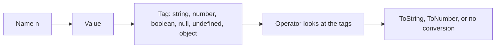

The name never enters that picture. Rebinding `n` does not convert the old value. It just points the label elsewhere. The old value stays whatever it was until nothing refers to it.

### Why `+` and `-` disagree

The `+` operator has two jobs, addition and concatenation, and it picks concatenation when either operand is a string. The other operand is turned into a string and the two texts are joined. So `"8" + 1` is the string `"81"`, and `1 + 2 + "3"` is `"33"` because the left `1 + 2` happens first and produces a number, and only then does `3 + "3"` become concatenation. `"3" + 1 + 2` is `"312"`, because the first `+` already produced a string and every `+` after that keeps concatenating.

The `-` operator has one job. Both sides become numbers. `"8" - 1` is `7`. That is why a total computed with `+` from form fields silently becomes text, while a difference computed with `-` from the same fields becomes a number. The characters look similar. The conversion rules are not.

Other arithmetic operators follow the numeric path as well. `"6" * "7"` is `42`. People remember `+` as the exception and then forget that the exception is the operator they use for totals.

`Number` applies the numeric conversion on purpose. An empty string becomes `0`, a string of spaces becomes `0`, and `"12"` becomes `12`. `"12px"` becomes `NaN`, because the whole string has to be numeric. `parseInt("12px", 10)` returns `12`, because it reads a prefix and stops. Those are different tools. A parser that uses `parseInt` on a price will accept `"12px"` as twelve. A parser that uses `Number` will reject it. Prefer `Number` when the whole string must be a number, and check `Number.isNaN` afterwards.

Booleans convert to numbers as `true → 1` and `false → 0` when an operator asks for a number. The other direction is not "is this the character zero". `Boolean` and an `if` condition use truthiness. `false`, `0`, `""`, `null`, `undefined`, and `NaN` are the falsy values. Everything else is truthy, including the string `"0"`, the string `"false"`, every array, and every object. A check written as `if (flag)` where `flag` came from a query string is true for the text `"0"`, which is the opposite of what a reader expects.

### `==` converts, `===` does not

`===` compares values without converting them. Different kinds are not equal. `1 === "1"` is false. `null === undefined` is false. This is the comparison to write unless you have a reason you can say out loud.

`==` converts first, then compares. The conversions are a table, not a vibe, and a few rows surprise people who only remember "it converts":

| Left | Right | `==` result | Why |
|---|---|---|---|
| `null` | `undefined` | true | They are paired with each other and with nothing else |
| `null` | `0` | false | `null` does not become `0` under `==` |
| `0` | `false` | true | `false` becomes `0` |
| `"0"` | `false` | true | `false` becomes `0`, then `"0"` becomes `0` |
| `""` | `0` | true | The empty string becomes `0` |
| `"8"` | `8` | true | The string becomes a number |

Objects take a further step. When `==` needs a primitive from an object, it asks the object for one. An array's primitive is the join of its elements, so an empty array becomes `""`. `"" == false` is already true, so `[] == false` is true. `![]` is `false` because an array is truthy and `!` flips it. Put those together and `[] == ![]` is true. Both sides "look empty" to the conversion rules and they are not the same value. `===` says false for all of these, which is why it is the default.

Objects compared with `===` are compared by identity. Two separately written object literals are two values, even when their contents match. Equality of contents is a decision you make by comparing the fields you care about, not a service the operator provides.

### Where this shows up in real code

A search box, a CSV cell, and `JSON.parse` of a payload that was assembled by another language all produce strings. The bug report is "the total is 1020 instead of 30" because `"10" + "20"` ran. The fix is to convert at the boundary, once, into a number you checked, and then stay in numbers. Converting on every use means one call site will forget, and `+` will not tell you.

The same boundary produces `"false"` and `"0"` as text. Storing those in a boolean field without an explicit map leaves you with a truthy string. The map is boring and that is the point: only the strings `"1"` and `"true"` become `true`, everything else you listed becomes `false`, and unexpected text is an error rather than a silent `Boolean(text)`.

`NaN` in a total usually means a conversion failed and the failure was added onward. Because `NaN` infects every later arithmetic operation, one bad cell blanks the whole column. Check `Number.isFinite` at the conversion and keep the bad cell out of the sum.

At work, the practical rule is small. Use `===`. Convert text to numbers at the edge with `Number` and reject `NaN`. Do not use truthiness to mean "the user typed a number" or "the flag was off". Leave `==` for the single case `value == null`, which is a shorthand some codebases allow for "null or undefined", and even then only if the surrounding code has agreed that the shorthand is worth it. Many codebases ban it and write the two comparisons out.

| You want | Write | Do not write |
|---|---|---|
| Same value, no conversion | `===` | `==` |
| Text that must be a number | `Number(s)` and `Number.isFinite` | `parseInt` on untrusted text, or `+` to "add" |
| A missing value | `=== null` and `=== undefined`, or one agreed `== null` | Truthiness, which also catches `0` and `""` |
| A present object or array | A field check, or `length` | `if (items)`, which is true for `[]` |

### You can now

- Say which value has a type, the binding or the value, and what `typeof null` reports.
- Predict `+` versus `-` on a mix of text and numbers, including a chain of `+`.
- Name the six falsy values and explain why the string `"0"` is not among them.
- Explain a `==` result by the conversion it applied, and default to `===`.
- Convert a whole string to a number and reject the cases that become `NaN`.

::: quiz
q: In JavaScript, what does a variable store?
- The type you first assigned, so a later string is converted back to that type
+ A reference to the current value, and only the value has a type, so the same name can point at a number and later at a string
- Both a type and a value, and the type is checked on every read
- Nothing until you declare it with a type annotation
why: A binding is a label on a value. The value carries the type tag. Rebinding the name does not convert the new value, and reading the name does not check a stored type, because there is no stored type.
:::

::: quiz
q: Why is `"9" + 1` the string `"91"` while `"9" - 1` is the number `8`?
- The quotes are kept only when the result is stored in a const
+ `+` concatenates when either side is a string, so the number is turned into text. `-` has only a numeric meaning, so the string is turned into a number
- Both operators concatenate, and the console prints the second one as a number by accident
- `-` removes the first character of the string
why: `+` is overloaded. A string operand selects concatenation, and the other side is converted with ToString. `-` always converts both sides with ToNumber. The two operators are not two spellings of the same idea.
:::

::: quiz
q: What is `[] == ![]`, and why do people get it wrong?
- false, because an array is never equal to a boolean
+ true. An array is truthy, so `![]` is `false`. `==` then converts `false` to `0` and the empty array to `""`, and `"" == 0` is true
- true, because both sides are empty values and `==` compares emptiness
- It throws, because you cannot negate an array
why: `!` uses truthiness, and arrays are truthy, so the right side is the boolean `false`. `==` then converts both sides to numbers via their primitives. The empty array's primitive is the empty string, which becomes `0`, and `false` becomes `0`. The two sides are not "both empty". They took different conversions that happened to meet.
:::

::: card
q: In JavaScript, which comparison converts types, and which six values are falsy?
answer: `==` converts, then compares. `===` does not convert. The falsy values are `false`, `0`, `NaN`, `""`, `null`, and `undefined`. The string `"0"`, the string `"false"`, `[]`, and `{}` are all truthy.
:::

::: predict lang=typescript
code:
```ts
console.log(typeof null)
console.log("5" + 2)
console.log("5" - 2)
console.log(Number(""))
console.log(Boolean("0"))
console.log([] == false)
```
answer:
```
object
52
3
0
true
true
```
why: `typeof null` is the historical `"object"`. `+` concatenates because of the string, so the result is the text `52`. `-` converts to numbers, so the result is `3`. `Number("")` is `0`. The string `"0"` is truthy. `[] == false` converts the array to `""` and `false` to `0`, and those compare equal.
:::

::: predict lang=typescript
code:
```ts
console.log(Boolean(""))
console.log(Boolean("0"))
console.log(Boolean([]))
console.log(Number("  "))
console.log(1 + "2" + 3)
console.log(1 + 2 + "3")
```
answer:
```
false
true
true
0
123
33
```
why: The empty string is falsy. The string `"0"` and any array are truthy. A string of spaces converts to `0`. `+` associates left to right, so `1 + "2"` is the string `"12"` and then `"12" + 3` is `"123"`. In the last line `1 + 2` is the number `3` first, and only then does `+ "3"` concatenate to `"33"`.
:::

::: write lang=typescript
task: Export `looseEqual(a, b)`. Implement this subset of `==`, not the whole language rule. If both values are `null` or `undefined`, return true. If one of them is `null` or `undefined` and the other is not, return false (`null` must not equal `0`). If either value is a boolean, replace `true` with `1` and `false` with `0` and try again. If one side is a number and the other is a string, convert the string with `Number` and compare with `===`; a string that becomes `NaN` is not equal. If both sides are the same primitive and `===` is true, return true. For anything else, including two objects, return false. `NaN` is not equal to `NaN`.
starter:
```ts
export function looseEqual(a: unknown, b: unknown): boolean {
  return a === b
}
```
tests:
```ts
// Wrong answer: a === b, which rejects null versus undefined and "5" versus 5
import { test } from "node:test"
import assert from "node:assert/strict"
import { looseEqual } from "./solution.ts"

test("null and undefined pair only with each other", () => {
  assert.equal(looseEqual(null, undefined), true)
  assert.equal(looseEqual(undefined, null), true)
  assert.equal(looseEqual(null, 0), false)
  assert.equal(looseEqual(undefined, ""), false)
})

test("numbers, strings, and booleans convert", () => {
  assert.equal(looseEqual(5, "5"), true)
  assert.equal(looseEqual("0", false), true)
  assert.equal(looseEqual(0, false), true)
  assert.equal(looseEqual(1, true), true)
  assert.equal(looseEqual("", 0), true)
  assert.equal(looseEqual("6", 5), false)
  assert.equal(looseEqual("x", 0), false)
})

test("no conversion for objects, and NaN is not equal to itself", () => {
  assert.equal(looseEqual({}, {}), false)
  assert.equal(looseEqual([], []), false)
  assert.equal(looseEqual(NaN, NaN), false)
  assert.equal(looseEqual(2, 2), true)
})
```
solution:
```ts
export function looseEqual(a: unknown, b: unknown): boolean {
  const missing = (v: unknown) => v === null || v === undefined
  if (missing(a) || missing(b)) return missing(a) && missing(b)
  if (typeof a === "boolean" || typeof b === "boolean") {
    const num = (v: unknown) => (v === true ? 1 : v === false ? 0 : v)
    return looseEqual(num(a), num(b))
  }
  if (typeof a === "number" && typeof b === "string") {
    const n = Number(b)
    return !Number.isNaN(n) && a === n
  }
  if (typeof b === "number" && typeof a === "string") {
    const n = Number(a)
    return !Number.isNaN(n) && b === n
  }
  return typeof a !== "object" && typeof b !== "object" && a === b
}
```
hint: Handle null and undefined before any conversion. Map a boolean to 0 or 1 and call the same function again. Only the number/string pair uses `Number`.
:::

::: write lang=typescript
task: Export `numeric(value)`. This is a strict conversion used at a boundary, not the `Number()` function. `null` becomes `0`. `undefined` becomes the string `"nan"`. `true` becomes `1` and `false` becomes `0`. A finite number stays that number. `NaN` and infinities become `"nan"`. A string is trimmed. A trimmed empty string becomes `0`. Any other string becomes `Number` of that trimmed text, or `"nan"` when that is `NaN`. Arrays, objects, and every other kind become `"nan"`, even though `Number([])` in JavaScript is `0`.
starter:
```ts
export function numeric(value: unknown): number | "nan" {
  return 0
}
```
tests:
```ts
// Wrong answer: return 0 for every value, or call Number() on objects and arrays
import { test } from "node:test"
import assert from "node:assert/strict"
import { numeric } from "./solution.ts"

test("null, undefined, and booleans", () => {
  assert.equal(numeric(null), 0)
  assert.equal(numeric(undefined), "nan")
  assert.equal(numeric(true), 1)
  assert.equal(numeric(false), 0)
})

test("numbers and strings", () => {
  assert.equal(numeric(0), 0)
  assert.equal(numeric(1.5), 1.5)
  assert.equal(numeric(NaN), "nan")
  assert.equal(numeric(Infinity), "nan")
  assert.equal(numeric(""), 0)
  assert.equal(numeric("  "), 0)
  assert.equal(numeric(" 4 "), 4)
  assert.equal(numeric("4px"), "nan")
})

test("objects are not numbers here", () => {
  assert.equal(numeric([]), "nan")
  assert.equal(numeric([3]), "nan")
  assert.equal(numeric({}), "nan")
})
```
solution:
```ts
export function numeric(value: unknown): number | "nan" {
  if (value === null) return 0
  if (value === undefined) return "nan"
  if (typeof value === "boolean") return value ? 1 : 0
  if (typeof value === "number") return Number.isFinite(value) ? value : "nan"
  if (typeof value === "string") {
    const trimmed = value.trim()
    if (trimmed === "") return 0
    const n = Number(trimmed)
    return Number.isNaN(n) ? "nan" : n
  }
  return "nan"
}
```
hint: Branch on `null` before `typeof`, because `typeof null` is `"object"`. Trim strings before `Number`. Use `Number.isFinite` so `NaN` and `Infinity` both become `"nan"`.
:::

## JavaScript for Python people
id: js-basics
stage: js
needs: t-dynamic
minutes: 50
goal: Read modern JavaScript fluently, especially where it differs from Python.
source: MDN: JavaScript guide | https://developer.mozilla.org/en-US/docs/Web/JavaScript/Guide
source: javascript.info: The modern JavaScript tutorial | https://javascript.info/

TypeScript checks a program and then deletes the types. What the machine runs is JavaScript, so a type error you already understand is useless if you cannot read the statement underneath it. Python and JavaScript share a lot of surface area, which is why the remaining differences are expensive: they look like the thing you already know and then do something else. The differences that matter on a normal day are how names are bound, how objects are copied, which values count as false, and which loop walks values rather than keys.

### The same ideas, different spellings

| Python | JavaScript |
|---|---|
| `x = 1` | `const x = 1` when the binding will not move, `let x = 1` when it will. Leave `var` alone |
| `None` | two values: `null` (set on purpose) and `undefined` (missing) |
| `==` | `===`. Two equals signs convert before comparing |
| `f"Hi {name}"` | `` `Hi ${name}` `` with backticks |
| `def f(x): return x * 2` | `const f = (x) => x * 2` |
| `len(xs)` | `xs.length` |
| `[x * 2 for x in xs if x > 0]` | `xs.filter((x) => x > 0).map((x) => x * 2)` |
| `{"a": 1}` | `{ a: 1 }` for a record, `new Map()` when the keys are not strings |
| `for x in xs:` | `for (const x of xs)` |
| `try / except` | `try / catch` |

`const` protects the binding, not the value. After `const point = { x: 1 }` you cannot write `point = { x: 2 }`, and that assignment is a runtime error as well as a type error. You can still write `point.x = 2`, because the binding `point` still refers to the same object. People coming from a language with real constants read `const` as "frozen". It is not. `Object.freeze` is the operation that rejects changes to the object's own properties, and it is shallow: a frozen object's nested array can still be pushed to. Almost no application code freezes objects. It copies them instead.

`let` is the binding you reassign: a counter, an accumulator, a reference you swap for a newer object. Prefer `const` until an assignment forces `let`. The reason is reading, not performance. A `const` binding means the name on line 40 is the same value as the name on line 10, so you do not have to scan for writes.

### Objects are shared until you copy them

An object literal creates one value. A second name assigned from the first is a second label on that same value, exactly as in Python. Mutating through either name is visible through the other. That is what you want for a cache you pass around, and it is how a helper accidentally corrupts its caller.

A spread `{ ...obj, title: "B" }` allocates a new object and copies the own enumerable properties. The new object has its own `title`. Nested objects and arrays are copied by reference, so the new object and the old one share those inner values. Pushing into a nested array is visible on both sides. The fix, when the next owner must not see your pushes, is to copy the array too: `tags: [...obj.tags]`. That second copy is still shallow. It is enough for an array of strings, and it is not enough for an array of objects you intend to mutate. Copy as deep as you mutate.

```js
const book = { title: "Reef", authors: ["Ann"] }
const renamed = { ...book, title: "Reef, 2nd", authors: [...book.authors] }
```

Destructuring reads fields out in one step: `const { title, authors } = book`. A missing field becomes `undefined`. Renaming during the read looks like `const { title: heading } = book`, which means "read `title`, bind it to `heading`". The colon is not a type annotation there. Optional chaining `book.publisher?.city` stops when the part before `?.` is `null` or `undefined` and yields `undefined` instead of throwing. It does not stop on `0` or `""`. Use it for a chain that is allowed to be missing, not as a general default.

Arrays are objects with a special `length` and indexed keys. `map`, `filter`, and `reduce` return new arrays or a folded value and do not change the input. `sort` and `splice` do change the input. When a function receives an array from its caller, sorting it in place is a visible side effect. Copy first, or use `toSorted` (present in current Node), which returns a new array.

### Two kinds of missing, and two kinds of default

`undefined` is what you get from a missing property, a missing argument, and a function with no `return`. `null` is a value someone stored to mean "none". JSON uses `null` and omits nothing as `undefined`, so a parsed payload has `null` where the sender sent null, and `undefined` where the key was absent. They are equal under `==` and not equal under `===`. Code that needs to treat "the field was sent as null" differently from "the field was not sent" has to use `===`.

`||` picks the right side when the left side is falsy. Falsy means `false`, `0`, `""`, `null`, `undefined`, and `NaN`. A real zero is falsy, so `qty || 1` turns a legitimate quantity of zero into one. `??` picks the right side only for `null` and `undefined`, so `qty ?? 1` keeps the zero. Defaults for numbers and strings belong on `??`. `||` still has a job when you truly mean "use this when the left side is empty or zero", and that should be rare enough to notice.

An empty array and an empty object are truthy. `if (items)` does not mean "if there is anything to do". `if (items.length)` does, for an array. The same habit from Python, where an empty list is false, is the bug.

`for...of` walks the values of an iterable: array elements, characters of a string, what a set yields. `for...in` walks enumerable keys, and on an array those keys are the index strings `"0"`, `"1"`, and so on, not the elements. `for...in` also walks keys inherited from the prototype when they are enumerable. Use `for...of` for the elements. Use `Object.keys`, `Object.entries`, or `Object.hasOwn` when you want the object's own names.

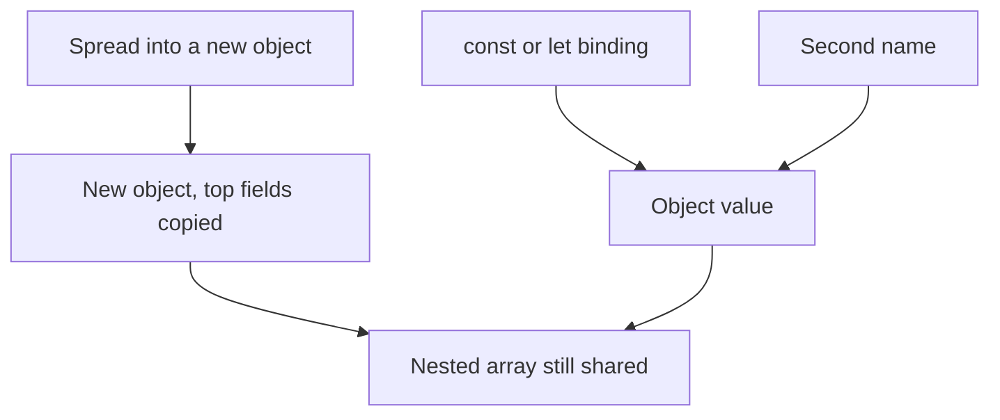

### What you will trip over in application code

A handler that does `user.tags.push("new")` on an object it received as an argument changes the caller's object. The caller then renders the extra tag and nobody threw. The repair is to build a new object at the boundary where the change is meaningful, and to copy the arrays you push to.

A configuration reader that uses `||` for a port, a timeout, or a retry count will replace an explicit `0` with the default. Timeouts of zero are unusual, but counts of zero are not. `??` keeps them.

`for...in` over an array, plus a function that expects a number, produces string indexes. `"0" + 1` is `"01"` because `+` concatenates once either side is a string. The loop looked like a Python `for`. It was not.

At work, the JavaScript you read in a Node service or a browser bundle is mostly this layer: objects in, shallow copies out, `===` for comparisons, `??` for defaults, `for...of` for lists. The type annotations sit on top of these statements and do not change them. When a runtime value surprises you, the annotation has already been deleted, and these rules are what is left.

| You mean | Write | Avoid |
|---|---|---|
| This name will not be reassigned | `const` | `var`, and `let` you never reassign |
| A new object with one field changed | `{ ...obj, field: next }` plus a copy of any nested array you will mutate | Mutating the caller's object |
| Default only when the value is missing | `??` | `\|\|` on numbers that may be `0` |
| The elements of an array | `for...of` or `map` | `for...in`, which yields index strings |
| A missing property without a throw | `obj?.field` | `obj.field` when `obj` may be null |

### You can now

- Translate a small Python snippet into `const` or `let`, a template string, and `for...of`.
- Say what `const` does not freeze, and why a spread copy still shares nested arrays.
- Choose `??` or `||` on purpose, and choose `for...of` rather than `for...in` for array elements.
- Tell `null` from `undefined` and compare them with `===`.
- Build a new object that leaves the input object unchanged, including its arrays.

::: predict lang=typescript
code:
```ts
console.log("1" == 1, "1" === 1)
console.log(0 || 10, 0 ?? 10)
console.log([] ? "truthy" : "falsy")
const xs = [3, 1, 2]
console.log(xs.map((x) => x * 2).filter((x) => x > 2).join(","))
```
answer:
```
true false
10 0
truthy
6,4
```
why: `==` converts types; `===` doesn't. `||` treats 0 as false and uses 10; `??` only replaces null and undefined, so 0 stays. Empty arrays are truthy in JS.
:::

::: write lang=typescript
task: Write and export `summarize(orders)`. Each order is `{ id: string, total: number, paid: boolean }`. Return `{ count, revenue, unpaid }`: the number of orders, the sum of **paid** totals, and the ids of unpaid orders. Use `filter`, `map` and `reduce`.
starter:
```ts
type Order = { id: string; total: number; paid: boolean }

export function summarize(orders: Order[]) {
  return { count: 0, revenue: 0, unpaid: [] as string[] }
}
```
tests:
```ts
import { test } from "node:test"
import assert from "node:assert/strict"
import { summarize } from "./solution"

test("summarizes", () => {
  const out = summarize([
    { id: "a", total: 10, paid: true },
    { id: "b", total: 5, paid: false },
    { id: "c", total: 2.5, paid: true },
  ])
  assert.deepEqual(out, { count: 3, revenue: 12.5, unpaid: ["b"] })
})

test("empty", () => {
  assert.deepEqual(summarize([]), { count: 0, revenue: 0, unpaid: [] })
})
```
solution:
```ts
type Order = { id: string; total: number; paid: boolean }

export function summarize(orders: Order[]) {
  return {
    count: orders.length,
    revenue: orders.filter((o) => o.paid).reduce((sum, o) => sum + o.total, 0),
    unpaid: orders.filter((o) => !o.paid).map((o) => o.id),
  }
}
```
hint: `orders.filter((o) => o.paid).reduce((sum, o) => sum + o.total, 0)` sums the paid totals.
:::

::: quiz
q: In JavaScript, what does `const` stop you from doing?
- Changing any property of the object, because the value is frozen
+ Reassigning that name. The object it points at can still have its fields changed
- Reading the name from an inner function
- Using the name in a type annotation
why: `const` protects the binding. `point.x = 2` is still legal because the name `point` was not moved. `Object.freeze` is what rejects property writes, and everyday code copies objects instead of freezing them.
:::

::: quiz
q: What does `for...in` walk on an array, compared with `for...of`?
- Both walk the elements, and `in` is just the older spelling
+ `for...in` walks enumerable keys, which on an array are the index strings. `for...of` walks the elements
- `for...in` walks the elements and `for...of` walks the keys
- `for...in` throws on an array because arrays are objects
why: An array's keys are `"0"`, `"1"`, and so on. `for...in` yields those keys, and it can also yield inherited enumerable names. `for...of` uses the iterator, so the loop variable is the element. A key that is a string will concatenate if you add it with `+`.
:::

::: card
q: In JavaScript, when does `??` take the right-hand side, and when does `||` take it?
answer: `??` takes the right-hand side only when the left is `null` or `undefined`, so a real `0` or `""` is kept. `||` takes the right-hand side for every falsy left-hand side, including `0`, `""`, and `NaN`.
:::

::: predict lang=typescript
code:
```ts
const book = { title: "A", authors: ["Ann"] }
const alias = book
const copy = { ...book, title: "B" }
alias.authors.push("Bea")
console.log(book.title, copy.title)
console.log(book.authors.join(","), copy.authors.join(","))
```
answer:
```
A B
Ann,Bea Ann,Bea
```
why: `alias` is a second name for the same object, so the push changes `book.authors`. The spread allocates a new object with a new `title`, but the `authors` property is still the same array, so the copy shows the pushed name too.
:::

::: predict lang=typescript
code:
```ts
const xs = ["q", "r"]
const keys: string[] = []
for (const k in xs) keys.push(k)
const vals: string[] = []
for (const v of xs) vals.push(v)
console.log(keys.join(","))
console.log(vals.join(","))
```
answer:
```
0,1
q,r
```
why: `for...in` yields the keys of the array, and those keys are the strings `"0"` and `"1"`. `for...of` yields the elements `"q"` and `"r"`.
:::

::: write lang=typescript
task: Export `rename(user, name)`. `user` is `{ name: string; tags: string[] }`. Return a new object whose `name` is the new name and whose `tags` is a new array with the same strings. Do not change the object or the array that was passed in. A later `push` on the result's tags must not appear on the input.
starter:
```ts
export function rename(user: { name: string; tags: string[] }, name: string) {
  user.name = name
  return user
}
```
tests:
```ts
// Wrong answer: assign user.name and return the same object, so the caller sees the write
import { test } from "node:test"
import assert from "node:assert/strict"
import { rename } from "./solution.ts"

test("returns a new name and keeps the input", () => {
  const input = { name: "Ada", tags: ["red"] }
  const out = rename(input, "Grace")
  assert.deepEqual(out, { name: "Grace", tags: ["red"] })
  assert.deepEqual(input, { name: "Ada", tags: ["red"] })
  assert.notEqual(out, input)
})

test("does not share the tags array", () => {
  const input = { name: "Ada", tags: ["red"] }
  const out = rename(input, "Grace")
  out.tags.push("blue")
  assert.deepEqual(input.tags, ["red"])
})
```
solution:
```ts
export function rename(user: { name: string; tags: string[] }, name: string) {
  return { name, tags: [...user.tags] }
}
```
hint: Build a fresh object. Copy `tags` with a spread so the result has its own array.
:::

## Functions, scope, and closures
id: js-functions
stage: js
needs: js-basics
minutes: 45
goal: Predict which binding a later call reads, because a closure keeps the environment it was created in and a var loop has only one binding.
source: MDN: Closures | https://developer.mozilla.org/en-US/docs/Web/JavaScript/Closures
source: MDN: let | https://developer.mozilla.org/en-US/docs/Web/JavaScript/Reference/Statements/let
source: javascript.info: Variable scope, closure | https://javascript.info/closure
source: javascript.info: The old "var" | https://javascript.info/var

A callback almost never runs at the moment you create it. A click handler, a timer, and a function returned from a factory all run later, sometimes after the function that built them has already returned. The later call still has to find `amount`, `id`, or `done`. JavaScript finds those names in the environment where the function was created, not in the environment of whoever happens to call it. That pair, the function plus the environment, is a closure. Most of the bugs in this area are not mysterious memory. They are one binding where you thought you had many, or many bindings where you thought you had one.

### Block scope, and the one binding `var` makes

`let` and `const` belong to a block. A block is the body of `if`, `for`, `while`, or a pair of braces written on their own. Outside that block the name does not exist, so a later statement cannot read or overwrite it by accident. `const` means you will not reassign the name. `let` means you might. Reassignment and mutation are different, because `const user = { city: "oslo" }` still allows `user.city = "rio"`. The binding still points at the same object. What `const` forbids is `user = { city: "rio" }`, a new object on the same name.

`var` ignores blocks. It is scoped to the whole function, or to the script if you wrote it outside any function. The declaration is hoisted to the top of that function and initialized to `undefined`. The line that looks like a declaration in the middle of the function is only an assignment. An `if` does not create a new `var` binding, and a `for` does not either. Two loops in the same function that both say `var i` are one binding, so the second loop starts from whatever the first loop left behind. That is why `var` is the wrong tool for new code. It still appears in old code, and the loop bug below is the reason it keeps causing tickets.

### The temporal dead zone

`let` and `const` are created at the start of the block as well, but they stay uninitialized until execution reaches the declaration line. The gap between those two moments is the temporal dead zone. Reading the name in that gap throws `ReferenceError`, because the binding exists and is not yet a value. `var` is initialized to `undefined` as soon as the function is entered, so a read before its line quietly produces `undefined` instead of throwing. The loud error is the safer one. A silent `undefined` gets concatenated, stored, and reported three calls later.

### A closure keeps the binding

When JavaScript creates a function, it stores a link from that function to the environment that was active at that moment. A call later looks names up through that link. The caller’s locals are irrelevant unless they were passed as arguments. The factory’s locals stay reachable because the returned function still points at them, so returning from the factory does not delete them.

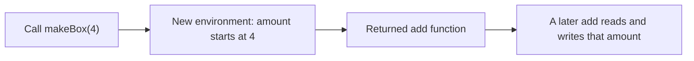

Consider a factory whose local starts at `4`. Each call returns an `add` function that takes a number, adds it to `amount`, and returns the new amount.

```js
function makeBox(seed) {
  let amount = seed
  return function add(extra) {
    amount = amount + extra
    return amount
  }
}
const left = makeBox(4)
const right = makeBox(4)
```

`left(1)` returns `5`, and a second `left(1)` returns `6`. `right(10)` returns `14`, not `16`. The two calls do not share `amount`, because each call to `makeBox` created a separate environment, and each returned function kept its own. If `amount` had been declared outside `makeBox`, both functions would have closed over that one binding and `right(10)` would have seen the writes from `left`. Sharing is not a property of closures in general. It is a property of closing over the same binding. People describe a closure as "remembering the values", and that picture is slightly wrong. The function remembers the bindings. If some other code can still assign to the same `let`, a later call sees the new value. A `const` is safe from that only because nobody can assign to it.

### The loop has one binding, the callbacks all read it

This is the bug that shows up in a list of buttons. The functions are created during the loop and called after it.

```js
const reads = []
for (var ticket = 1; ticket <= 4; ticket++) {
  reads.push(function () {
    return ticket
  })
}
```

Every function returns `5`. There were not four copies of `ticket`. `var ticket` is one function-scoped binding, hoisted and then assigned on each iteration. The loop stops when the condition `ticket <= 4` fails, so the binding holds `5`. The functions run after that, and each one reads the same binding, so each one reads `5`. A story in which each function copied the number at creation time would return `1`, `2`, `3`, and `4`. That story is what programmers want. It is not what `var` does.

`for (let ticket = 1; ticket <= 4; ticket++)` returns `1`, `2`, `3`, and `4`. The reason is more specific than "let is block scoped". The loop creates a fresh binding for each iteration and initializes it from the previous iteration’s value. The function created in that iteration closes over that iteration’s binding. Later assignments go into a different binding, so they cannot change this one. `for (const city of cities)` does the same kind of thing: each iteration gets its own `city`.

A `let` outside the loop does not save you. This version still collapses, even though the loop variable itself is per iteration:

```js
let latest = ""
const seen = []
for (const city of ["lima", "oslo", "rome"]) {
  latest = city
  seen.push(function () {
    return latest
  })
}
```

Every function returns `"rome"`. `city` really is a new binding each time, but the functions never read `city`. They read `latest`, and there is only one `latest`, assigned three times. The repair is to close over the per-iteration name, or to copy into a new `const` inside the body before creating the function: `const current = city`, then return `current`. That inner `const` is a separate binding each time the body runs, so the function keeps that copy even though `latest` moves on. The same repair, an inner `const` assigned from `ticket`, is how people used to survive a `var` loop before `let` existed.

### Where it breaks

The shared loop binding is the loud version. A quieter version is a factory that closes over a module-level `let` when the author meant one piece of state per caller. Every caller then increments the same counter, and the second screen "starts" where the first screen left off. Move the `let` inside the factory and each call gets a new one.

A closure also keeps the whole environment alive, not only the one name you think about. If the function closes over `id` but `id` lives next to a huge array in the same environment, that array cannot be collected until the function is dropped. The cause is the link to the environment. The fix is to copy the small value into a tighter block and create the function there, so the function’s environment does not include the array.

An arrow assigned to a `const` has no intrinsic name and no `arguments` object. A `function` declaration has both, and the name exists for the whole function body because the declaration is hoisted, so the function can call itself before the line a reader thinks of as the definition. Use `function` when you need that name, a stack frame you can recognize, or `arguments`. Use an arrow when you want a short function that does not get its own `this` and does not need a name. The choice is about which bindings the function should have, not about which syntax is newer.

### How this is used at work

A table of invoices renders a button per row. The handler is created in the loop and runs on click, which is later. If the loop was `for (var id of rows)` or a `var` index, every click reports the last id, and the charge lands on the wrong invoice. `for (const row of rows)` gives each handler that iteration’s `row`. The handler text can look identical. The binding structure is what decides which invoice moves.

A pay button needs a once-wrapper so a double click does not create two charges. The wrapper is a function that closes over `done` and the first receipt. The first call runs the request and stores the receipt. A later call returns the stored receipt and does not call the request again. The flag has to be created inside the factory. A flag in the module is one binding shared by every button, so the second product would look already paid. The same shape stores the first successful parse of a file, or the first focus handler in a widget, without putting that flag on a class.

Private state without a class is the `makeBox` shape. Callers receive `add` and never receive a way to name `amount`. They cannot assign to it, because it was never a property. That is the right size for a token bucket, a retry counter, or a socket wrapper that should not grow a public field just so two methods can share a number. Two callers that each call the factory do not share that number, which is what you want when two widgets both "start at zero".

| You want | Write | Do not write |
|---|---|---|
| A binding that is not reassigned | `const` | `var`, or `let` when nothing assigns again |
| A binding you reassign inside a block | `let` | `var`, which is visible to the whole function |
| A new binding per loop turn for a callback | `for (let x ...)` or `for (const x of ...)` | `for (var x ...)`, one shared binding |
| A function that needs a name or `arguments` | `function name(...)` | An arrow, which has neither |
| A short callback that should not get its own `this` | An arrow | `function`, which receives `this` from the call |

### You can now

- Say why `var` is one binding for the whole function, and why a read before its line is `undefined` rather than an error.
- Explain the temporal dead zone as an uninitialized `let` or `const`, and why that throw is earlier than a `var` bug.
- Predict that two calls to a factory do not share its locals, because each call creates an environment.
- Predict that callbacks made in a `var` loop all read the final value, and that `for (let ...)` gives each iteration its own binding.
- Put the `let` that must be private inside the factory, and close over the per-iteration name when you build a list of handlers.

::: quiz
q: Why do functions created in `for (var i = 0; i < 3; i++)` all return `3` when they are called after the loop?
- Each function copied the number at the moment it was created, and those copies were already `3` because the loop had finished
+ There is one function-scoped binding for `i`. The functions close over that binding and read it later, after the loop has left `3` in it
- `var` creates a new binding per iteration, but calls are batched and only the last result is kept
- The functions ran inside the loop, and the log only shows the last line
why: `var` hoists one binding for the whole function, and the loop only assigns to it. A closure keeps that binding, not a snapshot of the number, so a later call sees the final value. A copy-at-creation story would have returned `0`, then `1`, then `2`. That is what a fresh binding per iteration would do, and `var` does not create one.
:::

::: quiz
q: `makePocket(1)` returns a function that adds its argument to a local `balance`. You call the factory twice and add `5` through the first function. Why is the second function's balance still `1`?
- Both functions share one `balance`, and the second call to `makePocket` resets it to `1`
+ Each call to `makePocket` creates a new environment. The returned function closes over the `balance` from that call, so the other call's `balance` is a different binding
- `let` stores the number `1` into the source text of the returned function
- The second function has not closed over anything yet, because it has never been called
why: A call creates an environment for its locals, and the function it returns keeps that environment. A second call creates a second environment. Writing one `balance` cannot change the other. The shared-and-reset picture is what you get when `balance` is declared outside the factory, so both returned functions close over one binding.
:::

::: card
q: What is the temporal dead zone, and how is it different from reading a `var` before its declaration line?
answer: A `let` or `const` binding exists from the start of the block but is uninitialized until the declaration runs. Reading it in that gap throws ReferenceError. A `var` binding is initialized to `undefined` when the function is entered, so an early read returns `undefined` instead of throwing.
:::

::: predict lang=typescript
code:
```ts
function makeCounter(start: number): () => number {
  let n = start
  return () => {
    n += 1
    return n
  }
}
const a = makeCounter(10)
const b = makeCounter(10)
console.log(a())
console.log(a())
console.log(b())
const marks: Array<() => number> = []
for (var step = 0; step < 3; step++) {
  marks.push(() => step)
}
const first = marks[0]
const second = marks[1]
const third = marks[2]
if (first && second && third) {
  console.log(first())
  console.log(second())
  console.log(third())
}
```
answer:
```
11
12
11
3
3
3
```
why: Each call to `makeCounter` creates its own `n`. `a` advances that binding from `10` to `11` and then `12`. `b` has a different `n`, so its first call returns `11`. The `var step` loop has one binding. After the loop it holds `3`, and every function reads that same binding.
:::

::: predict lang=typescript
code:
```ts
function pair(): [() => string, () => string] {
  let label = "oak"
  const early = () => label
  label = "elm"
  const late = () => label
  return [early, late]
}
const [p, q] = pair()
console.log(p())
console.log(q())
const snaps: Array<() => string> = []
for (let city of ["rio", "oslo"]) {
  snaps.push(() => city)
}
const s0 = snaps[0]
const s1 = snaps[1]
if (s0 && s1) {
  console.log(s0())
  console.log(s1())
}
```
answer:
```
elm
elm
rio
oslo
```
why: `early` and `late` both close over the one `label` binding, and neither runs until after that binding has been assigned `"elm"`. `for (let city of ...)` creates a new `city` binding per iteration, so each function keeps the city from the iteration that created it.
:::

::: write lang=typescript
task: Export `capture(ids)`. Return one function per id, in the same order. When a returned function is called, it returns the id from the iteration that created it, even if the caller invokes the functions out of order or long after `capture` has returned. Two calls to `capture` must not share state. An empty input returns an empty array.
starter:
```ts
export function capture(ids: string[]): Array<() => string> {
  const out: Array<() => string> = []
  let shared = ""
  for (const id of ids) {
    shared = id
    out.push(() => shared)
  }
  return out
}
```
tests:
```ts
// Wrong answer: one shared let overwritten each iteration, so every function returns the last id
import { test } from "node:test"
import assert from "node:assert/strict"
import { capture } from "./solution.ts"

test("each function returns the id from its own iteration", () => {
  const fns = capture(["oak", "elm", "ash"])
  assert.deepEqual(
    fns.map((fn) => fn()),
    ["oak", "elm", "ash"],
  )
})

test("later calls and a second capture stay independent", () => {
  const first = capture(["nile"])
  const second = capture(["danube", "volga"])
  assert.equal(second[1]?.(), "volga")
  assert.equal(first[0]?.(), "nile")
  assert.equal(second[0]?.(), "danube")
  assert.equal(first[0]?.(), "nile")
})

test("empty input returns no functions", () => {
  assert.deepEqual(capture([]), [])
})
```
solution:
```ts
export function capture(ids: string[]): Array<() => string> {
  const out: Array<() => string> = []
  for (const id of ids) {
    out.push(() => id)
  }
  return out
}
```
hint: Close over the per-iteration `id`, not over a `let` declared outside the loop. `for (const id of ids)` already makes a fresh binding each turn.
:::

::: write lang=typescript
task: Export `once(fn)`. It returns a function that calls `fn` on the first invocation, stores that return value, and returns the stored value on every later invocation without calling `fn` again. The stored value may be `0`, `""`, or `undefined`. Those are real results, not a sign that `fn` still needs to run. Each call to `once` has its own memory, so two wrappers do not share a first result.
starter:
```ts
export function once<T>(fn: () => T): () => T {
  let stored: T | undefined
  return () => {
    if (stored === undefined) stored = fn()
    return stored as T
  }
}
```
tests:
```ts
// Wrong answer: treats an undefined stored slot as "not called yet", so a first result of undefined makes fn run again
import { test } from "node:test"
import assert from "node:assert/strict"
import { once } from "./solution.ts"

test("later calls return the first string and do not call fn again", () => {
  let n = 0
  const wrapped = once(() => {
    n += 1
    return "row-" + String(n)
  })
  assert.equal(wrapped(), "row-1")
  assert.equal(wrapped(), "row-1")
  assert.equal(n, 1)
})

test("zero and the empty string are cached", () => {
  let n = 0
  const zeros = once(() => {
    n += 1
    return 0
  })
  assert.equal(zeros(), 0)
  assert.equal(zeros(), 0)
  assert.equal(n, 1)
  let m = 0
  const blanks = once(() => {
    m += 1
    return ""
  })
  assert.equal(blanks(), "")
  assert.equal(blanks(), "")
  assert.equal(m, 1)
})

test("undefined is a real first result, and wrappers do not share it", () => {
  let n = 0
  const missing = once(() => {
    n += 1
    return undefined
  })
  assert.equal(missing(), undefined)
  assert.equal(missing(), undefined)
  assert.equal(n, 1)
  let hits = 0
  const other = once(() => {
    hits += 1
    return "kept"
  })
  assert.equal(other(), "kept")
  assert.equal(missing(), undefined)
  assert.equal(hits, 1)
  assert.equal(n, 1)
})
```
solution:
```ts
export function once<T>(fn: () => T): () => T {
  let done = false
  let stored: T | undefined
  return () => {
    if (!done) {
      stored = fn()
      done = true
    }
    return stored as T
  }
}
```
hint: Keep a separate flag for "already called". Checking that the stored value is `undefined` cannot tell a missing call from a real `undefined` result.
:::

## this, call, and arrow functions
id: this-binding
stage: js
needs: js-functions
minutes: 45
goal: Predict the receiver of a method, a bare call, call, and an arrow, because this is set by the call unless the function is an arrow.
source: MDN: this | https://developer.mozilla.org/en-US/docs/Web/JavaScript/Reference/Operators/this
source: MDN: Arrow functions | https://developer.mozilla.org/en-US/docs/Web/JavaScript/Reference/Functions/Arrow_functions
source: javascript.info: Object methods, "this" | https://javascript.info/object-methods
source: javascript.info: Function binding | https://javascript.info/bind

A method reads `this.name` and works when you write `panel.read()`. The same function, stored in a `const` and called with nothing in front of it, throws or reads the wrong object. The text of the function did not change between those two calls. `this` is not a local variable you assigned, and it is not looked up the way `amount` is looked up in a closure. For an ordinary function, the call sets `this`. An arrow is the exception: it does not get a `this` of its own, so it uses the `this` of the environment where the arrow was created, and no later call can replace that.

### The call sets this

There are four call styles that cover almost every bug.

`obj.method()` takes the value in front of the dot and passes it as `this`. With a panel whose `label` is `"north"` and whose `read` returns `this.label`, `panel.read()` returns `"north"`, because `this` is that panel. The method can live on the object or on its prototype. What matters is the receiver of this call, not the object where the function was first written.

Pulling the method off loses that receiver. `const read = panel.read` copies the function value. `read()` is a bare call. There is no dot. In strict mode `this` is `undefined`, and the body then evaluates `this.label`. Reading a property of `undefined` throws `TypeError`. The throw is the signal that the receiver was lost. It is not a defect in `label`. Destructuring does the same thing, because `const { read } = panel` is another bare function value. The object is not secretly stored inside the function at the moment you defined the method.

`fn.call(receiver, ...args)` sets `this` for one call and passes the arguments after the receiver. `read.call({ label: "south" })` returns `"south"` even though `read` was taken from the north panel. `call` does not look up `read` on the object you pass. It only sets `this` and invokes the function you already have. `fn.apply(receiver, argsArray)` is the same rule with the arguments packed in an array. In strict mode `call(null)` and `call(undefined)` really do set `this` to `null` or `undefined`, so a property read still throws. Older sloppy mode replaced those with the global object, which hid the bug as a mysterious global write.

An arrow sitting on an object does not join this system. An arrow has no `this` parameter to fill. It captures the `this` of the enclosing scope, the same way it captures any other outer binding, and that capture happens when the arrow is created. Calling it as `box.outer()` does not redirect it. `box.outer.call({ label: "yard" })` does not redirect it either. `bind` cannot give an arrow a receiver, because there is still no `this` slot on the arrow.

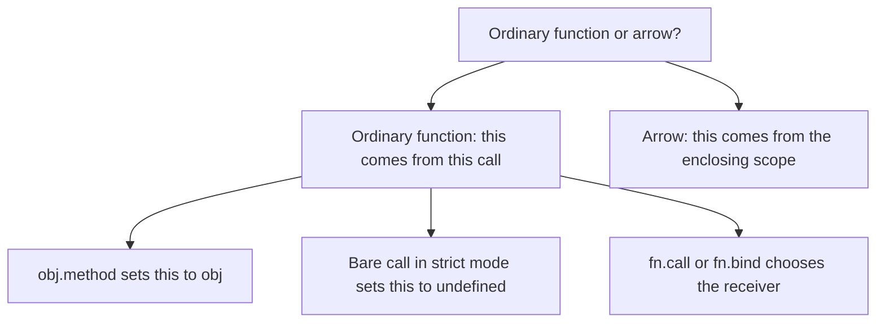

Node modules run in strict mode, so a bare call in module code has `this === undefined` and the property read throws. That includes the body of a function you exported and someone else called without a receiver. Do not put behavior on `this` at the top of a file. That value depends on whether the file is a CommonJS script or a module, so it is not a stable place to hang a name or a mode flag. Put the value in a local, or pass it as an argument.

`bind` is the version of `call` that does not invoke yet. `panel.read.bind(panel)` returns a new function. When that new function runs, `this` is the panel, even if the caller uses `.call` with a different object. The bound receiver wins for an ordinary function. Leading arguments can be fixed too: `read.bind(panel, "id")` prepends `"id"` to whatever the later caller passes. The original function is unchanged. `bind` returns a wrapper. It does not edit `panel.read`.

A worked case, different from a button named north, is a builder that itself was called with a receiver:

```js
"use strict"
function build() {
  return {
    label: "hall",
    own() {
      return this.label
    },
    outer: () => this.label,
  }
}
const box = build.call({ label: "lab" })
```

`box.own()` returns `"hall"`, because the dot sets `this` to `box`. `box.own.call({ label: "yard" })` returns `"yard"`, because `call` replaced the receiver for that one invocation. `box.outer()` returns `"lab"`, because the arrow took `this` from `build`, and `build` was called with `{ label: "lab" }`. `box.outer.call({ label: "yard" })` still returns `"lab"`. The arrow’s `this` was fixed when `build` ran. The object the arrow happens to sit on is only a place to store the function.

### Where it breaks

The usual break is "I passed the method". `button.addEventListener("click", panel.read)` does not call `panel.read()`. The browser later calls the function it was given. For a listener, `this` is the element, not the panel. If the body reads `this.label` hoping for the model, it reads the element’s label instead, which is often the empty string or an unrelated attribute. If the body then calls `this.save()`, that property is missing on the element and the call throws `TypeError`. `setTimeout(panel.read, 0)` and `rows.forEach(panel.read)` are the same shape: the API calls your function, and it does not know about `panel`.

An arrow used as a method breaks the other way. An object literal written inside a module, with `label: () => this.label`, does not mean "this object’s label". The arrow was created in the surrounding scope, so `this` is that scope’s `this`, which in a module is not the object being built. The method syntax `label() { return this.label }` is the one that receives the object from the dot. Use an arrow when you want to ignore the caller. Use a method when the object in front of the dot is the point.

`call` and `bind` fail in a quieter way when the receiver is the wrong shape. They will happily set `this` to `{ label: "south" }` for a function that expected a panel with `save` as well. The failure shows up on the next property read, inside the function, which makes it look like the function is wrong. The call site chose a receiver that does not have the fields the body uses. Check the object you pass to `call` or `bind` the same way you check an argument.

### How this is used at work

A class component stores `handleClick` on the prototype. JSX that says `onClick={this.handleClick}` passes the function the way `addEventListener` does. React calls it with no useful receiver, so `this` is `undefined` in strict mode and `this.setState` throws. The text `this.setState` looked correct next to the other methods. The call was not a method call. One repair is a class-field arrow, `handleClick = () => { this.setState(...) }`. That arrow is created while the instance is being constructed, so it captures the instance as `this`, and React’s bare call cannot replace it. Another repair is `this.handleClick = this.handleClick.bind(this)` in the constructor, which produces a wrapper whose receiver is the instance. A third is to write `onClick={() => this.handleClick()}` at the element, so the thing you pass is an arrow, and the arrow’s body uses a real method call with a dot.

DOM code has the same split. Prefer `element.addEventListener("click", () => panel.read())` when `read` needs the panel. The arrow calls `panel.read()` with a receiver. Prefer `panel.read.bind(panel)` when an API must receive a function that will be called bare and you cannot wrap it in another arrow, for example a library that stores the exact function so it can remove it later. `bind` gives you one stable function value to add and remove. A fresh arrow on every render is a different function each time, so `removeEventListener` would not find it. Use `call` when you are the one invoking the function now and you have the receiver in hand, which is common in tests and in a tiny dispatcher that walks a list of callbacks.

Function components avoid this class of bug because there is no instance `this` to lose. The moment a value is a method on a class, a DOM listener, or a callback registry, the call style is part of the design again.

| You want | Write | Do not write |
|---|---|---|
| The object in front of the dot as `this` | A method, called as `obj.method()` | An arrow stored in that slot |
| A callback that must keep a receiver you already have | `() => obj.method()` or `obj.method.bind(obj)` | `obj.method` passed raw |
| One immediate call with a chosen receiver | `fn.call(obj, arg)` | Assigning the function onto a temporary object just to use a dot |
| A stable function you can register and remove, with `this` fixed | `const saved = fn.bind(obj)` once | A new arrow every time you add the listener |
| An arrow’s `this` to change per call | You cannot. Close over a value, or use an ordinary function | `arrow.call(other)` or `arrow.bind(other)` |

### You can now

- Predict `obj.method()`, a method copied into a `const` and called bare, and `fn.call(other)`.
- Say why a bare call in strict mode throws on `this.label`: `this` is `undefined`, and the property read is what throws.
- Explain why an arrow ignores the dot, `call`, and `bind`: it has no `this` of its own and keeps the enclosing one.
- Choose an arrow wrapper, `bind`, or `call` for a React or DOM callback instead of passing the raw method.
- Refuse to depend on `this` at the top of a file, because that value changes with the module system.

::: quiz
q: In strict mode, `const read = panel.read` and then `read()` throws `TypeError`. `panel.read()` returns the panel's label. Why does the bare call throw?
- The assignment `const read = panel.read` stripped the body and left a function that has no `label` local
+ A bare call sets `this` to `undefined` in strict mode, so the body’s `this.label` reads a property of `undefined`. The dot call had set `this` to `panel`
- `const` always freezes `this` to `undefined`, even if you later call the function as a method
- The throw happens because `read` was declared with `const` instead of `var`
why: An ordinary function receives `this` from the call. `panel.read()` puts the panel in front of the dot, so `this` is the panel. Copying the function and calling it with no receiver does not send the panel along. Strict mode uses `undefined` rather than the global object, and `undefined.label` throws. `const` is not what cleared `this`. The same throw happens if the copy is stored with `let`.
:::

::: quiz
q: An object is `{ tag: "alpha", viaArrow: () => this.tag }` and it was created inside a function called with `{ tag: "outer" }`. Why does `viaArrow.call({ tag: "beta" })` still return `"outer"`?
- `call` only changes `this` for the first call, and the arrow already ran once while the object was being built
+ An arrow does not get its own `this`. It captured the enclosing function’s `this`, which is `{ tag: "outer" }`, and `call` has no `this` slot on the arrow to overwrite
- `call` sets `this` to `{ tag: "beta" }`, but `tag` is read from the object the arrow is stored on, which is still `"alpha"`
- Arrows copy every property of the receiver into locals at creation time, including a property named `tag` with value `"outer"`
why: `this` inside an arrow is the enclosing `this`, captured when the arrow is created. The function that built the object was called with `{ tag: "outer" }`, so that is what the arrow reads. `call` supplies a receiver only to an ordinary function. The tempting `"alpha"` answer would be right for a method that returns `this.tag` and is called with a dot on the alpha object. This call is on the arrow, and the arrow never used the object it is stored on.
:::

::: card
q: For an ordinary function in strict mode, what is `this` for `obj.method()`, for a bare call, and for `fn.call(other)`? What does an arrow do instead?
answer: `obj.method()` sets `this` to `obj`. A bare call sets `this` to `undefined`, so reading `this.prop` throws TypeError. `fn.call(other)` sets `this` to `other` for that call. An arrow has no `this` of its own. It uses the enclosing `this`, and `call` or `bind` cannot replace it.
:::

::: predict lang=typescript
code:
```ts
"use strict"
const account = {
  name: "mina",
  title(this: { name: string }) {
    return this.name
  },
}
console.log(account.title())
console.log(account.title.call({ name: "cleo" }))
const detached = account.title
try {
  console.log(detached())
  console.log("nope")
} catch {
  console.log("threw")
}
```
answer:
```
mina
cleo
threw
```
why: `account.title()` sets `this` to `account`, so the name is `mina`. `call` sets `this` to the object `{ name: "cleo" }` for that call. The bare `detached()` is strict, so `this` is `undefined` and `this.name` throws. The catch prints `threw` instead of a name.
:::

::: predict lang=typescript
code:
```ts
"use strict"
function outer(this: { tag: string }) {
  const unit = {
    tag: "alpha",
    viaArrow: () => this.tag,
    viaMethod(this: { tag: string }) {
      return this.tag
    },
  }
  console.log(unit.viaMethod())
  console.log(unit.viaArrow())
  console.log(unit.viaMethod.call({ tag: "beta" }))
  console.log(unit.viaArrow.call({ tag: "beta" }))
}
outer.call({ tag: "outer" })
```
answer:
```
alpha
outer
beta
outer
```
why: `viaMethod` is an ordinary function, so the dot sets `this` to `unit` (`alpha`) and `call` sets it to `{ tag: "beta" }`. `viaArrow` captured `this` from `outer`, whose receiver is `{ tag: "outer" }`. The later `call` on the arrow does not replace that.
:::

::: write lang=typescript
task: Export `callAll(obj, fns)`. Call every function in `fns` with `obj` as its `this`, in order, and return the strings those calls return. Do not append anything of your own. An empty list returns an empty array. Each function may close over other values, but the name it reads from `this` must be `obj.name`.
starter:
```ts
export function callAll(
  obj: { name: string },
  fns: Array<(this: { name: string }) => string>,
): string[] {
  return fns.map(() => obj.name + "!")
}
```
tests:
```ts
// Wrong answer: ignores each function and returns obj.name plus an exclamation mark
import { test } from "node:test"
import assert from "node:assert/strict"
import { callAll } from "./solution.ts"

test("calls every function with obj as this", () => {
  const fns = [
    function (this: { name: string }) {
      return this.name + "-1"
    },
    function (this: { name: string }) {
      return this.name + "-2"
    },
  ]
  assert.deepEqual(callAll({ name: "ada" }, fns), ["ada-1", "ada-2"])
})

test("does not add punctuation, and an empty list stays empty", () => {
  const fns = [
    function (this: { name: string }) {
      return this.name
    },
  ]
  assert.deepEqual(callAll({ name: "cleo" }, fns), ["cleo"])
  assert.deepEqual(callAll({ name: "cleo" }, []), [])
})

test("uses the name from this, including a second object", () => {
  let extra = "tail"
  const fns = [
    function (this: { name: string }) {
      return this.name + ":" + extra
    },
  ]
  assert.deepEqual(callAll({ name: "bea" }, fns), ["bea:tail"])
  extra = "fin"
  assert.deepEqual(callAll({ name: "bea" }, fns), ["bea:fin"])
})
```
solution:
```ts
export function callAll(
  obj: { name: string },
  fns: Array<(this: { name: string }) => string>,
): string[] {
  const out: string[] = []
  for (const fn of fns) {
    out.push(fn.call(obj))
  }
  return out
}
```
hint: A bare `fn()` does not pass `obj`. Call `fn.call(obj)` so this invocation’s `this` is `obj`, then collect each return value.
:::

::: write lang=typescript
task: Export `lockName(obj, fn)`. Return a new function that takes one `extra` string. Whenever that function runs, it must call `fn` with `obj` as `this` and `extra` as the argument, and return whatever `fn` returns. A later `.call` on the wrapper must not switch `fn` to a different receiver. Do not invent the result from `obj.name` yourself. `fn` decides how to combine the name and the extra text.
starter:
```ts
export function lockName(
  obj: { name: string },
  fn: (this: { name: string }, extra: string) => string,
): (extra: string) => string {
  return (extra) => obj.name + "!" + extra
}
```
tests:
```ts
// Wrong answer: ignores fn and always returns obj.name + "!" + extra
import { test } from "node:test"
import assert from "node:assert/strict"
import { lockName } from "./solution.ts"

test("passes extra and uses obj as this", () => {
  function join(this: { name: string }, extra: string) {
    return this.name + ":" + extra
  }
  const locked = lockName({ name: "ada" }, join)
  assert.equal(locked("west"), "ada:west")
  assert.equal(locked("east"), "ada:east")
})

test("a later call cannot replace the receiver", () => {
  function join(this: { name: string }, extra: string) {
    return this.name + "/" + extra.length
  }
  const locked = lockName({ name: "bea" }, join)
  const via = locked.call({ name: "nope" }, "xyz")
  assert.equal(via, "bea/3")
})

test("two locks do not share a receiver", () => {
  function join(this: { name: string }, extra: string) {
    return extra + "@" + this.name
  }
  const left = lockName({ name: "mina" }, join)
  const right = lockName({ name: "cleo" }, join)
  assert.equal(left("go"), "go@mina")
  assert.equal(right("go"), "go@cleo")
})
```
solution:
```ts
export function lockName(
  obj: { name: string },
  fn: (this: { name: string }, extra: string) => string,
): (extra: string) => string {
  return (extra) => fn.call(obj, extra)
}
```
hint: Return a function that calls `fn.call(obj, extra)`. The wrapper can be an arrow so a later `.call` on the wrapper does not become `fn`’s receiver.
:::

## A read walks the chain and a write can shadow it
id: prototypes
stage: js
needs: this-binding
minutes: 45
goal: Predict whether a property read is own or inherited, because lookup walks a prototype link and a later assignment shadows the parent instead of editing it.
source: javascript.info: Prototypal inheritance | https://javascript.info/prototype-inheritance
source: MDN: Inheritance and the prototype chain | https://developer.mozilla.org/en-US/docs/Web/JavaScript/Inheritance_and_the_prototype_chain

When you read `device.model`, JavaScript does not search a flat bag of fields that was copied onto `device` at creation. It looks for an own property named `model` on that object. If the name is missing there, it follows an internal link to another object and looks again. That other object is the prototype. The walk continues until the name is found or the link is `null`. Nothing in that walk clones the parent, so two objects can share one parent and see the same property. Sharing is the reason methods exist once and the reason a mutable array left on a prototype shows up, edited, on every child that never shadowed the name.

### The walk, and where it stops

Every ordinary object has a prototype link, called `[[Prototype]]` in the specification. `Object.getPrototypeOf(obj)` reads it. `Object.create(parent)` builds a new object whose link is `parent`, and it copies no keys. Until you assign something, the child has no own properties at all. A literal `{}` is linked to `Object.prototype`, which is why a fresh object can answer `toString` without you writing that function. `Object.create(null)` is the form you choose when you want the opposite: the link is `null`, the walk has nowhere to go, and a key named `toString` cannot appear by inheritance.

The search is one name at a time. For a read of `key`, the engine asks whether the current object has that key as an own property. If it does, the walk stops and that value is the result, even when the value is `undefined`. A stored `undefined` is a hit, not a miss, because the property is present and its contents happen to be `undefined`. If the key is absent, the engine takes the prototype and tries again, then that object's prototype, until a hit or a `null` link. Missing means the chain ended and the name never appeared. That outcome is different from finding the name with value `undefined`. A helper that only returns `obj[key]` throws this distinction away, and it also throws away the difference between an own hit and an inherited hit, because both reads can produce the same value. Callers that need to know where the hit happened have to ask a second question, or they have to walk the chain themselves and remember which step succeeded.

The parent is an ordinary object. It can have a prototype of its own, so a three-level chain is the same step applied twice, not a special feature. A read of a name that lives on the grandparent still does not copy that property down onto the child or the middle object. The child holds a link, the middle object holds a link, and the value stays where it was written.

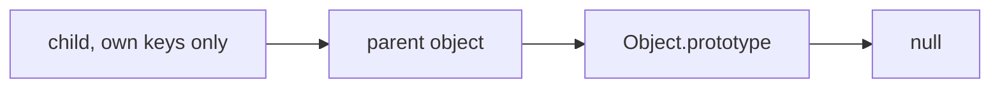

A normal assignment does not walk the way a read walks. `child.model = "gx"` creates or updates an own property on `child`. It does not search for an existing `model` and then edit the parent. The parent's `model` remains for anyone whose walk does not stop earlier. The child now has its own `model`, so later reads of `child.model` stop at the child. That hiding is shadowing. The inherited property is not deleted, and the link is not broken. Delete the own property and the inherited one is visible again, because lookup simply fails to find an own key and continues. The exception is a setter already sitting on the chain for that name: the assignment invokes the setter instead of creating an own data property. Ordinary data fields do not do that, so the default you should expect is that a write makes an own property on the object at the left of the dot.

### `in` sees the chain and `hasOwn` does not

`"model" in child` answers "does the walk find this key anywhere", so it is true for an own key and true for an inherited key. `Object.hasOwn(child, "model")` answers "is this key an own property of this object", and it is false when the key lives only on a prototype. The two questions get mixed because both sound like "does it have model". They are not the same question, and using one where the code meant the other is how a default inherited from a parent gets treated as a value this object stored itself.

`Object.keys` and `Object.entries` list own enumerable keys only, so an inherited `model` is absent there even though `"model" in child` is true. JSON serialization follows the same own-enumerable view, which is why a prototype field disappears in a payload. A `for...in` loop is the odd walk: it visits inherited names too, but only enumerable ones, so it still hides `toString`. An empty `Object.keys` result is not an empty chain. `"toString" in {}` is true, `Object.hasOwn({}, "toString")` is false, and `Object.keys({})` is an empty array. If you are deciding whether a write has already shadowed a name, read `in` and `Object.hasOwn` as a pair. After the child assigns `model`, `hasOwn` flips to true and the read returns the child's value, while the parent still reports whatever it held. A name that exists on nobody makes both checks false.

Prefer `Object.hasOwn(obj, key)` to `obj.hasOwnProperty(key)`. `hasOwnProperty` is itself an inherited method. A dictionary created with `Object.create(null)` does not have it, and a dictionary that stored a non-function under that name will not give you a trustworthy call. `Object.hasOwn` is a function you hold, and the object's keys cannot replace it. The runtime you are using here provides it, so there is no reason to borrow the method from the object you are inspecting.

### Methods are shared because they sit on the prototype

A class declaration creates a constructor function and an object stored at `Constructor.prototype`. Methods written in the class body are defined on that prototype object. They are not copied onto each instance. Instance fields go the other way. Each time the constructor runs, field initializers store own properties on the new object. The split is why a method is shared and a field is not, and it is a direct consequence of the walk above, not a second kind of object.

```ts
class Gauge {
  unit = "kPa"
  read(raw: number) {
    return `${raw} ${this.unit}`
  }
}
```

`new Gauge()` returns an object whose prototype link is `Gauge.prototype`. `unit` sits on the instance, so one gauge can hold `"kPa"` while another holds `"psi"`. `read` sits on `Gauge.prototype`, so both instances look it up and find the same function. `Object.hasOwn(gauge, "read")` is false. `Object.hasOwn(gauge, "unit")` is true. `gaugeA.read === gaugeB.read` is true. `Object.keys(gaugeA)` lists `unit` and does not list `read`, because the method is not an own property, and on the prototype it is non-enumerable anyway. Calling `gaugeA.read(4)` still uses `gaugeA` as `this`, because the call sets `this` to the receiver. The function object is shared. The receiver is not. The body reads `this.unit`, so it sees the own field of whichever gauge you called it on. Sharing the function does not share the field. If it did, two gauges could not display different units through one `read`.

If you wrote `read` as a field whose initializer created a function, each constructor run would store a new function as an own property. The instances would no longer share one function, `hasOwn` on `read` would be true, and a subclass or a later patch to `Gauge.prototype.read` would not affect those instances. A method in the class body is the shared shape. A field initializer is the per-instance shape. That is also the safe place to create an array. The initializer runs again for every `new`, so each instance receives its own array reference. Putting one array where every instance looks it up, on the prototype, does the opposite.

Static methods are properties of the constructor function, not of `Constructor.prototype`. `Gauge.parse` is found on `Gauge`. An instance does not inherit it by walking to `Gauge.prototype`, so `gauge.parse` is a miss unless you assigned it yourself. Keep statics on the constructor in your mental picture, or you will search the instance chain for a function that was never placed there.

### A mutable value on the prototype is one value

A prototype looks like a template, and for a string or a number the mistake of stuffing defaults there stays quiet. Replacing a string means assigning a new own property, which shadows the parent and leaves the parent alone. An array or a plain object is not replaced by `push` or by writing a nested field. The child does not own the array. The read finds the parent's array. `push`, an index write, and a property write on an object all mutate that one value, so every child who still resolves the name to the parent sees the edit.

Picture a template object whose `alarms` property is `[]`, and two device objects created with `Object.create(template)`. The first device pushes `"overheat"`. The second device's `alarms` list now contains `"overheat"` as well. `Object.hasOwn(device, "alarms")` is still false after the push. That is the clue. `push` did not assign the property `alarms`. It mutated the array the property already referenced. The repair is an own array before the write, either `device.alarms = []` or a class field `alarms = []`. The field initializer runs per instance, so the references differ. One array object parked on the prototype is the bug, even when the author thought of it as "the default empty list".

Mutating the parent directly has the same shape. `template.alarms.push("overheat")` is visible to every child whose walk still finds `alarms` on the template. A child that already shadowed `alarms` with its own array does not see that push, because its walk stops at the own property. A test that builds one child and never mutates hides the sharing. Two children and one `push` make the single array obvious. The same bug appears when the shared value is a plain object of counters or a map of sets: any in-place edit is a write to shared memory, and the prototype link is what made the memory shared.

### Class syntax or `Object.create`

Both tools install a prototype link. Neither one copies fields onto the child as a template stamp. Choose by the object you are trying to build, not by which syntax looks more modern. A class is a constructor plus a prototype object for shared methods plus per-instance fields. `Object.create` is only the link, which is what you want when the parent already exists and you do not need a constructor to keep in step with it.

| You want | Use | Why |
|---|---|---|
| Many instances, shared methods, separate fields | `class` and `new` | Methods are defined on `Constructor.prototype`. Each construction runs field initializers and stores own properties |
| One object linked to a parent you already hold | `Object.create(parent)` | Sets the prototype link and copies nothing, so there is no constructor to maintain |
| A dictionary that must not inherit `toString` | `Object.create(null)` | The chain ends immediately, so inherited names cannot show up in `in` or `for...in` |
| A shared mutable array or object used as a default | Neither | Every child that has not shadowed the name reads and mutates the same value |

Reach for a class when you would otherwise write a constructor function and then assign methods onto its `.prototype` by hand. The declaration does that placement for you, and field initializers give each instance its own data. Reach for `Object.create` when you are linking one object to data you built earlier, or when you want a chain with no constructor at all. Refuse the prototype as a bag of default arrays and default objects. If each record needs its own list, the list has to be created when that record is created. The chain is for sharing behavior that is safe to share, mostly functions, not for sharing containers that callers will mutate.

### You can now

- Trace a property read from the object through each prototype until a hit or `null`.
- Separate an own key, an inherited key, and a missing key with `Object.hasOwn` and `in`, including a stored `undefined`.
- Explain shadowing as an own write that stops the walk, not as an edit applied to the parent.
- Say where a class puts methods and where it puts instance fields, and why two instances share one method while `this` still sees the receiver's fields.
- Recognize a shared mutable array on a prototype and give each object an own array instead.

::: quiz
q: `parent` is `{ hue: "amber" }` and `child` is `Object.create(parent)`, with no assignment to `child`. Which description is right?
- `"hue" in child` is false, because `hue` was never written on `child`, and `Object.create` only links own keys
+ `"hue" in child` is true and `Object.hasOwn(child, "hue")` is false, because `in` walks the prototype link and `Object.hasOwn` does not
- Both checks are true, because `Object.create` copied `hue` onto `child` as an own property
- Both checks are false, because a prototype property is visible only to `Object.keys`
why: `Object.create` does not copy keys. It sets the child's prototype link to `parent`, so a read of `hue` finds the parent and `in` reports true. `Object.hasOwn` stops at the child, which has no own `hue`. The tempting mistake is to treat `Object.create` as a copy, or to treat `in` as if it were `Object.keys`, which lists only own enumerable names.
:::

::: quiz
q: A template object holds `alarms: []`. Two children are made with `Object.create(template)`, and the first child runs `alarms.push("overheat")`. What do you observe?
- The second child's list stays empty, because `push` writes an own property on the first child
- The push throws, because properties found on a prototype are frozen
+ Both children see `"overheat"`, because neither owns `alarms`, so both reads find the one array on the template, and `push` mutates that array
- Each child received a private array at creation, so only the first list changes
why: The prototype is not a stamp that copies `[]` into each child. Lookup finds the same array object, and `push` mutates it in place, so `Object.hasOwn(child, "alarms")` stays false. The tempting picture is a per-instance default. That only happens if each child assigns its own array, or a class field initializer creates a new array per construction. `push` never does that assignment.
:::

::: card
q: Where does a class declaration put a method, where does it put an instance field, and what does a call use for `this`?
answer: The declaration creates a constructor function and stores methods on `Constructor.prototype`, so instances share one function and `Object.hasOwn(instance, "methodName")` is false. Field initializers write own properties on each new instance, so those values are not shared. A call such as `instance.method()` sets `this` to that instance, and the shared function then reads the own fields of the receiver.
:::

::: predict lang=typescript
code:
```ts
const parent = { role: "base", tags: ["core"] }
const child = Object.create(parent)
child.role = "leaf"
console.log(child.role)
console.log("role" in child)
console.log(Object.hasOwn(child, "role"))
console.log("tags" in child)
console.log(Object.hasOwn(child, "tags"))
console.log(child.tags[0])
```
answer:
```
leaf
true
true
true
false
core
```
why: `Object.create` links `child` to `parent` and copies nothing. Assigning `child.role` creates an own property that shadows `parent.role`, so the read is `leaf`, `in` is true, and `hasOwn` is true. `tags` was never assigned on the child, so `in` still finds it on the parent while `hasOwn` is false, and the read returns the parent's array.
:::

::: predict lang=typescript
code:
```ts
const proto = { notes: ["boot"] }
const a = Object.create(proto)
const b = Object.create(proto)
a.notes.push("a-only")
console.log(b.notes.join(","))
console.log(Object.hasOwn(a, "notes"))
a.notes = ["fresh"]
a.notes.push("mine")
console.log(a.notes.join(","))
console.log(proto.notes.join(","))
```
answer:
```
boot,a-only
false
fresh,mine
boot,a-only
```
why: The first `push` mutates the one array on `proto`, so `b` sees it, and `a` still does not own `notes`. Assigning `a.notes = ["fresh"]` shadows the name with a new array. The later `push` edits that own array only, so the prototype's array stays `boot,a-only`.
:::

::: write lang=typescript
task: Export `lookup(obj, key)`. Walk from `obj` with `Object.getPrototypeOf` until the link is `null`. If `key` is an own property of the starting object, return `{ value, own: true }`. If the first hit is on a later object in the chain, return `{ value, own: false }`. If the chain ends with no hit, return `undefined`. A stored `undefined` is still a hit. Do not implement this as `obj[key]` alone, because that value cannot tell an own hit from an inherited hit or a miss from a stored `undefined`. Read values with `Object.getOwnPropertyDescriptor` or another own-property check, not with a single index.
starter:
```ts
export function lookup(obj: object, key: string): { value: unknown; own: boolean } | undefined {
  if (!Object.hasOwn(obj, key)) return undefined
  const desc = Object.getOwnPropertyDescriptor(obj, key)
  if (desc === undefined || !("value" in desc)) return undefined
  return { value: desc.value, own: true }
}
```
tests:
```ts
// Wrong answer: Object.hasOwn on the start object only, so inherited keys come back undefined
import { test } from "node:test"
import assert from "node:assert/strict"
import { lookup } from "./solution.ts"

test("own, inherited, shadowed, and missing", () => {
  const root = { origin: "lab", label: undefined }
  const mid = Object.create(root) as { mid?: number }
  mid.mid = 2
  const leaf = Object.create(mid) as { origin?: string }
  leaf.origin = "field"
  assert.deepEqual(lookup(leaf, "origin"), { value: "field", own: true })
  assert.deepEqual(lookup(leaf, "mid"), { value: 2, own: false })
  assert.deepEqual(lookup(leaf, "label"), { value: undefined, own: false })
  assert.equal(lookup(leaf, "nope"), undefined)
})

test("a stored undefined is an own hit, and a null prototype has no toString", () => {
  const box: Record<string, unknown> = { mark: undefined }
  assert.deepEqual(lookup(box, "mark"), { value: undefined, own: true })
  const bare: Record<string, unknown> = Object.create(null)
  bare.code = 7
  assert.deepEqual(lookup(bare, "code"), { value: 7, own: true })
  assert.equal(lookup(bare, "toString"), undefined)
})

test("non-enumerable own keys and Object.prototype are still on the walk", () => {
  const sealed = {}
  Object.defineProperty(sealed, "seal", { value: "wax", enumerable: false })
  assert.deepEqual(lookup(sealed, "seal"), { value: "wax", own: true })
  const found = lookup({}, "toString")
  assert.equal(found?.own, false)
  assert.equal(typeof found?.value, "function")
})
```
solution:
```ts
export function lookup(obj: object, key: string): { value: unknown; own: boolean } | undefined {
  let current: object | null = obj
  let own = true
  while (current !== null) {
    if (Object.hasOwn(current, key)) {
      const desc = Object.getOwnPropertyDescriptor(current, key)
      const value = desc !== undefined && "value" in desc ? desc.value : undefined
      return { value, own }
    }
    current = Object.getPrototypeOf(current) as object | null
    own = false
  }
  return undefined
}
```
hint: Loop with `Object.getPrototypeOf` until `null`. On the first object where `Object.hasOwn` is true, read that descriptor's `value` and return. Set `own` to false only after you leave the starting object. Do not treat a value of `undefined` as a miss.
:::

## A new array can still share the objects inside
id: arrays-js
stage: js
needs: prototypes
minutes: 45
goal: Build a new array or object from an old one without mutating nested values you still share, because spread and the copying array methods are shallow.
source: javascript.info: Array methods | https://javascript.info/array-methods
source: MDN: Array | https://developer.mozilla.org/en-US/docs/Web/JavaScript/Reference/Global_Objects/Array
source: MDN: Optional chaining | https://developer.mozilla.org/en-US/docs/Web/JavaScript/Reference/Operators/Optional_chaining
source: MDN: Destructuring assignment | https://developer.mozilla.org/en-US/docs/Web/JavaScript/Reference/Operators/Destructuring_assignment

`map`, `filter`, and `reduce` are functions on `Array.prototype`. Your list does not own a private copy of them. A read of `loans.map` walks to `Array.prototype` and finds one shared function, the same way any other method is found, so calling it does not stamp a new `map` onto that array. What the call returns is a different question from where the function lives. `map` and `filter` allocate a new array. They do not rewrite the array you called them on. `reduce` allocates whatever your callback builds, which is often not an array at all. The bugs start when the new array still holds the old objects, or when a different method, `sort` or `splice`, edits the original instead of allocating.

### `map`, `filter`, and `reduce` each keep a different thing

`map` calls your function once per index and stores the return value, so the result has the same length as the input. Use it when every element becomes a new element. `filter` also calls your function once per element, but it keeps the original element, not the callback's return value, and only when that return value is truthy. The result is shorter or the same length, never a transformation of the element into the boolean you returned. Returning `loan.title` from `filter` keeps every loan whose title is a non-empty string, because a non-empty string is truthy. It does not produce an array of titles. If you want the titles of the open loans, filter first on `loan.open`, then map the survivors to `loan.title`. One callback cannot do both jobs, because the two methods disagree about what the return value means.

`reduce` folds the list into one accumulator. Pass the initial value. Without it, `reduce` takes the first element as the accumulator and starts at index 1, and an empty array throws, because there is no first element to steal. With an initial `0`, an empty list of page counts sums to `0` and a non-empty list starts adding from that `0`. The callback returns the next accumulator. It does not get pushed anywhere unless the accumulator you chose is an array and you push into it, which is usually a worse `map` or `filter`.

Take three loans, `{ title: "Knots", pages: 240, open: true }`, `{ title: "Tides", pages: 180, open: false }`, and `{ title: "Ore", pages: 96, open: true }`. Filtering on `open` keeps Knots and Ore. Mapping those to `title` yields `["Knots", "Ore"]`. Reducing with `(sum, loan) => loan.open ? sum + loan.pages : sum` and an initial `0` yields `336`. None of those calls reorder or shorten the original `loans` array. If a later step needs the closed loan, it is still at index 1. That is the reason to prefer these methods over a loop that `splice`s as it goes: the loop's index shifts under you when you delete, and the caller who handed you the array sees the damage.

A callback that only reads is safe to share with those methods. A callback that does `loan.open = false` or `loan.tags.push("x")` mutates the object that still sits in the input, because `map` and `filter` put the same object references in the output when you return them. Returning `loan` from `map` is a new array and the same objects. Returning `{ ...loan, open: true }` is a new array and new objects for the ones you spread. The distinction is the whole rest of this page.

### Destructuring and `?.` name the piece you actually need

Destructuring is a read pattern, not a copy of the whole value. `const [head, ...rest] = titles` takes index 0 and builds a new array for everything after it. `rest` is not a view that writes back into `titles`. `const { title, pages, open = false } = loan` pulls own properties off the object. The default `false` applies only when `open` is missing or `undefined`. A real `false` stays `false`, so a default is not a truthiness filter. Renaming is `title: name` on the left, which means "read `title`, bind it to `name`". The colon is not a type and not a default. `const { title: name, ...meta } = loan` puts the other enumerable own properties onto a new object, `meta`, which is shallow in the same way a spread is shallow.

Optional chaining stops a read when the base is `null` or `undefined`. `loan.borrower?.city` is `undefined` when `borrower` is nullish, and it does not throw. It also yields `undefined` when `borrower` exists and `city` is absent. The `?.` covers only the base on its left. `loan.borrower?.city.length` still throws when `city` is `undefined`, because the property read of `length` is ordinary. Write `loan.borrower?.city?.length` if both links may be missing. `catalog?.[index]` does the same for a value that might not be an array, and `notify?.()` calls a function only when `notify` is not nullish. Optional chaining is not an assignment. You cannot use it on the left of `=` to mean "set this if the chain exists".

`??` is the partner to use when the fallback should apply only to `null` and `undefined`. `loan.shelf ?? "stacks"` keeps a shelf name of `""` and replaces a missing shelf. `||` would also replace `""` and `0`, because both are falsy. That difference matters for a label that is allowed to be blank and for a count that is allowed to be zero. Reach for `??` unless you have already decided that every falsy value should become the fallback. An assignee that was stored as `""` is not the same fact as an assignee that was omitted.

### Spread copies one level, then shares the rest

Object spread and array spread build a new container and copy the values of the own enumerable properties, or the elements, into it. A string or a number is a value, so the copy has its own. Replacing `next.section` does not change `shelf.section`. An array or an object is also a value, and that value is a reference. The copy stores the same reference. Both containers now point at one nested array, and at one nested object inside it.

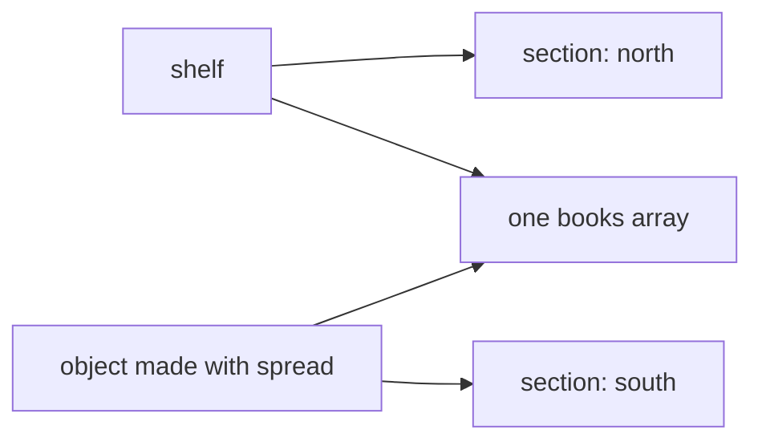

So this shape is a trap if you meant a private list:

```ts
const shelf = { section: "north", books: [{ title: "Knots", pages: 240 }] }
const next = { ...shelf }
next.section = "south"
next.books.push({ title: "Tides", pages: 180 })
```

`shelf.section` stays `"north"`, because you assigned a new string onto `next` only. `shelf.books` gains Tides, because `push` mutated the array both variables still share. A later `next.books[0].pages = 1` would also change `shelf.books[0].pages`. The spread did not fail. It did exactly one level. People describe that as a shallow copy. A deep copy would allocate new arrays and new objects all the way down, which is a different operation, and it is often more copying than an update needs. `JSON.parse(JSON.stringify(shelf))` is a clumsy deep copy that drops `undefined`, turns dates into strings, and throws functions away. Reaching for it to change one title is a sign the path-copy below is a better fit.

The same one-level rule applies to arrays. `[...books]` is a new array with the same book objects. Sorting or pushing on the new array leaves the old array's length and order alone. Replacing `copy[0].title` still edits the book the old array holds, because index 0 in both arrays is the same object. Copying the list of tags on a book is `[...book.tags]`, a new array of the same strings. Strings have no mutating methods that change their contents, so the new array is what stops a later `push` from touching the caller's tag list. Spreading the book and forgetting to spread `tags` copies the array reference and fails that test.

### `sort` and `splice` edit the array you already have

`sort` reorders the array you called it on and returns that same array. A caller who kept the reference sees the new order. The default comparison converts elements to strings and compares UTF-16 code units, so a page-count list `[8, 40, 9]` becomes `[40, 8, 9]`, because `"40"` starts with a code unit before `"8"`. Numeric order needs a comparator `(x, y) => x - y`. Forgetting the comparator is why a list that looks sorted is sorted as text. `toSorted` uses the same comparison rules and returns a new array, leaving the receiver's order alone. `reverse` and `toReversed` are the same pair for flipping ends.

`splice` mutates too, and its return value is the removed elements, not the array that remains. `const tail = items.splice(1)` deletes from index 1 through the end of `items` and hands you those deleted elements. `items` is now only what was at index 0. Code that wanted "a copy of the tail, input unchanged" wanted `toSpliced`, or a destructuring rest, not `splice`. `toSpliced(start, deleteCount, ...inserts)` returns the new array and does not write through the old one. `with(index, value)` returns a copy with one index replaced, which is the array form of "new container, one element changed". These copying methods exist in current Node, so a mutation is a choice you should be able to point at, not the only tool the standard library gave you.

If a function's name says it is a view, a summary, or an update, mutating `sort` and `splice` are the wrong default. They are reasonable when you own the array, nothing else holds it, and you want to avoid allocating. The moment the array was an argument, assume the caller still holds it.

### Change a nested field by copying the path

An immutable update returns a new root and new objects only along the path you changed. Objects you did not change can stay the same references. That sharing is deliberate, and it is safe only because you do not mutate those objects later. For a shelf, a new title on one book is a new shelf, a new `books` array, and a new object for that book. The other book references can be reused.

```ts
function retitle(shelf: { books: { isbn: string; title: string }[] }, isbn: string, title: string) {
  return {
    ...shelf,
    books: shelf.books.map((book) => (book.isbn === isbn ? { ...book, title } : book)),
  }
}
```

The original shelf's matching book still has the old title, because you never assigned to it. You allocated a replacement and put that replacement in the new array. One spread of the shelf, followed by `next.books[i].title = title`, does the opposite. The root is new, the array is shared, the book is shared, and the assignment writes into the caller's book. The bug is the write into a nested object the spread did not clone, not a failure of the `...` operator.

The same pattern is how you add a tag without sharing the array: copy the book, and copy `tags` with a new array that includes the extra string, `{ ...book, tags: [...book.tags, "reprint"] }`. Pushing onto `book.tags` after a shallow spread edits the input's array. When the nested value is itself an object, spread that object too. Stop at the level you actually replace. Copying every node in a large tree to change one leaf works, but it is more allocation than the path requires, and it hides which objects were supposed to remain comparable by reference.

| You want | Write | Do not write |
|---|---|---|
| A new element for every input | `map` | A loop that writes into the caller's array |
| A shorter list of the same elements | `filter` on a boolean test | `filter` that returns a title, or `splice` while iterating |
| One accumulated value | `reduce` with an initial value | `reduce` on a possibly empty array with no initial value |
| A sorted copy | `toSorted(compare)` | `sort`, which reorders the receiver, or the default string compare for numbers |
| A copy with a gap or an insert | `toSpliced` | `splice`, which mutates and returns the removed piece |
| One object field replaced | `{ ...obj, field }` | `obj.field =` when other holders of `obj` must not change |
| One nested field replaced | Spread each object along the path | A root spread, then a write into a nested object you still share |
| A read that may be missing | `a?.b?.c` | `a.b.c` when `a` or `b` may be nullish |
| A default only for `null` and `undefined` | `??` | `\|\|`, which also replaces `""` and `0` |

### You can now

- Choose `map`, `filter`, or `reduce` by whether you keep a return value, an original element, or an accumulator, and pass an initial value to `reduce`.
- Pull an array apart with a rest element and an object apart with a rename, a default, and an object rest.
- Predict that object spread and array spread share nested arrays and objects, so a later `push` or field write hits the input.
- Prefer `toSorted`, `toReversed`, and `toSpliced` when a caller still holds the array, and pass a numeric comparator when the elements are numbers.
- Return a new root for a nested change by copying each object on the path, and use `?.` and `??` without treating `""` or `0` as missing.

::: quiz
q: You have `const pages = [8, 40, 9]` and you call `const ordered = pages.sort()`. What is true afterward?
- `ordered` is `[8, 9, 40]` and `pages` is still `[8, 40, 9]`, because `sort` returns a copy in numeric order
+ `sort` reorders `pages` itself with the default string comparison, so both `pages` and `ordered` are `[40, 8, 9]` and they are the same array
- `sort` returns the removed elements, so `ordered` is empty and `pages` is unchanged
- The call throws, because numeric arrays have no default order
why: `sort` mutates the receiver and returns that same array. The default comparator turns numbers into strings, and `"40"` is less than `"8"` in UTF-16 order, so the result is not numeric order. The tempting belief is that `sort` is a pure view. A copy in numeric order is `pages.toSorted((x, y) => x - y)`, which leaves `pages` as `[8, 40, 9]`.
:::

::: quiz
q: `shelf` is `{ section: "north", books: [{ title: "Knots" }] }` and `next` is `{ ...shelf }`. Then the code sets `next.section = "south"` and `next.books[0].title = "Tides"`. What does `shelf` hold, and why?
- `{ section: "south", books: [{ title: "Tides" }] }`, because spread is a live view of the original
+ `{ section: "north", books: [{ title: "Tides" }] }`, because spread copied the string into a new object but copied the reference to the same `books` array and the same book object
- `{ section: "north", books: [{ title: "Knots" }] }`, because spread deep-clones every nested object before you write
- The title assignment throws, because a spread object is frozen
why: Spread allocates one new object and copies each own property's value once. The section string is replaced on `next` only. The `books` value is a reference, so `next.books[0]` is `shelf.books[0]`, and assigning `title` mutates that shared object. The tempting mistake is to treat spread as a deep clone, or as an alias of the original variable.
:::

::: card
q: What do `map`, `filter`, and `reduce` keep from the callback, and when does `reduce` throw on an empty array?
answer: `map` stores the callback's return value and keeps the length. `filter` stores the original element when the callback's return value is truthy, so returning a title does not build a list of titles. `reduce` stores whatever accumulator the callback returns. It throws on an empty array when you omit the initial value, because it would have to use a first element that does not exist.
:::

::: predict lang=typescript
code:
```ts
const station = { name: "dock", probe: { serial: "P-4", unit: "C" } }
const alias = { ...station, name: "dock-2" }
alias.probe.unit = "F"
console.log(station.name)
console.log(station.probe.unit)
console.log(alias.probe === station.probe)
```
answer:
```
dock
F
true
```
why: The spread builds a new object and copies `name` and `probe` one level. Replacing `alias.name` does not write `station.name`, so the first line stays `dock`. `probe` is a shared object reference, so writing `alias.probe.unit` changes `station.probe.unit` to `F`, and the two `probe` properties are still `===`.
:::

::: predict lang=typescript
code:
```ts
const samples = [20, 3, 100]
console.log(samples.toSorted().join(","))
console.log(samples.join(","))
const ranked = samples.toSorted((x, y) => x - y)
console.log(ranked.join(","))
samples.splice(0, 1)
console.log(samples.join(","))
console.log(ranked.join(","))
```
answer:
```
100,20,3
20,3,100
3,20,100
3,100
3,20,100
```
why: `toSorted` with no comparator orders by string code units, so `100` comes first, and `samples` stays `20,3,100`. The numeric comparator returns a new array `3,20,100`. `splice(0, 1)` mutates `samples` into `3,100` and does not touch `ranked`, which is a different array.
:::

::: write lang=typescript
task: Export `viewOf(tickets)`. Each ticket has `id`, `title`, an optional `assignee`, and `tags`. Return one row per ticket whose `title` is not blank after `trim`, in the same order. Keep the original `title` text, including surrounding spaces, when the trimmed title is not empty. `who` is the `assignee` when that property is a string, including `""`, and `"unassigned"` when `assignee` is missing or `undefined`. Copy `tags` into a new array on every row so a later `push` on the row does not change the ticket's array. Do not mutate the input array or any ticket.
starter:
```ts
export function viewOf(
  tickets: { id: string; title: string; assignee?: string; tags: string[] }[],
): { id: string; title: string; who: string; tags: string[] }[] {
  return tickets
    .filter((ticket) => ticket.title.trim() !== "")
    .map((ticket) => ({
      id: ticket.id,
      title: ticket.title,
      who: ticket.assignee ?? "unassigned",
      tags: ticket.tags,
    }))
}
```
tests:
```ts
// Wrong answer: reusing ticket.tags, so a push on the row mutates the input
import { test } from "node:test"
import assert from "node:assert/strict"
import { viewOf } from "./solution.ts"

test("drops blank titles and keeps an empty assignee", () => {
  const input = [
    { id: "n1", title: "   ", tags: ["skip"] },
    { id: "n2", title: " Rack warm ", assignee: "", tags: ["hw"] },
    { id: "n3", title: "Fan", assignee: "mo", tags: ["hw", "urgent"] },
  ]
  const view = viewOf(input)
  assert.deepEqual(
    view.map((row) => [row.id, row.title, row.who]),
    [
      ["n2", " Rack warm ", ""],
      ["n3", "Fan", "mo"],
    ],
  )
  assert.equal(input.length, 3)
  assert.equal(input[0]?.title, "   ")
})

test("a missing assignee is unassigned, and tags are not shared", () => {
  const tags = ["net"]
  const input = [
    { id: "n9", title: "Link", tags },
    { id: "n8", title: "\n", assignee: "mo", tags: ["gone"] },
  ]
  const view = viewOf(input)
  assert.equal(view.length, 1)
  assert.equal(view[0]?.who, "unassigned")
  assert.deepEqual(view[0]?.tags, ["net"])
  view[0]?.tags.push("extra")
  assert.deepEqual(tags, ["net"])
  assert.notEqual(view[0]?.tags, tags)
})
```
solution:
```ts
type Ticket = { id: string; title: string; assignee?: string; tags: string[] }
type Row = { id: string; title: string; who: string; tags: string[] }

export function viewOf(tickets: Ticket[]): Row[] {
  const rows: Row[] = []
  for (const ticket of tickets) {
    if (ticket.title.trim() === "") continue
    rows.push({
      id: ticket.id,
      title: ticket.title,
      who: ticket.assignee ?? "unassigned",
      tags: [...ticket.tags],
    })
  }
  return rows
}
```
hint: `filter` on `title.trim()`, then build a new object. `??` keeps an empty assignee string. Copy tags with `[...ticket.tags]` so the row's array is a different reference.
:::

::: write lang=typescript
task: Export `setProbeUnit(station, unit)`. `station` has `id` and `probe`, and `probe` has `unit` and `serial`. Return a new station whose probe is a new object with the given `unit` and the same `serial`. Leave the caller's `station` and `station.probe` unchanged, including the old `unit`.
starter:
```ts
export function setProbeUnit(
  station: { id: string; probe: { unit: string; serial: string } },
  unit: string,
): { id: string; probe: { unit: string; serial: string } } {
  station.probe.unit = unit
  return station
}
```
tests:
```ts
// Wrong answer: assigning station.probe.unit writes through the shared probe and returns the same root
import { test } from "node:test"
import assert from "node:assert/strict"
import { setProbeUnit } from "./solution.ts"

test("copies the station and the probe", () => {
  const station = { id: "dock", probe: { unit: "C", serial: "P-4" } }
  const next = setProbeUnit(station, "F")
  assert.equal(next.probe.unit, "F")
  assert.equal(next.probe.serial, "P-4")
  assert.equal(next.id, "dock")
  assert.notEqual(next, station)
  assert.notEqual(next.probe, station.probe)
  assert.equal(station.probe.unit, "C")
})

test("a second call does not see the first call's unit", () => {
  const station = { id: "pier", probe: { unit: "C", serial: "P-9" } }
  const warmer = setProbeUnit(station, "K")
  const cooler = setProbeUnit(station, "C")
  assert.equal(warmer.probe.unit, "K")
  assert.equal(cooler.probe.unit, "C")
  assert.equal(station.probe.unit, "C")
  assert.notEqual(warmer.probe, cooler.probe)
})
```
solution:
```ts
export function setProbeUnit(
  station: { id: string; probe: { unit: string; serial: string } },
  unit: string,
): { id: string; probe: { unit: string; serial: string } } {
  return {
    ...station,
    probe: { ...station.probe, unit },
  }
}
```
hint: Spread the station and spread `probe` inside that new object. Passing `unit` after the probe spread overwrites the copied unit. Do not assign to `station.probe`.
:::

## An import reads a live binding, and package.json picks the loader
id: modules-js
stage: js
needs: arrays-js
minutes: 45
goal: Predict what an importer sees after an export is reassigned, and which package.json fields decide the loader, the runtime dependencies, and the public entry.
source: javascript.info: Modules | https://javascript.info/modules-intro
source: MDN: JavaScript modules | https://developer.mozilla.org/en-US/docs/Web/JavaScript/Guide/Modules
source: Node.js: Packages | https://nodejs.org/api/packages.html

A JavaScript file is not a module because it contains functions. It is a module when the loader treats it as one, and that decision changes which syntax is legal and what an `import` captures. Two files can look identical and behave differently because one directory has `"type": "module"` and the other does not. The failure is a value published through the wrong door, or a binding the importer copied once and then trusted after the owner had moved on.

The loader keeps one module instance per absolute URL. The first import runs the body. A later import of the same URL does not run it again. A counter, a registry, or a feature flag lives in that one instance, which is why every importer shares it.

### Named exports and the one default

A named export publishes a binding under a name you choose. `export function parse(s: string): number` exports `parse`. `export const limit = 20` exports `limit`. `export { parse as read }` publishes that function as `read`. The importer asks for the names: `import { parse, limit } from "./io.js"`, or `import { parse as read } from "./io.js"`. Anything not exported stays private. A neighboring file cannot read a `let` just because it shares a folder.

A default export is a binding whose name is `default`, not the name of the function you wrote. `export default function load() {}` is imported as `import load from "./io.js"`. The local name is the importer's choice, so `import app from "./io.js"` reads the same export. Both surfaces fit in one statement, `import load, { parse } from "./io.js"`. `import { load }` does not find a default, and `import parse from "./io.js"` does not find a named function. The braces are the difference.

Use a default when the file has one obvious value. Do not default-export an object of utilities. The names leave the import line, and a reader has to open the file to see the contract. `export { parse } from "./parse.js"` re-exports `parse` without copying it into a new variable. The binding is still the original one.

### The binding stays attached to the exporter

`export let count = 0` does not hand importers the number `0`. It hands them the binding `count`. When the exporter later runs `count = count + 1`, the next read in every importer sees the new number. Nothing notifies them. The read looks through the binding. That is a live binding, and it is the normal behavior of `import`.

The importer cannot write it. After `import { count } from "./metrics.js"`, the statement `count = 1` is a type error and a runtime error. The assignment belongs to the module that declared the `let`. A snapshot is a separate variable taken on purpose: `const atStart = count`. That number will not move. Use it for the value as of this line. Keep the binding when you mean whatever the owner has set, which is what a feature flag or a counter is. Copying the flag at import time is how a test changes it and the code under test keeps the old value.

CommonJS does not do this. `const { count } = require("./metrics.cjs")` copies the current property into a local. Later assignments in the required file do not update that local. `const metrics = require("./metrics.cjs")` followed by a read of `metrics.count` does see later writes to that property, because both sides hold the object. It does not see a later reassignment of `module.exports`. `require` already returned the previous object. After the exporter assigns, an ES `import` sees the new value on the next read. A destructured `require` does not.

### A relative specifier names the file

In a real ES module a relative specifier is a URL path, not a search. `./util` does not try `./util.js`, then `./util.json`, then `./util/index.js`. The extension is part of the string. `./util.js` loads that file. `../pkg.js` climbs one directory. A trailing slash does not mean `index.js`. CommonJS will search. The ES loader will not, and the error names the extensionless specifier.

Write the extension of the file that actually loads. Source may be `util.ts` while the published file is `util.js`, and the import is `./util.js`. TypeScript still typechecks `util.ts` from that specifier. A bundler might add an extension. Node will not. When a `.ts` file runs directly, nothing rewrites the string either, so `./util.ts` can load and `./util` cannot.

A specifier with no leading dot is a package name. `import { z } from "money"` looks up `money` in `node_modules` and then uses that package's public entry. Relative rules are for your files.

Applying `..` and `.` is string arithmetic, not a disk read. The directory of `src/app.js` is `src`, so `./util.js` names `src/util.js`. The directory of `src/lib/a.js` is `src/lib`, so `../pkg.js` names `src/pkg.js`. From `src/a.js`, `../../out.js` climbs twice. The second climb has nothing left to leave, so the leftover `..` stays in front and the result is `../out.js`. A string that still contains `src/lib/../pkg.js` has not been resolved. Concatenating the directory and the specifier leaves that work undone.

### package.json decides how a .js file is loaded

The nearest `package.json` classifies `.js` files. `"type": "module"` makes them ES modules: `import` and `export` are legal, and `require` is not defined. `"type": "commonjs"` makes them CommonJS: `module.exports` publishes the value, and `import` is a syntax error, "Cannot use import statement outside a module". `.mjs` is always an ES module and `.cjs` is always CommonJS, whatever `type` says.

Leave `type` out and a file with no `import` and no `export` is CommonJS. Current Node also sniffs. If `type` is absent and the file contains `import` or `export`, that one file loads as an ES module. The sniff is not a contract. A tool that only reads `package.json` will disagree with it. Set `type`.

The study sandbox runs a lone `.ts` file and does not write a `package.json` beside it. With no `import` and no `export`, Node runs that file as CommonJS, so `require` and `module.exports` exist. Add an `import` and the sniff loads it as an ES module, because `type` is absent. `"type": "module"` belongs in the package you ship. The sandbox will not invent that file.

### dependencies run, devDependencies build

`dependencies` are packages the running program imports. Someone who installs your package gets them, and a production install that omits dev packages keeps them. `devDependencies` are for building and testing: TypeScript, the test runner, the bundler. Another project that installs yours does not get them, and a production install of an app does not get them either.

Swapping the lists fails in production and looks fine on a dev machine. `typescript` in `dependencies` ships a compiler to every install. A runtime library in `devDependencies` resolves while dev packages are installed and throws when the service starts without them. The field says when the package has to be present. It does not install anything. Nothing here runs npm. The JSON is the whole answer.

### exports is the public door

Before `exports`, `main` named one entry, and any file could still be imported by a deep path such as `ledger/src/internal.js`. That path becomes public the moment one caller uses it, and the file can never move. With `exports` present, only the listed keys can be imported, and `exports` takes precedence over `main`. A leftover `main` does not reopen a hidden file.

`"."` is what `import "ledger"` loads. `"./csv"` is what `import "ledger/csv"` loads. A string value, as in `"exports": { ".": "./src/index.js" }`, is that file for every condition. An object value selects a condition, first match in source order. `"import"` matches an ESM import, `"require"` matches CommonJS, and `"default"` matches only when nothing earlier did, so it comes last. A file that is not a key is not a public entry, even if it sits in `src/`. Callers import keys. They do not browse the tree.

`private: true` asks npm to refuse to publish. It does not change the loader. `"type": "module"` does. A library you are not publishing yet wants both: no accidental publish, and every `.js` file an ES module.

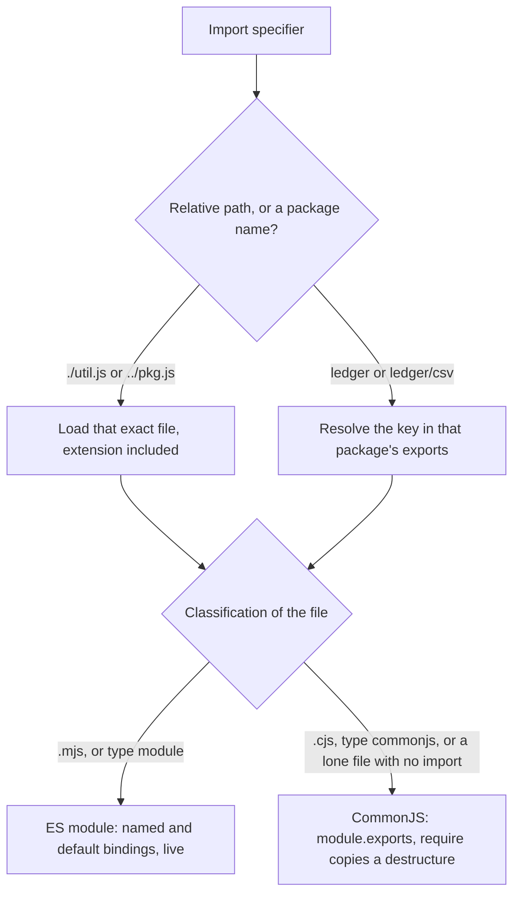

| You want | Write | Do not write |
|---|---|---|
| A named export from a neighboring file | `import { parse } from "./parse.js"` | `import { parse } from "./parse"`, or `import parse from "./parse.js"` when `parse` is not the default |
| The default export, and a named one beside it | `import load, { parse } from "./io.js"` | `import { load, parse } from "./io.js"` when `load` is the default |
| Every `.js` file in the package to be ESM | `"type": "module"` | A missing `type`, and a hope that the sniff notices `import` |
| A library the running program imports | `dependencies` | `devDependencies`, which production installs omit |
| TypeScript, or the test runner | `devDependencies` | `dependencies`, which ships them to every consumer |
| What `import "ledger"` and `import "ledger/csv"` load | `exports` keys `"."` and `"./csv"` | A deep path into `src/` that the map does not list, or `main` alone |
| The value of an exported `let` after the owner assigns it | Read the imported binding again | A `const` copied earlier, or a destructured `require` |

### You can now

- Import a named export and a default export from the same relative file, extension included.
- Say why an imported `let` changes after the exporter assigns it, and why the importer cannot assign it.
- Say what `"type": "module"`, `"type": "commonjs"`, and a missing `type` each do to a `.js` file, including a lone sandbox file with no import.
- Put a runtime library in `dependencies` and the compiler in `devDependencies`.
- Point `"."` and a subpath at real files in `exports`, and treat that map as the only public door.
- Resolve a relative specifier by applying `.` and `..`, keeping leftover `..` segments when the path climbs past the start.

::: quiz
q: A file exports `export function parse(s: string): number` and `export default function load() {}`. Which import binds both from `./io.js`?
- import parse, load from "./io.js"
- import { parse, load } from "./io.js"
+ import load, { parse } from "./io.js"
- import { default as load, parse } from "./io"
why: The default binding is imported outside the braces, under a local name you choose. Named exports go inside the braces. `load` is not a named export, so `{ parse, load }` does not find it. The specifier also needs the real extension. `./io` is not a file the ES loader will search for.
:::

::: quiz
q: `metrics.ts` contains `export let count = 0` and a function that later runs `count = count + 1`. Another file has `import { count } from "./metrics.ts"` and calls that function. What does the importer read from `count` afterward?
- Still 0, because import copied the number when the module was first evaluated
+ The new number, because the import is a live binding to `count`. The importer cannot assign `count`, but it sees the exporter's assignment
- A thrown error, because an exported let is frozen after the module body finishes
- undefined, because let exports are not visible to import
why: An ES import captures the binding, not a snapshot of the value. The module body ran once, the instance is cached, and the `let` lives in that instance. Reading `count` after the assignment reads through the binding. Writing `count = 1` in the importer is illegal. `const atStart = count` would be the snapshot, and a destructured `require` would also be a snapshot.
:::

::: card
q: When does Node load a `.js` file as an ES module, and which package.json list should hold `typescript` versus a library the program imports at runtime?
answer: `"type": "module"` makes `.js` files ES modules. `"type": "commonjs"` makes them CommonJS, and `import` is then a syntax error. A missing `type` is CommonJS for a file with no import or export. Node may sniff `import` when `type` is absent, and a lone sandbox `.ts` file with no package.json and no import runs as CommonJS. Do not rely on the sniff. Put the runtime library in `dependencies` and `typescript` in `devDependencies`. The `exports` map is the public entry. `"."` is what importing the package name loads.
:::

::: predict lang=typescript
q: There is no package.json next to this file, and the file has no import and no export. What does it print?
code:
```ts
console.log(typeof require)
console.log(exports === module.exports)
console.log(typeof module)
```
answer:
```
function
true
object
```
why: With no package.json and no import or export syntax, Node loads the file as CommonJS. `require` is a function, `module` is the module object, and `exports` starts out as the same object as `module.exports`. An `import` in this same sandbox would be classified differently, because the sniff would see module syntax and `type` is absent. `"type": "module"` is the setting that makes that classification stable for a real package.
:::

::: predict lang=typescript
q: This imports a module from a data URL. The module body is `export let n = 1; export function set(v){ n = v }`. The importer then assigns `m.n = 9`, which throws, and calls `m.set(4)`. What is printed?
code:
```ts
const url = "data:text/javascript,export let n = 1; export function set(v){ n = v }"
const m = await import(url)
console.log(m.n)
try {
  m.n = 9
  console.log("wrote")
} catch {
  console.log("locked")
}
m.set(4)
console.log(m.n)
```
answer:
```
1
locked
4
```
why: The namespace starts with `n` equal to 1. Assigning `m.n` throws because an importer cannot write an exported binding, so the catch prints `locked` and `n` is still 1. `set` runs inside the exporting module, where the assignment is legal. The binding is live, so the importer's next read of `m.n` is 4. A `const` copied from `m.n` before `set` would still be 1.
:::

::: config lang=json
task: Write a package.json for a private library named `ledger`. It must not be published (`private` is the boolean `true`). Its `.js` files are ES modules (`type` is `module`). Do not add a `main` field. The public entry for `import "ledger"` is `./src/index.js`, under the exports key `.`. The public entry for `import "ledger/csv"` is `./src/csv.js`, under the exports key `./csv`. The runtime package `money` at version `1.2.0` belongs in `dependencies`. The compiler `typescript` at version `5.6.2` belongs in `devDependencies` and must not appear under `dependencies`. `money` must not appear under `devDependencies`. Nothing is installed. The JSON file is the whole answer.
starter:
```json
{ }
```
check: private = true | private is true
check: name = "ledger" | name is ledger
check: type = "module" | type is module
check: main missing | there is no main field
check: exports."." = "./src/index.js" | the package root loads ./src/index.js
check: exports."./csv" = "./src/csv.js" | the ./csv subpath loads ./src/csv.js
check: dependencies.money = "1.2.0" | money is a runtime dependency
check: devDependencies.typescript = "5.6.2" | typescript is a devDependency
check: dependencies.typescript missing | typescript is not a dependency
check: devDependencies.money missing | money is not a devDependency
solution:
```json
{
  "name": "ledger",
  "private": true,
  "type": "module",
  "exports": {
    ".": "./src/index.js",
    "./csv": "./src/csv.js"
  },
  "dependencies": {
    "money": "1.2.0"
  },
  "devDependencies": {
    "typescript": "5.6.2"
  }
}
```
hint: `private` is a boolean and `type` is `module`. The exports key `.` points at `./src/index.js`, and the key `./csv` points at `./src/csv.js`. Put `money` only in `dependencies` and `typescript` only in `devDependencies`. Leave `main` out.
:::

::: write lang=typescript
task: Export `resolveRelative(fromFile, spec)`. `fromFile` is a posix path of a file, such as `src/app.js` or `./src/app.js`. `spec` is a relative specifier. The cases you must handle are `./x.js`, `../y.js`, and `../../z.js`, and you must apply `.` and `..` wherever those segments appear, including a `.` segment already in `fromFile`. Start from the directory that contains `fromFile` (drop the final file name). Apply each `.` by skipping it and each `..` by climbing one directory. Do not keep a trailing slash, and do not leave `..` sitting in the middle of the result. If the path climbs above the start, keep the leading `..` segments. `resolveRelative("src/app.js", "./util.js")` is `"src/util.js"`. `resolveRelative("src/lib/a.js", "../pkg.js")` is `"src/pkg.js"`. `resolveRelative("src/a.js", "../../out.js")` is `"../out.js"`. `resolveRelative("a.js", "../../out.js")` is `"../../out.js"`. Do not read or write the filesystem. Compute the string.
starter:
```ts
export function resolveRelative(fromFile: string, spec: string): string {
  const slash = fromFile.lastIndexOf("/")
  const dir = slash === -1 ? "" : fromFile.slice(0, slash)
  return dir === "" ? spec : dir + "/" + spec
}
```
tests:
```ts
// Wrong answer: concatenating the directory and the specifier, which leaves ".." in the result
import { test } from "node:test"
import assert from "node:assert/strict"
import { resolveRelative } from "./solution.ts"

test("a same-directory file and one level up", () => {
  assert.equal(resolveRelative("src/app.js", "./util.js"), "src/util.js")
  assert.equal(resolveRelative("src/lib/a.js", "../pkg.js"), "src/pkg.js")
  assert.equal(resolveRelative("a.js", "./b.js"), "b.js")
  assert.equal(resolveRelative("lib/a.js", "../b.js"), "b.js")
  assert.equal(resolveRelative("./src/app.js", "./util.js"), "src/util.js")
})

test("climbing above the start keeps the leading .. segments", () => {
  assert.equal(resolveRelative("src/a.js", "../../out.js"), "../out.js")
  assert.equal(resolveRelative("a.js", "../b.js"), "../b.js")
  assert.equal(resolveRelative("a.js", "../../out.js"), "../../out.js")
  assert.equal(resolveRelative("src/lib/a.js", "../../../x.js"), "../x.js")
})

test("dot and dot-dot are applied, with no trailing slash", () => {
  assert.equal(resolveRelative("src/lib/a.js", "../../pkg.js"), "pkg.js")
  assert.equal(resolveRelative("src/app.js", "./util.js").endsWith("/"), false)
  assert.equal(resolveRelative("src/lib/a.js", "../pkg.js").includes(".."), false)
})
```
solution:
```ts
export function resolveRelative(fromFile: string, spec: string): string {
  const dir = fromFile.split("/").slice(0, -1)
  const out: string[] = []
  for (const part of dir.concat(spec.split("/"))) {
    if (part === "" || part === ".") continue
    if (part === "..") {
      const top = out.at(-1)
      if (top !== undefined && top !== "..") out.pop()
      else out.push("..")
    } else {
      out.push(part)
    }
  }
  return out.join("/")
}
```
hint: Drop the file name from `fromFile`, then walk every segment of that directory and of `spec`. Skip `""` and `"."`. Pop for `".."` only when the last kept segment is a real name. Otherwise push `".."`. Join with `/`.
:::

## Capture goes down, the target is hit, then the event comes back up
id: dom
stage: js
needs: modules-js
minutes: 40
goal: Predict which node hears a click, what stopPropagation cancels that preventDefault does not, and why untrusted text cannot go through innerHTML.
source: javascript.info: Bubbling and capturing | https://javascript.info/bubbling-and-capturing
source: MDN: Introduction to the DOM | https://developer.mozilla.org/en-US/docs/Web/API/Document_Object_Model/Introduction
source: MDN: Introduction to events | https://developer.mozilla.org/en-US/docs/Learn_web_development/Core/Scripting/Events

A page is a tree, and a click is a walk on that tree. The element under the pointer is not the only code that runs. Every ancestor gets a chance on the way down and another chance on the way up, and the listener you attached yesterday still runs for a child that was created a moment ago. Most event bugs are a wrong assumption about that walk: the handler was on the parent, the code read the wrong element, or it stopped the browser's action by stopping the walk, which is a different switch.

The Document Object Model is that tree. The document node sits at the top. Element nodes contain element nodes. A form contains a row, the row contains a button, the button contains a span with the label. Text is a node too, a child of the element that shows it, which is why the element under a click is often the span and not the button you styled. Parents, children, and siblings are the whole vocabulary. A sibling of the button is not on the path from the button to the document, so a listener that only walks that path never sees the sibling. Tools in the browser show this tree. The rules below are about the tree, not about a particular framework's wrapper around it.

### Three phases, in that order

When an event is dispatched it moves in three phases. Capture goes from the window down through the document and the ancestors, and it stops before the target. The target phase runs the listeners registered on the element the event hit. Bubble goes from the parent of the target back up through the ancestors to the window. The order is fixed. Bubble does not run first. A listener on the window in the capture phase sees the event before a listener on the button. A listener on the window in the bubble phase sees it after.

`addEventListener` picks the phase with its third argument. `true`, or `{ capture: true }`, registers the listener for the way down. `false`, or omitting the argument, registers it for the way up. That choice matters on ancestors. It does not reorder listeners on the target itself. During the target phase the browser invokes the target's listeners in the order they were registered, and it ignores the capture flag for that ordering. Register a bubble listener on the button and then a capture listener on the same button, and the bubble listener runs first, because it was registered first. People write `{ capture: true }` on the target expecting it to run before the other listener on that same node. It will not. Capture versus bubble is a question about ancestors.

The path is determined when the event is dispatched, from the tree as it is at that moment. Removing a node later does not rewrite an event that has already started. Adding a node later does not attach today's click to yesterday's path. The next click computes a new path.

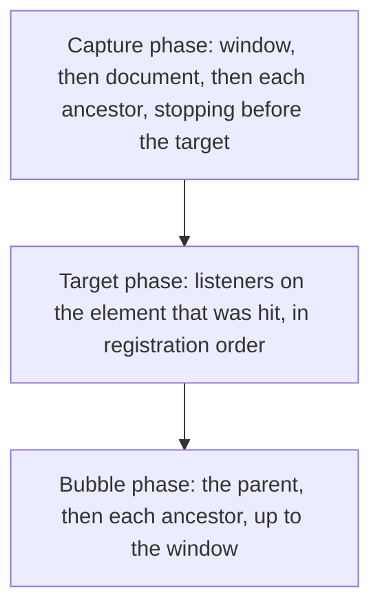

A click on a button inside a row inside a form therefore runs capture listeners on the window, the document, the form, and the row, then the button's own listeners, then bubble listeners on the row, the form, the document, and the window. The row's capture listener runs before the button. The row's bubble listener runs after the button. A sibling of the row is never visited.

### target is where it started, currentTarget is who is listening

Inside a listener, `event.target` is the element the event started on, the deepest element of the hit. `event.currentTarget` is the element the listener was registered on, the element whose listener is running right now. In a non-arrow function, `this` is also `event.currentTarget`. While the button's own listener runs, target and currentTarget are the same node. While the form's listener runs for that same click, target is still the button, or the span inside the button, and currentTarget is the form.

That split is the whole of delegation. One listener on a stable parent handles every child, including a child that did not exist when `addEventListener` ran. The listener was not copied onto the children. The event walks up to the parent at event time, the parent listener runs, and it reads `event.target` to find out which descendant was hit. A button added by a later render still bubbles to the form. A listener nailed to each button does not know about that new button unless something remembers to register it again. Delegation removes that second step.

The usual browser check is slightly more than `event.target === theButton`. The hit is often a child of the control, the icon or the label span, so the handler asks whether the target is the control or is inside it, typically with `closest`. If neither is true, the click belonged to some other descendant and this handler should ignore it. One parent can host several delegated behaviors. The form listens once. The target's identity picks save versus delete.

`stopPropagation` and `preventDefault` are not two spellings of cancel. `stopPropagation` stops the walk. Listeners on elements not yet visited do not run. Capture listeners that already ran stay ran. A stop during the target phase cuts off the bubble, so the form never hears a click that the button stopped. A stop during capture on the form means the button never hears the event at all. `stopImmediatePropagation` does that and also skips later listeners on the same element. Neither function cancels the browser's default action.

`preventDefault` cancels the default action and leaves the walk alone. A form's `submit` listener that calls `preventDefault` stops the navigation or the HTTP submit, and the event still bubbles, so a parent can still log it. A listener that only calls `stopPropagation` does not stop the submit. The form still submits, and the ancestors simply do not see the event. A link still navigates if all you did was stop the walk. Pick the switch that matches the thing you are trying to stop. Calling both is reasonable when you want neither the default action nor the rest of the walk. Calling one and expecting the other is how a form both double-posts and fails to update the parent.

### textContent is text, innerHTML is a parser

`textContent` reads and writes the text of a node. The characters `<` and `>` are characters. The browser shows them. It does not build elements from them. `innerHTML` parses a string as HTML and replaces the node's children with the resulting tree. That is what you want for markup you produced and trust. It is a cross-site scripting bug for a string that came from a user, a query parameter, a comment, or a row in the database.

The accurate form of the bug is narrower than "any script tag runs", and the narrow form is the one that ships. A `<script>` element inserted by assigning `innerHTML` does not execute. An element with an event-handler attribute does. ``, an SVG, and the same shapes in a fragment are enough. The attacker does not need a script tag. Setting `innerHTML` to untrusted text is the bug even when you looked for the word `script` and did not find it. `textContent` is the fix when what you have is text. A sanitizer with an allow-list is the fix when you truly have to accept a subset of HTML. Escaping by hand, and then concatenating into a larger HTML string, is how the second hole gets missed.

The same split applies to `insertAdjacentHTML` and to any helper that ends in an HTML parser. A framework that offers a text slot and an HTML slot is asking you the same question. The text slot is `textContent`. The HTML slot is the parser.

### The exercise is the walk, on a plain object

There is no browser in the exercise, and no `document`. The tree is a plain object so the walk can run under Node:

`type El = { id: string; on?: string; children: El[] }`

`id` is how the test names an element. `children` is the element children, in order. `on` is optional and, when it is a non-empty string, stands for the handler you would have registered with `addEventListener` on that element. An empty string means no handler, the same as leaving `on` off. The object is not a DOM node. It has no `innerHTML`, and nothing in the exercise parses HTML. The XSS rule still applies the moment the same idea touches a real element.

`bubble(root, targetId)` is the upward half of the path, including the target. The ids come back target first and root last. For a form that contains a row that contains a button, the button's result is the button, then the row, then the form. That is `event.target` first, then each ancestor that would be `event.currentTarget` while a bubble listener on that ancestor runs. It is not the capture order, which is the ancestors downward and does not start at the target. Siblings are not on the path. A missing id is an empty array, not a throw and not a one-element guess.

`handlerFor(root, targetId)` applies delegation to that same direction. Walk from the target toward the root and return the first non-empty `on`. The target's own handler wins, because it is first. If the target has none, the nearest ancestor with a non-empty `on` wins. That is the parent listener reading the event and deciding to handle it. A handler on a sibling is invisible, because the walk never visits the sibling. If the id is missing, or nobody on the path has a handler, the result is an empty string.

The transfer back to the browser is the names, not the object shape. You register with `addEventListener` on the stable parent. When the function runs, `event.target` is the hit and `event.currentTarget` is the parent. `bubble` is the list of elements those two roles walk across, from the hit up to the root. `handlerFor` is the first of those elements that actually registered a handler.

| You want | Use | Do not use |
|---|---|---|
| The element the event started on | `event.target` | `event.currentTarget`, which is the element the listener was registered on |
| The element whose listener is running | `event.currentTarget` | `event.target`, which stays the deep hit the whole way up |
| Clicks on children created later | One `addEventListener` on a stable parent, then read `event.target` | A listener on each child, which misses children added afterward |
| Later listeners on other elements to not run | `stopPropagation` | `preventDefault`, which does not stop the walk |
| The browser's default action to not run | `preventDefault` | `stopPropagation`, which leaves submit and link navigation in place |
| Untrusted text shown as text | `textContent` | `innerHTML`, which parses markup, including event-handler attributes |
| Ids from the hit up to the root | The target, then each ancestor, root last | Capture order, or the target id alone, or a sibling |

### You can now

- Name the three phases in order, and say why a capture flag on the target does not beat registration order on that same node.
- Tell `event.target` from `event.currentTarget`, and use one parent listener so children added later still count.
- Choose `stopPropagation` to cut off the walk and `preventDefault` to cancel the default action.
- Put untrusted text in `textContent`, and say why an `innerHTML` string is still a script injection when it has no script tag.
- Walk a plain element object from the target up to the root, and take the first non-empty handler on that path.

::: quiz
q: A click hits a button inside a form inside the document. In which order do the phases run?
- Bubble from the button up to the window, then capture back down to the button
+ Capture from the window down through the button's ancestors, then the target phase on the button, then bubble from the button's parent back up to the window
- Only the button's listeners run. Ancestors are not visited unless they also contain the pointer
- Capture and bubble both run on the way down, and the target phase is a third trip
why: Dispatch walks down in the capture phase, stopping before the target, runs the target's listeners in registration order, then walks up in the bubble phase. Ancestors are visited twice, once in each phase, if they have listeners for that phase. The capture flag does not reorder two listeners on the button itself.
:::

::: quiz
q: A listener on a form handles `submit`. It calls `event.preventDefault()` and does not call `stopPropagation()`. What happens?
- The walk stops, so no ancestor listener runs, and the form still submits because preventDefault was the wrong call
- Both the submit and the rest of the walk are cancelled
+ The browser does not perform the form's default submit, and the event still bubbles, so an ancestor listener still runs
- Nothing changes. preventDefault only has an effect when the listener is on the window
why: `preventDefault` cancels the default action and does not stop propagation. `stopPropagation` does the opposite: ancestors do not hear the event, and the form still submits. They are different switches. A listener that needs both outcomes calls both.
:::

::: card
q: In a listener registered with `addEventListener` on a parent, what are `event.target` and `event.currentTarget`, and why does that one listener see a child created after the call?
answer: `event.target` is the element the event started on, often a deep child of the control. `event.currentTarget` is the parent, the element the listener was attached to, while that listener runs. The path is computed when the event fires, not when the listener was registered, so a child added later still bubbles to the parent. Read `event.target` to see which descendant was hit. `textContent` shows untrusted text safely. `innerHTML` parses it.
:::

::: predict lang=typescript
q: A button `btn` sits inside `row`, which sits inside `form`. No listener calls stopPropagation. List the capture, target, and bubble lines for a click on `btn`, naming only these three elements.
code:
```ts
const parent: Record<string, string> = { btn: "row", row: "form" }
const path: string[] = []
let cur: string | undefined = "btn"
while (cur) {
  path.push(cur)
  cur = parent[cur]
}
const target = path[0] ?? ""
for (const id of path.slice(1).reverse()) console.log("capture " + id)
console.log("target " + target)
for (const id of path.slice(1)) console.log("bubble " + id)
```
answer:
```
capture form
capture row
target btn
bubble row
bubble form
```
why: The path from the target up is btn, row, form. Capture walks the ancestors downward, so form runs before row, and the target is not part of the capture phase. The target phase names btn. Bubble walks from the parent back up, row and then form, and does not repeat the target. A capture listener on the target would still run in the target phase, in registration order with the target's other listeners, not on the way down.
:::

::: predict lang=typescript
q: The same three elements are visited capture-down, then target, then bubble-up. The first printed line is a full walk. The second printed line calls stopPropagation during the target phase and then stops. What is printed?
code:
```ts
function walk(stopAtTarget: boolean): string {
  const steps = [
    ["capture", "form"],
    ["capture", "row"],
    ["target", "btn"],
    ["bubble", "row"],
    ["bubble", "form"],
  ]
  const out: string[] = []
  for (const step of steps) {
    const phase = step[0] ?? ""
    const id = step[1] ?? ""
    out.push(phase + " " + id)
    if (stopAtTarget && phase === "target") break
  }
  return out.join(", ")
}
console.log(walk(false))
console.log(walk(true))
```
answer:
```
capture form, capture row, target btn, bubble row, bubble form
capture form, capture row, target btn
```
why: Without a stop, capture, target, and bubble all run. `stopPropagation` during the target phase does not undo the capture listeners that already ran. It cuts off the bubble, so row and form do not hear the event on the way up. `preventDefault` would not remove any of these names. It would cancel the browser's default action and leave both lines identical.
:::

::: write lang=typescript
task: Export `bubble(root, targetId)`. The tree is a plain object, not a browser node. `type El = { id: string; on?: string; children: El[] }`. Ids in one tree are unique. Return the ids from the target up to the root, target first and root last. A form whose child is a row whose child is a button, asked for the button, returns `["btn", "row", "form"]` when those are the ids. A hit on the root returns an array of just the root id. Do not include siblings. Do not list the capture phase. Do not stop early because some element has an `on` field. Return `[]` if the id is missing. There is no document and no addEventListener. Walk the object.
starter:
```ts
type El = { id: string; on?: string; children: El[] }

export function bubble(root: El, targetId: string): string[] {
  if (root.id === targetId) return [root.id]
  for (const child of root.children) {
    const found = bubble(child, targetId)
    if (found.length > 0) return found
  }
  return []
}
```
tests:
```ts
// Wrong answer: returning only the target id, with no ancestors above it
import { test } from "node:test"
import assert from "node:assert/strict"
import { bubble } from "./solution.ts"

const tree = {
  id: "form",
  children: [
    { id: "other", children: [] },
    { id: "row", children: [{ id: "btn", children: [] }] },
  ],
}

test("target first, then ancestors, root last", () => {
  assert.deepEqual(bubble(tree, "btn"), ["btn", "row", "form"])
  assert.deepEqual(bubble(tree, "row"), ["row", "form"])
  assert.deepEqual(bubble(tree, "other"), ["other", "form"])
  assert.deepEqual(bubble(tree, "form"), ["form"])
})

test("a missing id is an empty path", () => {
  assert.deepEqual(bubble(tree, "nope"), [])
  assert.deepEqual(bubble(tree, ""), [])
})
```
solution:
```ts
type El = { id: string; on?: string; children: El[] }

function pathTo(root: El, targetId: string): El[] | null {
  if (root.id === targetId) return [root]
  for (const child of root.children) {
    const below = pathTo(child, targetId)
    if (below) return [root, ...below]
  }
  return null
}

export function bubble(root: El, targetId: string): string[] {
  const path = pathTo(root, targetId)
  if (!path) return []
  return path.map((el) => el.id).reverse()
}
```
hint: Find the root-to-target list of nodes with a depth-first walk. If a child walk returns a path, prepend the current node. Reverse that list so the target is first. Return an empty array when no node has the id. Do not append siblings.
:::

::: write lang=typescript
task: Export `handlerFor(root, targetId)`. Use the same plain object, `type El = { id: string; on?: string; children: El[] }`. There is no browser. `on` stands for the handler that element would have registered with `addEventListener`. Walk from the target toward the root, target first, the same direction as the ids `bubble` returns. Return the first `on` string that is non-empty. An empty string does not count, and a missing `on` does not count. If the target's own `on` is non-empty, return it and do not keep looking. If the only handler is on an ancestor, return that ancestor's `on`. Ignore `on` values on siblings, because they are not on the path. If the id is missing, or no element on the path has a non-empty `on`, return `""`.
starter:
```ts
type El = { id: string; on?: string; children: El[] }

function find(root: El, targetId: string): El | null {
  if (root.id === targetId) return root
  for (const child of root.children) {
    const found = find(child, targetId)
    if (found) return found
  }
  return null
}

export function handlerFor(root: El, targetId: string): string {
  return find(root, targetId)?.on ?? ""
}
```
tests:
```ts
// Wrong answer: reading only the target's own on, so a handler on an ancestor is missed
import { test } from "node:test"
import assert from "node:assert/strict"
import { handlerFor } from "./solution.ts"

const tree = {
  id: "form",
  on: "save",
  children: [
    { id: "other", on: "nope", children: [] },
    {
      id: "row",
      children: [
        { id: "btn", on: "", children: [] },
        { id: "ok", on: "edit", children: [] },
      ],
    },
  ],
}

test("the target's own handler wins, otherwise the nearest ancestor", () => {
  assert.equal(handlerFor(tree, "btn"), "save")
  assert.equal(handlerFor(tree, "ok"), "edit")
  assert.equal(handlerFor(tree, "row"), "save")
  assert.equal(handlerFor(tree, "other"), "nope")
  assert.equal(handlerFor(tree, "form"), "save")
})

test("no handler on the path, or a missing id, is an empty string", () => {
  const bare = { id: "form", children: [{ id: "btn", children: [] }] }
  assert.equal(handlerFor(bare, "btn"), "")
  assert.equal(handlerFor(tree, "missing"), "")
})
```
solution:
```ts
type El = { id: string; on?: string; children: El[] }

function pathTo(root: El, targetId: string): El[] | null {
  if (root.id === targetId) return [root]
  for (const child of root.children) {
    const below = pathTo(child, targetId)
    if (below) return [root, ...below]
  }
  return null
}

export function handlerFor(root: El, targetId: string): string {
  const path = pathTo(root, targetId)
  if (!path) return ""
  for (let i = path.length - 1; i >= 0; i--) {
    const on = path[i]?.on ?? ""
    if (on !== "") return on
  }
  return ""
}
```
hint: Build the root-to-target path, then read `on` from the target end backward. Skip `undefined` and `""`. Return the first remaining string. A sibling is never on that path. A missing id returns `""`.
:::

## The stack finishes before any queue runs
id: event-loop
stage: js
needs: dom
minutes: 45
goal: Predict the next callback, because one thread runs the stack to completion and only then drains nextTick, microtasks, and timers, in an order that depends on the module kind.
source: MDN: The event loop | https://developer.mozilla.org/en-US/docs/Web/JavaScript/Event_loop
source: MDN: Using microtasks in JavaScript | https://developer.mozilla.org/en-US/docs/Web/API/HTML_DOM_API/Microtask_guide
source: Node.js: Event loop, timers, and process.nextTick | https://nodejs.org/en/learn/asynchronous-work/event-loop-timers-and-nexttick
source: Node.js: process.nextTick | https://nodejs.org/api/process.html#processnexttickcallback-args

A click, a paint, and a timer are not three threads racing toward the same variables. They are jobs waiting on one thread, so the function on the stack is the only JavaScript running. The browser cannot paint and cannot dispatch the next click until that function returns, because layout, paint, and input handlers need the same thread the script is using. A timer you already queued waits in the same line. The delay you passed is the earliest moment the callback is allowed to run, not an interrupt, so a delay of 0 still means "after this synchronous turn." A long loop freezes the page because the thread cannot paint while the loop is on the stack. Node has no paint, and the same rule still delays timers and I/O callbacks there, because the JavaScript thread stays inside the loop until the loop returns.

`Promise.all` does not add a thread. It waits for a list of promises and hands you the values in one result, in the same order as the list. If each task is a synchronous loop, those loops still take turns on this thread. The first loop runs, then the second, and a long one still blocks clicks, paints, and timers. The concurrency people feel from several fetches is the waiting. The operating system can move bytes while this thread runs other JavaScript, and the callbacks still take turns when the bytes are ready. Waiting for several results is not the same thing as running several loops at once, so wrapping a CPU loop in `Promise.all` does nothing to the freeze. A worker is a real separate thread, and you create it on purpose. Nothing in `Promise.all` creates one for you.

### What has to finish first

The call stack is the synchronous part. A function runs until it returns or throws. Calling another function pushes a frame. Returning pops it. While any of your frames are still there, none of the queues run. That is why a log placed after a loop appears before a timer that was scheduled before the loop. The timer callback is already queued. It is not allowed to start, because the stack has not cleared. Shortening the loop does not change the rule. A loop of one iteration still finishes before the timer, because the reason is the stack, not the wall clock. People misread a delay of 0 as "interrupt me," and then they file a bug when a tight loop starves the callback. The callback was never a second thread.

A reaction on an already fulfilled promise is also not synchronous. `Promise.resolve().then(callback)` queues `callback` and returns. The next line of the current function runs first. Only after the stack is empty does that callback get a turn. `queueMicrotask` is the same kind of queue entry. The usual surprise is a flag set inside `then` and read on the next line. The flag is still the old value, because the reaction has not run. That is not a race against another core. The current function has not returned, so the queue has not had a chance.

```ts
Promise.resolve().then(() => {
  ready = true
})
report(ready)
```

`report` sees the old value of `ready`. The assignment happens on the microtask turn. If you need the value, you await the promise, or you move the use into the reaction. You do not read the variable on the next line and hope the queue has already drained, because it has not. The same shape shows up when a function returns `Promise.resolve(value)` and the caller logs a variable the reaction was supposed to update. The log is early. The promise is the thing to wait for.

### Four queues, and the module kind picks the order

After the stack clears, the host drains queues. The names get mixed together, so separate them by what they are for.

Synchronous work is not a queue you schedule. It is the stack itself. It is already running, which is why it beats a callback you just queued from inside it.

`process.nextTick` is a Node queue. The browser does not have it. A callback passed to `process.nextTick` is meant to run after the current operation finishes, and before I/O and timers. Libraries use it so they can hand you a callback that runs soon without re-entering the function that is still on the stack. If you call it from a browser page, the name `process` is missing and the call throws. It does not quietly become a microtask.

Promise reactions and `queueMicrotask` share the microtask queue. In the browser and in Node, a promise `then` and a `queueMicrotask` callback are the same priority. The one registered first runs first. There is not a separate promise phase that always beats `queueMicrotask`, and there is not a rule that every microtask beats every nextTick in every host. If you queue a microtask and then a promise reaction, the microtask runs first. If you queue the promise reaction first, it runs first. Registration order is the whole rule inside that queue.

`setTimeout` and `setInterval` are timers. They run on a later turn, after the delays that are due. A delay of 0 does not mean "before microtasks." It means "join the timer queue." A timer queued during the synchronous script still waits until that script returns and the earlier queues for that turn have drained.

The order between nextTick and microtasks is the part that changes, and it changes for a specific reason.

A Node file with no `import` and no `export`, and with no `package.json` that says `"type": "module"`, is a CommonJS script. After its synchronous code finishes, Node hits the nextTick checkpoint first. It drains `process.nextTick` callbacks. Then it drains promise reactions and `queueMicrotask` callbacks, in registration order. Then it runs due timers. A nextTick callback that queues another nextTick is drained in that same nextTick pass, before any microtask. A microtask queued from a nextTick runs in the microtask pass after the nextTick queue is empty. A nextTick queued from a microtask runs after those microtasks, and it still runs before timers. When callbacks keep scheduling, the checkpoint is not one frozen pass, but work that was already queued has a stable order: every tick, then every microtask, then every timer.

An ES module takes the other checkpoint. A `package.json` of `"type": "module"` makes the file an ES module. So does `import` or `export` in the file, even when no `package.json` is present, because that syntax is evaluated as a module. During that evaluation, V8 drains microtasks before Node reaches the nextTick checkpoint. Promise reactions and `queueMicrotask` callbacks queued during evaluation therefore run before `process.nextTick`. "nextTick is always before promises" is false. It describes the CommonJS script. It does not describe ES module evaluation. Adding an `import` to a scratch file can flip the order even though you did not touch `package.json`, because the `import` changed the module kind. If a demonstration suddenly prints the promise before the nextTick, check the syntax before you decide the host is random.

That reversal is about evaluation, not about every callback for the rest of the process. Inside a timer callback the two module kinds agree again. The timer function runs to the end, then nextTick callbacks queued by it, then promise reactions and `queueMicrotask` callbacks queued by it. Moving a file from CommonJS to a module changes the order at the bottom of the file. It does not invert the order inside a later timer. Code that must run before a promise in both kinds of file belongs in the synchronous section, or it should be awaited, rather than hanging on a nextTick that only wins in one of the two checkpoints.


The browser branch has no nextTick box, because the platform does not provide that queue. Microtasks run, then the next task, and a timer is a task. Porting a Node snippet that calls `process.nextTick` into a page throws. Porting a browser snippet that only uses promises and `setTimeout` into Node keeps the promise ahead of the timer, and a nextTick you add beside those two follows the module kind above. The diagram is the evaluation order. It is not a claim that an ES module prefers microtasks inside every future timer.

A nextTick callback that always queues another nextTick never lets the timer run, and never lets I/O run, because Node keeps draining nextTick until that queue is empty. Microtasks have the same trap. The queue is a place to finish the current turn, not a place to park a long job. If the work is large, return and continue from a timer or from an I/O callback, so the thread can paint and can read a socket. Scheduling the continuation with nextTick looks polite and is not, because it cuts in front of those jobs. A microtask that queues another microtask starves paints for the same reason. Splitting a loop only helps when the stack actually becomes empty and you do not fill the microtask queue again before the browser paints.

### setImmediate is not a stylish setTimeout

`setImmediate` is a Node API. It is not a browser timer. It schedules a callback for the check phase. `setTimeout` schedules the timers phase. At the top of a script, calling both and expecting one fixed order is a bug, because that order is not stable. One run can run the immediate callback first. The next run can run the timer first. Do not predict that pair, and do not write a test that requires it. The delay of 0 is not a promise that the timer phase is the next phase.

Inside an I/O callback the order is stable. The callback runs in the poll phase. The check phase, where `setImmediate` runs, comes before the timers phase comes around again. A `setImmediate` and a `setTimeout` of 0 queued in that same I/O callback therefore run the immediate callback first. The cause is the phase order, not the spelling of the delay. At the top of the script the loop has not given you that guarantee, which is why the same two calls cannot be sorted by hand from the source alone. If you need "after this I/O, before timers," queue `setImmediate` from the I/O callback. If you need "some later turn" and the order against `setImmediate` does not matter, `setTimeout` is enough. If the program is wrong when the two swap, the program is wrong at the top of the script.

### What you can rely on

Use a promise or `queueMicrotask` when you mean "after this function returns, before timers, in registration order." Use `process.nextTick` in Node when you mean "after this operation, and, in a CommonJS script or inside a timer, before those microtasks." Do not use it when you need the same order while an ES module is still evaluating. Use `setTimeout` when you mean "on a later timer turn," and never as a way to say "before promises." Use `setImmediate` when you are inside I/O and you mean "before timers queued in this same callback." Use neither comparison at the top of a script if a flip would break the program.

None of these split a CPU loop across threads. If a computation blocks the page, return to the host so paints and clicks can run. Do a chunk and schedule the rest, or move the work to a worker on purpose. A microtask is not a worker. A nextTick is not a worker. `Promise.all` is not a worker. The thread is still one thread, so the queue you pick only decides when the same thread will come back, not how many threads will share the loop.

| You are about to rely on | It holds | It does not hold |
|---|---|---|
| nextTick runs before a promise queued beside it | CommonJS script, or inside a timer callback | While an ES module is still evaluating |
| A promise reaction and `queueMicrotask` have an order | Registration order: the first one queued runs first | Treating them as two different priorities |
| `setImmediate` runs before `setTimeout` of 0 | Both were queued inside an I/O callback | Both were queued at the top of the script |
| `Promise.all` runs your JavaScript in parallel | The tasks are waiting on I/O | The tasks are synchronous loops on this one thread |

### You can now

- Say why a long synchronous loop blocks paints, clicks, and timers, and why `Promise.all` does not add a thread.
- Order synchronous code, `process.nextTick`, microtasks, and `setTimeout` for a CommonJS script whose jobs are already queued.
- Explain why nextTick-before-promises is false during ES module evaluation, and why it is true again inside a timer callback.
- Refuse to order `setTimeout` of 0 against `setImmediate` at the top of a script, and state the order inside an I/O callback.
- Explain why a `then` on an already fulfilled promise does not run on the next line.

::: quiz
q: Why does a long synchronous loop delay a setTimeout callback that was queued before the loop, and also freeze clicks and paints?
- A delay of 0 interrupts the loop as soon as the timer is due, but the browser waits for paint on its own thread
+ JavaScript on the page runs on one thread. The timer, the click handler, and the paint all wait until the loop returns, because none of them can run while that stack is busy
- Promise.all around the loop moves each iteration onto its own thread
- setTimeout of 0 is defined to run only after the next click
why: The delay is the earliest time the callback may run, not an interrupt. Clicks and paints share the thread, so they wait for the same return. Promise.all does not create threads for the loop.
:::

::: quiz
q: A Node script has no import, no export, and no package.json "type": "module". It queues a process.nextTick callback, then a promise reaction, then a queueMicrotask callback, then a setTimeout of 0. After the synchronous lines finish, what order do those four callbacks run?
- The promise reaction, the queueMicrotask, the nextTick, then the timer, because nextTick is always last
+ The nextTick, then the promise reaction, then the queueMicrotask, then the timer
- The timer, the nextTick, the promise reaction, then the queueMicrotask, because a delay of 0 runs first
- The queueMicrotask, the nextTick, the promise reaction, then the timer
why: This file is CommonJS, so the nextTick checkpoint runs before microtasks. The promise reaction and the queueMicrotask share a queue and run in registration order. The timer is a later turn. During ES module evaluation those microtasks run before nextTick, so this order is not universal.
:::

::: card
q: When does a Node nextTick callback run before a promise reaction, when does setImmediate run before a setTimeout of 0, and what does Promise.all not do?
answer: nextTick runs before a promise queued in the same CommonJS script, and before a promise queued in the same timer callback. During ES module evaluation the microtasks run first, so nextTick is not always before promises. setImmediate runs before a setTimeout of 0 when both were queued inside an I/O callback. At the top of a script that pair is not stable. Promise.all does not create extra threads, so synchronous work inside it still runs on the one thread.
:::

::: predict lang=typescript
code:
```ts
console.log("arm")
process.nextTick(() => console.log("nt-a"))
queueMicrotask(() => console.log("qm-a"))
Promise.resolve().then(() => console.log("then-a"))
setTimeout(() => console.log("timer-a"), 0)
console.log("disarm")
```
answer:
```
arm
disarm
nt-a
qm-a
then-a
timer-a
```
why: The file has no import and no export, so Node runs it as CommonJS. The two synchronous logs run first. The nextTick checkpoint then runs before microtasks, so nt-a prints before qm-a. qm-a was registered before the promise reaction, and those two share the microtask queue, so qm-a prints before then-a. The timer runs after that checkpoint.
:::

::: predict lang=typescript
code:
```ts
setTimeout(() => console.log("bell"), 0)
let n = 0
while (n < 1000) n += 1
console.log("spin")
```
answer:
```
spin
bell
```
why: The timer is queued during the synchronous script. A delay of 0 does not interrupt the loop, so the loop finishes and prints spin before the timer callback is allowed to run. The length of the loop is not what makes this true. The stack has to become empty first.
:::

::: write lang=typescript
task: Export `drain(jobs)`. Each job has an `id` and a `queue` of `"sync"`, `"tick"`, `"micro"`, or `"timer"`. The jobs are already queued, in the order given. Do not simulate a callback that queues more work while it runs. Return the ids in four passes: every `"sync"` job, then every `"tick"` job, then every `"micro"` job, then every `"timer"` job. Keep the original relative order inside each queue. This is the order a CommonJS Node script uses for work that is already queued. It is not alphabetical order, and it is not the order ES module evaluation uses, where microtasks run before nextTick.
starter:
```ts
export function drain(jobs: { id: string; queue: "sync" | "tick" | "micro" | "timer" }[]): string[] {
  return jobs.map((job) => job.id).sort()
}
```
tests:
```ts
// Wrong answer: sort ids alphabetically, or run timer before micro
import { test } from "node:test"
import assert from "node:assert/strict"
import { drain } from "./solution.ts"

test("sync, then tick, then micro, then timer, stable inside each queue", () => {
  assert.deepEqual(
    drain([
      { id: "b", queue: "sync" },
      { id: "late", queue: "timer" },
      { id: "a", queue: "sync" },
      { id: "soon", queue: "micro" },
      { id: "k", queue: "tick" },
      { id: "m", queue: "micro" },
    ]),
    ["b", "a", "k", "soon", "m", "late"],
  )
})

test("a timer listed first still waits until microtasks are done", () => {
  assert.deepEqual(
    drain([
      { id: "t", queue: "timer" },
      { id: "m", queue: "micro" },
    ]),
    ["m", "t"],
  )
})

test("empty input", () => {
  assert.deepEqual(drain([]), [])
})
```
solution:
```ts
export function drain(
  jobs: { id: string; queue: "sync" | "tick" | "micro" | "timer" }[],
): string[] {
  const queues = ["sync", "tick", "micro", "timer"] as const
  const ids: string[] = []
  for (const queue of queues) {
    for (const job of jobs) {
      if (job.queue === queue) ids.push(job.id)
    }
  }
  return ids
}
```
hint: Make four passes in the order sync, tick, micro, timer. Push ids only when the queue matches, so the original order inside one queue stays put.
:::

## Promises and async/await
id: js-async
stage: js
needs: event-loop
minutes: 50
goal: Combine promises without dropping a failure, because all, allSettled, and any mean three different things and a rejection nobody handles ends the process.
source: MDN: Using promises | https://developer.mozilla.org/en-US/docs/Web/JavaScript/Guide/Using_promises
source: javascript.info: Promises | https://javascript.info/promise-basics
source: javascript.info: Promise API | https://javascript.info/promise-api
source: MDN: Promise.allSettled | https://developer.mozilla.org/en-US/docs/Web/JavaScript/Reference/Global_Objects/Promise/allSettled

A promise is a value with a later. The function that starts a file read or a request returns immediately, and the result shows up on the promise when the operation settles. Settled means finished, once. A fulfilled promise holds a value. A rejected promise holds a reason, usually an `Error`. Nothing after that changes the promise. A second success does not overwrite the first, and attaching `then` later still sees the same outcome. That is the difference from a callback you might fire twice by mistake.

`async` marks a function whose return value is wrapped in a promise. `return 4` fulfills that promise with `4`. `throw` rejects it. `await` on a promise pauses that function until the promise settles, and a rejection becomes a throw at the `await`. The pause is not a blocked thread. The function returns its promise to the caller at the first `await`, and the rest of the function runs later as a microtask. Callers who ignore that returned promise have not paused. They have dropped the result on the floor.

```ts
async function loadUser(id: string) {
  const res = await fetch(`https://api.example.com/users/${id}`)
  if (!res.ok) throw new Error(`HTTP ${res.status}`)
  return res.json()
}
```

`fetch` here stands for any function that returns a promise. The shape is the same for a file read. `await` either gives you the response or throws the rejection into this function. The `if` is still required when a fulfilled response can mean an HTTP error. The promise being fulfilled only means a response object arrived.

### One rejection has to be delivered somewhere

`then` registers the fulfillment path. `catch` registers the rejection path. Both return a new promise for whatever the handler returns, so the chain continues. If you neither `await` nor attach `catch`, the rejection has nowhere to go. Current Node treats that as fatal and ends the process. A browser logs it and keeps the page, which is easier to miss and just as much a bug. The fix is at the call, not in a process-wide handler that swallows everything. `await` inside `try`, or `.catch` on the promise you were given, is the link. A `try` wrapped around the call without `await` does not see the rejection, because the call returned a promise instead of throwing.

An `async` function that throws before its first `await` still rejects the promise it returned. The throw is not synchronous from the caller's point of view. The caller has to `await` or `.catch` either way. That surprises people who put the validation throw above the `await` and then wrap only the call.

### Sequential waits add up, and one combinator is not all of them

Two `await`s in a row run the second operation only after the first has settled. The elapsed time is the sum. That is what you want when the second call needs the first value, a user id that came back from a login. It is waste when the two calls do not depend on each other.

`Promise.all` starts them together. You pass an iterable of promises, and you get one promise for the array of values, in the same order as the input, not in the order they finished. The whole promise rejects as soon as one input rejects. The other operations keep running, but their values are discarded and you will not see them in the result. Use `all` when every result is required and a single failure should fail the batch. A dashboard that can show three of four panels should not use it, because one slow error blanks the three that worked.

`Promise.allSettled` waits for every input. Each element is `{ status: "fulfilled", value }` or `{ status: "rejected", reason }`. Nothing is thrown by `allSettled` itself. You sort the rows afterward. Use it when a partial result is a valid answer, and when you need to know which id failed rather than only that something failed.

`Promise.any` fulfills with the first fulfillment. Rejections are ignored unless every input rejects, in which case the promise rejects with an `AggregateError`. Use it when you have several ways to get one answer and you want the first success. `Promise.race` settles with whichever input settles first, fulfillment or rejection. A timeout is the usual reason: race the work against a promise that rejects when the time is up. `race` does not cancel the loser. The slower request is still in flight. Cancellation is a separate signal you pass into the operation. Racing without cancelling leaks work.

| You need | Combinator | What a single rejection does |
|---|---|---|
| Every value, or no result | `Promise.all` | Rejects the batch and drops the other values |
| Every outcome, including failures | `Promise.allSettled` | Records `{ status: "rejected", reason }` and still waits |
| The first success | `Promise.any` | Ignores it unless every input rejects |
| The first settlement, success or failure | `Promise.race` | That rejection wins even if another input would have succeeded later |

Starting the promises is a separate step from waiting. `ids.map(id => fetchOne(id))` calls `fetchOne` for every id before any `await`. A loop of `await fetchOne(id)` calls the next one only after the previous one settles. Both type-check. Only the `map` version overlaps the work. `Promise.all` on an array of promises that you built one by one inside an `await` loop does not get the overlap back. The awaits already serialized the starts.

### Where a batch usually goes wrong

The failure list and the success list get out of alignment when you push successes and forget that a rejection skipped an index. `allSettled` gives you one slot per input, in input order. The id at position `i` belongs to the result at position `i`. Building two arrays by pushing, and then zipping them by position, pairs a later success with an earlier failure's id. Walk the settled array with the index, and push the id only in the rejected branch.

A handler that `catch`es and returns `undefined` turns a rejection into a fulfillment. `Promise.all` then succeeds with a hole. That is sometimes what you want, and it is a bug when the caller cannot tell a missing user from a user whose name is undefined. Prefer `allSettled`, or rethrow, so the hole stays a rejection.

`await` on a non-promise wraps the value in a fulfilled promise and continues. That makes a function easy to call with either a value or a promise in tests. It does not make a synchronous throw inside a plain function asynchronous. Only the `async` function, or an explicit `Promise.reject`, produces a rejection.

Node can hold a large number of waits on one thread because the waits are not stacks. A long synchronous loop inside one of those callbacks still blocks every other callback. The combinators schedule work. They do not move a CPU loop onto another core.

### You can now

- Say what fulfilled and rejected mean, and why a second settle does not change a promise.
- Choose `all`, `allSettled`, `any`, or `race` from what a single failure should do to the batch.
- Start independent work before the first `await`, so the waits overlap.
- Keep ids aligned with `allSettled` results by index.
- Attach `await` or `.catch` so a rejection is not left unhandled.

::: predict lang=typescript
code:
```ts
console.log("1")
setTimeout(() => console.log("2"), 0)
Promise.resolve().then(() => console.log("3"))
console.log("4")
```
answer:
```
1
4
3
2
```
why: Synchronous code runs first (1, 4). Then the microtask queue (promise callbacks: 3), and only then timers (2), even with a 0 ms delay.
:::

::: write lang=typescript
task: Export `async function loadAll(ids, fetchOne)`. `fetchOne(id)` returns a Promise of a number. Fetch every id **in parallel** and return `{ ok: number[], failed: string[] }`: the values that arrived (in id order) and the ids whose fetch failed.
starter:
```ts
export async function loadAll(ids: string[], fetchOne: (id: string) => Promise<number>) {
  const ok: number[] = []
  for (const id of ids) ok.push(await fetchOne(id))
  return { ok, failed: [] as string[] }
}
```
tests:
```ts
import { test } from "node:test"
import assert from "node:assert/strict"
import { loadAll } from "./solution"

const wait = (ms: number) => new Promise((r) => setTimeout(r, ms))
const fake = async (id: string) => {
  await wait(150)
  if (id.startsWith("x")) throw new Error("nope")
  return id.length
}

test("collects values and failures", async () => {
  assert.deepEqual(await loadAll(["a", "xb", "ccc"], fake), { ok: [1, 3], failed: ["xb"] })
})

test("runs in parallel", async () => {
  const t = Date.now()
  await loadAll(["a", "b", "c", "d"], fake)
  assert.ok(Date.now() - t < 450, "four 150 ms fetches should take about 150 ms, not 600")
})
```
solution:
```ts
export async function loadAll(ids: string[], fetchOne: (id: string) => Promise<number>) {
  const results = await Promise.allSettled(ids.map((id) => fetchOne(id)))
  const ok: number[] = []
  const failed: string[] = []
  results.forEach((r, i) => {
    if (r.status === "fulfilled") ok.push(r.value)
    else failed.push(ids[i]!)
  })
  return { ok, failed }
}
```
hint: Start all the fetches with `ids.map(...)`, then `Promise.allSettled` them. Each result has `status` `"fulfilled"` (with `value`) or `"rejected"`.
:::

::: quiz
q: You start four independent reads and you can still show the ones that worked. Which combinator fits, and what does Promise.all do instead?
- Promise.all, because it waits for every read and skips the failures
+ Promise.allSettled. It records a fulfilled or rejected outcome for each input. Promise.all rejects on the first rejection and you never receive the values that did arrive
- Promise.race, because the fastest read stands for the whole batch
- Promise.any, because it turns every rejection into an empty string
why: A partial result is a valid answer here, so each input needs a slot. allSettled keeps every slot. all rejects the combined promise on the first failure and discards the other values. race and any collapse the batch to a single settlement.
:::

::: quiz
q: An async function returns a rejected promise and the caller does not await it and does not call catch. What happens in current Node?
- The rejection is stored until the next await in the process, then it throws there
+ The rejection is unhandled. Node's default is to end the process
- Nothing, because a rejection without a listener is ignored
- The async function throws synchronously at the call, so a try around the call catches it
why: The call returns a promise. A try without await does not see the rejection. If nobody awaits or attaches catch, the rejection is unhandled, and current Node ends the process by default. A browser logs it and keeps running, which is the same missed error with a quieter symptom.
:::

::: card
q: What do Promise.all, Promise.allSettled, Promise.any, and Promise.race each do with a rejection?
answer: all rejects the batch on the first rejection and drops the other values. allSettled waits for every input and records fulfilled or rejected for each. any ignores rejections until every input rejects, then rejects with an AggregateError. race settles with whichever input settles first, so the first rejection wins even if another input would have fulfilled later.
:::

::: predict lang=typescript
code:
```ts
const log: string[] = []
Promise.resolve(1).then((n) => log.push("a" + String(n)))
Promise.reject(new Error("no")).catch(() => log.push("b"))
log.push("s")
queueMicrotask(() => console.log(log.join(",")))
```
answer:
```
s,a1,b
```
why: The synchronous push of s runs before any microtask. The fulfillment handler and the rejection handler were queued first, in that order, and the queueMicrotask that prints was queued last. Handlers on an already settled promise still run later, not on the line that attached them.
:::

::: write lang=typescript
task: Export `async function firstOk(jobs)`. `jobs` is an array of functions, each returning a `Promise<string>`. Start every job, then return the first string that fulfills. If every job rejects, or there are no jobs, return `"none"`. Do not throw. A later success must still count when an earlier job rejects.
starter:
```ts
export async function firstOk(jobs: Array<() => Promise<string>>): Promise<string> {
  const values = await Promise.all(jobs.map((job) => job()))
  return values[0] ?? "none"
}
```
tests:
```ts
// Wrong answer: Promise.all, which rejects the batch when an earlier job rejects
import { test } from "node:test"
import assert from "node:assert/strict"
import { firstOk } from "./solution.ts"

test("the first fulfillment wins even if an earlier job rejects", async () => {
  const out = await firstOk([
    () => Promise.reject(new Error("down")),
    () => Promise.resolve("kept"),
    () => Promise.reject(new Error("also")),
  ])
  assert.equal(out, "kept")
})

test("every rejection, and an empty list, are none", async () => {
  assert.equal(await firstOk([() => Promise.reject(new Error("a")), () => Promise.reject(new Error("b"))]), "none")
  assert.equal(await firstOk([]), "none")
})
```
solution:
```ts
export async function firstOk(jobs: Array<() => Promise<string>>): Promise<string> {
  if (jobs.length === 0) return "none"
  try {
    return await Promise.any(jobs.map((job) => job()))
  } catch {
    return "none"
  }
}
```
hint: `Promise.any` fulfills with the first success. If every input rejects it throws an `AggregateError`, and an empty list rejects too. Catch that and return `"none"`.
:::

::: write lang=typescript
task: Export `async function labels(tasks)`. `tasks` is an array of functions that return `Promise<string>`. Start them all. Return a string for each, in input order: `ok:` plus the value when it fulfills, and `err` when it rejects. Do not throw. The word `err` does not include the message.
starter:
```ts
export async function labels(tasks: Array<() => Promise<string>>): Promise<string[]> {
  const out: string[] = []
  for (const task of tasks) out.push("ok:" + (await task()))
  return out
}
```
tests:
```ts
// Wrong answer: await in a loop and prefix every value with ok, so the first rejection throws
import { test } from "node:test"
import assert from "node:assert/strict"
import { labels } from "./solution.ts"

test("keeps order and records a rejection as err", async () => {
  const out = await labels([
    () => Promise.resolve("red"),
    () => Promise.reject(new Error("nope")),
    () => Promise.resolve("gold"),
  ])
  assert.deepEqual(out, ["ok:red", "err", "ok:gold"])
})

test("empty", async () => {
  assert.deepEqual(await labels([]), [])
})
```
solution:
```ts
export async function labels(tasks: Array<() => Promise<string>>): Promise<string[]> {
  const settled = await Promise.allSettled(tasks.map((task) => task()))
  return settled.map((row) => (row.status === "fulfilled" ? "ok:" + row.value : "err"))
}
```
hint: Map the tasks to promises first so they start together, then `Promise.allSettled`. A fulfilled row contributes `ok:` plus `value`. A rejected row contributes `err`.
:::

## A 404 still fulfills the promise
id: fetch
stage: js
needs: js-async
minutes: 45
goal: Tell a network failure from a bad status, because fetch rejects on network failure, DNS failure, and abort, while a 404 or 500 still fulfills with response.ok false.
source: MDN: Using the Fetch API | https://developer.mozilla.org/en-US/docs/Web/API/Fetch_API/Using_Fetch
source: javascript.info: Fetch | https://javascript.info/fetch
source: MDN: AbortController | https://developer.mozilla.org/en-US/docs/Web/API/AbortController

`fetch` returns a promise for a response. The promise is about whether a response arrived, not about whether the server liked the request. That split is the bug in handlers that only have a `catch`. A 404 and a 500 are responses. The server answered, so the promise fulfills. `response.ok` is false for both, because `ok` is true only when `status` is from 200 through 299 inclusive. 200 is ok. 204 is ok. 299 is ok. 300 is not. 404 is not. 500 is not. A `catch` written to mean "the request failed" never sees those statuses, so the UI stays on the success path and then breaks later, when the body is not the object the page expected. The success path ran because fulfillment is the success path for the promise, and fulfillment is the wrong word for an HTTP error.

The promise rejects when there is no response to give you. A DNS failure rejects. A connection that never completes rejects. An abort rejects. Those are the cases for `catch`, or for a rejected `await`. They do not have a `status`, because there is no response object. Treating a rejection and a fulfilled 500 as the same branch hides which problem you can retry. A DNS failure might be worth a retry. A 404 for a missing user is an answer, and retrying it will not create the user. A 500 might be worth a retry, because the handler on the server may have crashed on a request that would work again. You can only make that choice if you read `status` on the fulfilled response instead of assuming that rejection means "HTTP error." If your logs show only "fetch failed," you threw away the status that would have told you which of those cases you hit.

### What ok does not promise

`response.ok` is a status check. It is not a body check. `response.json()` reads the body as text and parses it as JSON. The method returns a promise. If the body is not JSON, that promise rejects, which means an `await` on it throws. An empty body is not JSON. An empty body is also normal for 204 No Content, and 204 is still `ok`, because 204 sits inside 200 through 299. A handler that says `if (response.ok) return response.json()` therefore rejects on a successful 204. The status was fine. The parse was not. The same rejection happens for a 200 whose body was an HTML error page, or a truncated `{`, because `json()` does not care that `ok` was true. It cares that the bytes are JSON. A page that shows "offline" for that rejection is mislabeling a body problem as a network problem.

The other direction matters just as much. A 404 body is often JSON, an error object from an API, with a message and a code. If you parse without looking at `status`, you treat that object as the resource. The promise fulfilled, `json()` fulfilled, and the page renders the error payload as if it were the user. The types even line up often enough that the bug survives a quick look, because both the user and the error object are objects. Check the status first. Parse only when you mean to read a body. If the parse rejects, that is a broken body, not a 500, and it is not a network failure. The error you record should say which one it was, because the next person to read the log cannot reconstruct a status you never kept.

```ts
const response = await fetch(url)
if (!response.ok) {
  throw new Error("status " + response.status)
}
return await response.json()
```

The `throw` in that snippet is yours. `fetch` did not throw for the status. You throw so later callers see a rejection for an HTTP error, which is a policy you chose, not the default. If you want the status and a parsed error body, read the body on the failure path too, and still keep the status. A parsed object with no status looks like success to anyone who only checks that the value is an object. If the body on the failure path is not JSON, that parse can reject as well, so the failure path needs the same care as the success path. One helper that returns either a value or a recorded error is easier to call than a response object every caller might forget to check.

204 with an empty body should not go through `json()` when the contract is "no content." The success value is then `null`, or some other empty value you chose, not a parse. If you do parse an empty string, the parse fails. Report that as a bad body. Do not report it as "status 204," because 204 was ok and the failure happened later. A 200 with a JSON `null` is different again. `null` is valid JSON, so the parse succeeds and the value is `null`. Treating a null value as a failed parse drops a real payload. The body `"0"` is also valid JSON, and the value is the number 0, which is falsy. A check of the form `if (!value)` after a successful parse throws away a legitimate 0.

### Abort is a rejection with a name

`AbortController` is how you cancel a `fetch` that is still waiting. You construct a controller, pass `controller.signal` into the request, and call `controller.abort()` when the result is no longer wanted. If the request is still pending, the fetch promise rejects. The rejection is an error whose name is `AbortError`. It is not a 404, and it is not a timeout you invent by forgetting the request. When you know the rejection is an `Error`, you can branch on that name. A DNS failure is a different rejection and should not be shown as "cancelled." An abort should not be shown as "the server is down," because your own code stopped the request. The name is the way you tell those rejections apart. The status code is not available, because abort did not produce a response.

```ts
const controller = new AbortController()
const pending = fetch(url, { signal: controller.signal })
controller.abort()
```

`pending` rejects with `AbortError` when the abort wins the race against the response. Abort does not rewind a response you already accepted. If the promise fulfilled before `abort()` ran, the fulfillment stands, and a `then` you already attached still runs. Abort also does not cancel a later request that uses a different controller. Cancellation and identity are different problems. You abort so a stale request stops using a connection. You still need to know which result the screen is allowed to show, because a fulfillment that happened first is not undone by a later `abort()` call.

### The arrival that finishes last can be the wrong one

A search box sends a request when the text changes. Responses do not arrive in keystroke order, because an earlier query can be slower than a later one. If every arrival writes into the same list, the slower older response overwrites the newer one, and the box shows answers for a query the user has already replaced. The last arrival is not "the latest request." The latest request is the one with the newest id. Arrival order and id order are different orderings, and the screen cares about the id.

You keep a number, increment it when you start a request, and close over that id. When a result arrives, you compare. If the id is not the current one, you drop the value. If it is, you show it. An older id that happens to sit at the end of a list of arrivals is still older. Taking the last element is the bug, not the fix, because the bug is exactly that the oldest request can finish last. The value you want is the one whose id equals the latest id. If that id is not in the list, nothing has arrived for the current query, so there is nothing to show. Falling back to some other row fills the box with a query the user is not looking at.

```ts
let latest = 0
function onInput(query: string): void {
  const id = ++latest
  const controller = new AbortController()
  void search(query, controller.signal).then(
    (value) => {
      if (id !== latest) return
      show(value)
    },
    (reason: unknown) => {
      if (id !== latest) return
      showError(reason)
    },
  )
}
```

`search` stands for the request. The `id !== latest` check is what protects the screen. Aborting the previous controller is extra, so a stale request does not keep a connection open. It does not replace the check. A response that fulfilled just before the abort still takes the success path, and the id is how you ignore it. If the ids are equal, this arrival is the one the user is waiting on, including when the value is an empty list. Empty is a result for that query. It is not a signal to fall through to an older arrival that happened to contain rows. Showing the older rows looks helpful and is a lie about what the user typed.

The pure check does not need a socket. You have the id you consider latest, and you have the arrivals so far, each with an id and a value. Walk the arrivals in the order you were given and take the first value whose id is the latest id. The first match matters when a duplicate id shows up, because "the value for this id" should not quietly become the last duplicate. If no row matches, return null. Do not return the last row's value just because the list is non-empty. That last row is the stale write the check exists to prevent.

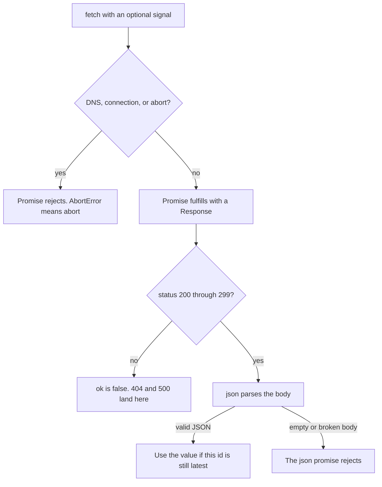

### Where handlers lie

A search handler that catches only network errors, and then renders the parsed body whenever the promise fulfills, will render a 500 body as a result list. A handler that treats every rejection as "offline" will say offline when the user typed again and you aborted. A handler that writes every fulfillment into the list will show the slow query after the fast one. These are three different checks. Skipping one of them looks like a flaky network, because the bug depends on timing and on status codes rather than on a crash you can replay with one input. The status check is pure: given a status and a body string, either the status is outside 200 through 299, or the body is not JSON, or you have a value. No socket is required to test that, which is why the bug can be pinned down without standing up a server.

Put the status check at the boundary, once. Callers further in should see a value or a recorded error, not a raw response they might forget to inspect. Parse after the status check. A parse failure is its own error, not a thrown exception that skips the rest of a batch, and not a fake status code. The latest-id check belongs where you touch the screen, not inside the parser, because the parser does not know which keystroke is current. A function that returns the matching arrival, or null when the id is absent, is the whole rule. UI code around it can stay thin, because the decision is no longer mixed with rendering.

| Situation | The fetch promise | What you do |
|---|---|---|
| DNS or connection failure | rejects, and there is no response | Tell the user the network failed |
| `abort()` while the request is still pending | rejects with name `AbortError` | Ignore it when this id is no longer latest |
| Status 404 or 500 | fulfills, and `ok` is false | Keep the status. Do not treat the body as the resource |
| Status 200 through 299 and a JSON body | fulfills, and `ok` is true | Read the value with `json()` |
| Status 204, or any ok status with an empty or broken body | fulfills, `ok` is true, then `json()` rejects | Do not call `json()` on an empty 204. A parse failure is not a status code |

### You can now

- Say why a 404 and a 500 fulfill the fetch promise, and name the failures that reject it.
- State the status range where `response.ok` is true, including 204, and explain why `ok` does not mean `json()` will succeed.
- Tell an `AbortError` from a network rejection, and explain why abort does not erase a response that already fulfilled.
- Ignore an arrival whose id is not the latest id, even when that arrival is the last one in the list.
- Check status before parsing, and turn a bad body into a failed result instead of a throw.

::: quiz
q: fetch receives an HTTP 500 from the server. Does the promise reject, and what is response.ok?
- The promise rejects, and there is no response, because 500 means the request failed
+ The promise fulfills. response.ok is false, because ok is true only for status 200 through 299. The promise rejects for a network failure, a DNS failure, or an abort, not for 500
- The promise fulfills and response.ok is true, because any response that arrived is success
- The promise rejects with an error named AbortError
why: A 500 is a response, so fetch fulfills. ok is false outside 200 through 299. A 404 behaves the same way. Rejection is reserved for cases where you do not get a response, including abort.
:::

::: quiz
q: Two search responses come back. The newer id finishes first. The older id finishes last. What should the box display, and why is taking the last arrival wrong?
- The older value, because the last write is the most recent network activity
+ The newer id's value. Arrival order is not id order, so a slower older response can finish last and overwrite the query the user is on
- Both values concatenated, so nothing is dropped
- Nothing, because a second response means the request failed
why: The latest id is the newest request, not the last element in the arrival list. Displaying the last arrival shows the stale query whenever the older request is slower.
:::

::: card
q: For which of 200, 204, 404, and 500 is response.ok true, and what does an empty body do to response.json()?
answer: ok is true for 200 and 204, and false for 404 and 500, because only status 200 through 299 are ok. response.json() returns a promise that rejects when the body is not JSON. An empty body is not JSON, so a 204 that is ok can still reject when you call json().
:::

::: predict lang=typescript
code:
```ts
function httpOk(status: number): boolean {
  return status >= 200 && status <= 299
}
console.log("200 " + String(httpOk(200)))
console.log("204 " + String(httpOk(204)))
console.log("404 " + String(httpOk(404)))
console.log("500 " + String(httpOk(500)))
```
answer:
```
200 true
204 true
404 false
500 false
```
why: ok follows the status range 200 through 299 inclusive. 200 and 204 are inside it, so both are true. 404 and 500 are outside it, so both are false. A 404 does not become a rejection merely because the status is an error. This function is the ok check, and it returns false instead of throwing.
:::

::: predict lang=typescript
code:
```ts
function classify(status: number, body: string): string {
  if (status < 200 || status > 299) return "not-ok " + String(status)
  try {
    JSON.parse(body)
    return "ok-json " + String(status)
  } catch {
    return "ok-bad-body " + String(status)
  }
}
console.log(classify(200, "{\"a\":1}"))
console.log(classify(204, ""))
console.log(classify(404, "{\"a\":1}"))
console.log(classify(500, "nope"))
console.log(classify(200, "{"))
```
answer:
```
ok-json 200
ok-bad-body 204
not-ok 404
not-ok 500
ok-bad-body 200
```
why: 200 with a JSON object parses, so the status is ok and the body is usable. 204 is inside 200 through 299, but an empty body is not JSON, so the parse fails after the status check. 404 and 500 are not ok, and the function does not parse them. A 200 whose body is a broken brace is ok as a status and still a bad body.
:::

::: write lang=typescript
task: Export `readJson(res)`. `res` has a numeric `status` and a string `body`. Return `{ ok: true, value }` or `{ ok: false, error }`. If `status` is outside 200 through 299 inclusive, do not parse. Return `{ ok: false, error: "status " + String(status) }`, so a 404 produces the error string `status 404`. Otherwise parse `body` with `JSON.parse`. If parsing throws, return `{ ok: false, error: "invalid json" }` and do not throw. If parsing works, return `{ ok: true, value }` with the parsed value, including `null` and `0` when those are the JSON values. A 204 is inside the ok range. An empty body on a 204 is invalid JSON, not a status error.
starter:
```ts
export function readJson(res: { status: number; body: string }): { ok: true; value: unknown } | { ok: false; error: string } {
  return { ok: true, value: JSON.parse(res.body) as unknown }
}
```
tests:
```ts
// Wrong answer: JSON.parse the body and skip the status check, so a 404 looks successful
import { test } from "node:test"
import assert from "node:assert/strict"
import { readJson } from "./solution.ts"

test("404 and 500 are not ok even when the body is JSON", () => {
  assert.deepEqual(readJson({ status: 404, body: "{\"missing\":true}" }), {
    ok: false,
    error: "status 404",
  })
  assert.deepEqual(readJson({ status: 500, body: "0" }), {
    ok: false,
    error: "status 500",
  })
})

test("a bad body on a 404 is still a status error and does not throw", () => {
  assert.deepEqual(readJson({ status: 404, body: "{" }), {
    ok: false,
    error: "status 404",
  })
})

test("200 and 204 parse JSON, including null and 0", () => {
  assert.deepEqual(readJson({ status: 200, body: "{\"a\":1}" }), {
    ok: true,
    value: { a: 1 },
  })
  assert.deepEqual(readJson({ status: 200, body: "null" }), {
    ok: true,
    value: null,
  })
  assert.deepEqual(readJson({ status: 204, body: "0" }), {
    ok: true,
    value: 0,
  })
  assert.deepEqual(readJson({ status: 299, body: "true" }), {
    ok: true,
    value: true,
  })
})

test("300 is outside the range, and an empty or broken ok body is invalid json", () => {
  assert.deepEqual(readJson({ status: 300, body: "true" }), {
    ok: false,
    error: "status 300",
  })
  assert.deepEqual(readJson({ status: 204, body: "" }), {
    ok: false,
    error: "invalid json",
  })
  assert.deepEqual(readJson({ status: 200, body: "{" }), {
    ok: false,
    error: "invalid json",
  })
})
```
solution:
```ts
export function readJson(
  res: { status: number; body: string },
): { ok: true; value: unknown } | { ok: false; error: string } {
  if (res.status < 200 || res.status > 299) {
    return { ok: false, error: "status " + String(res.status) }
  }
  try {
    return { ok: true, value: JSON.parse(res.body) as unknown }
  } catch {
    return { ok: false, error: "invalid json" }
  }
}
```
hint: Reject on status before you call JSON.parse. Catch a parse failure and return ok false instead of letting it throw. null and 0 are successful values.
:::

::: write lang=typescript
task: Export `takeLatest(latest, arrivals)`. Each arrival has a numeric `id` and a string `value`. Return the `value` of the first arrival whose `id` is `latest`. If no arrival has that id, return null. Do not return the last arrival unless its id is `latest`. An older id that shows up at the end of the list is still the wrong row.
starter:
```ts
export function takeLatest(latest: number, arrivals: { id: number; value: string }[]): string | null {
  const last = arrivals[arrivals.length - 1]
  if (last === undefined) return null
  void latest
  return last.value
}
```
tests:
```ts
// Wrong answer: return the last arrival, which is stale when an older id finishes last
import { test } from "node:test"
import assert from "node:assert/strict"
import { takeLatest } from "./solution.ts"

test("an older id that arrived last is not the result", () => {
  assert.equal(
    takeLatest(2, [
      { id: 2, value: "new" },
      { id: 1, value: "old" },
    ]),
    "new",
  )
})

test("missing id and empty list are null", () => {
  assert.equal(takeLatest(9, [{ id: 1, value: "old" }]), null)
  assert.equal(takeLatest(1, []), null)
})

test("the first row with the latest id wins when ids repeat", () => {
  assert.equal(
    takeLatest(5, [
      { id: 5, value: "first" },
      { id: 4, value: "other" },
      { id: 5, value: "second" },
    ]),
    "first",
  )
})
```
solution:
```ts
export function takeLatest(
  latest: number,
  arrivals: { id: number; value: string }[],
): string | null {
  for (const arrival of arrivals) {
    if (arrival.id === latest) return arrival.value
  }
  return null
}
```
hint: Walk from the front and return on the first id match. Return null only after the whole list fails to match. The last index is not special.
:::

## Read your frame, then the reason
id: js-debug
stage: js
needs: fetch
minutes: 45
goal: Explain a failure and continue a batch, because try/catch misses an async rejection unless you await it, and a strict catch binding is unknown until you narrow it.
source: MDN: try...catch | https://developer.mozilla.org/en-US/docs/Web/JavaScript/Reference/Statements/try...catch
source: MDN: Error cause | https://developer.mozilla.org/en-US/docs/Web/JavaScript/Reference/Global_Objects/Error/cause
source: Node.js: process | https://nodejs.org/api/process.html
source: Chrome: Debug JavaScript | https://developer.chrome.com/docs/devtools/javascript

A stack is a list of frames from the throw outward. The frame you read first is the frame you wrote where the throw happened. That line is the operation that failed. The frames under it are how the program got there. They are the callers, and they matter after you know the throw, not before. Starting at the outermost function tells you which click began the work and hides the empty string that actually threw. Frames that belong only to the runtime are context. They tell you the throw was inside a parser or a promise helper. They are not the first place you edit, because you cannot fix your bug by editing the runtime, and the runtime frame does not name the value you passed.

```text
Error: empty
    at parse (load.ts:2:11)
    at load (load.ts:6:10)
    at main (load.ts:9:3)
```

You read `parse` at line 2 first, because that is the throw. Then you read `load`, because `load` passed the empty string. You do not start at `main`. If the top frames are inside `JSON.parse`, your code did not throw. The first frame you wrote is the call to `JSON.parse`, and that call is what you read first. The runtime frames tell you the text was not JSON. Your frame tells you which text, and which assumption was wrong. In the browser debugger the same stack is a list you can open. The order does not change because the tool draws a window around it. You still start at your frame, then you walk to the callers when you need to see who passed the bad value. Reading the bottom frame first feels thorough and sends you to the entry point, which is the least specific line in the pile.

### A catch only sees a synchronous throw

An `async` function always returns a promise. If the function throws, or if an `await` inside it rejects, that failure becomes a rejection of the promise. The call itself does not throw into the caller. The caller receives the promise and continues. A `try/catch` wrapped around the call, with no `await` and no `.catch`, has nothing to catch. The synchronous part of the call succeeded. It succeeded at returning a promise. The rejection arrives later, after this `try` block has already finished, so the `catch` you can see on the screen is not the handler that runs.

```ts
async function save(): Promise<void> {
  throw new Error("denied")
}
try {
  save()
  report("after")
} catch {
  report("caught")
}
```

`report("after")` runs. `report("caught")` does not. The rejection is still outstanding. If nobody awaits that promise and nobody attaches `.catch`, current Node ends the process. That is the default, not an option you have to turn on. The failure is not stored quietly for a later log line you meant to write. A browser page usually stays open and prints the rejection on the console, which is easy to miss when you are watching the page and not the console. In both hosts the `catch` next to the call did not run. The difference is only whether the process is still alive afterward. A test that "passes" because the process exited before the assertion is not a pass. The rejection ended the run.

`await save()` changes the delivery. The `await` throws the rejection into this function, and this `catch` runs. Calling `.catch` on the returned promise also handles it, so Node does not treat the promise as unhandled, but that callback runs later, not inside the `try` written above the call. A `catch` block sitting next to a call is not connected to that call unless one of those two links exists. The bug looks like a broken `try` statement. The `try` is fine. The rejection never entered it. Adding more statements inside the `catch` does nothing, because the block is not running. The fix is the `await`, or a `.catch` you attached to the promise the call returned.

### The binding is unknown, and a string is not an Error

JavaScript lets you throw any value. A strict TypeScript `catch` binding is therefore `unknown`. Reading `e.message` without a check is a compile error, because `unknown` has no `message`. The check that matches an `Error` is `instanceof Error`. After that check, `name` and `message` are available. `cause` is still `unknown` even on an `Error`, so you narrow the cause again before you read its message. One `instanceof` does not narrow every field that happens to be a value you hope is an error.

A thrown string is not an `Error`. `instanceof Error` is false, and `typeof` is `"string"`. A handler that only understands `Error` reports that failure as unknown, or it crashes if you forced the type with `as Error` and then read `.message`. The cast is a lie the compiler accepts. The runtime value is still a string, and a string has no `message` property you can use. Branch on `typeof value === "string"` when you need to keep those failures. Keep a final branch for everything else, because a number, `null`, or a plain object can also be thrown. Those are not errors and they are not strings. Reporting them as `unknown` is honest. Inventing a `.message` on them is how a handler throws while it is trying to explain the first throw, and the thing you log is then the handler's own crash. You have replaced the original reason with a worse one.

```ts
catch (e: unknown) {
  if (e instanceof Error) {
    report(e.name + ": " + e.message)
  } else if (typeof e === "string") {
    report("string: " + e)
  } else {
    report("unknown")
  }
}
```

`name` belongs in the report because `TypeError` and `Error` are different faults that can share similar messages. A message alone collapses them, and the next reader cannot tell a bad argument from a failure you constructed yourself. The string branch keeps the text you threw on purpose, with a prefix so it cannot be confused with an `Error` message that happens to contain the same words. The unknown branch is the remainder. It should not try to JSON-encode the value, because the value may be circular or may be `undefined`, and a logger that throws is a second bug.

### cause keeps the original fault

When a lower-level failure crosses a boundary, the caller needs both layers. The outer sentence is the context, such as a flush that did not complete. The inner sentence is why, such as a closed pipe. Replacing the original with a new `Error` that only copies the text drops the name and the stack of the original. `cause` is the ES2022 slot for the original value. You pass it when you construct the wrapper, and the original object stays intact.

```ts
throw new Error("flush failed", { cause: err })
```

The wrapper's stack starts at your `throw`. The original stays on `cause`, so a logger can print the wrapper's name and message and then the cause message without pretending they are one error. Read one level first. If `cause` is an `Error`, append its message and stop. If `cause` is a string, or if it is missing, do not invent a second sentence. A string cause is not an `Error`, and copying it blindly can duplicate text you have already placed in the wrapper message. Walking an unbounded chain is a later choice. The bug in front of you is dropping the first cause entirely, which leaves a wrapper message and no reason. The frame of the original throw is on that cause error's stack when you need it. It is not on the wrapper, so a log that prints only the wrapper stack points at the `throw` where you wrapped, not at the line that failed.

An empty `catch` is the same loss, done quickly and then forgotten. The reason is discarded. The stack is discarded. The caller thinks the operation worked, because control fell through to the next line. The symptom shows up later as a missing row or a blank screen, and the frame you needed is gone, so you debug the symptom instead of the throw. An empty `catch` is not handling. Handling means you recorded the reason, retried under a rule you can say out loud, or rethrew. If you cannot say which of those you did, the block should not be empty. Logging the reason and then continuing as if the write succeeded is the empty block with an extra line. The caller still proceeds. The log is easy to miss. Rethrowing the same value keeps the original stack. Throwing a new `Error` without `cause` starts a new stack at the rethrow and drops the frame you wanted to read first.

```ts
catch (e: unknown) {
  report(e)
  throw e
}
```

That rethrow is right for a single operation whose caller must still fail. A batch is the other contract. One rejection should not throw away the successes you already collected, and it should not skip the tasks you have not started. You await each task, in order. A fulfillment pushes the string onto the values. A rejection pushes an explanation of that reason onto the errors and the loop continues. The function returns both lists and does not throw. That is different from an empty `catch`, because the reason is in the errors list as text you can assert on. It is different from starting every task at once, because the second task must see the effect of the first task having settled, not merely having been called. If you call every function before you await any of them, the second function runs while the first promise is still pending. Awaiting in sequence is what gives you the later start. No timer is involved. The first promise settles, and only then do you call the next function.

The explanation you push has a fixed shape so a test can read it. An `Error` becomes its name, a colon, a space, and its message. When `cause` is an `Error`, append a space, the word because, a space, and the cause message. Do not append a cause that is not an `Error`. A thrown string becomes the prefix `string: ` plus the text. Anything else becomes the word `unknown`. A `TypeError` keeps the name `TypeError`, so you must use `err.name` and not a hardcoded `Error` prefix. One cause level is enough. The cause's own cause stays unread, because the contract is the first reason, not a walk of every wrapper someone might add later.

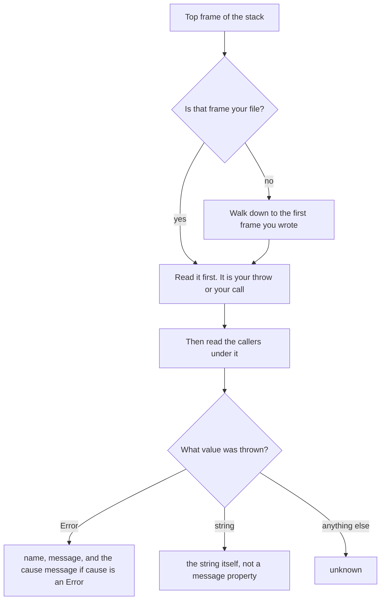

| Code | What happens | What you do instead |
|---|---|---|
| `try { asyncFn() } catch` with no await | The catch does not run. The promise is still rejected | `await asyncFn()`, or attach `.catch` |
| `catch (e)` and then `e.message`, under strict TypeScript | Compile error, because `e` is `unknown` | Narrow with `instanceof Error` before reading `message` |
| `throw "offline"` | The catch value is a string, not an `Error` | Branch on `typeof value === "string"` |
| `new Error("wrap", { cause: err })` | The original `Error` stays on `cause` | Read `cause` only after a second `instanceof Error` |
| `catch { }` | The reason and the stack are discarded | Record the reason, or rethrow the same value |

### You can now

- Find the frame you wrote at the throw and read it before the callers and before any runtime frames.
- Explain why `try/catch` around an async call does not catch the rejection unless you await the promise or attach `.catch`.
- Say what current Node does with a rejection nobody handled.
- Narrow a `catch` binding with `instanceof Error`, and keep a thrown string on its own branch.
- Attach the original error with `cause`, and refuse an empty `catch` that drops the reason.
- Await tasks one at a time, record both values and explained rejections, and do not throw out of the batch.

::: quiz
q: save is an async function that throws an Error. You write try { save() } catch { report("caught") } and you do not await the call. Why does "caught" not run, and what does current Node do if nothing else handles the promise?
- The catch runs immediately, because the throw inside save is synchronous from the caller's point of view
+ save returns a rejected promise and the call itself does not throw, so this catch never sees the rejection. If nothing awaits the promise or attaches .catch, current Node ends the process
- The catch runs later with the same binding, because JavaScript retries a try block on the next turn
- Node ignores unhandled rejections by default, so the missing catch has no effect
why: An async function turns a throw into a rejection of the promise it returns. try/catch only receives a synchronous throw. await, or .catch, is what connects the rejection to your handler. Current Node's default is to end the process on an unhandled rejection.
:::

::: quiz
q: Under TypeScript strict mode, catch (e) receives a thrown string "offline". What is the type of e, and why is reading e.message unsafe?
- e is string, so e.message is the text offline
+ e is unknown, because any value can be thrown. At runtime this value is a string, not an Error, so instanceof Error is false and e.message is not yours to read until you narrow
- e is any, and e.message is required to exist on every thrown value
- e is Error, because catch always wraps the thrown value in an Error before your block runs
why: Strict catch bindings are unknown. A thrown string fails instanceof Error. Reading message without a narrow is a type error. Casting to Error would then fail at runtime, because a string has no message.
:::

::: card
q: What should you read first on a stack, what is error.cause for, and what is wrong with an empty catch?
answer: Read the frame you wrote where the throw happened, then the callers under it. If the top frame is inside the runtime, walk down to the first frame that is your call. cause is the ES2022 slot for the original error when you wrap it in a new Error, so the wrapper can keep the original message and stack. An empty catch throws the reason and the stack away, so a later blank result is all that is left of the bug.
:::

::: predict lang=typescript
code:
```ts
async function load(): Promise<string> {
  throw new Error("missing")
}
async function main(): Promise<void> {
  try {
    const pending = load()
    console.log("called")
    pending.catch(() => {
      console.log("caught-later")
    })
  } catch {
    console.log("caught-now")
  }
  try {
    await load()
  } catch (e) {
    console.log(e instanceof Error ? e.name : "other")
  }
}
void main()
```
answer:
```
called
caught-later
Error
```
why: load is async, so the first call returns a rejected promise instead of throwing into the try. caught-now does not print. called does print, because the synchronous part of the try kept going. pending.catch handles that rejection later, which is why the process stays up, and caught-later prints. await load throws the second rejection into the second catch. The value is an Error, so the name Error is what prints.
:::

::: predict lang=typescript
code:
```ts
try {
  throw "disk full"
} catch (e) {
  console.log(typeof e)
  console.log(String(e instanceof Error))
}
const err = new Error("save failed", { cause: new Error("disk full") })
const cause: unknown = err.cause
console.log(err.name + ": " + err.message)
if (cause instanceof Error) console.log("because " + cause.message)
```
answer:
```
string
false
Error: save failed
because disk full
```
why: A thrown string is a string, so typeof prints string and instanceof Error is false. The wrapper is an Error whose name is Error and whose message is save failed. Its cause is a separate Error, so the cause message prints on the next line. The string that was thrown and the cause message are different values. The catch did not turn the string into an Error.
:::

::: write lang=typescript
task: Export `explain(err)`. `err` is `unknown`. If it is an `Error`, return `err.name + ": " + err.message`. When `err.cause` is an `Error`, append `" because " + err.cause.message`. Do not append anything when `cause` is missing or is not an `Error`, and do not read a second cause. If `err` is a string, return `"string: " + err`. For every other value, including numbers, `null`, and plain objects, return `"unknown"`. Do not throw.
starter:
```ts
export function explain(err: unknown): string {
  if (typeof err === "string") return "string: " + err
  if (err instanceof Error) return err.name + ": " + err.message
  return "unknown"
}
```
tests:
```ts
// Wrong answer: return the name and message, and drop error.cause
import { test } from "node:test"
import assert from "node:assert/strict"
import { explain } from "./solution.ts"

test("Error name, message, and one cause message", () => {
  assert.equal(explain(new TypeError("bad")), "TypeError: bad")
  const wrapped = new Error("save failed", { cause: new TypeError("disk full") })
  assert.equal(explain(wrapped), "Error: save failed because disk full")
})

test("a string cause is not appended", () => {
  const wrapped = new Error("save failed", { cause: "disk full" })
  assert.equal(explain(wrapped), "Error: save failed")
})

test("strings and other values", () => {
  assert.equal(explain("disk full"), "string: disk full")
  assert.equal(explain(404), "unknown")
  assert.equal(explain(null), "unknown")
  assert.equal(explain({ message: "nope" }), "unknown")
})
```
solution:
```ts
export function explain(err: unknown): string {
  if (typeof err === "string") return "string: " + err
  if (err instanceof Error) {
    const cause: unknown = err.cause
    if (cause instanceof Error) {
      return err.name + ": " + err.message + " because " + cause.message
    }
    return err.name + ": " + err.message
  }
  return "unknown"
}
```
hint: Narrow with typeof for strings and instanceof Error for errors. Narrow cause with instanceof Error again before you read its message. Anything left is unknown.
:::

::: write lang=typescript
task: Export `runAll(tasks)` as an async function. `tasks` is an array of functions, and each function returns a `Promise<string>`. Call them one at a time. Do not start the next function until the current promise has settled. If it fulfills, push the string onto `values`. If it rejects, or if the function throws, push `explain(reason)` onto `errors` and continue. Do not throw out of `runAll`. Return a promise of `{ values, errors }`. `explain` uses these rules. An `Error` becomes `name + ": " + message`, and if `cause` is an `Error` you append `" because " + cause.message`. A string becomes `"string: " + text`. Anything else becomes `"unknown"`.
starter:
```ts
export async function runAll(
  tasks: Array<() => Promise<string>>,
): Promise<{ values: string[]; errors: string[] }> {
  const values: string[] = []
  for (const task of tasks) {
    values.push(await task())
  }
  return { values, errors: [] }
}
```
tests:
```ts
// Wrong answer: await each task with no try/catch, so the first rejection rejects runAll
import { test } from "node:test"
import assert from "node:assert/strict"
import { runAll } from "./solution.ts"

test("records rejections and keeps later successes", async () => {
  let result: { values: string[]; errors: string[] }
  try {
    result = await runAll([
      async () => "kept",
      async () => {
        throw new Error("save failed", { cause: new Error("disk full") })
      },
      async () => {
        throw "disk full"
      },
      async () => "after",
    ])
  } catch (err) {
    assert.fail("runAll threw " + String(err))
  }
  assert.deepEqual(result.values, ["kept", "after"])
  assert.deepEqual(result.errors, [
    "Error: save failed because disk full",
    "string: disk full",
  ])
})

test("does not start the next task until the current promise settles", async () => {
  let stage = "idle"
  const result = await runAll([
    () => {
      stage = "started"
      return Promise.resolve().then(() => {
        stage = "finished"
        return "one"
      })
    },
    () => Promise.resolve(stage === "finished" ? "two" : "too-soon"),
  ])
  assert.deepEqual(result, { values: ["one", "two"], errors: [] })
})
```
solution:
```ts
export function explain(err: unknown): string {
  if (typeof err === "string") return "string: " + err
  if (err instanceof Error) {
    const cause: unknown = err.cause
    if (cause instanceof Error) {
      return err.name + ": " + err.message + " because " + cause.message
    }
    return err.name + ": " + err.message
  }
  return "unknown"
}

export async function runAll(
  tasks: Array<() => Promise<string>>,
): Promise<{ values: string[]; errors: string[] }> {
  const values: string[] = []
  const errors: string[] = []
  for (const task of tasks) {
    try {
      values.push(await task())
    } catch (reason) {
      errors.push(explain(reason))
    }
  }
  return { values, errors }
}
```
hint: Await inside the loop, one call per iteration, and wrap that await in try/catch. Push explain(reason) on failure. Return both arrays instead of throwing.
:::

## Project: a notes app without a framework
id: p-vanilla
stage: js
needs: js-debug, dom, modules-js, prototypes
minutes: 80
project: yes
goal: Model a small notes app as data in and data out, including loading, empty, error, and a reload.
source: MDN: Window.localStorage | https://developer.mozilla.org/en-US/docs/Web/API/Window/localStorage
source: MDN: Introduction to the DOM | https://developer.mozilla.org/en-US/docs/Web/API/Document_Object_Model/Introduction

A page is a function from state to something a person can look at. The browser paints that picture into the document, and a click comes back as a value you fold into the next state. Frameworks hide the wiring. The wiring is still there, and a small app is easier to reason about if you can see the state, the action, and the lines of text that would become nodes. This project builds that core for a notes list. There is no document and no network in the checker, so the "page" is a list of strings and the "server" is a string you parse. The decisions are the ones a real page has to get right: do not lose a note because a later keystroke reused an array, do not show a stale error over a successful load, do not treat a blank line as a note, and do not restore garbage after a reload.

### The state you are willing to paint

Three phases cover the screen. `loading` means you have asked for the notes and nothing has come back, so the only honest line is that you are waiting. `ready` means you have a list, which might be empty. `error` means the load failed and you have a message. Mixing these up is how a UI shows notes and a spinner at the same time, or shows an old error under a list that already loaded. One phase field makes the illegal combinations unrepresentable as long as every update goes through one function.

The rest of the state is the notes, the current query, and the error message. A note is an id and a text. The query is the string in the search box. It filters what you show. It does not delete notes. Clearing the box shows the full list again, which is only true if the filter never mutated the stored array.

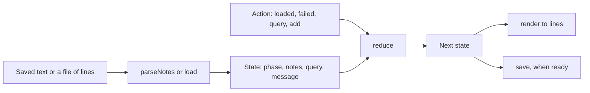

An action is one thing that happened. `loaded` carries the notes that arrived. `failed` carries a message. `query` carries the box text. `add` carries an id and a text. The reducer returns a new state and leaves the previous one alone, because a paint that is still on the screen may be reading the previous notes. Sharing the array means a push shows up in both pictures.

### Edges that look like the happy path

A file of notes is lines of `id|text`. Blank lines are noise. A line with no bar is noise. A missing id or a missing text is not a note, and a line that failed those checks does not count as "the first time we saw this id". Only a line you actually kept occupies the id. A later valid line with that same id is a duplicate and is dropped, because two rows with one id make a later delete ambiguous. Trimming matters: a title that is only spaces is not a title, and an id with a leading space is the same id as the trimmed one.

`add` does nothing unless the phase is `ready` and the trimmed text is non-empty. Adding during `loading` would invent a note the server has not agreed to. Adding during `error` would hide the failure under a local row. Returning the same notes, copied, keeps the screen stable.

`render` has one line for `loading`, one line `error: ` plus the message for `error`, and either `empty` or `id: text` rows for `ready`. The filter is `includes` on the note text, case-sensitive. A query that matches nothing is `empty`, not a blank screen and not an error. The notes that failed the filter are still in the state.

`save` writes JSON only in `ready`. Other phases return an empty string, so a crash during load does not overwrite the last good snapshot with `{ notes: [], query: "" }`. `load` reads that JSON back. A bad string, a non-object, a missing query, or a note that is not `{ id: string, text: string }` returns `null`. The caller keeps the loading state instead of painting `undefined`. This is the same job as `localStorage` in a browser: the storage is a string under a key, any script on the page can write that key, and the next visit has to parse it and reject it when the shape is wrong. `JSON.parse` throws on a truncated string, so the parse sits in `try/catch` and the failure becomes `null` rather than an unhandled exception during startup. A successful parse is still not trusted. `JSON.parse` of `{"notes":[{"id":1,"text":"a"}],"query":""}` is a value, and the id is a number. Painting that would blow up later, at the first place that calls a string method. Checking each field at the boundary means the rest of the app can treat a note as a note.

The lines `render` returns are what you would put in the document. A loading line becomes a status element. An error line becomes an alert. Each `id: text` line becomes a row. One listener on the list, not one listener per row, is how a row added by `add` still receives a click: the click bubbles to the list, and the handler reads which row was the target. That wiring is not exercised here, because there is no document. The state you return is what that wiring would read. If `reduce` mutates the previous notes, a row that is mid-paint and a row that is about to paint share one array, and a click handler that pushes will surprise both.

A query that hides rows must not be saved as if those rows were deleted. `save` stores the full notes and the query string. After `load`, the same filter runs again. Someone who refreshes with a search in the box sees the same subset, and clearing the box shows the notes that were only hidden. Storing the filtered list instead would make a refresh permanent data loss, which is a bad trade for a feature that feels like a view.

| Situation | What the screen shows | What the state does |
|---|---|---|
| Waiting on the first load | `loading` | phase stays `loading` until loaded or failed |
| Load failed | `error: ` and the message | notes are kept, phase is `error` |
| Ready, nothing typed, no notes | `empty` | notes is `[]` |
| Ready, query matches none | `empty` | notes unchanged, query set |
| Reload of a good snapshot | the saved notes and query | `load` returns them |
| Reload of garbage | still loading, until you decide | `load` returns `null` |

### You can now

- Parse a line-oriented note file and reject blank, broken, and duplicate rows.
- Fold loaded, failed, query, and add into a new state without mutating the previous one.
- Render loading, error, empty, and filtered rows as a list of strings.
- Save only a ready snapshot, and refuse a snapshot that is not the shape you wrote.

::: quiz
q: A notes screen can be loading, showing rows, or showing a load error. Why keep a single phase field instead of three independent booleans?
- Three booleans let the server send partial updates faster
+ Two booleans can both be true, so the screen can claim to be loading and failed at once. One phase is only one of those pictures
- The DOM rejects more than one boolean on a node
- Booleans are falsy when they are strings
why: Independent flags combine. `loading && error` is a picture you do not have a layout for, and some branch will forget it. A phase that is exactly one of `loading`, `ready`, or `error` makes that combination impossible to store.
:::

::: quiz
q: The search box changes. Why must the filter read the notes and leave the stored array as it was?
- Filtering is faster when it deletes the misses, and the server still has the full list
+ The query is a view. Deleting the misses would throw notes away, and clearing the box could not bring them back
- Arrays cannot be read without mutating them
- The query is stored inside each note, so the array has to change
why: The notes are the data. The query chooses which lines to show. If you splice the misses out, the next empty query has nothing to show. Render builds a new list of strings from the notes that match.
:::

::: card
q: In a notes app that saves a JSON snapshot, when should save refuse to write, and what should load return for a string that is not that shape?
answer: Save only when the phase is ready, so a loading or error state does not overwrite the last good snapshot. Load returns null for invalid JSON or for an object whose notes and query are not the expected shape, and the caller keeps waiting instead of painting garbage.
:::

::: write lang=typescript
task: Export `parseNotes(raw)`. `raw` is a string of lines. A note line is `id|text`. Trim the line, the id, and the text. Skip blank lines, lines with no `|`, and lines whose id or text is empty after trimming. If an id appears twice, keep the first note and skip the later line. Return `{ id, text }[]` in file order.
starter:
```ts
export function parseNotes(raw: string): { id: string; text: string }[] {
  return raw.split("\n").map((line) => {
    const [id, text] = line.split("|")
    return { id: id ?? "", text: text ?? "" }
  })
}
```
tests:
```ts
// Wrong answer: split every line on the first bar and keep blanks and duplicate ids
import { test } from "node:test"
import assert from "node:assert/strict"
import { parseNotes } from "./solution.ts"

test("parses, trims, and skips junk", () => {
  const raw = " a | first \n\nno bar\n| missing id\nb |\nb | later\nb | again\nc | third"
  assert.deepEqual(parseNotes(raw), [
    { id: "a", text: "first" },
    { id: "b", text: "later" },
    { id: "c", text: "third" },
  ])
})

test("empty file", () => {
  assert.deepEqual(parseNotes(""), [])
  assert.deepEqual(parseNotes("\n  \n"), [])
})
```
solution:
```ts
export function parseNotes(raw: string): { id: string; text: string }[] {
  const seen = new Set<string>()
  const notes: { id: string; text: string }[] = []
  for (const line of raw.split("\n")) {
    const trimmed = line.trim()
    if (!trimmed) continue
    const bar = trimmed.indexOf("|")
    if (bar < 0) continue
    const id = trimmed.slice(0, bar).trim()
    const text = trimmed.slice(bar + 1).trim()
    if (!id || !text || seen.has(id)) continue
    seen.add(id)
    notes.push({ id, text })
  }
  return notes
}
```
hint: Find the first `|` with `indexOf` so a title may contain another bar. Remember ids you have already kept.
:::

::: write lang=typescript
task: Export the types and `reduce(state, action)`. State is `{ phase: "loading" | "ready" | "error"; notes: { id: string; text: string }[]; query: string; message: string }`. An action is `{ type: "loaded"; notes }`, `{ type: "failed"; message: string }`, `{ type: "query"; text: string }`, or `{ type: "add"; id: string; text: string }`. `loaded` sets phase to `ready`, replaces notes with a copy, and clears message. `failed` sets phase to `error` and the message, and keeps a copy of the previous notes. `query` sets query and copies notes. `add` trims text and, only when phase is `ready` and the text is non-empty, appends `{ id, text }` on a new array. Otherwise `add` leaves phase, query, message, and note values unchanged. Never mutate the arrays or objects inside the state you were given.
starter:
```ts
export type Note = { id: string; text: string }
export type State = { phase: "loading" | "ready" | "error"; notes: Note[]; query: string; message: string }
export type Action =
  | { type: "loaded"; notes: Note[] }
  | { type: "failed"; message: string }
  | { type: "query"; text: string }
  | { type: "add"; id: string; text: string }

export function reduce(state: State, action: Action): State {
  if (action.type === "add") state.notes.push({ id: action.id, text: action.text })
  if (action.type === "query") state.query = action.text
  if (action.type === "failed") state.phase = "error"
  if (action.type === "loaded") state.phase = "ready"
  return state
}
```
tests:
```ts
// Wrong answer: mutate the caller's notes array and ignore the ready-phase and blank-text rules
import { test } from "node:test"
import assert from "node:assert/strict"
import { reduce, type State } from "./solution.ts"

const base = (): State => ({ phase: "loading", notes: [{ id: "a", text: "one" }], query: "", message: "" })

test("loaded and failed copy notes", () => {
  const s = base()
  const next = reduce(s, { type: "loaded", notes: [{ id: "b", text: "two" }] })
  assert.equal(next.phase, "ready")
  assert.equal(next.message, "")
  assert.deepEqual(next.notes, [{ id: "b", text: "two" }])
  assert.equal(s.phase, "loading")
  next.notes.push({ id: "z", text: "nope" })
  assert.equal(s.notes.length, 1)
  const bad = reduce(next, { type: "failed", message: "down" })
  assert.equal(bad.phase, "error")
  assert.equal(bad.message, "down")
  assert.equal(bad.notes.length, 2)
})

test("add only when ready and the text is not blank", () => {
  const loading = base()
  const stuck = reduce(loading, { type: "add", id: "n", text: "x" })
  assert.equal(stuck.notes.length, 1)
  assert.notEqual(stuck.notes, loading.notes)
  const ready: State = { phase: "ready", notes: [{ id: "a", text: "one" }], query: "o", message: "" }
  const blank = reduce(ready, { type: "add", id: "n", text: "  " })
  assert.equal(blank.notes.length, 1)
  const added = reduce(ready, { type: "add", id: "n", text: "  two " })
  assert.deepEqual(added.notes, [
    { id: "a", text: "one" },
    { id: "n", text: "two" },
  ])
  assert.equal(ready.notes.length, 1)
})

test("query does not drop notes", () => {
  const ready: State = { phase: "ready", notes: [{ id: "a", text: "one" }], query: "", message: "" }
  const next = reduce(ready, { type: "query", text: "z" })
  assert.equal(next.query, "z")
  assert.deepEqual(next.notes, [{ id: "a", text: "one" }])
})
```
solution:
```ts
export type Note = { id: string; text: string }
export type State = { phase: "loading" | "ready" | "error"; notes: Note[]; query: string; message: string }
export type Action =
  | { type: "loaded"; notes: Note[] }
  | { type: "failed"; message: string }
  | { type: "query"; text: string }
  | { type: "add"; id: string; text: string }

const copy = (notes: Note[]): Note[] => notes.map((n) => ({ id: n.id, text: n.text }))

export function reduce(state: State, action: Action): State {
  if (action.type === "loaded") {
    return { phase: "ready", notes: copy(action.notes), query: state.query, message: "" }
  }
  if (action.type === "failed") {
    return { phase: "error", notes: copy(state.notes), query: state.query, message: action.message }
  }
  if (action.type === "query") {
    return { ...state, notes: copy(state.notes), query: action.text }
  }
  const text = action.text.trim()
  if (state.phase !== "ready" || text === "") return { ...state, notes: copy(state.notes) }
  return { ...state, notes: [...copy(state.notes), { id: action.id, text }] }
}
```
hint: Copy notes with `map` on every return. `add` appends only after `phase === "ready"` and `text.trim()` is non-empty.
:::

::: write lang=typescript
task: Export `render(state)`. State is `{ phase: "loading" | "ready" | "error"; notes: { id: string; text: string }[]; query: string; message: string }`. `loading` returns `["loading"]`. `error` returns `["error: " + message]`. `ready` returns `id: text` for each note whose text includes `query`, in order. If that list is empty, return `["empty"]`. Do not change `state`.
starter:
```ts
type Note = { id: string; text: string }
type State = { phase: "loading" | "ready" | "error"; notes: Note[]; query: string; message: string }

export function render(state: State): string[] {
  return state.notes.map((n) => n.text)
}
```
tests:
```ts
// Wrong answer: always map notes to their text, including during loading and with no query filter
import { test } from "node:test"
import assert from "node:assert/strict"
import { render } from "./solution.ts"

test("loading and error", () => {
  assert.deepEqual(render({ phase: "loading", notes: [], query: "", message: "" }), ["loading"])
  assert.deepEqual(render({ phase: "error", notes: [{ id: "a", text: "one" }], query: "", message: "down" }), ["error: down"])
})

test("ready filters and empty", () => {
  const notes = [
    { id: "a", text: "one" },
    { id: "b", text: "two" },
  ]
  assert.deepEqual(render({ phase: "ready", notes, query: "", message: "" }), ["a: one", "b: two"])
  assert.deepEqual(render({ phase: "ready", notes, query: "w", message: "" }), ["b: two"])
  assert.deepEqual(render({ phase: "ready", notes, query: "z", message: "" }), ["empty"])
  assert.deepEqual(render({ phase: "ready", notes: [], query: "", message: "" }), ["empty"])
  assert.deepEqual(notes, [
    { id: "a", text: "one" },
    { id: "b", text: "two" },
  ])
})
```
solution:
```ts
type Note = { id: string; text: string }
type State = { phase: "loading" | "ready" | "error"; notes: Note[]; query: string; message: string }

export function render(state: State): string[] {
  if (state.phase === "loading") return ["loading"]
  if (state.phase === "error") return [`error: ${state.message}`]
  const rows = state.notes.filter((n) => n.text.includes(state.query)).map((n) => `${n.id}: ${n.text}`)
  return rows.length === 0 ? ["empty"] : rows
}
```
hint: Handle `loading` and `error` before the filter. A ready list that matches nothing is `["empty"]`.
:::

::: write lang=typescript
task: Export `save(state)` and `load(raw)`. State is `{ phase: "loading" | "ready" | "error"; notes: { id: string; text: string }[]; query: string; message: string }`. `save` returns `JSON.stringify({ notes, query })` when phase is `ready`, and `""` otherwise. `load` parses a string from `save`. Return `{ notes, query }` when `query` is a string and `notes` is an array of objects with string `id` and string `text`. Return `null` for invalid JSON, non-objects, or a bad note. Do not throw.
starter:
```ts
type Note = { id: string; text: string }
type State = { phase: "loading" | "ready" | "error"; notes: Note[]; query: string; message: string }

export function save(state: State): string {
  return JSON.stringify(state)
}
export function load(raw: string): { notes: Note[]; query: string } | null {
  return JSON.parse(raw) as { notes: Note[]; query: string }
}
```
tests:
```ts
// Wrong answer: JSON.stringify the whole state, and JSON.parse without checking the shape
import { test } from "node:test"
import assert from "node:assert/strict"
import { load, save } from "./solution.ts"

test("saves only a ready snapshot", () => {
  const ready = { phase: "ready" as const, notes: [{ id: "a", text: "one" }], query: "o", message: "" }
  assert.equal(save(ready), JSON.stringify({ notes: ready.notes, query: "o" }))
  assert.equal(save({ ...ready, phase: "loading" }), "")
  assert.equal(save({ ...ready, phase: "error", message: "x" }), "")
})

test("loads the snapshot and rejects garbage", () => {
  const raw = save({ phase: "ready", notes: [{ id: "a", text: "one" }], query: "o", message: "" })
  assert.deepEqual(load(raw), { notes: [{ id: "a", text: "one" }], query: "o" })
  assert.equal(load(""), null)
  assert.equal(load("{"), null)
  assert.equal(load(JSON.stringify({ notes: [{ id: 1, text: "a" }], query: "" })), null)
  assert.equal(load(JSON.stringify({ notes: [], query: 1 })), null)
  assert.equal(load("null"), null)
})
```
solution:
```ts
type Note = { id: string; text: string }
type State = { phase: "loading" | "ready" | "error"; notes: Note[]; query: string; message: string }

export function save(state: State): string {
  if (state.phase !== "ready") return ""
  return JSON.stringify({ notes: state.notes, query: state.query })
}

export function load(raw: string): { notes: Note[]; query: string } | null {
  try {
    const value: unknown = JSON.parse(raw)
    if (value === null || typeof value !== "object") return null
    const rec = value as { notes?: unknown; query?: unknown }
    if (typeof rec.query !== "string" || !Array.isArray(rec.notes)) return null
    const notes: Note[] = []
    for (const item of rec.notes) {
      if (item === null || typeof item !== "object") return null
      const note = item as { id?: unknown; text?: unknown }
      if (typeof note.id !== "string" || typeof note.text !== "string") return null
      notes.push({ id: note.id, text: note.text })
    }
    return { notes, query: rec.query }
  } catch {
    return null
  }
}
```
hint: `save` returns `""` unless `phase` is `"ready"`. `load` wraps `JSON.parse` in try/catch and checks every note's fields before trusting them.
:::

## Types vanish before running
id: erasure
stage: types
needs: p-vanilla
minutes: 45
goal: Predict what is left after the types are deleted, because the checker and the running program are two different programs.
source: TypeScript handbook: The basics | https://www.typescriptlang.org/docs/handbook/2/basic-types.html
source: Node.js: Running TypeScript natively | https://nodejs.org/en/learn/typescript/run-natively
source: TSConfig: erasableSyntaxOnly | https://www.typescriptlang.org/tsconfig/erasableSyntaxOnly.html
source: TypeScript handbook: Enums | https://www.typescriptlang.org/docs/handbook/enums.html

TypeScript looks at your program, refuses some of it, and then the types disappear. The file that Node runs is JavaScript. A parameter annotated `number` is not a lock on the value. It is a note the checker read and then threw away. That split is the whole design. The checker can be strict because it never has to be present in production, and production can stay fast because it never walks your types. The cost is that a value which arrives while the program is running was never shown to the checker. JSON, an environment variable, a form field, and a row from a database are whatever bytes showed up. If the annotation said `User` and the payload has a misspelled key, the function still runs, and the field you expected is `undefined`.

```ts
function greet(name: string): string {
  return "hi " + name
}
```

After the types are removed, the running function is `function greet(name) { return "hi " + name }`. Call it with a number from JavaScript that was not checked, and `+` concatenates, because the annotation is gone. The checker would have rejected that call in a typed file. The call site in an untyped file, or a value that was cast with `as`, never meets the checker again.

### What is deleted, and what is real code

An interface, a type alias, a type parameter, a union, and an `as` cast are types. They produce no JavaScript. `import type` is the same idea for a binding: the import exists so the checker can see a type, and it is dropped, so the running file does not load that module. `satisfies` checks a value and keeps the value's own type. It also disappears.

A class, a function, and an object literal are JavaScript. They stay. `typeof` on a class is `"function"`, because a class is a constructor function. A type alias with the same shape is not a value. You cannot call it, you cannot `typeof` it, and it will not appear in a stack. People treat `interface User` as if it were a schema the runtime could consult. There is no schema. The name `User` is gone before the first line runs.

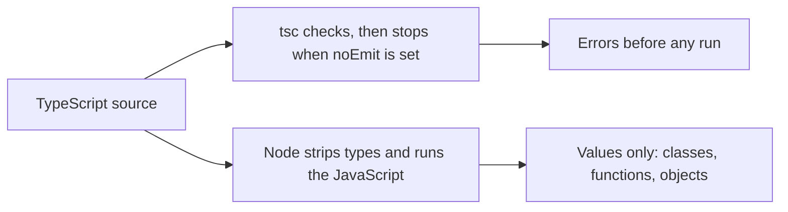

Checking and running are two commands. `tsc --noEmit` reads the project and prints errors. It does not have to write a `.js` file. Node, since 22.18 and 23.6 with the behavior on by default, and current Node 26, executes a `.ts` file by deleting the type syntax. It does not generate code. Bun and Deno do the same kind of stripping. A bundler such as esbuild also strips. If the syntax only makes sense after the compiler emits extra JavaScript, a strip-only runtime cannot run it.

### Syntax that needs an emit

An `enum` is the usual trap. A numeric enum compiles to an object plus a reverse map, so `Color.Red` and `Color[0]` both work. That object is generated code. Node's strip-only mode stops with `ERR_UNSUPPORTED_TYPESCRIPT_SYNTAX` on the word `enum`. It does not build the object for you. A `namespace` that merges values, and a constructor parameter property such as `constructor(public id: string)`, also need emit. The parameter property is sugar for declaring a field and assigning `this.id = id` in the constructor. Stripping the types would leave a parameter named `id` and no assignment, so the runtime refuses the syntax instead of silently dropping the field.

`erasableSyntaxOnly`, added in TypeScript 5.8, makes the checker reject those forms. The flag exists so the error appears in `tsc` rather than as a crash when the process starts. The replacement for an enum is a union of string literals, or a plain object with `as const` and a type read off that object. The object is real JavaScript you wrote yourself. The union is a type and disappears. You keep autocomplete and exhaustiveness, and Node has nothing extra to generate.

| You wrote | After stripping | Use it when |
|---|---|---|
| `type`, `interface`, `import type`, `as`, `satisfies` | Deleted | The name is only for the checker |
| `class`, `function`, object, array | Kept, annotations removed | The program has to run it |
| `enum`, `namespace`, parameter property | Rejected by strip-only Node and by `erasableSyntaxOnly` | Don't. A string union or an `as const` object is the same idea |
| A cast `as User` on JSON | Deleted. The value is unchanged | You have not checked the JSON |

`strict` is the other half of the setup. Without it, `null` is allowed wherever an object is expected, and a missing annotation becomes `any`, which turns checking off for that value and for whatever it touches. `noUncheckedIndexedAccess` makes `arr[i]` include `undefined`, because the index might be missing. Those flags do not survive into the run either. They only change which programs `tsc` accepts. The exercises in this module are checked with `strict`, `noUncheckedIndexedAccess`, and `erasableSyntaxOnly`.

A cast is the escape hatch, and it is also a hole. `value as User` tells the checker to trust you. The bytes are the same bytes. Use a cast at the edge only after a check you wrote, or not at all. A typed function called from checked code is protected at the call. The same function called from a file the checker never saw, or handed a value that was cast, is an ordinary JavaScript function.

A small file makes the split concrete. It declares `interface Ticket { id: string }`, a function `function title(ticket: Ticket): string { return ticket.id }`, and `const raw = JSON.parse(text) as Ticket`. The interface is deleted. The `as Ticket` is deleted. `JSON.parse` still returns whatever the text contained, and `title` still reads `.id`. When the text is `{"ID":"9"}`, `title` returns `undefined`, and the checker stays quiet because the cast already told it to stop looking. The function body is ordinary property access. A test that constructs `{ id: "9" }` inside a typed file never takes this path, so the bug waits for a real payload.

The replacement for an enum is a value you write yourself:

```ts
const Gate = { open: "open", shut: "shut" } as const
type GateName = (typeof Gate)[keyof typeof Gate]
```

`Gate.open` is the string `"open"` when the program runs, because the object is JavaScript. `GateName` is `"open" | "shut"` and disappears. Nothing in that file asks the compiler to invent an object. A parameter property does the opposite. `constructor(public code: number)` looks like one parameter, and a real emit turns it into a field plus `this.code = code`. Strip the types and that assignment was never written, so both the flag and the runtime refuse the syntax. Write the field and the assignment as two statements. Then stripping has nothing to invent, and a reader can see where `code` is stored.

### You can now

- Say what is left of a typed function after the types are removed, and why a string can still arrive where a number was declared.
- Tell a class, which exists at runtime, from an interface or a type alias, which does not.
- Explain why `enum` and parameter properties fail under Node's type stripping, and what to write instead.
- Separate `tsc --noEmit` from running the file, and name the flags that make the checker agree with a strip-only runtime.

::: quiz
q: Your function is typed `(user: User) => string`, and an API returns `{ "nmae": "Ana" }` (a typo). What happens at runtime?
- TypeScript throws a type error when the data arrives
+ Nothing checks it: the code runs with the wrong shape, and `user.name` is `undefined`
- The compiler refuses to build because the API is wrong
- Node validates it against the interface
why: Types are erased before running. Data arriving at runtime has to be checked by code you write (or a library like Zod).
:::

::: quiz
q: Why do modern setups avoid `enum`?
- Enums are slower than objects
+ An enum generates JavaScript code, so a runtime that just strips types can't run it; a union like `"draft" | "sent"` is pure type and erases cleanly
- Enums can't be exported
- Enums don't work with strict mode
why: Type stripping (Node, Bun, esbuild) removes annotations; it doesn't generate code. Unions of literals give the same safety with nothing to generate.
:::

::: card
q: After type stripping, what is left of `function label(id: number): string { return String(id) }`, and what does `typeof` report for a class?
answer: The function remains `function label(id) { return String(id) }`. The annotations are gone. A class remains, and `typeof` on the class is `"function"` because a class is a constructor. A type alias or interface with the same shape is not a value, so it is not there to ask `typeof` about.
:::

::: quiz
q: A constructor is written `constructor(public code: number) {}`. Why does a strip-only runtime refuse that file?
- `public` is a privacy check that runs on every call
+ A parameter property is sugar for a field plus `this.code = code`, and stripping types would drop the assignment, so the syntax is rejected
- Classes cannot have constructors once types are erased
- `public` fields are rejected by `strict`
why: The assignment was never written as a statement. A stripper that only deletes types would leave a parameter and no field, so Node and `erasableSyntaxOnly` refuse the form. Write the field and `this.code = code` yourself.
:::

::: quiz
q: `interface Row { n: number }` is in scope. What is true of the name `Row` when the file runs?
- `typeof Row` is `"object"`, because an interface becomes an empty object
+ `Row` is only a type, so it is not a value. A class with the same name would be a constructor function
- `typeof Row` is `"interface"`
- Node builds a validator from the interface and checks every object
why: Interfaces and type aliases are deleted. A class is a value, so it survives as a function. There is no schema left behind under the name `Row`.
:::

::: predict lang=typescript
code:
```ts
class Shelf {
  slots = 2
}
type ShelfNote = { slots: number }
const shelf = new Shelf()
console.log(typeof Shelf)
console.log(shelf.slots * 5)
```
answer:
```
function
10
```
:::

::: write lang=typescript
task: Export `openState(code: number): "open" | "shut" | "other"`. Code `1` is `"open"`, code `2` is `"shut"`, and every other number is `"other"`. Do not use an enum. The return type is a union of those three strings.
starter:
```ts
export function openState(code: number): "open" | "shut" | "other" {
  return "open"
}
```
tests:
```ts
// Wrong answer: returning "open" for every code, or String(code)
import { test } from "node:test"
import assert from "node:assert/strict"
import { openState } from "./solution.ts"

test("1 is open", () => {
  assert.equal(openState(1), "open")
})
test("2 is shut", () => {
  assert.equal(openState(2), "shut")
})
test("0 is other", () => {
  assert.equal(openState(0), "other")
})
test("9 is other", () => {
  assert.equal(openState(9), "other")
})
```
solution:
```ts
export function openState(code: number): "open" | "shut" | "other" {
  if (code === 1) return "open"
  if (code === 2) return "shut"
  return "other"
}
```
:::

::: write lang=typescript
task: Export `onlyString(value: unknown): string`. Return the value when it is already a string. Otherwise throw an `Error`. Do not coerce numbers, booleans, or `null` with `String`.
starter:
```ts
export function onlyString(value: unknown): string {
  return String(value)
}
```
tests:
```ts
// Wrong answer: String(value), which turns 4 into "4" and null into "null"
import { test } from "node:test"
import assert from "node:assert/strict"
import { onlyString } from "./solution.ts"

test("keeps a string", () => {
  assert.equal(onlyString("hi"), "hi")
})
test("rejects a number", () => {
  assert.throws(() => onlyString(4), Error)
})
test("rejects null", () => {
  assert.throws(() => onlyString(null), Error)
})
```
solution:
```ts
export function onlyString(value: unknown): string {
  if (typeof value === "string") return value
  throw new Error("not a string")
}
```
:::

::: config lang=json
task: Write a `tsconfig.json` whose `compilerOptions` turn on `strict`, `noUncheckedIndexedAccess`, `erasableSyntaxOnly`, and `noEmit`. Set `module` and `moduleResolution` to `nodenext`, and `target` to `es2023`. A file with `"strict": false`, or with those flags missing, does not pass.
starter:
```json
{
  "compilerOptions": {
    "strict": false
  }
}
```
check: compilerOptions.strict = true | strict is on
check: compilerOptions.noUncheckedIndexedAccess = true | indexed access includes undefined
check: compilerOptions.erasableSyntaxOnly = true | only strippable syntax is allowed
check: compilerOptions.noEmit = true | the checker does not write JavaScript
check: compilerOptions.module = "nodenext" | module is nodenext
check: compilerOptions.moduleResolution = "nodenext" | module resolution is nodenext
check: compilerOptions.target = "es2023" | target is es2023
solution:
```json
{
  "compilerOptions": {
    "strict": true,
    "noUncheckedIndexedAccess": true,
    "erasableSyntaxOnly": true,
    "noEmit": true,
    "module": "nodenext",
    "moduleResolution": "nodenext",
    "target": "es2023"
  }
}
```
:::

## A type is a set of values
id: type-set
stage: types
needs: erasure
minutes: 40
goal: Name the set of values a type stands for, and tell unknown from any and never from void.
source: TypeScript handbook: Everyday types | https://www.typescriptlang.org/docs/handbook/2/everyday-types.html
source: TypeScript handbook: Types as sets | https://www.typescriptlang.org/docs/handbook/typescript-in-5-minutes-oop.html#types-as-sets

A type error is a claim about sets. The checker refuses a value when the set of things that value might be does not sit inside the set you asked for. `boolean` is the set `{true, false}`. The literal `"good"` is the set that contains only that string. `string` is every string, so `"good"` fits where a `string` is expected, and a `string` does not fit where `"good"` is expected, because the string might be `"bad"`. A union is the combination of sets. `"a" | "b"` contains those two strings and nothing else. A value of that type is one of them, and a function that accepts it may only use operations that work for both.

```
unknown          every value
  string           every string
    "good"           only that string
  boolean          true, false
never            no values, so it sits inside every other set
```

The annotations are still deleted before the program runs. The set is a rule for `tsc`. Node sees the value that was actually there. A cast does not shrink the set of bytes. `payload as string` tells the checker to pretend, and `JSON.parse` still returns whatever the text contained.

`unknown` is the honest top of the picture. Every value is an `unknown`, and an `unknown` is not a `string`, a `number`, or an object with a property until a check throws the other possibilities away. After `typeof value === "string"` the checker uses the smaller set in that branch, because the branch only runs when the other values have been rejected. `any` names every value too, and then it breaks the picture. A value of type `any` is allowed where a `string` is expected, and a property read on it is allowed, so the checker has stopped. One `any` spreads. A function that returns `any` makes the caller's variable `any`, and the next function that receives it is no longer checked. That is why outside data, a payload, an environment variable, a form field, wants `unknown` until a check you wrote produces a smaller type. Typing it as `any` moves the bug from the editor to production.

`never` is the empty set. No value has that type. It is what remains when every case of a union has been handled, and it is the return type of a function that always throws or never finishes. `null` is the wrong substitute. `null` is a real value, the only member of the type `null`, and under `strict` it is not a `string`. `void` is a third idea. A function typed as returning `void` is allowed to return, and the caller is told not to use what came back. What came back is often `undefined`, which is a value, so `void` is not "this cannot happen."

| Type | Set the checker uses | If you use it for outside data |
|---|---|---|
| `unknown` | every value, and you must narrow before use | the check is code, and a bad payload fails there |
| `any` | every value, with checking turned off | property reads typecheck and crash later |
| `never` | no values | you cannot return a normal result |
| `void` | the caller should ignore the result | reading it as data treats `undefined` as a success |
| `"good"` | that one string | a wider `string` does not fit |

One error looks like a set problem and is not. A fresh object literal `{ id: "1", extra: true }` assigned to a type that only mentions `id` is rejected, even though at runtime an object is allowed to have extra fields. The checker does that for a freshly written object so a typo in a field name is caught. A value that already has a wider type can still be passed, and the extra field is still there when the function runs. Assignability of an existing value follows the sets. The extra complaint on a fresh object is a separate check for typos.

### Reading an assignment as inclusion

Three lines that look alike are three different questions about which set sits inside which.

`const flag: boolean = true` is accepted because the set `{true}` sits inside `{true, false}`. The other direction fails. `const flag: true = false` is rejected because `false` is not a member of `{true}`. A parameter typed `boolean` is that same larger set. Passing the value `true` is fine. Passing a `boolean` variable where the type `true` is required is not, because the variable might be `false` on this call. The checker does not look at the current contents and hope. It uses the whole set the binding was given.

`let mode = "good"` is not the set `"good"`. A `let` can be assigned again, so the checker widens the set to `string`, and the next line may set `mode = "bad"`. `const mode = "good"` cannot be assigned again, so the set stays one string. Inference is choosing the set from the way the binding works. An annotation can force the wider set anyway: `const mode: string = "good"` is a `string` that happens to hold `"good"` today, and a later reader must not assume the set still has one member.

A union is how you make the set bigger on purpose and then stop. `let mode: "good" | "bad" = "good"` still rejects `mode = "ok"`. The annotation stopped the widening at those two strings instead of every string. Without it, `let` would widen all the way to `string`, and the typo would be a legal assignment. That is the practical reason to write a small union on a status field. The cost is that every producer has to hand you one of those strings. A free-form note from a user is a `string`, and pretending it is `"good" | "bad"` is a cast, not a parse.

### Overlap

`string & number` asks for the values that are in both sets at once. Nothing is both a string and a number, so the overlap is empty, and the empty set is `never`. Object types overlap in a useful way, because one value can carry both fields. `{ id: string } & { name: string }` is the objects that have an `id` and a `name`. That set is smaller than either piece, and it is not empty. A function that asks for the intersection may read both fields. A function that asks only for `{ id: string }` may not read `name`, because that set includes objects that have no `name`. Adding fields to an object type shrinks the set of values. It does not grow it. The extra field is another requirement.

### Where the picture fails you

A red squiggle is not proof the running program will throw. It is proof the sets do not line up in the files the checker saw. A test that builds `{ id: "9" }` inside those files never supplies the payload that was cast in from text. A green check is not proof the sets match the data outside the program. It means every value the checker could see sat inside the sets you declared. Bytes that arrive later were not one of those values, and the annotation will not be there to refuse them.

People also reach for `any` because `unknown` will not let them call a method yet. The method call is the moment the set has to shrink. If the method is the first thing you do, you have skipped the check, and `any` is how the skip is spelled. A thrown error is not a `never` either. The throw happens, and then the function does not produce a value. Callers do not receive the error as a return value unless you caught it and returned it. Until you do, the error is a control-flow path, not a member of the set.

At work the small sets are status codes and results. `"queued" | "sent" | "failed"` rejects the typo `"send"` at the call. A row typed as `unknown` cannot be passed to a function that expects cents until something narrows it. The same row typed as `any` sails into that function, and a string of digits becomes concatenation instead of a sum, because the annotation that said `number` was never a lock on the value.

### You can now

- Name the set for `boolean`, a string literal, a union of two literals, `unknown`, and `never`.
- Say why `"good"` fits in `string` and a `string` does not fit in `"good"`.
- Tell `unknown` from `any`, and `never` from `void` and from `null`.
- Explain why a cast leaves the bytes alone, and why a fresh object with an extra field is a separate check.

::: quiz
q: Which values are in the type `"good"`?
- Every string
+ Only the string good
- The string good, and undefined
- No values, because a literal type is erased
why: A literal type is a set of one value. Erasure means the running program does not consult that set. The checker still uses it.
:::

::: quiz
q: Which value has the type `never`?
- null
- undefined
- An error that was thrown
+ No value does
why: `never` is the empty set. A function that returns `never` throws or never finishes. `null` and `undefined` are values, each with its own type.
:::

::: quiz
q: A payload is typed `any` in one function and `unknown` in another. What actually changes?
- `unknown` rejects more values while the program runs
+ With `unknown` the checker refuses a property read until you narrow. With `any` the read is allowed and the crash moves to runtime
- `any` is the empty set
- `unknown` contains only objects
why: Both names cover every value. `any` is assignable to everything, so checking stops. `unknown` is not assignable to a more specific type until a check shrinks the set.
:::

::: card
q: What sets do `boolean`, `"a" | "b"`, `unknown`, and `never` name, and how is `any` different from `unknown`?
answer: `boolean` is `true` and `false`. `"a" | "b"` is those two strings. `unknown` is every value, and you narrow it before use. `never` is no values. `any` is also every value, but it turns checking off, so it is not a safe stand-in for `unknown`.
:::

::: predict lang=typescript
code:
```ts
function slot(kind: "bool" | "word", value: unknown): string {
  if (kind === "bool" && typeof value === "boolean") return value ? "yes" : "no"
  if (kind === "word" && value === "good") return "good"
  return "nope"
}
console.log(slot("bool", true))
console.log(slot("bool", "true"))
console.log(slot("word", "good"))
console.log(slot("word", "Good"))
```
answer:
```
yes
nope
good
nope
```
:::

::: write lang=typescript
task: Export `member(kind: "bool" | "lit" | "never" | "unknown", value: unknown): boolean`. Return true for `"bool"` only when the value is `true` or `false`. Return true for `"lit"` only when the value is the string `"good"`. Return false for `"never"`, whatever the value is. Return true for `"unknown"`, whatever the value is. Do not compare `typeof value` to `kind`.
starter:
```ts
export function member(kind: "bool" | "lit" | "never" | "unknown", value: unknown): boolean {
  return typeof value === kind
}
```
tests:
```ts
// Wrong answer: typeof value === kind, which is "boolean" or "string", never "bool" or "lit"
import { test } from "node:test"
import assert from "node:assert/strict"
import { member } from "./solution.ts"

test("booleans and the string true", () => {
  assert.equal(member("bool", true), true)
  assert.equal(member("bool", false), true)
  assert.equal(member("bool", "true"), false)
})
test("the literal good", () => {
  assert.equal(member("lit", "good"), true)
  assert.equal(member("lit", "Good"), false)
  assert.equal(member("lit", true), false)
})
test("never is empty and unknown is everything", () => {
  assert.equal(member("never", "good"), false)
  assert.equal(member("never", undefined), false)
  assert.equal(member("unknown", 0), true)
  assert.equal(member("unknown", null), true)
})
```
solution:
```ts
export function member(kind: "bool" | "lit" | "never" | "unknown", value: unknown): boolean {
  if (kind === "bool") return value === true || value === false
  if (kind === "lit") return value === "good"
  if (kind === "never") return false
  return true
}
```
:::

## Check the project, then run the file
id: setup
stage: types
needs: type-set
minutes: 40
goal: Predict which mistakes tsc reports and which ones Node still runs.
source: TSConfig: noEmit | https://www.typescriptlang.org/tsconfig/noEmit.html
source: TSConfig: strict | https://www.typescriptlang.org/tsconfig/strict.html
source: TSConfig: verbatimModuleSyntax | https://www.typescriptlang.org/tsconfig/verbatimModuleSyntax.html
source: Node.js: Running TypeScript natively | https://nodejs.org/en/learn/typescript/run-natively

A TypeScript project is checked by one program and executed by another. `tsc --noEmit` reads `tsconfig.json`, applies the flags, and prints errors. It does not start the program, and with `noEmit` it does not write `.js` files beside the source. Node runs a `.ts` file by deleting the type syntax and executing what remains. It does not read those errors. A file can be rejected by `tsc` and still print an answer under `node`, because the leftover JavaScript was legal.

```ts
const n: number = "no"
console.log(typeof n)
```

The annotation says the set is `number`. The value is the string `"no"`. `tsc` with `strict` reports that a string is not assignable to `number`. Node deletes the annotation, so `typeof n` is `"string"`. The set was a rule for the checker. The runtime never consulted it. That is why a pipeline that only starts the process will ship the bad assignment. The reverse also bites. `tsc --noEmit` can be clean while the program still does the wrong thing, because a mistake inside the allowed set is not a type error. Returning `4` from a function that was supposed to add `1` and `2` is still a `number`. You find that by running the file.

`strict` is a bundle. It includes `strictNullChecks`, so `null` is not a member of `string`, and `noImplicitAny`, so a parameter with no type is an error instead of quietly becoming `any`. Leave the bundle on. `noEmit` belongs in the config when Node or a bundler is what loads the source. An older pipeline ran `tsc` to emit JavaScript and then ran the `.js` files. Strip-only Node makes that emit unnecessary. `module` and `moduleResolution` set to `nodenext` tell the checker to follow Node's rules for file extensions and for the `"type"` field in `package.json`.

`verbatimModuleSyntax` belongs with those module settings. An import that exists only so the checker can see a type is deleted, so it has to be written `import type`. A value import of a type would point at a binding that is not there when the file runs. The flag makes that a checker error instead of a crash on startup. `include` lists the files in this project. A file outside `include` is not part of the check, so a mistake in it stays quiet until a config actually covers it.

| You run | Types | The program | Files written |
|---|---|---|---|
| `tsc --noEmit` | checked | not started | none |
| `node file.ts` | stripped, not checked | runs | none |
| `tsc` without `noEmit` | checked | not started | `.js` next to the source |

A missing annotation is the hole `noImplicitAny` closes. `function greet(name)` gives `name` no type. Under `strict` that is an error. With the flag off, `name` is `any`, and `name.toUpperCase()` typechecks even when the caller passes a number. Give parameters a type. When the value may be absent, spell that as `string | undefined`, and decide in the body what "absent" means. `??` replaces `null` and `undefined` and leaves `""` alone, because an empty string is a string. `||` replaces every falsy value, so `""` becomes the default too. Pick `??` when an empty string is real data and only absence should change.

### What the error is saying

When `const n: number = "no"` fails, the message is that `string` is not assignable to `number`. The value's set is `string`. The place you put it requires `number`. Those sets do not overlap, so there is no honest value that satisfies both. The fix is to change the value, change the annotation, or narrow before the assignment. `as number` does none of those. It leaves the string in the variable, and a later `n.toFixed(0)` throws, because a string has no `toFixed`. The checker was the only reader that still believed the set was `number`.

A second kind of message shows up as soon as `strict` is on and a parameter has no annotation: the parameter implicitly has an `any` type. That one is not a clash between two sets. It is the checker refusing to invent `any` for you. Add the set you meant. If you truly have no idea yet, `unknown` keeps the set honest and forces the next line to narrow. `any` compiles the next line and deletes the reason you turned `strict` on.

### Which files are in the project

`tsc` does not check "the file that is open." It checks the project described by `tsconfig.json`. `include` is a list of globs, and `files` is an explicit list of paths. When both are left out, the default is the TypeScript files under the directory that holds the config, minus the usual exclusions such as `node_modules`. Setting `"include": ["src"]` is a decision that scratch files next to `src` are not part of this check. A mistake in `scratch/try.ts` stays quiet, which is what you want for a sandbox and a surprise if you thought that file shipped. `exclude` removes paths from what `include` selected. It does not drop a file that an included file imports. The import pulls the target into the program, because the checker has to know the type of the thing you called.

### Type imports have to be marked

```ts
import type { Ticket } from "./ticket.ts"
import { save } from "./ticket.ts"
```

`Ticket` exists for the checker, so the first import is deleted and does not load the module by itself. `save` is a function, so the second import stays and loads `./ticket.ts`. A single `import { Ticket, save }` asks the runtime for a binding named `Ticket`. After the types are stripped, that binding is not there. `verbatimModuleSyntax` reports the combined import so you split the type from the value. A relative import also needs an extension the runtime can load. With Node stripping TypeScript, and with `noEmit` so the checker is not writing `.js`, that extension is `.ts`. A bare `./ticket` that only worked because a bundler guessed the file will fail when Node is the loader. The checker and the runtime then disagree, which is the failure this setup exists to prevent.

### Where a clean command still lies

`skipLibCheck` skips typechecking of declaration files that arrived with dependencies. Builds get shorter, and a wrong type inside a library stays hidden until your own call happens to touch it. Treat it as a choice about build time, not as a way to turn a red project green. The other lie is a script that runs `node src/main.ts` and never runs `tsc --noEmit`. The process starts, the annotations are already gone, and every set error is still sitting in the source. Put the checker next to the tests. A type error fails that command. Nothing in the running process will enforce it for you later.

### You can now

- Say what `tsc --noEmit` checks, and that it neither runs the program nor writes JavaScript.
- Predict what Node prints for a value whose annotation the checker would reject.
- Put `strict`, `noEmit`, `nodenext`, and `verbatimModuleSyntax` in a config, and say what each one is for.
- Use `??` when only `undefined` should become a default, and leave `""` in place.

::: quiz
q: A file contains a string assigned to a `number` annotation, and the leftover JavaScript is legal. What does `node` do with that file?
- It refuses to start, because tsc would report an error
+ It runs the file. The annotation is stripped, so the string is still a string
- It rewrites the string into a number
- It runs the file only when `noEmit` is set
why: Node does not ask the checker. `noEmit` only tells `tsc` not to write output. The running value is whatever the assignment left behind.
:::

::: quiz
q: What does `tsc --noEmit` produce when the project typechecks?
- A `.js` file next to each source file, then it runs them
+ No output files and no run. Silence means the checker accepted the project
- A stripped copy that Node will load
- It fails, because `noEmit` forbids a clean check
why: `noEmit` means the checker reports and stops. Running is a separate command. A clean check is an empty report, not a bundle.
:::

::: card
q: For `tsc --noEmit`, `node file.ts`, and `tsc` without `noEmit`, what happens to types, to the program, and to output files?
answer: `tsc --noEmit` checks types, does not start the program, and writes nothing. `node file.ts` strips types without checking them, and runs the remaining JavaScript. `tsc` without `noEmit` checks and writes `.js` files, and still does not run the program.
:::

::: predict lang=typescript
code:
```ts
const label: string = 12
console.log(typeof label)
console.log(label + 1)
```
answer:
```
number
13
```
:::

::: write lang=typescript
task: Export `missingAnnotation(name: string | undefined): string`. Return the name when it is a string, including the empty string. Return `"anon"` when the name is `undefined`.
starter:
```ts
export function missingAnnotation(name: string | undefined): string {
  return name ?? ""
}
```
tests:
```ts
// Wrong answer: name ?? "", which turns undefined into an empty string, or name || "anon", which also replaces ""
import { test } from "node:test"
import assert from "node:assert/strict"
import { missingAnnotation } from "./solution.ts"

test("keeps a name and an empty string", () => {
  assert.equal(missingAnnotation("Ada"), "Ada")
  assert.equal(missingAnnotation(""), "")
})
test("undefined becomes anon", () => {
  assert.equal(missingAnnotation(undefined), "anon")
})
```
solution:
```ts
export function missingAnnotation(name: string | undefined): string {
  return name ?? "anon"
}
```
:::

::: config lang=json
task: Write a `tsconfig.json` that checks `src` and does not emit JavaScript. `compilerOptions.strict` is true, `noEmit` is true, `module` and `moduleResolution` are `nodenext`, and `verbatimModuleSyntax` is true. `include` has one entry, `src`. A config with `strict` false, or with no `include`, does not pass.
starter:
```json
{
  "compilerOptions": {
    "strict": false,
    "noEmit": true
  }
}
```
check: compilerOptions.strict = true | strict is on
check: compilerOptions.noEmit = true | the checker writes nothing
check: compilerOptions.module = "nodenext" | module is nodenext
check: compilerOptions.moduleResolution = "nodenext" | module resolution is nodenext
check: compilerOptions.verbatimModuleSyntax = true | type imports are explicit
check: include[0] = "src" | the project includes src
solution:
```json
{
  "compilerOptions": {
    "strict": true,
    "noEmit": true,
    "module": "nodenext",
    "moduleResolution": "nodenext",
    "verbatimModuleSyntax": true
  },
  "include": ["src"]
}
```
:::

## Everyday types and inference
id: everyday
stage: types
needs: setup
minutes: 45
goal: Predict the type inference gives a value, and annotate the places it cannot see.
source: TypeScript handbook: Everyday types | https://www.typescriptlang.org/docs/handbook/2/everyday-types.html
source: TypeScript handbook: Object types | https://www.typescriptlang.org/docs/handbook/2/objects.html

Most local bindings do not need an annotation. The checker already has a set for `const count = 0`, and writing `: number` next to it adds noise without adding a fact. The annotations that earn their place are the ones inference cannot recover: a function parameter, the return of a function other files will call, and a container that is still empty. Everything else is a place to stop and read what the checker already decided.

```ts
const count = 0
let copies = 1
const origin = [0, 0] as const
const titles: string[] = []
```

`count` is the set `{0}`, not every number. A `const` initialized with a literal cannot be assigned again, so the checker keeps the literal. `copies` is `number`, because `let` can be assigned `2` on the next line, and the set has to include that. `origin` is the tuple `readonly [0, 0]`. Without `as const` the same brackets are an array whose elements are `number`, and the length is no longer part of the type. `titles` is a `string` array with nothing in it yet. The annotation is what stops it becoming an implicit `any[]`.

### What you write down, and what you leave

A parameter has no value at the declaration, so there is nothing to infer from. `function greet(name)` is the implicit-`any` error under `strict`. `function greet(name: string)` says the set. The return type of a local function can often be inferred from the `return`, and that is fine while the function is private. On an exported function, write the return type anyway. It is the contract the caller sees, and it stops a refactor inside the function from silently widening what every caller receives. If you meant to return a number of cents and you accidentally return a string, the annotation fails at the `return`. Inference would have published the string.

An empty array is the other hole. Under `strict`, `const titles = []` followed by a read is an implicit `any[]` error, because no element has fixed the set. Push a string and then read, and the checker evolves the array to `string[]`. That evolution feels helpful and goes wrong when the first push was a mistake, or when one branch pushes a string and another pushes a number and the element set becomes the union. Write `string[]`, or a tuple, at the creation. The type is then a decision instead of a side effect of the first call.

| Binding | Inferred set | Write an annotation |
|---|---|---|
| `const n = 0` | `0` | Only if you wanted every number |
| `let n = 0` | `number` | When a smaller set, such as `0 \| 1`, is the real rule |
| `const pair = [1, "a"]` | `(string \| number)[]` | When the length and the order matter. Use a tuple or `as const` |
| `const pair = [1, "a"] as const` | `readonly [1, "a"]` | The literal tuple is already the set |
| `const titles = []` | implicit `any[]` if you read it too soon | Yes. The elements are not in the value yet |

`as const` freezes the literals in an array or an object for the checker. It does not freeze the value at runtime. `origin[0]` is the type `0`, and a later assignment to `origin[0]` is rejected because the tuple is readonly. The array is still a normal array if some other code holds a wider alias and mutates it. The modifier is a checker rule. It is deleted with the rest of the types.

### Objects you describe, and holes you have to handle

A `type` alias can name an object, a union, a tuple, or a primitive. An `interface` names an object shape and can be extended or merged with another interface of the same name. Merging surprises people, because a second `interface User` in the program adds fields to the first instead of replacing it. Prefer `type` unless you specifically want that extension. Both are erased. Neither one is a runtime check.

```ts
type User = {
  id: string
  email: string
  nickname?: string
  readonly createdAt: Date
}
```

`nickname?` means the property may be missing. Reading it produces `string | undefined`. Assigning `undefined` is also allowed under the default `strict` flags, so "missing" and "present but undefined" are the same set until a stricter flag separates them. `readonly createdAt` means this alias cannot assign a new date. Another alias that does not mark the field readonly still can, if it points at the same object. Readonly is not a freeze, and `Object.freeze` is the runtime tool if you actually need one.

An index signature or `Record<string, number>` says every property is a number if it exists. It does not say every string key exists. With `noUncheckedIndexedAccess`, `prices[sku]` is `number | undefined`, because `sku` might be a code you have never stored. The same is true of `titles[0]`. The flag is the checker admitting that the index is a lookup, not a proof. Handle the `undefined` before you do arithmetic. A non-null assertion `prices[sku]!` deletes the `undefined` from the set and leaves the crash for the run, which is the same kind of lie as a cast.

Tuples are for a fixed order. `[string, number]` is a name and a count, not a list you push onto. A function that returns one can be annotated with the tuple, and the caller can read index `0` as a string and index `1` as a number without a narrowing ladder. An array of the union `string | number` cannot make that promise, because index `0` might be either. Use the tuple when swapping the two positions would be a bug. Use the array when the length is data.

### Where inference is the wrong kindness

Inference follows the values you happened to write. `const status = "open"` is the set `"open"`, which is what you want for a constant and too small if that binding was supposed to hold either state. Widening it with an annotation, or with `let`, is a decision about who may choose the value later. A function whose only return is `"open"`, and which has no return annotation, publishes the type `"open"`. Callers can pass that result where `"open" | "closed"` is expected, because the smaller set fits inside the larger one. They are not told that `"closed"` exists, so they have no reason to handle it. A return annotation of `"open" | "closed"` does not force the function to return both members. Returning `"open"` still typechecks, because that value is in the set. What the annotation does reject is a value outside the set, including the typo `"opne"`. Inference would have published the typo as a brand new literal type and called it a success. The annotation is a ceiling. It is not a demand that every member appear.

At work these choices show up in a config object and a list of rows. The config is `as const` when the keys and the literal flags are the API. The rows are an annotated array because they start empty and get pushed as results arrive. The id on each row is `readonly` so a helper cannot "fix" it in place. The optional note is read with a check for `undefined`, not with an assertion, because a missing note is normal and a crash is not.

### You can now

- Predict the set for `const` and `let` initialized with a number or a string, and for an array with and without `as const`.
- Annotate parameters, exported returns, and empty containers, and leave a simple local alone.
- Describe an object with an optional field and a readonly field, and say what each one does and does not prevent at runtime.
- Treat an index read as `T | undefined` when `noUncheckedIndexedAccess` is on, and handle the missing case.


::: quiz
q: With `noUncheckedIndexedAccess` on, what's the type of `scores["ana"]` if `scores: Record<string, number>`?
- `number`
+ `number | undefined`
- `any`
- `unknown`
why: A record can't promise that every string key exists. The flag makes you deal with the missing case instead of crashing on `undefined`.
:::

::: write lang=typescript
task: Define and export a type `Invoice` with `id` (string), `lines` (an array of `{ description: string; amount: number }`), an optional `note` (string), and `status` that can only be `"draft"`, `"sent"` or `"paid"`. Then export `total(inv: Invoice): number` returning the sum of the line amounts. The hidden type checks also verify that a wrong status is rejected.
starter:
```ts
export type Invoice = any

export function total(inv: Invoice): number {
  return 0
}
```
tests:
```ts
import { test } from "node:test"
import assert from "node:assert/strict"
import { total } from "./solution"

test("sums lines", () => {
  assert.equal(total({ id: "1", status: "draft", lines: [{ description: "a", amount: 10 }, { description: "b", amount: 2.5 }] }), 12.5)
})
test("empty", () => {
  assert.equal(total({ id: "2", status: "paid", lines: [] }), 0)
})
```
types:
```ts
import type { Invoice } from "./solution"

const ok: Invoice = { id: "1", status: "sent", lines: [], note: "thanks" }
const noNote: Invoice = { id: "2", status: "paid", lines: [{ description: "x", amount: 1 }] }
// @ts-expect-error: "lost" isn't a status
const badStatus: Invoice = { id: "3", status: "lost", lines: [] }
// @ts-expect-error: amount must be a number
const badAmount: Invoice = { id: "4", status: "draft", lines: [{ description: "x", amount: "1" }] }
export { ok, noNote, badStatus, badAmount }
```
solution:
```ts
export type Invoice = {
  id: string
  lines: { description: string; amount: number }[]
  note?: string
  status: "draft" | "sent" | "paid"
}

export function total(inv: Invoice): number {
  return inv.lines.reduce((sum, line) => sum + line.amount, 0)
}
```
hint: `status: "draft" | "sent" | "paid"` is a union of literal types. `note?: string` makes it optional.
:::

::: quiz
q: What is the inferred type of `const seats = 5`, and of `let seats = 5`?
- Both are `number`
+ `const` is the literal `5`, and `let` is `number`, because `let` can be assigned again
- Both are the literal `5`
- `const` is `number`, and `let` is the literal `5`
why: A `const` binding cannot change, so a numeric literal stays that one value. A `let` has to include every later assignment, so the checker widens it to `number`.
:::

::: quiz
q: What is the type of `const pair = [1, "a"] as const`?
- `(string | number)[]`
+ `readonly [1, "a"]`
- `[number, string]`
- `any[]`
why: Without `as const` the brackets are an array of the union, and the length is forgotten. `as const` keeps the literal members and the length, and marks the tuple readonly for the checker.
:::

::: card
q: Which three places deserve an annotation even when inference could be left to guess, and what goes wrong with `const titles = []` if you read it immediately?
answer: Annotate function parameters, the return type of an exported function, and an empty container. A parameter has no value to infer from. An exported return is the contract callers see, and it rejects a value outside that set. An empty array that is read before any element fixes it is an implicit `any[]` under `strict`.
:::

::: predict lang=typescript
code:
```ts
const fixed = 5
let copies = 5
copies = copies + 1
const point = [1, "a"] as const
console.log(fixed)
console.log(copies)
console.log(point[0] + point[1])
```
answer:
```
5
6
1a
```
:::

::: write lang=typescript
task: Export `headCount(row: readonly [string, number] | []): number`. An empty tuple returns `0`. A pair returns the number in the second position, and that number may itself be `0`. Do not return the length of the tuple.
starter:
```ts
export function headCount(row: readonly [string, number] | []): number {
  return 0
}
```
tests:
```ts
// Wrong answer: always returning 0, or returning row.length (a pair has length 2)
import { test } from "node:test"
import assert from "node:assert/strict"
import { headCount } from "./solution.ts"

test("a pair returns its count, including zero", () => {
  assert.equal(headCount(["Ada", 4]), 4)
  assert.equal(headCount(["", 0]), 0)
})
test("empty returns 0", () => {
  assert.equal(headCount([]), 0)
})
```
solution:
```ts
export function headCount(row: readonly [string, number] | []): number {
  if (row.length === 0) return 0
  return row[1]
}
```
:::

## Any infects the caller; unknown waits for a narrow
id: special
stage: types
needs: everyday
minutes: 40
goal: Tell any, unknown, never, and void apart, because a value you have not checked is not permission to touch it, and a function that returns any turns checking off for its caller too.
source: TypeScript handbook: Everyday types | https://www.typescriptlang.org/docs/handbook/2/everyday-types.html
source: TypeScript handbook: More on functions | https://www.typescriptlang.org/docs/handbook/2/functions.html
source: TypeScript handbook: Narrowing | https://www.typescriptlang.org/docs/handbook/2/narrowing.html

A parameter annotated `string` is a claim the checker can see at every typed call. A payload that just arrived cannot make that claim. `JSON.parse` is declared to return `any` in the library types, a message from another process is whatever bytes showed up, and a config file is text until you decide what it means. The type you put on that boundary is the whole policy. `any` and `unknown` both mean "this could be every value". They diverge the moment you touch the value. `never` means the set of values is empty. `void` means the caller does not get to use a return. Mixing those four up is how a checked program quietly stops being checked, or how a missing field gets a type that was never a value.

### Both accept every value, and only one of them lets you proceed

`any` was added so a line could typecheck when you did not want to describe it. You can read a property of `any`, call it, assign it to a `number`, and assign a `number` back to it. Each of those results is `any` again. The handbook states the consequence directly: using `any` disables further type checking. That is not a narrow you forgot to write. It is the checker leaving.

`unknown` also accepts every value. A `string`, a `number`, `null`, an object, and a function can all be stored in an `unknown` variable. The similarity stops there. It is not legal to read a property of `unknown`, to call it, or to pass it where a `string` is required. The checker is not being fussy about style. It is refusing to pretend that a value with no known shape has the operation you just wrote. People describe `unknown` as "`any`, but easier to work with". That description is the bug. `any` is easier to write, and the ease is the checking disappearing. `unknown` is the stricter type. It is every value, and you cannot touch it until a narrow.

The practical split shows up one function boundary later. A helper that returns `any` does not confine the hole to its own body. The call expression has type `any`, so the caller can write `.id` on a parse that returned `null`, pass the result into arithmetic, and store it in a typed field. The caller is unchecked too. That is infection. A helper that returns `unknown` forces the narrow to happen at the caller, in the open, where the branch is visible. `JSON.parse` hands you `any`. Assigning that result to `unknown` at the edge is the move that puts the checks back. A cast in the other direction, `as any`, or the double cast `as unknown as SomeType`, deletes them again. The bytes are unchanged.

```ts
function load(text: string): unknown {
  return JSON.parse(text)
}
```

`load` typechecks, and nothing about the return value can be used until the caller proves a shape. Replace `unknown` with `any` and the same body typechecks, and so does every mistaken use at every call site. The body did not get safer. The signature exported the hole.

### A narrow is a runtime check the checker believes

The way out of `unknown` is an ordinary check, the same kind of check narrowing already follows on a union. `typeof value === "string"` makes that branch a `string`. `typeof value === "number"` makes it a `number`. `typeof value === "boolean"` makes it a `boolean`. `typeof value === "function"` makes it a function you can call. `Array.isArray` separates arrays from other objects. `instanceof Date` separates a `Date` from a plain object, because it walks the prototype chain. Equality does the rest: `value === null`, `value === undefined`, and `value === "ready"` each remove the other possibilities.

Those checks have sharp edges, and the sharpest is historical. `typeof null` is `"object"`. It has been `"object"` since the first JavaScript implementation, and a `typeof` comparison will not exclude it. After `typeof value === "object"` the value may still be `null`, and it may be an array, and it may be a boxed number such as `Object(1)`, whose `typeof` is also `"object"`. Exclude `null` with `===`. Use `Array.isArray` when you mean a list. Then read fields. Skipping that and casting to an object type is how a `null` payload becomes a crash on the next line, in code the checker signed off on.

A number that passed `typeof` is still not a number you can add into a total. `NaN` and `Infinity` are both numbers. `typeof NaN` is `"number"`, and `NaN` infects every later arithmetic result. `Number.isFinite` rejects `NaN` and both infinities. The order is the policy: kind first, then the extra condition the kind still allows, then use the value. What remains after the branches you support is still unchecked input. Throw there. Do not stringify it and hope. `String` on an arbitrary value produces text for objects (`"[object Object]"`), for `null` (`"null"`), and for a boolean (`"true"`, not a word you chose). That text typechecks as `string` and it is the wrong answer, and it does not throw, so the caller cannot tell a supported value from junk.

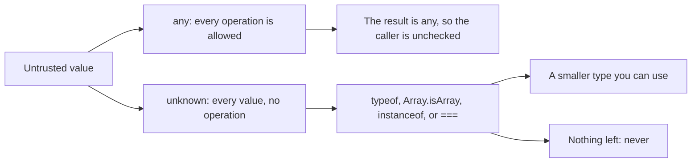

The cast sits outside that picture on purpose. It does not appear in the narrow, because the checker does not learn anything from it. If you can write the check, write the check. If you cannot, the value is still `unknown`, and returning it as a specific type is a lie the next function will believe.

### never is the empty set

`never` has no values. It is the type of a branch that cannot happen, and the type of a function that does not come back. `never` is assignable to every type, because there is no value that could surprise the destination. Nothing is assignable to `never` except `never` itself. That one-way door is the tool.

A function that always throws can be annotated `never`. The annotation matches the runtime: there is no return value, because control leaves by the exception. Callers can use the call where a `string` was required, since a return that never arrives does not violate the `string`. Code written after the call is unreachable. If the function can fall off the end, or return a real value, the annotation is false and the checker rejects the body. An infinite loop is the other way a function fails to return. Throwing is the one you write on purpose at a boundary, when the input matched none of the shapes you support.

```ts
function fail(message: string): never {
  throw new Error(message)
}
```

The other arrival of `never` is what remains of a union. Start with `"on" | "off"`. A `switch` that returns in both cases leaves the `default` with nothing. The handbook describes that state as the type of a value that should not exist. Assign the leftover to a `never` binding. Today the assignment typechecks, because the leftover really is empty. Add `"sleep"` to the union and forget the branch, and the leftover is `"sleep"`, which is not assignable to `never`, so the build fails. The failure is the maintenance. You did not have to remember every caller. The closed set of cases closed itself.

`never` is not "void, but stronger", and it is not `null`. A function typed `never` must not return to the caller. A function typed `void` does return. The next section is that other kind of nothing.

### void means the caller looks away

`void` is the return type of a function that does not return a value. Leave out `return`, or write `return` with no expression, and inference fills in `void`. That is a statement about the type of the call, not about a value stored in a field. At runtime a JavaScript function that returns nothing produces `undefined`. `undefined` is the value. It is the one you store when a field is empty, and the one you compare with `===` when you mean "nothing was returned". `void` is not a third empty beside `null` and `undefined`. Do not put `void` on a property to mean the property is blank. `null` is not even assignable to `void` under `strict`. `undefined` is assignable to `void`, which means a variable of type `void` can be forced into existence, and it is still the wrong tool: the type means "do not use this result", not "this slot is empty".

There is one place where a `void` return deliberately allows a value to come back. A callback slot typed `() => void` does not force the function you pass to return nothing. The function may return a `boolean`, a `number`, or anything else. The code that invokes the callback sees the result as `void` and must ignore it. This is why `forEach` accepts `push`. `forEach` asks for a callback that returns `void`. `push` returns a `number`, the new length. The call is legal because `forEach` is not going to read that length. Call `push` yourself and the number is there at runtime, unchanged. The type forbade the callback's caller from using it. It did not delete the return from the function that produced it.

That looseness is only the contextual callback type. A function you yourself annotate as returning `void` may not return a value. `return true` in that function is an error. The two rules are easy to collapse, and they are opposite directions. The callback rule exists so existing functions that return useful values can still be used as procedures. The declaration rule exists so a procedure you wrote does not start handing out a result its callers were told not to use.

The JavaScript `void` operator is a third spelling of the same word and a different mechanism. `void expr` evaluates `expr` and yields `undefined`. It does not produce a void-typed token you can store. Even the operator agrees with the runtime story: the value is `undefined`.

| You mean | Write | Do not write |
|---|---|---|
| Every value, and the caller must narrow | `unknown` | `any`, which accepts the operation and types the result `any` |
| Every operation, checking deliberately off | `any`, at a boundary you are about to assign to `unknown` | `unknown` described as "the easy any" |
| This function throws and does not return | `: never` | `: void`, which does return, with the value `undefined` |
| Every case of a union is handled | Assign the leftover to `never` | A `default` that returns a guess |
| The caller must ignore the return | `: void` on your function, and return nothing | A field typed `void` to mean empty. Store `undefined` |
| A callback whose result is discarded | A parameter typed `() => void` | Assuming the function you passed produced no runtime value |

At the boundary the policy is small. Accept `unknown`. Narrow with a check you can point at. Throw on the rest, and type that throw `never` if callers need the unreachable path to stay unreachable. Return `any` only as a temporary you convert before anyone else sees it, which means you almost never return it. Use `undefined` when the value is missing. Use `void` when the return is none of the caller's business, and remember that a `void` callback may still have returned something the callback's caller is not allowed to read.

### You can now

- Say why `any` and `unknown` both accept every value, and why only `any` makes the caller's next line unchecked.
- Narrow `unknown` with `typeof`, `Array.isArray`, `instanceof`, or `===`, and explain why `typeof null` does not prove you have an object.
- Use `never` for a function that always throws, and for the leftover of a union once every case has returned.
- Explain `void` as "the caller must ignore this", name `undefined` as the value a function actually returns when it returns nothing, and say why a `() => void` callback may still return a value at runtime.

::: quiz
q: A helper is declared to return `any`, and the caller reads `.id` on the result without a check. What does the checker do, and why?
- It treats the result as `unknown` and rejects the property read until a `typeof` check
+ It allows the read. `any` accepts every operation, the result of that operation is `any`, and a function that returns `any` makes the caller unchecked too
- It allows the read only when the helper's body returned an object literal
- It rejects the helper, because `any` cannot be used as a return type
why: `any` turns checking off for the value and for whatever you compute from it. Returning `any` exports that hole. `unknown` would have rejected `.id` until a narrow. The body of the helper does not have to return an object for the caller to be allowed to pretend it did.
:::

::: quiz
q: `value` has type `unknown`. Which check proves you have a non-null object you can read a field from?
- `typeof value === "object"`, because `typeof` is never `"object"` for `null`
+ `typeof value === "object"` is not enough: `typeof null` is `"object"`, and arrays are objects too. Exclude `null` with `===`, and use `Array.isArray` when the value might be an array, before you read a field
- Assign it to `any` first. That is the supported narrow
- `unknown` can already be indexed. The check is only for documentation
why: The checker believes `typeof`, `Array.isArray`, `instanceof`, and equality. `typeof null` is the historical `"object"`, so that comparison does not remove `null`. A cast or an assignment to `any` does not narrow. It stops checking.
:::

::: quiz
q: A function's declared return type is `void`, and the body has no `return`. What is true of the caller and of the runtime?
- The caller receives a storable empty value called `void`, and the runtime value is `void`
+ The caller must ignore the result. The value produced at runtime is `undefined`, which is not the same claim as the type `void`
- The function's type is `never`, so code after the call is unreachable
- The caller receives `null`, because `void` is the typed spelling of `null`
why: `void` tells the caller not to use the return. A JavaScript function that falls off the end yields `undefined`. `undefined` is the value you store for empty. `never` would mean the function does not come back at all. `null` is a different value and is not assignable to `void` under `strict`.
:::

::: card
q: When is a type `never`, and why is `any` not "`unknown` but easier"?
answer: `never` is the empty set. No value has that type. A function that always throws can return `never`, and after a `switch` has handled every member of a union the leftover is `never`. Assigning that leftover to `never` fails the build when a new member appears and has no branch. `any` and `unknown` both accept every value. `unknown` cannot be used until a narrow. `any` accepts every operation and types the result `any`, so a function that returns `any` turns checking off for the caller too.
:::

::: card
q: Why may a callback typed `() => void` still return a number at runtime?
answer: A contextual `() => void` means the code that calls the callback must ignore the return. The function you pass is allowed to return a value anyway, which is why `forEach` accepts `push` even though `push` returns a number. Call `push` directly and the number is still there. A function whose own declared return type is `void` may not return a value. `undefined` is what you get from a function that does not return, and it is the value to store when you mean empty. `void` is not that value.
:::

::: predict lang=typescript
code:
```ts
function describe(value: unknown): string {
  if (typeof value === "string") return "string:" + value
  if (typeof value === "number" && Number.isFinite(value)) return "finite:" + value
  if (value === null) return "null"
  return "other:" + typeof value
}
console.log(typeof null)
console.log(describe("hi"))
console.log(describe(12))
console.log(describe(Infinity))
console.log(describe(null))
console.log(describe(true))
console.log(describe([1]))
```
answer:
```
object
string:hi
finite:12
other:number
null
other:boolean
other:object
```
why: `typeof null` is the historical `"object"`. A string and a finite number take the first two branches. `Infinity` is a number, so `typeof` matches, and `Number.isFinite` rejects it, so it falls through to `typeof`, which is `"number"`. `null` is caught by `===` before the final branch, which is why it does not report `"object"`. `true` and an array miss every positive branch. `typeof true` is `"boolean"`. `typeof` of an array is `"object"`.
:::

::: predict lang=typescript
code:
```ts
function run(cb: () => void): void {
  const result = cb()
  console.log(typeof result)
  console.log(String(result))
}
run(() => "kept")
function blank() {}
console.log(typeof blank())
console.log(String(blank()))
function stop(message: string): never {
  throw new Error(message)
}
try {
  stop("halted")
  console.log("continued")
} catch (error) {
  console.log(error instanceof Error ? error.message : "no")
}
```
answer:
```
string
kept
undefined
undefined
halted
```
why: The parameter type `() => void` is erased before the run, so the callback's return value still exists. `run` prints that value's `typeof` and its text. `blank` has no return, so the runtime value is `undefined`. `stop` throws, the `catch` runs, and `continued` is never printed because control left by the exception.
:::

::: write lang=typescript
task: Export `readUnknown(value: unknown): string`. When `value` is a string, return that string unchanged. When `value` is a number and `Number.isFinite(value)` is true, return `String(value)`. When `value` is a boolean, return `"yes"` for `true` and `"no"` for `false`. For every other value, including `null`, arrays, `NaN`, and the infinities, throw `new Error("unsupported")`. Do not accept `String(true)`, which is `"true"`, as the boolean result, and do not accept a conversion that fails to throw.
starter:
```ts
export function readUnknown(value: unknown): string {
  return String(value)
}
```
solution:
```ts
export function readUnknown(value: unknown): string {
  if (typeof value === "string") {
    return value
  }
  if (typeof value === "number" && Number.isFinite(value)) {
    return String(value)
  }
  if (typeof value === "boolean") {
    return value ? "yes" : "no"
  }
  throw new Error("unsupported")
}
```
tests:
```ts
// Wrong answer: String(value), which turns true into "true" and does not throw for null, objects, or Infinity
import { test } from "node:test"
import assert from "node:assert/strict"
import { readUnknown } from "./solution.ts"

test("strings pass through and finite numbers become text", () => {
  assert.equal(readUnknown("hi"), "hi")
  assert.equal(readUnknown(""), "")
  assert.equal(readUnknown(0), "0")
  assert.equal(readUnknown(-2.5), "-2.5")
})

test("booleans are yes and no, not true and false", () => {
  assert.equal(readUnknown(true), "yes")
  assert.equal(readUnknown(false), "no")
})

test("everything else throws unsupported", () => {
  const values = [null, undefined, Infinity, -Infinity, NaN, { a: 1 }, [], 1n]
  for (const value of values) {
    assert.throws(() => readUnknown(value), { message: "unsupported" })
  }
})
```
types:
```ts
import { readUnknown } from "./solution.ts"

function fail(message: string): never {
  throw new Error(message)
}

function shape(kind: "a" | "b"): string {
  switch (kind) {
    case "a":
      return "a"
    case "b":
      return "b"
    default: {
      const leftover: never = kind
      return fail(messageOf(leftover))
    }
  }
}

function messageOf(leftover: never): string {
  return leftover
}

const parsed: unknown = readUnknown("ok")
// @ts-expect-error: unknown is not usable until a narrow
parsed.toUpperCase()

export { fail, shape, parsed }
```
:::

## Readonly does not freeze the object
id: objects-ts
stage: types
needs: special
minutes: 40
goal: Choose type or interface for an object and copy when you change it, because optional fields, readonly, and excess-property checks describe the type and do not freeze the value.
source: TypeScript handbook: Object types | https://www.typescriptlang.org/docs/handbook/2/objects.html
source: TypeScript handbook: Everyday types | https://www.typescriptlang.org/docs/handbook/2/everyday-types.html
source: TypeScript handbook: Narrowing | https://www.typescriptlang.org/docs/handbook/2/narrowing.html

Once a value has been narrowed to an object, the checker still only knows the fields you listed. That list is a view. It is not a schema the runtime consults, and it is not a copy. Two variables can point at one object, an optional field can be missing or explicitly `undefined`, and `readonly` can reject an assignment the running program would perform without complaint. The declarations `type` and `interface` are how you write the view. Which one you pick matters when the view is a union, or when another block of code needs to add a field later. What you do at runtime matters when a caller still holds the old object and must not see your edit.

### A question mark allows absence, and usually allows undefined

Write `owner?: string` when the field may be left out. Reading it under `strict` gives `string | undefined`, because a missing property reads back as `undefined` in JavaScript. The question mark does not invent a third state. It says the property might not be there, and that if you do set it to a real value, the value is a `string`.

There is a further switch, `exactOptionalPropertyTypes`, that treats "missing" and "present, but `undefined`" as different. That switch is off in the default `strict` set. Do not write a type that only typechecks when you turn it on. With the switch off, both of these are legal on an optional `string` field: omitting the property, and setting the property to `undefined`. The type cannot tell them apart. A read is `string | undefined` either way.

The distinction still exists at runtime, and it is a different check from the type. `typeof record.owner === "string"` accepts a string and rejects both missing and `undefined`. The empty string passes, because the empty string is a string. `"owner" in record` answers a different question: was the key stored, including stored as `undefined`? Use `typeof` when the decision is "do I have text". Use `in` when the decision is "did the sender include this key". A function that copies the field only when it is a string follows `typeof`, and the new object simply does not have the key in the other two cases. Copying with a spread copies a key that is present and `undefined`, which is the opposite choice. Make the choice on purpose.

### readonly guards one view, not the bytes

`readonly id: string` means an assignment to `id` through this type is an error. Constructing the object can still set `id`. That is how the object is born. The modifier emits nothing. It does not call `Object.freeze`, and a frozen object is a separate decision you would write yourself if you wanted the engine to throw on a write. The handbook's wording is the one to keep: `readonly` does not mean the inner contents are immutable. It means this property cannot be reassigned through this type. A `readonly` field that holds an object still lets you write the inner fields. Forbidding replacement of `resident` does not forbid `resident.name = "Ana"`.

Another alias without `readonly`, or a cast, can write the field the first alias cannot. The checker is protecting the view you named, not sealing the allocation. That is why an update another holder must not observe has to be a new object. Assigning `title` on the object you were given changes `title` for every variable that points at it. Reading `id` in order to place the same string on a new object is allowed. Writing `id` through the `readonly` view is not. A nested map is the second half of the same fact. Spreading the outer object copies the reference to the map. A later write to one tag is still a write through the caller's map. Copy the map into a new object if the tags are part of the edit boundary. The values inside are strings, so a shallow copy of the map is the whole copy.

```ts
const note = { id: "a", title: "old", tags: { area: "api" } }
const renamed = { id: note.id, title: "new", tags: { ...note.tags } }
```

`note.title` is still `"old"` after `renamed` exists. `renamed.tags` is a different object from `note.tags`. None of that required `readonly`. `readonly` would only have stopped `note.id = "b"` if `note` were seen through a type that marked `id` readonly. Run the assignment anyway, through a wide variable, and the property changes, because nothing froze it.

### An index signature is a map, and a missing key is still missing

When the names are not a fixed list, an index signature types the values. `{ [key: string]: number }` says that a string key holds a number. A named field on that same object has to be a number too, because the named field can also be reached with a string. `label: string` on a number map is an error, not an extra. `Record<string, number>` is the same map with a name. The key type of a string index is a string. JavaScript coerces a numeric index to a string before the lookup, which is why a numeric index and a string index on one type have to agree.

The signature says what a present value is. It does not promise the key was stored. With `noUncheckedIndexedAccess`, which this checker uses, the read is `number | undefined`. The handbook's examples without that flag show the read as `number`. The flag is the honest version of a map: you handle the missing key, or you narrow it, before you add it to a total. A fixed set of optional fields is the other tool, and it is the wrong tool when the sender chooses the names.

### type can be a union; interface can be reopened

`type` and `interface` both name an object by listing fields. TypeScript is structural, so a value fits when the fields fit, whatever name you used at the construction site. The handbook's split is the one that changes a design. Almost everything an interface can do, a type alias can do, except be reopened. An interface can be declared again, and the two declarations merge into one shape. That is declaration merging. A second `type` with the same name is a duplicate-identifier error. An interface can `extend` another interface. A type alias combines two object types with an intersection (`&`), which adds the fields and does not create a parent class.

The capability that runs the other direction is the union. A type alias can name `"draft" | "sent"`, a primitive, an intersection, or a tuple. An interface cannot. Interfaces declare object shapes. They do not rename primitives. So the preference follows the feature you actually need. Prefer `type` when you need a union. Prefer `interface` when you are describing an object that other code will extend or merge. A single closed object that nobody will reopen can be either, and pretending otherwise starts a style argument with no type-safety consequence. Keep the unions in type aliases so you do not discover halfway through a change that an interface cannot be one.

```ts
interface Named {
  title: string
}

interface Named {
  revision: number
}

type Status = "open" | "closed"
```

After the two `Named` declarations, a `Named` value has both `title` and `revision`. `Status` could not have been written as an interface. Extending `Named` with another interface adds fields for a subtype. Intersecting two type aliases does the same structural addition when you do not want a mergeable name.

### Excess property checks inspect the literal you just wrote

A fresh object literal assigned straight to a type is checked for fields the type did not ask for. `{ colour: "red", width: 100 }` assigned to a type that spells the field `color` is an error, even though a surplus field would otherwise be harmless under structural typing. The checker treats the fresh literal as a likely typo. The check applies when the literal is the argument you pass, not only when it is the right-hand side of a `const`.

It does not apply to a variable that already has a wider type. Store that same object in a variable first and the assignment asks a different question: are the required fields present, and do their types match? Extra fields ride along. That is still structural typing. The object is not sealed, and a later reader through the narrower type simply does not see `colour`. A value with no overlapping fields still fails. Sitting in a variable is not a universal pass. The common case the check is designed to ignore is "this wider object has the fields I need, plus some I do not care about here".

If the extra fields are real data, put them in the type, or add an index signature whose value type you mean, so the open keys are checked rather than winked through. A cast also silences the excess check. It silences a wrong `width` in the same breath. Prefer the variable only when the wider type is already honest. Prefer a direct literal at the place you build a value of the narrow type, so a misspelled field fails there.

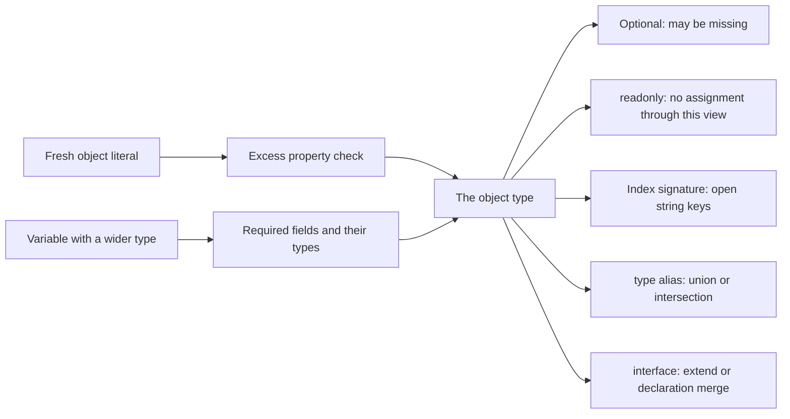

| You want | Write | Not this |
|---|---|---|
| A union, a primitive alias, or an intersection | `type` | `interface`, which only names an object shape |
| An object other code will extend or merge | `interface` | A second `type` with the same name, which is a duplicate identifier |
| A field that may be absent | `key?: T` | A field typed `void` to mean empty. A read is `T` or `undefined`. Explicit `undefined` is allowed while `exactOptionalPropertyTypes` is off |
| A field this view must not reassign | `readonly key: T` | `Object.freeze` as if it were the same thing. `readonly` does not freeze nested fields and does not run |
| A map whose names are open | `{ [key: string]: number }` or `Record<string, number>` | A fixed list of optional fields. Under `noUncheckedIndexedAccess` a read is `number` or `undefined` |
| A typo caught on a new object | Assign the literal directly to the target type | Parking it in a wider variable first, which skips the excess-property check |

An update follows from the same table. Build a new object, copy the readonly identity by reading it, copy a nested map into a new map, and copy an optional string only after `typeof` says it is a string. The input object stays whatever the caller still holds. The type stays a view. The freeze, if you need one, is a runtime call you can see.

### You can now

- Read `key?: T` as "may be missing", and remember that explicit `undefined` is also allowed while `exactOptionalPropertyTypes` is off.
- Explain `readonly` as a ban on assignment through that type, not as `Object.freeze`, and not as a ban on writing nested fields.
- Type an open map with an index signature or `Record`, and handle `undefined` on a read when `noUncheckedIndexedAccess` is on.
- Pick `type` for a union and `interface` for an object other code will extend or merge.
- Say when an excess property is rejected, and why a wider variable skips that check.
- Change a shared object by copying, including a nested map, so the caller's value stays put.

::: quiz
q: A field is declared `owner?: string`, and `exactOptionalPropertyTypes` is off, which is the default under `strict`. Which assignments typecheck, and what does a read return?
- The field may be omitted, but writing `undefined` is a type error. A read is `string`
+ The field may be omitted, and it may be present with the value `undefined`. A read has type `string | undefined`
- The field must be present and must be a string. The question mark only affects error messages
- Missing and `undefined` are different types here, and only missing is allowed
why: `key?: T` means the property may be absent. With `exactOptionalPropertyTypes` off, an explicit `undefined` is also allowed. The flag that separates those two is not part of default `strict`. Under `strict`, reading the property produces `T | undefined` because a missing property reads as `undefined` at runtime.
:::

::: quiz
q: `ticket` has type `{ readonly id: string; title: string }`. Which statement is true?
- `readonly` emits `Object.freeze`, so `ticket.id = "b"` throws at runtime even if the checker is bypassed
+ `ticket.id = "b"` is a type error through this type. The object is not frozen: another alias without `readonly` can still write `id` at runtime, and creating the object with an `id` is allowed
- `readonly` makes `id` optional
- `readonly` applies only to interfaces, not to type aliases
why: `readonly` is checked on that view and emits no runtime guard. Construction may set the property. Later assignment through the readonly view may not. Nested mutability is a separate question: `readonly` on a property that holds an object does not freeze the object's fields.
:::

::: quiz
q: Why does assigning the fresh literal `{ id: "a", role: "admin" }` to the type `{ id: string }` fail, while the same fields stored in a variable first can succeed?
- The checker rejects extra fields on every value, so the variable form should fail too
+ Excess property checks apply to a fresh object literal assigned directly to the target. A variable already has a wider type, and assignment then checks that the required fields match. Extra fields ride along
- `role` is a reserved name and is always rejected
- Fresh literals are checked only when the target is an interface
why: The excess check is a typo catch for the literal you just wrote, including a literal passed straight into a function. It is not a seal. Structural typing still allows a wider variable that has the required fields plus others. A value with none of the required fields does not become valid merely by sitting in a variable.
:::

::: card
q: When do you choose a type alias, and when an interface?
answer: Prefer `type` for a union, an intersection, or a primitive alias. An interface cannot name `"draft" | "sent"` and cannot rename a primitive. Prefer `interface` when you are describing an object that other code will extend or declaration-merge. Two interfaces with the same name combine their fields. A second type alias with the same name is a duplicate-identifier error. A plain closed object can be either.
:::

::: card
q: What does `{ [key: string]: number }` mean once `noUncheckedIndexedAccess` is on, and what does `readonly` not do to a nested object?
answer: The index signature types a map from strings to numbers, and every named property on that object must fit `number`. With `noUncheckedIndexedAccess`, reading a key has type `number | undefined`, because the key may be absent. `Record<string, number>` is the same map under a name. `readonly` on a field stops reassignment of that field through the type. It does not freeze the object at runtime, and it does not stop writes to fields inside a nested object.
:::

::: predict lang=typescript
code:
```ts
const row = { sku: "s1", name: "old", meta: { aisle: "3" } }
const next = { sku: row.sku, name: "new", meta: { ...row.meta } }
next.meta.aisle = "9"
console.log(row.name)
console.log(row.meta.aisle)
console.log(next.name)
console.log(next.meta.aisle)
row.sku = "s2"
console.log(row.sku)
```
answer:
```
old
3
new
9
s2
```
why: The outer object and the inner map are both new objects, so changing `next.meta.aisle` does not change `row.meta.aisle`, and the new name does not change the old one. Assigning `row.sku` still works. Nothing in that object was frozen. `readonly` would have been a type error here only if a type had marked `sku` readonly, and that error would not exist at runtime.
:::

::: predict lang=typescript
code:
```ts
function ownerName(record: { owner?: string }): string {
  if (typeof record.owner === "string") return record.owner
  return "none"
}
const present = { id: "a", owner: "ada" }
const missing = { id: "b" }
const blank = { id: "c", owner: undefined }
console.log(ownerName(present))
console.log(ownerName(missing))
console.log(ownerName(blank))
console.log("owner" in missing)
console.log("owner" in blank)
console.log(ownerName({ owner: "" }).length)
```
answer:
```
ada
none
none
false
true
0
```
why: `typeof` accepts only a string, so a missing field and an explicit `undefined` both become `"none"`. The empty string is a string, and its length is `0`. `"owner" in missing` is false because the key was never stored. `"owner" in blank` is true because the key is present and the value is `undefined`. The optional type allows both shapes when `exactOptionalPropertyTypes` is off. The `in` operator is what tells them apart.
:::

::: write lang=typescript
task: Export this type and function. `Ticket` is `{ readonly id: string; title: string; owner?: string; tags: Record<string, string> }`. `retitle(ticket: Ticket, title: string): Ticket` returns a new object. Copy `id`. Use the `title` argument. Copy `tags` into a new object so a later write to the result's tags does not change the input's tags. Copy `owner` only when `typeof ticket.owner === "string"`, which includes the empty string. When `owner` is missing or `undefined`, the result must not have an `owner` key. Do not assign to the input.
starter:
```ts
export type Ticket = {
  readonly id: string
  title: string
  owner?: string
  tags: Record<string, string>
}

export function retitle(ticket: Ticket, title: string): Ticket {
  ticket.title = title
  return ticket
}
```
solution:
```ts
export type Ticket = {
  readonly id: string
  title: string
  owner?: string
  tags: Record<string, string>
}

export function retitle(ticket: Ticket, title: string): Ticket {
  const next: Ticket = {
    id: ticket.id,
    title,
    tags: { ...ticket.tags },
  }
  if (typeof ticket.owner === "string") {
    next.owner = ticket.owner
  }
  return next
}
```
tests:
```ts
// Wrong answer: assigning ticket.title and returning the same object mutates the caller and shares tags
import { test } from "node:test"
import assert from "node:assert/strict"
import { retitle } from "./solution.ts"

test("returns a new ticket and leaves the input and its tags alone", () => {
  const tags = { area: "api" }
  const ticket = { id: "t1", title: "old", owner: "ada", tags }
  const next = retitle(ticket, "new")
  assert.equal(ticket.title, "old")
  assert.notEqual(next, ticket)
  assert.equal(next.id, "t1")
  assert.equal(next.title, "new")
  assert.equal(next.owner, "ada")
  assert.deepEqual(next.tags, { area: "api" })
  assert.notEqual(next.tags, tags)
  next.tags.area = "db"
  assert.equal(tags.area, "api")
})

test("copies owner only when it is a string", () => {
  const missing = retitle({ id: "t2", title: "a", tags: {} }, "b")
  assert.equal(Object.hasOwn(missing, "owner"), false)
  const blank = retitle({ id: "t3", title: "a", tags: {}, owner: undefined }, "c")
  assert.equal(Object.hasOwn(blank, "owner"), false)
  const empty = retitle({ id: "t4", title: "a", tags: {}, owner: "" }, "d")
  assert.equal(empty.owner, "")
  assert.equal(empty.title, "d")
})
```
types:
```ts
import type { Ticket } from "./solution.ts"

const t: Ticket = { id: "a", title: "t", tags: {} }
const blankOwner: Ticket = { id: "a", title: "t", tags: {}, owner: undefined }
// @ts-expect-error: id is readonly
t.id = "b"
// @ts-expect-error: a missing tag is string or undefined
const tag: string = t.tags["area"]

export { t, blankOwner, tag }
```
:::

## Shapes, not names
id: structural
stage: types
needs: objects-ts
minutes: 40
goal: Predict that TypeScript matches types by their properties, so a wider object still fits a smaller shape.
source: TypeScript handbook: Type compatibility | https://www.typescriptlang.org/docs/handbook/type-compatibility.html

TypeScript does not ask what you named a type. It asks whether the value has the properties the destination requires, with types that fit. A `Card` that carries `hanzi`, `pinyin`, and `due` is a valid argument to a function that only asks for `{ hanzi: string }`. The extra fields are not a mismatch. They are fields the function promised not to look at. The name `Card` never enters the check. A second type with the same fields and a different name is the same shape, and a value of either one can be passed where the other is expected.

```ts
type Card = { hanzi: string; pinyin: string; due: number }
type HasHanzi = { hanzi: string }

function show(card: HasHanzi): string {
  return card.hanzi
}

const row: Card = { hanzi: "学", pinyin: "xué", due: 3 }
show(row)
```

`show` accepts `row` because every `Card` has a `hanzi` string. The function cannot read `pinyin` or `due`. Those properties are not in `HasHanzi`, so the checker treats them as absent from this view even though they are still on the object when the function runs. That is the point of a small parameter type. The caller may know more. The callee may use only what it declared. Passing a richer record into a function that needs an id, or a hanzi, is the normal way modules talk. You do not write a converter that copies one field into a new nominal type just to satisfy a name.

### The check is one way

The other direction fails. A `HasHanzi` does not have to have `pinyin` or `due`, so it is not a `Card`. The destination required properties the source never promised. Adding a required field shrinks the set of values. Removing a required field, or asking for fewer of them, grows the set. A function that demands less can take a value that has more. A function that demands more cannot take a value that only proved the smaller list.

This is why two interfaces with the same fields are interchangeable, and why a class with only public fields is interchangeable with an object literal of those fields. The constructor's name is not a brand. `instanceof` is a runtime test you write if you care which constructor made the object. The checker will not invent that test from the type name.

There is a real exception, and it is about privacy rather than about the name you chose. A class field marked `private` or `protected` is part of the identity of that class. A different class with a private field of the same name and type is not assignable to it, even when every public field matches. The private field is not visible to compare structurally, so TypeScript refuses to pretend the two classes are the same. A `#` field is the runtime version of a hidden slot, and it has the same effect on the check: the public shape is not the whole story once something is hidden. Public data stays structural. Hidden data is nominal.

### Fresh literals are a second check

A value that already has a wider type keeps its extra fields when you pass it. A fresh object literal written directly at the call is treated more strictly. `{ hanzi: "学", typo: true }` passed straight into `show` is an error, because `typo` matches nothing on `HasHanzi` and is likely a misspelling of a field you meant to set. Put that same object in a variable with an explicit wider type first, and the extra field is allowed through. The excess-property check is a typo net for the literal you just wrote. It is not a seal, and it is not structural typing deciding that extra fields are illegal. Structural typing is the rule for values that already have a type. The fresh-literal rule is an extra complaint on top of it.

An index signature changes the question again. If the destination has a string index of a type the extra fields do not fit, those fields are no longer "ignored extras." They are values of the index, and they have to match. A destination with no index simply does not look at them.

### Where a name would have helped, and does not

People coming from a nominal language expect `type UserId = string` and `type OrderId = string` to be incompatible. They are not. Both are `string`. A function that asks for a `UserId` will take an `OrderId`, because the sets are the same set. If mixing them is a bug, the types have to say so with a brand the checker can see, usually an intersection with a phantom property that no real string has, and a function that is the only way to create one. That brand is still erased. At runtime both ids are strings, and only the function you wrote stops a raw string from entering. The default, and the right default for records, payloads, and view models, is the structural rule: extra fields may ride along, missing required fields may not.

Walk a call with the sets written down. `show` asks for the set of objects that have a `hanzi` string. `row` is a member of a smaller set, the objects that have `hanzi`, `pinyin`, and `due`. The smaller set sits inside the larger one, so the call is legal, and inside `show` the type of the parameter has no `pinyin`. The property is still there if you log the argument. The type is the view, not a copy. A hand-built `{ hanzi: "学" }` is a member of the larger set and also legal. A hand-built `{ pinyin: "xué" }` is not, because `hanzi` was required and never provided. Renaming `HasHanzi` to `Glyph` changes nothing about those three calls. Renaming a field does. `glyphs` instead of `hanzi` is a different property, and the sets no longer line up, even if every reader can see you meant the same idea.

That is also why a helper typed as `{ id: string }` can sit in front of a database row, a form result, and a test fixture without three adapters. The adapters would only rename a shape that already matched. Write an adapter when the names differ or when a string has to become a number. Do not write one when the destination simply ignores columns.

At work this shows up when a row from a query has twenty columns and a renderer needs two. Type the renderer parameter as those two fields. The row assigns. A test can pass `{ hanzi: "学", pinyin: "xué", due: 0 }` or a hand-built `{ hanzi: "学" }`, and both are honest. The bug the checker catches is the row that has `pinyin` and `due` and no `hanzi`, not the row that has columns the renderer ignores.

### You can now

- Say why a value with extra properties fits a destination that asks for fewer.
- Say why the destination's name does not matter, and why the opposite assignment fails.
- Separate that rule from the excess-property check on a fresh literal.
- Explain why two string aliases do not keep a user id and an order id apart.

::: quiz
q: A function expects `{ hanzi: string }`. Why does a `{ hanzi, pinyin, due }` object pass?
- The names of the two types are related
+ The object has every property the destination requires, and extra properties are allowed on a value that already has a wider type
- Extra properties are deleted before the call
- It passes only when the argument is written as a fresh literal
why: Compatibility compares properties, not declared names. A wider value still has `hanzi`. A fresh literal with a misspelled extra field is a separate check, and that check would complain rather than silently accepting the typo.
:::

::: quiz
q: `type UserId = string` and `type OrderId = string`. What does the checker do with an `OrderId` passed where a `UserId` is expected?
- It rejects the call, because the names differ
+ It accepts the call, because both types are the set of all strings
- It accepts the call only inside the file that declared both aliases
- It rejects the call unless you write `as UserId`, and the cast checks the prefix
why: Aliases of the same primitive are the same set. A different name does not create a different type. Stopping the mix takes a brand you add on purpose, and that brand is still erased at runtime.
:::

::: card
q: When does a value fit a destination object type, when does it fail, and what is the fresh-literal exception?
answer: It fits when every required property of the destination exists on the source with an assignable type. Extra properties on a value that already has a wider type are fine, and the destination's name is irrelevant. It fails when a required property is missing or has the wrong type. A fresh object literal written directly at the assignment is also checked for extra properties, so a typo in a field name is reported. That extra check is not the structural rule.
:::

::: predict lang=typescript
code:
```ts
function skuOf(item: { sku: string }): string {
  return item.sku
}
const row = { sku: "a-1", qty: 4, bin: "n" }
console.log(skuOf(row))
console.log(skuOf({ sku: "b-2" }))
```
answer:
```
a-1
b-2
```
:::

::: write lang=typescript
task: Export `binOf(item: { bin: string }): string`, returning the `bin` field. Callers will pass objects that also have other fields, such as a sku and a quantity. Do not read those other fields, and do not invent a bin when it is missing. The hidden type check rejects an argument that has no `bin`.
starter:
```ts
export function binOf(item: { bin: string }): string {
  return ""
}
```
tests:
```ts
// Wrong answer: returning "" for every item, or returning a sku instead of the bin
import { test } from "node:test"
import assert from "node:assert/strict"
import { binOf } from "./solution.ts"

test("reads bin and ignores extra fields", () => {
  assert.equal(binOf({ bin: "n", sku: "a-1", qty: 4 }), "n")
  assert.equal(binOf({ bin: "" }), "")
})
```
types:
```ts
import { binOf } from "./solution.ts"

const full = { bin: "w", sku: "c-3", qty: 1 }
const ok: string = binOf(full)
// @ts-expect-error: qty is not a bin
const missing = binOf({ qty: 1 })
export { ok, missing }
```
solution:
```ts
export function binOf(item: { bin: string }): string {
  return item.bin
}
```
:::

## Assignability is set inclusion
id: assignable
stage: types
needs: structural
minutes: 40
goal: Read an "is not assignable" error as one set that does not sit inside another.
source: TypeScript handbook: Type compatibility | https://www.typescriptlang.org/docs/handbook/type-compatibility.html
source: TypeScript handbook: Types as sets | https://www.typescriptlang.org/docs/handbook/typescript-in-5-minutes-oop.html#types-as-sets

Every "is not assignable" message is the same question. The value you have has a set. The place you are putting it requires a set. The assignment is legal exactly when the first set sits inside the second. `"a"` sits inside `"a" | "b"`, because every value of the first type is a value of the second. `"a" | "b"` sits inside `string` for the same reason. `string` does not sit inside `"a" | "b"`, because a string might be `"c"`. `"b"` does not sit inside `"a"`. The error text names the two sets. You do not need a second theory to read it.

```ts
const exact: "a" = "a"
const pair: "a" | "b" = exact
const text: string = pair
```

Each line widens the set, so each line is legal. Reverse any line and the checker refuses, because the source might be a value the destination cannot hold. A `let` that was inferred as `string` cannot be passed to a parameter of type `"a" | "b"` until you narrow it. The current contents do not matter. The set on the binding is the whole set, including values it does not happen to hold today.

### More properties means a smaller set

The same inclusion decides objects, and the direction surprises people who think of "more fields" as a bigger type. A type with more required properties describes fewer values. `{ sku: string; qty: number }` can only be objects that have both. `{ sku: string }` can be those objects and also objects that have a sku and no qty. The two-field type sits inside the one-field type. That is why the richer value assigns to the smaller parameter, and why the smaller value does not assign to the richer parameter. Adding a required field moves you down the inclusion, toward fewer objects. Making a field optional moves you up, toward more objects, because values that lack the field join the set.

`{ sku: string }` assigns to `{ sku?: string }`. Every object with a sku string is a legal "maybe a sku" object. The optional type does not assign back. A value of type `{ sku?: string }` might have no sku, and the required destination cannot accept that possibility. `undefined` is the same story under `strict`. A `string` assigns to `string | undefined`. A `string | undefined` does not assign to `string` until you remove `undefined` from the set.

Primitives and objects meet at an intersection, which is the overlap of the two sets. You will use that to require both shapes at once. The inclusion rule here is enough to predict the direction: the overlap is smaller than either set, so a value of the intersection assigns to either piece, and a value of one piece does not assign to the intersection unless it also satisfies the other piece.

### What the message is not saying

The message is not saying the program will throw. It is saying the sets in the files the checker can see do not line up. A cast `as "a"` puts a `string` into the smaller set without removing any runtime value. The bytes stay a string, which might be `"c"`, and the checker stops mentioning the risk. Narrowing is the version that really shrinks the set, because the branch only runs when the other values have been rejected.

A fresh object literal can produce an error that is not inclusion. `{ sku: "a-1", qty: 1 }` written directly where `{ sku: string }` is expected mentions `qty` as an excess property. The two-field value would fit the one-field set if it already had a wider type. The checker adds the excess check because a property that appears in a brand-new literal and matches nothing is usually a typo. Read that message as "this property is not on the target," and read "is not assignable" as "this set is not inside that set." They are different complaints. Fixing a typo by stuffing the literal into a variable of type `{ sku: string; qty: number }` and then passing it is the structural assignment, and it is legal. Fixing it by deleting the field is right when the field was a typo. The inclusion rule tells you which of those you meant.

| Source | Destination | Assignable? |
|---|---|---|
| `"a"` | `"a" \| "b"` | Yes. One string sits inside the pair |
| `"a" \| "b"` | `string` | Yes. Both strings are strings |
| `string` | `"a" \| "b"` | No. A string may be `"c"` |
| `"b"` | `"a"` | No. Different singleton |
| `{ sku: string; qty: number }` | `{ sku: string }` | Yes. More required fields is a smaller set |
| `{ sku: string }` | `{ sku: string; qty: number }` | No. `qty` was never promised |
| `{ sku: string }` | `{ sku?: string }` | Yes. A present sku is one way to be optional |
| `{ sku?: string }` | `{ sku: string }` | No. The sku might be missing |

Read one error with the table in hand. `Type 'string' is not assignable to type '"a" | "b"'` means the source set is every string and the destination set is two of them. The fix that keeps the destination is a check that rejects everything except `"a"` and `"b"`. The fix that keeps the source is widening the destination to `string`. Both can be honest. The cast `as "a" | "b"` is the third edit, and it is the one that leaves `"c"` able to arrive. A second error, `Property 'qty' is missing in type '{ sku: string }'`, is the object row of the table. The source never promised `qty`. Adding a dummy `qty: 0` makes the sets line up and may invent a quantity the user did not enter. Widening the destination by dropping `qty` is right when this function does not use a quantity. The message is the direction of inclusion. The edit is the decision about which set was wrong.

At work you read the error from the bottom of that table upward. A handler that wanted `{ sku: string; qty: number }` and received a search hit of type `{ sku: string }` is missing `qty` in the set, not in the particular hit you tested. A status parameter of type `"a" | "b"` that was handed a `string` from a text box has the same shape of problem. The text box can contain more than the parameter allows. The fix is a check that rejects the rest, or a wider parameter if the rest is actually legal. The cast is neither fix.

### You can now

- Decide which of `"a"`, `"a" | "b"`, and `string` assign to which, and say why.
- Explain why an object type with more required properties is a smaller set.
- Read "not assignable" as failed inclusion, and an excess-property message as the fresh-literal check.
- Tell a cast from a narrow: one lies about the set, the other rejects values at runtime.

::: quiz
q: Which assignment does the checker accept?
- A `string` variable where `"a" | "b"` is expected
+ An `"a"` value where `"a" | "b"` is expected, and that pair where `string` is expected
- `"b"` where `"a"` is expected
- `"a" | "b"` where `"a"` is expected
why: Each accepted step moves from a smaller set into a larger one. `"a"` is inside the pair, and the pair is inside `string`. The reverse steps include values the destination does not allow.
:::

::: quiz
q: Why is `{ sku: string; qty: number }` assignable to `{ sku: string }`, and not the other way around?
- Extra properties are always deleted, so both directions work
+ More required properties means fewer possible objects, so the richer value sits inside the smaller view. The view without `qty` does not sit inside the type that demands `qty`
- Assignability ignores properties and compares names
- It is assignable only when `qty` is optional
why: The one-field type is a larger set. Every two-field object is a one-field object. A one-field object might have no `qty`, so it is not a two-field object.
:::

::: card
q: For `"a"`, `"a" | "b"`, `string`, `{ sku: string }`, and `{ sku: string; qty: number }`, which sets sit inside which?
answer: `"a"` sits inside `"a" | "b"`, which sits inside `string`. None of those assignments reverse. `{ sku: string; qty: number }` sits inside `{ sku: string }` because more required fields make a smaller set. `{ sku: string }` does not sit inside the two-field type. A fresh literal can still be rejected for an extra field; that message is the excess-property check, not a reversal of inclusion.
:::

::: predict lang=typescript
code:
```ts
function rank(code: number): string {
  if (code === 0) return "none"
  if (code === 1) return "one"
  return "many"
}
console.log(rank(0))
console.log(rank(1))
console.log(rank(2))
```
answer:
```
none
one
many
```
:::

::: write lang=typescript
task: Export `holds(target: "exact" | "pair" | "any-string", value: string): boolean`. `"exact"` is true only for the string `"a"`. `"pair"` is true for `"a"` or `"b"`. `"any-string"` is true for every string, including the empty string and `"c"`. This mirrors the sets: `"a"` is inside the pair, and the pair is inside `string`.
starter:
```ts
export function holds(target: "exact" | "pair" | "any-string", value: string): boolean {
  return value === "a"
}
```
tests:
```ts
// Wrong answer: value === "a" for every target, which rejects "b" as a pair and rejects "c" as any string
import { test } from "node:test"
import assert from "node:assert/strict"
import { holds } from "./solution.ts"

test("exact is only a", () => {
  assert.equal(holds("exact", "a"), true)
  assert.equal(holds("exact", "b"), false)
  assert.equal(holds("exact", ""), false)
})
test("pair is a or b, any-string is every string", () => {
  assert.equal(holds("pair", "b"), true)
  assert.equal(holds("pair", "c"), false)
  assert.equal(holds("any-string", "c"), true)
  assert.equal(holds("any-string", ""), true)
})
```
solution:
```ts
export function holds(target: "exact" | "pair" | "any-string", value: string): boolean {
  if (target === "exact") return value === "a"
  if (target === "pair") return value === "a" || value === "b"
  return true
}
```
:::

## Unions and intersections
id: unions
stage: types
needs: assignable
minutes: 45
goal: Model "this or that" with a union and "both at once" with an intersection, and use only what every member has.
source: TypeScript handbook: Union types | https://www.typescriptlang.org/docs/handbook/2/everyday-types.html#union-types
source: TypeScript handbook: Intersection types | https://www.typescriptlang.org/docs/handbook/2/objects.html#intersection-types

A union is the combination of two sets. `string | number` contains every string and every number, and a value of that type is one of them. You do not get to treat it as both at once. The operations you may use on the union, before you have proved which member you hold, are the operations every member has. `toString` is on both strings and numbers, so it is legal. `toUpperCase` is only on strings, so it is not. `toFixed` is only on numbers, so it is not. The checker is not hiding the method. It is refusing a method that the other member would crash on. A value that is a number does not have `toUpperCase`, and the type still includes numbers.

```ts
function label(id: string | number): string {
  return id.toString()
}
```

`label` is legal because both members can do that. The moment the function needs a string method, it has to reject the numbers first. Until that check exists, the parameter is the whole union on every line. An early `return` after a `typeof` check is what leaves the other member in the rest of the function. The check is ordinary JavaScript. The checker follows it and shrinks the set in that branch. Without the check, there is no branch, and the set stays large.

`null` and `undefined` are members you add the same way. `string | null` is a string or null, and you may not call a string method until null is gone. Optional chaining and `??` are short ways to handle that member. They are still checks. `id?.toUpperCase()` does not run when `id` is null or undefined, and the type of the whole expression includes `undefined`, because that is the result when the call was skipped. The union did not become a string. The call became optional.

### Only the overlap of the operations

People try to "support both" by calling a method and catching the crash. The crash is what the union was designed to move to the checker. If both shapes are objects, the methods and fields you can use are the ones written on every member. `{ sku: string; qty: number } | { sku: string; bin: string }` has `sku` in common and nothing else. Reading `qty` is an error until a check shows you are holding the first member. A shared field with two different types becomes the union of those types. `{ code: string } | { code: number }` lets you read `code`, and the type of that read is `string | number`, which is the same problem one level down.

A union of object literals with a shared field that holds a distinct literal is the tool for "one of several kinds," because checking the literal tells the checker which member remains. A union of primitives is the tool for "a sku or a numeric id." Mixing them in one parameter is fine when the function really does accept both, and it is a bad parameter when every caller actually has one of them and the function immediately branches. Two functions with two parameter types are then clearer. The union is for the boundary that genuinely receives either.

### Intersection keeps both

`A & B` is the overlap, the values that are in both sets at once. `string & number` asks for a value that is a string and a number. Nothing is both, so the overlap is empty, and the checker calls that empty set `never`. You cannot construct it. A function that claims to return `string & number` can only throw or loop. An assignment of `"1"` or of `1` fails, and the error names `never`, because that is what the intersection simplified to.

Object types overlap in a useful way. A value can have both lists of fields at the same time. `{ label: string } & { grams: number }` is the set of objects that have a `label` and a `grams`. That set is smaller than either piece. It is not empty. A tea tin `{ label: "tea", grams: 20 }` is in it. `{ label: "tea" }` is not, because `grams` was required by the second piece. A value of the intersection assigns to either piece, because it has those fields. A value of one piece does not assign to the intersection.

```ts
type Packed = { label: string } & { grams: number }

function stamp(item: Packed): string {
  return item.grams + "g " + item.label
}
```

`tag` may read both fields. No check is required to choose a member, because there is only one member of the intersection: an object with both. This is the opposite of a union. The union forces a choice. The intersection stacks requirements. Adding `& { bin: string }` shrinks the set again. Forgetting that, and piling on intersections to mean "either of these," produces a type that nothing can satisfy. Either-of is `|`. Both-at-once is `&`.

Intersections also distribute over unions. `(string | number) & { length: number }` is the values that are a string or a number, and that also have a `length`. A string has `length`. A number does not, so the number half of the union disappears, and what remains is a string. The mental picture is a filter. The intersection throws away every alternative that cannot meet the extra requirement. When the filter removes everything, you are back to `never`, and that is information: the combination you wrote cannot occur.

| You write | The set | You can use |
|---|---|---|
| `string \| number` | either | only `toString` and the other shared members, until a check |
| `string \| null` | a string, or null | string methods only after null is rejected |
| `{ sku: string; qty: number } \| { sku: string; bin: string }` | one of the two objects | `sku` immediately; `qty` or `bin` only after a check |
| `string & number` | nothing (`never`) | nothing. There is no value |
| `{ label: string } & { grams: number }` | objects with both fields | `label` and `grams` without choosing a member |

### Where the operators get swapped

The usual bug is `&` where `|` was meant. A result type written `{ ok: true; value: string } & { ok: false; error: string }` requires `ok` to be `true` and `false` at once, which is `never`, so the function cannot return either of the outcomes it was built for. The two outcomes are alternatives. They join with `|`. The fields inside one outcome join by sitting on the same object, which you can spell as one object type or as an intersection of field groups. Both spellings mean "all of these fields." They do not mean "one of these outcomes."

The other bug is reading a field that only some members have and "fixing" the error with a cast. The cast does not reject the other member. When that member arrives, the field is `undefined` and the next call throws. The union was the list of things that might arrive. The check is the only thing that deletes one of them. A shared operation is the only thing you may do before the check.

At work a union is an identifier that came from a form as text or from a counter as a number, a search hit that is a product or a category, a field that may be null in a column. An intersection is a command that must carry both a tenant id and a payload, or a value that has already been narrowed to an object and still needs a particular field. Name the union after the choice (`SkuOrCode`). Name the intersection after the combination (`Packed`). When a colleague asks which operator, ask whether a single value is one of these, or whether it has to be all of these at once.

### You can now

- Use, on a union, only the operations every member has, and say why `toUpperCase` is illegal on `string | number`.
- Explain why `string & number` is `never`, and why `{ label: string } & { grams: number }` is not.
- Put `|` between alternative outcomes and `&` between requirements a single value must meet together.
- Predict that an intersection with a union keeps only the members that satisfy the extra requirement.


::: quiz
q: `function len(x: string | string[]) { return x.length }`. Does it type-check?
+ Yes: both strings and arrays have `length`, so it's available on the union
- No: you must narrow first
- Only with `as string`
- Only for strings
why: On a union you may use whatever every member has. Both members have `.length`, so no narrowing is needed for that.
:::

::: write lang=typescript
task: Export `toCents(value: string | number | null): number`. A number is euros (`12.5` → `1250`). A string may have a euro sign or spaces and a decimal comma (`"€ 3,20"` → `320`). `null` is `0`. A string that isn't a number throws an `Error`. Round to whole cents.
starter:
```ts
export function toCents(value: string | number | null): number {
  return Math.round(value * 100)
}
```
tests:
```ts
import { test } from "node:test"
import assert from "node:assert/strict"
import { toCents } from "./solution"

test("numbers", () => {
  assert.equal(toCents(12.5), 1250)
  assert.equal(toCents(0.1 + 0.2), 30)
})
test("strings", () => {
  assert.equal(toCents("€ 3,20"), 320)
  assert.equal(toCents("7"), 700)
})
test("null", () => assert.equal(toCents(null), 0))
test("garbage throws", () => assert.throws(() => toCents("abc")))
```
solution:
```ts
export function toCents(value: string | number | null): number {
  if (value === null) return 0
  if (typeof value === "number") return Math.round(value * 100)
  const n = Number(value.replace(/[€\s]/g, "").replace(",", "."))
  if (Number.isNaN(n)) throw new Error(`not an amount: ${value}`)
  return Math.round(n * 100)
}
```
hint: Handle `null` first, then `typeof value === "number"`. What's left is a string: strip `€` and spaces, swap `,` for `.`, convert with `Number()`, and check `Number.isNaN`.
:::

::: quiz
q: Why is `string & number` the same type as `never`, while `{ label: string } & { grams: number }` is not?
- Both intersections are empty, because `&` always means "impossible"
+ Nothing is both a string and a number, so that overlap is empty. One object can have a label and a grams at the same time, so that overlap is the objects that have both
- `{ label: string } & { grams: number }` means the value is one field or the other
- `string & number` is every string, because `&` widens
why: `&` is the overlap of the two sets. Primitives do not overlap, so the result simplifies to `never`. Object types overlap by stacking fields, and the result is smaller than either piece but not empty.
:::

::: quiz
q: `type Hit = { sku: string; qty: number } | { sku: string; bin: string }`. Which read is legal before any check?
- `hit.qty`, because qty is a number
+ `hit.sku`, because both members have a sku string
- `hit.bin`, because some members have a bin
- `hit.sku.toFixed(0)`, because sku might be numeric
why: On a union you may use only what every member has. `sku` is on both. `qty` and `bin` are each on one member, so they wait for a check that throws the other member away.
:::

::: card
q: When do you write `|`, when do you write `&`, and what may you call on `string | number` before a check?
answer: `|` is a choice: the value is one member or the other. `&` is a stack of requirements: the value must satisfy both at once. `string & number` is `never` because that overlap is empty. An intersection of two object types is an object with both sets of fields. Before a check, `string | number` only allows operations both members have, such as `toString`. `toUpperCase` and `toFixed` each belong to one member.
:::

::: predict lang=typescript
code:
```ts
function codeOf(id: string | number): string {
  return "#" + id.toString()
}
console.log(codeOf("go"))
console.log(codeOf(4))
console.log(codeOf(10).length)
```
answer:
```
#go
#4
3
```
:::

::: write lang=typescript
task: Export `tag(item: { label: string } & { grams: number }): string`. Return `label`, a colon, and `grams`, so `{ label: "tea", grams: 20 }` becomes `"tea:20"`. Both fields are required. Do not drop `grams`, and do not add a unit suffix.
starter:
```ts
export function tag(item: { label: string } & { grams: number }): string {
  return item.label
}
```
tests:
```ts
// Wrong answer: returning only item.label, which drops the grams
import { test } from "node:test"
import assert from "node:assert/strict"
import { tag } from "./solution.ts"

test("joins label and grams", () => {
  assert.equal(tag({ label: "tea", grams: 20 }), "tea:20")
  assert.equal(tag({ label: "salt", grams: 0 }), "salt:0")
})
```
types:
```ts
import { tag } from "./solution.ts"

const packed: { label: string } & { grams: number } = { label: "tea", grams: 20 }
const text: string = tag(packed)
// @ts-expect-error: a string is not also a number
const impossible: string & number = "1"
export { packed, text, impossible }
```
solution:
```ts
export function tag(item: { label: string } & { grams: number }): string {
  return item.label + ":" + item.grams
}
```
:::

## Narrowing follows the checks you already write
id: narrowing
stage: types
needs: unions
minutes: 45
goal: Predict the type left in each branch after typeof, equality, in, and instanceof.
source: TypeScript handbook: Narrowing | https://www.typescriptlang.org/docs/handbook/2/narrowing.html

A union is only useful once a check can shrink it. The checker does not run your program. It walks the conditions you wrote and deletes members that the condition has ruled out. In the true branch those members are gone. In the false branch the members you required are gone. After a `return` or a `throw`, the rest of the function does not include the members you just handled. The type on the next line is whatever is left.

```ts
function show(value: string | number): string {
  if (typeof value === "string") return value.toUpperCase()
  return String(value)
}
```

On the first line `value` is `string | number`. Inside the `if`, it is `string`, so `toUpperCase` is legal. After the `return`, the function only continues when the condition was false, so `value` is `number`. Nothing in that picture is a special TypeScript statement. `typeof` is the same operator JavaScript uses. The annotation is what gave the checker a set to shrink, and the annotation is deleted before the run, so the `typeof` is also what protects the program when a cast or an untyped caller lied.

### The checks the checker understands

`typeof value === "string"`, and the other `typeof` strings, select a primitive. `value === null` and `value === undefined` remove those members. `===` against a literal selects that literal from a union of literals. `"email" in value` selects object members that have declared `email`, and it removes members the checker knows cannot have that property. `value instanceof Date` selects a class. `Array.isArray(value)` selects an array. A comparison of a discriminant, `value.kind === "box"`, selects the member with that literal.

Each of these is a positive test. The `else` is the complement. If you only test one member of a three-member union, the `else` is still the other two, and you still may not use a method that only one of those two has.

Truthiness is a check, and it is a blunt one. `if (value)` on `string | null` removes `null` in the true branch, and it also removes `""`, because the empty string is falsy. The true branch is a non-empty string. The false branch is `null` or `""`. If an empty string is real data, the truthiness check has thrown it away. Compare with `value !== null`, or with `typeof`, when empty is legal. The same trap hits `0`. `if (value)` on `number | undefined` treats `0` as missing. `value !== undefined` keeps `0`.

`typeof null` is `"object"`. A check `typeof value === "object"` on `unknown` or on `object | null` still includes `null`, and it includes arrays. Exclude `null` with `===` before you read a property. Use `Array.isArray` when a list is not the object you meant. The checker follows those refinements. It will not assume you meant them.

| Check | True branch loses | Watch for |
|---|---|---|
| `typeof x === "string"` | every non-string | `typeof null` is `"object"`, not `"null"` |
| `x === null` or `x === undefined` | the other values | use this, not truthiness, to keep `""` and `0` |
| `if (x)` | falsy members | `""` and `0` take the false branch |
| `"email" in x` | members that cannot have `email` | a string index on the other member may block the narrow |
| `x instanceof Date` | non-Dates | the class must be the real constructor, which exists at runtime |
| `x.kind === "box"` | members whose `kind` is another literal | `kind` typed as `string` does not select a member |

### Early return, and what a cast does not do

Returning from the string branch is the same as an `else`. The code below the `if` is the `else`, whether you write the keyword or not. Throwing is the same control flow. A function that throws on `null` and then uses the value has a `string` afterwards, if `null` was the other member. Assigning into the variable can also narrow. `value = value.trim()` does not, by itself, change a `string | number` into a `string`. The assignment's result has to be a value of the remaining type for the binding to shrink. The reliable pattern is the condition, then the use.

A cast is not in the table. `value as string` does not delete `number` from the set of bytes. Later lines think the set is `string`. The `typeof` test was never run. When the number arrives, `toUpperCase` throws. Narrowing and casting are easy to confuse because both "make the error go away." One of them deletes members by a check the runtime will perform. The other deletes the error message.

Optional chaining is a narrow that produces a union with `undefined`. `user?.email` when `user` is `User | null` has type `string | undefined` if `email` is a string. The chain did not prove that `user` is a `User` for the next statement. It only covered that one read. The next line still sees `user` as `User | null` unless you branched on `user` itself.

### At the boundary

A parameter typed as a union is a promise that both members occur, and a map of the checks that have to exist inside. A parameter typed as `unknown` is the same machinery starting from every value. `typeof`, `Array.isArray`, and `===` are how you walk down to a type you can use. If the last branch throws, nothing remains, and the throw's return type can be `never`. Callers then see that a failed check does not continue.

Take `show` one line at a time. Before the `if`, `value` is `string | number`, so `value.toUpperCase()` is an error on that line even though it is fine two lines later. The condition `typeof value === "string"` is the gate. The checker does not look at what `show` was called with. It looks at the condition. After `return`, the string case has left the function, so a number method would be legal and a string method would not. Swap the condition to `typeof value === "number"` and the types swap with it. Add `| null` to the parameter and the line after the string return is `number | null`, not `number`, until you reject `null` too. The leftover set is the whole job. People stare at the true branch and forget to name what the false branch still contains.

At work the painful narrow is the one that used `if (value)` on a count or a name. Zero quantities disappear. Blank names disappear. The branch that was supposed to mean "missing" also means "present, but empty," and a later report undercounts. Write the condition that matches the set you want to delete, not the condition that happens to be short.

### You can now

- Give the type of a `string | number` parameter before a `typeof` check, inside the string branch, and after an early return.
- Name the checks the checker follows, and say why `typeof null` does not prove you have an object.
- Prefer `!== null` and `!== undefined` over truthiness when `""` or `0` is data.
- Tell a narrow from a cast: the narrow is a runtime check, and the cast is not.

::: quiz
q: `function show(value: string | number): string` returns inside `if (typeof value === "string")`. What is the type of `value` on the line after that `if`?
- `string | number`, because a check never changes the parameter
+ `number`, because the string branch already returned
- `string`, because `typeof` was used
- `unknown`
why: The line after the `if` runs only when the condition was false. The string member has been handled. What remains is the other member of the union.
:::

::: quiz
q: `value` is `string | null`. Why is `if (value)` a risky way to narrow it?
- `if (value)` does not remove `null`
+ The true branch drops `null` and also drops `""`, because the empty string is falsy. `value !== null` keeps the empty string
- `if (value)` throws on `null`
- The true branch becomes `string | null`
why: Truthiness removes every falsy member, not only `null`. An empty string is a string. Use it as data by testing `null` directly. The same mistake treats `0` as missing on `number | undefined`.
:::

::: card
q: Which checks narrow a union, and what does a cast do instead?
answer: `typeof`, equality with `null`, `undefined`, or a literal, `in`, `instanceof`, `Array.isArray`, and a comparison with a discriminant literal all shrink the union. The checker deletes members the condition rules out, including in the code after a `return` or a `throw`. `if (value)` also narrows, and it treats `""` and `0` as absent. A cast `as string` does not delete members at runtime. `typeof null` is `"object"`, so an object narrow still has to reject `null`.
:::

::: predict lang=typescript
code:
```ts
function bucket(value: string | number | null): string {
  if (value === null) return "missing"
  if (typeof value === "string") return "s:" + value
  return "n:" + String(value)
}
console.log(bucket(null))
console.log(bucket(""))
console.log(bucket(0))
```
answer:
```
missing
s:
n:0
```
:::

::: write lang=typescript
task: Export `kindTag(value: string | boolean | undefined): string`. `undefined` returns `"missing"`. A string returns `"empty"` when its length is 0 and `"text"` otherwise. `true` returns `"yes"` and `false` returns `"no"`. Do not use truthiness on the whole value, or the empty string and `false` collapse together.
starter:
```ts
export function kindTag(value: string | boolean | undefined): string {
  return typeof value
}
```
tests:
```ts
// Wrong answer: typeof value, which returns "string" and "boolean", or if (value), which treats "" and false the same
import { test } from "node:test"
import assert from "node:assert/strict"
import { kindTag } from "./solution.ts"

test("strings, including empty", () => {
  assert.equal(kindTag("hi"), "text")
  assert.equal(kindTag(""), "empty")
})
test("booleans and missing", () => {
  assert.equal(kindTag(true), "yes")
  assert.equal(kindTag(false), "no")
  assert.equal(kindTag(undefined), "missing")
})
```
solution:
```ts
export function kindTag(value: string | boolean | undefined): string {
  if (value === undefined) return "missing"
  if (typeof value === "string") return value.length === 0 ? "empty" : "text"
  return value ? "yes" : "no"
}
```
:::

## Discriminated unions
id: discriminated
stage: types
needs: narrowing
minutes: 45
goal: Model one of several kinds of thing with a shared literal field, so an illegal combination cannot be written.
source: TypeScript handbook: Discriminated unions | https://www.typescriptlang.org/docs/handbook/2/narrowing.html#discriminated-unions
source: TypeScript handbook: Exhaustiveness checking | https://www.typescriptlang.org/docs/handbook/2/narrowing.html#exhaustiveness-checking

A loose object tries to be every state at once by making each state's fields optional. That type accepts a paid payment with an error, a failed payment with no reason, and a pending payment that already has a refund date. Every combination of the optional fields is a value of the type, including the ones the product says cannot happen. Callers then defend themselves with checks that the type did not help them write, because the type never said which fields exist together.

A discriminated union splits the states into members. Each member is one object type. The members share one property whose type is a distinct literal, and the rest of the fields belong only to the member that needs them. The shared property is the discriminant. Checking it throws the other members away, so in that branch the extra fields are required, not optional.

```ts
type Payment =
  | { status: "pending" }
  | { status: "paid"; paidAt: Date }
  | { status: "failed"; error: string }

function describe(p: Payment): string {
  switch (p.status) {
    case "pending":
      return "waiting"
    case "paid":
      return `paid on ${p.paidAt.toISOString()}`
    case "failed":
      return `failed: ${p.error}`
    default: {
      const unreachable: never = p
      return unreachable
    }
  }
}
```

`"paid but with an error"` cannot be written. A failed payment cannot omit `error`. In the `"paid"` branch, `paidAt` is a `Date`, not `Date | undefined`, because the other members are gone. The loose version had to treat `paidAt` as optional on every payment, including the ones that were not paid.

The discriminant has to be a literal type, or a union of literals, not `string`. If `status` is `string` on every member, checking `p.status === "paid"` proves nothing about the rest of the object. The checker cannot tell the members apart, because every member's status could be any string. The literals `"pending"`, `"paid"`, and `"failed"` are disjoint, so equality with one of them selects one member. The property name can be `status`, `kind`, or `type`. What matters is that the literals do not overlap. Two members that both say `kind: "box"` are not discriminated from each other.

### What the check is allowed to believe

A `switch` on the discriminant, or an `if` that compares it, is the narrow. Inside `case "paid"`, writing `p.error` is an error if `error` is not on that member. That is the safety. The branch is not a suggestion. It is the only place those fields exist. A `default` that assigns the leftover to `never` typechecks today because every member was returned from. Add `| { status: "refunded"; amount: number }` and forget a case, and the leftover in `default` is that new member, which is not `never`, so the build fails on the assignment. The failure points at the switch that did not grow. A `default` that returns a guess, such as `"unknown"`, still typechecks after you add the member. The new state is silently called unknown. The `never` binding is what turns a forgotten case into a compile error instead of a string you invented.

Returning `unreachable` also gives the function a value on a path that has no value. `never` assigns to `string`, because a return that cannot happen does not violate the return type. You are not producing a string from nothing. You are telling the checker the path is empty.

The same split models a screen (`loading`, `ready` with data, `broken` with a message), a job (`queued`, `running` with a worker, `done` with a worker and a duration), and an event from an API. The illegal states are the ones you did not write a member for. If a ready screen cannot exist without data, the data is a required field on that member, not an optional field on a single `Screen` type.

### Where the pattern fails

A discriminant that is computed, or that you store as a separate boolean beside the object, does not narrow the object. `if (p.status === "paid" && p.paid)` is a muddle. Put the fact in the one literal. Two booleans, `paid` and `failed`, can both be true, and no `switch` will save you, because they are not one property with disjoint literals.

A member that is a primitive (`"timeout" | { status: "failed"; error: string }`) can still be a union, and `typeof` or a comparison selects it. It is discriminated only in the loose sense that the members are distinguishable. The classic pattern is object members with a shared literal, because the extra fields need somewhere to live. Prefer that when each kind has its own data. Prefer a union of string literals when the kinds have no data.

A job makes the same split concrete. `{ state: "queued" } | { state: "running"; worker: string } | { state: "done"; worker: string; ms: number }` cannot express a done job that forgot its duration, and it cannot express a queued job that already names a worker. A single type with `worker?: string` and `ms?: number` expresses all of those. The switch on `state` is short because the literals are disjoint. In the queued branch there is no `worker` to forget to check. In the done branch `ms` is a number, so arithmetic does not start with `undefined`. The loose type forces every branch to repeat `if (job.ms !== undefined)`, including the branch that was queued and should not have been looking at a duration at all.

At work you will be tempted to keep the loose object because the JSON really does arrive half-filled. The union is the type after a parse, not before. The parse looks at `status` and builds one member, or rejects the payload. If you annotate the raw JSON as `Payment`, you have claimed the parse already happened. A cast does not look at `status`. The discriminant helps only the code that received a real member.

Optional fields inside a member are still optional. A paid payment can have an optional receipt url without letting a pending payment have one. The optionality stays on the member that owns the field. Hoisting it to every member is how the loose object comes back. Add the field to the one member, and the other branches do not see it.

Keep the discriminant stable across the wire. `"paid"` and `"Paid"` are different literals, and a payload that capitalizes one of them will not enter the `"paid"` member unless the parser maps it. Do that mapping in one place and produce the member there. Scattering `toLowerCase` inside every switch reintroduces a `string` and the narrow collapses. The union is the set of kinds you support after normalization, not the set of strings a client might invent. A client string that you forgot to map is a rejected payload. It is not a new member you hope `default` will describe.

### You can now

- Replace a bag of optional fields with one object type per state, joined by `|`.
- Put a unique literal on a shared property so a check selects the whole member.
- Explain why `status: string` does not discriminate, and why a `default` that returns a guess hides a new member.
- Assign the leftover of a finished `switch` to `never`, so a new member fails the build until you handle it.


::: quiz
q: You add `| { status: "refunded"; amount: number }` to `Payment`. What does the `never` check in `describe` do?
- Nothing until it runs with a refunded payment
+ It fails to compile: in the default branch `p` is now the refunded variant, which isn't assignable to `never`
- It throws at runtime
- It returns undefined for refunds
why: The check turns "I forgot a case" from a runtime surprise into a compile error at exactly the right line.
:::

::: write lang=typescript
task: Export a discriminated union type `Shape` with three variants: `{ kind: "circle"; radius: number }`, `{ kind: "rect"; width: number; height: number }`, `{ kind: "triangle"; base: number; height: number }`. Export `area(s: Shape): number` with a `switch` on `kind` and a `never` exhaustiveness check in `default`. (The type checks verify that `Shape` rejects mixed-up shapes.)
starter:
```ts
export type Shape = { kind: string; radius?: number; width?: number; height?: number; base?: number }

export function area(s: Shape): number {
  return 0
}
```
tests:
```ts
import { test } from "node:test"
import assert from "node:assert/strict"
import { area } from "./solution"

test("circle", () => assert.ok(Math.abs(area({ kind: "circle", radius: 1 }) - Math.PI) < 1e-9))
test("rect", () => assert.equal(area({ kind: "rect", width: 2, height: 3 }), 6))
test("triangle", () => assert.equal(area({ kind: "triangle", base: 4, height: 3 }), 6))
```
types:
```ts
import type { Shape } from "./solution"

// @ts-expect-error: a circle has no width
const a: Shape = { kind: "circle", width: 2 }
// @ts-expect-error: unknown kind
const b: Shape = { kind: "hexagon", radius: 1 }
// @ts-expect-error: a rect needs a height
const c: Shape = { kind: "rect", width: 2 }
export { a, b, c }
```
solution:
```ts
export type Shape =
  | { kind: "circle"; radius: number }
  | { kind: "rect"; width: number; height: number }
  | { kind: "triangle"; base: number; height: number }

export function area(s: Shape): number {
  switch (s.kind) {
    case "circle":
      return Math.PI * s.radius ** 2
    case "rect":
      return s.width * s.height
    case "triangle":
      return (s.base * s.height) / 2
    default: {
      const unreachable: never = s
      return unreachable
    }
  }
}
```
hint: Write the type as three object types joined with `|`, each with its own literal `kind`. Inside each `case`, TypeScript knows which fields exist.
:::

::: quiz
q: Why does `status: string` on every member fail to discriminate them?
- A string status is faster to compare
+ Every member's status could be any string, so `status === "paid"` does not select one object type
- `string` is a literal type
- Discrimination only works on a property named `kind`
why: The members are distinguishable when their discriminant literals are disjoint. A plain `string` overlaps on every member, so the other fields stay a mix of optional possibilities.
:::

::: card
q: What makes a union discriminated, and what does assigning the leftover to `never` do when a member is added?
answer: Each member is an object type, and one shared property holds a distinct literal. Checking that literal narrows the whole member, so only that member's fields are visible. A `status` typed as `string` does not do this. After every member has a case, the `default` value is `never`. Add a member and forget the case, and the leftover is that member, which is not assignable to `never`, so the build fails. A `default` that returns a fixed string still typechecks.
:::

::: predict lang=typescript
code:
```ts
type Lamp =
  | { mode: "off" }
  | { mode: "on"; watts: number }

function draw(lamp: Lamp): string {
  switch (lamp.mode) {
    case "off":
      return "dark"
    case "on":
      return String(lamp.watts)
    default: {
      const leftover: never = lamp
      return leftover
    }
  }
}
console.log(draw({ mode: "off" }))
console.log(draw({ mode: "on", watts: 40 }))
```
answer:
```
dark
40
```
:::

::: write lang=typescript
task: Export a type `Job` with `{ state: "queued" }`, `{ state: "running"; worker: string }`, and `{ state: "done"; worker: string; ms: number }`. Export `workerOf(job: Job): string`. `"queued"` returns `"none"`. `"running"` and `"done"` return `worker`. Use a `switch` and assign the `default` leftover to `never`.
starter:
```ts
export type Job = { state: string; worker?: string; ms?: number }

export function workerOf(job: Job): string {
  return "none"
}
```
tests:
```ts
// Wrong answer: returning "none" for every state, so a running job loses its worker
import { test } from "node:test"
import assert from "node:assert/strict"
import { workerOf } from "./solution.ts"

test("queued has no worker, the others do", () => {
  assert.equal(workerOf({ state: "queued" }), "none")
  assert.equal(workerOf({ state: "running", worker: "ada" }), "ada")
  assert.equal(workerOf({ state: "done", worker: "mo", ms: 12 }), "mo")
})
```
types:
```ts
import type { Job } from "./solution.ts"

const running: Job = { state: "running", worker: "ada" }
// @ts-expect-error: queued has no worker
const queued: Job = { state: "queued", worker: "ada" }
// @ts-expect-error: done needs ms
const done: Job = { state: "done", worker: "mo" }
export { running, queued, done }
```
solution:
```ts
export type Job =
  | { state: "queued" }
  | { state: "running"; worker: string }
  | { state: "done"; worker: string; ms: number }

export function workerOf(job: Job): string {
  switch (job.state) {
    case "queued":
      return "none"
    case "running":
    case "done":
      return job.worker
    default: {
      const leftover: never = job
      return leftover
    }
  }
}
```
:::

## A forgotten case is a type error
id: exhaustive
stage: types
needs: discriminated
minutes: 40
goal: Make a new union member fail the build at every switch that does not handle it.
source: TypeScript handbook: Exhaustiveness checking | https://www.typescriptlang.org/docs/handbook/2/narrowing.html#exhaustiveness-checking
source: TypeScript handbook: The never type | https://www.typescriptlang.org/docs/handbook/2/narrowing.html#the-never-type

A `switch` that handles every member you can think of today is not finished. Someone will add a member. The old switches still compile if their `default` returns a string you invented, or if there is no `default` and `strict` is not forcing a return on every path. The new member falls through to the guess, or the function returns `undefined` against a return type you forgot to check. The bug is quiet because the old code still looks complete.

`never` is the empty set. After a `switch` has returned from every member, the `default` runs only when no member remains. The value there has type `never`. Assigning it to a `never` binding typechecks, because the empty set sits inside itself. Add a member and leave it out of the `switch`, and the `default` now holds that member. A review of kind `"easy"` is not `never`. The assignment fails, and the error points at the switch you did not update. You do not hunt the callers. The build lists the places that claimed to be finished.

```ts
type Door =
  | { kind: "shut" }
  | { kind: "open"; count: number }

function passes(door: Door): number {
  switch (door.kind) {
    case "shut":
      return 0
    case "open":
      return door.count
    default: {
      const leftover: never = door
      return leftover
    }
  }
}
```

`return leftover` also satisfies the return type `number`. `never` assigns to every type, because a value that cannot exist cannot be the wrong one. The `default` is not producing `0` or `NaN`. It is a path the checker has proved unreachable. If you later make the `switch` incomplete, that line is exactly where the proof breaks.

### A guess in the default deletes the proof

`default: return -1` typechecks whether or not you handled every member. The new member returns `-1` at runtime, which might even look like a policy. It is not a policy you chose for that member. It is the leftover bucket. Delete the guess. The `never` assignment is the bucket, and it is not allowed to hold a real member.

Skipping `default` can also be exhaustive. If every case returns, and the return type is not optional, a missing case is an error because that path returns nothing. That works until the function's return type is `void`, or until a case forgets to return and falls through. The `never` assignment stays an error in those shapes too, so it is the habit to keep. Put it in `default`, and do not give `default` a human-readable result.

The discriminant has to be the thing you switch on. Switching on a `string` copy of the kind, or on a boolean you derived, leaves the original union intact and the `never` assignment fails even when you thought you were done. Switch on `door.kind`. In each case, use the fields that member actually has. The `"shut"` member has no `count`. Reading `door.count` there is an error, which is what you want. Zero passes is the `return 0`, not a field that member forgot.

### Adding a member is a migration, not a surprise

When the new member is real, the fix is a case, not a cast of the leftover to `never`. The cast makes the assignment succeed and throws away the list of switches. The error was the list. Handle `"easy"` by reading its fields, and the leftover is empty again. A codebase that adds a status in the type and then casts every `default` back to silence has the loose object problem in disguise. Every state is accepted. Nothing forces the new behavior.

Add the member on paper before you trust the habit. `Door` has `"shut"` and `"open"`. `passes` assigns `default` to `never`, and the build is clean. You add `| { kind: "held"; count: number }`. You do not touch `passes`. The `default` value is now the held door. `const leftover: never = door` fails, and the message is that `{ kind: "held"; count: number }` is not assignable to `never`. The case you write reads `door.count` and returns it, or returns something else the product asked for. The assignment goes quiet again. If `held` should not be possible, the fix is in the parser that built the `Door`, not in a cast on `leftover`. A cast `as never` compiles on the day you add the member and on every day after, so the next member is invisible too.

A function that returns `void` needs the same assignment even though it has nothing to return. Call a helper `function unreachable(value: never): never { throw new Error("unexpected") }` and pass the leftover. The parameter type `never` is the proof. A helper that takes `Door` and throws will accept the new member and swallow it. The type of that helper is the bug. Keep the parameter `never` so the helper cannot be used as a bucket for real doors.

At work this is a payment status, a job state, a review grade, an analytics event. The union is the registry of kinds. The `never` checks are the readers of that registry. A kind that is only added in a UI menu, and not in the union, still compiles and still ships a string the checkers never saw. The union has to be the place the kind is born. JSON that contains an unknown kind fails in the parser, before a value of the union is constructed. The `switch` then stays exhaustive because unknown kinds never become a member. They become a rejected payload.

A missing `return` in one case is a different bug from a missing case. The member was named, and then execution fell into `default` anyway. The `never` assignment then fails even though you can see the case label, because the label did not stop the value from arriving there. Return or throw in every case. The empty set is the claim that control cannot get through. A label without a `return` does not make that claim.

Order the cases so the proof is obvious to a reader, not only to the checker. Handle the member with no extra fields first, then the members that carry data, and put `never` last. A fall-through is legal when two members share the fields you are about to use, and it is a hole when the second member has a field you then fail to read. The `never` assignment does not notice a fall-through that compiled. It notices a member that never appeared in any case. If two kinds should share a result, write both case labels and then the return. If they should not, the missing label is the bug the empty set is there to catch.

### You can now

- Assign the leftover of a `switch` to `never` so a new member fails the build.
- Explain why `default: return -1` still typechecks after the member is added.
- Switch on the discriminant itself, and return `never` rather than invent a result.
- Treat a cast of the leftover to `never` as hiding the missing case.

::: quiz
q: A `switch` handles every current member and assigns the `default` value to `never`. You add a member and do not touch the `switch`. What happens?
- The new member returns `undefined` at runtime, and the checker stays quiet
+ The build fails, because `default` now holds the new member and that member is not assignable to `never`
- The build fails only if the new member is passed in a test
- `never` accepts the new member, because `never` is every value
why: `never` is the empty set. It stops being empty in `default` the moment a member has no case. The error is at the assignment, in the switch that was not updated.
:::

::: quiz
q: Why does `default: return -1` fail to catch a forgotten member?
- `-1` is not a number
+ The `default` typechecks whether or not every member was handled, so the new member silently returns `-1`
- A `default` is unreachable by definition
- `-1` has type `never`
why: A concrete return is a value of the return type, so it is legal even when `default` still holds a real member. The `never` assignment is the version that becomes illegal when a member remains.
:::

::: card
q: What do you write in `default` so a new union member fails the build, and what do you not write?
answer: Assign the switched value to a binding of type `never`, and return that binding if the function must return. `never` is empty, so the assignment typechecks only when no member is left. Do not return a guess such as `-1` or `"unknown"`. That guess typechecks with or without the new member. Do not cast the leftover to `never`. The error is the list of switches you still have to update.
:::

::: predict lang=typescript
code:
```ts
type Door =
  | { kind: "shut" }
  | { kind: "open"; count: number }

function passes(door: Door): number {
  switch (door.kind) {
    case "shut":
      return 0
    case "open":
      return door.count
    default: {
      const leftover: never = door
      return leftover
    }
  }
}
console.log(passes({ kind: "shut" }))
console.log(passes({ kind: "open", count: 3 }))
```
answer:
```
0
3
```
:::

::: write lang=typescript
task: Export a type `Review` with three members: `{ kind: "again" }`, `{ kind: "good"; streak: number }`, and `{ kind: "easy"; streak: number }`. Export `nextStreak(review: Review): number`. `"again"` returns `0`. `"good"` returns `streak + 1`. `"easy"` returns `streak + 2`. In `default`, assign the leftover to `never` and return it. The hidden type check includes a switch that forgets `"easy"` and must be an error.
starter:
```ts
export type Review = { kind: string; streak?: number }

export function nextStreak(review: Review): number {
  return -1
}
```
tests:
```ts
// Wrong answer: returning -1 for every review, which hides a missing case
import { test } from "node:test"
import assert from "node:assert/strict"
import { nextStreak } from "./solution.ts"

test("again resets, good and easy advance", () => {
  assert.equal(nextStreak({ kind: "again" }), 0)
  assert.equal(nextStreak({ kind: "good", streak: 4 }), 5)
  assert.equal(nextStreak({ kind: "easy", streak: 4 }), 6)
  assert.equal(nextStreak({ kind: "good", streak: 0 }), 1)
})
```
types:
```ts
import { nextStreak, type Review } from "./solution.ts"

const easy: Review = { kind: "easy", streak: 1 }
const n: number = nextStreak(easy)

function forgot(review: Review): number {
  switch (review.kind) {
    case "again":
      return 0
    case "good":
      return review.streak
    default: {
      // @ts-expect-error: easy is still left, so this is not never
      const leftover: never = review
      return leftover
    }
  }
}

export { easy, n, forgot }
```
solution:
```ts
export type Review =
  | { kind: "again" }
  | { kind: "good"; streak: number }
  | { kind: "easy"; streak: number }

export function nextStreak(review: Review): number {
  switch (review.kind) {
    case "again":
      return 0
    case "good":
      return review.streak + 1
    case "easy":
      return review.streak + 2
    default: {
      const leftover: never = review
      return leftover
    }
  }
}
```
:::

## Type predicates and satisfies
id: guards
stage: types
needs: narrowing
minutes: 45
goal: Teach the checker a check you wrote, and check a value with satisfies without widening it.
source: TypeScript handbook: Using type predicates | https://www.typescriptlang.org/docs/handbook/2/narrowing.html#using-type-predicates
source: TypeScript handbook: satisfies | https://www.typescriptlang.org/docs/handbook/release-notes/typescript-4-9.html

`typeof` and `in` cover the checks the checker already knows. A domain rule is often more specific than that. A word is an object with a non-empty `text` string and a finite `rank` number. After `typeof value === "object"` you still do not have a word, and repeating the field checks at every call site is how one of them drifts. A type predicate is a function whose return type is `value is Word`. When it returns true, the checker narrows the argument to `Word` in that branch. When it returns false, `Word` is removed. The predicate is still a function you wrote. The return type is a claim about what `true` means. The checker does not re-check the body against `Word`. If the body returns true for a number, the call site believes the number is a `Word`, and the next read of `.text` throws.

```ts
type Word = { text: string; rank: number }

function isWord(value: unknown): value is Word {
  if (typeof value !== "object" || value === null) return false
  if (!("text" in value) || !("rank" in value)) return false
  const row = value as { text: unknown; rank: unknown }
  return typeof row.text === "string" && row.text.length > 0 && typeof row.rank === "number" && Number.isFinite(row.rank)
}
```

The `as` inside the predicate is not the caller's problem. It sits after `in` has proved the keys exist, and it only lets you read the fields as `unknown` so the next `typeof` can run. Returning true still depends on those `typeof` tests. `typeof value === "object"` alone is a bad predicate body. It accepts `null` if you forgot the null check, and it accepts arrays, and it accepts `{ text: 1, rank: "no" }`. The caller's narrow is then a lie. Test the false cases. A predicate that is only tried on good values will accept everything and still look typed.

Call it as a condition. `if (isWord(value))` makes `value` a `Word` in the block. `value.text` is a string there. In the `else`, it is not a `Word`. Passing the predicate to `items.filter(isWord)` narrows the resulting array to `Word[]`, because `filter` understands a type predicate. A function that returns `boolean` and checks the same fields does not narrow the array. The boolean says yes or no. The predicate says yes means `Word`.

An assertion function is the other shape. `function assertWord(value: unknown): asserts value is Word` returns nothing and throws when the value is wrong. After the call, the checker treats `value` as `Word`, because a bad value would have thrown. Use that when the rest of the function cannot proceed. Use the predicate when both branches are real.

### satisfies checks, and then keeps the narrow type

An annotation is a destination. The value must fit it, and the binding takes the destination's type. `const theme: Record<string, string> = { ink: "#111", paper: "#eee" }` checks that the properties are strings, and then `theme.ink` is `string`. The literal `"#111"` is gone. You can no longer pass `theme.ink` where `"#111"` is required without another check.

`satisfies` checks the value against a type and leaves the value's own type in place.

```ts
const theme = {
  ink: "#111",
  paper: "#eee",
} satisfies Record<string, `#${string}`>
```

`theme.ink` is still `"#111"`. A typo `ink: "111"` fails, because that string does not match `` `#${string}` ``. A missing property fails if the target requires it. The check happened. The widening did not. Use an annotation when you want callers to see the wide type, for example a map you will write more strings into. Use `satisfies` when the object is a fixed table and the specific literals are the point. The operator is erased. It does not parse or freeze the object at runtime.

`as const` is the other way to keep literals, and it also makes the object readonly. `satisfies` does not. You can still assign `theme.ink = "#222"` if the resulting literal type allows it... with the inferred type, `ink` is the literal `"#111"`, so a different string is an error, while the property is not a readonly modifier from `satisfies` itself. `as const` adds the readonly. Reach for `satisfies` when the question is "does this value meet the contract." Reach for `as const` when the question is "keep every literal, and do not let me write."

| You want | Write | What the binding's type becomes |
|---|---|---|
| Callers may only rely on the wide type | an annotation | the annotation, literals widened |
| Check a fixed object and keep its literals | `satisfies` | the object's own inferred type |
| Keep literals and reject writes | `as const` | a readonly literal type |
| Narrow `unknown` with a domain rule | `value is Word` | `Word` in the true branch, if the function really returned true only for words |

### The predicate is a runtime function

Because the claim is not checked against the body, a refactor that deletes the `rank` test leaves the return type `value is Word` looking as sure as before. The type did not get less true. The function did. Keep the predicate small, and put the rejected cases in tests: `null`, a missing key, an empty string, `NaN`, a string rank. A predicate that throws instead of returning false surprises `filter`, which expects a boolean. Throw in an assertion function. Return false in a predicate.

`items.filter(isWord)` is the case that shows why the return type is not a plain `boolean`. The array is `unknown[]`. A function `(value: unknown) => boolean` that performs the same tests returns `unknown[]` from `filter`, and the next line still cannot read `.text` without another check. The predicate return type tells `filter` that the kept elements are `Word`. That only helps if `true` really meant `Word`. One loosened clause, `rank` allowed to be a numeric string, widens every filtered array in the program, and no call site starts failing to typecheck. The tests on `isWord` are the type checker you did not get for free.

`satisfies` has the matching failure mode in the other direction. Annotating the color table as `Record<string, string>` makes `theme.ink` a `string`. A function that expected `"#111" | "#222"` no longer accepts it, so someone adds a cast at the use, and the table can gain `"red"` without a complaint at the declaration. `satisfies` keeps the complaint at the declaration and keeps `"#111"` at the use. The two tools sit at two edges. The predicate admits untrusted values one record at a time. `satisfies` admits a fixed table you wrote yourself and refuses to forget the specifics.

At work the predicate is the edge of a parser for one record, and `satisfies` is the edge of a table of constants: routes, colors, feature names. The annotation on the table feels safer and quietly turns every specific name into `string`, so a switch on a route stops being exhaustive. `satisfies Record<string, Route>` or a more precise target keeps the check and keeps the names.

### You can now

- Write `isWord(value: unknown): value is Word`, and say that a true return narrows the caller only as well as the body deserves.
- Use the predicate in `if` and in `filter`, and use an assertion function when a bad value should throw.
- Choose `satisfies` over an annotation when the literals must survive the check.
- Name the cases a predicate has to reject so a loosened body cannot hide.

::: quiz
q: `function isWord(value: unknown): value is Word` returns true for every object. What does the checker do at the call?
- It ignores the predicate and keeps `value` as `unknown`
+ In the true branch it treats `value` as `Word`, even if the body accepted a bad object. The claim is not re-checked
- It rejects the function, because the body does not mention `Word`
- It narrows only if you add `as Word` at the call
why: A type predicate is a contract the checker trusts. `true` means `Word` at the call site. Tests have to reject `null`, missing fields, and the wrong field types, because the return type will not do that for you.
:::

::: quiz
q: `const theme = { ink: "#111", paper: "#eee" } satisfies Record<string, string>`. What is the type of `theme.ink`, compared with the same object annotated as `Record<string, string>`?
- Both are `"#111"`
+ With `satisfies`, `theme.ink` stays `"#111"`. With the annotation, `theme.ink` is `string`
- With `satisfies`, `theme.ink` is `string`. The annotation keeps the literal
- `satisfies` freezes the object so `ink` cannot be read
why: An annotation replaces the inferred type with the type you wrote, so the literal widens to `string`. `satisfies` checks the object against that type and keeps the inferred literal. It is erased at runtime.
:::

::: card
q: What does a type predicate change at the call site, and what does `satisfies` keep that an annotation throws away?
answer: `value is Word` means a true result narrows `value` to `Word` in that branch, including in `filter`. A false result removes `Word`. The checker trusts the claim and does not audit the body. `satisfies Target` checks the value against `Target` and leaves the value's own type, so a literal like `"#111"` stays `"#111"`. An annotation would widen that property to the target's type. Neither construct runs as a validator or a freeze. The predicate's body is the validator.
:::

::: predict lang=typescript
code:
```ts
const theme = { ink: "#111", paper: "#eee" }
function inkOf(row: { ink: string }): string {
  return row.ink.toUpperCase()
}
console.log(inkOf(theme))
console.log(theme.paper.length)
```
answer:
```
#111
4
```
:::

::: write lang=typescript
task: Export `type Word = { text: string; rank: number }` and `isWord(value: unknown): value is Word`. Return true only when `value` is a non-null object with a non-empty string `text` and a finite number `rank`. Return false for `null`, arrays, missing fields, `""`, `NaN`, and a string `rank`. Extra fields may be present.
starter:
```ts
export type Word = { text: string; rank: number }

export function isWord(value: unknown): value is Word {
  return typeof value === "object"
}
```
tests:
```ts
// Wrong answer: typeof value === "object", which accepts null and { text: "", rank: NaN }
import { test } from "node:test"
import assert from "node:assert/strict"
import { isWord } from "./solution.ts"

test("accepts a word and ignores extra fields", () => {
  assert.equal(isWord({ text: "学", rank: 1, extra: true }), true)
  assert.equal(isWord({ text: "a", rank: 0 }), true)
})
test("rejects empty text, bad ranks, and non-objects", () => {
  assert.equal(isWord({ text: "", rank: 1 }), false)
  assert.equal(isWord({ text: "学", rank: Number.NaN }), false)
  assert.equal(isWord({ text: "学", rank: "1" }), false)
  assert.equal(isWord({ text: "学" }), false)
  assert.equal(isWord(null), false)
  assert.equal(isWord(["学"]), false)
})
```
types:
```ts
import { isWord } from "./solution.ts"

function read(value: unknown): string {
  if (!isWord(value)) return "no"
  return value.text
}

const ok: string = read({ text: "学", rank: 2 })
export { ok }
```
solution:
```ts
export type Word = { text: string; rank: number }

export function isWord(value: unknown): value is Word {
  if (typeof value !== "object" || value === null) return false
  if (!("text" in value) || !("rank" in value)) return false
  const row = value as { text: unknown; rank: unknown }
  return typeof row.text === "string" && row.text.length > 0 && typeof row.rank === "number" && Number.isFinite(row.rank)
}
```
:::

::: write lang=typescript
task: Export a constant `theme` with `ink` set to `"#111"` and `paper` set to `"#eee"`. Check it with `satisfies Record<string, \`#\${string}\`>` so a bad color is rejected and `theme.ink` stays the literal `"#111"`. Export `ink(): "#111"` returning `theme.ink`. Do not annotate `theme` as `Record<string, string>`, and do not cast the return.
starter:
```ts
export const theme: Record<string, string> = { ink: "#111", paper: "#eee" }

export function ink(): "#111" {
  return "#222"
}
```
tests:
```ts
// Wrong answer: annotating theme as Record<string, string>, which widens ink to string, or returning a different literal
import { test } from "node:test"
import assert from "node:assert/strict"
import { ink, theme } from "./solution.ts"

test("ink and paper are the table values", () => {
  assert.equal(ink(), "#111")
  assert.equal(theme.paper, "#eee")
  assert.equal(theme.ink, "#111")
})
```
types:
```ts
import { ink, theme } from "./solution.ts"

const kept: "#111" = theme.ink
const same: "#111" = ink()
// @ts-expect-error: ink is "#111", not "#222"
const other: "#222" = theme.ink
export { kept, same, other }
```
solution:
```ts
export const theme = {
  ink: "#111",
  paper: "#eee",
} satisfies Record<string, `#${string}`>

export function ink(): "#111" {
  return theme.ink
}
```
:::


## Classes and erasable syntax
id: classes
stage: types
needs: objects-ts, erasure
minutes: 35
goal: Use classes and private fields, and replace enum with an object and a union so the syntax can be erased.
source: TypeScript handbook: Classes | https://www.typescriptlang.org/docs/handbook/2/classes.html

A class is a constructor function plus a prototype. The name `Ticket` is a value you can call with `new`. Methods written in the class body live on `Ticket.prototype`, so every instance shares one function object. Fields live on the instance, because each ticket has its own id and its own lane. That split is why `typeof Ticket` is `"function"` and why `instanceof Ticket` can succeed: both questions are about a value that is still there after types are deleted. A type alias with the same shape cannot answer them. The alias is gone before the file runs, so there is nothing to construct and nothing for `instanceof` to test.

The trouble starts when the class uses syntax that only works if a compiler emits extra JavaScript. A parameter property is the usual case. `constructor(public x: number)` looks like one argument. A full emit turns it into a field declaration plus the statement `this.x = x` inside the constructor. A strip-only runtime does not invent that statement. Deleting the word `public` and the type would leave a parameter named `x` and no assignment, so `this.x` would stay `undefined` and the bug would look like ordinary logic. Node refuses the syntax instead, and `erasableSyntaxOnly` refuses it in the checker for the same reason. The form you can strip is the long form. Declare the field on the class, then assign `this.x = x` in the constructor. Both pieces are ordinary JavaScript once the annotations disappear, so nothing has to be generated.

Privacy has a quieter version of the same split. The TypeScript modifier `private` is a type. It is deleted. At runtime the property is public, another file written in JavaScript can read it, and `Object.hasOwn` reports it. `#title` is not that modifier. It is an ECMAScript private field, a real slot on the instance. Methods of the class may read and write the slot. Code outside the class cannot name it. That wall is still there after types are stripped, because it was JavaScript. Use `#title` when hiding the data is part of the program. Use the `private` keyword only when you mean a checker warning and you accept that the property remains visible to JavaScript.

An `enum` is the other piece of generated code. A string enum compiles to an object you did not write. A numeric enum compiles to an object plus a reverse map, so both the name and the number resolve. Strip-only Node stops on the word `enum` because it will not build that object. `erasableSyntaxOnly` reports the same form before a run, so the failure shows up in the checker instead of as a crash at startup. The replacement is an object you write, marked `as const` so the values stay literals, plus a type read off that object. `Lane.now` is the string `"now"` when the file runs. The type `Lane` is `"now" | "later"` and disappears. Autocomplete and assignment checks stay in the checker. Node has no second object to invent. The value and the type share a name on purpose: one spelling is the table, the other is the set of strings in the table, and they do not collide because one of them is not a runtime binding.

```text
Ticket, the constructor function
  .prototype            shared methods
  instance.id           own public field, assigned in the constructor
  instance.lane         own public field
  instance.#title       own private slot, not visible as a property
needs generated code, so strip-only Node and erasableSyntaxOnly reject it:
  constructor(public x: number)
  enum Lane { now = "now", later = "later" }
already JavaScript, so stripping only deletes annotations:
  this.x = x
  const Lane = { now: "now", later: "later" } as const
  type Lane = (typeof Lane)[keyof typeof Lane]
```

### A ticket is a value you can branch on

A help-desk ticket sits in a lane. The lane table is a real object. The class stores `id` and `lane` as public fields, because a queue needs to read them, and it stores the owner in `#owner`, because callers may move a ticket between lanes but should not rewrite who opened it by assigning a property. `instanceof` is how a function that accepts `Ticket | string` tells the two apart. In the true branch the checker narrows to the class, so `lane` is the union taken from the table. In the false branch the value is still a string. A type alias could describe the same fields and still could not be the right-hand side of `instanceof`, because a type alias is not a constructor.

```ts
const Lane = { now: "now", later: "later" } as const
type Lane = (typeof Lane)[keyof typeof Lane]

class Ticket {
  readonly id: string
  lane: Lane
  #owner: string
  constructor(id: string, owner: string) {
    this.id = id
    this.#owner = owner
    this.lane = Lane.now
  }
  owner(): string {
    return this.#owner
  }
}

function describe(value: Ticket | string): string {
  if (value instanceof Ticket) return value.owner() + "@" + value.lane
  return value
}
```

`describe(new Ticket("t9", "Ada"))` returns `"Ada@now"`. `describe("Ada")` returns `"Ada"`. The method `owner` is one function on the prototype. The string in `#owner` is per instance. An arrow stored as a field, such as `greet = () => this.#owner`, is a new function on every instance and does not sit on the prototype. That is legal, and it is the wrong default for a method, because the object then pays for a closure each time it is constructed and the picture of a shared prototype is no longer true. Pulling a method off the instance has the opposite problem. `const read = ticket.owner` and then `read()` throws in strict mode, because `this` is `undefined`. The call has to stay `ticket.owner()`, or the function has to be an arrow field that closed over the instance. The prototype share and the `this` binding are the same design.

### Where it breaks

Three causes show up as soon as the file is stripped instead of emitted.

The constructor used a parameter property. `erasableSyntaxOnly` fails the check, or a looser tool deletes `public` and leaves the field unset. `new Ticket(...)` still returns an object, a log prints `undefined`, and the call site looks well typed, because the call matched the sugar the compiler never expanded. The assignment was never a statement in the file you wrote, so a reader cannot see the bug by reading the constructor.

The lane was an `enum`. Tooling that allows enums expects an emit step to create the object and, for a numeric enum, the reverse map. A process that only strips types never creates it, so the file does not start. A bare string union has the opposite hole: the type `"now" | "later"` disappears, and there is no `Lane.now` to pass around. Code that wanted a value has nothing to index. The `as const` object is what keeps those names as values while the derived type stays erasable.

The owner was spelled `private owner` instead of `#owner`. The checker blocks `ticket.owner` in a typed file. A test, a console, or any JavaScript caller still sees the property, and `ticket.owner = "Eve"` succeeds at runtime. Hiding was never part of the running program. The same kind of false confidence shows up when two copies of the class are loaded. Duplicate modules mean two constructor functions. An object built with one fails `instanceof` against the other, the narrow never happens, and a ticket is handled as the string branch. `instanceof` narrows to the constructor you tested, not to "anything with an id and a lane."

### How a service uses this

A service uses a class for the few records that must be recognized at runtime: a job handle, a connection, a ticket on a queue. Fields that are data stay public and are assigned in the constructor, so logs and tests can read them after types are gone. A field that protects an invariant, such as an owner or a cache key, is a hash field, and only methods of the class change it. A closed set of statuses is an `as const` object, not an enum, because the process starts by stripping types and there is no second compile that could emit an enum object. `instanceof` sits at the edge where a worker receives `Ticket | string` and has to decide whether it already holds a ticket. A type alias is what a function should accept when any object with those fields would do. A class is what it should accept when construction, a shared prototype, and real privacy matter.

| You want | Write | After stripping |
|---|---|---|
| A field set from the constructor | the field, then `this.x = x` | The assignment runs |
| A parameter property | `constructor(public x: number)` | Rejected. The assignment was never written |
| A closed set of strings | `as const` object and `(typeof Lane)[keyof typeof Lane]` | The object stays, the type is deleted |
| An enum | `enum Lane { now = "now" }` | Rejected. Nothing generates the object |
| State hidden from JavaScript | `#title` | A real private slot |
| A checker-only warning | `private title` | Deleted. The property is public |
| A branch that sees the class | `instanceof Ticket` | Narrows only for that constructor |

### You can now

- Describe a class as a constructor function plus a prototype, and say which data is per instance.
- Replace `constructor(public x: number)` with a field and `this.x = x`, because the short form needs generated code.
- Replace an enum with an `as const` object and `type Lane = (typeof Lane)[keyof typeof Lane]`, so the file can be stripped.
- Choose `#title` over the `private` keyword when privacy has to survive the run, and use `instanceof` to narrow a class.

::: quiz
q: A constructor is written `constructor(public x: number) {}`. Why does erasableSyntaxOnly reject it, and what do you write instead?
- `public` is a runtime privacy check, so the flag deletes the field for speed
+ A parameter property is sugar for a field plus `this.x = x`. Stripping types would drop that assignment, so you declare the field and assign `this.x = x` yourself
- Classes cannot take arguments once types are erased, so the constructor must be empty
- `this.x = x` is also rejected, because `this` is a type
why: The assignment was never a statement in the source. A stripper that only deletes types would leave a parameter and no field, so the checker and strip-only Node both refuse the sugar. The long form is ordinary JavaScript after the annotation on `x` is removed.
:::

::: quiz
q: Why does an enum fail under strip-only Node and erasableSyntaxOnly, while an as const object does not?
- Enums are slower objects, and the flag rejects anything slow
+ An enum asks the compiler to generate a runtime object. An `as const` object is JavaScript you wrote, and `type Lane = (typeof Lane)[keyof typeof Lane]` is a type that disappears
- `as const` generates the same reverse map, but Node special-cases it
- Enums are rejected only because their members are numbers
why: Strip-only runtimes delete type syntax. They do not emit the object an enum needs, so the file is refused. The plain object remains, and the union derived from it is erased with the other types.
:::

::: card
q: What is the difference between the TypeScript modifier private and a #title field, and what does instanceof narrow?
answer: `private` is erased. The property is still public JavaScript, so a caller outside the type checker can read and write it. `#title` is a real private field. It survives stripping, and code outside the class cannot name the slot. `instanceof Ticket` narrows to that constructor's instance type because `Ticket` is a runtime function. A type alias with the same shape is not a value, so it cannot be used with `instanceof`.
:::

::: predict lang=typescript
q: What does this print?
code:
```ts
class Bin {
  #n: number
  constructor(n: number) {
    this.#n = n
  }
  dump(): void {
    console.log(this.#n)
    console.log(this.#n + 1)
  }
}
new Bin(4).dump()
```
answer:
```
4
5
```
why: `dump` reads the private field twice. The first line is the stored 4. The second line is that value plus one. `#n` is real JavaScript, so stripping types does not remove it, and the method on the prototype is what prints both lines.
:::

::: write lang=typescript
task: Export a lane table and a Ticket class. `Lane` is `{ now: "now", later: "later" } as const`, and the type `Lane` is `(typeof Lane)[keyof typeof Lane]`. `Ticket` has `readonly id: string`, a private `#name`, and `lane: Lane`. The constructor takes `(id: string, name: string)`, assigns `id` and `#name`, and sets `lane` to `"now"`. `retitle(name: string)` replaces `#name`. `label()` returns `` `${this.#name}:${this.lane}` ``. Do not use an enum or a parameter property. Do not store the title in a public `name` field.
starter:
```ts
export enum Lane {
  now = "now",
  later = "later",
}

export class Ticket {
  name: string
  constructor(public id: string, name: string) {
    this.name = name
  }
  label(): string {
    return this.name
  }
}
```
tests:
```ts
// Wrong answer: an enum, or a public name field the tests don't use
import { test } from "node:test"
import assert from "node:assert/strict"
import { Ticket } from "./solution.ts"

test("a new ticket is titled and in now", () => {
  const ticket = new Ticket("t1", "Milk")
  assert.equal(ticket.label(), "Milk:now")
  assert.equal(ticket.id, "t1")
  assert.equal(Object.hasOwn(ticket, "name"), false)
})

test("retitle changes the label and leaves the lane", () => {
  const ticket = new Ticket("t1", "Milk")
  ticket.retitle("Bread")
  assert.equal(ticket.label(), "Bread:now")
})

test("setting lane to later changes the label", () => {
  const ticket = new Ticket("t1", "Milk")
  ticket.lane = "later"
  assert.equal(ticket.label(), "Milk:later")
})
```
types:
```ts
import { Ticket } from "./solution.ts"

const ticket = new Ticket("t1", "Milk")
// @ts-expect-error: "soon" is not a Lane
ticket.lane = "soon"
// @ts-expect-error: id and name are both required
new Ticket()
```
solution:
```ts
export const Lane = { now: "now", later: "later" } as const
export type Lane = (typeof Lane)[keyof typeof Lane]

export class Ticket {
  readonly id: string
  #name: string
  lane: Lane
  constructor(id: string, name: string) {
    this.id = id
    this.#name = name
    this.lane = "now"
  }
  retitle(name: string) {
    this.#name = name
  }
  label() {
    return `${this.#name}:${this.lane}`
  }
}
```
hint: Write the field and `this.id = id` as two separate pieces. The title goes in `#name`, not `private name` and not a public field. The lane type is the union of the object's values, so `"soon"` cannot be assigned.
:::


## Project: model a review
id: p-model
stage: types
needs: exhaustive, guards, classes
minutes: 70
goal: Model spaced-repetition cards as a discriminated union with an exhaustive transition and a guard at the edge.
project: yes
source: TypeScript handbook: Narrowing | https://www.typescriptlang.org/docs/handbook/2/narrowing.html

A spaced-repetition card is a small state machine, not a class. It has an id and a box. The box is `1`, `2`, or `"done"`. That union is the discriminant: every transition reads `box` and returns a new card with the same id. A grade is `"again"` or `"good"`. `again` on box `1` stays on `1`, because the card was already in the first box and there is nowhere lower to send it. `again` on box `2` drops to `1`. `good` on box `1` moves to `2`. `good` on box `2` moves to `"done"`. A done card ignores the grade, so both `again` and `good` leave it done. The next session can filter on the box without replaying the grade. The id stays put so a store can replace the row instead of inserting a second one.

The box is a type only until a value arrives from outside. A request body, a row, or a parsed line is `unknown`. The checker will not look at those bytes. A guard has to. `isCard` returns a type predicate. True means the value is a card: a non-null object, an `id` that is a non-empty string, and a `box` that is exactly `1`, `2`, or `"done"`. False means reject it. Extra fields may exist. The type is structural, so `{ id: "a", box: "done", extra: 1 }` is still a card. A guard that insisted on a fixed set of keys would reject records a database tagged with a version field, and the predicate would be stricter than the type. A guard that only checks `typeof x === "object"` is the opposite mistake. It accepts `null` only if you forgot that `null` has type `"object"`, and when it returns true immediately it accepts an empty id and a box of `3`. The caller then treats that value as a card, because a predicate is a claim the checker trusts and does not re-check against the body.

```text
box 1 --good--> box 2 --good--> done
  |               |
  again           again
  |               |
  stays 1         drops to 1

done --again--> done
done --good---> done

unknown --isCard false--> reject
unknown --isCard true---> review(card, grade) --> card with the same id
```

The transition is a pure function. It does not read a clock and it does not mutate the input. Callers can keep the previous card and the next card and see the grade that joined them. Inside, a `switch` on `card.box` handles `1`, `2`, and `"done"`. The default assigns the leftover to `never`. Today that assignment is unreachable, because every member of the union already returned. The point of `never` is the next edit. Add `3` to the box union and forget a case, and `3` is not assignable to `never`, so the file fails until someone decides what `3` does. A default that returned the input unchanged would compile after that edit and silently ignore the new box. A missing default relies on a fall-through, and under a return type of `Card` the forgotten path becomes a missing return only when control can actually leave the switch. The `never` binding makes the forgotten member a direct error even though a default clause is present.

### A door uses the same shape

The worked example is a door, not a card, so the moving parts are visible without the review grades. A door has an id and a state, `"shut"` or `"open"`. A shove on a shut door opens it. A tap leaves it shut. An open door ignores the force. `unknown` does not become a door until `isDoor` says so. The switch assigns the leftover state to `never`, so a third state cannot appear without a case.

```ts
type Door = { id: string; state: "shut" | "open" }
type Force = "tap" | "shove"

function isDoor(value: unknown): value is Door {
  if (typeof value !== "object" || value === null) return false
  if (!("id" in value) || !("state" in value)) return false
  const id = value.id
  const state = value.state
  if (typeof id !== "string" || id.length === 0) return false
  return state === "shut" || state === "open"
}

function nudge(door: Door, force: Force): Door {
  switch (door.state) {
    case "shut":
      return { id: door.id, state: force === "shove" ? "open" : "shut" }
    case "open":
      return { id: door.id, state: "open" }
    default: {
      const leftover: never = door.state
      return leftover
    }
  }
}
```

`isDoor({ id: "d1", state: "shut", color: "red" })` is true, because `color` is extra and the type never banned it. `isDoor(4)` is false, because a number is not a non-null object, and the function returns before it reads any field. `isDoor(null)` is false for the same reason: `typeof null` is `"object"`, so the null test has to be its own clause. `nudge({ id: "d1", state: "shut" }, "shove")` returns `{ id: "d1", state: "open" }`. The input object is unchanged. An open door nudged with either force returns a door that is still open, with the same id. That is the whole pattern a review uses: reject bad input at the edge, then switch exhaustively on the discriminant and copy the identity forward.

A class would be the wrong container here. A review does not need a prototype, a private slot, or `instanceof`. It needs a value that can be stored as data and compared by its fields. A class would make two cards with the same id and box fail a field comparison if you compared instances by identity, and it would not help the guard, because JSON does not arrive as an instance of your constructor. Plain objects keep the transition honest.

### Where it breaks

Three causes account for most bad review code.

The guard is `typeof x === "object"` and then `true`. `null` passes the typeof test. An empty id passes. A box of `3` or `"soon"` passes. The predicate's return type still says `x is Card`, so every call site narrows, and `review` receives a value its switch was not built for. The failure is late, often a missing return or a box that the database cannot store. The false cases are the test: `null`, `""`, `3`, and a number. Extra keys are not a false case.

The switch has no `never` leftover. Someone adds a box, gives the new member an implicit fall-through or a default that returns the old card, and the program keeps reviewing as if the new box were done or unchanged. The type of `review` still says it returns a `Card`. Callers do not get an error. Exhaustiveness is a property you build with the leftover assignment, not something a union has by itself.

The function mutates `card.box` and returns the same object. A list that still holds the old card now shows the new box. A retry of the same grade applies a second time. Done stops being a stable end, because a second `good` can be written through the shared reference if the branch is wrong, and even a correct branch surprises any other holder of that object. Returning a new object with the same id leaves the input alone. A cast, `value as Card`, is a fourth door into the same hole if it replaces the guard: the cast is deleted, and `review` runs on whatever arrived.

### How a scheduler uses this

At work the guard is the edge of a review endpoint. The body is `unknown` until `isCard` returns true. False becomes a 400, not a card in box `1` by default, because a default would train the model on junk. `review` is the domain function the endpoint calls after that, and it is the function tests call with object literals. No clock sits inside it, so a test names the grade and the box and expects an exact next box. The scheduler that decides when a card is due can change without touching the transition. The `never` leftover is what lets a new box land in code review as a type error instead of as a card that skipped a grade. Structural typing is why the guard allows extra fields: storage adds metadata, and the transition only promises id and box.

| Situation | Result |
|---|---|
| `isCard` sees `null`, a number, `""`, or box `3` | `false`, and the value stays `unknown` in the false branch |
| `isCard` sees `{ id: "a", box: "done", extra: 1 }` | `true`, extra fields are allowed |
| box `1`, grade `again` | box `1`, same id |
| box `2`, grade `again` | box `1`, same id |
| box `1`, grade `good` | box `2`, same id |
| box `2`, grade `good` | `"done"`, same id |
| box `"done"`, either grade | `"done"`, same id |
| A new box is added and the switch is not updated | The `never` leftover fails to typecheck |

### You can now

- Model a card as `{ id: string; box: 1 | 2 | "done" }` and a grade as `"again" | "good"`.
- Reject bad input with a predicate that checks a non-null object, a non-empty id, and an exact box, without banning extra fields.
- Write `review` as a switch that returns a new card, including the six transitions and a done card that ignores the grade.
- Put the uncovered box in a `never` binding so a new member cannot compile until it has a case.

::: quiz
q: review switches on box and the default assigns the leftover to never. A new box 3 is added to the union and no case is written for it. What happens?
- The default runs at runtime and stores box 3 as done
+ The leftover assignment fails to typecheck, because 3 is not assignable to never, so the forgotten case is a type error
- never means the function returns null for that box
- The checker deletes the default, so box 3 is ignored and the old card is returned
why: A value of type never cannot exist. After the known cases return, the only type left for the default is never. Adding 3 without a case puts 3 into that position, which is a type error. A default that returned the input would hide the new box instead of forcing a decision.
:::

::: quiz
q: A guard like isCard is called with the number 4. Why is the result false?
- typeof 4 === "object" is true, so the guard accepts it and the box becomes 4
+ 4 is not a non-null object, so the guard returns false before it reads id or box
- The checker throws a type error at runtime because 4 is not a card
- Numbers are objects, and only the box comparison decides
why: The predicate is an ordinary function. A number fails `typeof value === "object"`. `null` needs its own check because `typeof null` is `"object"`. Neither value is a card, and the false return does not throw.
:::

::: predict lang=typescript
q: What does this print?
code:
```ts
function review(box: 1 | 2 | "done", grade: "again" | "good"): 1 | 2 | "done" {
  if (box === "done") return "done"
  if (grade === "again") return 1
  if (box === 1) return 2
  return "done"
}
console.log(review(1, "good"))
console.log(review(2, "again"))
```
answer:
```
2
1
```
why: Good on box 1 moves to 2, so the first line is 2. Again on box 2 drops to 1, so the second line is 1. The function is in this file, types are stripped, and both printed results are numbers.
:::

::: write lang=typescript
task: Export `type Grade = "again" | "good"` and `type Card = { id: string; box: 1 | 2 | "done" }`. Export `isCard(x: unknown): x is Card`. Return true only for a non-null object whose `id` is a non-empty string and whose `box` is `1`, `2`, or `"done"`. Extra fields are allowed. Return false for `null`, a number, an empty id, and any other box.
starter:
```ts
export type Grade = "again" | "good"
export type Card = { id: string; box: 1 | 2 | "done" }

export function isCard(x: unknown): x is Card {
  return typeof x === "object"
}
```
tests:
```ts
// Wrong answer: typeof x === "object" only
import { test } from "node:test"
import assert from "node:assert/strict"
import { isCard } from "./solution.ts"

test("accepts a card and allows extra fields", () => {
  assert.equal(isCard({ id: "a", box: 1 }), true)
  assert.equal(isCard({ id: "a", box: "done", extra: 1 }), true)
})

test("rejects null, an empty id, a bad box, and a number", () => {
  assert.equal(isCard(null), false)
  assert.equal(isCard({ id: "", box: 1 }), false)
  assert.equal(isCard({ id: "a", box: 3 }), false)
  assert.equal(isCard(4), false)
})
```
solution:
```ts
export type Grade = "again" | "good"
export type Card = { id: string; box: 1 | 2 | "done" }

export function isCard(x: unknown): x is Card {
  if (typeof x !== "object" || x === null) return false
  if (!("id" in x) || !("box" in x)) return false
  const id = x.id
  const box = x.box
  if (typeof id !== "string" || id.length === 0) return false
  return box === 1 || box === 2 || box === "done"
}
```
hint: After rejecting non-objects and null, read `id` and `box` as unknown and compare the box to `1`, `2`, and `"done"`. Do not reject extra keys. `typeof x === "object"` alone is not a card.
:::

::: write lang=typescript
task: Export `review(card: Card, grade: Grade): Card`, using the `Card` and `Grade` types from the starter. Keep the same id. Again on box 1 stays 1. Again on box 2 becomes 1. Again on done stays done. Good on box 1 becomes 2. Good on box 2 becomes done. Good on done stays done. Switch on `card.box` and assign the leftover to `never`. Return a new object. Do not mutate the input.
starter:
```ts
export type Grade = "again" | "good"
export type Card = { id: string; box: 1 | 2 | "done" }

export function review(card: Card, grade: Grade): Card {
  return card
}
```
tests:
```ts
// Wrong answer: mutating card.box, or treating good on done as a move back to 2
import { test } from "node:test"
import assert from "node:assert/strict"
import { review } from "./solution.ts"

test("again on 1 stays 1", () => {
  assert.deepEqual(review({ id: "a", box: 1 }, "again"), { id: "a", box: 1 })
})

test("again on 2 becomes 1", () => {
  assert.deepEqual(review({ id: "a", box: 2 }, "again"), { id: "a", box: 1 })
})

test("again on done stays done", () => {
  assert.deepEqual(review({ id: "a", box: "done" }, "again"), { id: "a", box: "done" })
})

test("good on 1 becomes 2", () => {
  assert.deepEqual(review({ id: "a", box: 1 }, "good"), { id: "a", box: 2 })
})

test("good on 2 becomes done", () => {
  assert.deepEqual(review({ id: "a", box: 2 }, "good"), { id: "a", box: "done" })
})

test("good on done stays done", () => {
  const before = { id: "a", box: "done" as const }
  assert.deepEqual(review(before, "good"), { id: "a", box: "done" })
  assert.deepEqual(before, { id: "a", box: "done" })
})
```
types:
```ts
import { review, type Card, type Grade } from "./solution.ts"

const kept: Card = review({ id: "a", box: 1 }, "good")
// @ts-expect-error: 3 is not a box
const badBox: Card = { id: "a", box: 3 }
// @ts-expect-error: "easy" is not a grade
const badGrade: Grade = "easy"
export { kept, badBox, badGrade }
```
solution:
```ts
export type Grade = "again" | "good"
export type Card = { id: string; box: 1 | 2 | "done" }

export function review(card: Card, grade: Grade): Card {
  switch (card.box) {
    case 1:
      return { id: card.id, box: grade === "again" ? 1 : 2 }
    case 2:
      return { id: card.id, box: grade === "again" ? 1 : "done" }
    case "done":
      return { id: card.id, box: "done" }
    default: {
      const leftover: never = card.box
      return leftover
    }
  }
}
```
hint: Switch on `card.box`, not on the grade. Done returns done without reading the grade. In the default, `const leftover: never = card.box` is what makes a new box a type error. Copy `id` into a new object.
:::

## Typing functions, any and unknown
id: functions-ts
stage: types
needs: unions
minutes: 20
goal: Type function signatures, callbacks and the "don't know yet" values honestly.
source: TypeScript handbook: More on functions | https://www.typescriptlang.org/docs/handbook/2/functions.html

```ts
function retry(times: number, fn: () => Promise<void>): Promise<void>   // a callback type
type Handler = (req: Request) => Response | Promise<Response>          // a function type alias
function greet(name: string, greeting = "Hello"): string               // default ⇒ optional
function log(...parts: unknown[]): void                                 // rest parameters
```

Parameters must be annotated (there's nothing to infer them from), except in callbacks, where they're inferred from context: in `users.map((u) => u.email)`, `u` is already a `User`.

### any vs unknown vs never vs void

| Type | Means | Use it |
|---|---|---|
| `any` | checking switched **off** for this value; anything goes, and the "any" spreads | almost never |
| `unknown` | could be anything, so you must check before using it | for data you haven't validated |
| `never` | no value can have this type | exhaustiveness, functions that always throw |
| `void` | no useful return value | callbacks and functions that return nothing |

`any` is contagious: `const x: any = getData(); const n = x.count` makes `n` an `any` too, and from then on the checker can't help you anywhere that value flows. `unknown` is the honest version: you can store it and pass it, but to use it you have to narrow it.

`as` (a type assertion, `value as User`) tells the compiler "trust me". It checks nothing at runtime. Every `as` is a place where a bug can hide; prefer a check that narrows.

### A call signature is what callers are allowed to do

A function value has a call signature, which is the parameter list and the return type a caller may rely on. `type Ping = (host: string, times?: number) => string` says the value can be called with a host and an optional count. When you write the function, those parameters are not inferred, because nothing has been passed yet. The same signature can sit on a type alias or inside an object type: `type Runner = { (label: string, times?: number): void }` is a value you call, not an object with a method named `call`.

The worked example is `herald`. It takes a host and a count, and a second function accepts any `Ping`. An array of names shows where a callback gets its parameter type without an annotation.

```ts
type Ping = (host: string, times?: number) => string

function herald(host: string, times = 1): string {
  const marks: string[] = []
  for (let i = 0; i < times; i++) marks.push(host)
  return marks.join(",")
}

function run(fn: Ping): string {
  return fn("localhost")
}

const names = ["Ada", "Bea"]
const widths = names.map((name) => name.length)
```

`run(herald)` returns `"localhost"`. The count was omitted, so the default `1` runs, one mark is pushed, and joining one element yields that element. `widths` is `[3, 3]`. `name` is `string` because `map` on `string[]` contextually types the callback as `(value: string, index: number, array: string[]) => U`, and `U` is inferred from `name.length`.

```text
call signature   (host: string, times?: number) => string
default          times = 1 runs when the argument is omitted or undefined
rest             ...parts: string[] is one real array of the extra arguments
void callback    return value is ignored, so a number return is still allowed
map / filter     the array element type flows into the arrow
```

### A default is code, and a question mark is only a type

`times = 1` makes the argument optional for callers because JavaScript fills it in. Inside the function `times` is `number`. The default replaced `undefined`, so a loop bound and `times.toFixed(0)` are safe. A parameter written `times?: number` with no default looks similar on the call signature and is not the same in the body. The body sees `number | undefined`. The `?` is erased with the other types, so there is no assignment at runtime. Concatenating the missing count prints the word `undefined`.

Rest sits at the end of the list. `function collect(sep: string, ...parts: string[]): string` gathers every argument after `sep` into a real array, in order. `parts` is `string[]`, and `parts.join` is the array method. It is not a tuple unless the signature says it is. A rest of `unknown[]` lets a logger accept mixed values without using `any`.

### void is not undefined

A return type of `undefined` means the value is `undefined`, so a caller can pass it where `undefined` is required. A return type of `void` means the caller must not use the result. In a callback slot the rule is loose: `() => void` accepts `() => 1`, because the caller ignores the return. `forEach` is typed that way. `map` is not, because the callback's return becomes the new element type. `filter` needs a boolean, and the kept elements stay the array's element type.

A function declared `: void` cannot `return 1`. The same arrow is allowed when `void` is only the contextual type, as in `const log: (host: string) => void = () => 1`, because that `void` means the result will be ignored. A contextual `() => undefined` still rejects `() => 1`.

### Context types the arrow, and overloads are brittle

`names.filter((name) => name.length > 2)` gets `name: string` the same way `map` does. Pull the arrow out to `const width = (name) => name.length` and the context is gone, so under `noImplicitAny` the parameter needs a type of its own.

An overload list is several call signatures in front of one implementation. Callers see the list, the implementation is hidden, and those lines are erased at runtime. The checker takes the first signature the arguments fit, so a wide signature placed first hides a later specific return. Matching does not distribute. A `number | string` argument matches neither `(id: number)` nor `(id: string)`, so the call is an error even though each member would work. One union parameter, or a generic when the return depends on the argument, accepts that call.

`function prop(row: any): any { return row.id }` accepts a number, and the return is `any`. `const name = prop(1)` is `any`, so `name.toUpperCase()` is unchecked, and the infection follows `name` into functions that never mentioned `any`. `unknown` allows the same storage and does not allow `.id` until a narrow. The caller receives `unknown` and narrows again.

| You need | Write | What goes wrong otherwise |
|---|---|---|
| Optional argument with a real fallback | `times = 1` | `times?: number` leaves `undefined` in the body, because `?` is erased |
| Extra arguments of one type | `...parts: string[]` | `arguments` is untyped |
| A callback whose result is ignored | `void` | `undefined` rejects arrows that return a number |
| The result is the next array | leave the `map` or `filter` parameter to context | `: any` makes the result unchecked |
| Two call patterns | one union, or a generic | an overload list is order-sensitive and rejects a union argument |
| A value you have not checked | `unknown`, then a narrow | `any` types the return as `any` and spreads |

### Where it breaks

Three causes.

The optional count was written with `?`, and the body uses it as a number. The fallback the author pictured was never an expression. Callers who omit the argument get `undefined`, and a string built from it contains `undefined`. A default expression is the fix when the fallback has to happen at runtime.

The overload list is wide-first, or the caller holds a union. The first match hides the specific return, and a union matches no single line, so the call is rejected. `as any` is the patch that starts the spread. One signature removes both problems.

The callback was annotated `any`, or `void` was used where the return value is the point. `map` then loses the element type. `unknown` would have forced a narrow, and the context from `map` was already a better type.

At work a handler is a call signature, and `limit = 20` is the fallback when a query omits the field. A click callback is `void` because the return is ignored, while `items.map` is not, because the screen renders the array. Loggers use rest.

### You can now

- Read a call signature, including a default that makes the argument optional and a rest parameter that is a real array.
- Tell `void` from `undefined`, and let `map` and `filter` type the callback instead of annotating `any`.
- Say why an overload list is fragile: the first match wins, and a union argument matches none of the lines.
- Prefer `unknown` over `any`, because `any` spreads and `unknown` does not.

::: quiz
q: `const data: unknown = JSON.parse(text)`. Which line compiles?
- `data.items.length`
- `const n: number = data`
+ `if (typeof data === "object" && data !== null && "items" in data) { /* … */ }`
- `data()`
why: `unknown` permits nothing until you narrow it. That's the point: it forces the check that `any` would let you skip.
:::

::: quiz
q: What's the actual risk of `const user = await res.json() as User`?
- None, `as` converts the JSON into a User
+ Nothing is checked: if the API sends a different shape, the code continues as if it were a User and fails later, somewhere else
- It's a compile error
- It makes the request slower
why: Assertions only silence the checker. Validate at the boundary instead (the next stage covers how).
:::

::: card
q: Why does a default parameter such as times = 1 make that argument optional for callers?
answer: The default is a JavaScript expression. It runs when the caller omits the argument or passes undefined, so TypeScript treats the parameter as optional on the call signature. Inside the function the parameter is the declared type, not `T | undefined`, because the default has already replaced undefined. A `times?: number` annotation with no default also lets the caller omit it, but it is erased, and the body still sees `number | undefined`.
:::

::: card
q: Why does a callback typed as () => void accept a function that returns a number, while () => undefined does not?
answer: `void` in a callback position means the caller of that callback will ignore the return value, so a function that returns a number is still allowed. That is why a `forEach` callback may return a number. A return type of `undefined` means the value is actually undefined, so returning a number is a type error. A function you declare as `: void` also cannot `return 1`. The loose direction applies when `void` is the contextual type, not when it is the function's own declared return.
:::

::: card
q: Why is an overload list a fragile way to type two call patterns?
answer: Callers see the overload signatures, and the checker picks the first one that matches. A wide signature placed first hides a later specific one. A value typed as a union of the two parameter types matches neither specific overload, because matching does not distribute over the union, so the call is rejected even though each member would work. The signatures are erased, so runtime is one function. One signature with a union parameter, or a generic when the return depends on the argument, accepts that call without depending on order.
:::

::: predict lang=typescript
q: What does this print?
code:
```ts
const xs = ["Ada", "Bea"]
console.log(xs.map(s => s.length).join(","))
```
answer:
```
3,3
```
why: `map` passes each string to the arrow. `"Ada"` and `"Bea"` each have length 3. `join(",")` puts a comma between those numbers, so the line is `3,3`. The parameter `s` is a string because `map` supplies that type from the array. Stripping types leaves an ordinary `map`.
:::

::: write lang=typescript
task: Export `joinLabeled(label: string, parts: string[], sep = ","): string`. When `parts` is empty, return `label + ":"`. Otherwise return `label + ": " + parts.join(sep)`. The default separator is a comma with no space around it.
starter:
```ts
export function joinLabeled(label: string, parts: string[], sep: string): string {
  return label + parts.join(sep)
}
```
tests:
```ts
// Wrong answer: always inserting a space, or joining empty parts as label + ": "
import { test } from "node:test"
import assert from "node:assert/strict"
import { joinLabeled } from "./solution.ts"

test("joins with the default comma", () => {
  assert.equal(joinLabeled("tags", ["a", "b"]), "tags: a,b")
})

test("empty parts keep a bare colon", () => {
  assert.equal(joinLabeled("tags", []), "tags:")
})

test("uses the separator argument", () => {
  assert.equal(joinLabeled("tags", ["a", "b"], " | "), "tags: a | b")
})
```
solution:
```ts
export function joinLabeled(label: string, parts: string[], sep = ","): string {
  if (parts.length === 0) return label + ":"
  return label + ": " + parts.join(sep)
}
```
hint: Give `sep` the default `","` so callers may omit it. If `parts` is empty, return the label and a colon with no space. Otherwise put `": "` between the label and `parts.join(sep)`.
:::

## Modules and import type
id: modules-ts
stage: types
needs: erasure, objects-ts
minutes: 35
goal: Split a program into ES modules and mark type-only imports so they disappear when types are erased.
source: TypeScript handbook: Modules | https://www.typescriptlang.org/docs/handbook/2/modules.html

An `import` and an `export` are runtime bindings, not notes for the checker. `export function show` creates a binding another file can load. `import { show } from "./format.ts"` loads that module and takes the binding. After types are stripped, both statements are still there, because the program has to call `show`. A type is the opposite. `export type Note = { text: string; pages: number }` creates no binding. `import type { Note } from "./notes.ts"` exists so the checker can name `Note`, and then the whole import is deleted. The running file does not load `notes.ts` for that name. Mixing the two up is how a file that typechecks crashes on startup, or how a function you needed is erased along with a type you did not.

`verbatimModuleSyntax` is the flag that makes this split an error instead of a guess. With the flag on, a type must be imported with `import type` or with the inline `type` modifier. A value import of a type is rejected, because that import would remain in the JavaScript. The matching `export type` was erased, so the module does not provide the binding, and Node throws when it links the importer. The flag is a checker setting. It does not appear in the source, and the source still has to say which names are types, because a strip-only run does not look at the flag to decide what to delete. It deletes type syntax. A value import is not type syntax, so it stays. You do not turn the flag on inside a function. You write the import so the file is already safe if the flag is on.

```text
notes.ts                         format.ts
  export type Note                 import { type Note, loadNote } from "./notes.ts"
  export function loadNote         export function line(...)
        |                                  |
        v                                  v
  after stripping                  after stripping
  export function loadNote         import { loadNote } from "./notes.ts"
  (Note is gone)                   (Note is gone, loadNote still loads)
```

A mixed import is one statement that carries both kinds of name. `import { type Card, show } from "./format.ts"` keeps `show` and drops `Card`. The `type` modifier applies to that name only. Writing `import type { Card, show }` is different and wrong when `show` is a function: `import type` erases the entire import, so `show` is not loaded, and the call throws because the identifier was never defined. Use the inline modifier when the file needs one value and one or more types from the same module. Use a whole `import type` when the file needs nothing but types, so the dependency is not a runtime dependency at all.

### notes.ts and format.ts

The worked split is a note loader and a one-line formatter. `notes.ts` exports the type `Note` and the function `loadNote`. `format.ts` needs both, so the import is mixed, and the relative specifier ends in `.ts`. `line` builds a `Note` through `loadNote` and returns one string. Nothing in either file uses an enum or a parameter property, so stripping has only annotations and the type import to remove.

```ts
export type Note = { text: string; pages: number }

export function loadNote(text: string, pages: number): Note {
  return { text, pages }
}
```

```ts
import { type Note, loadNote } from "./notes.ts"

export function line(text: string, pages: number): string {
  const note: Note = loadNote(text, pages)
  return note.text + " (" + note.pages + ")"
}
```

`line("keel", 4)` is `"keel (4)"`. `Note` is gone from the running `format.ts`. `loadNote` is still called, so `notes.ts` still loads. The annotation `const note: Note` is deleted too. What remains is a const initialized by the call. If `format.ts` had used `import type { Note, loadNote }`, the call would not resolve, because the import would have been removed with the type. If it had used `import { Note, loadNote }` without a `type` modifier, a strip-only run would keep `Note` in the import list. `notes.ts` no longer exports `Note`, because `export type` was erased, and loading `format.ts` fails before `line` runs.

Relative ESM specifiers under `moduleResolution` `nodenext` need an extension. This course's checker wants the `.ts` extension, because the file you are checking is the TypeScript source. Node strips the types out of the file that specifier names. It does not rewrite a bare `./notes` into a file, and it does not treat `./notes.js` as `./notes.ts` when you are running the TypeScript files directly. `import type` does not relax the rule for the value imports that remain. Those still need `./notes.ts`. A type-only import is deleted, so its specifier never has to resolve at runtime, but the checker still resolves it while checking.

### Where it breaks

Three causes cover the crashes.

A type was imported as a value. `import { Note }` stays in the JavaScript. `export type Note` does not. Node reports that the module does not provide `Note`, and the importer never runs. `verbatimModuleSyntax` turns that into a checker error so you see it before startup. Without the flag, emit-based `tsc` might elide the unused type import and hide the problem, while a strip-only run keeps the import and crashes. The safe spelling is the one both tools can run.

A value was imported as a type. `import type { loadNote }` is erased. The function call refers to a name that was never imported and never declared. The failure is a `ReferenceError` at the call, or a checker error if nothing else declares `loadNote`. Marking a whole module `import type` because one of its exports is a type drops the functions in that module too.

The specifier has no extension, or it ends in `.js` while the source being run is `.ts`. `nodenext` refuses the extensionless form. Node then fails to resolve the file the checker accepted under a looser setting. The `.ts` suffix is part of the source text for every relative value import in this course. Path aliases and extensionless Node-style imports belong to a bundler config this runtime does not apply.

A fourth, related slip is a module that only exports types and is still value-imported for side effects it does not have. The load succeeds only if you import nothing by name. A named import of the erased type does not. If the module truly has no runtime code, `import type` is the one that matches.

### How a codebase uses this

At work the type import is how a feature file mentions a record without loading the module that only declared it. A formatter loads the function it calls and type-imports the shape of the argument. Tests import the function with a relative `.ts` path and type-import the alias when they annotate a fixture. `verbatimModuleSyntax` is turned on in the project so a value import of a type fails in the editor, which matters once production runs by stripping rather than by a full emit. A barrel file that re-exports every type as a value pulls modules into the runtime graph for names that will not exist, and the first import of that barrel throws. Keeping `export type` on the type, and `import type` or `type` on the way in, means the runtime graph is exactly the functions the program calls.

| You wrote | Left after stripping | Use it when |
|---|---|---|
| `import { loadNote } from "./notes.ts"` | The import stays and the module loads | `loadNote` is a function or other value |
| `import type { Note } from "./notes.ts"` | The import is deleted | `Note` is only a type |
| `import { type Note, loadNote } from "./notes.ts"` | Only `loadNote` remains | One statement needs a type and a value |
| `import type { Note, loadNote }` | The whole import is deleted | You do not call `loadNote` |
| `export type Note = ...` | Deleted | The name is a type |
| `import { Note }` when `Note` is type-only | Stays, then Node throws | Do not. The binding was erased |

### You can now

- Split a value export, which stays, from `export type` and `import type`, which are erased.
- Write a mixed `import { type Card, show }` when one module exports both a type and a function.
- Say why `verbatimModuleSyntax` rejects a value import of a type: the import would remain, and the erased export would not be there to load.
- End a relative specifier in `.ts` under `nodenext`, because the checker requires the extension and Node strips the types from that file.

::: quiz
q: Note is a type and loadNote is a function, both exported from notes.ts. Which import disappears when types are stripped, so that binding does not load the module?
- `import { loadNote } from "./notes.ts"`, because a function is a type
+ `import type { Note } from "./notes.ts"`, because a type import is not a runtime binding
- `import { type Note, loadNote } from "./notes.ts"`, because a mixed import deletes the whole line, including loadNote
- Neither import disappears, because both are stored as strings for Node to interpret
why: `import type` is erased with the other type syntax. A value import of `loadNote` stays and loads the module. In a mixed import, only the names marked `type` are dropped, so `loadNote` remains.
:::

::: quiz
q: Why must a type-only import not remain in the JavaScript?
- Type imports are slower, so the stripper removes them to save time
+ `export type` was erased, so a leftover named import asks for a binding the module does not have, and Node throws when it loads the importer
- A leftover type import turns into a cast at the call site
- Node rewrites it into `instanceof`, which then fails
why: Stripping deletes `export type` and does not delete a normal `import { Note }`. The importer still expects an export named `Note`. `import type`, or the inline `type` modifier, is what removes that name before the file runs. `verbatimModuleSyntax` reports the value import of a type so the mismatch is a checker error.
:::

::: card
q: Why do relative imports in this course end in .ts?
answer: With module and moduleResolution set to nodenext, a relative specifier needs a file extension. The checker looks at the TypeScript file you wrote, so the specifier ends in `.ts`. Node's strip-types runner accepts that specifier and strips the types out of the loaded file. A bare `./notes` fails resolution. An `import type` is erased, but every value import that stays still needs the `.ts` extension.
:::

::: predict lang=typescript
q: What does this print?
code:
```ts
function noteText(raw: string): string {
  return raw.trim()
}
function showNote(text: string, pages: number): string {
  return text + " (" + String(pages) + ")"
}
console.log(showNote(noteText("  keel  "), 4))
```
answer:
```
keel (4)
```
why: Both functions are in this file, so no import remains to resolve. `noteText` trims the padded string to `keel`. `showNote` builds `keel (4)`. Types on the parameters are stripped and do not affect the string.
:::

::: write lang=typescript
task: Export `type Sku = string` and `function tag(sku: Sku, n: number): string`. Return `sku + "#" + n`. The type alias must be a real export type so a number cannot be assigned to `Sku`.
starter:
```ts
export function tag(sku: string, n: number): string {
  return ""
}
```
tests:
```ts
// Wrong answer: returning sku + n without "#", or String(n) + sku
import { test } from "node:test"
import assert from "node:assert/strict"
import { tag } from "./solution.ts"

test("tags tea with 2", () => {
  assert.equal(tag("tea", 2), "tea#2")
})
```
types:
```ts
import { tag, type Sku } from "./solution.ts"

const s: Sku = "a"
// @ts-expect-error: a number is not a Sku
const n: Sku = 4
export { s, n, tag }
```
solution:
```ts
export type Sku = string

export function tag(sku: Sku, n: number): string {
  return sku + "#" + n
}
```
hint: `export type Sku = string` is erased, and it still means a `Sku` is a string, so `4` is not a `Sku`. The function is a value export. Build the string with `"#"` between the sku and the number.
:::


## Project: a typed flashcard CLI
id: p-cli
stage: types
needs: setup, functions-ts, objects-ts, modules-ts, special
minutes: 70
goal: Build the logic of a flashcard command-line tool: parse a line, score a review, and list what is due.
project: yes
source: TypeScript handbook: Everyday types | https://www.typescriptlang.org/docs/handbook/2/everyday-types.html

A flashcard command-line tool looks like it needs a filesystem and `process.argv`. The part you can test does not. One line of text becomes a card or becomes null. A grade moves a box. A list of cards and a timestamp become the ids that are due. Those are functions of strings and numbers. A test calls them with a line like `a|猫|cat|1|0` and with `now` set to `0`. No file is opened, and nothing reads the real argument vector, because both of those would make the test depend on the machine instead of on the rule.

A card is `{ id: string; front: string; back: string; box: 1 | 2 | 3; due: number }`. The line is five fields separated by `|`: id, front, back, box, due. The box in the file is a character, `1`, `2`, or `3`, and the value you store is the number `1`, `2`, or `3`, because later comparisons are numeric. The due field is an integer. Empty fields are null. A box of `4` is null. A due field that is not an integer, such as `x`, is null. Too few fields is null. The type `1 | 2 | 3` does not do this work. It is erased. `parseCard` is the code that makes the string match the type, and null is how it refuses. Throwing would force every caller to catch. A command loop wants a value it can skip, print, and continue past.

Scoring is a second pure function. `again` returns box `1` from every box, including `3`, because a missed card goes back to the start. `good` on `1` returns `2`. `good` on `2` returns `3`. `good` on `3` stays `3`, because there is no fourth box. The function does not look at the due date. Scheduling can add days from the new box without the score function knowing the calendar. Listing what is due is the third function. An id is included when `due <= now`, in the order the cards were given. Equal timestamps are due. A later `due` waits. The input array is not sorted and is not mutated, so a stable order is the order the user typed.

```text
"a|猫|cat|1|0"
  split on "|"
  exactly five fields, none empty
  box character is "1", "2", or "3" → number
  due matches an integer → number
  → { id: "a", front: "猫", back: "cat", box: 1, due: 0 }

score: again → 1;  good: 1 → 2,  2 → 3,  3 → 3
dueIds: keep id when due <= now, input order
```

### A parcel line is the same parser, smaller

The worked example is a parcel, not a card, so the split is visible without the five flashcard fields. A parcel line is `code|grams`. Empty sides are null. Grams must be digits. The function returns a plain object or null, and a second function lists codes whose grams are at most a limit, in input order. Nothing in the example reads a file.

```ts
type Parcel = { code: string; grams: number }

function parseParcel(line: string): Parcel | null {
  const parts = line.split("|")
  if (parts.length !== 2) return null
  const code = parts[0]
  const gramsText = parts[1]
  if (code === undefined || gramsText === undefined) return null
  if (code === "" || gramsText === "") return null
  if (!/^\d+$/.test(gramsText)) return null
  return { code, grams: Number(gramsText) }
}

function heavyCodes(parcels: Parcel[], limit: number): string[] {
  const codes: string[] = []
  for (const parcel of parcels) {
    if (parcel.grams <= limit) codes.push(parcel.code)
  }
  return codes
}
```

`parseParcel("b|10")` is `{ code: "b", grams: 10 }`. `parseParcel("b|")` is null, because the grams field is empty. `parseParcel("b|10|x")` is null, because the line has three fields. `parseParcel("b|1.5")` is null, because `1.5` is not a run of digits. `heavyCodes` with limit `10` keeps `b` and drops a parcel of `40` grams. Index access on `parts` is `string | undefined` when unchecked index access is on, so the function checks the length and still checks the elements before it treats them as strings. `Number` runs only after the pattern matches, so `"10"` cannot sneak through as `NaN` and `"1e2"` is rejected even though `Number("1e2")` is the integer `100`. The pattern is the rule, not the coercion.

The flashcard line is that function with more fields and a tighter box. Front and back may be any non-empty string, including `猫`, because `split` does not care about letters. The box is not any integer. Only `1`, `2`, and `3` map to the union. Due uses an integer pattern that allows a leading minus, because a negative integer is still an integer, and rejects `x`, blanks, and decimals. Score never returns a number outside `1 | 2 | 3`. Due ids compare with `<=` so a card scheduled at the current timestamp is included.

### Where it breaks

Three causes show up when the functions are thin wrappers around erased types.

The split does not check the field count. A short line yields `undefined` for the missing pieces. `Number(undefined)` is `NaN`. A card with `box: NaN` is returned, the type annotation says `1 | 2 | 3` anyway if someone cast it, and `dueIds` then compares `NaN <= now`, which is false, so the bad card vanishes instead of being rejected at the parse. Empty strings need their own check even when the count is five, because `a||cat|1|0` has five fields and an empty front.

The box is accepted because it was a number at all. The union `1 | 2 | 3` is gone at runtime. `Number("4")` is `4`, and a return type does not filter it. Box `4` has to return null before the object is built. The same hole is `String` coercion of the due field: `String` would turn a missing field into `"undefined"` and hide the bad line. The integer test rejects `x` and does not coerce.

The due test uses `<` instead of `<=`. A card due at this exact `now` disappears from the list, which looks like the scheduler skipped a day. A related slip is sorting inside `dueIds`. The command should print ids in input order so a file's order stays stable. Another slip is calling `process.argv` or reading a file inside `parseCard`. The function then cannot be tested with a single string, and a type for `Card` does not make that I/O pure. Score has its own version of the off-by-one: `good` on box `3` must stay `3`, and `again` from `3` must go to `1`, not to `2`.

### How the command uses this

At work these three functions are the middle of the command. One layer reads a line from the terminal or from a file and is allowed to touch the process. It passes the string to `parseCard` and, on null, prints an error and does not store a card. A review command takes a grade word, checks it is `"again"` or `"good"`, calls `score`, and writes the new box back. A list command takes the current time as a number and calls `dueIds`. Tests never start that layer. They call the functions. That split is also why the types stay simple. `box` is a union of three numbers, `due` is `number`, and the parser is the only place a string is allowed to become those numbers. `special` values such as `NaN` are kept out by the pattern, not by the annotation `number`, because `NaN` is a number and would otherwise typecheck.

| Input or call | Result |
|---|---|
| `a\|猫\|cat\|1\|0` | `{ id: "a", front: "猫", back: "cat", box: 1, due: 0 }` |
| box character `4`, due `x`, an empty field, or too few fields | `null` |
| `score(3, "again")` | `1` |
| `score(1, "good")`, `score(2, "good")`, `score(3, "good")` | `2`, `3`, `3` |
| `due <= now` | id kept, input order |
| `due > now` | id omitted |

### You can now

- Parse `id|front|back|box|due` into a card or null, mapping only box `1`, `2`, and `3` and an integer due.
- Score `again` back to box `1`, and `good` one step up until `3`.
- List ids whose `due` is less than or equal to `now`, in input order.
- Keep filesystem and `process.argv` out of these functions so a test can call them with a string and a number.

::: quiz
q: score is called with box 3 and grade "again". What does it return, and why?
- 3, because a card in the last box ignores grades
- 2, because again steps back by one
+ 1, because again from every box, including 3, returns to the first box
- It throws, because 3 has no lower box in the union
why: Again means the card was missed, so the next box is 1 no matter where it was. Good is the grade that steps 1 to 2, 2 to 3, and leaves 3 at 3. The type is erased, so the function itself has to return one of those three numbers.
:::

::: card
q: A card is due at timestamp 5 and now is 5. Why does dueIds include that id?
answer: Due means `due <= now`, so an equal timestamp is due. A strict `<` would hide a card scheduled for this exact moment. Ids come back in input order, and cards with a later due stay out. The function does not sort, mutate the array, or read a clock of its own. `now` is an argument.
:::

::: predict lang=typescript
q: What does this print?
code:
```ts
const rows = [
  { id: "a", due: 2 },
  { id: "b", due: 9 },
  { id: "c", due: 2 },
]
const now = 2
for (const row of rows) {
  if (row.due <= now) console.log(row.id)
}
```
answer:
```
a
c
```
why: `a` and `c` are due at 2, which is equal to now, so both are printed. `b` is due at 9, so it is skipped. The prints follow input order, and nothing sorts the rows.
:::

::: write lang=typescript
task: Export `type Card = { id: string; front: string; back: string; box: 1 | 2 | 3; due: number }` and `parseCard(line: string): Card | null`. The line is `id|front|back|box|due`. Require exactly five non-empty fields. Accept box only when the field is `1`, `2`, or `3`, and store it as that number. Accept due only when it is an integer, including a negative integer. Otherwise return null. Do not read files or `process.argv`.
starter:
```ts
export type Card = { id: string; front: string; back: string; box: 1 | 2 | 3; due: number }

export function parseCard(line: string): Card | null {
  const parts = line.split("|")
  return {
    id: parts[0] ?? "",
    front: parts[1] ?? "",
    back: parts[2] ?? "",
    box: 1,
    due: 0,
  }
}
```
tests:
```ts
// Wrong answer: accepting box 4, coercing due "x" with Number, or ignoring empty fields
import { test } from "node:test"
import assert from "node:assert/strict"
import { parseCard } from "./solution.ts"

test("parses a full line", () => {
  assert.deepEqual(parseCard("a|猫|cat|1|0"), {
    id: "a",
    front: "猫",
    back: "cat",
    box: 1,
    due: 0,
  })
})

test("rejects a bad box, a non-integer due, and too few fields", () => {
  assert.equal(parseCard("a|猫|cat|4|0"), null)
  assert.equal(parseCard("a|猫|cat|1|x"), null)
  assert.equal(parseCard("a|猫|cat|1"), null)
})
```
solution:
```ts
export type Card = { id: string; front: string; back: string; box: 1 | 2 | 3; due: number }

export function parseCard(line: string): Card | null {
  const parts = line.split("|")
  if (parts.length !== 5) return null
  const id = parts[0]
  const front = parts[1]
  const back = parts[2]
  const boxText = parts[3]
  const dueText = parts[4]
  if (id === undefined || front === undefined || back === undefined || boxText === undefined || dueText === undefined) {
    return null
  }
  if (id === "" || front === "" || back === "" || boxText === "" || dueText === "") return null
  if (!/^-?\d+$/.test(dueText)) return null
  let box: 1 | 2 | 3
  if (boxText === "1") box = 1
  else if (boxText === "2") box = 2
  else if (boxText === "3") box = 3
  else return null
  return { id, front, back, box, due: Number(dueText) }
}
```
hint: Split on `|` and require five non-empty strings. Map the box text with three equality checks so the result is `1 | 2 | 3` without a cast. Accept due only when it matches an optional minus and digits, then convert with `Number`.
:::

::: write lang=typescript
task: Export `score(box: 1 | 2 | 3, grade: "again" | "good"): 1 | 2 | 3`. Again always returns `1`. Good moves `1` to `2`, `2` to `3`, and leaves `3` at `3`.
starter:
```ts
export function score(box: 1 | 2 | 3, grade: "again" | "good"): 1 | 2 | 3 {
  return box
}
```
tests:
```ts
// Wrong answer: again stepping back by one, or good on 3 wrapping past 3
import { test } from "node:test"
import assert from "node:assert/strict"
import { score } from "./solution.ts"

test("again returns 1 from every box", () => {
  assert.equal(score(1, "again"), 1)
  assert.equal(score(2, "again"), 1)
  assert.equal(score(3, "again"), 1)
})

test("good steps up and stops at 3", () => {
  assert.equal(score(1, "good"), 2)
  assert.equal(score(2, "good"), 3)
  assert.equal(score(3, "good"), 3)
})
```
solution:
```ts
export function score(box: 1 | 2 | 3, grade: "again" | "good"): 1 | 2 | 3 {
  if (grade === "again") return 1
  if (box === 1) return 2
  if (box === 2) return 3
  return 3
}
```
hint: Handle `again` first so every box returns `1`. For `good`, return the next box until `3`, which stays `3`.
:::

::: write lang=typescript
task: Export the `Card` type and `dueIds(cards: Card[], now: number): string[]`. Return ids whose `due` is less than or equal to `now`, in input order. Do not sort and do not mutate `cards`.
starter:
```ts
export type Card = { id: string; front: string; back: string; box: 1 | 2 | 3; due: number }

export function dueIds(cards: Card[], now: number): string[] {
  return cards.map((card) => card.id)
}
```
tests:
```ts
// Wrong answer: using due < now, so an equal timestamp is dropped, or sorting the ids
import { test } from "node:test"
import assert from "node:assert/strict"
import { dueIds, type Card } from "./solution.ts"

test("keeps due ids in input order, including equal now", () => {
  const cards: Card[] = [
    { id: "a", front: "猫", back: "cat", box: 1, due: 5 },
    { id: "b", front: "犬", back: "dog", box: 2, due: 9 },
    { id: "c", front: "鳥", back: "bird", box: 3, due: 5 },
  ]
  assert.deepEqual(dueIds(cards, 5), ["a", "c"])
  assert.equal(cards.length, 3)
})

test("returns an empty list when nothing is due", () => {
  const cards: Card[] = [{ id: "a", front: "猫", back: "cat", box: 1, due: 4 }]
  assert.deepEqual(dueIds(cards, 3), [])
})
```
solution:
```ts
export type Card = { id: string; front: string; back: string; box: 1 | 2 | 3; due: number }

export function dueIds(cards: Card[], now: number): string[] {
  const ids: string[] = []
  for (const card of cards) {
    if (card.due <= now) ids.push(card.id)
  }
  return ids
}
```
hint: Walk the array once. Push `card.id` when `card.due <= now`. Do not sort, so the ids stay in input order.
:::

## Generics
id: generics
stage: types
needs: functions-ts
minutes: 30
goal: Write one function or type that works for many types without losing information.
source: TypeScript handbook: Generics | https://www.typescriptlang.org/docs/handbook/2/generics.html
source: TypeScript handbook: Keyof type operator | https://www.typescriptlang.org/docs/handbook/2/keyof-types.html

Without generics, a reusable function has to give up the caller's type:

```ts
function first(xs: unknown[]): unknown { return xs[0] }
const n = first([1, 2])        // unknown, though we passed numbers
```

A **type parameter** keeps it:

```ts
function first<T>(xs: T[]): T | undefined { return xs[0] }
const n = first([1, 2])        // number | undefined
const s = first(["a"])         // string | undefined
```

`T` is a variable for a type, filled in from the arguments at each call. You'll mostly **use** generics (`Array<T>`, `Promise<T>`, `Map<K, V>`, `useState<T>`) and occasionally write them.

### Constraints

`T extends Something` limits what `T` may be, so you can use what `Something` has:

```ts
function byId<T extends { id: string }>(items: T[]): Map<string, T> {
  return new Map(items.map((item) => [item.id, item]))
}
```

### keyof

`keyof T` is the union of `T`'s keys, and `T[K]` is the type of property `K`:

```ts
function pluck<T, K extends keyof T>(items: T[], key: K): T[K][] {
  return items.map((item) => item[key])
}
pluck(users, "email")     // string[]
pluck(users, "emial")     // error: not a key of User
```

The checker follows typos in property names through generic code, which is why typed APIs feel like autocomplete.

### Inference copies an element type into T

A type parameter is a hole. The call fills it. In `last<T>(xs: T[])`, `T` sits on the parameter and on the return, so the checker copies the argument's element type into the hole and builds the return from that copy. `last(["B1", "B2"])` sees a string, so the result is `string | undefined`. `last([4, 5, 6])` sees a number, so the result is `number | undefined`. The JavaScript is the same call. Only the copied set changes.

```text
[4, 5, 6]  -> element number -> T = number -> number | undefined
["B1"]     -> element string -> T = string -> string | undefined
[]         -> no element     -> T = never  -> undefined
```

Those copies come from inference sites, the places `T` appears in the arguments. One array is one site, and its elements combine. `last([4, "B2"])` is `string | number | undefined`, because the array really holds both. Two parameters that share one `T` are two sites, and they have to agree. `(a: T, b: T) => T` accepts `1` and `2` as `number`. It rejects `1` and `"B2"`, because those are not one `T`. The error stays at the call. If the arguments may honestly differ, the signature needs two holes, `T` and `U`.

An annotation on the destination can fill the hole from the outside. `const codes: string[] = echo([])`, for `echo<T>(xs: T[]): T[]`, makes `T` string even though the array is empty. That read does not cross a statement. Annotate the next line and the annotation only checks. It does not travel back and repair `T`.

The read `xs[xs.length - 1]` is `T | undefined`, not `T`. A numeric index can miss. `last` returns that read directly. Asserting would delete `undefined` on paper and leave it in the value, so the next access on an empty list throws.

### An empty array needs an explicit type argument

Inference needs a witness. An empty array has none, so `T` becomes `never`, and `never | undefined` simplifies to `undefined`. `const missing = last([])` is typed `undefined`, not "a string that has not arrived." A `typeof missing === "string"` branch is dead, and a string method there is an error on `never`. The call compiled. The element type is gone.

Pin the hole when you know the element and the value does not show it:

```ts
function last<T>(xs: T[]): T | undefined {
  return xs[xs.length - 1]
}

const missing = last<string>([])
```

`missing` is `string | undefined`. The `<string>` does not push a string, and the runtime result is still `undefined`. It only stops `T` from collapsing. After a `typeof missing === "string"` check, string operations are legal. The same call without `<string>` never gives you that branch.

An explicit argument checks. It does not convert. `last<string>([4, 5])` is an error, because `number[]` is not `string[]`. Use angle brackets when there is no witness, or when you want to pin a wide inference. Do not use them to lie about a value that is already present.

A default fills a hole when no witness and no explicit argument exist. `function blank<T = string>(): T[] { return [] }` makes `blank()` a `string[]`, and `blank<number>()` a `number[]`. Pass a value and inference wins: `wrap<T = string>(value: T)` types `wrap(4)` as `number`, and the default is ignored. A default also does not limit callers. Banning numbers is a constraint, `T extends string`, which is an upper bound. `T = string` is only a fallback. When a no-argument call needs a fallback and a limit, write both: `T extends string = string`.

### T[] keeps the element; unknown[] discards it

`function head(xs: unknown[]): unknown` accepts every array, because every array is an `unknown[]`, and then returns `unknown` on every call. The caller who passed numbers has to narrow before using one, which is a second opinion about a type the argument already had. `any[]` is worse: the return becomes `any`, and the next call is unchecked. `unknown` at least forces the narrow. It still forces it on calls whose element type was obvious.

`T[]` is reusable across calls, not by forgetting the element inside one call. `last([4, 5])` is about numbers. `last(["B1"])` is about strings. The function is written once, and the caller's type comes back. A mixed bag belongs in `T[]` only when that union is the element you meant. Unrelated values belong in `unknown[]`, because there is no single `T`. A function that returns one element of a list wants `T[]`.

| You write | What the call remembers | What you do next |
|---|---|---|
| `T[]` in, `T \| undefined` out | that call's element type | check `undefined`, then use `T` |
| `unknown[]` in, `unknown` out | only that it was an array | narrow before any use |
| `any[]` | nothing, and the return is infected | avoid it |
| `last<string>([])` | `T` is string with no element present | result is `string \| undefined` |
| `T = string` and no inference site | the fallback `string` | a fallback is not a ban on other types |

### Three ways the hole goes wrong

The empty array, with no type argument and no contextual type, still typechecks. `T` is `never`, and every later use of the element is dead code or a cast. The cast restores the string you meant and also accepts a number someone pushed later, because a cast does not look at the array. Write `<string>` at the call, or annotate the destination that inference can still see.

Sharing one `T` across values that do not agree is the second break. Replacing the parameter with `unknown`, or casting the second argument, compiles and drops the connection. Two honest types need two parameters. One required match needs one `T` and a fixed call.

The third break is swapping the three tools. `T = string` does not stop `wrap(4)`. `T extends string` does not by itself type a no-argument call as `string`, because with no witness and no default the call still needs a type argument. An explicit `last<string>([4])` does not stringify `4`. It fails. The fix belongs in the value, not in the brackets.

At work this is the last event in a buffer, an empty list allocated before a fetch fills it, and a wrapper that returns a `T` a guard already proved. The empty buffer is the `<string>([])` case. The parsed payload should come back as that `T`, not as `unknown` again. A constructor may default to `string` so a no-argument call is usable, as long as the default is not treated as a constraint. Once the helper reads a field, the hole needs an upper bound too.

### You can now

- Say how `T` is copied from an argument, and why two sites of one `T` must agree.
- Write `<string>` on an empty array, and say why `last([])` collapses to `undefined`.
- Tell a default `T = string` from a constraint, and tell `T[]` from `unknown[]`.
- Leave `undefined` on a missing index instead of asserting it away.

::: write lang=typescript
task: Export `groupBy<T, K extends string>(items: T[], keyOf: (item: T) => K): Record<K, T[]>`-like behaviour: return an object mapping each key to the items that have it, in order. Use a generic so the result keeps the item type. (The type checks call it with users and check the result's type.)
starter:
```ts
export function groupBy(items: any[], keyOf: (item: any) => string): any {
  return {}
}
```
tests:
```ts
import { test } from "node:test"
import assert from "node:assert/strict"
import { groupBy } from "./solution"

test("groups in order", () => {
  const out = groupBy([1, 2, 3, 4, 5], (n) => (n % 2 ? "odd" : "even"))
  assert.deepEqual(out, { odd: [1, 3, 5], even: [2, 4] })
})
test("empty", () => assert.deepEqual(groupBy([], () => "x"), {}))
```
types:
```ts
import { groupBy } from "./solution"

type User = { name: string; team: "web" | "data" }
const users: User[] = [{ name: "ana", team: "web" }]
const g = groupBy(users, (u) => u.team)
const webUsers: User[] | undefined = g["web"]
// @ts-expect-error: items are Users, not numbers
const wrong: number[] | undefined = g["web"]
// @ts-expect-error: the callback's argument is a User, which has no "age"
groupBy(users, (u) => u.age)
export { webUsers, wrong }
```
solution:
```ts
export function groupBy<T, K extends string>(items: T[], keyOf: (item: T) => K): Partial<Record<K, T[]>> {
  const out: Partial<Record<K, T[]>> = {}
  for (const item of items) {
    const key = keyOf(item)
    ;(out[key] ??= []).push(item)
  }
  return out
}
```
hint: Two type parameters: `T` for the items and `K extends string` for the keys. `Partial<Record<K, T[]>>` is honest about keys that may have no items yet.
:::

::: predict lang=typescript
q: Types are erased, so this runs fine. What does it print?
code:
```ts
function pluck<T, K extends keyof T>(items: T[], key: K): T[K][] {
  return items.map((item) => item[key])
}
const users = [{ name: "ana", age: 30 }, { name: "ben", age: 25 }]
console.log(pluck(users, "age").reduce((a, b) => a + b, 0))
console.log(pluck(users, "name").join("+"))
```
answer:
```
55
ana+ben
```
why: `pluck(users, "age")` is typed `number[]`, so `reduce` adds numbers; `pluck(users, "name")` is `string[]`.
:::

::: quiz
q: `function last<T>(xs: T[]): T | undefined`. Why write `last<string>([])` when the missing tail should still be a string slot?
- `last([])` already infers `T` as `string` from the variable name you bind it to
+ An empty array has no element, so `T` becomes `never` and the result collapses to `undefined`. `<string>` sets `T`, and the result stays `string | undefined`
- `<string>` inserts `""` into the array at runtime so the index is no longer missing
- Empty arrays are illegal unless a default of `T = string` is declared on `last`
why: Inference copies an element type from the argument. An empty array provides no element, so `T` is `never` and `never | undefined` is `undefined`. The explicit type argument pins `T` without changing the runtime value, which is still `undefined`.
:::

::: quiz
q: A helper returns one element of the list it was given. Which parameter type keeps the caller's element type?
- `unknown[]`, because every array is assignable to it and the return can be cast later
+ `T[]`, with the return `T | undefined`, because each call copies its own element type into `T`
- `any[]`, because the caller might mix numbers and strings and `any` is the honest union
- `object[]`, because every element in a TypeScript array is an object
why: `unknown[]` accepts every array and returns `unknown`, so the caller narrows what the argument already knew. `any[]` infects the return. `T[]` remembers the element for that call. A truly heterogeneous bag is the case for `unknown[]`, not a function that hands one element back.
:::

::: card
q: What does `T = string` do on a type parameter, and what does it refuse to do?
answer: A default fills `T` only when inference and an explicit type argument are both absent, so a no-argument `blank<T = string>()` returns `string[]`. It does not reject other types. Pass `4` to a function whose parameter is `T` and inference sets `T` to `number`, ignoring the default. A ban on numbers is `T extends string`, an upper bound. The bound and the default can be written together when you need both a fallback and a limit.
:::

::: predict lang=typescript
q: What does this print?
code:
```ts
function last<T>(xs: T[]): T | undefined { return xs[xs.length - 1] }
console.log(String(last([1, 2, 3])))
console.log(String(last(["a"])))
console.log(String(last([])))
```
answer:
```
3
a
undefined
```
why: Types are erased, so `T` does not exist at runtime. `last` returns the value at the last index, or `undefined` when the index is missing. `String` turns `3` into `3`, `"a"` into `a`, and `undefined` into `undefined`.
:::

::: write lang=typescript
task: Export `second<T>(xs: readonly T[]): T | undefined`. Return the element at index 1. A one-element array and an empty array both return `undefined`, because that index can miss. Do not throw, and do not substitute a default element. Keep `T` so a number array and a string array do not collapse to `unknown`.
starter:
```ts
export function second(xs: readonly unknown[]): unknown {
  return xs[0]
}
```
tests:
```ts
// Wrong answer: returning xs[0], or throwing when the array is shorter than two
import { test } from "node:test"
import assert from "node:assert/strict"
import { second } from "./solution.ts"

test("returns index 1", () => {
  assert.equal(second([10, 20, 30]), 20)
})
test("short array", () => {
  assert.equal(second(["a"]), undefined)
})
test("empty array", () => {
  assert.equal(second([]), undefined)
})
```
types:
```ts
import { second } from "./solution.ts"

const n: number | undefined = second([1, 2])
// @ts-expect-error: the result might be undefined, and it is a number, not a string
const s: string = second([1, 2])
```
solution:
```ts
export function second<T>(xs: readonly T[]): T | undefined {
  return xs[1]
}
```
hint: One type parameter, copied from the element. Index 1 is `T | undefined` under the strict index check, which matches the return. Do not assert, and do not special-case the empty array.
:::

## Constraints and defaults
id: constraints
stage: types
needs: generics
minutes: 35
goal: Limit a type parameter with extends, and give a default when the caller omits it.
source: TypeScript handbook: Generics | https://www.typescriptlang.org/docs/handbook/2/generics.html

A bare type parameter will accept any value, so the body may not read a field. `function echo<T>(row: T): T` can return `row`, and it cannot return `row.sku`, because `T` might be a number, and a number has no `sku`. The error is the checker refusing a read that some caller would crash on. A constraint is the fix that stays inside the type system. `T extends { sku: string }` says every allowed `T` is assignable to that shape, so `sku` is a string on all of them, and the read is legal. The caller may still pass a richer object. The bound is an upper bound on the hole, not a replacement for the caller's type.

```text
T extends { sku: string }
    caller passes { sku: "B1", cents: 250 }
        T is inferred as that full object, not as { sku: string }
            body may read row.sku
            return type T still has cents
```

The worked case is a label that has to read `sku` and still hand the rest of the row back. The parameter is not annotated as `{ sku: string }`. That annotation would accept the call and then forget `cents`, because the destination type only has `sku`. The type parameter is what remembers the extra fields. The constraint is what makes `sku` safe to read. Both are required, and they do different jobs.

```ts
function describe<T extends { sku: string }>(row: T): T & { label: string } {
  return { ...row, label: "sku:" + row.sku }
}

const priced = describe({ sku: "B1", cents: 250 })
```

`priced` has `sku`, `cents`, and `label`. `T` was inferred as `{ sku: string; cents: number }`, which extends `{ sku: string }`, so the call is legal. A row `{ cents: 250 }` is not legal, because the bound demands `sku`. A row `{ sku: 250 }` is not legal either, because `250` is not a `string`. The bound is structural. It does not look for a class named something, and it does not run. When the file is executed the constraint is gone, and `row.sku` is an ordinary property read. The constraint's whole effect is to reject, at compile time, the callers that would make that read a lie.

### A default fills a missing argument

`T = string` is not another way to write the bound. A default is used when the caller omits the type argument and inference also has nothing to copy. `type Box<T = string> = { value: T }` makes `Box` mean `Box<string>`. `Box<number>` is still legal, because the caller did not omit the argument. The default did not ban `number`. On a function, `function blank<T = string>(): T[] { return [] }` types `blank()` as `string[]` and `blank<number>()` as `number[]`. The moment a value occupies an inference site, the default steps aside. `function wrap<T = string>(value: T): T` types `wrap(4)` as `number`.

People write the default where they wanted the bound, and the body still cannot read `sku`, because `T = { sku: string }` never said every `T` has a `sku`. Inference from `{ cents: 1 }` sets `T` to `{ cents: number }` and the default is ignored. The other mix-up is expecting the bound to fill in a type when the caller passes nothing. `function blank<T extends string>(): T[]` has no witness and no default, so the call `blank()` is an error until someone writes `blank<string>()`. The bound limited the hole. It did not pick a resident for it.

Write both when you need both. `T extends { sku: string } = { sku: string }` rejects a row with a numeric `sku`, and a no-argument form that returns `T` can still fall back to `{ sku: string }` when nothing is inferred. The `=` is the fallback. The `extends` is the ceiling. Reading them as two spellings of one idea is how a numeric id gets stored in a string slot, or how an empty constructor becomes an error you paper over with a cast.

The bound is a ceiling, so narrower callers stay narrow. A `sku` typed `"B1" | "B2"` is assignable to `string`, so it satisfies `T extends { sku: string }`, and `T` is inferred as the narrower object, not widened to the bound. That is why returning `T` is better than returning the bound. The caller who had a literal union still has it. Returning `{ sku: string }` would throw the union away at the boundary you added the generic to protect.

| You write | Who it constrains | When the caller omits a type argument |
|---|---|---|
| `T` | no one. Any value is a `T` | inference, or an error if there is no witness |
| `T extends { sku: string }` | the caller. `T` must be assignable to that shape | still needs inference or an explicit argument |
| `T = string` | no one. Other types stay legal | `T` becomes `string` if inference finds nothing |
| `T extends string = string` | the caller, and the fallback is inside the bound | `T` becomes `string` |
| a parameter typed `{ sku: string }` with no `T` | the caller, and extra fields are dropped | there is no hole to default |

### Where the bound is the wrong tool

The first break is a missing bound. The body needs `row.sku`, the checker refuses, and a cast makes the error go away. The cast does not add a `sku` at runtime. The caller who passes `{ cents: 1 }` still typechecks if the cast is inside the function, and the read produces `undefined`, and `"sku:" + undefined` becomes the string `"sku:undefined"`. The bound would have stopped that caller. The cast moved the bug from the call to production.

The second break is annotating the parameter as the bound itself. `function describe(row: { sku: string })` reads `sku` legally and returns that same annotation, so `cents` is gone and a later `priced.cents` is an error on a value that still has the property at runtime. Callers then cast the result back to the full row, and the cast drifts from the fields the function actually copies. `T extends { sku: string }` with a return of `T` keeps the fields the caller had. Use the plain annotation only when extra fields must be dropped on purpose.

The third break is a default standing in for a bound, or a bound standing in for a default. `T = { sku: string }` lets `wrap({ cents: 1 })` infer a `T` with no `sku`. `T extends { sku: string }` makes `blank()` an error, and someone "fixes" it with `blank<any>()` or a cast, which deletes the bound at the one call that needed a type. The pair `T extends { sku: string } = { sku: string }` is the repair when both the fallback and the ceiling matter. A default wider than the bound is itself an error, because the fallback must be a member of the set it claims to fill.

At work the bound is a row in a catalog import that must carry `sku` before it is priced, a queue message that must carry a tenant key before it is dispatched, and a length check that accepts strings, arrays, and `{ length: number }` without caring which one arrived. The default is the no-argument constructor of a small container, or a type alias callers usually want as `string` and occasionally pin to something else. The generic that both reads a field and returns the same row needs the bound and the type parameter together. Drop either one and you either cannot read the field or you cannot give the row back intact.

### You can now

- Add `T extends { sku: string }` so a read of `sku` is legal, and say why a bare `T` is not.
- Return `T` so extra fields survive, instead of annotating the parameter as the bound.
- Tell a default `T = string` from a constraint, and write both when a call can omit `T` and must still be limited.
- Reject a cast that hides a missing field, because the constraint is what was supposed to reject that caller.

::: quiz
q: `function skuOf<T extends { sku: string }>(row: T): string` is allowed to read `row.sku`. Why?
- `T` is always `string`, so every property read on `row` is a string method
+ Every type argument the signature accepts has a string `sku`, so the read is safe for every caller that typechecks
- `extends` copies a `sku` property onto the object when the file runs
- A generic function may read any field, and the constraint is only a comment
why: A constraint is an upper bound. `T` has to be assignable to `{ sku: string }`, so `sku` exists on every accepted row. Without the bound, `T` might be a number, and the read would be a crash for that caller.
:::

::: quiz
q: `type Box<T = string> = { value: T }`. What does the default do, and does `Box<number>` stay legal?
- `Box` is an error until a caller writes a type argument, because defaults apply only to functions
+ `Box` means `{ value: string }`. `Box<number>` stays legal, because a default fills an omitted argument and does not limit the ones you write
- `T = string` means `T extends string`, so `Box<number>` is rejected
- `Box<number>` is rewritten to `{ value: string }`, because the default always wins
why: The default is used when the type argument is omitted. Writing `<number>` is not omitting it. A ban on `number` would be `T extends string`, which is a different clause and can sit beside the default.
:::

::: card
q: How is `T extends { sku: string }` different from a parameter annotated `{ sku: string }`, and different from `T = { sku: string }`?
answer: The constraint is a ceiling. Callers must have a string `sku`, extra fields stay inside `T`, and the body may read `sku`. A plain annotation `{ sku: string }` also demands `sku`, but the type of the parameter is exactly that shape, so extra fields disappear. `T = { sku: string }` is only a fallback for an omitted type argument. It does not demand `sku`, and inference from a value ignores it. Write `T extends { sku: string } = { sku: string }` when you need the ceiling and the fallback together.
:::

::: predict lang=typescript
q: What does this print?
code:
```ts
function minLength(value: { length: number }): number {
  return value.length
}
console.log(minLength("sku"))
console.log(minLength([true, false]))
```
answer:
```
3
2
```
why: A string and an array both have a numeric `length`, so both are assignable to `{ length: number }`. The function reads that property and prints it. `"sku"` has length 3. The array has two elements, so its length is 2. The constraint is erased before the run.
:::

::: write lang=typescript
task: Export `indexById<T extends { id: string }>(items: readonly T[]): Map<string, T>`. Put each item in a `Map` under `item.id`. When an id appears again, the later item overwrites the earlier one. Keep `T` so fields other than `id` stay on the stored value. Do not key the map by any other field.
starter:
```ts
export function indexById(items: readonly { id: string }[]): Map<string, { id: string }> {
  return new Map()
}
```
tests:
```ts
// Wrong answer: keying the map by name, or keeping the first row when an id repeats
import { test } from "node:test"
import assert from "node:assert/strict"
import { indexById } from "./solution.ts"

test("indexes by id and keeps name", () => {
  const map = indexById([
    { id: "a", name: "ana" },
    { id: "b", name: "ben" },
  ])
  assert.equal(map.get("a")?.name, "ana")
  assert.equal(map.get("b")?.name, "ben")
  assert.equal(map.size, 2)
})
test("later duplicate overwrites", () => {
  const map = indexById([
    { id: "a", name: "first" },
    { id: "a", name: "second" },
  ])
  assert.equal(map.get("a")?.name, "second")
  assert.equal(map.size, 1)
})
```
types:
```ts
import { indexById } from "./solution.ts"

// @ts-expect-error: missing id
indexById([{ name: "a" }])

// @ts-expect-error: id is a string, so the map values are not { id: number }
const m: Map<string, { id: number }> = indexById([{ id: "a" }])
```
solution:
```ts
export function indexById<T extends { id: string }>(items: readonly T[]): Map<string, T> {
  const map = new Map<string, T>()
  for (const item of items) {
    map.set(item.id, item)
  }
  return map
}
```
hint: Constrain `T` so `item.id` is a string, and store `T` rather than `{ id: string }` so `name` survives. `Map.set` replaces a key that is already present, which is the overwrite rule.
:::


## keyof, typeof, and indexed access
id: keyof
stage: types
needs: objects-ts, generics
minutes: 35
goal: Name the keys of a type, lift a value into a type with typeof, and read a property type with T[K].
source: TypeScript handbook: Keyof | https://www.typescriptlang.org/docs/handbook/2/keyof-types.html
source: TypeScript handbook: Indexed access types | https://www.typescriptlang.org/docs/handbook/2/indexed-access-types.html

A function that reads a property by a caller-chosen name has two facts to keep. The name has to be a real key, and the result has to be the type of that property, not a smear of every property. Writing the key as `string` keeps neither fact. `string` includes `"nope"`, so `obj["nope"]` is not a safe read, and even a real key typed as `string` no longer says whether the result is a string or a number. `keyof` names the keys. Indexed access, written `T[K]`, names the property type. A type parameter constrained to `keyof T` ties the two together at the call.

```text
value gate = { host: "edge", port: 443 }
    typeof gate          -> { host: string; port: number }
        keyof typeof gate -> "host" | "port"
            Gate["port"]  -> number
```

`keyof` is a type operator. It does not list keys at runtime. `Object.keys` does that, and it returns `string[]`, which is wider than the key union and is a different tool. `keyof { host: string; port: number }` is the union `"host" | "port"`. Indexed access looks through one of those names. `Gate["port"]` is `number`. `Gate["host"]` is `string`. `Gate["host" | "port"]` is `string | number`, because a union in the brackets becomes the union of the property types. That last form is what you get when the key is typed as the whole `keyof Gate` instead of one member. Specific keys are the useful case, and a type parameter is how a call stays specific.

### typeof copies a value's type, in type position

The value `gate` is the object the program holds. In type position, `typeof gate` is the type the checker inferred for that value. It is erased. It does not read `gate` when the program runs, and it does not freeze the object. The same keyword in value position is the JavaScript operator, and `typeof gate` there is the string `"object"`. The two uses share spelling and nothing else. A type query belongs where a type is legal, next to an annotation or inside `keyof typeof gate`. The runtime operator belongs in an `if`.

A binding's inference decides what `typeof` can see. `const port = 443` has the literal type `443`, so `typeof port` is `443`. `let port = 443` is widened to `number`, and `typeof port` is `number`, because the literal was already lost when the `let` was checked. `typeof` does not reach back into the initializer and recover it. If a config object is declared with `let` and then mutated, `keyof typeof config` follows the widened type, including keys the mutation might have removed from the value the programmer is picturing. Prefer `const` for a table whose keys are the point.

The generic read is the pattern that uses all three:

```ts
const gate = { host: "edge", port: 443 }
type Gate = typeof gate

function readGate<K extends keyof Gate>(key: K): Gate[K] {
  return gate[key]
}
```

`readGate("port")` infers `K` as `"port"`, so the return is `Gate["port"]`, which is `number`. `readGate("host")` returns `string`. `readGate("zone")` is an error, because `"zone"` is not in `keyof Gate`. If `K` were only `string`, the body `gate[key]` would be an error, because a `string` is not known to be a key. The constraint `K extends keyof Gate` is what makes the read legal and what makes a typo fail at the call. Writing `key: keyof Gate` also makes the read legal, and it makes every call return `string | number`, because `K` is no longer inferred as the single key the caller wrote. The extra type parameter is the difference between "some key" and "the key this call used."

A literal index and a variable index are different on purpose. `gate["port"]` on a value is a number, because the brackets hold a specific name. Store that name in a variable annotated `keyof Gate` and the same brackets become `string | number`. Nothing about the object changed. The key type got wider, so the property type became the union of both properties. Callers who annotate the key "to be safe" lose the specific return and then assert it back. Leave the key as a fresh literal, or as its own type parameter, and the assertion is unnecessary. Indexed access is doing the same lookup in all of these cases. The type of `K` is the only thing that decides whether the result is one property or every property.

### Where the operators surprise people

`keyof` of a union is the keys the members share, not the keys any member has. `keyof ({ host: string } | { host: string; port: number })` is `"host"`. `"port"` is absent, because the first member has no `port`, and a value of the union might be that member. People write `keyof` expecting a menu of every field they might want to print, and the menu silently drops the fields that are not universal. A union of records needs a shared key, or a check that narrows to one member, before indexed access can see the rest.

`keyof` of a primitive is the keys of the boxed object, not a small name you would guess. `keyof string` includes `number` and the string methods, because a `string` can be indexed and has methods. Constraining `K extends keyof string` therefore accepts a lot more than `"length"`. On an object type you wrote, `keyof` stays the properties you wrote, plus `string` or `number` if you added a string or number index signature. An index signature widens `keyof` until specific property names are no longer the whole union, and `T[K]` then includes the index type. A config object that picked up `[extra: string]: string` stops catching typos.

The third break is `typeof` in the wrong position, or `typeof` on a widened binding. A runtime `typeof gate === "object"` does not produce `Gate`, and a type-position `typeof gate` does not produce the string `"object"`. Mixing them gives either a type error or a check that does not narrow to the keys you listed. Widening is the quieter version. The table was built with `let`, the literal keys or literal values collapsed, and `typeof` faithfully copies the collapsed type. The repair is a `const` binding, or an explicit annotation, before `keyof typeof` is asked to be a menu.

At work this is a column picker over a query row, a form helper whose field names must match a values object, and a feature-flag table declared once as a value so `keyof typeof flags` stays tied to the keys that actually exist. Change the table and the union changes. A handwritten union of key names drifts the first time someone adds a flag. Indexed access is also how a helper returns `Row[K]` instead of `string` for every column. The call site then treats a port as a number and a host as a string without a second annotation.

| Expression | Position | What you get |
|---|---|---|
| `keyof Gate` | type | `"host" \| "port"`, the keys |
| `Gate["port"]` | type | `number`, that property's type |
| `Gate[keyof Gate]` | type | `string \| number`, every property type at once |
| `typeof gate` | type | the type inferred for the value `gate` |
| `typeof gate` | value | the string `"object"` |
| `K extends keyof Gate` | constraint on a type parameter | this call's key, so the return stays `Gate[K]` |

### You can now

- Read `keyof Gate` as the union of keys, and `Gate["port"]` as the type of that property.
- Use `typeof` in type position to copy a value's type, and keep it apart from the runtime `typeof` operator.
- Constrain `K extends keyof T` so a key read returns `T[K]` and a typo is an error.
- Explain why `keyof` on a union keeps only the shared keys, and why a wide `keyof T` smears the return type.

::: quiz
q: Why does a property read need `K extends keyof T` instead of a second parameter typed as `string`?
- `string` is already the same type as `keyof T` for every object, so the constraint is optional style
+ `keyof T` is the set of real keys. The constraint makes `obj[key]` legal, types the result as `T[K]`, and rejects a key the object does not have
- The constraint changes `key` at runtime into a key that exists, so a typo still runs
- It makes the read faster by skipping missing properties
why: A `string` might not be a key, so the indexed read is rejected or smeared. `K extends keyof T` limits the key to the union of real keys, inference keeps the single key the caller wrote, and the return type is that property's type.
:::

::: quiz
q: `type Gate = { host: string; port: number }`. What is `keyof Gate`, and what is `Gate[keyof Gate]`?
- `keyof Gate` is `{ host: string; port: number }`, and `Gate[keyof Gate]` is `string`
+ `keyof Gate` is `"host" | "port"`. `Gate[keyof Gate]` is `string | number`, because a union of keys becomes the union of the property types
- Both are `string`, because property names and property values are strings
- `keyof Gate` is `"host" | "port" | "zone"`, because extra keys are always allowed
why: `keyof` produces the keys of the type you wrote, not the object type and not an open set of strings. Indexing with the whole key union unions the property types. One call stays specific only when `K` is inferred as one of those keys.
:::

::: card
q: What is the difference between the value `gate` and the type `typeof gate`, and how is that different from the runtime `typeof` operator?
answer: `gate` is the object the program holds. In type position, `typeof gate` copies the type inferred for that value, and it is erased before running. It does not read the object and it does not freeze it. The runtime `typeof` operator is the same keyword in value position and returns a string such as `"object"`. `const` keeps a literal visible to `typeof`. A `let` that widened to `number` has already lost the literal, and `typeof` will not recover it.
:::

::: predict lang=typescript
q: What does this print?
code:
```ts
const row = { sku: "B1", title: "Arrival", qty: 4 }
function pick(key: "title" | "sku"): string {
  return row[key]
}
console.log(pick("title"))
console.log(pick("sku"))
```
answer:
```
Arrival
B1
```
why: `pick` indexes `row` with a key that is either `"title"` or `"sku"`, and both of those properties are strings. The first call reads `title` and prints `Arrival`. The second reads `sku` and prints `B1`. The key union is erased. The index is an ordinary property read.
:::

::: write lang=typescript
task: Export `get<T, K extends keyof T>(obj: T, key: K): T[K]` that returns `obj[key]`. A call with `"pages"` on `{ title: "Dune", pages: 400 }` must be a number, and a call with `"title"` must be a string. A key that is not on the object must be a type error. Do not coerce the result to string.
starter:
```ts
export function get(obj: Record<string, unknown>, key: string): unknown {
  return obj[key]
}
```
tests:
```ts
// Wrong answer: always returning the title, or stringifying every property
import { test } from "node:test"
import assert from "node:assert/strict"
import { get } from "./solution.ts"

test("reads pages", () => {
  assert.equal(get({ title: "Dune", pages: 400 }, "pages"), 400)
})
test("reads title", () => {
  assert.equal(get({ title: "Dune", pages: 400 }, "title"), "Dune")
})
```
types:
```ts
import { get } from "./solution.ts"

const book = { title: "Dune", pages: 400 }
// @ts-expect-error: author is not a key of book
get(book, "author")

const p: number = get({ title: "Dune", pages: 400 }, "pages")
```
solution:
```ts
export function get<T, K extends keyof T>(obj: T, key: K): T[K] {
  return obj[key]
}
```
hint: Two type parameters. `K extends keyof T` makes the key a real key and makes the return type follow that key. Return `obj[key]` with no assertion. Inference at the call is what keeps `pages` a number.
:::


## Conditional types and infer
id: conditional
stage: types
needs: constraints, unions
minutes: 40
goal: Choose a type with extends ? :, and pull a piece out with infer. Know that naked conditionals distribute over unions.
source: TypeScript handbook: Conditional types | https://www.typescriptlang.org/docs/handbook/2/conditional-types.html

A conditional type is a question the checker asks about a type. `T extends U ? Yes : No` means: if `T` is assignable to `U`, the result is `Yes`, otherwise `No`. It looks like a ternary, and it is erased before the program runs, so it cannot filter a value and it cannot replace a check you write in JavaScript. Its job is to compute a type from another type. `infer` is how the true branch names a piece of the match it just made. You do not declare the piece in advance. You write `infer Item` in the position you want to capture, and the true branch may use `Item`.

```text
string[] | number[]
    naked check, once per member
        string[]  -> element string
        number[]  -> element number
            result string | number

    not (string | number)[]
```

`type ElementOf<T> = T extends readonly (infer Item)[] ? Item : never` is the worked form. `ElementOf<string[]>` is `string`, because `string[]` matches an array and `Item` is bound to the element. `ElementOf<number[]>` is `number`. `ElementOf<Date>` is `never`, because a `Date` is not an array and the false branch is `never`. The false branch is part of the design. `never` means "there is no element." A different helper, one that should leave a non-match alone, returns the original type parameter in the false branch. A promise unwrap is that shape: `type Resolved<T> = T extends Promise<infer R> ? R : T`. `Resolved<Promise<string>>` is `string`. `Resolved<Date>` is `Date`, because the false branch hands `T` back instead of `never`.

The array form and the promise form are the same machine. The type after `extends` is a pattern. `infer` marks the hole in the pattern. The true branch is the hole. The false branch is what you want when the pattern does not match. `T extends Promise<infer R>` captures the resolution. `T extends (infer R)` captures the whole type, which is a useless unwrap. `T extends Array<Promise<infer R>>` matches only an array of promises, so a bare `Promise<string>` falls through.

### A naked type parameter distributes

When the type being checked is a naked type parameter, and the caller supplies a union, the conditional runs once for each member and the results are unioned. `ElementOf<string[] | number[]>` is `ElementOf<string[]> | ElementOf<number[]>`, which is `string | number`. It is not `(string | number)[]`. The conditional extracted elements. Distribution then unioned those elements. Reading the input `string[] | number[]` as "an array of strings or numbers" and expecting an array type back is the wrong picture. The input was already two array types. Each one contributed its element.

The same split is easier to see when the conditional builds a new wrapper instead of unwrapping one. `type BoxEach<T> = T extends unknown ? T[] : never` applied to `string | number` is `string[] | number[]`. Each member was wrapped on its own. The result is two array types, not one array whose element is the union. A caller who assigns `["a", 1]` to that result is rejected, because a mixed array is neither `string[]` nor `number[]`. That rejection is usually the bug report that reveals distribution. The conditional did not mis-compile. It ran twice.

Distribution happens only for a naked type parameter. Wrap the check in a one-element tuple and the parameter is no longer naked, so the union is tested as a whole. `type BoxWhole<T> = [T] extends [unknown] ? T[] : never` applied to `string | number` is `(string | number)[]`. One check, one array, the element type is the original union. The same wrap changes an unwrap. `type ElementOfWhole<T> = [T] extends [readonly (infer Item)[]] ? Item : T` applied to `string[] | number` does not peel the array member, because the whole union `string[] | number` is not itself an array. The false branch returns the union unchanged, `string[] | number`. The naked form with a false branch of `T`, applied to that same union, would unwrap `string[]` to `string` and leave `number` alone, producing `string | number`. The brackets are the switch. Naked means "do this to each member." Wrapped means "do this to the union as one type."

`unknown` in `T extends unknown` is a check that is always true, which is a way to force distribution and nothing else. `T extends U` still distributes when `U` is a real pattern. You do not opt in with a keyword. You opt out by stopping `T` from being naked, almost always with `[T] extends [U]`.

### infer is erased, so the type test is the real check

Nothing in this mechanism runs. A function that returns the first element, or a dash when the array is empty, has a runtime behavior you can print. That print tells you what the function did with values. It does not tell you whether `infer` captured the element, whether a union distributed, or whether a `Date` fell through to the false branch. Those are questions about types, and types are gone before `node` starts. A runtime test of a function can still lock the value you return for a non-empty list. The type assertions beside it are what fail if the conditional is backwards, if `infer` sits on the array instead of the element, or if the false branch returns `never` and a `Date` can no longer be stored. When you change the alias, trust the type test, not a `console.log`.

```ts
type ElementOf<T> = T extends readonly (infer Item)[] ? Item : never
type Resolved<T> = T extends Promise<infer R> ? R : T
```

`ElementOf<string[] | number[]>` is `string | number`. `Resolved<Promise<string> | number>` is `string | number`, because the promise member contributes `string` and the `number` member takes the false branch and stays `number`. `Resolved<Date>` is `Date`. Swap the branches and a promise unwrap becomes the promise itself in the true case, which is the bug the type test is there to catch. No printed line will show it.

### Where conditionals go wrong

The first break is forgetting distribution. You wrote an element extractor, passed `string[] | number[]`, and expected `(string | number)[]` or a single array type. The result is `string | number`. Downstream, a function that only accepts `string` rejects the result, or a function that expected an array has nothing to index. The repair is either to accept the union of elements, which is what "element of either array" means, or to wrap the check as `[T] extends [...]` when you truly meant the union as one type. Wrapping without deciding which meaning you wanted just hides the split inside a harder type.

The second break is `infer` in the wrong slot, or a false branch of `never` where a non-match should have passed through. `Resolved` that returns `never` in the false branch types a `Date` as `never`, and every use of that `Date` collapses. `ElementOf` that returns `T` in the false branch types a `Date` as `Date`, which is a different helper wearing the same name. Match the false branch to the story. "No element" is `never`. "Leave it alone" is `T`. Capturing `infer R` on the outside of `Promise<...>` captures the promise, not the payload, and the true branch then looks identical to doing nothing.

The third break is using the conditional as if it validated data. A value typed `unknown` does not become `string` because an alias somewhere says `T extends string ? T : never`. The alias never sees the value. Parsers, guards, and ordinary `if` statements are what reject a bad payload. The conditional describes the type that remains after a guard has already done that work, or the type of a generic function's return once `T` is known. People also write a distributive conditional over a large union and produce a union of hundreds of members, then the checker slows down and the error messages name a huge type. If the union is data, a runtime map is the right tool. If the union is a fixed set of names, distribution is the right tool, and the result should stay small enough to read.

At work conditional types show up as the resolution of a `Promise`, the element of a list a client returned, and the success payload of a result wrapper shaped `Promise<{ data: ... }>`. Library authors write them so call sites do not repeat the unwrap. Application code reads them more often than it writes them, mostly when a helper's return type is a conditional and an error message is a wall of `T extends ... ? ...`. Knowing that a naked check splits a union, and that `[T] extends [U]` does not, is usually enough to see which branch you are in. `infer` is the part that names the piece you meant to keep.

| Form | Input | Result |
|---|---|---|
| `T extends readonly (infer Item)[] ? Item : never` | `string[] \| number[]` | `string \| number` |
| the same, read wrongly as one array | `string[] \| number[]` | not `(string \| number)[]` |
| `T extends unknown ? T[] : never` | `string \| number` | `string[] \| number[]` |
| `[T] extends [unknown] ? T[] : never` | `string \| number` | `(string \| number)[]` |
| `T extends Promise<infer R> ? R : T` | `Promise<string> \| number` | `string \| number` |
| the same | `Date` | `Date` |

### You can now

- Write `T extends U ? Yes : No`, and put `infer` in the slot you want to capture.
- Predict that a naked conditional splits a union into one check per member.
- Stop that split with `[T] extends [U]` when the union should be tested whole.
- Choose `never` or `T` in the false branch on purpose, and rely on a type test rather than a printout to prove `infer`.

::: quiz
q: `type ElementOf<T> = T extends readonly (infer Item)[] ? Item : never`. What is `ElementOf<string[] | number[]>`?
- `(string | number)[]`, because the input is arrays and the result stays an array
+ `string | number`, because the naked check runs once per member and each member contributes its element
- `never`, because a union of arrays does not extend an array
- `string[] | number[]`, because `infer` copies the input unchanged
why: A naked type parameter distributes. `string[]` contributes `string` and `number[]` contributes `number`. The conditional extracted elements, so the result is not an array type. `(string | number)[]` is the reading people expect, and it is the wrong one.
:::

::: quiz
q: What changes when the check is written `[T] extends [readonly (infer Item)[]]` instead of `T extends readonly (infer Item)[]`?
- Nothing. The brackets are only a grouping for the person reading it
+ `T` is no longer naked, so a union is tested as one type instead of once per member
- The check starts running at runtime and throws when `T` is a union
- `infer` is disabled inside brackets, so the true branch is always `never`
why: Distribution applies to a naked type parameter. Wrapping both sides in a one-element tuple makes the check non-distributive. The union is accepted or rejected as a whole, which is how you stop `string | number` from becoming `string[] | number[]` in a wrapper, or stop a mixed union from being unwrapped member by member.
:::

::: card
q: What does `infer` capture, and why is a passing runtime test not proof that the alias is right?
answer: `infer R` inside a pattern such as `Promise<infer R>` names the type in that position when the check matches, so the true branch can return `R`. The false branch runs when the pattern does not match, and it should be `never` or the original `T` depending on whether a non-match has an element. Conditional types are erased. A function that returns the first value, or a dash, proves only the runtime path. The type test is what catches a swapped branch, a misplaced `infer`, or a `Date` that collapsed to `never`.
:::

::: predict lang=typescript
q: What does this print?
code:
```ts
function firstOrDash(xs: readonly string[]): string {
  const head = xs[0]
  return head === undefined ? "-" : head
}
console.log(firstOrDash(["oak", "ash"]))
console.log(firstOrDash([]))
```
answer:
```
oak
-
```
why: The first call reads index 0 and prints `oak`. The empty array has no index 0, so the missing read is `undefined` and the function prints a dash. This is ordinary JavaScript. A conditional type would be erased and could not choose the dash.
:::

::: write lang=typescript
task: Export a runtime function `elementOf<T>(xs: readonly T[]): T | undefined` that returns the first element, or `undefined` when the array is empty. Also export `type UnwrapArray<T> = T extends readonly (infer E)[] ? E : T`. The alias must pull the element out of an array, distribute over a union of arrays, and leave a non-array such as `Date` as itself. The type tests are the real check of `infer`. The runtime tests only lock the first element.
starter:
```ts
export function elementOf(xs: readonly unknown[]): unknown {
  return undefined
}

export type UnwrapArray<T> = T
```
tests:
```ts
// Wrong answer: returning the last element, or joining the members into one string
import { test } from "node:test"
import assert from "node:assert/strict"
import { elementOf } from "./solution.ts"

test("first string", () => {
  assert.equal(elementOf(["a", "b"]), "a")
})
test("only number", () => {
  assert.equal(elementOf([1]), 1)
})
```
types:
```ts
import type { UnwrapArray } from "./solution.ts"

type A = UnwrapArray<string[]>
const a: A = "z"
type B = UnwrapArray<string[] | number[]>
const b: B = 3
const b2: B = "q"
// @ts-expect-error: boolean is neither
const bad: B = true
type C = UnwrapArray<Date>
const c: C = new Date()
```
solution:
```ts
export function elementOf<T>(xs: readonly T[]): T | undefined {
  return xs[0]
}

export type UnwrapArray<T> = T extends readonly (infer E)[] ? E : T
```
hint: The function is an index read, so the result includes `undefined`. The alias is a naked conditional. `infer E` sits in the element slot, and the false branch is `T` so a `Date` stays a `Date`. Do not wrap `T` in a tuple or the union of arrays will not split.
:::


## Mapped types
id: mapped
stage: types
needs: keyof
minutes: 35
goal: Build a new object type by walking each key, and remap keys with as.
source: TypeScript handbook: Mapped types | https://www.typescriptlang.org/docs/handbook/2/mapped-types.html

A mapped type builds a new object type by walking keys. `{ [K in keyof T]: T[K] }` means: for each key `K` of `T`, the new type has that same key, and the property type is whatever sits in the value position. The value position can copy `T[K]`, or it can replace every property with another type, such as `boolean`. The walk is a type. It does not loop at runtime, and it does not change a value you already hold. A function that returns a transformed object still has to build that object in JavaScript. The mapped type only says what the built object should look like.

```text
Gate = { host: string; port: number }
    K walks "host", then "port"
        Frozen puts readonly on each key and keeps the property type
            { readonly host: string; readonly port: number }
```

`type Frozen<T> = { readonly [K in keyof T]: T[K] }` is the worked form. `Frozen<Gate>` still has `host` and `port`, and both are readonly, so an assignment to `frozen.port` is an error. The original `Gate` is unchanged. `Frozen` did not call `Object.freeze`, and a frozen type can still be a plain object that a caller mutates if they hold a wider reference. The modifier is a promise the checker enforces on that binding. `readonly` in the mapped type adds the modifier to every key. A `?` in the same position, `{ [K in keyof T]?: T[K] }`, makes every key optional. A prefix `-readonly` or `-?` removes a modifier the source had. Adding and removing are type operations. Neither one inserts or deletes a property when the program runs.

### Homomorphic walks keep the modifiers you did not mention

A mapped type is homomorphic when it walks `keyof T` for a type parameter `T`. The walk copies modifiers you did not mention. If `port` was already `readonly` and `host` was optional, `{ [K in keyof T]: T[K] }` still has a readonly `port` and an optional `host`. The copy is why `Readonly<T>` and `Partial<T>` can add one modifier without wiping the others. A walk that is not homomorphic does not copy them. `{ [K in "host" | "port"]: T[K] }` lists the keys by hand. Optional and readonly on the source are dropped, and the new properties are required and writable. The type looks similar and the modifiers are gone. That shows up when a later assignment to a property that used to be readonly suddenly typechecks.

`as` remaps the key instead of keeping it. `{ [K in keyof T as `field_${K & string}`]: T[K] }` produces `field_host` and `field_port`, and the property types still follow `T[K]`. The `K & string` filters out a `symbol` or `number` key that cannot sit inside a template. A remap that sends two source keys to one name collapses them. The later property wins in the type, and the earlier one is gone, with no runtime merge to inspect. Remapping with `as` while still walking `keyof T` stays homomorphic, so a readonly source key stays readonly under the new name. The new name is still only a type. An object built at runtime keeps the names it was given in JavaScript.

The value position is independent of the key. A walk that puts `boolean` in every property describes a record of flags with the same keys as the source. It does not look at the source values, because a type cannot see whether a number was `0` or `1`. The function that builds the flags has to decide that. `Boolean(0)` is `false` and `Boolean(1)` is `true`. A nullish test would treat `0` as present and therefore true, which is a different function. `""` is also false under `Boolean`, and a non-empty string is true. Pick the rule in the function. The mapped type only says the result properties are booleans.

Building that object in a loop loses the key union on the way through. `Object.keys` returns `string[]`, and an accumulator typed as a string dictionary is not yet the mapped type, because the checker will not connect those strings back to `keyof T`. The finished object is asserted to the mapped type. The assertion is the cost of a loop the checker cannot follow. It is not a conversion of the values. If the loop writes a number into a property the mapped type calls `boolean`, the assertion hides it, and the type test on the alias is what still fails when the alias itself is wrong. Test the values.

```ts
type Frozen<T> = { readonly [K in keyof T]: T[K] }

type Gate = { host: string; port: number }
const locked: Frozen<Gate> = { host: "edge", port: 443 }
```

`locked.port = 80` is an error. `locked` at runtime is a normal object. Another binding typed `Gate` could still assign to `port` if it pointed at the same object. The mapped type protected the view, not the memory.

### Where a walk does something you did not ask

The first break is expecting the mapped type to transform the value. `Frozen<Gate>` on a parameter type does not freeze the argument. A function body can still write `row.port = 80` if `row` is typed `Gate` rather than `Frozen<Gate>`. Callers who needed a runtime freeze need `Object.freeze` or a copy. Callers who needed a type-level ban need the mapped type on the binding that is not supposed to write. Using one as a substitute for the other leaves either a mutation the checker allows or a freeze you never promised.

The second break is a non-homomorphic walk, or a remap that collides. Hand-listing keys drops `readonly` and `?`, so a property that was optional becomes required and a missing field becomes a type error at the wrong layer. A remap of both `host` and `port` to the same literal name silently deletes one property from the type. Callers then cannot read a field the value still has, or they read the survivor and believe it is the one they asked for. Keep `keyof T` when you want modifiers copied. Read the template you remap to, and make sure two keys cannot land on one name.

The third break is the value rule drifting from the type. The mapped type says `boolean`. The function uses a nullish check, so `0` stays truthy and the returned object does not match the story the tests describe, even though it matches the type. Or the function uses `Boolean` and a caller assumed only `null` and `undefined` would be false. The type cannot express "false when nullish." It can express `boolean`. The function body is the spec for which inputs become `false`, and a test with `0` and a test with a non-empty string are what lock it. The assertion on the returned object will not lock it, because any boolean is a boolean.

At work a mapped type is a patch of a config object, a readonly view of a row handed to a renderer, a renamed set of columns for a table, and a flags object a form derives from the same keys as its model. The model gains a key and the flags type gains it too, as long as the walk is `keyof T` and not a handwritten list. The function that fills the flags is ordinary code and has to be tested like ordinary code. The type keeps the keys and the property types honest after that function returns.

| You write | Keys | Modifiers |
|---|---|---|
| `{ [K in keyof T]: T[K] }` | the same keys | copied, because the walk is homomorphic |
| `{ readonly [K in keyof T]: T[K] }` | the same keys | `readonly` added, others copied |
| `{ [K in keyof T]?: T[K] }` | the same keys | every key optional |
| `{ [K in "host" \| "port"]: T[K] }` | only the names you listed | not copied. You started from a key union, not from `keyof T` |
| `{ [K in keyof T as `field_${K & string}`]: T[K] }` | new names | copied onto the new names when the walk is still `keyof T` |

### You can now

- Write `{ [K in keyof T]: ... }` and say that the walk is a type, not a loop.
- Add `readonly` or `?`, and explain that a homomorphic walk keeps modifiers you did not mention.
- Remap a key with `as`, and notice when two keys would collapse to one name.
- Keep the runtime conversion, such as `Boolean`, in the function, and assert the finished object only because `Object.keys` lost the key union.

::: quiz
q: What does `type Frozen<T> = { readonly [K in keyof T]: T[K] }` change?
- It calls `Object.freeze` on every value of type `T` when the program runs
+ It is a new object type with the same keys and property types, and every key is readonly. The value is unchanged
- It removes every property except the readonly ones that `T` already had
- It turns every property type into `boolean`
why: A mapped type walks keys and builds a type. `readonly` in the value position's modifier slot adds a readonly modifier. Nothing runs, so the object is not frozen. A boolean property type would be written in place of `T[K]`.
:::

::: quiz
q: A source property is optional and readonly. Which walk keeps both modifiers without you restating them?
- `{ [K in "host" | "port"]: T[K] }`, because listing the keys is more precise
+ `{ [K in keyof T]: T[K] }`, because a walk over `keyof T` is homomorphic and copies modifiers
- `{ [K in keyof T]: boolean }`, because changing the value position copies modifiers onto the boolean
- A mapped type always drops modifiers, so you must add `readonly` and `?` by hand every time
why: Homomorphic mapped types copy `readonly` and `?` from the source. A hand-listed key union is not that walk, so the modifiers disappear. The value position chooses the property type. It is not what copies the modifiers.
:::

::: card
q: What does `as` do in a mapped type, and why does a loop that builds the object often need an assertion?
answer: `as` renames each key, for example `` `field_${K & string}` ``, while the property type stays `T[K]`. The new names exist on the type. A runtime object still has whatever keys the function wrote. `Object.keys` returns `string[]`, so an accumulator is only a string dictionary and is not yet the mapped type. Asserting the finished object is the cost of that gap. The assertion does not check that you applied `Boolean` rather than a nullish test. A test of `0` does.
:::

::: predict lang=typescript
q: What does this print?
code:
```ts
function tinyFlags(obj: Record<string, unknown>): Record<string, boolean> {
  const out: Record<string, boolean> = {}
  for (const key of Object.keys(obj)) {
    const value = obj[key]
    out[key] = Boolean(value)
  }
  return out
}
console.log(JSON.stringify(tinyFlags({ on: "x", off: 0 })))
```
answer:
```
{"on":true,"off":false}
```
why: `Boolean("x")` is true and `Boolean(0)` is false. `Object.keys` walks `on` then `off`, and `JSON.stringify` prints string keys in that order. The mapped type that would describe this result is erased and does not decide the booleans.
:::

::: write lang=typescript
task: Export `type Flags<T> = { [K in keyof T]: boolean }` and `flagsOf<T extends Record<string, unknown>>(obj: T): Flags<T>`. Each property of the result is `Boolean` of the input property, so `{ a: 1, b: 0 }` becomes `{ a: true, b: false }`. Do not treat only `null` and `undefined` as false. `0` and `""` are false. Keep the keys of `T`.
starter:
```ts
export type Flags<T> = T

export function flagsOf<T extends Record<string, unknown>>(obj: T): Flags<T> {
  return obj
}
```
tests:
```ts
// Wrong answer: returning the original numbers, or treating only null and undefined as false so that 0 stays true
import { test } from "node:test"
import assert from "node:assert/strict"
import { flagsOf } from "./solution.ts"

test("Boolean of each value", () => {
  assert.deepEqual(flagsOf({ a: 1, b: 0 }), { a: true, b: false })
})
test("empty string is false and text is true", () => {
  assert.deepEqual(flagsOf({ name: "", ok: "x" }), { name: false, ok: true })
})
```
types:
```ts
import type { Flags } from "./solution.ts"

type F = Flags<{ a: number; b: string }>
const f: F = { a: true, b: false }
// @ts-expect-error: values are booleans
const bad: F = { a: 1, b: false }
```
solution:
```ts
export type Flags<T> = { [K in keyof T]: boolean }

export function flagsOf<T extends Record<string, unknown>>(obj: T): Flags<T> {
  const out: Record<string, boolean> = {}
  for (const key of Object.keys(obj)) {
    out[key] = Boolean(obj[key])
  }
  return out as Flags<T>
}
```
hint: Map every key to `boolean`. In the function, walk `Object.keys` and store `Boolean(value)`. `Object.keys` loses `keyof T`, so the returned dictionary is asserted to `Flags<T>`. `Boolean(0)` is false, which a nullish check would get wrong.
:::


## Template literal types
id: template
stage: types
needs: conditional, mapped
minutes: 35
goal: Build string types from other string types, including event-handler names.
source: TypeScript handbook: Template literal types | https://www.typescriptlang.org/docs/handbook/2/template-literal-types.html

A template literal type builds a string type the same way a template string builds a string. The pieces are types. `` type MethodHeader = `X-Method-${Uppercase<"get">}` `` is the type `"X-Method-GET"`. `Uppercase` is a built-in that uppercases every character of a string type. `Capitalize` uppercases only the first character, so `Capitalize<"get">` is `"Get"` and `Uppercase<"get">` is `"GET"`. `Lowercase` and `Uncapitalize` are the other two. They are types. They do not change a value. The runtime cousins are `toUpperCase` and a slice of the first character, and those cousins are not the same operation for every string, which is where the careful code has to be honest.

```text
"get" | "post" | "delete"
    Uppercase each member
        "GET" | "POST" | "DELETE"
            prefix X-Method-
                "X-Method-GET" | "X-Method-POST" | "X-Method-DELETE"
```

A union inside a template literal distributes. Each member is substituted, and the results are unioned. `` `X-Method-${Uppercase<"get" | "post" | "delete">}` `` is `"X-Method-GET" | "X-Method-POST" | "X-Method-DELETE"`, not one string that contains a pipe character, and not a single wide `string`. The substitution is the same idea as a naked conditional running once per member. A second union in the same template multiplies. `` `${"a" | "b"}${"1" | "2"}` `` is `"a1" | "a2" | "b1" | "b2"`. Four types, from two unions of two. That product is useful when both sides are small fixed sets, and it is a wall of types when someone interpolates a large union by accident.

`string` inside a template does not enumerate. `` `X-Method-${string}` `` is the open pattern of every string that starts with `X-Method-`. It is not the union of all possible strings, and it is not the three method headers. A value of that pattern accepts `"X-Method-GET"` and also `"X-Method-nope"`. The finite union is what catches the typo. The open pattern only catches a missing prefix. `Capitalize<string>` stays broad in the same way. Once the input is a plain `string` rather than a union of literals, the output stops being a menu of names.

### The worked case is an HTTP method header

```ts
type Method = "get" | "post" | "delete"
type MethodHeader = `X-Method-${Uppercase<Method>}`

function methodHeader(method: Method): MethodHeader {
  return ("X-Method-" + method.toUpperCase()) as MethodHeader
}
```

`methodHeader("get")` is `"X-Method-GET"` both as a type and as a value, for these ASCII letters. The `as` is required, and it is the honest cost. `method.toUpperCase()` is typed `string`. Concatenating `"X-Method-"` with a `string` produces `string`. The checker does not look inside `toUpperCase` or inside the concatenation and discover that the result is one of three literals. The assertion says the result matches `MethodHeader`. It is a claim, not a check. If the prefix is `"X-"` by mistake, the assertion still typechecks, and the bug is a wrong string at runtime. The type of the alias stays correct while the function lies. A test of the returned string is what catches the lie. The type test of `MethodHeader` catches a typo in a literal, such as assigning `"X-Method-nope"` where the three headers are required.

`Capitalize` is the other built-in, and it belongs to names that only change the first character. `Capitalize<"root" | "panel">` is `"Root" | "Panel"`. A CSS custom property can use the raw name, `` `--${"root" | "panel"}` `` which is `"--root" | "--panel"`, while a setter name uses `Capitalize`. The two built-ins are not interchangeable. `Uppercase<"root">` is `"ROOT"`. Using `Uppercase` where a handler or a setter expected a capital first letter produces a type that will not match the string the runtime builder writes, or the other way around. Match the built-in to the case change the runtime code actually performs.

Event names use `Capitalize` because the conventional handler for `"click"` is `"onClick"`, not `"onCLICK"`. The type `` `on${Capitalize<E>}` `` with `E` fixed to `"click" | "submit"` is `"onClick" | "onSubmit"`. The runtime builder is `"on" + event.slice(0, 1).toUpperCase() + event.slice(1)`. `slice` returns `string`, so the concatenation is `string`, and the function asserts that `string` back to the template type. Same cost as the method header. `slice(0, 1)` is the first character for these ASCII names, and the rest of the string is copied unchanged, which is what `Capitalize` does. `Capitalize<"cLICK">` is `"CLICK"`, not `"Click"`. The runtime formula matches that. It does not title-case the tail.

### Where the string type and the string value split

The first break is the assertion hiding a bad builder. The return type looks like the template, the tests were never written, and `"on" + event` ships without the capital letter. Callers that only see the return type believe they hold `"onClick"`. A literal `"onClick"` assigned to the alias still typechecks, so the type test of the alias stays green while the function is wrong. Test the function with the events you care about. Keep the assertion, because there is no safer way to connect `slice` to a template type, and do not let the assertion be the only evidence.

The second break is a wide input. A parameter typed `string` infers `E` as `string`, and `` `on${Capitalize<string>}` `` is an open pattern, effectively `on${string}`. `"onhover"` is assignable to that pattern. The typo that a union of literals would have caught is legal again. Constrain the event to a union of known names when you want the menu. Leave it as a generic `E extends string` when the caller may pass a fresh literal and you want that literal capitalized. A fresh literal `"click"` still infers `E` as `"click"` and the return as `"onClick"`. A value that has already been widened to `string` does not.

The third break is `toUpperCase` disagreeing with `Uppercase` or `Capitalize`. The type operators are locale-independent and operate on the string's characters as the type system defines them. `toUpperCase` follows the runtime locale. The Turkish capital of `i` is not `I`. An ASCII word such as `click` or `get` is stable, which is why those examples are fair tests. A builder that uppercases user-supplied text and then asserts a template is a place the locale can make the value differ from the type. The other disagreement is choosing `Uppercase` in the type and `Capitalize`-style slicing at runtime, or the reverse. The letters will not match, the assertion will hide it, and a test that compares the whole string is the catch.

At work template literal types name HTTP headers derived from a method union, CSS variables derived from a token union, route strings such as `` `/users/${string}` ``, and handler names derived from event names. A finite union is a closed set of commands. An open `string` slot is a parameter inside a route. Mixing them on purpose is how `` `/users/${string}/posts/${"draft" | "live"}` `` stays half open and half closed. Multiplying two large unions is how a type becomes too big to read. If the set of names is data from a server, build the strings in JavaScript. If the set is fixed in the program, the template is the tool that keeps a typo out of a header or a handler.

| You write | Result |
|---|---|
| `` `X-Method-${Uppercase<"get">}` `` | `"X-Method-GET"` |
| `` `X-Method-${Uppercase<"get" \| "post">}` `` | `"X-Method-GET" \| "X-Method-POST"` |
| `Capitalize<"click">` | `"Click"` |
| `` `on${Capitalize<"click" \| "submit">}` `` | `"onClick" \| "onSubmit"` |
| `` `on${Capitalize<string>}` `` | an open pattern, not a finite menu |
| `` `${"a" \| "b"}${"1" \| "2"}` `` | the four-way product `"a1" \| "a2" \| "b1" \| "b2"` |

### You can now

- Build a string type with a template, and say why a union inside it becomes a union of strings.
- Choose `Uppercase` for a method and `Capitalize` for a first-letter change such as `"click"` to `"Click"`.
- Explain why `slice` and `toUpperCase` are typed as `string`, so the function asserts the template type.
- Keep a finite union when a typo must fail, and expect a wide `string` input to become an open pattern.

::: quiz
q: What is `` `on${Capitalize<"click" | "submit">}` ``?
- `"onClick | submit"`, because the union is substituted as text
+ `"onClick" | "onSubmit"`, because each member is capitalized and then prefixed, and the results are unioned
- `"onclick" | "onsubmit"`, because `Capitalize` lowercases the rest of the word
- `string`, because a template of a union is always a wide string
why: Unions distribute inside template literal types. `Capitalize<"click">` is `"Click"` and `Capitalize<"submit">` is `"Submit"`. Prefixing `on` produces the two handler names. It does not produce one string containing a pipe, and it does not lowercase the tail.
:::

::: quiz
q: A function takes `event: string` and returns `` `on${Capitalize<string>}` ``. Why can `"onhover"` typecheck as that return, when it would fail for `"click" | "submit"`?
- `Capitalize` of a wide string throws, so the checker allows every assignment
+ A plain `string` does not expand into a finite union. The template becomes an open pattern that accepts any string starting with `on`, including `"onhover"`
- `"onhover"` is one of the built-in event names, so it is included automatically
- Template types ignore their input once the function has a runtime assertion
why: Literal unions stay finite, so `"onhover"` is not `"onClick" | "onSubmit"`. A wide `string` interpolates as a pattern. The pattern checks the prefix and then allows the rest, which is why a typo survives once the argument has been widened.
:::

::: card
q: Why does a runtime builder for `"onClick"` need `as`, and what does that assertion fail to prove?
answer: `event.slice(0, 1).toUpperCase()` and the concatenation are typed as `string`. The checker cannot see that the string is `"on" + Capitalize<E>`. The assertion claims the template type, and it is erased, so a wrong prefix or a missing capital letter still typechecks. `Capitalize<"click">` is `"Click"`, and the slice formula matches that for ASCII by uppercasing only the first character. A test of the returned string is what proves the claim. The assertion will not.
:::

::: predict lang=typescript
q: What does this print?
code:
```ts
function handlerName(event: string): string {
  return "on" + event.slice(0, 1).toUpperCase() + event.slice(1)
}
console.log(handlerName("click"))
console.log(handlerName("submit"))
```
answer:
```
onClick
onSubmit
```
why: `slice(0, 1)` of `"click"` is `"c"`, `toUpperCase` makes it `"C"`, and the rest is `"lick"`, so the line is `onClick`. The same steps turn `"submit"` into `onSubmit`. `Capitalize<"click">` is `"Click"`. The print is the runtime string, not the type.
:::

::: write lang=typescript
task: Export `type HandlerName<E extends string> = `on${Capitalize<E>}` ` and `handlerName<E extends string>(event: E): HandlerName<E>`. Return `"on"` plus the event with its first character uppercased, so `"click"` becomes `"onClick"` and `"submit"` becomes `"onSubmit"`. `slice` returns `string`, so assert the concatenation as `HandlerName<E>`. Do not lowercase the rest of the event.
starter:
```ts
export type HandlerName<E extends string> = string

export function handlerName<E extends string>(event: E): HandlerName<E> {
  return event
}
```
tests:
```ts
// Wrong answer: returning the event unchanged, or prefixing on without capitalizing the first letter
import { test } from "node:test"
import assert from "node:assert/strict"
import { handlerName } from "./solution.ts"

test("click", () => {
  assert.equal(handlerName("click"), "onClick")
})
test("submit", () => {
  assert.equal(handlerName("submit"), "onSubmit")
})
```
types:
```ts
import type { HandlerName } from "./solution.ts"

const h: HandlerName<"click" | "submit"> = "onClick"
// @ts-expect-error: onhover is not onClick or onSubmit
const bad: HandlerName<"click" | "submit"> = "onhover"
```
solution:
```ts
export type HandlerName<E extends string> = `on${Capitalize<E>}`

export function handlerName<E extends string>(event: E): HandlerName<E> {
  return ("on" + event.slice(0, 1).toUpperCase() + event.slice(1)) as HandlerName<E>
}
```
hint: The alias is a template around `Capitalize<E>`. Unions of events become unions of handler names by themselves. The function builds the same string with `slice` and `toUpperCase`, then asserts, because that expression is only `string` to the checker.
:::

## Utility and mapped types
id: utility
stage: types
needs: mapped, conditional
minutes: 25
goal: Derive new types from existing ones instead of copying them, so they never drift apart.
source: TypeScript handbook: Utility types | https://www.typescriptlang.org/docs/handbook/utility-types.html
source: TypeScript handbook: Mapped types | https://www.typescriptlang.org/docs/handbook/2/mapped-types.html

Write a type once and compute the variants:

| Utility | Gives you |
|---|---|
| `Partial<User>` | every field optional (an update payload) |
| `Required<T>` | every field required |
| `Readonly<T>` | every field readonly |
| `Pick<User, "id" \| "email">` | only those fields |
| `Omit<User, "password">` | everything except those (a public view) |
| `Record<K, V>` | an object with keys K and values V |
| `ReturnType<typeof fn>` | what a function returns |
| `Parameters<typeof fn>` | a tuple of its parameter types |
| `Awaited<Promise<T>>` | `T`: what you get after `await` |
| `NonNullable<T>` | `T` without `null \| undefined` |

```ts
type User = { id: string; email: string; password: string; createdAt: Date }
type NewUser = Omit<User, "id" | "createdAt">         // what a signup form sends
type UserPatch = Partial<Pick<User, "email" | "password">>
type PublicUser = Omit<User, "password">
```

Add a field to `User` and every derived type updates. Copy-paste the fields into four types instead, and they drift apart within a month.

### Mapped types

The utilities are built from **mapped types**: loop over keys and build a new object type:

```ts
type Flags<T> = { [K in keyof T]: boolean }
type Getters<T> = { [K in keyof T as `get${Capitalize<string & K>}`]: () => T[K] }
```

Write these rarely; read them often, since library types are full of them.

### The utilities are loops and inferences, not new data

`Partial`, `Pick`, `Omit`, `Record`, `ReturnType`, `Parameters`, and `Awaited` are two mechanisms with names. A mapped type walks the keys of an object type and builds another object type. A conditional type matches a pattern, and `infer` names the piece that matched. Neither mechanism runs. The value you hold is the value you still hold, so a public alias that hides a field does not delete it, and a return-type alias does not call the function.

That gap is the problem. A patch, a public view, and a loader result should be computed from one source type, because adding a field must update every view. The computation is invisible at runtime, so a function typed as the public view can still hand the secret back. `ReturnType` reads the annotation and does not look at one call. `Awaited` peels promises in the type and does not settle them.

```text
source object type
    |  mapped type: for each key, copy, drop, or rewrite the property
    v
view type (Partial, Pick, Omit, Record)

function type
    |  conditional: match (...args) => R, or match PromiseLike
    v
inferred piece (Parameters, ReturnType, Awaited)
```

Two library names are short enough to write in full. `Partial` is a mapped type with optional properties. `Awaited` is a conditional type that keeps unwrapping thenables and leaves everything else alone:

```ts
type Partial<T> = {
  [K in keyof T]?: T[K]
}

type Awaited<T> = T extends PromiseLike<infer U> ? Awaited<U> : T
```

The `?` is a modifier, not a value. A key in `Partial<T>` may be absent. When it is present, its type is still `T[K]`. `Pick` is the same loop over a smaller key set, `{ [P in K]: T[P] }`, with `K` limited to keys of `T`. `Omit` is that pick after the forbidden keys leave the key union, so it is not a third idea. `Record<K, V>` is `{ [P in K]: V }`. When `K` is `string`, the type is a dictionary: if a property is present it is `V`. It does not prove that an arbitrary key was stored.

`ReturnType` and `Parameters` are the conditional half. A short form is `T extends (...args: infer P) => infer R ? R : never` for the return, and the same match selecting `P` for the parameter tuple. Non-functions fall through to `never`. The `infer` names are whatever sat in that position. Overloads contribute the last signature. A generic function often collapses to its constraint. `Parameters` of `(id?: string) => void` keeps the optional slot. It is not the argument list of one call.

`Awaited` is that recursion. `Promise<Promise<string>>` matches, the inner piece is `Promise<string>`, and the recursion matches again, so the result is `string`. A bare `string` does not match, so it stays `string`. A function typed as `Promise<Account>` returns a promise when you call it. `ReturnType` of that function is the promise. `Awaited` of that return type is the account.

### An account, not a copied field list

Keep one billing account as the source:

```ts
type Account = {
  id: string
  email: string
  plan: "free" | "pro"
  secret: string
}

type AccountPatch = Partial<Pick<Account, "email" | "plan">>
type PublicAccount = Omit<Account, "secret">
type PlanPrice = Record<Account["plan"], number>

function loadAccount(id: string): Promise<Account> {
  return Promise.resolve({ id, email: "a@x.io", plan: "pro", secret: "s" })
}

type LoadedAccount = Awaited<ReturnType<typeof loadAccount>>
```

`AccountPatch` may be `{}`, `{ email: "b@x.io" }`, or `{ plan: "free" }`. It cannot carry `secret` or `id`, because `Pick` dropped those keys before `Partial` ran. `PublicAccount` still requires `id`, `email`, and `plan`. `PlanPrice` is `{ free: number; pro: number }`, because the plan union becomes the keys. `LoadedAccount` is `Account`, not the promise, because `ReturnType` stopped at `Promise<Account>` and `Awaited` peeled it. Add `region: string` to `Account` and the public view and the loaded type gain it. The patch does not, because the pick never named `region`. Copying the fields by hand is how the views drift. A readonly mapped type is the same kind of view as `Partial`: it rejects assignment in the checker and does not freeze the object.

### Where the names lie

The first break is treating the utility as a rewrite of the value. `Omit<Account, "secret">` changes what the checker will mention. `JSON.stringify` of the same object still contains `secret`. The fix is a new object, built from the fields the view allows, at the boundary where the object leaves the service.

The second break is trusting `ReturnType` as the value of one call. The alias follows the declared return. A too-wide `Promise<object>` makes `Awaited` of that return type `object`, and a generic function often collapses to its constraint. Read the declaration. Do not read one test's value back into the alias.

The third break is stopping `Awaited` one layer early. `Awaited<Promise<Promise<string>>>` is `string`, not `Promise<string>`. A field named `then` that holds a string is not `PromiseLike`, so it stays as it is. Rejection is control flow, not part of the alias. The resolved type is all it knows.

`Record<string, string>` has a related hole. A read of an arbitrary key can be absent, so the type of the read includes `undefined` when index reads are checked. A non-null assertion hides that and leaves the crash. `Partial` has the twin hole: a known key may be absent until you check.

### How a service uses them

A handler keeps one `Account` next to the row. The create body omits server-generated keys. The update body is `Partial` of a `Pick` of the editable keys, so a client cannot patch `id`. The response omits `secret`. Prices are a `Record` of the plan union, so a new plan with no number fails the build. None of these aliases validate JSON. They describe values the program already believes, and a boundary parse is what creates that belief.

| You want | Write | You do not get |
|---|---|---|
| Every field optional | `Partial<Account>` | A deleted field, or a changed value |
| Only `email` and `plan` | `Pick<Account, "email" \| "plan">` | A runtime projection |
| Everything except `secret` | `Omit<Account, "secret">` | A removed property on the object |
| One value type per key in a union | `Record<Account["plan"], number>` | Proof that an arbitrary string key exists |
| The declared return | `ReturnType<typeof loadAccount>` | The value of one call, or an unwrapped promise |
| The parameter tuple | `Parameters<typeof loadAccount>` | The arguments one caller passed |
| The type after `await`, including nested promises | `Awaited<Promise<Promise<string>>>`, which is `string` | A settled promise, or a caught error |

### You can now

- Read `Partial` and `Pick` as mapped types, and `ReturnType`, `Parameters`, and `Awaited` as conditional types that `infer` a piece.
- Say why `Awaited<Promise<Promise<string>>>` is `string`, and why `ReturnType` of an async function is still the promise.
- Explain why an `Omit` view does not strip a field at runtime, and why a `Record<string, V>` read can still be missing.
- Derive a patch, a public view, and a plan table from one account type so a new field is not copied by hand.

::: quiz
q: An endpoint updates a user's email or password, both optional. The best type for its body is:
- `User`
- `{ email: string; password: string }`
+ `Partial<Pick<User, "email" | "password">>`
- `any`
why: `Pick` keeps only the two fields, `Partial` makes them optional, and both stay tied to `User`'s definitions.
:::

::: write lang=typescript
task: Given `User` (in the starter), export three derived types (don't repeat any field by hand): `PublicUser` (everything except `passwordHash`), `NewUser` (no `id` and no `createdAt`), and `UserPatch` (only `email` and `name`, both optional). Also export `toPublic(u: User): PublicUser` that drops the hash.
starter:
```ts
export type User = { id: string; email: string; name: string; passwordHash: string; createdAt: Date }

export type PublicUser = User
export type NewUser = User
export type UserPatch = User

export function toPublic(u: User): PublicUser {
  return u
}
```
tests:
```ts
import { test } from "node:test"
import assert from "node:assert/strict"
import { toPublic } from "./solution"

test("drops the hash", () => {
  const u = { id: "1", email: "a@x.io", name: "Ana", passwordHash: "h", createdAt: new Date(0) }
  const p = toPublic(u)
  assert.equal("passwordHash" in p, false)
  assert.equal(p.email, "a@x.io")
})
```
types:
```ts
import type { PublicUser, NewUser, UserPatch } from "./solution"

const pub: PublicUser = { id: "1", email: "e", name: "n", createdAt: new Date() }
// @ts-expect-error: the public view has no hash
const pubBad: PublicUser = { id: "1", email: "e", name: "n", createdAt: new Date(), passwordHash: "x" }
const fresh: NewUser = { email: "e", name: "n", passwordHash: "h" }
// @ts-expect-error: a new user has no id yet
const freshBad: NewUser = { id: "1", email: "e", name: "n", passwordHash: "h" }
const patch: UserPatch = {}
const patch2: UserPatch = { name: "Ana" }
// @ts-expect-error: the patch can't touch the hash
const patchBad: UserPatch = { passwordHash: "x" }
export { pub, pubBad, fresh, freshBad, patch, patch2, patchBad }
```
solution:
```ts
export type User = { id: string; email: string; name: string; passwordHash: string; createdAt: Date }

export type PublicUser = Omit<User, "passwordHash">
export type NewUser = Omit<User, "id" | "createdAt">
export type UserPatch = Partial<Pick<User, "email" | "name">>

export function toPublic(u: User): PublicUser {
  const { passwordHash: _, ...rest } = u
  return rest
}
```
hint: `Omit<User, "passwordHash">`, `Omit<User, "id" | "createdAt">`, `Partial<Pick<User, "email" | "name">>`. To drop a field at runtime, destructure it away: `const { passwordHash: _, ...rest } = u`.
:::

::: quiz
q: What is Awaited<Promise<Promise<string>>>?
- Promise<string>
- Promise<Promise<string>>
+ string
- unknown
why: Awaited unwraps every nested thenable, the same way await does, so two Promise layers are still string. It does not stop after one layer, and it does not turn a promise type into unknown.
:::

::: quiz
q: A function returns the same account object, and its return type is Omit of the secret field. What is true when the function runs?
- The secret property is deleted before the caller sees the object
+ The secret property is still on the object, because Omit changes only the type
- Partial would have deleted the secret and Omit would have frozen it
- Record rewrites the object into a dictionary with no secret key
why: Mapped utilities are erased with every other type. Hiding a field from callers is a new object that copies the fields you intend to keep. The alias only stops the checker from mentioning the hidden field.
:::

::: card
q: ReturnType of a function says Promise of an account. What does a call hand you at runtime, before anything awaits it?
answer: A Promise object, not the account. ReturnType reads the declared return type and does not run the function. Awaited of that return type is the account type, which is what you have after await. Until something awaits the call, the value is still the promise, and reading email on it is a property read on a Promise.
:::

::: predict lang=typescript
q: What does this print?
code:
```ts
function joined(row: Record<string, string>): string {
  const keys = Object.keys(row).sort()
  const parts: string[] = []
  for (const key of keys) {
    parts.push(key + "=" + row[key])
  }
  return parts.join(",")
}
console.log(joined({ plan: "pro", id: "a1" }))
```
answer:
```
id=a1,plan=pro
```
why: Object.keys lists the own keys, sort puts id before plan, and each key is joined to its string value. Record is only the type of the parameter, so it does not change the object the function receives.
:::

::: write lang=typescript
task: Export a mapped type ReadonlyRecord<T> whose properties are the properties of T, each marked readonly. Export freezeShape that accepts an object whose values are strings and returns ReadonlyRecord of that same object. Return the argument itself. Do not copy it and do not change its fields.
starter:
```ts
export type ReadonlyRecord<T> = T

export function freezeShape<T extends Record<string, string>>(obj: T): ReadonlyRecord<T> {
  return obj
}
```
tests:
```ts
// Wrong answer: copying into a new object, or rewriting a value so the property is not "1"
import { test } from "node:test"
import assert from "node:assert/strict"
import { freezeShape } from "./solution.ts"

test("returns the same object and keeps the value", () => {
  const input = { a: "1" }
  const out = freezeShape(input)
  assert.equal(out, input)
  assert.equal(out.a, "1")
})
```
types:
```ts
import { freezeShape } from "./solution.ts"

const o = freezeShape({ a: "1" })
// @ts-expect-error: the mapped property is readonly, so assignment is rejected
o.a = "2"
```
solution:
```ts
export type ReadonlyRecord<T> = { readonly [K in keyof T]: T[K] }

export function freezeShape<T extends Record<string, string>>(obj: T): ReadonlyRecord<T> {
  return obj
}
```
hint: Map with `readonly [K in keyof T]: T[K]`. The function's body is `return obj`, because a readonly mapped type does not build a new object.
:::

## Strict mode, flag by flag
id: strict-flags
stage: types
needs: special, narrowing
minutes: 35
goal: Name which strict flag rejects null, which rejects a missing annotation, and which reverses function parameters.
source: TypeScript handbook: Strict mode / tsconfig strict | https://www.typescriptlang.org/tsconfig/strict.html

`strict` is not one check. It turns on a family of flags, and each flag rejects a different lie about a JavaScript value. Turning the family on is the right default, because a codebase that leaves them off will compile programs that throw on the first null, the first unannotated parameter, or the first callback that does not accept what the caller passes. Turning the family off to quiet a build hides which lie you were telling. Read the error, name the flag, and change the value or the type so the lie is gone.

The family is larger than the six checks here. It also includes `strictPropertyInitialization` and `noImplicitThis`. Those two matter for classes and for `this`. The six below are the ones that decide null, a missing annotation, the direction of a function parameter, `call` and `apply`, strict-mode syntax, and the type of a caught value. A project that sets `"strict": true` gets all of them. A project that sets one flag back to `false` has chosen which hole to reopen.

```text
value might be null or undefined     strictNullChecks
parameter or variable has no type    noImplicitAny
callback parameter is too narrow     strictFunctionTypes
fn.call / fn.apply arguments         strictBindCallApply
sloppy syntax, and the use-strict    alwaysStrict
catch (e) { e.message }              useUnknownInCatchVariables
```

`strictNullChecks` takes `null` and `undefined` out of every type. Without it, a `string` parameter accepts `null`, and a property read on a possibly empty box is allowed. With it, `null` is only in types that mention `null`, and the same is true of `undefined`. The error on a property read is `'box' is possibly 'null'.` or `'u' is possibly 'undefined'.` Optional chaining and a comparison are the repairs, because they reject the empty value before the property read. A non-null assertion deletes the error and leaves the throw.

`noImplicitAny` rejects a parameter, a rest argument, or a binding the checker cannot type. The error is `Parameter 'x' implicitly has an 'any' type.` The dangerous fix is to write `: any`, because `any` turns checking off for that value and for every value it touches. The useful fix is the type the function actually needs. A parameter that is a string should say `string`. A parameter that is truly unknown input should say `unknown`, and the body should narrow it. Inference still works. A variable initialized with `1` is a number, and no annotation is required. The flag fires when there is nothing to infer.

`strictFunctionTypes` checks function parameters contravariantly. A slot of type `(a: Animal) => void` will be called with any `Animal`, including one that is not a `Dog`. A function `(d: Dog) => void` reads `d.breed` and cannot accept that call, so the assignment is an error: `Type '(d: Dog) => void' is not assignable to type '(a: Animal) => void'.` The other direction is safe. A function that accepts `Animal` can sit where a `Dog` function is expected, because the caller of that slot only passes dogs, and a dog is an animal. Methods declared with method syntax stay special and are not checked this strictly. A function type written with an arrow is checked. If the error appears, widen the parameter the function accepts, or narrow the slot. Do not swap the two types and hope.

`strictBindCallApply` typechecks the extra arguments of `call`, `apply`, and `bind`. Without it, `fn.call(null, "nope")` is allowed even when `fn` takes a number. With it, the error is `Argument of type 'string' is not assignable to parameter of type 'number'.` The receiver, the first argument of `call`, is still your problem to get right. The flag's job is the rest of the argument list. `apply` takes that list as an array, and the array's element types have to match the parameters. A wrapper that forwards `arguments` without a tuple type will trip here, which is the point: the forward was not checked.

`alwaysStrict` parses each file in ECMAScript strict mode and asks emit to start the file with `"use strict"`. Strict mode makes silent sloppy-mode behavior throw instead: assigning an undeclared name no longer creates a global, and `with` is illegal. The error you see for that statement is `'with' statements are not allowed in strict mode.` A module is already strict, because the module grammar is strict, so the flag's extra effect is scripts and the prologue in emitted JavaScript. A checker that sets `noEmit` will not write that prologue to disk. The flag is still part of `strict`, and a file that only made sense in sloppy mode is the file it is there to reject.

`useUnknownInCatchVariables` types the `catch` binding as `unknown` rather than `any`. JavaScript can `throw` a string, a number, or a plain object, so `e.message` is not safe. The error is `'e' is of type 'unknown'.` The repair is a narrow: `e instanceof Error ? e.message : String(e)`. Leaving the flag off makes the binding `any`, and `e.message` compiles even when a library threw a string. The flag does not stop you from rethrowing. It stops you from reading a property that the thrown value may not have.

### A score, not a user record

A ranking helper shows the null flag without mixing in the others:

```ts
function medal(points: number | null): string {
  if (points === null) return "none"
  if (points >= 10) return "gold"
  return "silver"
}
```

`points >= 10` is legal only after the null check, because a comparison against `null` is not the comparison you meant, and under `strictNullChecks` the number operators do not accept `null`. `medal(undefined)` is a separate error. `undefined` is not `null`, so a parameter of `number | null` does not accept it. That distinction is the whole flag: the type lists the empty values it actually allows.

The callback flag shows up when a leaderboard stores `(pet: Animal) => void` and someone tries to store a function that requires `Dog`. The checker quotes the missing `breed` property. Swapping the storage to `(pet: Dog) => void` and storing the `Animal` function succeeds. `call` shows up when a test does `medal.call(null, "10")`. The string is not a number, so `strictBindCallApply` rejects it. A `catch` around `medal` that reads `e.message` without a narrow is `useUnknownInCatchVariables`, not the null flag. The wording of the error is how you tell them apart.

### Where one flag gets blamed for another

The first break is silencing `'box' is possibly 'null'` with a postfix `!`. The flag did its job. The assertion removes the symptom, and the next request that really is null throws on the property read. Check, return, or narrow. The assertion is a last resort when a value was already tested in a way the checker cannot follow, not the default repair.

The second break is annotating the parameter as `any` so `noImplicitAny` goes quiet. The error moves from the parameter to every caller that would have been checked, and then it disappears. `unknown` is the annotation that keeps the checking. `any` is the annotation that ends it.

The third break is turning `strictFunctionTypes` off, or casting the `Dog` function into the `Animal` slot. The cast compiles. A later caller passes a cat, and the function reads `breed` on a value that has no breed. The safe direction is the one the flag allows without a cast: the function must accept at least as much as the caller will pass. Parameter positions run backward from return positions. A function that returns a `Dog` may be used where a function that returns an `Animal` is required, because the caller can treat the dog as an animal. That direction is not the parameter direction, and using it as an excuse for the parameter assignment is how the cat gets through.

At work the config is `"strict": true` in the one `tsconfig` the CI job uses. A migration turns the family on and fixes the errors file by file, rather than generating `!` and `any` to get a green build in a day. Reviewers look at the error text before they look at the line. Possibly null is a missing check. Implicit any is a missing annotation. A function type that will not assign is a parameter that is too narrow for the slot. A bad `call` is an argument list. `unknown` in `catch` is a thrown value you have not inspected. `with` is sloppy syntax. Naming the flag wrong sends the fix to the wrong place: a null check will not repair a contravariant parameter, and an annotation will not repair a missing `y` on an object that is already fully annotated.

| Error text | Flag |
|---|---|
| `'box' is possibly 'null'.` or `'u' is possibly 'undefined'.` | `strictNullChecks` |
| `Parameter 'x' implicitly has an 'any' type.` | `noImplicitAny` |
| `Type '(d: Dog) => void' is not assignable to type '(a: Animal) => void'.` | `strictFunctionTypes` |
| `Argument of type 'string' is not assignable to parameter of type 'number'.` on `.call` or `.apply` | `strictBindCallApply` |
| `'with' statements are not allowed in strict mode.` | `alwaysStrict` |
| `'e' is of type 'unknown'.` | `useUnknownInCatchVariables` |

### You can now

- Name `strictNullChecks` as the flag behind "possibly null" and "possibly undefined", and say why `undefined` is not accepted by a `null` union.
- Name `noImplicitAny` as the flag behind a parameter with no type, and refuse `any` as the repair.
- Explain why `(d: Dog) => void` is not assignable to `(a: Animal) => void` when `strictFunctionTypes` is on, and why the opposite assignment is safe.
- Match a `call` argument error, a `catch` unknown error, and a strict-mode syntax error to the flag that produces it.

::: quiz
q: Which flag produces 'box' is possibly 'null' and 'u' is possibly 'undefined'?
- noImplicitAny
+ strictNullChecks
- strictFunctionTypes
- useUnknownInCatchVariables
why: strictNullChecks removes null and undefined from every type that does not mention them, so a property read has to reject those values first. The other flags are about missing annotations, callback parameters, and catch bindings.
:::

::: quiz
q: A parameter with no type annotation is reported as implicitly having an any type. Which flag is that?
- strictNullChecks
- alwaysStrict
+ noImplicitAny
- strictBindCallApply
why: noImplicitAny fires when the checker cannot infer a type. The honest repairs are an explicit type or unknown plus a narrow. Annotating any only silences the flag.
:::

::: card
q: Why is (d: Dog) => void not assignable to (a: Animal) => void when strictFunctionTypes is on?
answer: The slot calls the function with any Animal, including values that are not Dogs. The Dog function does not accept those values, so the assignment is unsafe. The opposite direction is safe: a function that accepts Animal can be used where a Dog function is expected, because every Dog is an Animal. strictFunctionTypes checks parameters contravariantly. The error names the two function types and then the missing property on Animal.
:::

::: predict lang=typescript
q: What does this print?
code:
```ts
function desk(name: string | null): string {
  if (name === null) return "guest"
  return name
}
console.log(desk(null))
```
answer:
```
guest
```
why: The null check selects the guest branch. The type of the parameter is erased before the run, and the comparison against null is ordinary JavaScript, so the string guest is what prints.
:::

::: write lang=typescript
task: Export labelOf. The parameter is an object with a string name, or null. Return "guest" when the value is null, and return the name otherwise. Do not accept undefined in the parameter type. Do not use a non-null assertion.
starter:
```ts
export function labelOf(user: { name: string } | null): string {
  return ""
}
```
tests:
```ts
// Wrong answer: returning guest for every input, or reading name without handling null
import { test } from "node:test"
import assert from "node:assert/strict"
import { labelOf } from "./solution.ts"

test("null is guest", () => {
  assert.equal(labelOf(null), "guest")
})

test("a named record returns the name", () => {
  assert.equal(labelOf({ name: "Ada" }), "Ada")
})
```
types:
```ts
import { labelOf } from "./solution.ts"

const guest: string = labelOf(null)
const named: string = labelOf({ name: "Ada" })
// @ts-expect-error: undefined is not null, and the parameter does not include undefined
labelOf(undefined)
export { guest, named }
```
solution:
```ts
export function labelOf(user: { name: string } | null): string {
  return user === null ? "guest" : user.name
}
```
hint: Compare with null and return "guest" in that branch. In the other branch the name is a string. Leave undefined out of the parameter so it stays a type error.
:::


## Beyond strict
id: extra-flags
stage: types
needs: strict-flags
minutes: 35
goal: Catch the holes strict leaves: unchecked index access, optional properties, and missing override.
source: tsconfig noUncheckedIndexedAccess | https://www.typescriptlang.org/tsconfig/noUncheckedIndexedAccess.html

`strict` still accepts three programs that fail later. An index read is treated as if the key existed. An optional property is treated as if passing `undefined` were the same as leaving the property off. A subclass method that happens to share a name with a parent method is treated as an override even when nobody wrote that down. Each hole has its own flag, and none of those flags is turned on by `strict`. A build that is "fully strict" can still crash on `names[0].toUpperCase()` when `names` is empty, because the element type was `string` and the empty case was never in the type.

The index flag is the one this checker actually turns on, together with `strict`. The optional-property flag is not on here, so a test that only passes when that flag is on will fail in this course even if the idea is right. The override flag is also off here. You still need to know what it rejects, because a codebase that enables it will demand the keyword, and a codebase that does not will let a renamed parent method silently stop being called.

```text
arr[i] and obj[key] look like T, but the key may be missing
        noUncheckedIndexedAccess makes the read T | undefined

{ a?: number } versus { a: undefined }
        exactOptionalPropertyTypes refuses to treat those as the same

class Child { label() { ... } } replacing Parent.label
        noImplicitOverride demands the override keyword
```

`noUncheckedIndexedAccess` changes indexing and nothing else. `names[0]` on a `string[]` becomes `string | undefined`. `prices[i]` on a `number[]` becomes `number | undefined`. `rec[key]` on a `Record<string, number>` becomes `number | undefined`. The flag does this even when it is the only extra flag, and `strict` does not do it. The error, once you use the value as a definite `string` or call a method on it, is `Object is possibly 'undefined'.` or `Type 'string | undefined' is not assignable to type 'string'.` The repair is the same repair as any other possibly missing value: compare with `undefined`, or provide a default, before you treat the result as present. A non-null assertion `names[0]!` compiles and throws on the empty array. The assertion is how this flag gets "fixed" without being fixed.

People meet the flag first on a tuple or a fixed list they "know" is non-empty. The checker does not know that. A `readonly string[]` can be empty. A function that returns the first element has to return `string | undefined`, or it has to throw, and the throw has to be written so the return type after the throw is `string`. Returning `names[0]` from a function annotated `string` is the error. Returning it from a function annotated `string | undefined` is the honest signature. Callers then handle the missing case once, instead of every caller discovering the crash.

`exactOptionalPropertyTypes` is about a different `undefined`. A property written `a?: number` means the property may be absent. Reading it can still produce `undefined`, because absence becomes `undefined` at the read. Writing `{ a: undefined }` is a different claim: the property is present, and its value is `undefined`. With the flag off, which is the default and which is what this course's checker does, `{ a: undefined }` may be assigned to `{ a?: number }`. With the flag on, that assignment fails. The error is `Type '{ a: undefined; }' is not assignable to type '{ a?: number; }' with 'exactOptionalPropertyTypes: true'.` You can opt back in for one property by writing `a?: number | undefined`, which means present-and-undefined is allowed again. Do not write an exercise or a test that expects the assignment to fail. This checker does not enable the flag, so the assignment is legal here, and a `@ts-expect-error` on it will be reported as unused.

That distinction matters for object builders. A patch that sets a key to `undefined` to mean "clear this column" is a different protocol from a patch that omits the key to mean "leave the column alone." With the flag off, both objects have the same type, so the protocol cannot be enforced by the type. With the flag on, omitted and explicit `undefined` separate. Turning the flag on in an old codebase produces a large set of errors that are real disagreements about that protocol, not index bugs. Leave it off until you mean to have that disagreement. This course leaves it off on purpose.

`noImplicitOverride` is a class flag. If a subclass method replaces a method of the same name on the parent, the method must be marked `override`. The error is `This member must have an 'override' modifier because it overrides a member in the base class 'Parent'.` A method marked `override` that does not exist on the parent is also an error, because the keyword is a claim that a parent method exists. The flag does not change index reads and it does not change optional properties. It catches a rename. Someone renames `Parent.label` to `Parent.title` and the child still has `label`. Without the keyword, the child method is now a new method, and calls through the parent type run the parent body. With the keyword, the child stops compiling until you rename it too. `strict` does not enable this flag. When you see the error, add `override` only if you intended to replace the parent. If you intended a new method, rename it.

### A price list, not a name list

A checkout helper that reads a price by index shows the hole `strict` misses:

```ts
function priceAt(prices: readonly number[], index: number): number | undefined {
  return prices[index]
}
```

Under `strict` alone, `prices[index]` is `number`, and a caller can add it to a total even when `index` is past the end. The sum becomes `NaN` once `undefined` is coerced, or the next method call throws. Under `noUncheckedIndexedAccess`, the return type `number | undefined` is forced by the read, and the caller has to decide what a missing price means. A draft note type `{ note?: string }` still accepts `{ note: undefined }` in this course. That line is not a way to demonstrate the optional-property flag here. A parent `Shape` with `area()` and a child that replaces `area` would need `override` only when `noImplicitOverride` is on. The price function is the one this checker will keep you honest about.

### Where the extra flags get confused

The first break is believing `strict` already made `arr[0]` a `T | undefined`. It did not. Teams turn on `strict`, ship an empty-list crash, and blame null checks. The index flag is a separate switch. If it is off, the read is `T`. If it is on, the read includes `undefined` even when `T` itself does not.

The second break is writing a test that assigns `{ a: undefined }` to `{ a?: number }` and expecting a type error. That error exists only under `exactOptionalPropertyTypes`. This course's checker does not enable that flag, so the test's `@ts-expect-error` is unused and the file fails for the opposite reason. Explain the flag. Do not depend on it in a test here.

The third break is treating `override` as documentation you may skip. The keyword is what makes a rename fail the build. Skipping it because the methods currently match means the next rename will not be seen. The matching failure is a child method that keeps the old name and is no longer called. The flag is how you make that a compile error instead of a production surprise.

At work you enable `noUncheckedIndexedAccess` with `strict` on new services, because dictionary lookups and array indexes are ordinary data access and the missing key is ordinary data. You enable `noImplicitOverride` when the classes are part of a public hierarchy you refactor. You enable `exactOptionalPropertyTypes` only when the JSON protocol really treats a missing key and an explicit nullish key as different, and you budget time to fix the builders. A reviewer who sees `!` on an index has found the first hole being patched with an assertion. A reviewer who sees `override` missing on a class that already uses the flag has found the third hole. A reviewer who rejects `{ a: undefined }` in this course, where the flag is off, is applying a rule the compiler is not applying.

| What you see | Flag | On with `strict` alone? |
|---|---|---|
| `Object is possibly 'undefined'.` on `arr[0]` or `obj[key]` | `noUncheckedIndexedAccess` | No |
| `Type 'string \| undefined' is not assignable to type 'string'.` from an index read | `noUncheckedIndexedAccess` | No |
| `Type '{ a: undefined; }' is not assignable ... with 'exactOptionalPropertyTypes: true'` | `exactOptionalPropertyTypes` | No. This course leaves it off |
| `This member must have an 'override' modifier because it overrides a member in the base class 'Parent'.` | `noImplicitOverride` | No |

### You can now

- Say that `strict` does not make `arr[0]` or `obj[key]` include `undefined`, and that `noUncheckedIndexedAccess` does, even as the only extra flag.
- Explain why `{ a?: number }` may still be assigned `{ a: undefined }` in this course, and what `exactOptionalPropertyTypes` changes when it is on.
- Explain why a subclass method that replaces a parent method needs `override` under `noImplicitOverride`, and what a rename does when the keyword is missing.
- Choose a check or a wider return type for an index read, instead of a non-null assertion.

::: quiz
q: Which flag makes arr[0] and obj[key] into T | undefined, even though strict is already on?
- strictNullChecks
+ noUncheckedIndexedAccess
- exactOptionalPropertyTypes
- noImplicitOverride
why: strict does not change index reads. noUncheckedIndexedAccess adds undefined to arr[i] and to obj[key] because the index may be missing. The other two flags are about optional properties and the override keyword.
:::

::: quiz
q: This course's checker does not enable which flag, so { a: undefined } may still be assigned to { a?: number }?
+ exactOptionalPropertyTypes
- noUncheckedIndexedAccess
- strictNullChecks
- noImplicitAny
why: exactOptionalPropertyTypes is off here, so a present undefined is still allowed on an optional property. Do not write a test that expects that assignment to fail. noUncheckedIndexedAccess is a different flag, and this checker does turn that one on.
:::

::: card
q: What does noImplicitOverride require, and what does it leave alone?
answer: A subclass method that replaces a parent method of the same name must be marked override. A method marked override that is not on the parent is an error too. The flag does not change index reads and it does not change whether { a: undefined } assigns to { a?: number }. It exists so a renamed parent method leaves the child failing to compile instead of quietly becoming a new method.
:::

::: predict lang=typescript
q: What does this print?
code:
```ts
function firstOrMissing(words: readonly string[]): string {
  const found = words[0]
  if (found === undefined) return "missing"
  return found
}
console.log(firstOrMissing(["cedar"]))
console.log(firstOrMissing([]))
```
answer:
```
cedar
missing
```
why: The first call reads the only element, which is the string cedar. The second call reads index 0 of an empty array, which is undefined, so the function prints missing. The readonly annotation is erased before the run.
:::

::: write lang=typescript
task: Export firstName. It takes a readonly string array and returns the first element, or undefined when the array is empty. The return type must be string | undefined. Do not use a non-null assertion.
starter:
```ts
export function firstName(names: readonly string[]): string | undefined {
  return undefined
}
```
tests:
```ts
// Wrong answer: returning a fixed name, or throwing on an empty array instead of undefined
import { test } from "node:test"
import assert from "node:assert/strict"
import { firstName } from "./solution.ts"

test("returns the first name", () => {
  assert.equal(firstName(["Ada", "Bea"]), "Ada")
})

test("an empty list is undefined", () => {
  assert.equal(firstName([]), undefined)
})
```
types:
```ts
import { firstName } from "./solution.ts"

const s: string | undefined = firstName(["A"])
// @ts-expect-error: the first element may be missing, so it is not a string
const t: string = firstName(["A"])
export { s, t }
```
solution:
```ts
export function firstName(names: readonly string[]): string | undefined {
  return names[0]
}
```
hint: Return `names[0]`. With noUncheckedIndexedAccess that read is `string | undefined`, which matches the return type. An empty array yields undefined at runtime.
:::


## Read any tsconfig
id: tsconfig
stage: types
needs: strict-flags, modules-ts
minutes: 35
goal: Say what target, module, moduleResolution, lib, types, include, and noEmit each decide.
source: TSConfig reference | https://www.typescriptlang.org/tsconfig/

A `tsconfig.json` file is a list of decisions about one program. The checker does not guess the runtime, the files, or whether you wanted JavaScript written out. Every surprising error of the form "cannot find name" or "relative import needs an extension" is one of those decisions being different from the story in your head. Reading the file means naming, for each key, the thing it changes. It does not mean memorizing a template.

This course checks exercises with `noEmit`, `strict`, `noUncheckedIndexedAccess`, `erasableSyntaxOnly`, `target` `esnext`, and `module` `nodenext`. That is a checker setup, not a starter repo you should go create. The keys below are how you read a file someone else already checked in, including a file that does not match this course.

```text
include  -> which files are in the program
target   -> which JavaScript dialect emit would write
module   -> how import and export are understood and emitted
moduleResolution -> how an import string becomes a file
lib      -> which built-in names exist (DOM or not)
types    -> which @types packages are loaded
noEmit   -> check only, write no JavaScript
```

`include` decides which files are in the program. A glob such as `["src"]` pulls in the TypeScript under that folder. A file that is not included is not checked, so a green `tsc` run says nothing about it. A test file left outside `include` can be wrong forever. An old script pulled in by a wide glob can fail the build for a reason nobody is editing. When a name from another file "cannot be found," the first question is whether that file is in the program, not whether the export exists on disk.

`target` is the JavaScript dialect emit would write. `es2020` downlevels newer syntax when emit is on. `esnext` leaves modern syntax alone. Changing `target` does not, by itself, decide whether you may write modern syntax in the TypeScript you check. The language you can write is mostly the TypeScript version. `target` matters when something is emitted, and it matters for which `lib` default you would have inherited. A project that sets `lib` explicitly has taken that default away. Do not read `target` as "the checker rejects `async`." It is the emit dialect.

`module` decides the module system. `nodenext` means the file is checked as Node checks modules: format follows the extension and the nearest `package.json` `"type"`, and ESM and CommonJS have different rules. `commonjs` means emit would rewrite imports into `require`. `esnext` means emit would keep `import` and `export`, but it does not apply Node's resolution rules. Setting `module` to `nodenext` also demands that `moduleResolution` be `nodenext`. The two keys are a pair. One without the other is an error.

`moduleResolution` is how an import string becomes a file. With the `nodenext` pair, a relative import must include the extension. `import { medal } from "./medal.ts"` is the shape the checker accepts. `import { medal } from "./medal"` fails, because Node ESM does not guess an extension and `nodenext` models Node. A bare package name such as `"zod"` is resolved through `node_modules`, not as a relative file. The extension rule is about relative specifiers. It is the rule people hit on the first file they convert.

`lib` is the type surface of the platform, not the code you wrote. `["esnext"]` describes the JavaScript standard library. Adding `"dom"` adds `document`, `window`, and the rest of the browser globals. A server program that includes `dom` will typecheck `document.querySelector`, and Node will throw when that line runs, because there is no document. A browser program that omits `dom` will reject `document` even though the page has one. `lib` does not ship those objects. It only tells the checker which names exist. Leave `dom` out of a server config. Put it in a browser config. A shared package that must run in both places should not quietly depend on either set. It should take the host objects as arguments.

`types` limits which `@types` packages are included. By default every `@types` package in `node_modules` is global in the program. `"types": ["node"]` means only `@types/node`. A forgotten `"types": []` means no `@types` packages at all, so `process` disappears and the error looks like a missing Node install. `types` does not choose DOM. DOM is `lib`. Confusing the two keys sends you looking for `@types/dom`, which is not how the browser surface is selected.

`noEmit` means check only. `tsc` reports type errors and writes no JavaScript. It does not mean "skip checking." It does not mean "delete the output folder." A CI job that runs `tsc --noEmit` is asking whether the program typechecks. The files that actually run are produced by a bundler, or by Node loading TypeScript directly, or by a separate emit step. This course uses `noEmit` because the exercise runner typechecks a solution and then executes it with Node's type stripper. Nothing in that path needs `tsc` to write a `.js` file.

The worked file is eight lines. It is a reader, not a command to create a project on disk:

```json
{ "include": ["src"],
  "compilerOptions": {
    "target": "esnext",
    "module": "nodenext",
    "moduleResolution": "nodenext",
    "lib": ["esnext"],
    "types": ["node"],
    "noEmit": true } }
```

`include` keeps the program to `src`. `target` says emit, if it were on, would keep modern syntax. `module` and `moduleResolution` are the Node pair, so relative imports need extensions. `lib` is the language standard library without DOM, which is what you want for a server or for a checker that should not pretend `document` exists. `types` loads Node's types and not every other `@types` folder. `noEmit` checks this file's program and writes nothing. A real service config also turns on `strict` and, often, `noUncheckedIndexedAccess`. Those are checking flags. They are not substitutes for `lib` or `include`.

### Where a key is read as a different key

The first break is a relative import with no extension under `module` `nodenext`. The error talks about the module path. The fix is the extension, or a different `moduleResolution` if you are not actually running on Node's ESM rules. Deleting the import to quiet the error removes the dependency the file needed.

The second break is `lib` including `dom` on a server, or omitting it in a browser. The symptom is either a `document` that typechecks and throws, or a `document` that errors in a file the page really runs. Look at `lib` before you invent a type for `document` yourself. A hand-written `declare const document` hides the missing `lib` entry and will not match the real DOM.

The third break is reading `noEmit` as "do not check," or reading `types` as the place DOM comes from. `noEmit` still typechecks every included file. `types` only filters `@types` packages. A missing `process` after `"types": []` is that filter, not a broken install. A `target` of `esnext` will not add `document` either. Each key has one job. Using one key to do another's job is how the file grows a comment that says "do not touch," which is how the next person copies it.

At work you open `tsconfig` before you open the file that failed. You ask which program the file is in (`include`), which platform names exist (`lib`, `types`), whether imports are Node-shaped (`module`, `moduleResolution`), and whether this command was supposed to write JavaScript (`noEmit`). A monorepo often has a base config and a small config per package. The effective settings are the merge, not the nearest file alone. When a package extends a base that sets `lib` to include `dom`, the server package has to turn that back off. When a package extends a base that sets `noEmit`, a publish step that expected `.js` files will publish nothing. The key did what it was set to do.

| Key | It decides | A wrong setting looks like |
|---|---|---|
| `include` | Which files are in the program | A file on disk is never checked |
| `target` | The emitted JavaScript dialect | Old syntax in output, not a ban on modern TypeScript |
| `module` | Module format and related checking | Imports rewritten, or Node rules not applied |
| `moduleResolution` | How a specifier becomes a file | `./file` rejected until you write `./file.ts` under `nodenext` |
| `lib` | Built-in type surface | `document` exists on a server, or is missing in a browser |
| `types` | Which `@types` packages load | `process` vanishes when the list is empty |
| `noEmit` | Check, and write no JavaScript | A CI job that thought it was skipping the checker |

### You can now

- Say what `include`, `target`, `module`, `moduleResolution`, `lib`, `types`, and `noEmit` each decide, and refuse to swap their jobs.
- Explain why `module` `nodenext` plus `moduleResolution` `nodenext` requires a relative import to carry its extension.
- Explain why `lib` including DOM is wrong for a server, and why `types` is not how you add DOM.
- Explain why `noEmit` still typechecks, and why `target` is an emit dialect rather than a ban on modern syntax.

::: quiz
q: What does noEmit decide?
- It skips typechecking and deletes the output folder
+ The compiler checks types and writes no JavaScript
- It switches the module system to CommonJS
- It adds the DOM library
why: noEmit means check only. The included files are still typechecked. No JavaScript is written. It is not a module switch and it is not a lib switch.
:::

::: quiz
q: With module and moduleResolution set to nodenext, what must a relative import include?
- A package version
+ The file extension, such as .ts
- The word require
- A triple-slash reference
why: nodenext models Node, and Node ESM does not guess an extension for a relative specifier. The import has to name the file, extension included. A bare package name is resolved as a package, which is a different specifier.
:::

::: card
q: A server has no document or window. What should lib be, and what goes wrong if lib includes DOM?
answer: Use a lib list such as esnext and do not include DOM. lib is the set of built-in names the checker believes exist. DOM adds document and window, so a server file can mention document and still typecheck, then throw on Node. types is a different key: it limits @types packages and does not select the DOM surface.
:::

::: predict lang=typescript
q: What does this print?
code:
```ts
function dialect(year: number): string {
  if (year >= 2022) return "esnext"
  return "es2020"
}
console.log(dialect(2026))
```
answer:
```
esnext
```
why: 2026 is greater than or equal to 2022, so the function returns the string esnext. This is ordinary JavaScript after types are stripped. It does not read a tsconfig file.
:::

::: write lang=typescript
task: Export option. It takes a name and a value, both strings, and returns them joined by one equals sign. option("module", "nodenext") must return "module=nodenext".
starter:
```ts
export function option(name: string, value: string): string {
  return ""
}
```
tests:
```ts
// Wrong answer: joining with a colon, or swapping the name and the value
import { test } from "node:test"
import assert from "node:assert/strict"
import { option } from "./solution.ts"

test("formats a compiler option", () => {
  assert.equal(option("module", "nodenext"), "module=nodenext")
})
```
solution:
```ts
export function option(name: string, value: string): string {
  return name + "=" + value
}
```
hint: Concatenate the name, one "=" character, and the value. No spaces.
:::


## Module resolution, ESM and CJS
id: resolution
stage: types
needs: modules-ts, tsconfig
minutes: 35
goal: Explain how an import string becomes a file, and why a default import from CommonJS surprises you.
source: TypeScript handbook: Modules | https://www.typescriptlang.org/docs/handbook/modules/theory.html

An import string is not a file until a resolver says it is. The checker has to use the same rules as the host that will load the file, because a path that typechecks and a path that throws at startup are the bug this machinery exists to prevent. Relative specifiers and package names are different questions. ESM and CommonJS are different answers. A default import sits on the seam between those answers, which is why `import fs from "node:fs"` is the line that looks obvious and is not.

The host in this course is Node, and the module settings that model Node are `module` `nodenext` with `moduleResolution` `nodenext`. Those settings do not rewrite the specifier. Whatever you write is what the host will look up. TypeScript's job is to decide whether that lookup succeeds, what kind of module the file is, and what type the imported name has.

```text
specifier
  ./medal.ts     relative: that file, extension included
  "greetings"    package: node_modules, package.json exports

nearest package.json "type"
  "module"       .js and .ts are ESM
  missing        Node 26 treats .ts as CommonJS, unless the file has import or export

default import of CommonJS
  binds to module.exports, not to a fictional ESM default
```

A relative specifier starts with `./` or `../`. Under `nodenext` it must name the extension. `./medal.ts` is a file. `./medal` is not completed for you, because Node's ESM loader does not try `.ts`, `.js`, and `/index.js` the way old CommonJS `require` did. A package specifier has no dot and no slash at the start. `"greetings"` is looked up in `node_modules`, using that package's `package.json` `"exports"` when it has one. Writing `./node_modules/greetings/index.js` to "help" the resolver fights the package's own exports map. Use the package name. Use a relative path only for your own files.

`nodenext` also looks at the extension and at the nearest `package.json` `"type"` field to decide whether a file is ESM or CommonJS. `.mjs` and `.mts` are ESM. `.cjs` and `.cts` are CommonJS. A plain `.js` or `.ts` file is ESM when the nearest package says `"type": "module"`, and CommonJS when `"type"` is missing or is `"commonjs"`. Node 26, loading TypeScript directly, adds one more rule for a `.ts` file when no `package.json` exists: the file is CommonJS unless it contains an `import` or an `export`. A file that only calls `console.log` is CommonJS, so `require` exists. The moment you add `export`, the same file is ESM, and `require` does not exist. That flip surprises people who add an export and suddenly cannot call `require`.

ESM cannot call `require`. The function is not in scope. A file that is ESM because of `"type": "module"`, or because it has `import` or `export`, loads dependencies with `import` or with dynamic `import()`. Reaching for `require` there is a crash, not a style choice. CommonJS cannot parse `import` and `export` syntax. The two formats meet only through the interop rules, not by mixing the syntax in one file.

A default import of a CommonJS module binds to `module.exports`. It does not bind to `module.exports.default`, which is what some bundlers did when they compiled ESM down to CommonJS and set an `__esModule` flag. Node does not do that. If a CommonJS file assigns `module.exports = function read() {}`, the default import is that function. If it assigns `exports.readFileSync = ...` and never sets a single default, the default import is the whole exports object. `import fs from "node:fs"` is that second case. Under `nodenext` the default you get is the `module.exports` object, which is the module namespace of functions, not one function. The imports that say what you mean are `import * as fs from "node:fs"` or a named import such as `import { readFileSync } from "node:fs"`. Reaching for `fs.default` because a bundler tutorial did that will be `undefined` on Node when `module.exports` has no `default` property.

The checker follows those rules when `module` is `nodenext`. A default import is typed as `module.exports`. A named import is typed as the property. A namespace import is the module object. If the declaration file was written with `export =`, the default import is that exported value. The surprise is not that the line is illegal. The surprise is that the value you hold is the exports object when you expected one function, or that a bundler and Node disagree about `.default`. Prefer named imports or `import * as` for Node built-ins and for other CommonJS packages that export a bag of functions.

### A path join, not an import of fs

You can see the specifier rules without loading `node:fs`. A relative file next to a folder is a string the resolver would also have to build correctly:

```ts
function fileRef(folder: string, name: string): string {
  const base = folder.endsWith("/") ? folder.slice(0, -1) : folder
  return base + "/" + name
}
```

`fileRef("src", "a.ts")` and `fileRef("src/", "a.ts")` both produce `src/a.ts`. The extension is part of the name, because the resolver will not invent it. A double slash from a folder that already ended in `/` is a different string, and a different string is a different lookup. The function is not an import. It is the shape of the relative specifier you would write: folder, one slash, filename, extension included.

A package import does not go through that function. `"node:fs"` is a built-in specifier. Node resolves it to the fs module. The default-import question is which binding you asked for, not where the file sits on disk. `import { readFileSync } from "node:fs"` asks for one property of the exports object. `import fs from "node:fs"` asks for the exports object itself.

### Where resolution and interop get mixed up

The first break is a relative import without an extension, under `nodenext`. The file is sitting next to the importer. The lookup still fails, because the specifier is not the filename. Adding `.ts` when Node or the checker will load TypeScript, or `.js` when the host will load emitted JavaScript, fixes the lookup. Omitting the extension and setting `moduleResolution` to `bundler` is a different host. Do that only when a bundler really is the host.

The second break is `"type": "module"` missing, or present, and the file not matching. No `package.json` and no `import` or `export` means Node 26 runs the `.ts` file as CommonJS. Add an export and the file becomes ESM. A `require` call that worked a minute ago throws, because ESM cannot `require`. The other direction is a package marked `"type": "module"` whose file still calls `require`. The marker, not the presence of `require`, decided the format. Put CommonJS in a `.cjs` file, or replace the call with an import.

The third break is a default import used as if it were one function, when `module.exports` is a bag of functions. `import fs from "node:fs"` may typecheck under `nodenext` and still not be the binding you wanted. `fs.readFileSync` can work, because the exports object has that property, while `fs` itself is not a function. Code that calls `fs()` then throws. Named imports make the property explicit. `import * as fs` makes the namespace explicit. Copying `fs.default.readFileSync` from a bundler example fails on Node when there is no `default`.

At work the `package.json` `"type"` field is a decision for the whole directory tree until a nested package says otherwise. Libraries ship both an exports map and a `"type"`. Application code uses `nodenext` so the checker and Node disagree less. Reviewers look at three things on an import line: relative or package, extension present when relative, and default versus named when the target is CommonJS. A green typecheck with `module` set to `esnext` does not prove Node will load the file. `esnext` does not apply Node's resolver. The setting and the host have to be the same story.

| Situation | What happens | What to write |
|---|---|---|
| Relative file under `nodenext` | The extension is required | `./file.ts` while loading TypeScript |
| Package name | Resolved in `node_modules` / exports | `"greetings"`, not a relative path into `node_modules` |
| No `package.json`, `.ts` file, no import or export | Node 26 treats it as CommonJS | Add `import` or `export` and it becomes ESM |
| `"type": "module"` | `.js` and `.ts` are ESM | Do not call `require` |
| Default import of CommonJS | Binds to `module.exports` | `import * as fs` or named imports for `node:fs` |
| ESM file | `require` is not defined | `import` or dynamic `import()` |

### You can now

- Explain how a relative specifier differs from a package name, and why `nodenext` requires the extension on the relative one.
- Say what Node 26 does with a `.ts` file when there is no `package.json`, and what `"type": "module"` changes.
- Explain why a default import of a CommonJS module is `module.exports`, and why `node:fs` wants a namespace import or named imports.
- Say why an ESM file cannot call `require()`.

::: quiz
q: Under moduleResolution nodenext, which relative import is the one Node's ESM loader can resolve?
- import { medal } from "./medal"
+ import { medal } from "./medal.ts"
- import { medal } from "medal"
- require("./medal")
why: A relative ESM specifier includes the extension. A bare name is a package lookup, not a relative file. require is CommonJS syntax and is not how an ESM file loads a neighbor.
:::

::: quiz
q: Node 26 loads a .ts file and there is no package.json. When is that file CommonJS, and when is it ESM?
- It is always ESM because the extension is .ts
+ It is CommonJS unless the file contains an import or an export. "type": "module" would make even a file without them ESM
- It is CommonJS only when the file calls require, and import is ignored
- It is ESM only on odd days of the month
why: With no package.json, Node 26 treats .ts as CommonJS until the file has import or export syntax. A nearest package.json with "type": "module" flips .ts and .js files to ESM even when they do not import anything.
:::

::: card
q: Why is import fs from "node:fs" a surprising default import under nodenext?
answer: node:fs is CommonJS. A default import binds to module.exports, which is the whole exports object, not one function and not exports.default. Under nodenext that object is what you get, so the clear forms are import * as fs from "node:fs" or a named import such as import { readFileSync } from "node:fs". ESM still cannot call require.
:::

::: predict lang=typescript
q: What does this print?
code:
```ts
function show(dir: string, file: string): string {
  if (dir.endsWith("/")) return dir + file
  return dir + "/" + file
}
console.log(show("src", "a.ts"))
console.log(show("src/", "a.ts"))
```
answer:
```
src/a.ts
src/a.ts
```
why: The first call inserts one slash between src and a.ts. The second call sees that the directory already ends in a slash and does not insert another. Both lines print src/a.ts.
:::

::: write lang=typescript
task: Export joinPath(dir, file). Join them with a single slash. If dir already ends with a slash, do not add a second one. joinPath("src", "a.ts") and joinPath("src/", "a.ts") are both "src/a.ts".
starter:
```ts
export function joinPath(dir: string, file: string): string {
  return dir + file
}
```
tests:
```ts
// Wrong answer: always inserting a slash, which turns "src/" into "src//a.ts"
import { test } from "node:test"
import assert from "node:assert/strict"
import { joinPath } from "./solution.ts"

test("inserts one slash", () => {
  assert.equal(joinPath("src", "a.ts"), "src/a.ts")
})

test("does not double a trailing slash", () => {
  assert.equal(joinPath("src/", "a.ts"), "src/a.ts")
})
```
solution:
```ts
export function joinPath(dir: string, file: string): string {
  if (dir.endsWith("/")) return dir + file
  return dir + "/" + file
}
```
hint: If dir ends with "/", concatenate file directly. Otherwise concatenate "/", then file.
:::


## Project: migrate a script to strict TypeScript
id: p-migrate
stage: types
needs: extra-flags, tsconfig, p-cli
minutes: 70
project: yes
goal: Take a small untyped script to strict types with no any and no ts-ignore, including a null check and an index check.
source: TSConfig reference | https://www.typescriptlang.org/tsconfig/

An untyped script runs until it does not. A name is a string until a caller passes null. An index is an element until the index is past the end and the next method call throws. A line in a file is two fields until one line is garbage and the total becomes `NaN`. Strict TypeScript does not invent runtime checks you forgot to write. It refuses to compile the version of the program that pretends those cases do not exist. This project takes a small script across that line: no `any`, no `ts-ignore`, a null check that is real, and an index read whose type still includes `undefined`.

The script, described as JavaScript, does three jobs. It sums a list of lines shaped like a name, a space, and an amount, skipping a line whose amount is not a finite number. It reads the element at an index and has to admit the index may be missing. It walks a list that mixes strings and null and returns the first string, or null when every element is null. The untyped versions of those jobs use a bare parameter, `xs[i]` as if it were a string, and `values[i]` as if it were not null. The typed versions keep the same results and make the holes visible in the types.

```text
lines "name amount"  -> skip non-finite amounts -> number
readonly string[] at index i -> string | undefined
readonly (string | null)[] -> first string, or null
```

Migration order matters because the shortcuts reinforce each other. `any` makes the null check and the index check both disappear. `ts-ignore` on the line that failed makes the next edit fail in the same way, and the comment stays after the types would have been fixed. A non-null assertion on `xs[i]` is the same move with less text: the type becomes `string`, the empty slot is still `undefined` at runtime, and the caller that trusted the type throws. Do the jobs in the open. Give each parameter a type. Give each index read a result type that includes `undefined`, or test the read before you treat it as present. Give each nullable value a comparison before you read a property or return it as a string.

The checker that will grade the result is the strict one, with index reads including `undefined`, and with emit turned off so the only output that matters is a typecheck plus the run. `noEmit` does not relax `strict`. It only means no JavaScript file is written. Node still runs the TypeScript by stripping types. A `!` that satisfied the checker is gone after the strip, and the value is whatever was in the array. That is why the assertion cannot be the implementation. The branch that handles the missing value has to be JavaScript, because JavaScript is all that remains.

### A quantity file, not the name-and-amount script

A warehouse note is the same shape as the script, with different words, so the pattern is visible without copying the exercise. Each line is a sku, a space, and a quantity. `sumQty` adds the quantities. A line whose quantity is not a finite number is skipped, not coerced to zero by accident and not allowed to poison the sum with `NaN`. `Number("no")` is `NaN`, and `Number.isFinite` rejects it. `Number("2")` is `2`, and it counts. A line with no second field has nothing to add. The index read `at(skus, i)` returns `string | undefined`, because `i` may be past the end even when the array is not empty. `firstSku(cells)` walks `string | null` and returns the first string, or null. A cell that is null is not a sku. An empty string is a string, so it counts as present if the rule is "not null." Mixing "null" and "blank" into one condition changes the rule.

```ts
function sumQty(lines: readonly string[]): number {
  let sum = 0
  for (const line of lines) {
    const qty = line.split(" ")[1]
    if (qty === undefined) continue
    const value = Number(qty)
    if (!Number.isFinite(value)) continue
    sum += value
  }
  return sum
}
```

`sumQty(["ab 2", "cd no", "ef 3"])` is `5`. `sumQty([])` is `0`. The split can yield a missing second field, and under a checker that types index reads as possibly undefined, `line.split(" ")[1]` is `string | undefined`. The comparison is what lets `Number` see a string. Skipping the comparison and writing `Number(qty)` is a type error, which is the migration working. The untyped script would have called `Number` on `undefined` and added `NaN` into the sum, and every later total would be `NaN` too.

### Where migrations go wrong

The first break is `any` on the parameter, or `ts-ignore` on the line that mentions `null`. Both make the file compile. Neither rejects a null that arrives at runtime. `unknown` plus a narrow is legal when the input is genuinely untyped. A parameter you already know is `string | null` should be written that way. `any` is not a step on the way. It is the flag being turned off for one name.

The second break is `xs[i]!` or another non-null assertion. The type of the read includes `undefined` because the index may be missing. The assertion deletes `undefined` from the type and leaves it in the value. Callers annotate their variable as `string` and call string methods. An empty array or a large index then throws. Return `string | undefined`, and let the caller decide. If the function's job is to require the element, throw an error you wrote, after an explicit comparison, so the throw exists in JavaScript.

The third break is a null check that tests the wrong empty value. `undefined == null` is true with loose equality, and it also treats `undefined` as null, which hides a bug in a list that should only contain `string | null`. A strict `=== null` test does what the type says. A function that returns `string | null` must actually return null when nothing was present, not `undefined`, or the caller's null check will not catch the miss. The same strictness applies to the amount. `parseInt("no")` is `NaN`. Adding `NaN` once ruins the sum. `Number.isFinite` is the test that keeps `NaN` and `Infinity` out.

At work this migration is how a small script joins a strict program. You turn `strict` and `noUncheckedIndexedAccess` on, you delete `any` and `ts-ignore` instead of adding them, and you fix the errors the compiler names. A sum over a text file, a lookup by index, and a scan for the first present value are the whole pattern: parse, admit absence, do not widen back to `any` to get the parse to compile. The script stays a function you can call in a test. It does not need a new repository, a bundler, or a second config. The config you already read tells you `noEmit` will check it and index reads will include `undefined`. Your job is to make the functions match those rules and still return the numbers and strings the old script returned for the good inputs.

| Old script habit | Strict replacement | What still fails if you skip it |
|---|---|---|
| Bare parameter | A type with null only if null is real | A null reaches a property read |
| `xs[i]` used as a string | Return `string \| undefined` or check before use | A missing index throws on the next call |
| `xs[i]!` | A comparison, then the string branch | The type lies and the crash remains |
| `any`, or `ts-ignore` | Delete both. Narrow `unknown` if you must | The next caller is unchecked too |
| `Number(field)` with no finite test | Skip the line when the value is not finite | `NaN` poisons the sum |
| Loose null check | `value === null` or `value !== null` | `undefined` and null get mixed |

### You can now

- Migrate a small untyped script without introducing `any` or `ts-ignore`.
- Sum numeric fields from text and skip amounts that are not finite numbers.
- Type an index read as `string | undefined` and refuse a non-null assertion as the fix.
- Return the first non-null string, or null when the list has none.

::: quiz
q: What is an acceptable way to get a strict script to compile?
- Add any on the parameter that mentions null
- Put ts-ignore on the index line and keep using the value as a string
+ Give the parameter a real type, check null, and type a missing index as undefined
- Assert the index with a postfix ! so the type is string
why: any and ts-ignore turn the error off. A non-null assertion deletes undefined from the type and leaves it at runtime. A real type plus a check is the migration.
:::

::: card
q: An index read under noUncheckedIndexedAccess is string | undefined. Why does xs[i]! fail this migration even when the element happens to be present in one test?
answer: The assertion only changes the type. After types are stripped, a missing index is still undefined, and a caller that was told the result is string will throw when it uses that undefined. Return string | undefined, or branch on a comparison that exists in JavaScript. One test with a present element does not prove the index exists.
:::

::: predict lang=typescript
q: What does this print?
code:
```ts
function nth(xs: readonly string[], i: number): string | undefined {
  return xs[i]
}
const word = nth(["pine", "oak"], 0)
const missing = nth(["pine", "oak"], 5)
console.log(word === undefined ? "missing" : word)
console.log(missing === undefined ? "missing" : missing)
```
answer:
```
pine
missing
```
why: Index 0 is the string pine. Index 5 is past the end, so the read is undefined and the second line prints missing. The types are stripped before the run. The comparisons are ordinary JavaScript.
:::

::: write lang=typescript
task: Export totalOf. Each line is a name, a space, and an amount. Sum the amounts that are finite numbers. Skip a line whose amount is missing or not a finite number. totalOf(["ada 2", "bea no", "cy 3"]) is 5. totalOf([]) is 0. Do not use any.
starter:
```ts
export function totalOf(lines: readonly string[]): number {
  return 0
}
```
tests:
```ts
// Wrong answer: adding Number("no"), which is NaN, so the sum is not 5
import { test } from "node:test"
import assert from "node:assert/strict"
import { totalOf } from "./solution.ts"

test("sums finite amounts and skips the rest", () => {
  assert.equal(totalOf(["ada 2", "bea no", "cy 3"]), 5)
})

test("an empty list is zero", () => {
  assert.equal(totalOf([]), 0)
})
```
solution:
```ts
export function totalOf(lines: readonly string[]): number {
  let sum = 0
  for (const line of lines) {
    const amount = line.split(" ")[1]
    if (amount === undefined) continue
    const value = Number(amount)
    if (!Number.isFinite(value)) continue
    sum += value
  }
  return sum
}
```
hint: Split each line on a space and read the second field. Skip it when it is missing or when Number of it is not finite. Add the finite values.
:::

::: write lang=typescript
task: Export nth. It takes a readonly string array and an index and returns the element at that index, or undefined when the index is missing. Do not use a non-null assertion.
starter:
```ts
export function nth(xs: readonly string[], i: number): string | undefined {
  return undefined
}
```
tests:
```ts
// Wrong answer: using xs[i]! or a non-null assertion
import { test } from "node:test"
import assert from "node:assert/strict"
import { nth } from "./solution.ts"

test("index 0 is the first string", () => {
  assert.equal(nth(["ada", "bea"], 0), "ada")
})

test("an index past the end is undefined", () => {
  assert.equal(nth(["ada", "bea"], 3), undefined)
})
```
types:
```ts
import { nth } from "./solution.ts"

const a: string | undefined = nth(["pine"], 0)
// @ts-expect-error: the index may be missing, so the result is not a string
const b: string = nth(["pine"], 0)
export { a, b }
```
solution:
```ts
export function nth(xs: readonly string[], i: number): string | undefined {
  return xs[i]
}
```
hint: Return xs[i]. The read is already string or undefined. A postfix ! would make the type test fail and would still be undefined at runtime when the index is missing.
:::

::: write lang=typescript
task: Export firstPresent. It takes a readonly list of string or null. Return the first element that is not null. If every element is null, or the list is empty, return null. An empty string is present, because it is not null.
starter:
```ts
export function firstPresent(values: readonly (string | null)[]): string | null {
  return null
}
```
tests:
```ts
// Wrong answer: skipping empty strings, or returning undefined instead of null
import { test } from "node:test"
import assert from "node:assert/strict"
import { firstPresent } from "./solution.ts"

test("returns the first non-null string", () => {
  assert.equal(firstPresent([null, "ada", "bea"]), "ada")
})

test("null when nothing is present", () => {
  assert.equal(firstPresent([null, null]), null)
  assert.equal(firstPresent([]), null)
})

test("an empty string counts as present", () => {
  assert.equal(firstPresent([null, ""]), "")
})
```
types:
```ts
import { firstPresent } from "./solution.ts"

const hit: string | null = firstPresent([null, "a"])
// @ts-expect-error: the result can be null, so it is not a string
const bad: string = firstPresent([null, "a"])
export { hit, bad }
```
solution:
```ts
export function firstPresent(values: readonly (string | null)[]): string | null {
  for (const value of values) {
    if (value !== null) return value
  }
  return null
}
```
hint: Walk the list. Return the first value that is not null. If the loop ends, return null. Do not treat "" as missing.
:::


## Variance
id: variance
stage: types
needs: assignable, generics, strict-flags
minutes: 35
goal: See why function parameters reverse assignability and why array methods mostly do not.
source: TypeScript handbook: Type compatibility | https://www.typescriptlang.org/docs/handbook/type-compatibility.html

Assignability of plain values follows the set. A `Dog` is an `Animal`, so a `Dog` value fits where an `Animal` is expected. Functions have positions inside them, and the positions do not all face the same way. The return value is something the caller receives, so it faces the same way as a plain value. The parameters are something the caller provides, so they face the other way. Arrays look like they face the same way, and then `push` writes through the wide view into the narrow array. That write is the hole. Variance is the name for which way a position faces.

`strictFunctionTypes` is what makes the parameter direction real for function types written as arrows. With the flag off, parameters are checked loosely in both directions, and the unsafe assignment compiles. With the flag on, the unsafe assignment is an error and the safe assignment is not. Method syntax is still loose, for compatibility with old class code. An arrow type is the form that tells you the truth.

```text
position              direction        Dog where Animal is expected
return type           covariant        () => Dog  fits  () => Animal
parameter             contravariant    (a: Animal) => void  fits  (d: Dog) => void
mutable array         looks covariant  Dog[] fits Animal[] for reading
                      push wants invariant, and the write is the sharp edge
type parameter out    covariant        Producer<Dog> fits Producer<Animal>
type parameter in     contravariant    Consumer<Animal> fits Consumer<Dog>
```

Return types are covariant. A function `() => Dog` produces a dog. A slot `() => Animal` is prepared to receive an animal. A dog is an animal, so the producer of dogs may be used in that slot. The caller cannot tell that the animal is specifically a dog, and it does not need to. The opposite substitution is unsafe. A function `() => Animal` might produce a cat. A slot `() => Dog` will read `breed`. Assigning the animal producer there is an error, because the set of results is too wide.

Parameters are contravariant under `strictFunctionTypes`. A slot `(d: Dog) => void` will only be called with dogs. A function `(a: Animal) => void` accepts every animal, so it accepts every dog, and it may be stored in that slot. The opposite is the error you see in practice. A function `(d: Dog) => void` reads `breed`. A slot `(a: Animal) => void` might call it with a cat. The cat has no `breed`. The error is that the `Dog` function is not assignable to the `Animal` function. People describe this as the parameters reversing assignability, because a wider parameter type makes a narrower function type. The function that accepts more is safe in more slots. The function that accepts less is safe in fewer slots.

The mental test is who is forced to deal with the value. On the way out, the caller deals with the return, so a more specific return is fine. On the way in, the function deals with the argument, so the function must accept everything the caller is allowed to pass. If you remember only one sentence, remember that one. The arrow that returns `Dog` points the same way as the value. The arrow that accepts `Dog` points backward.

Arrays are the sharp edge. At the type level, a `Dog[]` is allowed where an `Animal[]` is expected, which is covariance, and it is safe for reading: every element you pull out is a dog, and a dog is an animal. `push` and the index write face the other way. Through the `Animal[]` view you may push a cat. The storage is still the `Dog[]`. The next read of `breed` throws, or worse, runs with `undefined`. A sound type system would make a mutable array invariant, so neither `Dog[]` nor `Animal[]` would substitute for the other. TypeScript keeps the covariant read because a huge amount of existing code passes arrays of subclasses to functions that only read. The cost is that the write is not refused. A `readonly` array closes the hole, because there is no `push`. A function that only reads should take `readonly Animal[]`. A function that writes should take the exact element type, not a wider one.

Variance annotations on a type parameter say which way you meant. `type Producer<out T> = () => T` marks `T` as covariant, output only. `type Consumer<in T> = (value: T) => void` marks `T` as contravariant, input only. `Box<Dog>` for an `out` parameter fits where `Box<Animal>` is expected. `Consumer<Animal>` fits where `Consumer<Dog>` is expected. If `T` appears in both an input and an output, it is invariant, and neither substitution is safe. You do not need the annotations for an ordinary function. The checker already treats returns and parameters differently. The annotations matter for a generic box you publish, so callers learn which substitution you allowed. Writing `out` on a parameter you also accept as input is a lie, and the checker can reject the annotation when the positions disagree.

### Dogs in, animals out

A shelter log can show both safe directions without storing anything:

```ts
type Animal = { name: string }
type Dog = { name: string; breed: string }

const makeDog = (): Dog => ({ name: "Nia", breed: "mix" })
const makeAnimal: () => Animal = makeDog

const takeAnimal = (animal: Animal): void => {
  console.log(animal.name)
}
const takeDog: (dog: Dog) => void = takeAnimal
```

`makeDog` fits `() => Animal` because the return is covariant. `takeAnimal` fits `(dog: Dog) => void` because the parameter is contravariant and `takeAnimal` accepts at least dogs. The unsafe pairs are the swaps. `const makeDogSlot: () => Dog = () => ({ name: "Nia" })` fails because the object is only an `Animal`. `const takeAnimalSlot: (animal: Animal) => void = (dog: Dog) => { console.log(dog.breed) }` fails under `strictFunctionTypes` because the slot may pass a non-dog. A mutable `const dogs: Dog[] = []` can still be passed to a function that wants `Animal[]` and calls `push`. That function is the sharp edge, not a counterexample to the return rule. Prefer `readonly Animal[]` when the function only reads names.

### Where the direction gets reversed on purpose

The first break is assigning the narrow callback to the wide slot and silencing it with a cast. `(d: Dog) => void` stored as `(a: Animal) => void` compiles after `as`, and the first cat that arrives has no `breed`. The cast did not make the call safe. Widen the function so it accepts `Animal`, or narrow the slot so it only ever receives dogs.

The second break is passing a `Dog[]` to a function that takes `Animal[]` and pushes. The read would have been safe. The push is not. If the function only iterates, change the parameter to `readonly Animal[]` so `push` is gone. If the function must insert, it should take `Dog[]` and insert dogs, not animals.

The third break is an `out` or `in` annotation that does not match the positions. `out` on a type parameter that is also the argument of a method claims covariance for a contravariant position. Callers will substitute `Dog` for `Animal` in a direction the method cannot support. Leave the annotation off until the parameter really is output-only or input-only. An invariant box, with `T` in both positions, is the honest default.

At work you see the return direction in factories and in `map`: mapping an array of dogs to their names is covariance of the result. You see the parameter direction in callbacks passed to a registry: the registry calls you with a specific event, so your handler may accept that event or anything wider, and it may not demand a narrower event than the registry sends. You see the array edge in a function that "just takes a list of animals" and then appends a placeholder. The placeholder is an `Animal`, the list was `Dog[]`, and the bug is a type hole rather than a logic typo. `readonly` on the parameter is the usual repair. Reviewers who only remember "Dog fits Animal" will approve the unsafe callback. The question to ask is whether the `Dog` is coming out or going in.

| Position | Direction | Safe substitution |
|---|---|---|
| Return type | Covariant | `() => Dog` fits `() => Animal` |
| Parameter | Contravariant | `(a: Animal) => void` fits `(d: Dog) => void` |
| Parameter, the other way | Unsafe | `(d: Dog) => void` does not fit `(a: Animal) => void` |
| Mutable array | Covariant at the type level, unsafe to write | Reading `Dog[]` as `Animal[]` is fine. `push` of an `Animal` is not |
| `out T` | Covariant | `Producer<Dog>` fits `Producer<Animal>` |
| `in T` | Contravariant | `Consumer<Animal>` fits `Consumer<Dog>` |

### You can now

- Say why a function that returns `Dog` fits where a function that returns `Animal` is expected, and why the reverse does not.
- Say why a function that accepts `Animal` fits where a function that accepts `Dog` is expected, and why `(d: Dog) => void` is not a `(a: Animal) => void`.
- Explain why a mutable array looks covariant for reading and why `push` makes that a sharp edge.
- Read `in` and `out` as contravariant and covariant marks on a type parameter.

::: quiz
q: Under strictFunctionTypes, which assignment is safe?
- Assign (d: Dog) => void to a slot of type (a: Animal) => void
+ Assign (a: Animal) => void to a slot of type (d: Dog) => void, and assign () => Dog to a slot of type () => Animal
- Assign () => Animal to a slot of type () => Dog
- Both parameter directions, because function parameters are bivariant when strict is on
why: Returns are covariant, so a Dog producer fits an Animal producer. Parameters are contravariant, so a function that accepts every Animal fits a slot that only passes Dogs. The Dog-only function does not fit the Animal slot, and an Animal producer does not fit a Dog slot.
:::

::: quiz
q: Why is a mutable Dog[] a sharp edge if a function reads it as Animal[]?
- Arrays cannot be passed to any function
+ Reading each Dog as an Animal is safe, but push on the Animal[] view can insert a non-Dog into the Dog[]
- push is refused because array methods are contravariant, so the insert cannot happen
- in and out annotations delete push
why: TypeScript treats the array as covariant, which matches reading. push writes an Animal through that view. A readonly array removes the write. The insert is not refused on a mutable array.
:::

::: card
q: What do the in and out modifiers mean on a type parameter?
answer: out marks a type parameter that is only produced, so it is covariant: a producer of Dog fits where a producer of Animal is expected. in marks a type parameter that is only consumed, so it is contravariant: a consumer of Animal fits where a consumer of Dog is expected. A parameter that is both an input and an output is invariant, and neither substitution is safe.
:::

::: predict lang=typescript
q: What does this print?
code:
```ts
function takeAnimal(animal: { name: string }): void {
  console.log(animal.name.length >= 0 ? "ok" : "no")
}
function run(takeDog: (dog: { name: string; breed: string }) => void): void {
  takeDog({ name: "Nia", breed: "mix" })
}
run(takeAnimal)
```
answer:
```
ok
```
why: takeAnimal only reads the name. run calls it with an object that has a name and a breed. After types are stripped, that call is ordinary JavaScript, the name is non-empty, and the function prints ok. This is the safe parameter direction: the function accepts a wider value than the slot promises to pass.
:::

::: write lang=typescript
task: Export adopt. It takes a readonly array of objects that have a string name, and a pick callback that receives one of those objects and returns boolean. Return the names for which pick returns true, in the same order. The callback argument has name and does not have age.
starter:
```ts
export function adopt(
  animals: readonly { name: string }[],
  pick: (a: { name: string }) => boolean,
): string[] {
  return []
}
```
tests:
```ts
// Wrong answer: returning every name, or returning the objects instead of the names
import { test } from "node:test"
import assert from "node:assert/strict"
import { adopt } from "./solution.ts"

test("keeps names the callback accepts", () => {
  const animals = [{ name: "Ada" }, { name: "Bea" }, { name: "Al" }]
  assert.deepEqual(
    adopt(animals, (a) => a.name.startsWith("A")),
    ["Ada", "Al"],
  )
})

test("returns an empty list when nothing matches", () => {
  assert.deepEqual(adopt([{ name: "Bea" }], (a) => a.name.startsWith("A")), [])
})
```
types:
```ts
import { adopt } from "./solution.ts"

const animals: readonly { name: string }[] = [{ name: "Ada" }]
const names: string[] = adopt(animals, (a) => a.name === "Ada")
// @ts-expect-error: the callback argument has no age property
adopt(animals, (a) => a.age)
export { names }
```
solution:
```ts
export function adopt(
  animals: readonly { name: string }[],
  pick: (a: { name: string }) => boolean,
): string[] {
  const names: string[] = []
  for (const animal of animals) {
    if (pick(animal)) names.push(animal.name)
  }
  return names
}
```
hint: Walk the array. When pick(animal) is true, push animal.name. Leave the objects that fail the test out of the result.
:::


## Project: a type-safe event emitter
id: p-emitter
stage: types
needs: utility, template, variance
minutes: 75
project: yes
goal: Implement on and emit so a wrong event name or a wrong payload fails to compile.
source: TypeScript handbook: Template literal types | https://www.typescriptlang.org/docs/handbook/2/template-literal-types.html

An event emitter is a map from a name to a list of functions, plus a way to call those functions with a payload. The unsafe version uses `string` for the name and `any` for the payload. Any name is accepted, any payload is accepted, and a click handler that expects coordinates receives a submit id and throws when it reads `x`. The safe version is one object type whose keys are the event names and whose values are the payload types. `on` and `emit` are generic in a key of that object, so the name and the payload have to agree. A name that is not a key fails. A payload that is missing a field fails. The handlers that were registered are the only ones that run.

The names of the handlers are a second type, built with a template literal. `Capitalize` turns the first character into its upper case letter in the type. A template `` `on${Capitalize<E>}` `` is the string type `"onClick"` when `E` is `"click"`, and `"onSubmit"` when `E` is `"submit"`. That type is not a function. It is the name a framework would use for a prop. Computing it from the event name means a rename of the event renames the prop type. Writing `"onClick"` by hand means the prop type drifts from the event.

```text
Events
  click  -> { x: number; y: number }
  submit -> { id: string }

on(name, fn)    fn must accept Events[name]
emit(name, payload)  payload must be Events[name]
handler name    "on" + Capitalize<name>
```

A mapped type is how the storage is written down. `{ [K in keyof Events]?: ((payload: Events[K]) => void)[] }` is an object with an optional array for each event. The array is optional because an event may have no listeners yet. The element is a function of that event's payload, not a function of every payload. Mixing the arrays into one `Array<(payload: never) => void>` or one array of `any` would let a submit handler sit on click. The mapped type is what keeps them apart. It is the same idea as `Record`, narrowed so each key keeps its own value type, and partial so a missing list means no listeners rather than an empty list you had to prebuild.

Calling `on` and `emit` safely is a generic function, not a map you index with a plain `string`. `K extends keyof Events` means the caller picks one key. `Events[K]` is the payload for that key. The callback `(payload: Events[K]) => void` is tied to the same `K`. This is why `on("click", (payload) => payload.x)` typechecks and `on("hover", () => {})` does not. `hover` is not a key. It is also why the callback faces the parameter direction you already use for functions: the emitter will call the handler with `Events[K]`, so the handler must accept `Events[K]`. A handler that demanded a narrower payload would be the unsafe direction. The generic does not allow that demand, because the payload type and the argument type are the same `Events[K]`.

`emit` uses the same `K`. `emit("click", { x: 1, y: 2 })` matches `{ x: number; y: number }`. `emit("click", { x: 1 })` does not, because `y` is required. `emit("click", { x: 1, y: 2, extra: true })` is an excess-property check on a fresh object, which is a separate complaint from a wrong event name. No listeners is not an error. `emit` looks up the array, sees it is missing, and returns. Throwing on an event nobody heard would punish a caller for a quiet component. The lookup itself is an index into the mapped type. A generic `K` does not always stay tied to `Events[K]` when you read the array back out of the object and push to it. The checker widens the element to a union of the handler types, and then a click handler is not assignable to that union, because of the parameter direction. The public methods already checked the name and the function. An assertion at the storage boundary puts the link back. It is safe only because nothing except those methods writes the map. It is not a cast of outside JSON.

The handler name is the other place a string stops being specific. `"on" + name.slice(0, 1).toUpperCase() + name.slice(1)` runs as string concatenation, so its type is `string`. The type you promised is `` `on${Capitalize<K>}` ``. The checker does not execute `slice` or `toUpperCase`. One assertion from `string` to `HandlerName<K>` is honest when the characters you built are exactly that template. It is not honest if you return `name` unchanged or forget the capital letter. The assertion does not check the payload and it does not replace the generic on `on` and `emit`.

### A resize event, not a click

A window bus with two events shows the same shape. `resize` carries `{ w: number; h: number }`. `save` carries `{ path: string }`. The handler name of `resize` is `onResize`. A listener registered for `resize` receives `w` and `h`. Emitting `save` does not call it. Emitting `resize` with only `w` fails to compile. Emitting `resize` when nobody has listened returns. The storage is a mapped type with an optional array per key. The public methods are generic in `keyof` the event map. The name builder capitalizes the first character and prefixes `on`.

```ts
type WindowEvents = {
  resize: { w: number; h: number }
  save: { path: string }
}

type WindowHandlerName<E extends string> = `on${Capitalize<E>}`
```

`WindowHandlerName<"resize">` is `"onResize"`. `WindowHandlerName<"save">` is `"onSave"`. A function that returns that type from a runtime string needs the assertion described for concatenation, because the value is a `string` until you connect it back to the template. A listener list for `resize` is `((payload: WindowEvents["resize"]) => void)[] | undefined`. Pushing a save handler into that list is a type error when the arrays stay separate. One shared array would accept both and then call a save handler with `{ w, h }`.

### Where an emitter goes back to string

The first break is `on(name: string, fn: (payload: any) => void)`. Every name typechecks, including `hover`, and every payload typechecks, including a click that forgot `y`. The generic key is the whole feature. `string` is the feature removed. `any` on the payload is the same removal, one parameter later.

The second break is one listener array for every event. `emit` then calls every handler with every payload. A click handler reads `x` on a submit payload and throws. The mapped type, with a different function type per key, is what stops that. An assertion that stuffs every function into `(payload: never) => void` and calls it with the wrong payload undoes the map. Assert only to reconnect a key you already checked to the array you stored under that key.

The third break is throwing when the listener list is missing, or building handler names without the capital letter. No listeners is a normal state. `emit` returns. A name built as `"on" + name` is `onclick` for `click`, and the template type `onClick` will not match it. `Capitalize` in the type describes the upper case character. The runtime `toUpperCase` on the first character is what makes the assertion true. Forgetting it means the type and the string disagree, and a test that expects `onClick` fails.

At work this is the shape of a small in-process bus: UI events, domain events, a websocket message name paired with a body type. The event map is the contract. `on` and `emit` are the only functions that touch the arrays. Tests register a handler, emit one payload, and assert on the values the handler pushed into an array the test owns. They also emit with no handlers and expect no throw. A type test tries a wrong name and a payload missing a field, and expects both lines to fail. You do not need an enum. A union of string keys on the event map is the name set, and a template literal is the prop name. Private fields are ordinary JavaScript. They keep the arrays off the public object so a caller cannot push a mismatched function by reaching past `on`.

| Piece | Type | Failure if it is widened |
|---|---|---|
| Event map | `{ click: { x: number; y: number }; submit: { id: string } }` | A payload can omit `y` or use the wrong body |
| `on` / `emit` | Generic `K extends keyof Events` | `hover` compiles, and the payload is not checked |
| Listener storage | Optional array per key, function of `Events[K]` | A submit handler runs on click |
| No listeners | `undefined` array means return | `emit` throws on a quiet event |
| Handler name | `` `on${Capitalize<K>}` `` | `click` stays `onclick`, or the type is a plain `string` |

### You can now

- Type an event map so each name has its own payload, and use a generic key so `on` and `emit` share that name.
- Reject a wrong event name and a payload that is missing a required field.
- Store handlers in a mapped object of optional arrays, and do nothing when `emit` finds no array.
- Build an `on` plus capitalized name, and explain the assertion that reconnects the concatenated string to the template literal type.

::: quiz
q: HandlerName<E extends string> is `on${Capitalize<E>}`. What is HandlerName<"submit">?
- submit
- onsubmit
+ onSubmit
- OnSubmit
why: Capitalize makes the first character upper case, and the template prefixes on. submit becomes onSubmit. It does not capitalize the whole word, and it does not leave the name unchanged.
:::

::: quiz
q: click is typed as { x: number; y: number }. Which call should fail to compile?
- emit("click", { x: 1, y: 2 })
+ emit("click", { x: 1 })
- on("click", (payload) => payload.x + payload.y)
- handlerName("click")
why: The click payload requires y. A fresh object with only x is not that payload. The full object, a click handler that reads x and y, and the handler name are all valid.
:::

::: card
q: Why does building "on" plus a capitalized name need an assertion to satisfy HandlerName<K>, and what must the assertion not paper over?
answer: Concatenation is typed as string, because the checker does not run slice or toUpperCase. HandlerName<K> is the specific template `on${Capitalize<K>}`. The assertion is honest only when the characters match that template. It does not check a payload, and it is not a substitute for a generic K on on and emit. Those methods are what reject a bad name and a bad payload. A separate assertion where a generic key is written back into the mapped handler arrays only reconnects a link the checker lost. It is safe only if the public method already checked that key.
:::

::: predict lang=typescript
q: What does this print?
code:
```ts
function handlerName(name: string): string {
  return "on" + name.slice(0, 1).toUpperCase() + name.slice(1)
}
function point(p: { x: number; y: number }): string {
  return p.x + "," + p.y
}
console.log(handlerName("click"))
console.log(point({ x: 1, y: 2 }))
```
answer:
```
onClick
1,2
```
why: slice takes the first character, toUpperCase makes it C, and the rest of the name stays lick, so the first line is onClick. The point prints the numbers joined by a comma. Types are stripped before the run, and the addition with a string concatenates.
:::

::: write lang=typescript
task: Export HandlerName and handlerName. HandlerName<E> is the template `on${Capitalize<E>}`. handlerName takes a key of Events, where Events has click and submit payloads as in the project, and returns HandlerName of that key. handlerName("click") is "onClick". handlerName("submit") is "onSubmit". You may assert the concatenated string back to the template type. Explain nothing with any.
starter:
```ts
export type Events = {
  click: { x: number; y: number }
  submit: { id: string }
}

export type HandlerName<E extends string> = E

export function handlerName<K extends keyof Events>(name: K): HandlerName<K> {
  return name as HandlerName<K>
}
```
tests:
```ts
// Wrong answer: returning the name unchanged, or prefixing on without capitalizing
import { test } from "node:test"
import assert from "node:assert/strict"
import { handlerName } from "./solution.ts"

test("click and submit handler names", () => {
  assert.equal(handlerName("click"), "onClick")
  assert.equal(handlerName("submit"), "onSubmit")
})
```
types:
```ts
import { handlerName } from "./solution.ts"

const clickName: "onClick" = handlerName("click")
// @ts-expect-error: the handler name is onClick, not click
const bad: "click" = handlerName("click")
export { clickName, bad }
```
solution:
```ts
export type Events = {
  click: { x: number; y: number }
  submit: { id: string }
}

export type HandlerName<E extends string> = `on${Capitalize<E>}`

export function handlerName<K extends keyof Events>(name: K): HandlerName<K> {
  const head = name.slice(0, 1).toUpperCase()
  const tail = name.slice(1)
  return `on${head}${tail}` as HandlerName<K>
}
```
hint: The type is `on${Capitalize<E>}`. At runtime uppercase the first character, prefix on, and assert to HandlerName<K> because concatenation is typed as string.
:::

::: write lang=typescript
task: Export Events, HandlerName, and a class Emitter. Events is click with { x: number; y: number } and submit with { id: string }. HandlerName<E> is `on${Capitalize<E>}`. Emitter stores optional handler arrays in a mapped type, one array per event. on(name, fn) registers fn for that event. emit(name, payload) calls the handlers for that event and does nothing when there are none. handlerName(name) returns the on-capitalized name. A wrong event name and a click payload missing y must fail to typecheck. No any, no enum. An assertion is allowed where a generic key is stored and where the handler name is built from strings.
starter:
```ts
export type Events = {
  click: { x: number; y: number }
  submit: { id: string }
}

export type HandlerName<E extends string> = `on${Capitalize<E>}`

export class Emitter {
  on<K extends keyof Events>(_name: K, _fn: (payload: Events[K]) => void): void {}
  emit<K extends keyof Events>(_name: K, _payload: Events[K]): void {}
  handlerName<K extends keyof Events>(name: K): HandlerName<K> {
    return name as HandlerName<K>
  }
}
```
tests:
```ts
// Wrong answer: calling every handler for every event, or building onclick instead of onClick
import { test } from "node:test"
import assert from "node:assert/strict"
import { Emitter } from "./solution.ts"

test("click handler sees x and y", () => {
  const seen: string[] = []
  const emitter = new Emitter()
  emitter.on("click", (payload) => {
    seen.push(payload.x + "," + payload.y)
  })
  emitter.emit("click", { x: 1, y: 2 })
  assert.deepEqual(seen, ["1,2"])
})

test("submit handler sees the id", () => {
  const seen: string[] = []
  const emitter = new Emitter()
  emitter.on("submit", (payload) => {
    seen.push("id:" + payload.id)
  })
  emitter.emit("submit", { id: "a" })
  assert.deepEqual(seen, ["id:a"])
})

test("emit with no handlers does not throw", () => {
  const emitter = new Emitter()
  emitter.emit("click", { x: 1, y: 2 })
  emitter.emit("submit", { id: "a" })
})

test("handler name", () => {
  const emitter = new Emitter()
  assert.equal(emitter.handlerName("click"), "onClick")
  assert.equal(emitter.handlerName("submit"), "onSubmit")
})

test("a submit emit does not call the click handler", () => {
  const seen: string[] = []
  const emitter = new Emitter()
  emitter.on("click", (payload) => {
    seen.push(payload.x + "," + payload.y)
  })
  emitter.on("submit", (payload) => {
    seen.push("id:" + payload.id)
  })
  emitter.emit("submit", { id: "a" })
  assert.deepEqual(seen, ["id:a"])
})
```
types:
```ts
import { Emitter } from "./solution.ts"

const emitter = new Emitter()
emitter.on("click", (payload) => {
  const x: number = payload.x
  const y: number = payload.y
  console.log(x + y)
})
// @ts-expect-error: hover is not an event name
emitter.on("hover", () => {})
// @ts-expect-error: click payload requires y
emitter.emit("click", { x: 1 })
```
solution:
```ts
export type Events = {
  click: { x: number; y: number }
  submit: { id: string }
}

export type HandlerName<E extends string> = `on${Capitalize<E>}`

type HandlerBag = {
  [K in keyof Events]?: ((payload: Events[K]) => void)[]
}

export class Emitter {
  #handlers: HandlerBag = {}

  on<K extends keyof Events>(name: K, fn: (payload: Events[K]) => void): void {
    const list = this.#list(name)
    list.push(fn)
  }

  emit<K extends keyof Events>(name: K, payload: Events[K]): void {
    const list = this.#handlers[name] as ((payload: Events[K]) => void)[] | undefined
    if (list === undefined) return
    for (const fn of list) fn(payload)
  }

  handlerName<K extends keyof Events>(name: K): HandlerName<K> {
    const head = name.slice(0, 1).toUpperCase()
    const tail = name.slice(1)
    return `on${head}${tail}` as HandlerName<K>
  }

  #list<K extends keyof Events>(name: K): ((payload: Events[K]) => void)[] {
    const found = this.#handlers[name] as ((payload: Events[K]) => void)[] | undefined
    if (found !== undefined) return found
    const created: ((payload: Events[K]) => void)[] = []
    this.#handlers[name] = created as HandlerBag[K]
    return created
  }
}
```
hint: Keep a private mapped bag of optional arrays. When the array for a key is missing, store a new one before push, and return immediately from emit. Build the handler name with on plus the capitalized first character. Assert only to reconnect the generic key to its array and the concatenated string to HandlerName<K>.
:::

## Outside data has no type
id: boundary
stage: real
needs: functions-ts, discriminated
minutes: 30
goal: Check untrusted data where it enters the program, and get a precise type out of the check.
source: Zod documentation | https://zod.dev/
source: Alexis King: Parse, don't validate | https://lexi-lambda.github.io/blog/2019/11/05/parse-don-t-validate/

Anything that arrives while the program runs is **unknown** until code checks it: HTTP request bodies, API responses, `JSON.parse`, environment variables, files, `localStorage`, messages from a queue. Types were erased; nothing protects you here.

The rule: **parse at the boundary**. Right where data enters, turn `unknown` into a precise type or reject it. Everything inside the program can then trust its types.

### By hand: a type guard

```ts
type Signup = { email: string; age: number }

function isSignup(x: unknown): x is Signup {        // "x is Signup": a type predicate
  return (
    typeof x === "object" && x !== null &&
    "email" in x && typeof x.email === "string" && x.email.includes("@") &&
    "age" in x && typeof x.age === "number" && x.age >= 16
  )
}
```

After `if (isSignup(body))`, `body` is a `Signup` in that branch.

### With a schema library (what you'd use at work)

```ts
import { z } from "zod"

const Signup = z.object({ email: z.email(), age: z.number().int().min(16) })
type Signup = z.infer<typeof Signup>          // the type comes FROM the schema

const result = Signup.safeParse(await req.json())
if (!result.success) return Response.json(result.error.issues, { status: 400 })
const signup = result.data                    // Signup, guaranteed
```

The schema is the single source of truth: the runtime check and the static type can't drift apart. Zod does this in TypeScript, Pydantic does it in Python (FastAPI uses it for every request), and Kubernetes validates manifests against an OpenAPI schema in the same way.

Env vars too: parse `process.env` once at startup and crash immediately if `DATABASE_URL` is missing, not at 3 a.m. on the first query.

### The boolean threw the value away

A check that returns `boolean` answers a yes or no and then drops the evidence. The caller still holds `unknown`, so the next line either checks again or casts. A cast compiles because `any` and `as` turn the error off, and the cast does not look at `cents`. A function that returns the value or an error keeps what it proved. The true branch carries a payment. The false branch carries a string you can show. You do not rebuild the proof at the call.

```text
unknown body
    │
    ├─ boolean check ──▶ true / false     the body is still unknown
    │
    └─ parse ──────────▶ { ok: true, payment }   a PaymentBody
                     └─▶ { ok: false, error }    a string, and no payment
```

`JSON.parse` is the usual way a body arrives. The standard library types that method as returning `any`, which is a historical signature from before `unknown` existed. `any` is not a check. `data.cents.toFixed()` typechecks even when the payload was `null` or a list, and the crash happens later, on a line that looks trusted. The bytes were never a payment. Bind the result as `unknown` before you read a field, or wrap `JSON.parse` in a function whose return type is `unknown`, so the checker refuses `.cents` until a parse has built a payment.

```ts
type PaymentBody = { cents: number; currency: "usd" | "eur" }

function readJson(text: string): unknown {
  return JSON.parse(text)
}

function parsePayment(input: unknown): { ok: true; payment: PaymentBody } | { ok: false; error: string } {
  if (typeof input !== "object" || input === null) return { ok: false, error: "expected an object" }
  if (!("cents" in input) || typeof input.cents !== "number" || !Number.isInteger(input.cents) || input.cents < 0) {
    return { ok: false, error: "cents must be a non-negative integer" }
  }
  if (input.currency !== "usd" && input.currency !== "eur") return { ok: false, error: "currency must be usd or eur" }
  return { ok: true, payment: { cents: input.cents, currency: input.currency } }
}
```

`parsePayment(readJson(raw))` is the whole boundary. Inside the `ok` branch, `payment.cents` is a number because the function returned that object, not because a boolean flipped. Extra keys on the raw object are gone, because the return value is a fresh object with two fields. A predicate `isPayment(input): boolean` that tested the same fields cannot do that. If the caller writes `const passed = isPayment(input)` and then returns `passed` from a helper, the helper's caller has a boolean and no payment. The original `input` is still `unknown` in that other function. The proof died at the `return`.

A type predicate (`input is PaymentBody`) is a better boolean, and it still is not this parse. In the `if` branch the checker narrows the original object, so extra fields are still there, and a mistaken `true` is trusted because the checker does not re-run the body. The predicate also has no error string. The caller knows it failed and does not know why. The result union keeps the reason on the same object as the success value, so a log line and a status code can use `error` without a second channel.

Environment variables are the other door. In the Node type definitions, `process.env.STRIPE_KEY` is `string | undefined`, not `string`. Unset is `undefined`. Set to an empty value is `""`, which is a string, and it is still not a key you can send. A late read, deep in a request, turns `undefined` into the word `"undefined"` inside a URL, or throws on the first charge instead of at boot. Read the record once, where the process starts, and turn each name into a present string or a refusal. After that, the rest of the program takes `string`.

### Where it breaks

The boolean is the first failure. The check ran, the branch was not stored with the value, and someone later writes `input as PaymentBody` so the red squiggle goes away. The cast is not a parse. A payload with `cents: "12"` still enters the charger, and `"12" + 1` becomes `"121"` if a string method is not what runs. The type said number. The bytes said otherwise.

`any` from `JSON.parse` is the second failure. No cast is even required. The call's declared return type already switches checking off, so a missing `currency` is `any` as well, and it spreads into the function you pass it to. Annotating the binding as `unknown` stops the spread. It does not accept the payload. You still need the parse.

The env read is the third. `const key: string = process.env.STRIPE_KEY` is a type error under `strict`, and the fix people reach for is `process.env.STRIPE_KEY!` or `?? ""`. The `!` claims the variable is set on every machine, including the one that forgot it. The empty default looks like a key and fails at the provider, with a message about an invalid credential, not a message about a missing variable. Compare with `undefined` and with `""` at the edge, and keep the name in the error so the operator knows which variable.

### At work

HTTP handlers, queue consumers, and cron entrypoints are boundaries. The framework type for `req.body` is often a lie you configured, or `unknown`, or `any`. Treat it as `unknown` until `parsePayment` returns. Do the same for a webhook: the signature check proves the sender, and the parse proves the shape. One does not do the other. Config belongs in the same habit. A service that parses `process.env` into a `Settings` object at startup can refuse to listen when `STRIPE_KEY` is missing, which is a deploy failure you see in the rollout, not a failed charge you see at night.

| Source | What you actually have | What to return |
|---|---|---|
| `JSON.parse` | declared `any`; the bytes are untrusted | bind `unknown`, then a payment or an error |
| `isPayment` boolean | `true` or `false`, input unchanged | do not stop here; you still need the value |
| type predicate | a narrow of the same object, if `true` is honest | a fresh object when you must drop fields |
| `process.env.NAME` | `string \| undefined` | a present string, or `missing NAME` |
| result union | `{ ok: true, payment }` or `{ ok: false, error }` | the only value the rest of the program sees |

Build a fresh object on success. Returning the input object "because the fields checked out" keeps `note`, `admin`, and anything else the client sent, and a later spread will persist those fields. The type `PaymentBody` does not list them, so the checker will not mention them. The fresh object is the type you claimed.

### You can now

- Say why a boolean check throws away the proof, and why a result that returns the payment or an error keeps it.
- Treat `JSON.parse` as untrusted: the library says `any`, so you bind `unknown` and parse.
- Treat an environment variable as `string | undefined`, and reject both missing and empty before anyone uses it.
- Drop unknown fields by returning a new object, and read `error` only in the `ok: false` branch.

::: write lang=typescript
task: Export `parseOrder(input: unknown)` that returns a **result**: `{ ok: true; order: Order }` or `{ ok: false; error: string }`. A valid order is an object with `id` (non-empty string), `qty` (integer ≥ 1) and `email` (string containing `@`). Export the `Order` type too. No `any`, no `as`.
starter:
```ts
export type Order = { id: string; qty: number; email: string }

export function parseOrder(input: unknown) {
  return { ok: true, order: input }
}
```
tests:
```ts
import { test } from "node:test"
import assert from "node:assert/strict"
import { parseOrder } from "./solution"

test("valid", () => {
  assert.deepEqual(parseOrder({ id: "o1", qty: 2, email: "a@x.io" }), { ok: true, order: { id: "o1", qty: 2, email: "a@x.io" } })
})
test("rejects bad shapes", () => {
  for (const bad of [null, 42, "x", {}, { id: "", qty: 1, email: "a@x" }, { id: "o", qty: 0, email: "a@x" }, { id: "o", qty: 1.5, email: "a@x" }, { id: "o", qty: 1, email: "nope" }, { id: "o", qty: "1", email: "a@x" }]) {
    const r = parseOrder(bad)
    assert.equal(r.ok, false, `should reject ${JSON.stringify(bad)}`)
  }
})
test("drops unknown fields", () => {
  const r = parseOrder({ id: "o", qty: 1, email: "a@x", admin: true })
  assert.deepEqual(r, { ok: true, order: { id: "o", qty: 1, email: "a@x" } })
})
```
types:
```ts
import { parseOrder, type Order } from "./solution"

const r = parseOrder(JSON.parse("{}"))
if (r.ok) {
  const o: Order = r.order
  console.log(o)
} else {
  const e: string = r.error
  console.log(e)
}
// @ts-expect-error: without checking ok first, order might not exist
r.order.id
```
solution:
```ts
export type Order = { id: string; qty: number; email: string }
export type Parsed = { ok: true; order: Order } | { ok: false; error: string }

export function parseOrder(input: unknown): Parsed {
  if (typeof input !== "object" || input === null) return { ok: false, error: "expected an object" }
  if (!("id" in input) || typeof input.id !== "string" || input.id === "") return { ok: false, error: "id must be a non-empty string" }
  if (!("qty" in input) || typeof input.qty !== "number" || !Number.isInteger(input.qty) || input.qty < 1) return { ok: false, error: "qty must be an integer of at least 1" }
  if (!("email" in input) || typeof input.email !== "string" || !input.email.includes("@")) return { ok: false, error: "email must contain @" }
  return { ok: true, order: { id: input.id, qty: input.qty, email: input.email } }
}
```
hint: Narrow step by step: `typeof input === "object" && input !== null`, then `"id" in input && typeof input.id === "string"`, and so on. Return a discriminated union on `ok`, and build a fresh object so extra fields are dropped.
:::

::: quiz
q: `isPayment(input: unknown): boolean` returns true when `cents` is a number. The caller stores that boolean and later receives only the boolean. Why is the payment still unsafe?
- The boolean is faster, so the type checker skips the next function
+ The boolean does not carry `cents` or `currency`. The caller still has `unknown`, or has nothing, and a cast does not check the bytes
- A boolean return is a type predicate, so `input` becomes a payment in every later function
- `true` means the object was copied without extra fields
why: A boolean is one bit. The parsed payment lived only inside the check. A function that returns `{ ok: true, payment }` or `{ ok: false, error }` keeps the value or the reason, so the next function does not parse again and does not cast.
:::

::: quiz
q: `const data = JSON.parse(text)` is declared to return `any`. Which binding forces a real check before you read `cents`?
- Leave it as `any`, because `any` means the JSON is valid
+ Bind it as `unknown` (or return `unknown` from a wrapper). `unknown` rejects `.cents` until a parse builds a payment
- Annotate `data` as `PaymentBody`. The annotation parses the string
- `JSON.parse` already returns `PaymentBody` when the text contains `cents`
why: The library signature is `any`, so property access typechecks with no check at all. `unknown` is the honest type of untrusted bytes. An annotation or a cast renames the value and does not look at it.
:::

::: card
q: What is the type of an environment variable such as `process.env.STRIPE_KEY`, and why are both `undefined` and `""` unusable as a secret?
answer: The Node type definitions give each `process.env` entry the type `string | undefined`. `undefined` means unset. `""` means set and empty. Neither is a key. Parse the record once at startup into a present string or a `missing STRIPE_KEY` error, and do not paper over the union with `!` or `?? ""`.
:::

::: predict lang=typescript
q: What does this print?
code:
```ts
function parsePayment(input: unknown): { ok: true; cents: number } | { ok: false; error: string } {
  if (typeof input !== "number" || !Number.isInteger(input) || input < 0) return { ok: false, error: "bad" }
  return { ok: true, cents: input }
}
const raw: unknown = JSON.parse('"12"')
const parsed = parsePayment(raw)
console.log(parsed.ok ? String(parsed.cents) : parsed.error)
```
answer:
```
bad
```
why: `JSON.parse('"12"')` produces the string `12`, not the number 12. The parse demands an integer number, so the string takes the error branch and the proof that is kept is the word bad, not a cast of the string.
:::

::: write lang=typescript
task: Export `parsePort(input: unknown)` returning `{ ok: true; port: number }` or `{ ok: false; error: string }`. Accept only integers from 1 through 65535. Reject numeric strings, `0`, `1.5`, `70000`, `null`, and any other non-integer. No `any` and no `as`.
starter:
```ts
export function parsePort(input: unknown): { ok: true; port: number } | { ok: false; error: string } {
  return { ok: true, port: Number(input) }
}
```
tests:
```ts
// Wrong answer: Number(input) accepts "443", 0, 1.5, and null (Number(null) is 0)
import { test } from "node:test"
import assert from "node:assert/strict"
import { parsePort } from "./solution.ts"

test("accepts the inclusive range", () => {
  assert.deepEqual(parsePort(1), { ok: true, port: 1 })
  assert.deepEqual(parsePort(443), { ok: true, port: 443 })
  assert.deepEqual(parsePort(65535), { ok: true, port: 65535 })
})

test("rejects strings, non-integers, and out of range", () => {
  for (const bad of ["443", "1", 0, -1, 1.5, 70000, 65536, null, undefined, Number.NaN, true, { port: 80 }]) {
    const r = parsePort(bad)
    assert.equal(r.ok, false, `should reject ${JSON.stringify(bad)}`)
    if (!r.ok) assert.equal(typeof r.error, "string")
  }
})
```
types:
```ts
import { parsePort } from "./solution.ts"

const r = parsePort(JSON.parse("0"))
if (r.ok) {
  const n: number = r.port
  console.log(n)
} else {
  const e: string = r.error
  console.log(e)
}
// @ts-expect-error: port exists only on the ok branch
r.port
```
solution:
```ts
export function parsePort(input: unknown): { ok: true; port: number } | { ok: false; error: string } {
  if (typeof input !== "number" || !Number.isInteger(input) || input < 1 || input > 65535) {
    return { ok: false, error: "port must be an integer from 1 to 65535" }
  }
  return { ok: true, port: input }
}
```
hint: `typeof input === "number"` still allows `1.5`, `NaN`, and `Infinity`. Require `Number.isInteger` and then the range `1` through `65535`. A numeric string fails the `typeof` test, which is what you want.
:::

## A schema is the source of truth
id: zod
stage: real
needs: boundary, unions, objects-ts
minutes: 40
goal: One description checks unknown data and is the type, the way Zod's z.infer does, without installing Zod.
source: Zod documentation | https://zod.dev/

A type alias and a hand-written `if` chain are two descriptions of one payload. They drift. Someone adds `"auditor"` to the type and forgets the comparison, so the checker allows a value the program never produces. Or the comparison accepts `"root"` and the type does not, so a cast appears at the gap. Callers then trust the alias. The alias was never looking at the bytes.

A schema is one description that does both jobs. Zod is the library people reach for. You describe an object once. `safeParse` either returns the data or a structured error. `z.infer<typeof Schema>` is the TypeScript type of that data, derived from the schema, so there is no second interface to keep in step. This course does not install Zod. The exercise is the same shape, written by hand: a function whose return is `{ ok: true; data: T } | { ok: false; error: string }`. The object you build in the success branch is the schema. `T` is that object's type.

```text
unknown
  → schema
       ├─ ok: true,  data: T     T came from the schema
       └─ ok: false, error       the bytes never became T
```

Zod's own result uses a discriminant named `success`, not `ok`. The idea is the same union. `.parse` throws a `ZodError` when the bytes are wrong. `.safeParse` does not throw. It returns `{ success: true, data }` or `{ success: false, error }`, and `error.issues` lists the fields. `.validate` returns a boolean and, on failure, builds no error. That boolean is the check that throws the proof away: the caller knows it failed and does not know which field, and a `true` result does not hand back a fresh object unless you keep using the original value.

```ts
import * as z from "zod"

const Ticket = z.object({
  id: z.string().min(1),
  seat: z.number().int().positive(),
})
type Ticket = z.infer<typeof Ticket>

function takeTicket(raw: unknown): Ticket | string {
  const parsed = Ticket.safeParse(raw)
  if (!parsed.success) return "rejected"
  return parsed.data
}
```

`Ticket` the value and `Ticket` the type share one name on purpose. The type is an extraction, not a second design. `takeTicket` never annotates `raw as Ticket`. A payload `{ id: "", seat: 4 }` fails `min(1)`. A payload `{ id: "a", seat: 4, vip: true }` succeeds, and `data` is `{ id, seat }` only if you treat the schema as the boundary. Zod strips unknown keys by default when you parse an object schema. The extra `vip` flag does not ride along on `parsed.data`. A cast of the whole JSON object would have kept `vip`, and a later save would have stored it.

The handwritten twin is a function that mentions every field in its return object and names that type `T`. You do not maintain a parallel unchecked path that assigns `input` to `T`. If the role is a union of two literals, the comparison has to be those two literals, because that comparison is what makes the property's type the union. Writing `role: string` on the type and `"admin" | "member"` in the `if` is the drift again, only in the other direction. Callers would not be protected from `"root"` at compile time, and the parse would be stricter than the type, so someone will "fix" the parse.

### Where it breaks

The first break is the second copy. `type Ticket = { id: string; seat: number }` plus a function that only checks `id`. `seat` is a string in the JSON. The annotation on the success path, or a cast, makes it a number to the checker. Arithmetic on `seat` concatenates. Derive the type, or build the object in one place and let the return type be that object, so a field you do not check cannot appear in `T`.

The second break is `.parse` on a request path. It throws. The throw is invisible in a signature that says `Ticket`. A bad body becomes an unhandled exception and a 500, which is the wrong status, because the client sent a bad seat and the server is fine. `safeParse`, or a handwritten `{ ok: false, error }`, stays in the return type. The route maps `ok` to 400 and never catches a validation failure, because there is nothing to catch.

The third break is the boolean API. Zod's `.validate` answers "acceptable?" and discards the issues. A predicate you wrote last month does the same. The UI then says "invalid" with no field, or the caller casts on `true` and keeps extra keys. Prefer the result that carries `data` or the error text. Use a throw only when the surrounding code is already "crash this task," not when the payload is user input.

### At work

Request bodies, form posts, job payloads, and webhook JSON all want one schema at the edge. Product code then takes `Ticket`, not `unknown`. When a field is added, it is added on the schema, and `z.infer` moves with it. Reviewers can see the runtime rule and the type in one expression. A handwritten parser is the same review in a smaller codebase: the returned object is the allow-list. Config files you load from disk belong here too. A `string` seat and a numeric seat should fail in development, on the first request, not after a charge.

| You want | Zod | Handwritten |
|---|---|---|
| The type of valid data | `z.infer<typeof Ticket>` | the type of the object you return |
| A bad payload without a throw | `safeParse` | `{ ok: false, error }` |
| A throw | `.parse` | not at this boundary |
| A yes/no only | `.validate` | a boolean, which drops the reason and the value |
| Unknown keys | stripped from `data` | omit them by building a new object |

Do not install Zod to finish the exercise. The fence is the picture of the design. The function you write uses `unknown`, `typeof`, and a union return, and it imports nothing from a package.

Walk three payloads through `Ticket.safeParse`, because the branches are the whole design. `{ id: "a", seat: 4 }` succeeds. `parsed.data.seat` is a number, and `parsed.error` does not exist on that branch, so a log line that always reads `error.issues` is a type error until you check `success`. `{ id: "", seat: 4 }` fails `min(1)`. The handler returns `"rejected"` and never reads `seat`, so a bad id cannot be charged as seat 4. `{ id: "a", seat: "4" }` fails because a numeric string is not `z.number().int()`. `JSON.parse` would have left that string as `any`. The schema is what notices. A fourth payload, `{ id: "a", seat: 4, vip: true }`, succeeds and `data` has no `vip` key when the object schema strips unknown keys. If your handwritten function returns `input` instead of a new object, `vip` survives, the type `Ticket` hides it, and a database write persists a flag no one reviewed. That is why the success branch builds `{ id, seat }` by name.

The boolean `.validate` on the empty id returns `false` and nothing else. You cannot tell `id` from `seat` in the UI without parsing again. That second parse is the drift: the message can mention a field the boolean check no longer tests. `safeParse` keeps the issues from the same run that accepted or rejected the bytes. A handwritten `error` string has to name the field for the same reason. `"expected an object"` and `"seat must be an integer"` are different fixes for the client. One string `"invalid"` recreates the boolean.

### You can now

- Explain `z.object`, `safeParse`, and `z.infer`: one schema checks the bytes and is the type.
- Choose `safeParse` over `.parse` when a bad payload is a 400, not a crash, and over a boolean when the caller needs the reason.
- Build a success object that lists only the fields you accept, so extras cannot leak and the type cannot drift from the check.
- Reject a literal that is not in the union, and keep that literal out of the type so a cast is unnecessary.

::: quiz
q: Why is `type Ticket = z.infer<typeof Ticket>` safer than a hand-written `type Ticket` next to a separate chain of `if` statements?
- The inferred type runs at runtime, so a bad seat throws inside the type
+ The type is derived from the schema, so the check and the type cannot drift apart. A second hand-written type can allow a value the check rejects, or the reverse
- `z.infer` freezes the object, so extra fields are a runtime error
- Inferring the type disables the need for `safeParse`
why: Two descriptions drift. The schema is the description. `z.infer` reads it. A handwritten parser stays honest when the object it returns is the only place the fields are chosen.
:::

::: quiz
q: A ticket schema uses `.parse` inside a request handler whose signature returns `Ticket`. The client sends `seat: "4"`. What goes wrong?
- The type checker rejects the client at compile time
+ `.parse` throws, and the throw is not in the return type, so the bad seat becomes an unhandled exception instead of a result the handler can turn into a 400
- `z.infer` accepts the string because JSON numbers and strings are the same
- `.parse` returns `{ success: false }` without throwing
why: `.parse` throws a `ZodError`. `.safeParse` returns a discriminated union and does not throw. User input is an expected failure, so it belongs in the return value.
:::

::: card
q: What does `safeParse` return, and what does a boolean check throw away that `safeParse` keeps?
answer: `safeParse` returns a discriminated union: success with `data` of the inferred type, or failure with an error whose `issues` name the fields. It does not throw. A boolean (`validate`, or a hand-written predicate) keeps neither the parsed value nor the field errors. The caller has yes or no, and the original `unknown` is still unknown.
:::

::: predict lang=typescript
q: What does this print?
code:
```ts
function roleOf(input: unknown): string {
  if (typeof input !== "object" || input === null || !("role" in input)) return "no"
  if (input.role === "admin" || input.role === "member") return input.role
  return "no"
}
console.log(roleOf({ name: "Ada", role: "admin", extra: true }))
console.log(roleOf({ role: "root" }))
```
answer:
```
admin
no
```
why: The check allows two literals and nothing else. `"root"` is a string, and it is not a member of that union, so the second call prints no. The extra field on the first object is ignored because the function returns only the role.
:::

::: write lang=typescript
task: Export `type User = { name: string; role: "admin" | "member" }` and `parseUser(input: unknown)` returning `{ ok: true; data: User }` or `{ ok: false; error: string }`. `name` must be a non-empty string. `role` must be the literal `"admin"` or `"member"`. Drop extra fields. Reject `null`, `""`, and `"root"`. No `any` and no `as`.
starter:
```ts
export type User = { name: string; role: "admin" | "member" }

export function parseUser(input: unknown): { ok: true; data: User } | { ok: false; error: string } {
  return { ok: true, data: input as User }
}
```
tests:
```ts
// Wrong answer: casting input to User accepts role "root", an empty name, null, and keeps extra fields
import { test } from "node:test"
import assert from "node:assert/strict"
import { parseUser } from "./solution.ts"

test("valid admin and member", () => {
  assert.deepEqual(parseUser({ name: "Ada", role: "admin" }), { ok: true, data: { name: "Ada", role: "admin" } })
  assert.deepEqual(parseUser({ name: "Bea", role: "member" }), { ok: true, data: { name: "Bea", role: "member" } })
})

test("drops an extra field", () => {
  assert.deepEqual(parseUser({ name: "Ada", role: "admin", extra: true }), { ok: true, data: { name: "Ada", role: "admin" } })
})

test("rejects root, empty name, and null", () => {
  for (const bad of [{ name: "Ada", role: "root" }, { name: "", role: "admin" }, { name: "Ada", role: "Admin" }, null, "Ada", { role: "admin" }, { name: "Ada" }]) {
    const r = parseUser(bad)
    assert.equal(r.ok, false, `should reject ${JSON.stringify(bad)}`)
  }
})
```
types:
```ts
import { parseUser, type User } from "./solution.ts"

const r = parseUser({ name: "Ada", role: "admin" })
if (!r.ok) throw new Error(r.error)
const role: "admin" | "member" = r.data.role

// @ts-expect-error: "root" is not a role on User
const bad: User = { name: "Ada", role: "root" }
export { role, bad }
```
solution:
```ts
export type User = { name: string; role: "admin" | "member" }

export function parseUser(input: unknown): { ok: true; data: User } | { ok: false; error: string } {
  if (typeof input !== "object" || input === null) return { ok: false, error: "expected an object" }
  if (!("name" in input) || typeof input.name !== "string" || input.name === "") {
    return { ok: false, error: "name must be a non-empty string" }
  }
  if (!("role" in input) || (input.role !== "admin" && input.role !== "member")) {
    return { ok: false, error: "role must be admin or member" }
  }
  return { ok: true, data: { name: input.name, role: input.role } }
}
```
hint: After `typeof input === "object"` and `input !== null`, test `"name" in input` and `typeof input.name === "string"`. Compare `role` with the two literals, then return a new object that copies only `name` and `role`.
:::


## Promises and async typing
id: async-ts
stage: real
needs: functions-ts, generics
minutes: 35
goal: Give a promise a type argument, and keep each result's type when several run together.
source: TypeScript handbook: More on functions | https://www.typescriptlang.org/docs/handbook/2/functions.html

A promise is a container. The type argument is the value inside, not the container. `Promise<Note>` means `await` produces a `Note`. If the type argument is missing, or is `any`, the value you get back is unchecked, and every field you read is unchecked too. An `async` function always returns a promise, even when the body returns a plain note. The return type you write is `Promise<Note>`. Callers who forget `await` hold a promise. `note.body` is then a type error if the binding is `Promise<Note>`, which is the error you want, because a promise has no `body`. If you annotate the function as returning `Note`, the annotation is a lie. The caller is told the body is a string, and at runtime it is a function on an object that is still pending.

```text
loadNote(id): Promise<Note>
        await  →  Note
        Awaited<Promise<Note>>  →  Note

Promise.all([loadNote(a), loadTag(b)])
        →  Promise<[Note, string]>

Promise.allSettled([loadNote(a), loadTag(b)])
        →  Promise<fulfilled | rejected> for each input, positions kept
```

`await` is how you open one container. The type of the await expression is `Awaited<T>`. `Awaited<Promise<Note>>` is `Note`. `Awaited<Note>` is `Note`, so a generic that sometimes receives a promise and sometimes a note can ask for the value `await` would produce. `Awaited<Note | Promise<string>>` is `Note | string`. Nested promise types unwrap all the way, because a promise that settles with another promise adopts that promise's value. You rarely write `Awaited` on a local you just awaited. You write it when the type is a parameter, and you need the inner value in a return type without awaiting inside the type position.

```ts
type Note = { id: string; body: string }

async function loadNote(id: string): Promise<Note> {
  return { id, body: "stored text" }
}

async function loadTwo(left: string, right: string): Promise<[Note, Note]> {
  return Promise.all([loadNote(left), loadNote(right)])
}
```

`loadTwo("n1", "n2")` has type `Promise<[Note, Note]>`. One `await` on that call is the tuple. `leftNote.body` is a string because position 0 is a `Note`, not because the two calls share a type. `Promise.all` on a tuple keeps positions. `Promise.all` on `Promise<Note>[]` returns `Promise<Note[]>`, and the fact that index 0 was the left id is gone. Two different type arguments need the tuple form. An array would collapse them to a union element, and `noUncheckedIndexedAccess` would also make `notes[0]` possibly `undefined`.

If either promise rejects, `Promise.all` rejects. You do not receive a half tuple with the one that fulfilled. That is the right tool when both notes are required to draw the page. `Promise.allSettled` waits for every input. Each element is `{ status: "fulfilled"; value: T }` or `{ status: "rejected"; reason: any }`. The `reason` is `any` in the standard library, for the same historical reason a thrown value can be anything. Narrow it before you read `.message`. The array lines up with the input, so a failure on the right id does not erase the left note. Use that when a missing note is a result you still want to render beside the one that loaded.

No timer is required to see the types. `Promise.resolve({ id: "n1", body: "stored text" })` is already `Promise<Note>`. The async function that returns a note wraps that note. Racing two network calls is the same type either way. The type does not know about latency, so do not encode latency in the signature.

### Where it breaks

The first break is the return annotation `Note` on an `async` function, or a missing `await`. The caller treats a promise as a note. Under a correct `Promise<Note>` return, that mistake is a type error. Under `any`, it is a crash on `.body` when the promise has not been opened, or a crash later if they passed the promise into `JSON.stringify` and stored `{}`.

The second break is `Promise.all(list)` when `list` is an array and the jobs return different types. A note and a tag become `(Note | string)[]`. The caller checks `typeof` on every element, which is the check the tuple would have made unnecessary. Build the call as `Promise.all([loadNote(left), loadTag(right)])` so the checker sees a tuple of two different promises.

The third break is the wrong combinator. `Promise.all` when one rejection is still data: the fulfilled note is discarded with the rejection, and a `catch` on the combined promise cannot see it. `Promise.allSettled` when both values are required: every caller grows a branch for `rejected`, including the caller that should have aborted. Pick `all` when one failure should fail the pair. Pick `allSettled` when each outcome is a row you still show.

### At work

A page that needs a note and its author should await one tuple, not two sequential awaits that ignore the type of the pair, and not a `Promise<any>[]` built with `push`. Sequential `await` is clearer when the second id comes from the first note. Parallel `Promise.all` is the type you want when the two ids are already known. Settlement belongs on a fan-out that reports "3 loaded, 1 failed" instead of failing the batch. The generic on the helper is what keeps position 0 a number and position 1 a string when the helper does not know those types itself. Two type parameters, used on the inputs and again on the tuple, are the correspondence. One type parameter would force the two promises to match.

| Situation | Type after await | Use |
|---|---|---|
| `async` function that returns a note | the function type is `Promise<Note>` | `await` once to get `Note` |
| a type that might already be a promise | `Awaited<T>` | return types and generics, not a second runtime check |
| two promises, both required, different types | a tuple, positions kept | `Promise.all` on a tuple |
| two promises, each may fail | `fulfilled` with `value`, or `rejected` with `reason` | `Promise.allSettled` |
| an array of the same promise | `Note[]` | `Promise.all` when order is a list, not a pair of roles |

`reason` is `any`. Assign it to `unknown` before you read a property, or use `instanceof Error`, the same way a `catch` variable is narrowed. Leaving it as `any` lets `.message` typecheck when the rejection was a string.

Take `loadTwo` one binding at a time. `loadNote(left)` is `Promise<Note>` before any await. `Promise.all` on the two calls is `Promise<[Note, Note]>`, not `Promise<Note>`. The await in `return Promise.all(...)` is inside `Promise.all`'s implementation; your function is still async, so the outer type stays a promise of the tuple. A caller who writes `const notes = loadTwo("n1", "n2")` without `await` has `Promise<[Note, Note]>`. `notes[0]` is a type error, because a promise is not a tuple. `const notes = await loadTwo("n1", "n2")` is `[Note, Note]`. `notes[0].body` is a string. `notes[1].id` is a string. Swap the array form `Promise.all(ids.map(loadNote))` and both positions are `Note | undefined` once index access is strict, even when you know the list had two ids. The tuple is how the two roles stay required.

`Awaited` shows up when the helper is generic. A function `async function ready<T>(value: T): Promise<Awaited<T>>` can accept either a `Note` or a `Promise<Note>` and always hand back `Promise<Note>`. Without `Awaited`, the return type would be `Promise<T>`, and a caller who passed a promise would see `Promise<Promise<Note>>` in the types even though the await inside already unwrapped it. The utility is the type-level picture of that unwrap. You do not call it at runtime. There is no `Awaited` function.

One rejection is the other walk-through. The left note fulfills and the right tag rejects. `await Promise.all(...)` throws, or rejects the async function, and there is no variable holding the left note. `const rows = await Promise.allSettled(...)` gives two elements. `rows[0].status` is `"fulfilled"` and the value is the note. `rows[1].status` is `"rejected"` and `reason` must be narrowed. A page that can render one column uses the settled rows. A page that must not render a half pair uses `Promise.all` and a single error state. The types are what make the half pair impossible to ignore, because the success type never appears.

### You can now

- Annotate an `async` function as `Promise<T>`, and say what a single `await` produces.
- Use `Awaited<T>` when a generic value might be a promise or a plain value.
- Keep positions with `Promise.all` on a tuple, and switch to `Promise.allSettled` when one rejection must not hide the other results.
- Give a helper two type parameters so a number promise and a string promise come back as `[number, string]`.

::: quiz
q: What is `Awaited<Note | Promise<string>>`?
- `Promise<Note | string>`
+ `Note | string`
- `Promise<Note> | Promise<string>`
- `any`
why: `Awaited<T>` is the type of `await`. A bare `Note` stays a `Note`. A `Promise<string>` unwraps to `string`. The union unwraps member by member.
:::

::: quiz
q: `Promise.all` is given a note promise and a tag promise. The tag promise rejects. What do you get, compared with `Promise.allSettled`?
- Both combinators return a tuple with the note and `undefined` for the tag
+ `Promise.all` rejects, and the note is not in the result. `Promise.allSettled` returns two rows: fulfilled with the note, and rejected for the tag
- `Promise.all` returns the note and skips the rejection. `allSettled` throws on the first failure
- Both return `any[]` because one input failed
why: `Promise.all` fails the whole tuple when one input rejects. `Promise.allSettled` always produces one settled row per input, in order, so the success is still there to read.
:::

::: card
q: An `async` function returns a note object from its body. What should the function's return type say, and what does one `await` of the call produce?
answer: The return type is `Promise<Note>`, because an async function always returns a promise. The body returned a note, and the language wrapped it. One `await` produces a `Note`. Annotating the function as `Note` lies about that wrap. Forgetting `await` leaves the caller holding the promise, which has no `body` field.
:::

::: predict lang=typescript
q: What does this print?
code:
```ts
function both(a: number, b: string): [number, string] {
  return [a, b]
}
console.log(both(1, "a").join(","))
```
answer:
```
1,a
```
why: The tuple keeps the number in position 0 and the string in position 1. `join` prints them in that order. `Promise.all` on a promise of `1` and a promise of `"a"` settles to this same pair of positions. The print is synchronous so the file does not need a top-level `await`.
:::

::: write lang=typescript
task: Export `async function pair<A, B>(a: Promise<A>, b: Promise<B>): Promise<[A, B]>`. Await both inputs and return them as a tuple in the same order. Do not collapse them into an array of a union.
starter:
```ts
export async function pair(a: Promise<unknown>, b: Promise<unknown>): Promise<unknown[]> {
  return [a, b]
}
```
tests:
```ts
// Wrong answer: returning [a, b] without await, or dropping the type parameters so the tuple becomes unknown[]
import { test } from "node:test"
import assert from "node:assert/strict"
import { pair } from "./solution.ts"

test("awaits both and keeps positions", async () => {
  assert.deepEqual(await pair(Promise.resolve(1), Promise.resolve("a")), [1, "a"])
  assert.deepEqual(await pair(Promise.resolve(true), Promise.resolve(0)), [true, 0])
})
```
types:
```ts
import { pair } from "./solution.ts"

const p: Promise<[number, string]> = pair(Promise.resolve(1), Promise.resolve("a"))

async function check(): Promise<void> {
  // @ts-expect-error: the first element is number, not string
  const swapped: [string, string] = await pair(Promise.resolve(1), Promise.resolve("a"))
  console.log(p, swapped)
}
```
solution:
```ts
export async function pair<A, B>(a: Promise<A>, b: Promise<B>): Promise<[A, B]> {
  return [await a, await b]
}
```
hint: Two type parameters belong on the two promises and again on the tuple `[A, B]`. `return [await a, await b]` unwraps each promise. Returning `[a, b]` would put the promises themselves in the tuple.
:::

## Errors as values
id: errors-ts
stage: real
needs: boundary, async-ts
minutes: 25
goal: Handle errors with types: narrow what `catch` gives you, and return expected failures as values.
source: TypeScript 4.4 release notes: unknown in catch | https://www.typescriptlang.org/docs/handbook/release-notes/typescript-4-4.html#defaulting-to-the-unknown-type-in-catch-variables---useunknownincatchvariables

In `catch (e)`, `e` is `unknown`, because JavaScript can `throw` anything, not just `Error`s: a string, a number, an object. So narrow it:

```ts
try {
  await deploy()
} catch (e) {
  const message = e instanceof Error ? e.message : String(e)
  logger.error({ err: e }, `deploy failed: ${message}`)
  throw e                                  // re-throw if you can't handle it here
}
```

### Expected failures are not exceptions

Exceptions are invisible in signatures: `function charge(): Receipt` doesn't tell the caller it can fail with "card declined". For failures that are a **normal outcome**, return them as values with a discriminated union:

```ts
type Result<T, E> = { ok: true; value: T } | { ok: false; error: E }

type ChargeError = { code: "declined" } | { code: "insufficient_funds"; missing: number }

async function charge(card: Card, cents: number): Promise<Result<Receipt, ChargeError>> { … }

const r = await charge(card, 1200)
if (!r.ok) {
  if (r.error.code === "insufficient_funds") showTopUp(r.error.missing)
  return
}
sendReceipt(r.value)
```

The caller **can't** use `r.value` without checking `ok`, and every error code is listed in the type. Keep `throw` for bugs and truly exceptional situations (the database is gone); use results for things a user can cause.

### The catch variable is unknown

`strict` includes `useUnknownInCatchVariables`. In `catch (e)`, `e` is `unknown`, not `any`. JavaScript lets you `throw` a string, a number, `null`, or a plain object. The language cannot promise an `Error`. `any` would let `e.message` typecheck when `e` is `"disk full"`, and the crash would be reading `.message` of a string, inside the handler that was supposed to record the failure. `unknown` rejects `.message` until you narrow. `instanceof Error` is the narrow that makes `.message` a string. The other branch still has to do something with the value, usually `String(e)`, because a thrown string's text is the string itself, not a property.

```text
throw anything
    → catch (e)   e: unknown
         ├─ e instanceof Error  → e.message
         └─ else                → String(e)
expected failure (missing file, declined card)
    → return { ok: false, error }     no throw
bug (index was negative)
    → throw
```

A missing file is not the same event as a bug in the caller. The user typed a path. The file is not there. That outcome is part of the function's contract, so it belongs in the return type. A throw hides it. `function readNote(): string` claims every call yields text. The caller that forgets `try` turns a missing file into a crashed process. A result union makes the miss visible: `{ ok: true; text: string } | { ok: false; error: "missing" | "not_text" }`. The caller cannot touch `text` without an `ok` check.

```ts
type ReadResult = { ok: true; text: string } | { ok: false; error: "missing" | "not_text" }

function readNote(load: () => string): ReadResult {
  let text: string
  try {
    text = load()
  } catch (e) {
    const message = e instanceof Error ? e.message : String(e)
    if (message.includes("ENOENT")) return { ok: false, error: "missing" }
    throw e
  }
  if (text.trim() === "") return { ok: false, error: "not_text" }
  return { ok: true, text }
}
```

`load` stands in for a disk read. When it throws an `Error` whose message names `ENOENT`, the file is absent, and the function returns `missing`. When it throws something else, this function does not know how to recover, so it throws again. The rethrow keeps the original value, including a string, instead of wrapping everything in a new `Error` and losing the cause. An empty file is not a throw at all. It is `not_text`, decided after the read succeeded. The caller prints `missing` or `not_text` with the same `if (!result.ok)` it uses for every expected failure.

A declined card is that kind of failure. The network worked. The provider said no. Throwing `new Error("declined")` makes `charge` look like it returns a receipt, and a forgotten `catch` becomes a 500. The user can fix a decline by using another card. They cannot fix a 500. Never throw for a declined card. Return `{ ok: false, error: { code: "declined" } }` and let the caller show the form. Reserve `throw` for a broken invariant: a negative index, a null where a parse already promised an object, a branch the types said was `never`. Those are bugs. A result would train every caller to handle a case that means the program is wrong.

`instanceof Error` is not a complete taxonomy. A library can throw a subclass, and `instanceof` still matches `Error`, so you can read `.message` and then look at `.code` if your own subclass declares it. A cross-realm object, or a thrown plain `{ message: "no" }`, fails `instanceof` and takes the `String(e)` branch. That is safer than a cast `e as Error`. The cast compiles for a thrown number, and `.message` is `undefined`. The `unknown` annotation is what stopped the cast from feeling required.

### Where it breaks

The first break is treating `catch` as `any`. That was the default before this flag, and `strict` turns it off. `e.message` without a narrow is a type error now. The bad fix is `catch (e: any)` or `e as Error`. Both restore the crash on a thrown string. Narrow with `instanceof`, and stringify the rest.

The second break is a throw for a decline, a validation miss, or a missing file the user named. The signature returns the happy type only. The failure is a side channel. One caller remembers `try`. The next one, written in a queue worker, does not, and the job retries a decline forever because a throw looks like a transient bug. A result does not retry unless the caller asks it to.

The third break is the opposite mix. Returning `{ ok: false }` for a programmer bug, such as a negative index that a typed call cannot produce, forces every caller to handle a case that should have crashed in development. The bug ships as a quiet branch. Throw when the branch means the types were bypassed. Return a value when the branch means the outside world said no.

### At work

Handlers map results to status codes. `missing` is 404. `not_text` is 422. A decline is 402. An unexpected throw is 500, and the log line uses the narrowed message. Parsing a header is a result. A database connection that disappears mid-request is still a throw or a retry, because the user did not cause it and the handler cannot invent a row. The split is "could a correct caller hit this on ordinary input?" If yes, it is in the union. If no, it throws, and the test expects a throw rather than a status.

| Outcome | Shape | Caller sees |
|---|---|---|
| File read, path was wrong | `{ ok: false, error: "missing" }` | a branch, no `try` required |
| File read, empty | `{ ok: false, error: "not_text" }` | the same branch |
| Card declined | a result, never a throw | a message, not a 500 |
| Thrown string in `catch` | `unknown` until `String(e)` | no `.message` |
| `e instanceof Error` | `e.message` is `string` | log it, or map a code you know |
| Negative index that types forbid | `throw` | a stack trace, a test that expects it |

Do not parse error text when you control the throw site. `message.includes("ENOENT")` is what you do with a host error you did not design. Your own failures should be codes in a union, not sentences you search.

### You can now

- Say why `catch (e)` is `unknown` under `strict`, and narrow it with `instanceof Error` before `.message`.
- Return a result for a missing file and for a declined card, and throw only for a broken invariant.
- Keep a rethrow as the original value when the failure is not one you handle.
- Put expected codes in the type so a forgotten case is a type error, not a sentence match.

::: write lang=typescript
task: Export `withdraw(balance: number, amount: number)` returning a `Result`: `{ ok: true; value: number }` (the new balance) or `{ ok: false; error: { code: "invalid_amount" } | { code: "insufficient"; missing: number } }`. An amount ≤ 0 or not finite is invalid. Also export `describe(r)` returning `"new balance 70"`, `"invalid amount"` or `"missing 30"`, with a `switch` on the error code.
starter:
```ts
export function withdraw(balance: number, amount: number) {
  if (amount > balance) throw new Error("insufficient")
  return balance - amount
}

export function describe(r: unknown): string {
  return ""
}
```
tests:
```ts
import { test } from "node:test"
import assert from "node:assert/strict"
import { withdraw, describe } from "./solution"

test("ok", () => {
  assert.deepEqual(withdraw(100, 30), { ok: true, value: 70 })
  assert.equal(describe(withdraw(100, 30)), "new balance 70")
})
test("insufficient", () => {
  assert.deepEqual(withdraw(20, 50), { ok: false, error: { code: "insufficient", missing: 30 } })
  assert.equal(describe(withdraw(20, 50)), "missing 30")
})
test("invalid", () => {
  for (const a of [0, -5, Number.NaN, Number.POSITIVE_INFINITY]) assert.equal(describe(withdraw(10, a)), "invalid amount")
})
```
solution:
```ts
type WithdrawError = { code: "invalid_amount" } | { code: "insufficient"; missing: number }
export type Result<T, E> = { ok: true; value: T } | { ok: false; error: E }

export function withdraw(balance: number, amount: number): Result<number, WithdrawError> {
  if (!Number.isFinite(amount) || amount <= 0) return { ok: false, error: { code: "invalid_amount" } }
  if (amount > balance) return { ok: false, error: { code: "insufficient", missing: amount - balance } }
  return { ok: true, value: balance - amount }
}

export function describe(r: Result<number, WithdrawError>): string {
  if (r.ok) return `new balance ${r.value}`
  switch (r.error.code) {
    case "invalid_amount":
      return "invalid amount"
    case "insufficient":
      return `missing ${r.error.missing}`
  }
}
```
hint: Define `Result<T, E>` as a union on `ok`. In `describe`, check `r.ok` first, then `switch (r.error.code)`. Inside the `"insufficient"` case, `missing` is available.
:::

::: quiz
q: Under `strict`, what is the type of `e` in `catch (e)`, and why is `e.message` an error before you narrow?
- `any`, so `e.message` is allowed. JavaScript only throws `Error` objects
+ `unknown`, because a `throw` can be a string, a number, or anything else. `.message` is not known to exist until `e instanceof Error`
- `Error`, because `strict` wraps every throw
- `string`, because `String(e)` runs automatically
why: `useUnknownInCatchVariables` is part of `strict`. The catch binding is not `any`. A thrown string has no `.message`. Narrow with `instanceof Error`, and use `String(e)` on the other branch.
:::

::: quiz
q: A charge call reaches the provider, and the provider declines the card. Why is `throw new Error("declined")` the wrong tool?
- A throw is faster, so the receipt type stays accurate
+ A decline is a normal outcome. A throw hides it from the return type, and a missed `catch` becomes a 500. Return a result and let the caller show the decline
- `strict` forbids `throw` inside an async function
- The catch variable would be `any`, so the message would be lost
why: Expected failures belong in a discriminated union. `throw` is for invariants the types say cannot happen. A declined card is something a correct caller must handle.
:::

::: card
q: How do you read a message from a `catch` binding typed as `unknown`?
answer: `e instanceof Error` narrows to `Error`, and then `e.message` is a string. In the other branch, `String(e)` covers a thrown string or number. Do not annotate the binding as `any`, and do not cast to `Error`. A cast typechecks for a thrown number and yields an `undefined` message.
:::

::: predict lang=typescript
q: What does this print?
code:
```ts
function parseIntStrict(text: string): { ok: true; value: number } | { ok: false; error: "not_integer" } {
  if (!/^-?\d+$/.test(text)) return { ok: false, error: "not_integer" }
  return { ok: true, value: Number(text) }
}
const r = parseIntStrict("10px")
console.log(r.ok ? String(r.value) : r.error)
```
answer:
```
not_integer
```
why: `"10px"` is not an optional minus followed by digits. `Number.parseInt` would have returned `10` and hidden the suffix. The result keeps the failure as the literal `not_integer` instead of throwing or returning a partial number.
:::

::: write lang=typescript
task: Export `parseIntStrict(text: string)` returning `{ ok: true; value: number }` or `{ ok: false; error: "not_integer" }`. Accept an optional leading `-` and then digits only. `"10"` is 10 and `"-3"` is -3. `"10px"`, `""`, and `"1.5"` are `not_integer`. Do not throw.
starter:
```ts
export function parseIntStrict(text: string): { ok: true; value: number } | { ok: false; error: "not_integer" } {
  return { ok: true, value: Number.parseInt(text, 10) }
}
```
tests:
```ts
// Wrong answer: Number.parseInt("10px") is 10, and Number("1.5") is 1.5, so both wrongly succeed
import { test } from "node:test"
import assert from "node:assert/strict"
import { parseIntStrict } from "./solution.ts"

test("integers and a leading minus", () => {
  assert.deepEqual(parseIntStrict("10"), { ok: true, value: 10 })
  assert.deepEqual(parseIntStrict("-3"), { ok: true, value: -3 })
  assert.deepEqual(parseIntStrict("0"), { ok: true, value: 0 })
})

test("rejects suffixes, decimals, and empty text", () => {
  for (const bad of ["10px", "", "1.5", "-", "+3", " 10", "10 ", "--1", "1e2"]) {
    assert.deepEqual(parseIntStrict(bad), { ok: false, error: "not_integer" })
  }
})
```
types:
```ts
import { parseIntStrict } from "./solution.ts"

const r = parseIntStrict("10px")
if (r.ok) {
  const n: number = r.value
  console.log(n)
} else {
  const e: "not_integer" = r.error
  console.log(e)
}
// @ts-expect-error: value exists only on the ok branch
r.value
```
solution:
```ts
export function parseIntStrict(text: string): { ok: true; value: number } | { ok: false; error: "not_integer" } {
  if (!/^-?\d+$/.test(text)) return { ok: false, error: "not_integer" }
  return { ok: true, value: Number(text) }
}
```
hint: Match the whole string with `/^-?\d+$/`. That is an optional minus and one or more digits, and nothing else. `Number.parseInt` stops at the first bad character, so `"10px"` would look successful.
:::

## Declaration files
id: dts
stage: real
needs: modules-ts, objects-ts
minutes: 35
goal: Describe untyped JavaScript with a .d.ts file so the checker can see it.
source: TypeScript handbook: Declaration files | https://www.typescriptlang.org/docs/handbook/declaration-files/introduction.html

A `.js` file has no parameter types. The checker either refuses the import or treats the exports as `any`, and `any` turns the next function into `any` as well. A declaration file is a second file, ending in `.d.ts`, that describes the shape and contains no runtime. Node does not execute it. `tsc` reads it and then deletes it from the run, the same way it deletes an annotation. If you put a real helper in a `.d.ts`, the helper is not there when the program runs. The call typechecks and throws `is not a function`.

```text
legacy-slug.js     the function that actually runs
legacy-slug.d.ts   types only: not executed, not a module Node loads
import { titleKey } from "legacy-slug"
        the checker sees the declare
        the runtime loads the .js
```

The common case is an npm package that shipped JavaScript and no types. You describe the module with `declare module` and the functions you call with `declare` or with an `export function` inside that block. The block is a claim. It does not look at the JavaScript to see if the claim is true.

```ts
declare module "legacy-slug" {
  export function titleKey(title: string): string
}

export function headline(title: string): string {
  return titleKey(title)
}
```

`titleKey("Hello")` is a `string`. `titleKey(1)` is an error, because the declaration says the parameter is a string. Nothing in that check lowercases the title. If the JavaScript version returns the original string, or returns a number, the checker still says `string`. Tests of the real function are what keep the claim honest. A declaration that is too wide (`title: any`, or `string | number`) lets a bad call through. A declaration that is too narrow rejects a call the JavaScript accepts. Match the calls you actually make, and no wider.

`export type` in a `.d.ts` is the same kind of claim for a type name. There is still no value at runtime. A class declared with `declare class` describes instance fields. It does not construct anything unless the JavaScript defines that class. Ambient `const` and `function` follow the same split: the name exists for the checker, and the value exists only if some script created it.

`@types` packages are declaration packages. `npm install --save-dev @types/lodash` installs descriptions of `lodash`, not a second copy of the library. The handbook's consumption notes say you skip that install when the package already ships its own `.d.ts` and points `types` or `typings` at it. Two copies disagree. The checker may pick the `@types` description while Node runs the newer JavaScript, and a renamed export is a crash at the import, or a silent `any` if the names still line up and the parameters do not. Prefer the types that ship with the package. Write a local `declare module` when nothing ships and the surface you use is small.

This exercise cannot add a second file beside the solution, so the function you write is real TypeScript with the signature a `.d.ts` would have declared. The body is the claim. The implementation is the JavaScript the claim is about. A title key lowercases, turns spaces into dashes, drops every character that is not `a` to `z`, `0` to `9`, or a dash, collapses repeated dashes, and trims dashes from the ends. `"Hello World!"` becomes `hello-world`. The declaration `titleKey(title: string): string` does not say any of that. It only says the input and output are strings. The tests say the rest, because a `.d.ts` cannot.

### Where it breaks

The first break is executable code in the `.d.ts`. A default, a `throw`, or a loop you wrote there never runs. Strip and emit both drop the file. The program calls `undefined`. Keep runtime in `.js` or `.ts`. Keep claims in `.d.ts`.

The second break is a drifted claim. The JavaScript takes `(title, separator)` and the declare takes `(title)`. Callers cannot pass the separator, or they pass it and the checker says the second argument does not exist, so someone adds `any[]` and the declare stops helping. When the JavaScript changes, change the declare in the same edit. There is no inference from a `.js` file unless you turn on checking for that file.

The third break is the wrong package of types. Installing `@types/name` beside a package that already publishes types forks the description. Skipping `@types` when the package has none leaves the import as an error under `nodenext`, which is the loud failure, or as `any` if `noImplicitAny` is off. The loud failure is better. A local `declare module "legacy-slug"` is the small fix. A community `@types` package is the fix when the surface is large and you do not own the JavaScript.

### At work

Vendored scripts, old SDKs, and a `slug` helper published in 2016 show up as untyped imports. You write the thinnest `declare module` that covers the calls in your program, you test the real function, and you delete the declare when the package ships types. Global scripts use `declare function` in a script-style `.d.ts` rather than a module block, because there is no import. Module packages use `declare module "name"` so the name in the import matches the package name. The checker wires those together. Node still resolves the JavaScript with the normal package rules. The `.d.ts` is not on that path.

| File or package | Executed by Node? | What the checker gets |
|---|---|---|
| `legacy-slug.js` | yes | nothing, unless a declare or `allowJs` adds types |
| `legacy-slug.d.ts` | no | the exports you wrote |
| `@types/lodash` | no, it is only declarations | types for the `lodash` import |
| a package that ships `.d.ts` | the `.js` runs; the `.d.ts` does not | those shipped types; do not also add `@types` |
| `declare module "legacy-slug"` | no | one import's shape, beside your source |

`titleKey(1)` failing to typecheck is the declaration working. It is not evidence the JavaScript rejects numbers. JavaScript will coerce or throw on its own. Keep a runtime test for the behavior, and keep the declare for the calls.

Follow one import through both tools. The checker resolves `"legacy-slug"` to the `declare module` block and binds `titleKey` as `(title: string) => string`. `headline("Hello")` typechecks. `headline(1)` fails at the call to `titleKey`, which is the point of the file. Node never opens the `.d.ts`. It resolves `"legacy-slug"` with the package `exports` or `main` field and loads JavaScript. If that JavaScript forgot to export `titleKey`, the import throws at runtime after a clean check. If the JavaScript exports `titleKey` and returns `title` unchanged, `headline("Hello")` returns `"Hello"`, and the checker still says the return is `string`. The declare cannot express "lowercase, spaces become dashes, other characters drop." That behavior is a test. The declare expresses only what would be a type error: the wrong argument type, a missing export name, a return used as a number.

`@types/lodash` follows the same split at package scale. `import * as _ from "lodash"` typechecks after the declarations are installed, because the checker finds the `@types` package by the naming convention. Node loads the real `lodash` JavaScript when the function runs. Uninstall the JavaScript and keep `@types`, and the check stays green while the run fails. Uninstall `@types` and keep the JavaScript, and the check fails while the run works. The two installs answer two questions. A local `declare module` is the same pair of questions for one function you vendor. Write the declare so the check can see the call, and keep the JavaScript so the run can find the function.

### You can now

- Say that a `.d.ts` is not executed and cannot hold a helper you need at runtime.
- Write `declare module "legacy-slug"` with an exported function type, and know it is a claim about a JavaScript file.
- Install `@types/name` only when the package does not ship types, because `@types` is a declaration package.
- Match a real function's signature to that claim, and test the behavior the declare cannot see.

::: quiz
q: You add a helper function inside `legacy-slug.d.ts` and import it. The file typechecks. What happens when Node runs the program?
- Node executes the `.d.ts` because the import named it
+ The `.d.ts` is not executed. The helper does not exist at runtime, so the call throws even though the checker accepted it
- `tsc` copies the helper into the `.js` output automatically
- The helper runs only when the file uses `declare`
why: A declaration file is types only. Node loads JavaScript. `declare` adds a name for the checker and does not create a value.
:::

::: quiz
q: `declare function titleKey(title: string): string` typechecks `titleKey("Hello")`. Which bug can that declaration still hide?
- A call with a number, because declare turns arguments into `any`
+ The JavaScript can return a number, or return the string unchanged. The declaration is a claim, and it does not run the function
- The declaration rejects every call, because `.d.ts` files are skipped by the checker
- `titleKey` throws at typecheck time if the `.js` file is missing
why: The checker believes the declare. It does not open the JavaScript to see the return value. Tests of the real function are what catch a drifted claim.
:::

::: card
q: What is an `@types` package, and when do you skip installing it?
answer: `@types/name` is a package of declaration files for the `name` library, usually from DefinitelyTyped. It has no runtime of its own. Skip it when `name` already ships a `.d.ts` and points its package `types` field at that file. Two descriptions of one library drift, and the checker may use the stale one while Node runs the new JavaScript.
:::

::: predict lang=typescript
q: What does this print?
code:
```ts
function titleKey(title: string): string {
  return title.toLowerCase().split(" ").join("-")
}
console.log(titleKey("Hello World"))
console.log(titleKey("---"))
```
answer:
```
hello-world
---
```
why: The function runs because it is real code, which a `.d.ts` would not be. Lowercasing and splitting on spaces turns `Hello World` into `hello-world`. `---` has no spaces, so this version leaves the dashes. A declaration `titleKey(title: string): string` would accept both calls and would not say which string comes back.
:::

::: write lang=typescript
task: Export `slug(title: string): string`. Lowercase the title, turn spaces into dashes, drop every character that is not `a`–`z`, `0`–`9`, or a dash, collapse repeated dashes into one, and trim dashes from both ends. `slug("Hello World!")` is `"hello-world"`. `slug("---")` is `""`. `slug("a--b")` is `"a-b"`.
starter:
```ts
export function slug(title: string): string {
  return title.toLowerCase()
}
```
tests:
```ts
// Wrong answer: toLowerCase only, so "Hello World!" stays "hello world!" and "a--b" is unchanged
import { test } from "node:test"
import assert from "node:assert/strict"
import { slug } from "./solution.ts"

test("spaces, punctuation, and case", () => {
  assert.equal(slug("Hello World!"), "hello-world")
  assert.equal(slug("A"), "a")
  assert.equal(slug("Hello  World"), "hello-world")
})

test("collapses dashes and trims them", () => {
  assert.equal(slug("a--b"), "a-b")
  assert.equal(slug("---"), "")
  assert.equal(slug("--a--"), "a")
})
```
types:
```ts
import { slug } from "./solution.ts"

const s: string = slug("A")
// @ts-expect-error: title is a string, not a number
slug(1)
export { s }
```
solution:
```ts
export function slug(title: string): string {
  const dashed = title.toLowerCase().replaceAll(" ", "-")
  const cleaned = dashed.replace(/[^a-z0-9-]/g, "")
  const collapsed = cleaned.replace(/-+/g, "-")
  let start = 0
  let end = collapsed.length
  while (start < end && collapsed[start] === "-") start++
  while (end > start && collapsed[end - 1] === "-") end--
  return collapsed.slice(start, end)
}
```
hint: Replace spaces with dashes first, then delete characters that fail `/[^a-z0-9-]/`, then turn `/-+/` into a single dash, then strip leading and trailing dashes. Doing the delete before the space replacement would remove nothing important, but trimming before collapsing leaves a different edge.
:::


## Project: a validated API client
id: p-client
stage: real
needs: zod, errors-ts, dts
minutes: 75
project: yes
goal: Parse responses into a Result, and type one legacy function as if it had a declaration file.
source: Zod documentation | https://zod.dev/

A client that annotates `await getJson()` as a post is a cast with a longer name. The field the server removed is still a `string` in the type, and `title.toUpperCase` throws when the JSON held `null`. The crash looks like a bug in the screen. It is a payload that never matched the type. Parse the bytes into a result. The screen reads `data` only when `ok` is true, and it shows `error` when the shape changed. Nothing on that path throws for a bad field.

```text
getJson(): Promise<unknown>
    │
    ├─ throws ──────────────▶ { ok: false, error: "network" }
    └─ resolves unknown ──▶ parse
              ├─ { ok: true, data: Post }
              └─ { ok: false, error }     a bad id or a missing title
```

There is no socket in this exercise. The HTTP layer is a function the caller passes in, `getJson: () => Promise<unknown>`. Tests pass a function that returns a fixed object, or a function that throws. Production can pass `() => fetch(url).then((res) => res.json())` later, and that promise is still `unknown` until the parse. `res.json()` is declared as `any` in the DOM types, which is the same hole as `JSON.parse`. The wrapper's return type `Promise<unknown>` closes it.

A comment payload shows the parse without being the post you will write. The success object lists the fields you keep. Extra keys stay on the raw value and are not copied.

```ts
type Comment = { id: number; body: string }

function parseComment(input: unknown): { ok: true; data: Comment } | { ok: false; error: string } {
  if (typeof input !== "object" || input === null) return { ok: false, error: "expected an object" }
  if (!("id" in input) || typeof input.id !== "number" || !Number.isInteger(input.id) || input.id < 1) {
    return { ok: false, error: "id must be a positive integer" }
  }
  if (!("body" in input) || typeof input.body !== "string" || input.body === "") {
    return { ok: false, error: "body must be a non-empty string" }
  }
  return { ok: true, data: { id: input.id, body: input.body } }
}
```

`{ id: 3, body: "Hi", html: "<b>Hi</b>" }` becomes `{ id: 3, body: "Hi" }`. The `html` field is dropped because the return object did not mention it. `{ id: 0, body: "Hi" }` is an error, because a positive integer starts at 1. `{ id: 3 }` is an error, because `body` is missing. The type `Comment` does not make those payloads legal. The function does.

Loading adds a second failure that the parse must not see. `getJson` can throw before it returns JSON: the name did not resolve, the socket reset, the injected function threw in a test. That is not a bad comment. If you let the throw escape, the caller cannot tell a bug from a down network, and a `try` at every call site starts to wrap bugs too. Catch it and return `{ ok: false, error: "network" }`. Then `await` the parse only on the value you actually received. A thrown string is still a throw. `catch` without reading the binding is enough, because every throw from this function maps to the same code.

The legacy piece is a function that already exists in JavaScript and has no types. You describe it the way a declaration file would, and the implementation you write is what that claim has to match.

```ts
declare function legacySlug(title: string): string
```

`legacySlug(1)` is a type error under that claim. The claim does not lowercase anything. The real function does: spaces become dashes, other characters other than `a` to `z`, digits, and dashes drop, repeated dashes collapse, and dashes at the ends are removed. `"Hello World"` becomes `hello-world`. The declare line is the type. The tests are the behavior. Shipping the declare without the tests would accept a function that returns the title unchanged.

### Where it breaks

The first break is a changed API. The server renames `title` to `headline`, or sends `id` as a string. A cast to `Post` still compiles. The failure is a throw on the first screen that reads `title`. A parse returns `ok: false` and a string. The client shows that string. The type of `data` stays the old post until you edit the parser, which is the one edit that should update both the check and the type.

The second break is a network throw mixed with a parse error. If `getJson` rejects and you have no `catch`, the promise rejects. A caller that only handles `{ ok: false }` from the parser never sees it, or a caller that wraps the whole function in `try` treats a bug in the parser as `"network"` if you catch too wide a region. Catch only the `getJson` call. Let the parser return its own error. Do not catch the parse, because the parser does not throw.

The third break is the legacy claim. `declare function legacySlug(title: string): string` when the JavaScript returns `undefined` for an empty title. Callers skip a check. The UI prints `"undefined"`. The declaration is not a parse of the return value. Test `"Hello World"`, and test the empty and dashed cases, so the implementation and the claim stay the same function.

### At work

One function per endpoint is the client. It takes the transport, or closes over a base URL in production, and it returns a result. Screens do not call `fetch` and they do not cast JSON. A contract test feeds recorded bodies: a good post, a post with an extra analytics field, a post with `"id": "2"`, and a transport that throws. None of those open a socket. When the server adds a required field, the parser grows one check and the type grows one property, in the same function. Reviewers see both. The legacy slug stays behind the declare until that package ships types, and then the declare is deleted so two descriptions cannot drift.

| Failure | What the client returns | What not to do |
|---|---|---|
| id missing, zero, or not an integer | `{ ok: false, error }` from the parser | cast the JSON to `Post` |
| title `""` or not a string | the parser's error | default the title to `"untitled"` and pretend it parsed |
| extra field | dropped on the success object | spread the raw object into the result |
| `getJson` throws | `{ ok: false, error: "network" }` | let the promise reject, or label a bad body as network |
| `legacySlug(1)` | a type error on the declared `string` parameter | declare the parameter as `any` |

`error: "network"` is a fixed string so the screen can branch on it. Parser errors can be sentences. They must not be the word `network`, or the screen will offer a retry for a title that was empty.

A recorded body is the test double. `async () => ({ id: 2, title: "Hi" })` resolves to unknown-shaped JSON without a server. `async () => { throw new Error("reset") }` is the outage. `async () => { throw "reset" }` is the same branch, because `catch` is `unknown` and this client does not read the thrown value. `{ id: "2", title: "Hi" }` is a 200 with a bad id, and the error string must not be `"network"`. Those three inputs are the contract. A later real `fetch` is only another function of the same type.

### You can now

- Parse an unknown JSON value into `{ ok: true, data }` or `{ ok: false, error }`, and drop fields you do not list.
- Await an injected `getJson`, map a throw to `"network"`, and map a bad body to the parser's error.
- Write `declare function legacySlug(title: string): string` as the claim, and implement a function that satisfies it.
- Treat a renamed API field as a typed error the screen can show, not as a crash on a missing property.

::: quiz
q: The server stops sending `title` and the client used to cast the JSON to `Post`. Why does a parser turn that into a typed error instead of a crash?
- The cast starts failing at compile time as soon as the server changes
+ The cast still compiles, and `title` is read on `undefined` at runtime. The parser sees `unknown`, rejects the missing title, and returns `{ ok: false, error }` so the screen never reads `title`
- `JSON.parse` throws when a key is absent, so the cast is never reached
- A declared return type of `Post` re-fetches the payload until `title` appears
why: Types were erased, and a cast does not look at the bytes. The check that returns the post or an error is what runs. A missing field is one of the `ok: false` results, not a throw inside the screen.
:::

::: card
q: `getJson` throws, and the JSON body is a post with an empty title. Which result is which?
answer: A throw from `getJson` is `{ ok: false, error: "network" }`, caught around that call only. An empty title is a successful response with a bad shape, so the parser returns its own error and does not use `"network"`. Catching the parser would hide a bug. Leaving the throw uncaught makes the caller treat the network like a crash.
:::

::: predict lang=typescript
q: What does this print?
code:
```ts
function readPost(input: unknown): string {
  if (typeof input !== "object" || input === null) return "bad"
  if (!("id" in input) || typeof input.id !== "number" || !Number.isInteger(input.id) || input.id < 1) return "bad"
  if (!("title" in input) || typeof input.title !== "string" || input.title === "") return "bad"
  return "ok"
}
console.log(readPost({ id: 2, title: "Hi", extra: true }))
console.log(readPost({ id: 2 }))
```
answer:
```
ok
bad
```
why: The first object has a positive integer id and a non-empty title. The extra field is not read, so it does not fail the check. The second object has no title, so the parse prints bad instead of building a post.
:::

::: write lang=typescript
task: Export `type Post = { id: number; title: string }`, `parsePost(input: unknown)` returning `{ ok: true; data: Post }` or `{ ok: false; error: string }`, and `async function loadPost(getJson: () => Promise<unknown>)` returning that same result. `id` must be a positive integer. `title` must be a non-empty string. Drop extra fields. `loadPost` awaits `getJson` and parses the value. If `getJson` throws, return `{ ok: false, error: "network" }`. Do not throw for a bad body. No `any` and no `as`.
starter:
```ts
export type Post = { id: number; title: string }

export function parsePost(input: unknown): { ok: true; data: Post } | { ok: false; error: string } {
  return { ok: true, data: input as Post }
}

export async function loadPost(getJson: () => Promise<unknown>): Promise<{ ok: true; data: Post } | { ok: false; error: string }> {
  return parsePost(await getJson())
}
```
tests:
```ts
// Wrong answer: casting the body accepts id 0 and a missing title, and a thrown getJson rejects instead of returning "network"
import { test } from "node:test"
import assert from "node:assert/strict"
import { loadPost, parsePost } from "./solution.ts"

test("parsePost accepts a post and drops extras", () => {
  assert.deepEqual(parsePost({ id: 2, title: "Hi", extra: true }), { ok: true, data: { id: 2, title: "Hi" } })
})

test("parsePost rejects bad bodies", () => {
  for (const bad of [null, { id: 0, title: "Hi" }, { id: 1.5, title: "Hi" }, { id: -1, title: "Hi" }, { id: "2", title: "Hi" }, { id: 2, title: "" }, { id: 2 }, { title: "Hi" }]) {
    const r = parsePost(bad)
    assert.equal(r.ok, false, `should reject ${JSON.stringify(bad)}`)
    if (!r.ok) assert.notEqual(r.error, "network")
  }
})

test("loadPost returns the post", async () => {
  assert.deepEqual(await loadPost(async () => ({ id: 2, title: "Hi" })), { ok: true, data: { id: 2, title: "Hi" } })
})

test("loadPost maps a throw to network and a bad body to a parse error", async () => {
  const down = await loadPost(async () => {
    throw new Error("reset")
  })
  assert.deepEqual(down, { ok: false, error: "network" })
  const thrown = await loadPost(async () => {
    throw "reset"
  })
  assert.deepEqual(thrown, { ok: false, error: "network" })
  const bad = await loadPost(async () => ({ id: "2", title: "Hi" }))
  assert.equal(bad.ok, false)
  if (!bad.ok) assert.notEqual(bad.error, "network")
})
```
types:
```ts
import { loadPost, type Post } from "./solution.ts"

async function check(): Promise<void> {
  const r = await loadPost(async () => ({ id: 2, title: "Hi" }))
  if (r.ok) {
    const post: Post = r.data
    const title: string = post.title
    console.log(title)
  } else {
    const e: string = r.error
    console.log(e)
  }
}
```
solution:
```ts
export type Post = { id: number; title: string }

export function parsePost(input: unknown): { ok: true; data: Post } | { ok: false; error: string } {
  if (typeof input !== "object" || input === null) return { ok: false, error: "expected an object" }
  if (!("id" in input) || typeof input.id !== "number" || !Number.isInteger(input.id) || input.id < 1) {
    return { ok: false, error: "id must be a positive integer" }
  }
  if (!("title" in input) || typeof input.title !== "string" || input.title === "") {
    return { ok: false, error: "title must be a non-empty string" }
  }
  return { ok: true, data: { id: input.id, title: input.title } }
}

export async function loadPost(
  getJson: () => Promise<unknown>,
): Promise<{ ok: true; data: Post } | { ok: false; error: string }> {
  let input: unknown
  try {
    input = await getJson()
  } catch {
    return { ok: false, error: "network" }
  }
  return parsePost(input)
}
```
hint: Parse with the same `typeof` and `in` checks you would use for any unknown object, and return a fresh `{ id, title }`. In `loadPost`, `try` only around `await getJson()`, and return `"network"` from `catch`. Call `parsePost` after the `try`, so a bug in the parser is not labeled as a network failure.
:::

::: write lang=typescript
task: Export `legacySlug(title: string): string`, the runtime that satisfies `declare function legacySlug(title: string): string`. Lowercase, turn spaces into dashes, drop characters other than `a`–`z`, `0`–`9`, and dashes, collapse repeated dashes, and trim dashes from the ends. `legacySlug("Hello World")` is `"hello-world"`.
starter:
```ts
export function legacySlug(title: string): string {
  return title
}
```
tests:
```ts
// Wrong answer: returning the title unchanged, so "Hello World" stays mixed case with a space
import { test } from "node:test"
import assert from "node:assert/strict"
import { legacySlug } from "./solution.ts"

test("Hello World", () => {
  assert.equal(legacySlug("Hello World"), "hello-world")
})

test("punctuation and repeated dashes", () => {
  assert.equal(legacySlug("Hello World!"), "hello-world")
  assert.equal(legacySlug("a--b"), "a-b")
  assert.equal(legacySlug("---"), "")
})
```
types:
```ts
import { legacySlug } from "./solution.ts"

const s: string = legacySlug("Hello World")
// @ts-expect-error: the declared parameter is string, not number
legacySlug(1)
export { s }
```
solution:
```ts
export function legacySlug(title: string): string {
  const dashed = title.toLowerCase().replaceAll(" ", "-")
  const cleaned = dashed.replace(/[^a-z0-9-]/g, "")
  return cleaned.replace(/-+/g, "-").replace(/^-|-$/g, "")
}
```
hint: The declaration says the parameter and the return are strings. The body still has to do the work: spaces to dashes, drop other characters, collapse `/-+/`, then strip dashes at the ends with `/^-|-$/g`.
:::


## Node runs TypeScript
id: node
stage: real
needs: setup, resolution, classes
minutes: 35
goal: Run a .ts file with Node by stripping types, and validate an environment variable before using it.
source: Node.js TypeScript documentation | https://nodejs.org/api/typescript.html

Node 26 runs a `.ts` file by stripping the types. It replaces annotations with whitespace and executes the JavaScript that remains. It does not read `tsconfig.json`, and it does not report a type error. A call that passes a number where the parameter says `string` still runs, and the function does whatever JavaScript does with a number. `tsc --noEmit` is the other command. It checks and does not run the file. A green node process is not a green check. A green check is not a printout. You run both because they answer different questions.

```text
app.ts
  node app.ts      strip types, run, no diagnostic
  tsc --noEmit     diagnostic, no run

no package.json
  file has import or export  →  ESM
  file has neither           →  CommonJS

"type": "module"     ESM even with no import
"type": "commonjs"   export is a syntax error
```

On this runtime, a `.ts` file with no `package.json` nearby is classified the way a bare script is classified. `export` or `import` means ESM. Neither means CommonJS, so `module` and `exports` exist and top-level `await` is not the module system you meant to pick. A nearest `package.json` overrides that sniff. `"type": "module"` makes the file ESM even when it has no import. `"type": "commonjs"` refuses `export` with a syntax error, because the package asked for CommonJS and Node will not rewrite one module system into the other. `.mts` is ESM and `.cts` is CommonJS regardless of that field, which is the escape hatch when one file disagrees with the package.

Strip-only mode cannot emit JavaScript that was not already in the file. `enum`, a parameter property (`constructor(public n: number)`), a `namespace` that creates a value, and an `import =` alias are syntax errors (`ERR_UNSUPPORTED_TYPESCRIPT_SYNTAX`), not silent deletions. Decorators are a parser error too. If the program needs those, it needs a compiler that emits JavaScript, not the built-in strip. Types, interfaces, and `import type` are erasable, so they stay legal. A value import of a type-only name is not erasable in the sense that matters at runtime: after the types disappear, the binding is missing and the import throws. Mark type imports with `type`.

Environment variables are the input the stripper will not check for you. In the Node type definitions, `process.env.UPLOAD_DIR` is `string | undefined`. Unset is `undefined`. Set and empty is `""`. Both are useless as a directory. A function that takes the record makes the rule testable without reading the real process environment, which differs between machines and would make a test depend on a laptop.

```ts
function uploadDir(env: Record<string, string | undefined>): string | undefined {
  const dir = env.UPLOAD_DIR
  if (dir === undefined || dir === "") return undefined
  return dir
}
```

`uploadDir({})` is `undefined`. `uploadDir({ UPLOAD_DIR: "/var/app" })` is that path. The rest of the program should see the string only after this function, or after a result that says `missing UPLOAD_DIR`. Interpolating the `undefined` into a path produces the directory name `"undefined"`, and the process later fails on `ENOENT` with no mention of the variable. Failing at boot, with the variable's name in the error, is the failure you can act on.

### Where it breaks

The first break is treating `node app.ts` as a check. The stripper deleted the annotations and ran the rest. A wrong argument type, a missing field, and a typo that `strict` would catch all print nothing from `tsc` because `tsc` was not run. CI needs `tsc --noEmit` beside the test command. The test command needs Node. They do not replace each other.

The second break is syntax the stripper cannot lower. An `enum` copied from an older code sample crashes the process at startup with `ERR_UNSUPPORTED_TYPESCRIPT_SYNTAX`, before any line runs. Rewrite it as a union of literals and a plain object if you need a value. Parameter properties have to become a declared field and an assignment in the constructor. Those are JavaScript. The stripper can run them.

The third break is `process.env.UPLOAD_DIR` used as a `string`. The type is `string | undefined`. The `!` assertion and `?? ""` both hide the missing name. The empty string passes a `!== undefined` test and still must be rejected, because an empty path is not a directory you configured. Check both, and include the name in the error so two missing variables are not one shared `"missing"` string.

### At work

A service boots by reading a record of the environment, building a settings object of present strings, and only then calling `listen`. The test passes `{ UPLOAD_DIR: "/tmp/uploads" }` and `{}` and never touches the developer machine's variables. The production unit sets the variables in the process manager. `node dist/app.ts` or `node app.ts` is the run, and it will happily start a build that `tsc` would reject if the check was skipped. Put `tsc --noEmit` in the same job as the tests. A file that is ESM because it contains `export` is the file you import with a `.ts` extension. A file with no import that you thought was ESM is CommonJS when no `package.json` says otherwise, and a named import of it fails.

| Question | Command or type | It does not |
|---|---|---|
| Does this typecheck? | `tsc --noEmit` | run the file or read `process.env` |
| What does this file do? | `node file.ts` (strip) | report type errors |
| ESM with no `package.json`? | the file contains `import` or `export` | look at the annotations |
| CommonJS with no `package.json`? | the file contains neither | treat `export` as optional |
| Is the directory configured? | `string \| undefined`, reject `""` | assume `process.env` values are `string` |

`enum` is the feature people miss first because the word looks like a type. It is a value. Strip mode has nowhere to put the object it would have generated. A union `"node" | "bun"` plus a function is the erasable replacement.

Two files in an empty directory make the module rule concrete. `export const port = 443` runs as ESM, because `export` is present and no `package.json` says otherwise. `console.log(typeof module)` in a file with no import and no export prints `object`, because that file is CommonJS and `module` exists. Add `"type": "commonjs"` beside the first file and `export` becomes `SyntaxError: Unexpected token 'export'`. Node did not silently switch the file to ESM. The package asked for CommonJS, and strip mode does not rewrite `export` into `module.exports`. Add `"type": "module"` beside the second file and `typeof module` is `undefined`, because the file is ESM even though it never imported anything. `.mts` and `.cts` pin the choice when one file in a package disagrees with `"type"`.

The environment walk is the same kind of edge. `uploadDir({})` hits `undefined` and returns `undefined`, so the caller can refuse to listen. `uploadDir({ UPLOAD_DIR: "" })` hits the empty string. A check that only tests `!== undefined` would return `""`, and `path.join("", "incoming")` is a relative path the process did not mean. `uploadDir({ UPLOAD_DIR: "/var/app" })` returns that string, and only then is a path built. Passing the record in, instead of reading `process.env` inside the helper, is what lets a test cover all three without exporting variables in the shell. The real process is one record among others. The type of each entry does not change because the record came from the operating system.

### You can now

- Separate `node file.ts` (strip and run, no check) from `tsc --noEmit` (check, no run).
- Predict ESM versus CommonJS for a `.ts` file with no `package.json`, and say what `"type": "module"` and `"type": "commonjs"` change.
- Name `enum` and parameter properties as syntax the stripper rejects instead of rewriting.
- Validate a `string | undefined` environment entry, including empty string, before any path is built from it.

::: quiz
q: `node app.ts` printed the result you expected. Why is that not evidence the file typechecks?
- Node runs `tsc` before stripping, and a clean print means there were no errors
+ Node strips types and runs the JavaScript. It does not check. A number can still be passed where a string is declared. `tsc --noEmit` is the check, and it does not run the file
- Strip mode refuses to run a file that has a type error
- `tsc --noEmit` executes the file and ignores types
why: Strip and check are different tools. The runtime deletes annotations. The checker reports errors and, with `--noEmit`, writes nothing and runs nothing.
:::

::: quiz
q: A `.ts` file has no `import` and no `export`, and the nearest directories have no `package.json`. How does Node 26 run it?
- As ESM, because every `.ts` file is a module
+ As CommonJS. A file that contains `import` or `export` is ESM. `"type": "commonjs"` in a package also rejects `export`
- As ESM only if the file mentions a type annotation
- It refuses to run the file until you add `tsconfig.json`
why: With no package.json, Node sniffs the syntax. `import` or `export` selects ESM. Neither selects CommonJS. A package `"type"` field overrides that default. Node does not read `tsconfig.json` while stripping.
:::

::: card
q: What is the type of `process.env.UPLOAD_DIR`, and which two values must you reject before using it as a path?
answer: `string | undefined`. Reject `undefined` (unset) and `""` (set and empty). Both should become an error that includes the variable name. `!` and `?? ""` hide the missing configuration until a later `ENOENT` that does not name the variable.
:::

::: predict lang=typescript
q: What does this print?
code:
```ts
function requireEnv(env: Record<string, string | undefined>, name: string): string {
  const value = env[name]
  if (value === undefined || value === "") return `missing ${name}`
  return value
}
console.log(requireEnv({}, "DATA_DIR"))
```
answer:
```
missing DATA_DIR
```
why: The record has no `DATA_DIR` key, so the lookup is `undefined`. The function prints `missing DATA_DIR` instead of building a path from an unset variable. An empty string takes the same branch.
:::

::: write lang=typescript
task: Export `requireEnv(env: Record<string, string | undefined>, name: string)` returning `{ ok: true; value: string }` or `{ ok: false; error: string }`. When `name` is missing or the value is `""`, the error is exactly `` `missing ${name}` ``. Do not read `process.env`. No `any` and no `as`.
starter:
```ts
export function requireEnv(env: Record<string, string | undefined>, name: string): { ok: true; value: string } | { ok: false; error: string } {
  return { ok: true, value: env[name] ?? "missing" }
}
```
tests:
```ts
// Wrong answer: env[name] ?? "missing" turns a missing DATA_DIR into the string "missing" and reports ok: true
import { test } from "node:test"
import assert from "node:assert/strict"
import { requireEnv } from "./solution.ts"

test("present DATA_DIR", () => {
  assert.deepEqual(requireEnv({ DATA_DIR: "/data" }, "DATA_DIR"), { ok: true, value: "/data" })
})

test("absent and empty", () => {
  assert.deepEqual(requireEnv({}, "DATA_DIR"), { ok: false, error: "missing DATA_DIR" })
  assert.deepEqual(requireEnv({ DATA_DIR: "" }, "DATA_DIR"), { ok: false, error: "missing DATA_DIR" })
  assert.deepEqual(requireEnv({ DATA_DIR: "/data" }, "PORT"), { ok: false, error: "missing PORT" })
})
```
types:
```ts
import { requireEnv } from "./solution.ts"

const r = requireEnv({ DATA_DIR: "/data" }, "DATA_DIR")
if (r.ok) {
  const v: string = r.value
  console.log(v)
} else {
  const e: string = r.error
  console.log(e)
}
// @ts-expect-error: value exists only on the ok branch
r.value
```
solution:
```ts
export function requireEnv(
  env: Record<string, string | undefined>,
  name: string,
): { ok: true; value: string } | { ok: false; error: string } {
  const value = env[name]
  if (value === undefined || value === "") return { ok: false, error: `missing ${name}` }
  return { ok: true, value }
}
```
hint: `env[name]` is already `string | undefined` under `noUncheckedIndexedAccess`. Reject `undefined` and `""` with the error `` `missing ${name}` ``. Return `{ ok: true, value }` only for a non-empty string. Do not call `process.env`.
:::


## Bun as a runtime and a toolkit
id: bun
stage: real
needs: node
minutes: 30
goal: Know what Bun runs, installs, and tests, and when Node is still the right pick.
source: Bun documentation | https://bun.sh/docs

Bun is one binary that does several jobs people otherwise split across tools. The runtime executes JavaScript and TypeScript, including JSX, so `bun index.ts` is a run, not a typecheck. The package manager installs with `bun install`. The test runner is `bun test`, and its docs describe it as Jest-shaped: `test`, `expect`, and snapshots, with TypeScript loaded directly. The same binary bundles. You did not add those as separate dependencies. That is the offer. One toolkit, one command name.

```text
bun index.ts          run TypeScript
bun install           packages
bun test              Jest-shaped tests
node --test           this course's checker, and a runtime you already operate
```

Node is the other pick, and it is the one this course's checker uses. `node --test` runs `node:test`. It does not understand `expect` from a Jest file unless you installed something else. Bun's runner does not care that your assertions came from `node:assert`. Mixing the two styles in one file and then switching commands is how a suite "passes" on one machine and fails to load on the other. The function in the exercise does not launch either tool. It returns the command string. The tests call it with Node's runner. In a Bun project the same source file would be executed with `bun test`, and the string `"bun test"` is what you would put in the script field, not a shell call from inside the function.

```ts
import { expect, test } from "bun:test"

test("length", () => {
  expect("bun test".length).toBe(8)
})
```

That import is the picture. It is not the exercise, and it is not installed here. `node:test` plus `node:assert/strict` is the runner that can load the exercise. The body of a pure function is the same under both, because neither runner typechecks the function. Bun, like Node's strip mode, runs TypeScript by transforming it. A type error can still print. `tsc --noEmit` remains the check whichever command runs the file.

Bun's docs present the runtime as a Node-compatible place to execute servers, with support that is still described as ongoing. Globals such as `process` and modules such as `fs` are the compatibility surface, not a promise that every Node version's edge case matches. A production process you already operate, monitor, and patch is a reason to stay on Node. A laptop where you want install, test, and run in one binary is a reason to use Bun for that inner loop. Those are different decisions. Choosing Bun for the inner loop does not require replacing the production runtime. Choosing Node for production does not forbid `bun install` on a branch. It does forbid shipping a package whose only tested path is `bun:test` when the consumers run Node.

### Where it breaks

The first break is treating `bun test` and `node --test` as the same CLI. The flags differ. The assertion import differs. A file that imports `bun:test` fails under Node because that specifier is not a Node built-in. A file that imports `node:test` is the one this checker runs. Keep the exercise on `node:test`. Say the Bun command in documentation and in the command string, and do not `spawn` it.

The second break is flipping the production runtime because the toolkit is faster in a demo. The service's process manager, the tracing, and the bugs you have already fixed are Node. Bun's own docs treat Node compatibility as a goal that is still moving. A library published from a Bun-only test run can fail in a consumer's Node process on a module format or a missing Web API you did not notice. Test the runtime you ship.

The third break is skipping the checker because the runtime "speaks TypeScript." Both runtimes will execute a bad annotation by deleting it. `scriptHost("deno")` should fail to typecheck when the parameter is `"node" | "bun"`. Neither `bun test` nor `node --test` reports that error. The union is the documentation of the two commands you actually support. A third string is how an untested runtime sneaks into a deploy script.

### At work

An application team can use `bun install` and `bun test` locally and still boot the service with Node in production, as long as the code they run does not import `bun:*`. A team that standardizes on Bun runs `bun test` in CI and runs Bun in production, and they know they operate Bun. This course is the first situation for the checker: Node loads the tests. The pure function is how you record the choice without a shell. `"node"` maps to `"node --test"`. `"bun"` maps to `"bun test"`. There is no third mapping, so the type rejects it instead of returning a command nobody runs.

| Job | Bun command | Node, here |
|---|---|---|
| Run a `.ts` file | `bun index.ts` | `node index.ts`, types stripped |
| Install packages | `bun install` | not used by these exercises |
| Run tests | `bun test` (Jest-shaped) | `node --test` with `node:test` |
| Typecheck | neither command checks | `tsc --noEmit` still required |
| Pick it when | you want one toolkit for those jobs | the checker and the production runtime are already Node |

Do not shell out. Returning the string is the whole side effect-free stand-in. A later automation layer can execute it. The function stays a map from a literal to a command, which is why `"deno"` is a type error rather than a runtime `"unknown tool"`.

A small service shows the split without a second runtime in the test. The author runs `bun install` once, so the lockfile appears quickly, and runs `bun test` while editing a pure function. The function returns `"bun test"` or `"node --test"` and does not care which process loaded it. CI for this course runs `node --test` and `tsc --noEmit`. Production stays on the Node process the on-call notes already describe. Nothing in that story imports `bun:test`, so the same file loads under Node. The day the team moves production to Bun, the CI command changes on purpose, and the compatibility notes in Bun's docs become operating notes, not a surprise during an incident. Until that day, Bun on the laptop is a toolkit choice and Node in production is a runtime choice.

`bun index.ts` will also execute a file that still contains a type error, because running is not checking. A parameter typed as `"node" | "bun"` and called with a wider string fails `tsc` and still prints if you only run Bun. That is the same split Node's stripper has. People meet it sooner with Bun because the marketing of "TypeScript is built in" sounds like a checker. It is a transform. Keep `tsc --noEmit` next to whichever command string the map returned. The map itself stays pure so the test can assert `"bun test"` without installing Bun and without a network fetch of a package. A script field in package metadata can store that string. The function is how the choice stays typed when the metadata is still a plain object of command names.

### You can now

- Name what `bun test`, `bun install`, and `bun index.ts` are for, and that `bun test` is Jest-shaped.
- Keep this course's tests on Node's runner, and treat `"bun test"` as the command a Bun project would run.
- Choose Bun for one toolkit on a machine, and Node when that is the runtime you operate and the runtime the checker uses.
- Reject a third tool in the type, because neither runner is a typechecker.

::: quiz
q: When is Bun the pick, and when is Node the pick, for the work in this course?
- Bun replaces `tsc`, so a file that runs under `bun test` has typechecked. Node cannot run TypeScript
+ Bun is the pick when you want one toolkit to run, install, and test. Node is the pick when it is the checker you are using and the production runtime you already operate. Neither command typechecks
- Node is only a package manager. Bun is only a test runner
- Always prefer Bun in production, because `node --test` cannot load a `.ts` file
why: Bun's docs describe a runtime, an installer, and a Jest-shaped test runner in one binary. This checker runs Node. `tsc --noEmit` is still the check on either runtime. A type error does not stop `bun test` or `node --test` by itself.
:::

::: card
q: What does `bun test` correspond to, and why must the exercise not import `bun:test` or spawn Bun?
answer: `bun test` is Bun's Jest-shaped runner (`test` and `expect`). This course's checker is `node --test` with `node:test`. Importing `bun:test` fails there because that specifier is not a Node module. Spawning Bun would depend on a binary the checker does not provide. Return the command string `"bun test"` and let Node call the pure function.
:::

::: quiz
q: `bun index.ts` printed a result. The parameter is typed `"node" | "bun"` and the call passed a wider string. Why did the run stay silent?
- Bun runs `tsc` before executing, so the wider string was narrowed
+ Bun runs TypeScript by transforming it. It does not typecheck. The wider string is still a type error under `tsc --noEmit`, and `node --test` will not report it either
- The union accepts every string once the file is executed
- `bun test` rejects the call at runtime because the union is erased into a range check
why: A runtime that understands TypeScript syntax still deletes types. The union is enforced by `tsc`, not by `bun test` or `node --test`. The exercise's type test is what rejects a third host.
:::

::: predict lang=typescript
q: What does this print?
code:
```ts
function scriptHost(tool: "node" | "bun"): string {
  if (tool === "node") return "node --test"
  return "bun test"
}
console.log(scriptHost("bun"))
```
answer:
```
bun test
```
why: The literal `"bun"` selects the Bun command string. `"node"` would print `node --test`. The function does not launch a process. It only returns the text a Bun project would run.
:::

::: write lang=typescript
task: Export `scriptHost(tool: "node" | "bun"): string`. Return `"node --test"` for `"node"` and `"bun test"` for `"bun"`. Do not spawn a process.
starter:
```ts
export function scriptHost(tool: "node" | "bun"): string {
  return tool
}
```
tests:
```ts
// Wrong answer: returning the tool name unchanged, so "bun" is not "bun test" and "node" is not "node --test"
import { test } from "node:test"
import assert from "node:assert/strict"
import { scriptHost } from "./solution.ts"

test("node and bun commands", () => {
  assert.equal(scriptHost("node"), "node --test")
  assert.equal(scriptHost("bun"), "bun test")
})
```
types:
```ts
import { scriptHost } from "./solution.ts"

const cmd: string = scriptHost("node")
// @ts-expect-error: deno is not one of the two hosts
scriptHost("deno")
export { cmd }
```
solution:
```ts
export function scriptHost(tool: "node" | "bun"): string {
  if (tool === "node") return "node --test"
  return "bun test"
}
```
hint: The parameter is only `"node"` or `"bun"`. Return the two command strings from those branches. The checker rejects `"deno"` because it is not in the union. There is no shell call to make.
:::

## Testing TypeScript
id: testing-ts
stage: real
needs: js-async, errors-ts, node
minutes: 25
goal: Write tests with Node's built-in runner (or Vitest), including async code and errors.
source: Node.js: Test runner | https://nodejs.org/api/test.html
source: Vitest: Getting started | https://vitest.dev/guide/

Node has a test runner built in, with no install needed, and it's what these exercises use:

```ts
import { test, describe } from "node:test"
import assert from "node:assert/strict"
import { slugify } from "./slugify.ts"

describe("slugify", () => {
  test("lower-cases and joins with dashes", () => {
    assert.equal(slugify("Hello World"), "hello-world")
  })

  test("rejects empty titles", () => {
    assert.throws(() => slugify(""), /empty/)
  })

  test("works with async", async () => {
    await assert.rejects(fetchSlug("missing"), { name: "NotFoundError" })
  })
})
```

Run with `node --test` (it finds `*.test.ts` files and strips their types). **Vitest** is the popular alternative with the same `test`/`expect` shape plus watch mode, mocking and coverage; most Vite and Next.js projects use it.

- `assert.equal` / `deepEqual` compare values (strict mode: no type coercion).
- `assert.throws` / `assert.rejects` check errors for sync / async code. Forgetting to `await` an `assert.rejects` makes the test pass whatever happens.
- Tests check behaviour; `tsc --noEmit` checks types. CI runs both.

### A green run can still be the wrong program

A value test runs a function and compares what came back. A type test does not run the function. It asks `tsc --noEmit` to compile a file whose job is to be wrong on one marked line. Both are required, because a slug helper can return `string | null` and still satisfy `assert.equal(slugify("Hello World"), "hello-world")`. The fixture was a string, so `node --test` stays green while callers must now handle `null`.

`node:test` is the runner these exercises use. It ships with Node, so nothing is installed for it. Vitest is the runner many app repositories use, and it is not installed here. The shape of a value test is the same idea either way: import the function, call it, assert. A type test is a separate file. You run `tsc --noEmit` on it. The marker is a comment, `// @ts-expect-error`, on the line directly before a use that must stay illegal. If that next line typechecks, the directive is unused, and `tsc` fails the build. That is the whole mechanism. The comment is not a note. It is an assertion that an error exists.

```text
value test    node --test     call the function, compare the value or the throw
type test     tsc --noEmit    the marked line must be a type error
wider type    unused directive    the marked line became legal, so the build fails
forgotten await    the promise is not the test's return value
```

The worked example is a slug, not a duration parser. `slugify` turns a title into a path segment. The value test locks one behavior: spaces become dashes and letters become lower case. The type test locks the return type. `slugify` returns `string`. A string has no `toFixed`, so the marked line is an error today. Change the return type to `number`, or to `any`, and `toFixed` becomes legal. The directive is then unused, and `tsc --noEmit` fails even though the value test still passes on `"Hello World"`. A return type of `string | number` still rejects `toFixed`, because not every member has it, so that marker stays used. Pick a line that is illegal for the type you intend and legal for the widening you fear. `toFixed` catches "the slug became a number, or `any`". It does not catch every union.

```ts
import { test } from "node:test"
import assert from "node:assert/strict"
import { slugify } from "./slug.ts"

test("joins words", () => {
  assert.equal(slugify("Hello World"), "hello-world")
})
```

```ts
import { slugify } from "./slug.ts"

const slug: string = slugify("Hello World")
// @ts-expect-error: a slug is text, so it has no numeric toFixed
slug.toFixed(0)
```

`const slug: string = slugify(...)` is the other half. If the function starts returning `string | null`, that assignment fails the build on its own. Use a plain annotation when a wider type should be rejected. Use `@ts-expect-error` when you need to prove a bad operation is still rejected. Delete the directive and the error fails the build. Keep the directive and widen the type until the line is allowed, and the unused directive fails the build. `@ts-ignore` does neither. An ignored error stays ignored after the type gets wider, so it is not a test.

### Where it breaks

The check passes for a reason that is not the reason you think, in three ways.

First, the assertion is detached from the test. `assert.rejects` returns a promise. `node:test` waits for a promise only when the test function returns it, which an `async` test does when you `await`. Call `assert.rejects(saveSlug("missing"))` without awaiting it and the test function returns `undefined` at once. On Node 26 that test is already marked passed. If the assertion later fails, the rejection arrives as an unhandled rejection after the test ended, and the runner says the activity would have failed the test but was not part of it. If the inner promise rejects in the way you hoped, the detached check happens to succeed and you learn nothing. Make the test `async` and `await` the assertion. The same split happens when you call an async helper and forget to return its promise. A call with no assertion is not a test of the slug.

Second, the value fixture hides a wider type. The slug test calls one title and compares one string. It cannot see that the return type became `string | null`, and it cannot see `any`. Nobody ran `tsc --noEmit` on a file that would have become an unused `@ts-expect-error`, or an assignment that no longer fits `string`. CI that runs only `node --test` will ship that.

Third, the assertion is too weak for the behavior you care about. `assert.ok(slugify("Hello World"))` passes for any non-empty string, including `"Hello World"` with the space still in it. `assert.throws` with no second argument passes when any error is thrown, including a typo in your own test setup. A value test that does not state the slug, or the error message, is a test that the function did something. It is not a test that it did the thing.

### How this is used at work

CI runs the value tests and the typecheck as two commands. One green check does not stand in for the other, because they observe different failures. Reviewers treat an unused `@ts-expect-error` as a failed test, because the line got quieter by the type getting looser. Code that parses a `string` into a narrower result gets a value test for the accept and reject cases, and a type test that a caller cannot treat the result as the wider input. Vitest watch mode is common on an app, and it is not installed here. These exercises use `node:test`, which is already in Node. Await the assertion. Assert the value you mean. Keep one file whose only job is to fail typechecking where you marked.

| You want to know | What you run | What fails |
| --- | --- | --- |
| Did `slugify("Hello World")` return `hello-world`? | `node --test` | `assert.equal` |
| Did a bad title throw the message you wrote? | `node --test`, and the test awaits if the assertion returns a promise | a missing `await` detaches the failure from the test |
| Is this call still a type error? | `tsc --noEmit` on a file with `@ts-expect-error` | the directive is unused, or a real error has no directive |
| Did a refactor widen the return type to `any`? | the same type test | `toFixed` became legal, so the directive is unused |
| Do you want watch mode and mocks? | Vitest, which is not installed in these exercises | a missing install, not a wrong slug |

### You can now

- Separate a value test (`node --test`) from a type test (`tsc --noEmit` plus `@ts-expect-error`).
- Explain why a wider type fails the build: the marked line became legal and the directive is unused.
- Await an async assertion so the rejection belongs to that test, instead of arriving after the test ended.
- Write a slug assertion that names the string it expects, not merely that a string came back.

::: quiz
q: This test always passes, even when `load()` resolves successfully. Why?

```ts
test("fails for bad ids", () => {
  assert.rejects(load("bad"))
})
```
- `assert.rejects` doesn't exist
+ The promise from `assert.rejects` isn't awaited (and the test function isn't async), so the test finishes before the check happens
- `load` must be wrapped in a function
- strict mode hides the failure
why: Async assertions return promises. Make the test `async` and `await assert.rejects(...)`, or the result is never observed.
:::

::: write lang=typescript
task: Export `parseDuration(text: string): number` returning milliseconds for strings like `"250ms"`, `"30s"`, `"5m"`, `"2h"`, and combinations like `"1h30m"`. Anything else (empty, unknown unit, no number) throws an `Error`. The hidden tests use node:test; read them in your head from the examples.
starter:
```ts
export function parseDuration(text: string): number {
  return Number.parseInt(text)
}
```
tests:
```ts
import { test } from "node:test"
import assert from "node:assert/strict"
import { parseDuration } from "./solution"

test("single units", () => {
  assert.equal(parseDuration("250ms"), 250)
  assert.equal(parseDuration("30s"), 30_000)
  assert.equal(parseDuration("5m"), 300_000)
  assert.equal(parseDuration("2h"), 7_200_000)
})
test("combined", () => assert.equal(parseDuration("1h30m"), 5_400_000))
test("invalid", () => {
  for (const bad of ["", "abc", "5", "10x", "m5", "1h 30m"]) assert.throws(() => parseDuration(bad), `"${bad}" should throw`)
})
```
solution:
```ts
const UNIT: Record<string, number> = { ms: 1, s: 1000, m: 60_000, h: 3_600_000 }

export function parseDuration(text: string): number {
  if (!/^(\d+(ms|s|m|h))+$/.test(text)) throw new Error(`not a duration: ${text}`)
  let total = 0
  for (const [, n, unit] of text.matchAll(/(\d+)(ms|s|m|h)/g)) total += Number(n) * (UNIT[unit!] ?? 0)
  return total
}
```
hint: Check the whole string first with `/^(\d+(ms|s|m|h))+$/` (note `ms` before `m`). Then add up each `(\d+)(ms|s|m|h)` match with `matchAll`.
:::

::: quiz
q: `slugify` used to return `string`. A type test has `@ts-expect-error` on the line `slug.toFixed(0)`. Someone changes the return type to `any`. `node --test` is still green. What does `tsc --noEmit` do?
- It passes, because `any` is erased and `toFixed` is still illegal
- It passes, because `@ts-expect-error` ignores whatever is on the next line
+ It fails: `any` makes `toFixed` legal, so the directive is unused
- It fails only if a value test also calls `toFixed`
why: `@ts-expect-error` asserts that the next line is a type error. When the type gets wide enough that the line typechecks, an unused directive fails the build. The value tests never looked at that line.
:::

::: quiz
q: A test calls `saveSlug("Red Apple")`, which returns a promise, and does not await it or return it. There is no assertion. On Node 26, what is wrong with counting that test as proof the slug was saved?
- `node:test` cannot import a TypeScript file
+ The test function finished without the promise, so a later rejection is not that test's assertion
- `saveSlug` must throw synchronously or the runner skips the file
- The promise is awaited automatically because the file is `.ts`
why: The runner waits for a promise the test function returns. A call you do not return is activity after the test has already been marked. Await it, or return it, so the result is the test.
:::

::: card
q: What is a value test, and what is a type test?
answer: A value test imports the function, runs it with `node --test`, and compares a return value or a thrown message with `node:assert/strict`. A type test is a file `tsc --noEmit` compiles. `@ts-expect-error` on the previous line asserts that the next line is illegal. If a wider type makes that line legal, the directive is unused and the build fails. `node --test` does not run the type test. Vitest is a common value-test runner and is not installed in these exercises.
:::

::: predict lang=typescript
q: What does this print?
code:
```ts
function needSeats(n: number): number {
  if (!Number.isInteger(n) || n <= 0) throw new Error("positive integer required")
  return n
}
try {
  console.log(needSeats(0))
} catch (err) {
  console.log(err instanceof Error ? err.message : "other")
}
```
answer:
```
positive integer required
```
why: `0` is an integer but it is not greater than zero, so `needSeats` throws. The `catch` prints `message` and does not print a return value, because the `console.log` of the call never runs.
:::

::: write lang=typescript
task: Export `assertPositive(n: number): number`. Return `n` when it is an integer greater than zero. Otherwise throw an `Error` whose message is `positive integer required`. `4` returns `4`. `0`, `-1`, and `1.5` throw.
starter:
```ts
export function assertPositive(n: number): number {
  return n
}
```
tests:
```ts
// Wrong answer: returning n for every input, so 0, -1, and 1.5 never throw
import { test } from "node:test"
import assert from "node:assert/strict"
import { assertPositive } from "./solution.ts"

test("4 stays 4", () => {
  assert.equal(assertPositive(4), 4)
})

test("rejects 0, negatives, and non-integers", () => {
  assert.throws(() => assertPositive(0), { message: "positive integer required" })
  assert.throws(() => assertPositive(-1), { message: "positive integer required" })
  assert.throws(() => assertPositive(1.5), { message: "positive integer required" })
})
```
solution:
```ts
export function assertPositive(n: number): number {
  if (!Number.isInteger(n) || n <= 0) throw new Error("positive integer required")
  return n
}
```
hint: `Number.isInteger` rejects `1.5`. A second check, `n <= 0`, rejects `0` and negatives. Throw `new Error("positive integer required")` before returning `n`.
:::

## A typed HTTP handler
id: http
stage: real
needs: node, zod, errors-ts
minutes: 40
goal: Validate a request body and return a typed status, the way a route handler does.
source: Node.js HTTP documentation | https://nodejs.org/api/http.html

A route is a method, a path, and a function. `POST /orders` means something different from `GET /orders`, and both mean something different from `POST /health`. Node's `http` module will read the socket, give you `req.method` and `req.url`, and let you set `res.statusCode`. That server is real, and it is not what you run here. These exercises do not open a socket. Hono and Express are routers people install so they can write `app.post("/orders", handler)` instead of a chain of comparisons. Neither is installed. Zod is the library teams use to describe a JSON body, and it is not imported here. The exercise is the decision function: given a method, a path, and a `body` whose type is `unknown`, return a status and a body.

The type of `body` is `unknown` because JSON parse does not know your schema. A type annotation of `{ sku: string; qty: number }` on data you did not check is a lie the checker will believe. You narrow. If the path is not one you handle, the status is 404. If the path is yours and the method is not, the status is 405. If the method and path match and the body is the wrong shape, the status is 400. If all three match, the status is 201 and the body is the order you accepted. The numbers are the contract. A client retries a 400 by fixing the JSON. A client does not retry a 404 by sending the same path again with a prettier body, because that path was never going to match.

```text
path miss            → 404
path hit, method miss → 405
path hit, method hit, body miss → 400 { error }
path hit, method hit, body ok   → 201 { sku, qty }
```

A ticket desk makes the same split with different names, so the order route stays in the exercise. A window accepts `POST /tickets` only. The clerk reads a note that claims to be `{ seat: string }`. An empty seat, a missing seat, or a note that is a list is a refusal, status 400, with an error string. `GET /tickets` reaches the window and is the wrong kind of request, status 405. `POST /lobby` never reaches a window, status 404. The clerk does not look at the seat when the path was `/lobby`, because a bad body on an unknown path would tell the client to fix JSON for a window that does not exist. Path first, then method, then body.

```ts
type Note = { method: string; path: string; body: unknown }

function ticketWindow(note: Note): number {
  if (note.path !== "/tickets") return 404
  if (note.method !== "POST") return 405
  const body = note.body
  if (typeof body !== "object" || body === null || Array.isArray(body)) return 400
  if (!("seat" in body) || typeof body.seat !== "string" || body.seat.length === 0) return 400
  return 201
}
```

The narrow is the whole validation. `typeof body === "object"` is not enough, because `null` is an object in JavaScript and so is an array. After you reject both, `"seat" in body` tells the checker the property exists. `typeof body.seat === "string"` tells it the property is text. `length === 0` is a value check the type system will not do for you. A seat of `" "` is non-empty text. Whether you trim is a product rule. The type rule is that you only return 201 from the branch where the checks have passed, so the value you put in the response is a `string`, not `unknown`.

### Where it breaks

Three mistakes produce a confident wrong status.

The path and the method are checked in the wrong order. `GET /missing` then returns 405, and the client thinks the path exists and the verb was the problem. It should be 404, because no route owns that path. 405 is reserved for a path you do own.

The body is trusted because the variable was annotated. A cast, or a parameter typed as the happy object, accepts `{ qty: "2" }` and `{ sku: "" }`. The handler returns 201. The row that gets stored is nonsense. The status said the body was valid. The check never ran.

The 400 body is a bare string, or a status with no `error` field. Callers branch on `error` being a string. A 400 that returns the original body, or that returns `null`, forces every client to special-case your handler. The failure is data: `{ error: string }`. It is not a thrown exception that the socket layer might turn into a generic 500.

### How this is used at work

A production route handler is this function plus the edges it refuses to own. The framework matches the method and the path, reads the bytes, and parses JSON. Zod, when you do install it, replaces the hand-written `typeof` chain with a schema that fails to the same 400. The handler you would pass Hono is still "validate, then return a status". Integration tests call the handler with a fake request object. They do not bind a port, because a port test is slower and it mixes router bugs with decision bugs. The decision bugs are the ones in the table. Keep the function pure: same request, same response, no `listen`.

| Request | Status | Why |
| --- | --- | --- |
| `POST /orders` with a non-empty `sku` and an integer `qty` of at least 1 | 201 | method, path, and body all match |
| `POST /orders` with `qty` of `0`, `1.5`, or a missing `sku` | 400 | the path was right and the body was not |
| `GET /orders` or `PUT /orders` | 405 | this path only accepts `POST` |
| `POST /health`, or any other path | 404 | no route, so the body is not the client's problem to fix |
| A thrown error for a bad body | wrong tool | the client needs a status, not a stack trace |

Node documents status codes on `ServerResponse`: you set `statusCode` and you write a body. The mapping, not the socket, is the part worth testing. 201 means a resource was created, so the body is the resource, here the sku and the qty, not an error string. 400 means the server understood the request and refused the content. 404 means the target was not found. 405 means the target was found and the method is not on the allow list. Putting a created order in a 200 is a smaller lie than a 404 for a bad qty, and it is still a lie, because clients and caches treat 201 as "a new resource exists". The exercise returns 201 for that reason. The body of an error is `{ error: string }` so a caller can show `error` without guessing which field you picked this time. A stack trace in the 400 body leaks internals and still fails the contract, because the field is missing.

Keep the comparisons exact. `"/orders/"` is not `"/orders"`. `"post"` is not `"POST"`. Node gives you the method in upper case when the client followed the protocol, and a hand-built request in a test will use whatever string you typed. The function does not normalize, so the test and the implementation share one spelling. That is stricter than a framework router, which may match case-insensitively, and it is the right strictness while no router is installed.

### You can now

- Describe a route as method plus path plus handler, and say why 404, 405, and 400 are different answers.
- Narrow an `unknown` JSON body without a cast, including rejecting `null` and arrays.
- Return 201 only after `sku` and `qty` have been checked, so the response body is typed by the branch.
- Keep the decision in a pure function. Node's HTTP server exists, and these exercises do not open a socket. Hono, Express, and Zod are not installed here.

::: quiz
q: `POST /no-such-path` arrives with a body of `{ sku: "" }`. Which status is right, and why?
- 400, because the sku is empty
- 405, because the method might be unsupported
+ 404, because no route owns that path, so the body is not validated
- 201, because a sku field is present
why: Unknown paths are 404 before the body is judged. 400 would tell the client to fix JSON for a route that does not exist. 405 is only for a path you do handle, with the wrong method.
:::

::: quiz
q: `GET /orders` arrives with a valid `{ sku: "mug", qty: 1 }` body. What status do you return?
- 201, because the body is valid
- 404, because GET is not a path
+ 405, because `/orders` exists and does not accept GET
- 400, because GET must not have a body
why: The path matches the orders route. The method does not. A valid body does not make a disallowed method into a create. 400 is for a POST whose body fails the shape.
:::

::: card
q: What runs in the exercise, and what is deliberately not running?
answer: You write a pure function from `{ method, path, body }` to `{ status, body }`. Node's `http` server is the real socket API and is not started. Hono and Express are routers that would call a function like this, and they are not installed. Zod would describe the body schema, and it is not imported. You narrow `unknown` yourself. 404 means unknown path, 405 means the path exists but the method does not, 400 means the JSON shape is wrong, 201 means the order was accepted.
:::

::: predict lang=typescript
q: What does this print?
code:
```ts
function windowStatus(body: unknown): number {
  if (typeof body !== "object" || body === null || Array.isArray(body)) return 400
  if (!("seat" in body) || typeof body.seat !== "string" || body.seat.length === 0) return 400
  return 201
}
console.log(windowStatus({ seat: "" }))
```
answer:
```
400
```
why: The value is an object and it has `seat`, but the string is empty, so the seat check fails and the status is 400 rather than 201.
:::

::: write lang=typescript
task: Export `Req` as `{ method: string; path: string; body: unknown }`, `Res` as `{ status: number; body: unknown }`, and `handle(req: Req): Res`. `POST /orders` with `{ sku, qty }` where `sku` is a non-empty string and `qty` is an integer greater than or equal to 1 returns status 201 and body `{ sku, qty }`. Any other method on path `/orders` returns status 405 and body `{ error: "method not allowed" }`. Any other path returns status 404 and body `{ error: "not found" }`. A `POST /orders` whose body is missing, not an object, an array, or has a bad `sku` or `qty` returns status 400 and body `{ error: "bad request" }`. Do not open a socket.
starter:
```ts
export type Req = { method: string; path: string; body: unknown }
export type Res = { status: number; body: unknown }

export function handle(req: Req): Res {
  return { status: 200, body: req.body }
}
```
tests:
```ts
// Wrong answer: always returning 200 with the raw body, so bad JSON, wrong methods, and unknown paths never get 400, 405, or 404
import { test } from "node:test"
import assert from "node:assert/strict"
import { handle } from "./solution.ts"

test("POST /orders accepts a real line", () => {
  assert.deepEqual(handle({ method: "POST", path: "/orders", body: { sku: "mug", qty: 2 } }), {
    status: 201,
    body: { sku: "mug", qty: 2 },
  })
})

test("bad bodies are 400", () => {
  const bodies: unknown[] = [null, [], { sku: "", qty: 1 }, { sku: "mug", qty: 0 }, { sku: "mug", qty: 1.5 }, { sku: "mug" }, { qty: 1 }]
  for (const body of bodies) {
    assert.deepEqual(handle({ method: "POST", path: "/orders", body }), { status: 400, body: { error: "bad request" } })
  }
})

test("other methods on /orders are 405", () => {
  assert.deepEqual(handle({ method: "GET", path: "/orders", body: { sku: "mug", qty: 1 } }), {
    status: 405,
    body: { error: "method not allowed" },
  })
  assert.deepEqual(handle({ method: "PUT", path: "/orders", body: null }), {
    status: 405,
    body: { error: "method not allowed" },
  })
})

test("other paths are 404", () => {
  assert.deepEqual(handle({ method: "POST", path: "/nope", body: { sku: "mug", qty: 1 } }), {
    status: 404,
    body: { error: "not found" },
  })
  assert.deepEqual(handle({ method: "GET", path: "/orders/1", body: null }), {
    status: 404,
    body: { error: "not found" },
  })
})
```
types:
```ts
import { handle, type Res } from "./solution.ts"

const res: Res = handle({ method: "GET", path: "/missing", body: null })
// @ts-expect-error: status is a number, not a string
const statusText: string = res.status
```
solution:
```ts
export type Req = { method: string; path: string; body: unknown }
export type Res = { status: number; body: unknown }

export function handle(req: Req): Res {
  if (req.path !== "/orders") return { status: 404, body: { error: "not found" } }
  if (req.method !== "POST") return { status: 405, body: { error: "method not allowed" } }
  const body = req.body
  if (typeof body !== "object" || body === null || Array.isArray(body)) {
    return { status: 400, body: { error: "bad request" } }
  }
  if (!("sku" in body) || !("qty" in body)) return { status: 400, body: { error: "bad request" } }
  const sku = body.sku
  const qty = body.qty
  if (typeof sku !== "string" || sku.length === 0) return { status: 400, body: { error: "bad request" } }
  if (typeof qty !== "number" || !Number.isInteger(qty) || qty < 1) {
    return { status: 400, body: { error: "bad request" } }
  }
  return { status: 201, body: { sku, qty } }
}
```
hint: Check the path before the method, and the method before the body. Reject `null` and arrays before you use `in`. 201's body is only `{ sku, qty }` from the branch where both checks passed.
:::


## A typed database layer
id: db
stage: real
needs: node, zod
minutes: 35
goal: Keep query parameters out of the SQL string, and give each query a result type.
source: PostgreSQL tutorial | https://www.postgresql.org/docs/current/tutorial.html

A query is two pieces: the text, and the parameters. PostgreSQL receives `select sku, qty from stock where id = $1` together with a list of values. The server substitutes `$1`. Your program never pastes the value into the sentence. That split is the whole defense against injection. A string built with concatenation, `"... where sku = '" + sku + "'"`, is not a query plus a parameter. It is one string the database will parse as SQL. A sku of `' or 1=1 --` changes the sentence. A parameter cannot change the sentence, because it arrives after the sentence has been planned.

The result has a type you write down. `find` returns one row or `undefined`, not a row that might be missing its fields. `insert` returns the row it stored, including the id the store assigned. Callers branch on `undefined`. They do not read `.sku` on a value that might be missing, because the type says the property is not there until they check. Zod is what teams use when a row comes back from a driver as `unknown`. It is not installed here. You are the schema, by returning `Row` only from the paths that built one.

An ORM such as Drizzle maps a table declaration to a TypeScript type so `select` results are typed. Drizzle is not installed, and there is no database process. The exercise is an in-memory table with the same contract: parameters in, a typed row or `undefined` out. A migration is the other half of a real database. It is an ordered change to the schema, applied once, named so the next person can see what the table used to be. `001_create_stock.sql` then `002_add_qty.sql` is a history. Editing the first file after it has run in production is not a migration. It is a rewrite of history the other databases will not repeat.

```text
query text     "select * from stock where id = $1"     structure, no user text
parameters     [id]                                    values, never parsed as SQL
result type    Row | undefined                         one row, or a checked miss
migration      001, 002, 003                           ordered, append-only
```

A pantry list is the worked example, and it is not the store you will write. Each jar has an id, a label, and a count. `addJar("oats", 3)` pushes a record and returns it. `jarById` walks the list and returns the record or `undefined`. The label is an argument to the function. It is not glued into a command string. If the only operation you have is `run("select * from jars where label = '" + label + "'")`, the label is SQL. If the operation is `run("select * from jars where label = $1", [label])`, the label is data. The in-memory function is the second shape with the SQL left out. The id is assigned by the list, starting at 1, so the caller does not invent it and then forget it collided.

```ts
type Jar = { id: number; label: string; count: number }

function createPantry(): { addJar(label: string, count: number): Jar; jarById(id: number): Jar | undefined } {
  const jars: Jar[] = []
  let next = 1
  return {
    addJar(label, count) {
      const jar: Jar = { id: next, label, count }
      next += 1
      jars.push(jar)
      return jar
    },
    jarById(id) {
      return jars.find((jar) => jar.id === id)
    },
  }
}
```

`find` on an array returns `Jar | undefined`. That union is the result type. A missing id is `undefined`, not a thrown error and not a jar-shaped object full of empty strings. Throwing makes a missing row look like a broken database. Empty strings make a missing row look like a jar named "". `undefined` makes the caller write the branch.

### Where it breaks

Concatenation is the first break. The query text and the user value share one string, so the value can close a quote and add a clause. Parameters exist so the value is never parsed as grammar. An in-memory store can still get this wrong if it builds a filter with `eval` or with a `Function` constructor from the sku. Pass the sku as a value and compare it with `===`.

A missing row typed as `Row` is the second break. The function returns `undefined` at runtime and the annotation says `Row`. The caller writes `row.sku` without a check. The checker is silent. The crash is a property read on `undefined`, or worse, a made-up default that stores a blank sku. The result type has to include the miss.

A migration edited in place is the third break. Someone "fixes" `001` after a teammate has applied it, and adds a column. Fresh databases get the column. Old databases do not, because they recorded `001` as done. The ordered file `003_add_column.sql` is the change both of them can apply. A migration is data about history, not a scratch file.

### How this is used at work

Application code calls a function per query. The SQL file, or the query builder, holds the text. The call site holds the parameters, typed. Reviewers reject a pull request that interpolates request input into SQL, even when the author promises the input is safe, because the promise is not a type. The row type is what `find` returns after the driver hands back untyped fields and a parse step checks them. Migrations live in the repository beside the code, and a deploy applies the ones the database has not recorded. The in-memory store is how you test the caller's decisions without PostgreSQL running. The production function has the same return type, so the caller does not change when you swap the implementation.

| Choice | Do this | Not this |
| --- | --- | --- |
| A value from a request | bind it as `$1` | concatenate it into the SQL text |
| A missing id | return `undefined` and check | annotate the result as `Row` and hope |
| A schema change | append the next numbered migration | edit a migration that already ran |
| Mapping tables to types | an ORM such as Drizzle, when it is installed | a cast of the driver's `any` |
| These exercises | an in-memory table with typed methods | a network connection to PostgreSQL |

The PostgreSQL tutorial walks through tables, inserts, and selects on a real server. The sentence shape it teaches is the one to keep when the server is absent: the statement is fixed, the values ride alongside. `$1` is the first parameter, `$2` the next. Reusing `$1` twice is still one value, not string concatenation. A driver in Node takes the text and an array. The in-memory store takes the sku and the qty as ordinary arguments, which is the same split with the SQL text deleted. If a later exercise puts the SQL back, the arguments stay arguments.

Ids are part of the result type, not a detail the caller invents. Starting at 1 and adding 1 means `find(1)` is the first insert and `find(9)` is a miss until eight more rows exist. Returning the row from `insert` saves a second lookup and fixes the id in the type of the return. `bySku` is a second query with a second parameter, the sku, compared with `===`. Two rows can share a sku. The first one wins, and the type is still `Row | undefined`, because the sku may be new. Callers who need every match would be a different function, returning an array. This one returns the first or a miss.

### You can now

- Say why a query is text plus parameters, and why concatenation is injection.
- Give `find` the type `Row | undefined` so a missing id is a branch, not a crash.
- Describe a migration as an ordered, append-only schema change.
- Implement that contract in memory. PostgreSQL is the real server, Drizzle is a real ORM, Zod is a real parser, and none of them is installed or contacted here.

::: quiz
q: A sku from a request is included in a query. Which shape keeps it out of the SQL grammar?
- `"select * from stock where sku = '" + sku + "'"`
- `` `select * from stock where sku = '${sku}'` ``
+ `"select * from stock where sku = $1"` with the sku passed in a parameter list
- `"select * from stock where sku = " + JSON.stringify(sku)`
why: `$1` is a placeholder. The database binds the value after it has parsed the statement, so a quote inside the sku cannot add a clause. Concatenation and template strings build one statement, which is the injection.
:::

::: quiz
q: `find(9)` runs and no row has id 9. What should the function return?
- A thrown `Error`, so the caller needs try/catch for a normal miss
- `{ id: 9, sku: "", qty: 0 }` so the result is always a row
+ `undefined`, because the result type is `Row | undefined`
- `null` cast to `Row`
why: A miss is a value the caller branches on. A throw treats a missing id like a broken store. A blank row is a real row with empty fields, which is a different fact.
:::

::: card
q: What is a migration, and why is it ordered?
answer: A migration is one schema change stored as its own step, applied in order, and recorded so it is not applied twice. `001` creates the table. `002` adds a column. You append `003` for the next change. Editing `001` after some databases have applied it means those databases never see the edit. The order is the history. These exercises do not run PostgreSQL. The in-memory store is the table. The migration is the idea you keep when the store becomes real SQL.
:::

::: predict lang=typescript
q: What does this print?
code:
```ts
const jars = [{ id: 1, label: "oats", count: 3 }]
const found = jars.find((jar) => jar.id === 1)
console.log(found ? found.label : "none")
```
answer:
```
oats
```
why: `find` returns the first match. Id 1 is the oats jar, so the true branch prints `label`. A miss would print `none` because the result would be `undefined`.
:::

::: write lang=typescript
task: Export `Row` as `{ id: number; sku: string; qty: number }` and `createStore()`. The store has `insert(sku: string, qty: number): Row`, `find(id: number): Row | undefined`, and `bySku(sku: string): Row | undefined`. Ids start at 1 and increase by 1. `find` and `bySku` return `undefined` when nothing matches. `bySku` returns the first inserted row with that sku. Do not build a SQL string.
starter:
```ts
export type Row = { id: number; sku: string; qty: number }

export function createStore(): {
  insert(sku: string, qty: number): Row
  find(id: number): Row | undefined
  bySku(sku: string): Row | undefined
} {
  return {
    insert(sku, qty) {
      return { id: 0, sku, qty }
    },
    find() {
      return undefined
    },
    bySku() {
      return undefined
    },
  }
}
```
tests:
```ts
// Wrong answer: every insert uses id 0 and find always returns undefined, so the second row and bySku never resolve
import { test } from "node:test"
import assert from "node:assert/strict"
import { createStore } from "./solution.ts"

test("insert two, find, miss, bySku", () => {
  const store = createStore()
  const first = store.insert("tea", 2)
  const second = store.insert("mug", 1)
  assert.deepEqual(first, { id: 1, sku: "tea", qty: 2 })
  assert.deepEqual(second, { id: 2, sku: "mug", qty: 1 })
  assert.deepEqual(store.find(1), { id: 1, sku: "tea", qty: 2 })
  assert.equal(store.find(9), undefined)
  assert.deepEqual(store.bySku("mug"), { id: 2, sku: "mug", qty: 1 })
  assert.equal(store.bySku("nope"), undefined)
  store.insert("tea", 9)
  assert.deepEqual(store.bySku("tea"), { id: 1, sku: "tea", qty: 2 })
})
```
types:
```ts
import { createStore } from "./solution.ts"

const store = createStore()
const row = store.find(1)
// @ts-expect-error: a found row has no property missing
row?.missing
```
solution:
```ts
export type Row = { id: number; sku: string; qty: number }

export function createStore(): {
  insert(sku: string, qty: number): Row
  find(id: number): Row | undefined
  bySku(sku: string): Row | undefined
} {
  const rows: Row[] = []
  let next = 1
  return {
    insert(sku, qty) {
      const row: Row = { id: next, sku, qty }
      next += 1
      rows.push(row)
      return row
    },
    find(id) {
      return rows.find((row) => row.id === id)
    },
    bySku(sku) {
      return rows.find((row) => row.sku === sku)
    },
  }
}
```
hint: Keep an array and a `next` id that starts at 1. `Array.prototype.find` already returns `Row | undefined`. Compare `sku` with `===` rather than building a string.
:::


## Project: a typed order service
id: p-service
stage: real
needs: http, testing-ts, bun, db
minutes: 80
project: yes
goal: Compose a store and a handler so invalid orders become 400 and stock changes are typed.
source: Node.js HTTP documentation | https://nodejs.org/api/http.html

An order service is two decisions that share a table. The table records stock: an id, a sku, and a quantity on hand. The handler decides what a request means. `POST /orders` adds a row. `POST /sell` decreases a row. `GET /orders/1` reads a row. Nothing in that list opens a port. Node's `http` module can listen, and this project does not call it. Docker is how a team runs PostgreSQL beside the process, and this project does not start a container. There is no database server. The store is an object in memory. The handler is a pure function of that object and the request, aside from the mutations the store itself performs when an insert or a sell is legal.

The store's sell result is a discriminated union, not a negative quantity. `{ ok: true, row }` means the row was reduced. `{ ok: false, error: "missing" }` means the id was not in the table. `{ ok: false, error: "short" }` means the sale would push the quantity below zero, and the row is unchanged. A negative `qty` is not a status the rest of the service should interpret. The type of the error is the literal union `"missing" | "short"`, so a caller cannot invent `"nope"` and have the checker treat it as a store failure. The handler maps those literals onto HTTP. A short sell and a missing sell are both 400, because the path was valid and the operation was refused. A missing id on `GET /orders/:id` is 404, because the client asked to read a row the table does not have. Those are different facts. One is "you may not take that many". The other is "there is no such order".

```text
POST /orders { sku, qty }     insert, 201, the new row
POST /sell   { id, qty }      ok → 200 and the updated row
                              missing or short → 400, row unchanged
GET  /orders/:id              200 the row, or 404
bad shape                     400, store unchanged
any other route               404
```

A booth till is the worked example, with names that are not the ones in the project. The till holds cups. `take(id, n)` returns `{ ok: true, left }` or `{ ok: false, reason: "none" | "low" }`. The counter in front of the till speaks in statuses. A request to take more cups than the booth has is a 400 with the reason `low`. A request to look up a booth id that was never opened is a 404. The till does not listen on a socket. The counter function calls `take` and translates the union. Tests build a till, sell too many, and read the count back. If the count changed on a refused take, the till is wrong even when the status was 400.

```ts
type Cup = { id: number; name: string; left: number }
type Take = { ok: true; left: number } | { ok: false; reason: "none" | "low" }

function takeCups(cups: Cup[], id: number, n: number): Take {
  const cup = cups.find((item) => item.id === id)
  if (!cup) return { ok: false, reason: "none" }
  if (cup.left - n < 0) return { ok: false, reason: "low" }
  cup.left -= n
  return { ok: true, left: cup.left }
}
```

The subtraction happens only after both refusals. That order is the invariant. A handler that decrements and then notices the quantity is negative has already lost the stock. Returning the error without writing is the whole point of `short`. The HTTP layer must not catch that error and still respond 201. It responds 400 and leaves the store as the store left it.

Validation of JSON is the handler's other job. `sku` on create is a non-empty string. `qty` on create and on sell is an integer greater than or equal to 1. `id` on sell is an integer greater than or equal to 1. A body that fails those checks is `{ error: "bad request" }` and does not call `insert` or `sell`. A well-shaped sell that the store refuses uses the store's word: `{ error: "short" }` or `{ error: "missing" }`. A get path is `/orders/` plus a decimal id with no extra segments. `GET /orders/9` when 9 was never inserted is 404 `{ error: "not found" }`. `POST /orders` success is 201 and the row `{ id, sku, qty }` with the id the store assigned, starting at 1.

### Where it breaks

The first break is a sell that clamps at zero or goes negative. The row's `qty` changes on a request you meant to reject. The next read shows a different stock than the buyer was allowed to take. `short` means no write.

The second break is using one status for every failure. A bad body, a short sell, and a missing GET all return 404, or all return 400. The client cannot tell "fix your JSON" from "that id is not here" from "the shelf is short". The table is the contract: 400 for a bad body and for a refused sell, 404 for an unknown route and for a missing GET.

The third break is a handler that opens a listen socket, shells out to Docker, or builds SQL by concatenation. The project is the decision and the in-memory table. A socket test hangs when the port is taken. A container test fails where Docker is absent. Neither failure is about stock. Keep `handleOrder` a function. The only mutation sits inside the store, on the success path of `insert` and `sell`.

### How this is used at work

The production service is this split with a real driver behind the store. The route handler parses JSON, calls `insert` or `sell`, and maps the union to a status. The store function is the transaction: update where the quantity is still enough, and treat zero updated rows as `short` or `missing`. Tests for the happy post, the short sell, and the missing get run against the in-memory store in CI, without a container. A second suite, not this project, points the same handler types at PostgreSQL. Bun can run the file the way Node does. The logic does not import Bun, because the logic is the store and the handler. Reviewers look for a write that happens before the refusal, and for a 404 where the path was known and the body was the problem.

| Call | Success | Refusal |
| --- | --- | --- |
| `insert` a valid sku and qty | 201 and the row, id from 1 | 400 `bad request`, nothing inserted |
| `sell` when the row exists and qty remains at least 0 | 200 and the updated row | |
| `sell` when the id is absent | | 400 `missing`, no throw |
| `sell` when qty would go negative | | 400 `short`, the stored qty unchanged |
| `GET /orders/:id` | 200 and the row | 404 `not found` |
| Any other path | | 404 `not found` |

### You can now

- Build an in-memory stock store whose `sell` returns `{ ok: true, row }` or `{ ok: false, error: "missing" | "short" }` and does not write on a refusal.
- Map that union through a handler: 201 for a created order, 200 for a sale, 400 for a bad body or a refused sale, 404 for a missing GET or an unknown path.
- Keep the handler pure aside from the store object. No listen socket, no Docker, no SQL string.

::: quiz
q: A sell asks for more units than the row has. The id exists. Which response is right, and what happens to the stored quantity?
- 404, and the quantity becomes 0
- 201, and the quantity goes negative
+ 400 with error `short`, and the stored quantity stays the same
- 200, and the quantity stays the same
why: The route exists, so this is not a 404. The sale is refused, so this is not a 200 or a 201. `short` means the store did not subtract.
:::

::: quiz
q: `GET /orders/9` runs and the store has never inserted id 9. How is that different from a sell of id 9?
- Both are 400, because 9 is a bad number
+ The GET is 404, because the read found no row. A sell of a missing id is 400 `missing`, because `/sell` was a real route and the operation was refused
- Both are 201 with an empty body
- The GET throws, and the sell returns 500
why: A missing read on a document URL is 404. A missing target of an action you posted to `/sell` is a refused action, returned as 400 with the store's `missing` error. The path was valid.
:::

::: card
q: What does this project refuse to start?
answer: It does not call `listen` on Node's HTTP server, and it does not start Docker or PostgreSQL. The store is an in-memory object. `handleOrder(store, req)` returns `{ status, body }`. Insert and sell mutate that object only when the operation is legal. A short sell returns `{ ok: false, error: "short" }` and leaves `qty` alone. The handler turns a bad JSON shape into 400 without calling the store. Bun and Node can execute the file. Neither framework nor database is required, and none is installed for this project.
:::

::: predict lang=typescript
q: What does this print?
code:
```ts
function take(onHand: number, n: number): string {
  if (onHand - n < 0) return "short"
  return String(onHand - n)
}
console.log(take(2, 5))
```
answer:
```
short
```
why: Five is more than two, so the quantity would go negative. The function returns the refusal and does not print a negative number.
:::

::: write lang=typescript
task: Export `StockRow` as `{ id: number; sku: string; qty: number }` and `createStock()`. The returned object has `insert(sku, qty)` which assigns ids from 1, `find(id)` which returns the row or `undefined`, and `sell(id, qty)`. `sell` returns `{ ok: false, error: "missing" }` when the id is absent, `{ ok: false, error: "short" }` when `qty` would push the stored quantity below 0 (and does not change the row), or `{ ok: true, row }` with the updated row after subtracting.
starter:
```ts
export type StockRow = { id: number; sku: string; qty: number }

export function createStock(): {
  insert(sku: string, qty: number): StockRow
  find(id: number): StockRow | undefined
  sell(id: number, qty: number): { ok: true; row: StockRow } | { ok: false; error: "missing" | "short" }
} {
  return {
    insert(sku, qty) {
      return { id: 1, sku, qty }
    },
    find() {
      return undefined
    },
    sell() {
      return { ok: false, error: "missing" }
    },
  }
}
```
tests:
```ts
// Wrong answer: sell always returns missing, and insert always reuses id 1, so a second row and a real decrement never happen
import { test } from "node:test"
import assert from "node:assert/strict"
import { createStock } from "./solution.ts"

test("insert assigns ids and find misses", () => {
  const stock = createStock()
  assert.deepEqual(stock.insert("tea", 2), { id: 1, sku: "tea", qty: 2 })
  assert.deepEqual(stock.insert("mug", 1), { id: 2, sku: "mug", qty: 1 })
  assert.deepEqual(stock.find(1), { id: 1, sku: "tea", qty: 2 })
  assert.equal(stock.find(9), undefined)
})

test("sell reduces, refuses a miss, and does not go negative", () => {
  const stock = createStock()
  stock.insert("tea", 2)
  assert.deepEqual(stock.sell(9, 1), { ok: false, error: "missing" })
  assert.deepEqual(stock.sell(1, 5), { ok: false, error: "short" })
  assert.deepEqual(stock.find(1), { id: 1, sku: "tea", qty: 2 })
  assert.deepEqual(stock.sell(1, 2), { ok: true, row: { id: 1, sku: "tea", qty: 0 } })
  assert.deepEqual(stock.find(1), { id: 1, sku: "tea", qty: 0 })
})
```
solution:
```ts
export type StockRow = { id: number; sku: string; qty: number }

type SellResult = { ok: true; row: StockRow } | { ok: false; error: "missing" | "short" }

export function createStock(): {
  insert(sku: string, qty: number): StockRow
  find(id: number): StockRow | undefined
  sell(id: number, qty: number): SellResult
} {
  const rows: StockRow[] = []
  let next = 1
  return {
    insert(sku, qty) {
      const row: StockRow = { id: next, sku, qty }
      next += 1
      rows.push(row)
      return row
    },
    find(id) {
      return rows.find((row) => row.id === id)
    },
    sell(id, qty) {
      const row = rows.find((item) => item.id === id)
      if (!row) return { ok: false, error: "missing" }
      if (row.qty - qty < 0) return { ok: false, error: "short" }
      row.qty -= qty
      return { ok: true, row }
    },
  }
}
```
hint: Mirror an in-memory list with ids from 1. In `sell`, return `missing` before you touch `qty`. Return `short` when the subtraction would be negative, still without writing. Subtract only in the success branch.
:::

::: write lang=typescript
task: In the same file as `createStock` from the starter, export `handleOrder(store, req)` where `req` is `{ method: string; path: string; body: unknown }` and the result is `{ status: number; body: unknown }`. `POST /orders` with a non-empty string `sku` and an integer `qty` of at least 1 inserts and returns 201 with the row. `POST /sell` with an integer `id` and `qty` of at least 1 returns 200 with the updated row, or 400 `{ error: "short" }`, or 400 `{ error: "missing" }`. A bad shape on either POST is 400 `{ error: "bad request" }` and does not change the store. `GET /orders/<id>` returns 200 with the row or 404 `{ error: "not found" }`. Every other route is 404 `{ error: "not found" }`. No socket and no Docker.
starter:
```ts
export type StockRow = { id: number; sku: string; qty: number }

type SellResult = { ok: true; row: StockRow } | { ok: false; error: "missing" | "short" }

export function createStock(): {
  insert(sku: string, qty: number): StockRow
  find(id: number): StockRow | undefined
  sell(id: number, qty: number): SellResult
} {
  const rows: StockRow[] = []
  let next = 1
  return {
    insert(sku, qty) {
      const row: StockRow = { id: next, sku, qty }
      next += 1
      rows.push(row)
      return row
    },
    find(id) {
      return rows.find((row) => row.id === id)
    },
    sell(id, qty) {
      const row = rows.find((item) => item.id === id)
      if (!row) return { ok: false, error: "missing" }
      if (row.qty - qty < 0) return { ok: false, error: "short" }
      row.qty -= qty
      return { ok: true, row }
    },
  }
}

export type OrderReq = { method: string; path: string; body: unknown }
export type OrderRes = { status: number; body: unknown }

export function handleOrder(store: ReturnType<typeof createStock>, req: OrderReq): OrderRes {
  return { status: 500, body: { error: req.method } }
}
```
tests:
```ts
// Wrong answer: returning 500 for every route, so a good post is not 201, a short sell is not 400, and a missing get is not 404
import { test } from "node:test"
import assert from "node:assert/strict"
import { createStock, handleOrder } from "./solution.ts"

test("post a good order then get it", () => {
  const store = createStock()
  const created = handleOrder(store, { method: "POST", path: "/orders", body: { sku: "tea", qty: 2 } })
  assert.deepEqual(created, { status: 201, body: { id: 1, sku: "tea", qty: 2 } })
  assert.deepEqual(handleOrder(store, { method: "GET", path: "/orders/1", body: null }), {
    status: 200,
    body: { id: 1, sku: "tea", qty: 2 },
  })
})

test("get missing", () => {
  const store = createStock()
  assert.deepEqual(handleOrder(store, { method: "GET", path: "/orders/9", body: null }), {
    status: 404,
    body: { error: "not found" },
  })
})

test("sell too many leaves the row", () => {
  const store = createStock()
  handleOrder(store, { method: "POST", path: "/orders", body: { sku: "tea", qty: 2 } })
  assert.deepEqual(handleOrder(store, { method: "POST", path: "/sell", body: { id: 1, qty: 5 } }), {
    status: 400,
    body: { error: "short" },
  })
  assert.deepEqual(store.find(1), { id: 1, sku: "tea", qty: 2 })
  assert.deepEqual(handleOrder(store, { method: "POST", path: "/sell", body: { id: 4, qty: 1 } }), {
    status: 400,
    body: { error: "missing" },
  })
  assert.deepEqual(handleOrder(store, { method: "POST", path: "/orders", body: { sku: "", qty: 1 } }), {
    status: 400,
    body: { error: "bad request" },
  })
})
```
solution:
```ts
export type StockRow = { id: number; sku: string; qty: number }

type SellResult = { ok: true; row: StockRow } | { ok: false; error: "missing" | "short" }

export function createStock(): {
  insert(sku: string, qty: number): StockRow
  find(id: number): StockRow | undefined
  sell(id: number, qty: number): SellResult
} {
  const rows: StockRow[] = []
  let next = 1
  return {
    insert(sku, qty) {
      const row: StockRow = { id: next, sku, qty }
      next += 1
      rows.push(row)
      return row
    },
    find(id) {
      return rows.find((row) => row.id === id)
    },
    sell(id, qty) {
      const row = rows.find((item) => item.id === id)
      if (!row) return { ok: false, error: "missing" }
      if (row.qty - qty < 0) return { ok: false, error: "short" }
      row.qty -= qty
      return { ok: true, row }
    },
  }
}

export type OrderReq = { method: string; path: string; body: unknown }
export type OrderRes = { status: number; body: unknown }

type Store = ReturnType<typeof createStock>

function badRequest(): OrderRes {
  return { status: 400, body: { error: "bad request" } }
}

function isRecord(value: unknown): value is Record<string, unknown> {
  return typeof value === "object" && value !== null && !Array.isArray(value)
}

function positiveInt(value: unknown): value is number {
  return typeof value === "number" && Number.isInteger(value) && value >= 1
}

export function handleOrder(store: Store, req: OrderReq): OrderRes {
  if (req.method === "POST" && req.path === "/orders") {
    if (!isRecord(req.body) || typeof req.body.sku !== "string" || req.body.sku.length === 0 || !positiveInt(req.body.qty)) {
      return badRequest()
    }
    return { status: 201, body: store.insert(req.body.sku, req.body.qty) }
  }
  if (req.method === "POST" && req.path === "/sell") {
    if (!isRecord(req.body) || !positiveInt(req.body.id) || !positiveInt(req.body.qty)) return badRequest()
    const sold = store.sell(req.body.id, req.body.qty)
    if (!sold.ok) return { status: 400, body: { error: sold.error } }
    return { status: 200, body: sold.row }
  }
  if (req.method === "GET") {
    const match = /^\/orders\/([1-9][0-9]*)$/.exec(req.path)
    if (!match) return { status: 404, body: { error: "not found" } }
    const id = Number(match[1])
    const row = store.find(id)
    if (!row) return { status: 404, body: { error: "not found" } }
    return { status: 200, body: row }
  }
  return { status: 404, body: { error: "not found" } }
}
```
hint: Validate the body before `insert` or `sell`. Map `sold.ok` to 200 and the row, and map a failure to 400 with `sold.error`. For GET, parse a numeric id out of the path, then `find`. A miss is 404. `match[1]` is `string | undefined` under noUncheckedIndexedAccess, so check the match before `Number`.
:::


## Next.js App Router
id: nextjs
stage: real
needs: async-ts, modules-ts
minutes: 40
goal: Describe a page, a layout, and a route handler, including a typed dynamic segment.
source: Next.js App Router documentation | https://nextjs.org/docs/app

A URL in the App Router is a folder. `app/page.tsx` is the UI for `/`. `app/layout.tsx` is the wrapper around that page and around every page nested below it. `app/orders/[id]/page.tsx` is the UI for `/orders/something`, and `id` is the segment in the brackets. `app/orders/[id]/route.ts` is not a page. It is a route handler: exported functions named `GET` or `POST` that return a response. You do not put `page.tsx` and `route.ts` in the same folder. One segment is either UI or a request handler, not both. Next.js owns the routing. It is not installed in these exercises, and you do not import it. The functions you write are the path you would put in a link, and the read you would do after the framework hands you the segment.

In Next 15 and later, `params` on a page, a layout, and a route handler is a `Promise`. The page is `async`. You `await params`, then you read `id`. Reading `params.id` without awaiting treats a promise as a bag of fields. The id is `undefined` at runtime, and the checker only saves you if the prop is typed as `Promise<{ id: string }>` rather than as the resolved object. The await is the narrow. After it, `id` is a `string` when the segment matched, which it did if the page rendered. A helper that receives the resolved object still has to allow a missing id, because a layout higher up, or a test, can call it with `{}`.

```text
app/layout.tsx              wraps every page under app/
app/page.tsx                UI for /
app/orders/[id]/page.tsx    UI for /orders/:id, await params
app/orders/[id]/route.ts    GET/POST for that URL, not a page
same folder, both files     not allowed: one segment, one job
```

A catalog page is the worked example. The folder is `app/catalog/[sku]/page.tsx`. The link builder does not concatenate a raw sku, because a sku can contain a space or a slash. `encodeURIComponent` turns a space into `%20` and a slash into `%2F`, so the slash stays inside the segment instead of becoming a new one. The page awaits `params`, then asks a small function whether `sku` is present. The function's failure is data, `{ ok: false, error: "missing sku" }`, not a throw from the framework. The layout at `app/catalog/layout.tsx` renders the shared chrome and `{children}`. Forget `{children}` and every catalog page is a blank wrapper. The layout did its job of wrapping, and it wrapped nothing visible.

```ts
function catalogHref(sku: string): string {
  return "/catalog/" + encodeURIComponent(sku)
}

async function skuFrom(params: Promise<{ sku?: string }>): Promise<string | undefined> {
  const resolved = await params
  return resolved.sku
}
```

`catalogHref("blue mug")` is `"/catalog/blue%20mug"`. The page does not decode that itself when Next has already matched the segment. It awaits `params` and receives the decoded `sku`. The href function is the outbound half. The await is the inbound half. They meet at the dynamic folder `[sku]`. A static folder named `blue mug` is not the same mechanism. Brackets are the dynamic segment. A promise-typed `params` is the current contract for reading it.

### Where it breaks

The first break is treating `params` as a plain object. The type in current Next is `Promise<{ id: string }>`. Skip the await and you read a property the promise does not have. The page renders the missing-id branch for every id, including ones that exist. The bug looks like a router bug. It is a forgotten `await`.

The second break is building the path with `"/" + id` and no encoding. An id of `a b` becomes a path the browser may split. An id of `a/b` becomes two segments, and `[id]` no longer matches the way you think. `encodeURIComponent` is the fix on the way out.

The third break is a layout that does not render `children`, or a `route.ts` dropped beside `page.tsx`. The layout swallows the page. The route file and the page file fight over the segment, and the build rejects the folder. A route handler is for a response. A page is for UI. Pick one per folder.

### How this is used at work

Teams keep one root layout for the document shell and smaller layouts for sections that share navigation. Dynamic pages await `params` once, at the top of the server component, and pass the id down as a string. Route handlers live under `app` when a client needs JSON at a URL, and they await `params` the same way. Links go through one function so every encoded segment is built in one place. Tests call that function and the id reader with plain objects. They do not start Next, because the framework is not installed in the exercise and the decision does not need a dev server. The production file adds the import, the `export default async function Page`, and the await. The decision stays the pure half you can run with Node.

| File | Owns | Does not own |
| --- | --- | --- |
| `app/layout.tsx` | The wrapper and `{children}` | A single order's data |
| `app/page.tsx` | UI for `/` | JSON for a POST |
| `app/orders/[id]/page.tsx` | UI for one order, after `await params` | Encoding a link by guessing |
| `app/orders/[id]/route.ts` | `GET` or `POST` for that URL | Rendering a layout's children |
| The exercise functions | The href and the id check | Importing `next` |

A layout is not a page that happens to sit higher in the tree. It renders once for the segment and stays mounted while the child page changes, which is why navigation between `/orders/1` and `/orders/2` can keep the chrome and swap the child. That only works if the layout actually renders `children`. The page file default-exports a component. The route file exports `GET` or `POST` as functions. Mixing those exports in one folder is a build error, not a runtime surprise you catch with a log. Dynamic segments stack: `app/orders/[id]/items/[sku]/page.tsx` awaits `params` and then has both `id` and `sku`. Each bracket is one segment, so encoding still matters on every piece you put into a link.

Search params are a different promise in current Next, and they are not the path. A page can take `searchParams: Promise<{...}>` and await that too. Confusing the query string with `[id]` sends you looking in `params` for a value that lives in the query. The exercise reader only sees the resolved path segment. It returns a small result object so a page can show a not-found state without throwing. `notFound()` is a Next function you would call in the real page after `readId` fails. It is not imported here, because Next is not installed. The result `{ ok: false, error: "missing id" }` is the decision `notFound()` would sit behind.

The href helper and the reader are intentionally split. Outbound paths are encoded. Inbound params arrive decoded, as the segment text. If you encode on the way in as well, a sku that was already decoded gains a second layer of `%` escapes and no longer matches the row. Tests lock one direction each: `orderPath` encodes, `readId` returns the id it was given.

### You can now

- Map a URL to `page.tsx`, `layout.tsx`, a `[id]` segment, and `route.ts`.
- Await `params` because, in Next 15 and later, it is a `Promise`.
- Encode a dynamic segment with `encodeURIComponent` so a space or a slash stays one segment.
- Read an id from a resolved params object into `{ ok, id }` or a missing-id error. Next.js is not installed here, and the functions do not import it.

::: quiz
q: In Next 15 and later, a page's `params` prop is a `Promise<{ id: string }>`. How do you read the id?
- Read `params.id` directly, because the file is already on the server
+ `await params`, then read `id` on the resolved object
- Import a client hook and skip the prop
- JSON.parse the file name
why: The prop is a promise. Reading `id` on the promise does not read the segment. The page function is async so the await is legal. After it, `id` is the string from the URL.
:::

::: quiz
q: Which pairing is allowed in one folder?
- `page.tsx` and `route.ts` together, so the URL is both UI and a POST handler
- Two `page.tsx` files, one for GET and one for POST
+ `layout.tsx` beside `page.tsx`, or `route.ts` in a folder that has no `page.tsx`
- `route.ts` that renders `{children}` instead of a layout
why: A segment is a page or a route handler, not both. A layout wraps pages by rendering `children`. It is not a substitute for `route.ts`.
:::

::: card
q: What does a layout wrap, and what does it have to render?
answer: `app/layout.tsx` wraps the pages and nested layouts under that folder. It renders `{children}` where the matched page goes. A layout that returns only a header shows the header and none of the page. Nested folders can add their own layouts. The root layout is the document shell. These exercises do not import Next or start its dev server. The wrapping rule is the part you need when you do.
:::

::: predict lang=typescript
q: What does this print?
code:
```ts
const sku = "red/pen"
console.log("/catalog/" + encodeURIComponent(sku))
```
answer:
```
/catalog/red%2Fpen
```
why: `encodeURIComponent` encodes the slash as `%2F`, so the sku stays a single path segment instead of looking like `/catalog/red/pen`.
:::

::: write lang=typescript
task: Export `orderPath(id: string): string` returning `"/orders/" + encodeURIComponent(id)`. Export `readId(params: { id?: string }): { ok: true; id: string } | { ok: false; error: "missing id" }`. A missing `id` or an empty string is `{ ok: false, error: "missing id" }`. Any other string is `{ ok: true, id }` with that string unchanged. Do not import Next.
starter:
```ts
export function orderPath(id: string): string {
  return "/orders/" + id
}

export function readId(params: { id?: string }): { ok: true; id: string } | { ok: false; error: "missing id" } {
  return { ok: true, id: params.id ?? "" }
}
```
tests:
```ts
// Wrong answer: concatenating the raw id, so "a b" stays unescaped, and treating a missing id as ok with an empty string
import { test } from "node:test"
import assert from "node:assert/strict"
import { orderPath, readId } from "./solution.ts"

test("encodes a space", () => {
  assert.equal(orderPath("a b"), "/orders/a%20b")
})

test("encodes a slash", () => {
  assert.equal(orderPath("a/b"), "/orders/a%2Fb")
})

test("reads an id", () => {
  assert.deepEqual(readId({}), { ok: false, error: "missing id" })
  assert.deepEqual(readId({ id: "" }), { ok: false, error: "missing id" })
  assert.deepEqual(readId({ id: "9" }), { ok: true, id: "9" })
})
```
solution:
```ts
export function orderPath(id: string): string {
  return "/orders/" + encodeURIComponent(id)
}

export function readId(params: { id?: string }): { ok: true; id: string } | { ok: false; error: "missing id" } {
  if (typeof params.id !== "string" || params.id.length === 0) return { ok: false, error: "missing id" }
  return { ok: true, id: params.id }
}
```
hint: `encodeURIComponent` belongs in the path helper. In `readId`, reject `undefined` and `""` before returning `{ ok: true }`. The id you return is the original string, not the encoded one.
:::


## Server and client components
id: server-client
stage: real
needs: nextjs, erasure
minutes: 35
goal: Say which component runs on the server, which ships to the browser, and what may cross as props.
source: Next.js server and client components | https://nextjs.org/docs/app/getting-started/server-and-client-components

In the App Router, a component is a server component unless the file says otherwise. Server components render on the server. They can be `async`, they can read a database, and they can read a secret such as an API key, because that code is not sent to the browser. They cannot use `useState`, `useEffect`, or an event handler. There is no click on the server render. The browser receives the rendered result, not the function that closed over your key.

`"use client"` at the top of a file, before the imports, is a boundary. That file and the modules it imports ship to the browser. You do not sprinkle the directive on every child. One boundary file pulls its imports across. Event handlers and `useState` live in that graph, because they run in the browser. A server component may render a client component and pass props. A client component may not import a server component. If you want server-rendered UI inside a client shell, the server parent passes it as `children`. The child is rendered on the server and sent as already-rendered output. It is not imported into the client module graph.

Props that cross the boundary have to be serializable. React sends them in the server payload. Functions do not cross. Class instances do not cross. A `Date` does not stay a `Date`. If you pass one, treat what arrives as a string you should have formatted on the server. The safe prop is plain data: strings, numbers, booleans, arrays, and plain objects of those. A password hash is plain data and still must not cross. Serializable is not the same as acceptable to show the browser. The server picks the fields.

```text
server component     default, secrets, no useState, not shipped as JS logic
"use client"         boundary, this file and its imports go to the browser
props that cross     plain data only
cannot cross         functions, class instances
children slot        server UI passed into a client shell without a client import
```

A profile card is the worked example. The server loads `{ id, name, passwordHash }`. The client card should show the name and react to a click. The prop type on the card is `{ id: string; name: string }`. A function `toPublic` copies `id` and `name` and drops `passwordHash`. The click handler is declared inside the client file. It is not passed from the server, because a function prop cannot cross. The server page awaits its data, calls `toPublic`, and renders `<ProfileCard user={publicUser} />`. The hash never appears in the props object, so it is not in the payload. Formatting a `joinedAt` date into a string happens on the server for the same reason. The client receives text it can render, not a `Date` method it can call.

```ts
type Account = { id: string; name: string; passwordHash: string }
type PublicAccount = { id: string; name: string }

function toPublic(account: Account): PublicAccount {
  return { id: account.id, name: account.name }
}
```

The return type is what the checker enforces. If `PublicAccount` has no `passwordHash`, returning the whole account is a type error, and reading `.passwordHash` on the result is a type error. That is the exercise's type test, aimed at a wire shape rather than at React. Next is not installed here. React is not installed here. You cannot render `<ProfileCard />` in the test runner, and you do not need to. The decision that protects the hash is a pure function.

### Where it breaks

The first break is a function prop. `onSave={saveOrder}` passed from a server component into a client component does not survive the payload. The handler belongs in the client file. If the save needs a secret, the client calls a route, and the route holds the secret. The function itself never crosses.

The second break is a class instance or a `Date`. A model object with methods looks convenient and is not serializable. A `Date` that "worked" locally becomes a string, or fails the build, once it is a prop. Format it, or pass a number of milliseconds and document that number. Do not call `.getFullYear()` on the client on a value you passed as a `Date`.

The third break is an accidental client boundary high in the tree. `"use client"` on the layout, or on a module that reads the database key, pulls that module into the browser bundle. The secret's module was imported by a client file, so it ships. Next replaces non-public env vars it knows about, and that is not a design. Keep the key in a server module the client never imports. Pass the data, not the capability.

### How this is used at work

Pages stay server components and fetch the row. A small client leaf holds the input state and the button. The props are a typed wire object someone reviewed for secrets. Shared formatting runs on the server so the client stays a view. Context providers are client components, and they wrap `{children}` from a server layout rather than wrapping the whole document in a file that cannot be a server component. Code review asks two questions of every new prop: can React serialize it, and should the browser see it? A hash fails the second question even though a string would pass the first. These exercises check that with a function and a type error. They do not mount React, because React and Next are not installed.

| Need | Where it runs | What crosses |
| --- | --- | --- |
| Read a secret or a database | Server component | The plain fields you choose |
| `useState`, `onClick` | Client component, under `"use client"` | Nothing but serializable props |
| A handler from the server | It cannot | Call a route instead |
| Server UI inside a client shell | Server parent passes `children` | Rendered output, not an import |
| A `Date` or a class | Keep it on the server | A string or a number, if you need the fact |

Serialization is a runtime filter with a type-shaped hint. React's server payload can carry the plain values listed in the docs. It cannot carry a closure, a `Map`, a class instance, or a function you meant as an event handler. A `Date` is the trap in the middle: it looks like data, and on the other side you often get a string, so `.toISOString()` throws or, worse, you render the string `"2026-01-05T00:00:00.000Z"` by accident and call it success. Format on the server. Pass the string. The wire type then says `string`, and the client does not need the `Date` prototype.

The hash example is the privacy half of the same rule. `passwordHash` is a string, so the payload would accept it. The type `WireUser` omits it, and `toWire` builds a fresh object. Returning the argument unchanged fails the return type once `WireUser` has no hash field, which is the checker earning its keep. A test that looks up the property with `Object.hasOwn` catches a version that copies every key and then annotates the return with a lie. Both checks stay, because a cast can silence the return type and still leak the key at runtime. These exercises do not render a component. They check the object the client would have been allowed to see.

### You can now

- Say that server components are the default, can read secrets, and cannot hold `useState` or event handlers.
- Treat `"use client"` as a boundary that ships that module and its imports.
- Pass only serializable props, and never pass a function or a class instance. Do not pass a `Date` if you still need a `Date`.
- Drop a secret field before the object crosses. The exercise is that pure copy. React and Next are not installed here.

::: quiz
q: A server component renders a client component and passes `onSubmit={save}`. What is wrong?
- Client components cannot take props
+ A function prop cannot cross the server-to-client boundary, because props must be serializable
- `save` runs twice, once on each side, which is fine
- `"use client"` makes functions serializable
why: The payload can carry plain data. It cannot carry a function. The handler is written in the client component. If it needs a secret, it calls a server route that holds the secret.
:::

::: quiz
q: Which file may read an API key and must not call `useState`?
- Any file whose name ends in `client`
+ A server component, which is the default when the file has no `"use client"` directive
- A client component, because the key is a string
- A layout only when it is marked `"use client"`
why: Server components are the default. Their code stays on the server, so a secret does not ship. `useState` and event handlers belong in a client component, under the directive.
:::

::: card
q: What does `"use client"` mark?
answer: It marks a boundary at the top of a file, before the imports. That module and the modules it imports are client components and ship to the browser. You do not add the directive to every child of that file. Server components remain the default everywhere else. They can read secrets and cannot use `useState`. Props passed into the client file must be serializable. Functions and class instances cannot cross. A `Date` should be formatted on the server if the client only needs to show it. React and Next are not installed in these exercises.
:::

::: predict lang=typescript
q: What does this print?
code:
```ts
const account = { id: "7", name: "Ada", passwordHash: "secret" }
const wire = { id: account.id, name: account.name }
console.log(wire.name)
```
answer:
```
Ada
```
why: The wire object copies `name` and leaves `passwordHash` behind. Printing `name` shows Ada. The hash is still on `account` and is not on `wire`.
:::

::: write lang=typescript
task: Export `WireUser` as `{ id: string; name: string }` and `toWire(user: { id: string; name: string; passwordHash: string }): WireUser`. Return only `id` and `name`. Do not copy `passwordHash`.
starter:
```ts
export type WireUser = { id: string; name: string; passwordHash: string }

export function toWire(user: { id: string; name: string; passwordHash: string }): WireUser {
  return user
}
```
tests:
```ts
// Wrong answer: returning the whole user, so passwordHash is still on the object the browser would receive
import { test } from "node:test"
import assert from "node:assert/strict"
import { toWire } from "./solution.ts"

test("drops the hash", () => {
  const wire = toWire({ id: "7", name: "Ada", passwordHash: "secret" })
  assert.deepEqual(wire, { id: "7", name: "Ada" })
  assert.equal(Object.hasOwn(wire, "passwordHash"), false)
})
```
types:
```ts
import { toWire, type WireUser } from "./solution.ts"

const user: WireUser = toWire({ id: "7", name: "Ada", passwordHash: "secret" })
// @ts-expect-error: passwordHash is not on the wire type
user.passwordHash
```
solution:
```ts
export type WireUser = { id: string; name: string }

export function toWire(user: { id: string; name: string; passwordHash: string }): WireUser {
  return { id: user.id, name: user.name }
}
```
hint: Build a new object with `id` and `name` only. The return type `WireUser` has no hash field, so returning `user` unchanged is a type error as well as a leaked secret.
:::


## Generate, stream, and structured output
id: ai-sdk
stage: real
needs: async-ts, zod
minutes: 40
goal: Describe a model call, a stream of text deltas, and a schema-checked object result.
source: AI SDK documentation | https://ai-sdk.dev/docs/introduction

A model call is a prompt in and a result out, and the result is not one shape. `generateText` waits until the model finishes and gives you one string, `result.text`. That fits a summary you will store, because nobody is watching tokens arrive. `streamText` starts returning immediately. `result.textStream` yields text deltas, the chunks of new characters, and you append them as they come. A chat UI needs that, because a minute of silence followed by a paragraph feels broken. The current AI SDK also puts a schema-checked object on `generateText` through an `output` specification. The older name for that call is `generateObject`. The docs now mark `generateObject` deprecated and tell you to use `generateText` with `output` instead. The idea did not go away. You still hand the SDK a schema, and the object you get back has been checked against it. Zod is the schema library in the SDK's examples. Zod is not installed in these exercises, and the `ai` package is not installed either. You do not import them. The exercise is a fake model: data you already have, plus the pure functions that join deltas and check an object.

A delta is one piece of the stream. Some pieces are text. One piece means the model is done. Joining the text pieces, and ignoring the done piece, is how a caller who was handed chunks recovers the string `generateText` would have returned in one shot. The done piece is not text. Concatenating it, or concatenating a JSON dump of it, corrupts the paragraph. The order of the text pieces is the order of the string. You do not sort them. You do not drop a short one.

A schema-checked object is a different result. The model was asked for `{ title, pages }`, and the runtime still does not trust it. `title` has to be a non-empty string. `pages` has to be an integer greater than zero. Failure is `{ ok: false, error }`, not a thrown exception and not a half-filled object. Success is `{ ok: true, data }` where `data` is exactly those two fields. Extra properties on the input are not part of `data`. A cast of `unknown` to the happy type is the bug the schema exists to prevent. The checker believes a cast. A reader of `pages` then calls a number method on a string the model emitted.

```text
generateText      one finished string, after the call completes
streamText        text deltas you append, then the stream finishes
schema output     an object checked against a schema (generateObject, now output on generateText)
fake model        a function or a list of deltas you pass in, no network
```

A headline machine is the worked example, and its names are not the exercise. The fake model is a function that returns pieces: `{ kind: "chunk", text: "North " }`, then `{ kind: "chunk", text: "wind" }`, then `{ kind: "end" }`. `joinChunks` walks that list, appends `text` for a chunk, and skips `end`. The result is `"North wind"`. Beside it, `readBrief` accepts `unknown` and returns a brief only when `headline` is non-empty text and `minutes` is a positive integer. `{ headline: "", minutes: 5 }` is a failure. `{ headline: "Gale", minutes: 5 }` is `{ ok: true, data: { headline: "Gale", minutes: 5 } }`. The fake model never called a provider. The test passes the pieces in. That is the point of a fake: the join and the schema are yours, and the network is not.

```ts
type Piece = { kind: "chunk"; text: string } | { kind: "end" }

function joinChunks(load: () => readonly Piece[]): string {
  let text = ""
  for (const piece of load()) {
    if (piece.kind === "chunk") text += piece.text
  }
  return text
}
```

`load` is the fake model. Production code passes a model id to `streamText` and iterates `textStream`. The loop body is the same append. Tests substitute `load` so they do not need a key, a provider, or a recording of a live completion. A live completion is not stable. A list of deltas is.

### Where it breaks

The first break is treating a stream as one string you can read immediately. `streamText` returns before the model has finished. The text you want is the concatenation of the deltas, or the promise that resolves when the stream ends. Reading too early gives you an empty string and a green test that asserted the empty string. `generateText` is the call that blocks until `text` is complete. Use it when you do not need to show progress.

The second break is trusting the object. The model returns `{ title: "", pages: "many" }` and a cast puts it in a `Book` variable. `pages` is not a number. The schema check rejects it. Zod would express that schema in one object. The hand-written check is the same gate without the package. Skipping the gate because "the model was instructed" is how a bad completion reaches the database.

The third break is counting the done marker as text, or dropping a delta because it is short. The finished string is every text piece in order. A done piece has no characters. A space-only delta is still text. Tests that only send one delta hide both bugs.

### How this is used at work

A route that powers a chat box calls `streamText` and forwards the deltas. A nightly job that files a summary calls `generateText` and stores `result.text`. A route that files a structured ticket uses a schema output so `title` and `pages` are checked before the insert. The schema is the boundary. The model is untrusted input, the way a request body is untrusted input. Keys stay on the server that makes the call. Unit tests pass a fake that returns a fixed list of deltas, or a fixed object, and assert the join and the parse. They do not call a provider. The `ai` package and Zod show up in the production route. They are not imported in the exercise, because the exercise is the join and the check.

| Call | You get | You use it when |
| --- | --- | --- |
| `generateText` | One string when the call finishes | A stored summary, no live viewer |
| `streamText` | Text deltas, then completion | A UI that appends as tokens arrive |
| Schema output (`generateObject`, or `output` on `generateText`) | An object that matched the schema, or a failure | A row you are about to insert |
| A fake model function | The deltas or the object you scripted | A test, with no network and no SDK install |
| A cast of the model JSON | A type the checker will not defend | Not a validation step |

Deltas are not required to split on words. A provider may send `"h"`, `"al"`, `"f"`, or the whole word at once. `collect` is correct if the concatenation matches, which is why the test uses more than one text piece and a done piece between them. An object result is not a delta. You do not `collect` a book. You parse it once, when the call finishes, because a half-parsed `{ title }` with `pages` still missing is not a row you can insert. Streaming a schema is a feature the SDK documents separately. The exercise keeps the two results apart: a string built from text pieces, and an ok-or-error object.

### You can now

- Contrast one finished string, a stream of text deltas, and a schema-checked object.
- Join text deltas in order and ignore the done marker.
- Reject an object whose title is empty or whose page count is not a positive integer, without casting `unknown`.
- Keep the model fake. The AI SDK and Zod are real tools, and neither is installed in these exercises.

::: quiz
q: A chat box should show text while the model is still writing. Which call matches that, and what do you append?
- `generateText`, appending `result.text` once at the end
+ `streamText`, appending each text delta as it arrives
- A schema object, appending `pages`
- `generateText` with no await, which yields deltas
why: `generateText` resolves to one string after the model finishes. `streamText` gives you the pieces in between. The UI appends those pieces. A schema result is an object, not the live paragraph.
:::

::: quiz
q: The model was asked for a book and returned `{ title: "", pages: 12 }`. What should the parse do?
- Return the object, because `pages` is a number
- Throw a network error
+ Return a failed result, because an empty title does not match the schema
- Cast it to the book type so the checker accepts it
why: The schema requires a non-empty title and a positive integer page count. One bad field fails the object. A cast would hide that. There is no network in the check.
:::

::: card
q: Where does the schema sit on an object result?
answer: The schema is the check that turns an untrusted model payload into a typed object, or into a failure. Zod is what the AI SDK examples use to declare it, and Zod is not installed here. `generateObject` is the older call. Current docs mark it deprecated and put the same schema on `generateText` through `output`. Either way, you do not cast the JSON. `title` must be a non-empty string and `pages` a positive integer, or the result is `{ ok: false, error }`. The exercise parses a value you pass in. It does not call a model.
:::

::: predict lang=typescript
q: What does this print?
code:
```ts
const parts: Array<{ type: "text"; text: string } | { type: "done" }> = [
  { type: "text", text: "ha" },
  { type: "done" },
  { type: "text", text: "lf" },
]
let out = ""
for (const part of parts) {
  if (part.type === "text") out += part.text
}
console.log(out)
```
answer:
```
half
```
why: The two text pieces concatenate in order. The done piece is skipped, so it does not insert extra characters between `ha` and `lf`.
:::

::: write lang=typescript
task: Export `Delta` as `{ type: "text"; text: string } | { type: "done" }`. Export `collect(deltas: readonly Delta[]): string`, concatenating every text piece in order and ignoring `done`. Export `parseObject(input: unknown)` returning `{ ok: true, data: { title: string; pages: number } }` or `{ ok: false, error: "invalid" }`. `title` must be a non-empty string. `pages` must be an integer greater than or equal to 1. Anything else, including a non-object, is `{ ok: false, error: "invalid" }`. Do not import the AI SDK or Zod.
starter:
```ts
export type Delta = { type: "text"; text: string } | { type: "done" }

export function collect(deltas: readonly Delta[]): string {
  return ""
}

export function parseObject(input: unknown): { ok: true; data: { title: string; pages: number } } | { ok: false; error: string } {
  return { ok: false, error: "invalid" }
}
```
tests:
```ts
// Wrong answer: joining every delta with JSON, so a done piece pollutes the string, and accepting an empty title
import { test } from "node:test"
import assert from "node:assert/strict"
import { collect, parseObject } from "./solution.ts"

test("collect joins text and skips done", () => {
  assert.equal(
    collect([
      { type: "text", text: "ab" },
      { type: "done" },
      { type: "text", text: "c" },
    ]),
    "abc",
  )
  assert.equal(collect([{ type: "done" }]), "")
})

test("parseObject checks the book", () => {
  assert.deepEqual(parseObject({ title: "Dune", pages: 400 }), { ok: true, data: { title: "Dune", pages: 400 } })
  assert.deepEqual(parseObject({ title: "", pages: 1 }), { ok: false, error: "invalid" })
  assert.deepEqual(parseObject({ title: "Dune", pages: 1.5 }), { ok: false, error: "invalid" })
  assert.deepEqual(parseObject({ title: "Dune", pages: 0 }), { ok: false, error: "invalid" })
  assert.deepEqual(parseObject(null), { ok: false, error: "invalid" })
})
```
solution:
```ts
export type Delta = { type: "text"; text: string } | { type: "done" }

export function collect(deltas: readonly Delta[]): string {
  let text = ""
  for (const delta of deltas) {
    if (delta.type === "text") text += delta.text
  }
  return text
}

export function parseObject(
  input: unknown,
): { ok: true; data: { title: string; pages: number } } | { ok: false; error: string } {
  if (typeof input !== "object" || input === null || Array.isArray(input)) return { ok: false, error: "invalid" }
  if (!("title" in input) || !("pages" in input)) return { ok: false, error: "invalid" }
  const title = input.title
  const pages = input.pages
  if (typeof title !== "string" || title.length === 0) return { ok: false, error: "invalid" }
  if (typeof pages !== "number" || !Number.isInteger(pages) || pages < 1) return { ok: false, error: "invalid" }
  return { ok: true, data: { title, pages } }
}
```
hint: In `collect`, append `delta.text` only in the `text` branch. In `parseObject`, reject `null` and arrays, then check `title` and `pages` before you put them in `data`. One failure shape is enough: `{ ok: false, error: "invalid" }`.
:::


## Tools and an agent loop
id: tools
stage: real
needs: ai-sdk, generics
minutes: 40
goal: Type a tool's input and run a loop that stops when the model returns text.
source: AI SDK documentation | https://ai-sdk.dev/docs/introduction

A tool is a name, a schema for its arguments, and an `execute` function. The model does not run your database. It returns a tool call: the name it chose and the arguments it proposes. Your loop runs `execute`, appends the result, and asks the model again. The model then returns either another tool call or text for the user. Text is the stop. A tool call is not the stop, even when the tool succeeded, because the user is still waiting for a sentence. The AI SDK's `generateText` and `streamText` do this when you pass a `tools` object. `stopWhen: stepCountIs(n)` is the cap. The package is not installed here. There is no model. The exercise is the typed call and the loop over a list you supply, which is the fake model.

The type of the arguments depends on the name. That is a discriminated union, and it is the generics idea in miniature: one name selects one argument shape. `{ name: "add"; args: { a: number; b: number } }` is not the same member as `{ name: "done"; args: { text: string } }`. In the `add` branch, `a` and `b` are numbers. In the `done` branch, `text` is a string. A call named `"subtract"` is not in the union, so it does not typecheck. You do not reach `execute` with a name you have no schema for. Widening `name` to `string` throws that away. Every name would be legal and every `args` would be a guess. The union is the schema.

`add` executes as the decimal representation of `a + b`. `done` executes as `args.text`, the sentence the model already wrote. The loop walks the list. Each call it accepts counts as one step. It accepts a call only while `steps` is still below `cap`. If the call is `done`, the loop returns that text and the step count, including the done call. If the call is `add`, the loop records the step and continues. If the next call would pass the cap, or the list ends with no `done`, the result text is `"cap"`. The cap is how a model that only emits tool calls cannot spin. The add result is not the user-facing text. Only `done` supplies that text. Hitting the cap supplies the word `cap` so the caller can tell a summary from a forced stop.

```text
tool            name + schema + execute
model turn      text, which stops, or a tool call, which runs
loop            execute, continue, stop on text or on the step cap
wrong name      not in the union, rejected by the checker
cap             text is "cap" when done never arrived in time
```

A kitchen scale is the worked example. The only tools are `grams`, which adds two masses, and `plate`, which returns the sentence. A scripted model emits `grams` of 200 and 50, then `plate` with `"250 g"`. The loop with a cap of 4 runs both and returns `{ steps: 2, text: "250 g" }`. The same script with a cap of 1 runs `grams` and stops. The text is `"cap"`, not `"250"`, because the plate sentence was never accepted. A tool named `ounces` is not in the union. The script does not compile, which is what you want. A runtime `if (name === "ounces")` hidden behind a `string` name would be a second schema, drifting from the type.

```ts
type ScaleCall = { name: "grams"; args: { left: number; right: number } } | { name: "plate"; args: { text: string } }

function readScale(call: ScaleCall): string {
  if (call.name === "grams") return String(call.args.left + call.args.right)
  return call.args.text
}
```

Inside `readScale`, the `if` narrows `args`. You do not cast. You do not index a record of functions with a `string` and hope the value exists. `noUncheckedIndexedAccess` would make that lookup `execute | undefined`. The union never produces `undefined` for a name it lists. That is the payoff of keeping the name a literal.

### Where it breaks

The first break is a wrong tool name forced through. Someone widens the union with a cast, or types `name` as `string`, and `execute` receives arguments for a tool that was never defined. The model hallucinated `subtract`. The type was supposed to reject it before the loop. A cast is a claim that the hallucination is real.

The second break is stopping on the first tool result. The loop returns `"5"` from `add` and never reads the following `done`. The user sees a bare number the model meant as an intermediate. Stop when the call is text. Keep going when the call is a tool.

The third break is no cap. The script is an endless list of adds, or a live model that never chooses text. The loop never returns. `stepCountIs` in the SDK, and `cap` here, bound the damage. When the cap hits first, the text is `"cap"` and the steps are how many calls were actually accepted. Pretending the cap is a successful sentence hides a truncated run.

### How this is used at work

Agents that book, search, or query a database are this loop with a real model on the other side of `generateText`. Each tool's `inputSchema` is Zod in the SDK's examples, and Zod is not installed here. `execute` is where side effects live, and tests pass a scripted list of calls so the side effect is a pure `add`. The step cap is configured beside the tools, not discovered after an incident. Logs store the steps and the final text, including the cap, so a truncated run is visible. A new tool is a new union member plus a branch. Forgetting the branch is a type error if the leftover is `never`. These exercises stop at the pure loop. They do not call a provider, and they do not import the AI SDK.

| Situation | Result |
| --- | --- |
| `add` then `done`, cap high enough | steps include both, text is the done sentence |
| Cap reached on a tool call, no `done` yet | text is `"cap"`, steps are the calls you accepted |
| Model returns text immediately | one step, that text, no execute of `add` |
| Name is not `add` or `done` | type error, the loop does not run it |
| Tool result treated as the final answer | wrong, unless that call was `done` |

The loop's step count includes the call that stopped it. A `done` on the first step with a cap of 1 returns `{ steps: 1, text }` from that call, not `{ steps: 0 }`. A cap of 0 accepts nothing and returns `{ steps: 0, text: "cap" }`, because the check is `steps < cap` before any call. The exercise tests the cap on an add, where the accepted step is the add and the text is still `"cap"`, since no done call was reached. `runTool` is the execute function for one call. The loop may call it, or it may inline the same branch. The strings have to match either way: addition is `String(a + b)`, not a sentence around the number, and done is the text unchanged. A tool schema in the SDK would describe `a` and `b` as numbers. Here the type of `args` is that schema. A non-number never enters `runTool` unless the caller lied with a cast, which the exercise does not do.

### You can now

- Type a tool call so the name selects the argument object.
- Run `add` to a numeric string and `done` to its text.
- Walk calls until `done` or a step cap, and return `"cap"` when the cap wins.
- Reject a wrong tool name at compile time. The AI SDK is not installed here. The list of calls is the fake model.

::: quiz
q: A scripted call uses the name `"subtract"`. Why should that fail before the loop runs?
- `subtract` is slower than `add`
+ `ToolCall` is a union of `"add"` and `"done"` only, so a different name is not a `ToolCall`
- The cap is always zero
- `execute` returns `undefined` for every name, so the extra name is fine
why: The name is the discriminant. A name outside the union does not tell the checker which `args` exist. Widening the name to `string` would compile and would also accept the hallucination.
:::

::: quiz
q: The list is an `add` followed by `done`, and the cap is high. What is the loop's text?
- The string form of `a + b`, because the first tool result wins
+ The `done` call's text, because a tool call does not stop the loop
- `"cap"`, because two calls always hit the cap
- An empty string, because `done` is ignored
why: `add` is an intermediate step. The loop continues until `done` or the cap. With room left, `done` supplies the text the caller returns.
:::

::: card
q: What is the step cap for?
answer: It stops the loop when the model keeps returning tool calls and never returns text. Each accepted call counts as a step. Once `steps` reaches the cap, the result text is `"cap"` rather than a tool's intermediate string. In the AI SDK the same idea is `stopWhen: stepCountIs(n)` on `generateText` or `streamText`. The package is not installed here. The cap is an argument to the pure loop, and the calls are data you pass in.
:::

::: predict lang=typescript
q: What does this print?
code:
```ts
const names = ["add", "done"]
let steps = 0
let text = "cap"
const cap = 1
for (const name of names) {
  if (steps >= cap) break
  steps += 1
  if (name === "done") {
    text = "ok"
    break
  }
}
console.log(text)
```
answer:
```
cap
```
why: The cap is 1, so the loop accepts `add` and then stops before `done`. The text stays `cap` because the done branch never runs.
:::

::: write lang=typescript
task: Export `ToolCall` as `{ name: "add"; args: { a: number; b: number } } | { name: "done"; args: { text: string } }`. Export `runTool(call: ToolCall): string`. `add` returns `String(a + b)`. `done` returns `args.text`. Export `loop(calls: readonly ToolCall[], cap: number): { steps: number; text: string }`. Walk the calls. Accept a call only when `steps < cap`, then increment `steps`. On `done`, return `{ steps, text: args.text }`. On `add`, continue. If the cap is reached or the list ends before `done`, return `{ steps, text: "cap" }` with `steps` equal to how many calls you accepted.
starter:
```ts
export type ToolCall = { name: "add"; args: { a: number; b: number } } | { name: "done"; args: { text: string } }

export function runTool(call: ToolCall): string {
  return ""
}

export function loop(calls: readonly ToolCall[], cap: number): { steps: number; text: string } {
  return { steps: 0, text: "cap" }
}
```
tests:
```ts
// Wrong answer: returning the add result as the final text, and ignoring the cap so a single add does not report cap
import { test } from "node:test"
import assert from "node:assert/strict"
import { loop, runTool } from "./solution.ts"

test("runTool adds and finishes", () => {
  assert.equal(runTool({ name: "add", args: { a: 2, b: 3 } }), "5")
  assert.equal(runTool({ name: "done", args: { text: "ok" } }), "ok")
})

test("add then done", () => {
  assert.deepEqual(
    loop(
      [
        { name: "add", args: { a: 2, b: 3 } },
        { name: "done", args: { text: "sum ready" } },
      ],
      5,
    ),
    { steps: 2, text: "sum ready" },
  )
})

test("cap 1 on an add", () => {
  assert.deepEqual(loop([{ name: "add", args: { a: 1, b: 1 } }], 1), { steps: 1, text: "cap" })
})
```
solution:
```ts
export type ToolCall = { name: "add"; args: { a: number; b: number } } | { name: "done"; args: { text: string } }

export function runTool(call: ToolCall): string {
  if (call.name === "add") return String(call.args.a + call.args.b)
  return call.args.text
}

export function loop(calls: readonly ToolCall[], cap: number): { steps: number; text: string } {
  let steps = 0
  for (const call of calls) {
    if (steps >= cap) return { steps, text: "cap" }
    steps += 1
    if (call.name === "done") return { steps, text: call.args.text }
  }
  return { steps, text: "cap" }
}
```
hint: Narrow on `call.name` so `args` matches that tool. In `loop`, the cap check happens before you accept the next call. `done` returns immediately with its text. Falling off the end of the list returns `"cap"`.
:::


## A streaming chat UI
id: chat-ui
stage: real
needs: ai-sdk, server-client
minutes: 35
goal: Separate the route that produces deltas from the client that appends them.
source: AI SDK documentation | https://ai-sdk.dev/docs/introduction

A streaming chat has two homes. The route lives on the server. It calls the model, holds the API key, and returns a stream of text deltas. The client component lives in the browser. It holds the message list in state and appends each delta as it arrives. The key never crosses, because a client component's module ships to the browser. The deltas do cross. They are strings. The AI SDK UI hooks will wire a route to that state for you, and the `ai` package is not installed here. React is not installed here. The exercise is the reducer that the client would call on every delta: given the messages so far and one string, return the next messages.

The reducer is pure. It does not mutate the array it was given, and it does not mutate the message objects inside that array. State updates in a client component are replacements. If you push onto the same array React already rendered, the next render can miss the change, and a test that kept the old list will see it corrupted. Copy the list. When the last message is already the assistant, copy that message too and append the delta to the copy's text. When the last message is the user, or the list is empty, append a new assistant message whose text is the delta. A user message in the middle of the list stays byte for byte. You are not rewriting history. You are extending the assistant tail.

```text
route (server)     model key, streamText, response is a stream of deltas
client             useState holds messages, appends each delta
reducer            (messages, delta) → next messages, no mutation
last is assistant  copy it, concatenate the delta
otherwise          push a new assistant message
```

A scoreboard is the worked example, and it is not a chat transcript. Squares are `{ side: "home" | "away"; text: string }`. `extend` takes the squares and a fragment. If the last square is `away`, the next list ends with that square's text plus the fragment, and the earlier squares are the same objects or shallow copies that still compare equal in their fields. If the last square is `home`, a new `away` square is added. The input array's length does not change. A home square that sat in the middle is still home. That is the whole UI bug, isolated from React: the append target is the tail, and only when the tail is the speaker who is still talking.

```ts
type Square = { side: "home" | "away"; text: string }

function extend(squares: readonly Square[], fragment: string): Square[] {
  const last = squares[squares.length - 1]
  if (last && last.side === "away") {
    const updated: Square = { side: "away", text: last.text + fragment }
    return [...squares.slice(0, -1), updated]
  }
  return [...squares, { side: "away", text: fragment }]
}
```

`squares[squares.length - 1]` is `Square | undefined` when index access is checked. The `&&` before `last.side` is the narrow. Skipping it is a crash on the first delta, the one that starts an empty board. Spreading into a new array is what keeps the caller's array stable. Reusing `last` and writing `last.text += fragment` updates the object the old list still points at. The copy `{ side, text: last.text + fragment }` is the fix.

### Where it breaks

The first break is mutation. `messages.push(...)` or `last.text += delta` edits the state the caller still holds. A test that asserts the previous list fails. A React render that depended on a new identity may not refresh. The reducer returns a new array and, when it changes a message, a new object.

The second break is appending to a user message. The last role is `user` because the person just sent a line, and the first delta is the start of the reply. Concatenating onto the user line makes the person appear to have said the model's words. A new assistant message is the start. Later deltas concatenate, because the tail is now the assistant.

The third break is putting the model key in the client, or running the model inside the reducer. The reducer sees strings. The route sees the key. A client that calls the provider directly ships the key. Streaming does not change that split. It only changes the shape of the response: many deltas instead of one string. `generateText` would be the route's choice if the UI waited for a finished paragraph. A streaming UI uses the route that forwards deltas, and the reducer that appends them.

### How this is used at work

The route is a server handler. It calls `streamText` and returns the SDK's stream response. The page is a server component until it needs state. The transcript component is marked `"use client"`, holds `messages` in `useState`, and on each delta calls the reducer and stores the result. Secrets stay in the route. Tests of the reducer are ordinary `node:test` cases: empty list plus `"Hi"`, then `"!"`, and a user line that must survive. They do not open a browser, because React is not installed and the bug is in the list update. The production hook differs in when it calls the reducer, not in what the reducer returns.

| Piece | Runs where | Holds |
| --- | --- | --- |
| Route that calls the model | Server | The API key, the stream |
| Client transcript | Browser, `"use client"` | Message state |
| `appendDelta` | Pure function, called from the client | No key, no network |
| Last message is assistant | Either side of the reducer | The same text, grown by the delta |
| Last message is user, or none | The reducer | A new assistant message |

Consider three arrivals in order, because that is what a stream actually does. The list is empty and the delta is `"Hi"`. The tail is missing, so the result is one assistant message, `"Hi"`. The next delta is `"!"`. The tail is the assistant, so the result is one message, `"Hi!"`, and the previous array still says `"Hi"` if the caller kept it. Then a user message is the whole list, `{ role: "user", text: "yo" }`, and a delta `"Hi"` arrives. The tail is the user, so the result has two messages and the user text is still `"yo"`. Concatenating onto `"yo"` is the bug a single happy-path test misses. The middle message, when there is a longer history, is not special-cased. It is copied by the spread and never inspected. Only the last index matters.

The route's job ends at the stream. It does not import the reducer, and the reducer does not import the SDK. That split is what lets the test file run under `node:test` with no React renderer and no model key. A client hook would call `appendDelta(messages, delta)` and `setMessages` with the return value. Writing `setMessages(messages)` after a push is the mutation bug again, because the array identity did not change. Returning a new array gives `setMessages` a new identity to render.

### You can now

- Separate the server route that produces deltas from the client that holds messages.
- Append a delta to the assistant tail, or start a new assistant message when the tail is not the assistant.
- Return a new array and a new message object so the input list is unchanged.
- Leave the model key on the server. The AI SDK and React are not installed in these exercises. The reducer is the piece you test.

::: quiz
q: Who holds the message list while deltas arrive?
- The route, because only the server can append strings
+ The client component, in state, because the browser is what redraws the transcript
- The model provider, which stores React state for you
- A server component, using `useState`
why: `useState` is a client hook. The route produces the stream and keeps the key. The client receives deltas and appends them to its own list. A server component does not hold that state.
:::

::: quiz
q: The last message is from the user and the next delta is `"Hi"`. What does the next list look like?
- The user message's text becomes the old text plus `Hi`
- The list is unchanged, because user messages close the stream
+ The user message stays, and a new assistant message `"Hi"` is added
- The user message is deleted and replaced by the assistant
why: A delta continues the assistant only when the assistant is already the tail. Otherwise it starts the assistant turn. The user's line is history, not a buffer.
:::

::: card
q: Why does the reducer copy instead of pushing?
answer: The input array and the message objects belong to the caller, which may be the previous React state. Pushing or writing `text += delta` mutates that state in place. Return a new array. If the last message is the assistant, put a new object at the end with the old text plus the delta, and leave the previous object alone. If the last message is not the assistant, append a new assistant message. The AI SDK can deliver the deltas. React can store the list. Neither is installed here.
:::

::: predict lang=typescript
q: What does this print?
code:
```ts
const squares: { side: string; text: string }[] = []
const last = squares[squares.length - 1]
const next =
  last !== undefined && last.side === "away"
    ? [...squares.slice(0, -1), { side: "away", text: last.text + "Hi" }]
    : [...squares, { side: "away", text: "Hi" }]
console.log(next[0]?.text)
```
answer:
```
Hi
```
why: The list starts empty, so there is no last square. The false branch appends a new away square whose text is `Hi`.
:::

::: write lang=typescript
task: Export `Msg` as `{ role: "user" | "assistant"; text: string }` and `appendDelta(messages: readonly Msg[], delta: string): Msg[]`. If the last message is the assistant, return a new array whose last message is a new object with the same role and the previous text plus `delta`. Otherwise return a new array with a new assistant message `{ role: "assistant", text: delta }` at the end. Do not mutate the input array or its objects. Earlier messages stay as they are, including a user message that is not last.
starter:
```ts
export type Msg = { role: "user" | "assistant"; text: string }

export function appendDelta(messages: readonly Msg[], delta: string): Msg[] {
  return []
}
```
tests:
```ts
// Wrong answer: pushing onto the same array and editing the last object, so the caller's messages change and a user tail gains the delta
import { test } from "node:test"
import assert from "node:assert/strict"
import { appendDelta, type Msg } from "./solution.ts"

test("starts an assistant message", () => {
  const next = appendDelta([], "Hi")
  assert.deepEqual(next, [{ role: "assistant", text: "Hi" }])
})

test("appends to the assistant and leaves the user line", () => {
  const input: Msg[] = [
    { role: "user", text: "weather" },
    { role: "assistant", text: "Hi" },
  ]
  const next = appendDelta(input, "!")
  assert.deepEqual(next, [
    { role: "user", text: "weather" },
    { role: "assistant", text: "Hi!" },
  ])
  assert.deepEqual(input, [
    { role: "user", text: "weather" },
    { role: "assistant", text: "Hi" },
  ])
})

test("a user tail starts a new assistant message", () => {
  const input: readonly Msg[] = [{ role: "user", text: "yo" }]
  assert.deepEqual(appendDelta(input, "Hi"), [
    { role: "user", text: "yo" },
    { role: "assistant", text: "Hi" },
  ])
  assert.equal(input.length, 1)
})
```
solution:
```ts
export type Msg = { role: "user" | "assistant"; text: string }

export function appendDelta(messages: readonly Msg[], delta: string): Msg[] {
  const last = messages[messages.length - 1]
  if (last && last.role === "assistant") {
    const updated: Msg = { role: "assistant", text: last.text + delta }
    return [...messages.slice(0, -1), updated]
  }
  return [...messages, { role: "assistant", text: delta }]
}
```
hint: Read the last message with an index check so `undefined` is handled. Spread into a new array. When you extend the assistant, allocate a new object instead of writing `last.text`.
:::


## MCP servers and clients
id: mcp
stage: real
needs: tools, zod
minutes: 35
goal: Expose one tool over a protocol shape any client can call.
source: Model Context Protocol specification | https://modelcontextprotocol.io/specification/2025-06-18

A tool inside one process is a function. A tool on MCP is a description any client can list, plus a call any client can make, without importing your module. MCP is the protocol for that. A server advertises tools. A client, which may be the AI SDK or another host, asks for the list and then sends a call by name with arguments. The server returns text or an error. The client does not need your TypeScript types. It needed the list. That is why the protocol exists: one server, many hosts, the same two operations.

The two operations are not the same request. Listing answers "what can I call?" with names and descriptions. It does not run a tool, and it does not look at arguments. Calling answers "run this name with these arguments" with a text result or an error result. A client that skips the list and guesses a name still has to handle an unknown-tool error. A client that treats the list as the result of the tool has a description string where it wanted an echo. The specification separates them so a host can show a catalog before it spends a call.

Zod often describes the arguments on a server built with a helper library. Zod is not installed here. The AI SDK, which can act as an MCP client, is not installed here. There is no socket and no JSON-RPC framing in the exercise. The exercise is the server function: one list, one call. The protocol shape is the return values. `listTools` returns `{ name, description }[]`. `callTool(name, args)` returns `{ ok: true, text }` or `{ ok: false, error }`. The failure is data, because a protocol response is a message, not an exception the client might not be attached to.

```text
list     name + description, no execution
call     name + arguments → text | error
echo     the one tool, args { text: string }, result is that text
unknown  a name that was not listed, ok: false
bad args arguments that are not { text: string }, ok: false
```

A front desk is the worked example. The desk lists one service, `repeat`, described as "Say the line back". A call named `repeat` with `{ line: "ping" }` returns `{ ok: true, text: "ping" }`. A call named `translate` returns `{ ok: false, error: "unknown tool" }` and does not pretend to translate. A call named `repeat` with `{ line: 3 }` or with no object returns `{ ok: false, error: "bad args" }`. The desk does not throw. The host prints `error` or prints `text`. Throwing would force every host to wrap the call in `try`, and hosts written against the protocol are matching on a result object. The in-memory function is that result object without the framing bytes.

```ts
function listDesk(): { name: string; description: string }[] {
  return [{ name: "repeat", description: "Say the line back" }]
}

function callDesk(name: string, args: unknown): { ok: true; text: string } | { ok: false; error: string } {
  if (name !== "repeat") return { ok: false, error: "unknown tool" }
  if (typeof args !== "object" || args === null || !("line" in args) || typeof args.line !== "string") {
    return { ok: false, error: "bad args" }
  }
  return { ok: true, text: args.line }
}
```

The check order is the protocol. Unknown name first, so a bad argument on a tool you do not offer is still "unknown tool". Then the arguments. Then the text. `"line" in args` after rejecting `null` is what lets the checker read the property. `typeof args.line === "string"` is the schema. An empty string is still a string. The echo of empty is empty. A number is not a string, even when the host JSON-encoded it.

### Where it breaks

The first break is running the tool during list. The catalog then depends on arguments you do not have, or it triggers a side effect because someone opened the tool picker. List is pure data. Call is the execution.

The second break is throwing on an unknown name. One host catches it and shows a message. Another host treats a thrown error as a dead server and drops the session. The specification's call result can carry an error. Return `{ ok: false, error: "unknown tool" }`. The server function is still in the success path of your process.

The third break is trusting `args` because the client was supposed to read the schema. `args` is `unknown`. A host can send `null`, a list, or `{ text: 1 }`. The server checks. A cast to `{ text: string }` makes the checker look away and crashes on `.text` when the value is a number, or echoes `"[object Object]"` when someone stringified badly. The check is the schema, since Zod is not imported.

### How this is used at work

A team exposes one internal action, such as "look up an order", as an MCP server. Every assistant that speaks MCP can list it and call it. The AI SDK app is one client. A desktop host is another. Neither client imports the server's functions. They speak the protocol. The server validates arguments the way a route validates a body, and it returns text the model can read. Tests call `listTools` and `callTool` directly. They do not bind a port, because the bug is in the name check and the argument check. The production server wraps those two functions in the framing the specification describes. The exercise stops at the functions. No package is installed to do it.

| Request | Runs the tool? | Result |
| --- | --- | --- |
| List | No | One entry, name `echo`, plus a description |
| Call `echo` with `{ text: string }` | Yes | `{ ok: true, text }` that same string |
| Call `echo` with a non-string `text`, `null`, or a missing field | No | `{ ok: false, error: "bad args" }` |
| Call any other name | No | `{ ok: false, error: "unknown tool" }` |
| A thrown exception | Not the contract | Hosts expect a result object |

Arguments are `unknown` because JSON on the wire has no TypeScript type. The list entry's description is documentation for the model and for a human picking a tool. It is not validated against the call. You can describe echo as "Repeat text" and still receive `{ text: 1 }`. The call checks the value. Keep the description stable and exact, so a client test can deep-compare the catalog. A second tool would be a second object in that array and a second branch in `callTool`. This server has one, on purpose. Adding `"translate"` to the list without a branch would advertise a tool that always returns `unknown tool`, which is a broken catalog. The list and the call stay in agreement: the only name is `echo`.

Empty text is a successful call. The schema says `string`, not "non-empty string". A missing property, a number, `null`, and an array fail `bad args`. An array is an object in JavaScript, so the `null` check is not enough. `"text" in args` is false for a normal array, and the result is `bad args` rather than a crash on a missing property. Unknown names do not get that far. `translate` with a perfectly shaped `{ text: "hi" }` is still `unknown tool`.

### You can now

- Separate listing tools from calling one.
- Return a single `echo` tool from the list, with a fixed description.
- Accept `{ text: string }` and return that text, and return an error object for an unknown name or bad arguments.
- Keep the server a function. MCP is the real protocol, the AI SDK can be a client, Zod can describe arguments, and none of those packages is installed here.

::: quiz
q: A client wants to show the tools a server offers. Which operation is that, and does it run echo?
- `callTool("echo", { text: "" })`, and yes it runs
+ `listTools`, and no tool runs
- Both, because a list is a call with empty args
- Neither, because the description is hard-coded in the client
why: List returns names and descriptions. It does not take arguments and it does not execute. Call is the request that runs echo, and only when the name and the arguments check out.
:::

::: quiz
q: `callTool("translate", { text: "hi" })` arrives. The only listed tool is echo. What do you return?
- Throw `Error("unknown tool")` so the host's try/catch is required
- `{ ok: true, text: "hi" }`, because the arguments happen to match echo
+ `{ ok: false, error: "unknown tool" }`, and do not read the text as a successful echo
- `{ ok: false, error: "bad args" }`, because translate has no schema yet
why: The name is not echo, so the result is an unknown-tool error. Bad args is reserved for a call that named echo and then failed the `{ text: string }` check. The error is a value, not a throw.
:::

::: card
q: What is the protocol shape the exercise actually implements?
answer: `listTools` returns an array of `{ name, description }`. `callTool(name, args)` returns `{ ok: true, text }` or `{ ok: false, error }`. Echo is the only name. Its arguments are `{ text: string }`, and the text result is that string. Anything else is an error object. The MCP specification wraps those ideas in messages a client can send without importing your module. The AI SDK can be that client. Zod can describe the arguments. None of that is installed here, and nothing listens on a port. The functions are the server.
:::

::: predict lang=typescript
q: What does this print?
code:
```ts
function repeat(args: unknown): string {
  if (typeof args !== "object" || args === null || !("line" in args) || typeof args.line !== "string") return "bad"
  return args.line
}
console.log(repeat({ line: "ping" }))
```
answer:
```
ping
```
why: The value is an object with a string `line`. The checks pass, so the function returns that string rather than `bad`.
:::

::: write lang=typescript
task: Export `listTools(): { name: string; description: string }[]` returning exactly one tool, `{ name: "echo", description: "Repeat text" }`. Export `callTool(name: string, args: unknown): { ok: true; text: string } | { ok: false; error: string }`. If `name` is not `"echo"`, return `{ ok: false, error: "unknown tool" }`. If `args` is not an object with a string `text` property, return `{ ok: false, error: "bad args" }`. Otherwise return `{ ok: true, text }` with that string. Do not throw. Do not import an MCP or Zod package.
starter:
```ts
export function listTools(): { name: string; description: string }[] {
  return []
}

export function callTool(name: string, args: unknown): { ok: true; text: string } | { ok: false; error: string } {
  return { ok: false, error: name }
}
```
tests:
```ts
// Wrong answer: list returns no tools, and call throws or echoes any name, so an unknown tool looks successful
import { test } from "node:test"
import assert from "node:assert/strict"
import { callTool, listTools } from "./solution.ts"

test("lists echo", () => {
  assert.deepEqual(listTools(), [{ name: "echo", description: "Repeat text" }])
})

test("echo returns the text", () => {
  assert.deepEqual(callTool("echo", { text: "ping" }), { ok: true, text: "ping" })
  assert.deepEqual(callTool("echo", { text: "" }), { ok: true, text: "" })
})

test("unknown tool and bad args", () => {
  assert.deepEqual(callTool("translate", { text: "ping" }), { ok: false, error: "unknown tool" })
  assert.deepEqual(callTool("echo", null), { ok: false, error: "bad args" })
  assert.deepEqual(callTool("echo", {}), { ok: false, error: "bad args" })
  assert.deepEqual(callTool("echo", { text: 1 }), { ok: false, error: "bad args" })
})
```
solution:
```ts
export function listTools(): { name: string; description: string }[] {
  return [{ name: "echo", description: "Repeat text" }]
}

export function callTool(name: string, args: unknown): { ok: true; text: string } | { ok: false; error: string } {
  if (name !== "echo") return { ok: false, error: "unknown tool" }
  if (typeof args !== "object" || args === null || !("text" in args) || typeof args.text !== "string") {
    return { ok: false, error: "bad args" }
  }
  return { ok: true, text: args.text }
}
```
hint: Return the echo entry from `listTools` and do not call the tool there. In `callTool`, reject a foreign name before you inspect `args`. Reject `null` before `in`. An empty string is a successful echo.
:::


## Project: a typed assistant turn
id: p-capstone
stage: real
needs: chat-ui, mcp, testing-ts
minutes: 90
project: yes
goal: Validate a user message, run one tool, and append the assistant text, with types and tests.
source: Model Context Protocol specification | https://modelcontextprotocol.io/introduction

A production assistant screen is three products working as one. Next.js renders the page. The AI SDK calls the model and streams tokens. An MCP server lists tools and runs the one the model picked. This project does not deploy that screen, and it does not call a live model. There is no API key in the file, no `listen`, and no host process. The typed core is what those products would share: validate the user's text, run one echo tool, and append the user line plus the assistant line to the history. The production wiring is a sentence you can say. The code you test is the core.

The user's text is `unknown` at the boundary and a non-empty string after it. `parseMessage` trims. A string that is empty after trim is `{ ok: false, error }`. A number, `null`, or an object is the same failure. Success is `{ ok: true, text }` with the trimmed string, not the raw padding. The tool is echo. `echoTool` accepts `unknown` arguments and succeeds only for `{ text: string }`, returning that text. A bad argument is `{ ok: false, error }`, not a throw, because a tool result on the protocol is a message the loop can show. The turn function is the reducer for one finished reply. It takes the history and the user's raw string. If the trim is empty, it returns a copy of the history and does not throw. Otherwise it appends `{ role: "user", text: trimmed }` and `{ role: "assistant", text: trimmed.toUpperCase() }`. The assistant text is the echo of the trimmed user text, uppercased. `"hi"` becomes a user line `hi` and an assistant line `HI`. The history objects already in the list stay put.

```text
parseMessage     unknown → trimmed non-empty text, or an error
echoTool         { text: string } → that text, else an error
turn             blank → history unchanged
                 otherwise → history + user line + assistant line in upper case
production       Next.js page, AI SDK model call, MCP server
this project     the three functions, no network
```

A reception desk is the worked example, with none of the project names. A visitor writes a note. `cleanNote` trims and refuses a blank. `shout` is the only desk tool: it returns the note's text unchanged. The desk log then records the visitor's trimmed note and a reply that is the note in upper case. A blank card does not add a line. The log is a new array, so yesterday's page is not edited by today's stamp. Nobody at the desk opens a socket to do this. The upper case is a stand-in for the model. It is deterministic, which is why a test can expect `HI` and not "whatever the model felt like".

```ts
type NoteLine = { who: "visitor" | "desk"; text: string }

function cleanNote(input: unknown): { ok: true; text: string } | { ok: false; error: string } {
  if (typeof input !== "string") return { ok: false, error: "need text" }
  const text = input.trim()
  if (text.length === 0) return { ok: false, error: "need text" }
  return { ok: true, text }
}

function stamp(log: readonly NoteLine[], raw: string): NoteLine[] {
  const text = raw.trim()
  if (text.length === 0) return [...log]
  return [...log, { who: "visitor", text }, { who: "desk", text: text.toUpperCase() }]
}
```

`stamp("  ")` copies the log and stops. `stamp("hi")` adds two lines. The copy on the blank path matters when the caller mutates later. Returning the same array is also "unchanged" for a deep compare, and it is a sharper test to also compare the original after the call. Either way you do not push and you do not throw. A blank message is a no-op, not an exception, because the UI should ignore a send button pressed on spaces.

The type tests you already know how to write belong on this core. A success value's `text` is a `string`. Treating it as a `number` is a type error, and `@ts-expect-error` locks that. A value test locks `"hi"` and the blank. CI runs both. A green value test with a return type of `any` is the widening a type test is there to catch. This project keeps the value tests on the three functions. The production page would add a type test that the message objects passed into a client component have no key field.

### Where it breaks

The first break is appending a blank. The user hammered send on spaces. The history grows a user message of `"  "` and an assistant message of `""` or `"  "`. The spec for this core is to return the history unchanged. Trim before you decide.

The second break is uppercasing the raw string, or not trimming the stored user line. `"  hi"` becomes assistant `"  HI"` and the user line keeps the spaces. The echo is of the trimmed text. Both lines use that trim. `parseMessage` is the same rule for the untrusted boundary, where the value might not even be a string. `turn` already receives a `string` and still has to tolerate blanks without throwing.

The third break is calling a live model or deploying a Next app from this file. The output would not be `HI` on every run, so the test would be theatre. The upper case is the fake model. The echo function is the fake MCP tool. The array append is the fake client reducer. Say what the real UI would be, and do not start it.

### How this is used at work

The server component loads the transcript and holds the model key. The client component holds the input box and the message state, and the objects it receives are serializable: role and text, no functions, no key. The route, or the MCP server, runs the tool. `parseMessage` sits on the boundary where the body is `unknown`. `echoTool` sits behind a `tools/call` for the one tool this project has. `turn` is what you unit-test without a browser. A later iteration replaces the upper case with the model's text and keeps the same history shape, so the client reducer does not change. Tests cover a normal `"hi"`, a blank that must not throw, a non-string `parseMessage`, and a bad `echoTool` argument. That is the core. The deploy is a different project.

| Step | Input | Output |
| --- | --- | --- |
| `parseMessage("  hi ")` | `unknown` that is a string | `{ ok: true, text: "hi" }` |
| `parseMessage("  ")` or `parseMessage(1)` | blank or not a string | `{ ok: false, error: "need text" }` |
| `echoTool({ text: "hi" })` | arguments | `{ ok: true, text: "hi" }` |
| `echoTool({})` | bad arguments | `{ ok: false, error: "bad args" }` |
| `turn(history, "hi")` | existing rows plus raw text | those rows, then user `hi`, then assistant `HI` |
| `turn(history, "  ")` | blank | the same rows, no throw |

### You can now

- Validate a message into a trimmed non-empty string, or a failed result.
- Run an echo tool that returns protocol-shaped success or error, without throwing.
- Append one user line and one uppercased assistant line, and leave the history unchanged when the text is blank.
- Point at the real UI without building it: a server component would hold the model key, a client component would hold the transcript state, and the rows you append are serializable. This project does not deploy, and it does not call a live model.

::: quiz
q: The user sends three spaces. What does `turn` do?
- Throws, because a blank message is a programmer error
- Appends a user message of three spaces and an assistant message of `""`
+ Returns the history with the same lines and does not throw
- Calls a live model to decide whether spaces are meaningful
why: Blank after trim is a no-op. The history is not extended. A throw would crash a send button. A live model is not part of this project.
:::

::: quiz
q: `parseMessage(1)` is a bad request body. Which result is right?
- `{ ok: true, text: "1" }`, because numbers print
- A thrown `TypeError`
+ `{ ok: false, error: "need text" }`, because the boundary value is not a non-empty string
- `{ ok: true, text: "" }`
why: The input is `unknown`. Only a string with non-zero trim is success. A number is the failure result, so the caller branches on `ok` instead of catching.
:::

::: card
q: In the real UI, what is a server component and what is a client component?
answer: The server component loads the page and is the place the model key stays. It does not ship that key. The client component holds the transcript in state and appends the assistant text. The history rows are serializable props: `{ role, text }` only, no functions and no class instances. The reducer result can cross because it is plain data. The key cannot. This project does not render either component. Next.js, the AI SDK, and an MCP server would be the production shape. Here you test `parseMessage`, `echoTool`, and `turn`.
:::

::: predict lang=typescript
q: What does this print?
code:
```ts
const raw = "hi"
const trimmed = raw.trim()
console.log(trimmed.toUpperCase())
```
answer:
```
HI
```
why: `trim` leaves `hi` unchanged, and `toUpperCase` turns it into `HI`. That is the assistant text for a user line of `hi`.
:::

::: write lang=typescript
task: Export `parseMessage(input: unknown): { ok: true; text: string } | { ok: false; error: string }`. If `input` is a string and `trim` is non-empty, return `{ ok: true, text }` with the trimmed string. Otherwise return `{ ok: false, error: "need text" }`.
starter:
```ts
export function parseMessage(input: unknown): { ok: true; text: string } | { ok: false; error: string } {
  return { ok: true, text: String(input) }
}
```
tests:
```ts
// Wrong answer: String(input) turns 1 into "1" and keeps blank spaces as a successful message
import { test } from "node:test"
import assert from "node:assert/strict"
import { parseMessage } from "./solution.ts"

test("trims a real message", () => {
  assert.deepEqual(parseMessage("  hi "), { ok: true, text: "hi" })
})

test("rejects blanks and non-strings", () => {
  assert.deepEqual(parseMessage("   "), { ok: false, error: "need text" })
  assert.deepEqual(parseMessage(1), { ok: false, error: "need text" })
  assert.equal(parseMessage(1).ok, false)
})
```
solution:
```ts
export function parseMessage(input: unknown): { ok: true; text: string } | { ok: false; error: string } {
  if (typeof input !== "string") return { ok: false, error: "need text" }
  const text = input.trim()
  if (text.length === 0) return { ok: false, error: "need text" }
  return { ok: true, text }
}
```
hint: Check `typeof input === "string"` before calling `trim`. Reject a trim that has length 0. Do not `String()` a number into a successful message.
:::

::: write lang=typescript
task: Export `echoTool(args: unknown): { ok: true; text: string } | { ok: false; error: string }`. `{ text: string }` returns `{ ok: true, text }` with that string, including an empty string. Any other arguments return `{ ok: false, error: "bad args" }`. Do not throw.
starter:
```ts
export function echoTool(args: unknown): { ok: true; text: string } | { ok: false; error: string } {
  return { ok: true, text: "" }
}
```
tests:
```ts
// Wrong answer: always returning ok with an empty string, so a real echo is lost and bad args look successful
import { test } from "node:test"
import assert from "node:assert/strict"
import { echoTool } from "./solution.ts"

test("echoes text", () => {
  assert.deepEqual(echoTool({ text: "hi" }), { ok: true, text: "hi" })
  assert.deepEqual(echoTool({ text: "" }), { ok: true, text: "" })
})

test("rejects bad args", () => {
  assert.deepEqual(echoTool({}), { ok: false, error: "bad args" })
  assert.deepEqual(echoTool({ text: 1 }), { ok: false, error: "bad args" })
  assert.deepEqual(echoTool(null), { ok: false, error: "bad args" })
})
```
solution:
```ts
export function echoTool(args: unknown): { ok: true; text: string } | { ok: false; error: string } {
  if (typeof args !== "object" || args === null || !("text" in args) || typeof args.text !== "string") {
    return { ok: false, error: "bad args" }
  }
  return { ok: true, text: args.text }
}
```
hint: Reject `null` and arrays before you use `in`. `typeof args.text === "string"` is the schema. Return the same string, not an uppercased copy. The turn does the upper case.
:::

::: write lang=typescript
task: Export `turn(history: readonly { role: "user" | "assistant"; text: string }[], userText: string)`. If `userText.trim()` is empty, return the history unchanged and do not throw. Otherwise return a new array: the old lines, then `{ role: "user", text: trimmed }`, then `{ role: "assistant", text: trimmed.toUpperCase() }`. Do not mutate `history`.
starter:
```ts
export function turn(
  history: readonly { role: "user" | "assistant"; text: string }[],
  userText: string,
): { role: "user" | "assistant"; text: string }[] {
  return [...history, { role: "user", text: userText }]
}
```
tests:
```ts
// Wrong answer: always appending the raw user text and never the uppercased assistant line, so "hi" has one row and spaces grow the list
import { test } from "node:test"
import assert from "node:assert/strict"
import { turn } from "./solution.ts"

test("hi becomes HI", () => {
  assert.deepEqual(turn([], "hi"), [
    { role: "user", text: "hi" },
    { role: "assistant", text: "HI" },
  ])
})

test("trims before echoing", () => {
  assert.deepEqual(turn([], "  yo  "), [
    { role: "user", text: "yo" },
    { role: "assistant", text: "YO" },
  ])
})

test("blank leaves history unchanged", () => {
  const history = [{ role: "assistant" as const, text: "old" }]
  assert.deepEqual(turn(history, "  "), [{ role: "assistant", text: "old" }])
  assert.deepEqual(history, [{ role: "assistant", text: "old" }])
  assert.deepEqual(turn(history, ""), [{ role: "assistant", text: "old" }])
})
```
solution:
```ts
type Line = { role: "user" | "assistant"; text: string }

export function turn(history: readonly Line[], userText: string): Line[] {
  const trimmed = userText.trim()
  if (trimmed.length === 0) return [...history]
  return [...history, { role: "user", text: trimmed }, { role: "assistant", text: trimmed.toUpperCase() }]
}
```
hint: Trim once. If the length is 0, return a shallow copy of `history` and stop. Otherwise append two new objects. The assistant text is the trimmed user text in upper case.
:::

## Project: a typed order workflow
id: p-ts
stage: real
needs: testing-ts, utility, generics
minutes: 60
project: yes
goal: Model a workflow as a state machine whose illegal transitions don't compile and whose runtime rejects bad events.

An order moves through states. Model it so the types do the guarding:

```text
draft ──submit──▶ submitted ──pay──▶ paid ──ship──▶ shipped
  │                   │
  └──cancel──▶ cancelled ◀──cancel──┘
```

- `Order` is a discriminated union on `status`: `draft` (items), `submitted` (items, `submittedAt`), `paid` (items, `paidAt`, `amount`), `shipped` (items, `paidAt`, `amount`, `tracking`), `cancelled` (items, `reason`).
- `Event` is a discriminated union on `type`: `submit`, `pay` (with `amount`), `ship` (with `tracking`), `cancel` (with `reason`).
- `apply(order, event, now)` returns a `Result`: the next order, or `{ ok: false, error: "cannot pay a draft order" }` (the pattern is `"cannot <event> a <status> order"`). Paying requires `amount` equal to the items' total, else `"amount must be <total>"`. Cancelling is allowed only from `draft` and `submitted`.
- An item is `{ sku: string; price: number; qty: number }`.

Use `switch` statements with `never` checks, and no `any` or `as`.

### A status string can say what the product forbids

A workflow is a set of states and a set of events. The interesting part is the pairs that are illegal. A draft cannot be paid. A shipped order cannot be cancelled. If `status` is a `string`, every event is type-compatible with every status, because the type has nothing to say about the pair. The function can still return an error at runtime, and the caller can still ignore it and build `{ status: "paid", items }` by hand. The illegal state is representable. A representable illegal state gets built, usually by a test helper or a partial update that "just sets the field".

A discriminated union makes the illegal state unrepresentable. Each status is its own object type. The fields that exist for that status live on that object and nowhere else. A draft has items. A paid order has items, a paid-at time, and an amount. There is no object in the union that is a draft and also has an amount, so "pay a draft" cannot be stored as data. The transition is a function. It takes one member and one event and returns either the next member or a failure value. The failure is data too: `{ ok: false, error }`. It is not a throw the caller can forget is part of the contract, and it is not a status string you hope they will read.

Illegal transitions belong in that result, as data, because the type system cannot see the event and the state at the same time until you switch. The event union and the state union are separate. `pay` is a legal event object. A draft is a legal order object. The pair is the problem. The function pattern-matches both and, for the pairs you reject, returns a message such as a refusal naming the event and the status. Callers match on `ok`. They do not parse an exception string. The allowed pairs are the only places that construct the next member. That is what keeps a paid order from being assembled in a UI handler that skipped the check.

`never` is the leftover, and it is what makes a new state a compile error instead of a quiet default. After the `switch` has a branch for every event, the `default` value is not a real event. Its type is `never`. Assigning that value to a `never` binding typechecks, because nothing remains. Add an event and forget the branch, and the leftover is that event. It is not assignable to `never`, so the build fails on the switch that did not grow. A `default` that returns `{ ok: false, error: "unknown" }` still typechecks after the new event arrives. The new event is silently rejected, or worse, accepted by a branch you copied badly. `never` refuses to invent a behavior for a case you did not write.

```text
state member     one object type per status, fields that belong together
event member     one object type per action
apply            (state, event) → next state | { ok: false, error }
illegal pair     returned as data, not stored as a status
never            the leftover of a finished switch, so a new member fails the build
```

A library card is the worked example, and it is not an order. A card is `held` or `loaned`. Borrowing a held card produces a loaned card. Borrowing a loaned card produces `{ ok: false, error: "already out" }`. There is no member that is both borrowed and held. A string status plus a boolean can say both at once. The union cannot. The `default` assigns the leftover event to `never`. Add `return` and forget the branch, and the file stops compiling.

```ts
type Card = { state: "held"; title: string } | { state: "loaned"; title: string; borrower: string }
type CardEvent = { type: "borrow"; borrower: string }

function borrow(card: Card, event: CardEvent): { ok: true; card: Card } | { ok: false; error: string } {
  switch (event.type) {
    case "borrow":
      if (card.state !== "held") return { ok: false, error: "already out" }
      return { ok: true, card: { state: "loaned", title: card.title, borrower: event.borrower } }
    default: {
      const leftover: never = event
      return leftover
    }
  }
}
```

Types remove states you refused to model. They do not run. A forged payload can still claim a state in JSON, so the parse builds a member or rejects the payload. After that, `borrow` is the only constructor for a loaned card. Returning `leftover` typechecks because `never` assigns to every type: the path cannot run, so it does not produce a wrong value.

### Where it breaks

A single `status: string` with optional fields is the first break. A paid draft is writable. Callers re-check combinations the type should have forbidden.

A boolean pair is the second break. `isPaid` and `isShipped` can both be true. Two booleans are not a discriminant. One literal with disjoint members is.

A `default` that returns a canned error is the third break. It hides a new event, the leftover is not `never`, and the build stays green. Assign the leftover to `never`.

### How this is used at work

Billing and shipping use this shape when a bad pair would move money or goods. The union is the model after validation. A database column can still be a string, and the read path parses it into a member or rejects the row. Reviewers flag object literals that build a later status without the transition, because that is how a draft becomes paid in a script. The refusal is data the UI can show. `never` sits in the switch so a new status fails CI until every branch names it. A helper that totals line items stays pure and separate. The transition calls it when an amount must match. The helper does not know the statuses, so it can be tested without driving the machine.

| Question | Union machine | String status |
| --- | --- | --- |
| Can a draft carry a paid amount? | No such object | Yes, the fields are optional |
| Where does "cannot pay a draft" live? | A returned `{ ok: false, error }` | An `if` someone may skip |
| What happens when a status is added? | `never` fails the build until the switch grows | The new string falls through a default |
| What crosses the JSON boundary? | A parse builds one member | A cast trusts the string |
| What does the caller match on? | `ok` | The hope that no one threw |

### You can now

- Explain why a discriminated union beats `status: string`: illegal combinations are not values.
- Put an illegal transition in the return value as data, instead of a state the type still allows.
- Use `never` as the leftover of a finished switch so a new member fails the build.
- Keep a pure total of line items separate from the transition that decides whether a payment matches it.

::: write lang=typescript
task: Export the types `Item`, `Order`, `Event` and the function `apply(order: Order, event: Event, now: Date)`, as described.
starter:
```ts
export type Item = { sku: string; price: number; qty: number }
export type Order = { status: string; items: Item[] }
export type Event = { type: string }

export function apply(order: Order, event: Event, now: Date) {
  return { ok: true as const, value: order }
}
```
tests:
```ts
import { test } from "node:test"
import assert from "node:assert/strict"
import { apply, type Order } from "./solution"

const items = [{ sku: "tea", price: 3.5, qty: 2 }, { sku: "mug", price: 10, qty: 1 }]
const now = new Date("2026-01-05T10:00:00Z")
const draft: Order = { status: "draft", items }

test("happy path", () => {
  const s = apply(draft, { type: "submit" }, now)
  assert.ok(s.ok)
  assert.equal(s.value.status, "submitted")
  const p = apply(s.value, { type: "pay", amount: 17 }, now)
  assert.ok(p.ok)
  assert.deepEqual(p.value, { status: "paid", items, paidAt: now, amount: 17 })
  const sh = apply(p.value, { type: "ship", tracking: "ZZ1" }, now)
  assert.ok(sh.ok)
  assert.equal(sh.value.status, "shipped")
})

test("wrong amount", () => {
  const s = apply(draft, { type: "submit" }, now)
  assert.ok(s.ok)
  assert.deepEqual(apply(s.value, { type: "pay", amount: 10 }, now), { ok: false, error: "amount must be 17" })
})

test("illegal transitions", () => {
  assert.deepEqual(apply(draft, { type: "pay", amount: 17 }, now), { ok: false, error: "cannot pay a draft order" })
  assert.deepEqual(apply(draft, { type: "ship", tracking: "x" }, now), { ok: false, error: "cannot ship a draft order" })
  const s = apply(draft, { type: "submit" }, now)
  assert.ok(s.ok)
  const p = apply(s.value, { type: "pay", amount: 17 }, now)
  assert.ok(p.ok)
  assert.deepEqual(apply(p.value, { type: "cancel", reason: "x" }, now), { ok: false, error: "cannot cancel a paid order" })
})

test("cancel", () => {
  const c = apply(draft, { type: "cancel", reason: "changed mind" }, now)
  assert.deepEqual(c, { ok: true, value: { status: "cancelled", items, reason: "changed mind" } })
})
```
types:
```ts
import type { Order, Event } from "./solution"

const items = [{ sku: "a", price: 1, qty: 1 }]
// @ts-expect-error: a shipped order needs tracking
const o1: Order = { status: "shipped", items, paidAt: new Date(), amount: 1 }
// @ts-expect-error: a draft has no paidAt
const o2: Order = { status: "draft", items, paidAt: new Date() }
// @ts-expect-error: pay needs an amount
const e1: Event = { type: "pay" }
// @ts-expect-error: unknown event
const e2: Event = { type: "refund" }
export { o1, o2, e1, e2 }
```
solution:
```ts
export type Item = { sku: string; price: number; qty: number }

export type Order =
  | { status: "draft"; items: Item[] }
  | { status: "submitted"; items: Item[]; submittedAt: Date }
  | { status: "paid"; items: Item[]; paidAt: Date; amount: number }
  | { status: "shipped"; items: Item[]; paidAt: Date; amount: number; tracking: string }
  | { status: "cancelled"; items: Item[]; reason: string }

export type Event =
  | { type: "submit" }
  | { type: "pay"; amount: number }
  | { type: "ship"; tracking: string }
  | { type: "cancel"; reason: string }

type Result = { ok: true; value: Order } | { ok: false; error: string }

const total = (items: Item[]) => items.reduce((sum, i) => sum + i.price * i.qty, 0)
const cannot = (order: Order, event: Event): Result => ({ ok: false, error: `cannot ${event.type} a ${order.status} order` })

export function apply(order: Order, event: Event, now: Date): Result {
  switch (event.type) {
    case "submit":
      if (order.status !== "draft") return cannot(order, event)
      return { ok: true, value: { status: "submitted", items: order.items, submittedAt: now } }
    case "pay": {
      if (order.status !== "submitted") return cannot(order, event)
      const due = total(order.items)
      if (event.amount !== due) return { ok: false, error: `amount must be ${due}` }
      return { ok: true, value: { status: "paid", items: order.items, paidAt: now, amount: event.amount } }
    }
    case "ship":
      if (order.status !== "paid") return cannot(order, event)
      return { ok: true, value: { status: "shipped", items: order.items, paidAt: order.paidAt, amount: order.amount, tracking: event.tracking } }
    case "cancel":
      if (order.status !== "draft" && order.status !== "submitted") return cannot(order, event)
      return { ok: true, value: { status: "cancelled", items: order.items, reason: event.reason } }
    default: {
      const unreachable: never = event
      return unreachable
    }
  }
}
```
hint: Switch on `event.type`; in each case, check `order.status` (which narrows the order) and build the next state. A small `cannot(order, event)` helper keeps the messages consistent.
:::

::: quiz
q: An order is still a draft. A caller applies a pay event. What should happen?
- The order becomes paid, because pay is a valid event somewhere
- The function throws `never`
+ The result is `{ ok: false, error }` and the draft is not rewritten as paid, because pay is not a legal pair for a draft
- The status string changes and the amount is optional
why: The event can be a real `pay` object and the order can be a real draft. The pair is illegal, so the transition returns an error value and does not build a paid order.
:::

::: quiz
q: Why is a `status: string` a weak model of a workflow?
- Strings cannot be compared
+ Every event is compatible with every status, so a paid draft is still a value you can write
- A union cannot be returned from a function
- `never` only works on numbers
why: The type does not relate the event to the status. Optional fields let you attach a paid amount to a draft. A discriminated union has no member for that combination.
:::

::: card
q: What does assigning the switch leftover to `never` do?
answer: After every known event has a branch, the `default` value's type is `never`, and the assignment typechecks. Add an event and forget the branch, and the leftover is that event, which is not assignable to `never`, so the build fails. A `default` that returns a fixed error string still typechecks, and the new event is silently unhandled. `never` is the reminder. It is not a value you construct at runtime.
:::

::: predict lang=typescript
q: What does this print?
code:
```ts
type Pass = { state: "ready" } | { state: "sent" }

function send(pass: Pass): Pass {
  if (pass.state !== "ready") return pass
  return { state: "sent" }
}

console.log(send({ state: "ready" }).state)
```
answer:
```
sent
```
why: A ready pass is the one state `send` moves forward. The function returns a new object whose `state` is `sent`, and that property is what gets printed. The ready object is not mutated.
:::

::: write lang=typescript
task: Export `total(items: readonly { price: number; qty: number }[]): number`. Add `price * qty` for every item. An empty list totals `0`. This helper does not know about order status. A list with a line at `3.5` times `2` and a line at `10` times `1` totals `17`.
starter:
```ts
export function total(items: readonly { price: number; qty: number }[]): number {
  return 0
}
```
tests:
```ts
// Wrong answer: summing price and ignoring qty, so 3.5 + 10 becomes 13.5 instead of 17
import { test } from "node:test"
import assert from "node:assert/strict"
import { total } from "./solution.ts"

test("tea and a ten", () => {
  assert.equal(total([{ price: 3.5, qty: 2 }, { price: 10, qty: 1 }]), 17)
})

test("empty", () => {
  assert.equal(total([]), 0)
})
```
solution:
```ts
export function total(items: readonly { price: number; qty: number }[]): number {
  let sum = 0
  for (const item of items) sum += item.price * item.qty
  return sum
}
```
hint: Multiply each line's price by its qty, then add. Do not sum the prices alone. An empty array never enters the loop, so the sum stays `0`.
:::
